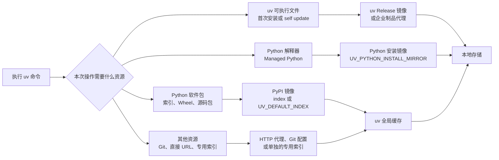

[toc]

## abstract

在国内环境下，`uv` 的默认下载速度可能确实不理想。由于 `uv` 是为了性能设计的，它**故意不读取** `pip` 的全局配置文件（如 `pip.conf`），所以你需要专门为 `uv` 配置国内镜像源。

以下是三种最有效的方法：

------

## 国内源局限性说明

> 部分源的包或者工具镜像不完整,如果安装过程中提示不可用,可能需要切换到不同源重试.

## 1. 配置文件

[Configuration files | uv](https://docs.astral.sh/uv/concepts/configuration-files/)

你可以创建一个全局配置文件，让所有的 `uv` 命令（包括 `uv add`、`uv run`、`uv tool`）默认都使用国内源。

**配置文件路径：**

- **Linux / macOS:** `~/.config/uv/uv.toml`
- **Windows:** `%APPDATA%\uv\uv.toml`

**操作步骤：**以ustc,aliyun,tuna源为例:

### 当前项目配置：

修改项目根目录下的 `uv.toml` 

```toml
[[index]]
url = "https://mirrors.aliyun.com/pypi/simple/"
# url = "https://mirrors.ustc.edu.cn/pypi/simple"
# url = "https://mirrors.tuna.tsinghua.edu.cn/pypi/web/simple"
default = true
```

或 `pyproject.toml`：

```toml
[[tool.uv.index]]
url = "https://mirrors.aliyun.com/pypi/simple/"
# url = "https://mirrors.ustc.edu.cn/pypi/simple"
# url = "https://mirrors.tuna.tsinghua.edu.cn/pypi/web/simple"
default = true
```

### 全局配置：

修改全局配置文件 `~/.config/uv/uv.toml`（Linux/macOS）或 `%AppData%\uv\uv.toml`（Windows），内容同上。

1. 如果目录不存在，先创建它：`mkdir -p ~/.config/uv`(linux/macos)或`mkdir $env:appdata/uv `(windows powershell)
2. 编辑或创建 `uv.toml` 文件

aliyun源为例

```TOML
[[index]]
url = "https://mirrors.aliyun.com/pypi/simple/"
# url = "https://mirrors.ustc.edu.cn/pypi/simple"
# url = "https://mirrors.tuna.tsinghua.edu.cn/pypi/web/simple"
default = true
```

> **注意：** 在全局 `uv.toml` 中，层级是直接从 `[[index]]` 开始的，不需要写 `[tool.uv]`。

### 一键配置shell脚本

以bash为例

```shell
#!/usr/bin/env bash

uv_config=~/.config/uv/uv.toml
uv_config_home="$(dirname $uv_config)"
mkdir -pv "$uv_config_home"

cat << eof > "$uv_config"

[[index]]
url = "https://mirrors.aliyun.com/pypi/simple/"
# url = "https://mirrors.ustc.edu.cn/pypi/simple"
# url = "https://mirrors.tuna.tsinghua.edu.cn/pypi/web/simple"
default = true

eof

echo "检查配置文件[$uv_config]"
nl "$uv_config"

```


------

## 2. 使用环境变量（临时加速或系统级配置）

如果你不想修改配置文件，或者想在 CI/CD 环境中使用，可以设置环境变量。

在你的 `.bashrc` 或 `.zshrc` 中添加：

```bash
export UV_INDEX_URL=https://mirrors.tuna.tsinghua.edu.cn/pypi/web/simple
```

设置后执行 `source ~/.bashrc` 即可生效。

------

## 3. 项目级配置

如果你只想让某个特定项目使用特定的镜像源，可以在该项目的 `pyproject.toml` 中添加：

```TOML
[[tool.uv.index]]
url = "https://mirrors.tuna.tsinghua.edu.cn/pypi/web/simple"
default = true
```

------


## 4. 解决 Python 解释器下载慢的问题

`uv` 除了下载包，还会自动下载 Python 解释器。如果这部分也慢，可以设置 Python 下载镜像。

目前国内尚无完美的 `uv` Python 解释器全量镜像，但你可以通过环境变量强制 `uv` 使用特定的安装源（如果该源支持）：

```bash
# 这种方式目前主要依赖于网络环境，建议开启代理或手动预安装 Python
uv python install 3.12
```

------

## 验证是否生效

配置完成后，你可以运行以下命令观察输出的 URL：

```bash
uv pip install requests --verbose
# 或者:
uv add requests --verbose
```

在输出的日志中，你应该能看到正在从镜像源中获取数据，而不是 `pypi.org`。

## 常用国内镜像源地址

| **机构**                   | **镜像地址**                                           |
| -------------------------- | ------------------------------------------------------ |
| **中国科学技术大学**(USTC) | `https://mirrors.ustc.edu.cn/pypi/web/simple`          |
| **清华大学 (TUNA)**        | `https://mirrors.tuna.tsinghua.edu.cn/pypi/web/simple` |
| **阿里云**                 | `https://mirrors.aliyun.com/pypi/simple/`              |
| **腾讯云**                 | `https://mirrors.cloud.tencent.com/pypi/simple/`       |

------

## 详解

下面按“链路拆分、加速覆盖面、Python 版本切换、配置方案、团队与 CI 最佳实践、排障方法”展开。示例以官方 uv 文档及国内镜像站当前公开说明为依据。

## 国内使用 uv 的核心结论

国内使用 uv 与国外使用 uv，**命令语义、依赖解析规则和虚拟环境机制没有区别**。主要差异来自以下网络链路：

- uv 可执行文件的**首次安装与自更新**
- uv 托管的 **Python 解释器下载**
- PyPI 包索引、Wheel 和源码包下载
- Git 依赖、直接 URL 依赖及 PyTorch 等专用索引
- 企业代理、TLS 证书和缓存环境

因此，配置一个 PyPI 镜像并不等于“uv 的所有网络操作都被加速”。应当先明确某项配置改变的是哪条下载链路，也就是它的**加速覆盖面（Acceleration Surface）**。

关于 Python 版本切换，可以先记住一句话：只有目标版本不存在、uv 需要下载解释器时，**Python 安装镜像**才会生效。

- uv 默认可以**同时发现系统 Python 和 uv 自己安装的托管 Python**（Managed Python）。
- 大多数命令接受 `--python` 参数；当请求的解释器不存在时，uv 默认会自动下载。
- `.python-version` 则用于记录项目默认使用的 Python 版本。 ([Astral 文档](https://docs.astral.sh/uv/concepts/python-versions/))

------

## 内容大纲

本文将依次介绍：

- uv 的不同下载链路及国内网络影响
- PyPI 镜像、Python 镜像、uv 安装镜像和代理的区别
- 各加速方案能够覆盖和不能覆盖的操作
- Python 安装、选择、固定与“切换”的区别
- 个人开发环境的推荐配置
- 团队项目、开源项目和企业内网的配置方式
- PyTorch、Git 依赖和直接 URL 等特殊情况
- 缓存、锁文件、安全性与 CI 最佳实践
- 常见故障的判断流程

------

## uv 的网络访问结构



这几条链路彼此独立。例如：

- 配置 PyPI 镜像不会改变 `uv python install` 的下载地址。
- 配置 Python 安装镜像不会加速 `uv add requests`。
- 配置 uv 安装镜像不会自动代理 GitHub 上的项目依赖。
- uv 的全局缓存只能减少重复下载，不能改善第一次下载的网络质量。

uv 对注册表依赖、直接 URL 依赖、Git 依赖和本地依赖采用不同的缓存规则，并会尽量避免重复下载与重复构建。 ([Astral 文档](https://docs.astral.sh/uv/concepts/cache/))

------

## 加速方案及覆盖面总览

| 加速方案                      | 主要配置                                            | 可以加速                                                   | 不能直接加速                                 |
| ----------------------------- | --------------------------------------------------- | ---------------------------------------------------------- | -------------------------------------------- |
| uv 自身的 Rust 实现与全局缓存 | 默认启用                                            | 依赖解析、重复安装、重复构建、本地文件复用                 | 第一次跨境下载、网络不可达                   |
| PyPI 镜像                     | `[[index]]`、`UV_DEFAULT_INDEX`                     | 包元数据、Wheel、源码包、普通构建依赖                      | Python 解释器、uv 二进制、Git 依赖、直接 URL |
| CPython 安装镜像              | `python-install-mirror`、`UV_PYTHON_INSTALL_MIRROR` | `uv python install`、自动下载 CPython、Python 补丁版本升级 | 软件包安装、已有 Python 之间的切换、PyPy     |
| PyPy 安装镜像                 | `pypy-install-mirror`、`UV_PYPY_INSTALL_MIRROR`     | uv 托管的 PyPy 下载                                        | CPython、软件包下载                          |
| uv Release 镜像               | 镜像站安装脚本、`UV_INSTALLER_GITHUB_BASE_URL`      | uv 首次安装、部分安装方式下的 `uv self update`             | Python 包和解释器                            |
| Astral 制品代理               | `UV_ASTRAL_MIRROR_URL`                              | 与 `releases.astral.sh` 对应的 Astral 元数据和制品         | 普通 PyPI、任意 GitHub 项目                  |
| HTTP 代理                     | `HTTPS_PROXY`、`HTTP_PROXY`、`ALL_PROXY`            | uv 发起的相应 HTTP 或 HTTPS 请求                           | 本地构建耗时、代理未覆盖的外部 Git 程序配置  |
| CI 缓存                       | 持久化 uv 缓存目录                                  | 重复流水线中的依赖准备和构建                               | 冷启动、镜像中不存在的软件包                 |

`UV_ASTRAL_MIRROR_URL` 是较新的统一制品代理入口，从 uv 0.11.14 开始提供；它要求代理端保持 `releases.astral.sh` 的路径布局，并且配置后不会自动回退到 GitHub。CPython 下载可以由更具体的 `UV_PYTHON_INSTALL_MIRROR` 覆盖，uv 自更新可以由 `UV_INSTALLER_GITHUB_BASE_URL` 覆盖。 ([Astral 文档](https://docs.astral.sh/uv/reference/environment/))

------

## PyPI 镜像能够加速什么

PyPI 镜像主要覆盖通过 Python 包索引（Package Index）解析和获取的软件包，包括：

- `uv add`
- `uv lock`
- `uv sync`
- `uv run` 自动触发的锁定和同步
- `uv pip install`
- `uv pip sync`
- `uv tool install`
- `uvx` 或 `uv tool run`
- 从索引获取的 Wheel
- 从索引获取的源码包（Source Distribution，sdist）
- 构建源码包时需要从索引下载的构建依赖

uv 默认使用 PyPI，也可以通过 `[[tool.uv.index]]`、`[[index]]`、`--index` 或 `--default-index` 使用其他兼容 Python Simple Repository API 的索引。 ([Astral 文档](https://docs.astral.sh/uv/concepts/indexes/))

### PyPI 镜像不能覆盖的内容

以下资源通常不会因为配置普通 PyPI 镜像而加速：

- `uv python install` 下载的 CPython
- uv 自身的安装包和自更新文件
- `git+https://...` 形式的依赖
- `package @ https://...` 形式的直接 URL 依赖
- GitHub Release 附件
- Hugging Face 上的直接文件
- PyTorch 官方 CUDA 专用索引
- 项目构建过程中的本地 C、C++、Rust 或 CUDA 编译时间

依赖可以来自索引、Git 仓库、直接 URL、本地路径和工作区，因此“安装依赖慢”不一定是 PyPI 慢。 ([Astral 文档](https://docs.astral.sh/uv/concepts/projects/dependencies/?utm_source=chatgpt.com))

------

## uv 不会读取现有 pip 镜像配置

这是从 pip 迁移到 uv 时最容易忽略的问题之一。

uv 不读取以下 pip 专用配置：

- `pip.conf`
- `pip.ini`
- `PIP_INDEX_URL`
- `PIP_EXTRA_INDEX_URL`

即使 `pip install` 已经能够使用国内镜像，uv 仍可能访问默认 PyPI。应改用 uv 自己的配置文件、`UV_DEFAULT_INDEX` 或 `UV_INDEX`。旧的 `UV_INDEX_URL` 仍然兼容，但已经建议改用 `UV_DEFAULT_INDEX`。 ([Astral 文档](https://docs.astral.sh/uv/pip/compatibility/?utm_source=chatgpt.com))

------

## 推荐的个人全局配置

### 配置文件位置

| 系统    | 用户级配置文件         |
| ------- | ---------------------- |
| Linux   | `~/.config/uv/uv.toml` |
| macOS   | `~/.config/uv/uv.toml` |
| Windows | `%APPDATA%\uv\uv.toml` |

系统级配置还可以放在 Linux 或 macOS 的 `/etc/uv/uv.toml`，以及 Windows 的 `%PROGRAMDATA%\uv\uv.toml`。配置优先级大致为：命令行高于环境变量，环境变量高于持久化配置；项目级配置高于用户级配置。 ([Astral 文档](https://docs.astral.sh/uv/concepts/configuration-files/))

### 同时配置 PyPI 和 CPython 下载镜像

下面以 USTC 当前提供的镜像为例：

```toml
# ~/.config/uv/uv.toml
# Windows 对应 %APPDATA%\uv\uv.toml

python-install-mirror = "https://mirrors.ustc.edu.cn/github-release/astral-sh/python-build-standalone/"

[[index]]
name = "cn-pypi"
url = "https://mirrors.ustc.edu.cn/pypi/simple"
default = true
```

其中：

- `[[index]]` 只负责 Python 软件包。
- `python-install-mirror` 只负责 uv 托管的 CPython。
- `default = true` 会让该索引替代 PyPI 作为默认索引，而不是仅仅增加一个额外索引。

USTC 当前公开说明中，其 `python-build-standalone` 镜像只保留最新的一个 Release，并过滤部分架构或调试制品；镜像不存在的文件可能重新定向至 GitHub。因此，较旧的 uv 可能请求旧构建，从而无法完全获得国内加速。uv 中可下载的 Python 版本信息又是随 uv 版本固定的，所以应保持 uv 本身相对较新。 ([中科大镜像站](https://mirrors.ustc.edu.cn/help/github-release.html))

### 其他可选 PyPI 镜像

```text
清华 TUNA:
https://pypi.tuna.tsinghua.edu.cn/simple

中国科学技术大学:
https://mirrors.ustc.edu.cn/pypi/simple

北京外国语大学:
https://mirrors.bfsu.edu.cn/pypi/web/simple
```

国内镜像的同步和缓存策略并不完全相同。例如，TUNA 公布了周期同步机制，USTC 则说明其软件包可能按访问动态缓存。因此，应根据实际网络、包完整度和团队策略选择，而不是同时堆叠大量公共镜像。 ([清华镜像站](https://mirrors.tuna.tsinghua.edu.cn/help/pypi/?utm_source=chatgpt.com))

------

## 临时配置与环境变量配置

### Linux 和 macOS

```bash
export UV_DEFAULT_INDEX="https://mirrors.ustc.edu.cn/pypi/simple"
export UV_PYTHON_INSTALL_MIRROR="https://mirrors.ustc.edu.cn/github-release/astral-sh/python-build-standalone/"
```

只对单条命令生效：

```bash
UV_DEFAULT_INDEX="https://mirrors.ustc.edu.cn/pypi/simple" \
uv sync
UV_PYTHON_INSTALL_MIRROR="https://mirrors.ustc.edu.cn/github-release/astral-sh/python-build-standalone/" \
uv python install 3.12
```

### Windows PowerShell

```powershell
$env:UV_DEFAULT_INDEX = "https://mirrors.ustc.edu.cn/pypi/simple"
$env:UV_PYTHON_INSTALL_MIRROR = "https://mirrors.ustc.edu.cn/github-release/astral-sh/python-build-standalone/"
```

环境变量适合临时测试、CI/CD 和不同网络环境之间切换。长期个人配置通常更适合放入用户级 `uv.toml`。 ([Astral 文档](https://docs.astral.sh/uv/reference/environment/?utm_source=chatgpt.com))

------

## Python 版本切换是否能够享受加速

需要把“切换 Python”拆分成三个不同动作。

### 安装 Python

```bash
uv python install 3.11 3.12 3.13
```

如果版本尚未安装，uv 会下载解释器。此时：

- CPython 使用 `UV_PYTHON_INSTALL_MIRROR`
- PyPy 使用 `UV_PYPY_INSTALL_MIRROR`
- 下载后会保存在 uv 的托管 Python 目录中

这是 Python 镜像真正发挥作用的阶段。 ([Astral 文档](https://docs.astral.sh/uv/reference/environment/))

### 选择或固定 Python

```bash
uv python pin 3.12
```

该命令主要创建或更新 `.python-version`：

```text
3.12
```

写入文件本身不需要下载，也没有“镜像加速”问题。之后 uv 执行项目命令时，会把这个版本作为默认 Python 请求。若本地已存在兼容解释器，直接使用；若不存在，才会触发自动下载。 ([Astral 文档](https://docs.astral.sh/uv/concepts/python-versions/))

### 创建环境或运行命令

```bash
uv venv --python 3.12
uv run --python 3.12 python -V
```

这里存在两种情况：

| 情况                        | 是否访问网络 | Python 镜像是否生效                |
| --------------------------- | ------------ | ---------------------------------- |
| Python 3.12 已安装          | 否           | 不需要                             |
| 系统已有兼容 Python 3.12    | 否           | 不需要                             |
| uv 托管目录已有 Python 3.12 | 否           | 不需要                             |
| 找不到兼容 Python 3.12      | 是           | 生效                               |
| 解释器存在，但依赖尚未安装  | 可能         | 使用 PyPI 镜像，不使用 Python 镜像 |

uv 会先寻找现有解释器，找不到时再检查可下载的托管 Python。 ([Astral 文档](https://docs.astral.sh/uv/concepts/python-versions/))

### Python 相关命令的覆盖矩阵

| 命令                           | 是否可能下载解释器                 | Python 镜像作用 |
| ------------------------------ | ---------------------------------- | --------------- |
| `uv python install 3.12`       | 是                                 | 有              |
| `uv python upgrade 3.12`       | 是                                 | 有              |
| `uv python pin 3.12`           | 否                                 | 无              |
| `uv python find 3.12`          | 否                                 | 无              |
| `uv python list`               | 通常否                             | 无              |
| `uv venv --python 3.12`        | 缺少版本时下载                     | 条件生效        |
| `uv run --python 3.12 ...`     | 缺少版本时下载                     | 条件生效        |
| `uv sync`                      | 项目需要的 Python 不存在时可能下载 | 条件生效        |
| 在已有 3.11 和 3.12 间改变选择 | 否                                 | 无              |

------

## uv 的“切换”不完全等同于 pyenv 的全局 Shell 切换

uv 的 `.python-version` 主要告诉 **uv 命令**应该选择哪个解释器，并不保证你在普通终端中直接执行：

```bash
python
```

就一定得到 `.python-version` 中的版本。

更稳定的使用方式是：

```bash
uv run python -V
```

或者创建并激活项目虚拟环境：

```bash
uv venv
source .venv/bin/activate
```

Windows PowerShell：

```powershell
.venv\Scripts\Activate.ps1
```

uv 默认安装的是带版本号的可执行文件，例如 `python3.12`。`uv python install --default` 可以安装未带版本号的 `python` 和 `python3` 命令，但该选项在官方文档中仍被标记为实验性，而且它也不是根据目录动态切换 Shell 命令的完整 shim 机制。 ([Astral 文档](https://docs.astral.sh/uv/guides/install-python/))

------

## Python 版本切换的推荐工作流

### 初始化项目

```bash
uv init my-project
cd my-project
```

### 声明项目支持范围

```toml
[project]
name = "my-project"
version = "0.1.0"
requires-python = ">=3.12,<3.14"
```

`requires-python` 描述项目能够支持的 Python 范围，并影响依赖解析；它不一定表示当前开发机必须选择范围内的最低版本。 ([Astral 文档](https://docs.astral.sh/uv/concepts/projects/config/?utm_source=chatgpt.com))

### 固定本地开发版本

```bash
uv python pin 3.12
```

### 同步项目

```bash
uv sync
```

### 运行程序

```bash
uv run python -V
uv run python main.py
```

### 临时测试其他版本

```bash
uv run --python 3.13 python -V
uv venv .venv-313 --python 3.13
```

推荐把“项目支持范围”放在 `requires-python`，把“当前开发环境默认版本”放在 `.python-version`，不要把二者混为一谈。

------

## 为什么不建议同时配置很多公共镜像

uv 默认采用 `first-index` 索引策略：

- 按优先级检查索引。
- 一旦在第一个索引发现某个包，就只考虑该索引中的候选版本。
- 不会默认把所有索引中的版本混在一起选择最高版本。

这是 uv 用于降低依赖混淆攻击（Dependency Confusion）风险的设计。虽然可以使用 `unsafe-best-match` 模拟更接近 pip 的多索引行为，但官方明确指出它会增加依赖混淆风险。 ([Astral 文档](https://docs.astral.sh/uv/pip/compatibility/))

个人用户更适合：

- 选择一个可信公共镜像作为默认索引。
- 镜像缺包时，临时切回官方 PyPI。
- 不把多个公共镜像配置成混合候选池。
- 企业私有包使用单独的命名索引。
- 专用包使用 `explicit = true`。

------

## PyTorch 等专用索引不会自动被 PyPI 镜像覆盖

许多 PyTorch CUDA Wheel 并不来自普通 PyPI，而是来自 PyTorch 自己的索引。应使用命名索引，并把相关包明确绑定到该索引：

```toml
[tool.uv.sources]
torch = { index = "pytorch-cu130" }

[[tool.uv.index]]
name = "pytorch-cu130"
url = "https://download.pytorch.org/whl/cu130"
explicit = true
```

`explicit = true` 表示该索引只为明确绑定的包服务，避免其他普通依赖意外从专用索引安装。命名索引如果要被 `tool.uv.sources` 引用，必须写入项目的 `pyproject.toml`，不能只配置在用户级 `uv.toml` 或环境变量中。 ([Astral 文档](https://docs.astral.sh/uv/concepts/indexes/))

国内环境下，如果该专用索引访问慢，需要：

- 使用组织提供的可信代理仓库。
- 对专用索引做企业级缓存代理。
- 或使用该项目官方认可的镜像。

普通 PyPI 镜像无法自动解决这一问题。

------

## `uv tool` 和 `uvx` 的配置范围

项目目录中的配置并不总是对所有 uv 命令生效。

`uv tool install` 和 `uvx` 属于用户级工具操作，会忽略当前项目的本地配置，主要读取用户级和系统级 `uv.toml`。因此，如果出现：

```bash
uv sync
```

走国内镜像，但：

```bash
uvx ruff
```

仍然很慢，应检查用户级配置，而不是只检查项目的 `pyproject.toml`。 ([Astral 文档](https://docs.astral.sh/uv/concepts/configuration-files/))

另外，下面这种配置只作用于 `uv pip`：

```toml
[tool.uv.pip]
index-url = "https://mirrors.ustc.edu.cn/pypi/simple"
```

它不会影响：

- `uv sync`
- `uv lock`
- `uv add`
- `uv run`

如果希望覆盖整个 uv 项目工作流，应使用顶层 `[[tool.uv.index]]` 或用户级 `[[index]]`。 ([Astral 文档](https://docs.astral.sh/uv/concepts/configuration-files/))

------

## uv 自身的安装和更新加速

### 通过 PyPI 镜像安装 uv

如果机器上已经有 Python，可以直接：

```bash
python -m pip install \
  -i https://mirrors.ustc.edu.cn/pypi/simple \
  uv
```

这种方式的加速来自 PyPI 镜像，但后续 `uv self update` 的行为可能与独立安装器方式不同。通常更适合已有 Python 环境的场景。

### 使用国内 Release 镜像安装

USTC 当前提供了 uv Release 镜像和安装脚本，例如：

```bash
export UV_DOWNLOAD_URL="https://mirrors.ustc.edu.cn/github-release/astral-sh/uv/LatestRelease/"

curl -sL \
  https://mirrors.ustc.edu.cn/github-release/astral-sh/uv/LatestRelease/uv-installer.sh \
  | sh
```

该镜像当前只提供最新的 uv Release，因此适合安装最新版，不适合固定任意历史版本。 ([中科大镜像站](https://mirrors.ustc.edu.cn/help/github-release.html))

### 企业自建制品代理

企业环境更适合代理：

- PyPI Simple API
- Python Wheel 和源码包
- `python-build-standalone`
- uv Release
- `releases.astral.sh`
- PyTorch 等专用索引

可根据代理布局选择：

```bash
export UV_ASTRAL_MIRROR_URL="https://artifacts.example.com/astral"
```

或者更具体地设置：

```bash
export UV_PYTHON_INSTALL_MIRROR="https://artifacts.example.com/python-build-standalone"
export UV_INSTALLER_GITHUB_BASE_URL="https://artifacts.example.com/uv-releases"
```

这些地址必须符合 uv 预期的目录结构，不能随意把普通网页代理地址填入其中。 ([Astral 文档](https://docs.astral.sh/uv/reference/environment/))

------

## 企业代理和证书注意事项

uv 支持常见代理环境变量：

```bash
export HTTPS_PROXY="http://proxy.example.com:8080"
export HTTP_PROXY="http://proxy.example.com:8080"
export NO_PROXY="localhost,127.0.0.1,.example.internal"
```

`ALL_PROXY` 可作为通用代理配置。 ([Astral 文档](https://docs.astral.sh/uv/reference/environment/))

如果企业代理使用了安装在系统证书库中的自签名根证书，可使用：

```bash
export UV_SYSTEM_CERTS=true
```

这会让 uv 使用操作系统原生证书库，而不是仅使用内置的 Mozilla 根证书。不要为了绕过证书错误而长期使用不安全主机选项。 ([Astral 文档](https://docs.astral.sh/uv/reference/environment/))

------

## 缓存最佳实践

uv 默认使用积极的全局缓存机制，能够复用：

- 已下载的包
- Wheel
- 构建结果
- Git 提交对应的依赖
- `uvx` 创建的工具环境

查看缓存位置：

```bash
uv cache dir
```

不要把下面命令当作常规“优化”操作：

```bash
uv cache clean
```

清空缓存通常会让下一次安装变慢。只有在确认缓存异常、镜像文件被错误替换或需要释放磁盘时才应执行。

刷新元数据而不清空整个缓存：

```bash
uv sync --refresh
```

只刷新某个包：

```bash
uv sync --refresh-package requests
```

uv 官方提供了完整缓存、按包清理和强制重新校验机制。 ([Astral 文档](https://docs.astral.sh/uv/concepts/cache/))

### Python 安装包缓存

托管 Python 安装完成后会长期保留，但 Python 安装归档文件默认不一定按照普通依赖缓存方式保留。CI 中可以指定：

```bash
export UV_PYTHON_CACHE_DIR="$HOME/.cache/uv/python"
```

并持久化该目录，以减少重复下载 Python 归档。 ([Astral 文档](https://docs.astral.sh/uv/reference/environment/))

------

## CI 和 Docker 中的推荐做法

### 使用锁文件

项目应提交：

```text
pyproject.toml
uv.lock
.python-version
```

生产或 CI 同步建议使用：

```bash
uv sync --locked
```

`--locked` 会检查锁文件是否仍与项目元数据一致；不一致时直接失败，而不是悄悄修改锁文件。`--frozen` 则直接使用现有锁文件而不检查其是否需要更新，适合某些分层 Docker 构建阶段。 ([Astral 文档](https://docs.astral.sh/uv/concepts/projects/sync/?utm_source=chatgpt.com))

### 持久化缓存

GitLab、GitHub Actions 或自建 CI 中应持久化 uv 缓存目录。例如 Docker BuildKit：

```dockerfile
ENV UV_LINK_MODE=copy

RUN --mount=type=cache,target=/root/.cache/uv \
    uv sync --locked
```

跨文件系统缓存挂载时，`UV_LINK_MODE=copy` 可以避免硬链接相关警告。 ([Astral 文档](https://docs.astral.sh/uv/guides/integration/docker/?utm_source=chatgpt.com))

### 不要在 CI 中无理由使用

```bash
uv sync --no-cache
```

`--no-cache` 会让每次流水线重新下载和准备依赖，只适合一次性容器且明确追求最终镜像体积、不打算复用缓存的情况。

------

## 镜像与 `uv.lock` 的关系

使用不同索引解析依赖时，索引来源可能进入 `uv.lock`。这意味着个人全局镜像配置可能影响团队提交的锁文件。

USTC 的使用说明也明确提示，设置索引可能改变 `uv.lock` 内容。uv 社区目前仍有关于“本地使用镜像但在锁文件中保留官方 PyPI 来源”的相关讨论。 ([中科大镜像站](https://mirrors.ustc.edu.cn/help/pypi.html))

推荐根据项目类型制定策略。

### 企业内部项目

- 在项目中明确配置统一的企业代理索引。
- 团队和 CI 使用同一个索引。
- 允许锁文件记录企业索引。
- 通过 `uv sync --locked` 保证一致性。

### 公共或开源项目

- 不宜把个人局域网、校园网或不可公开访问的镜像写入锁文件。
- 由 CI 使用统一的官方索引生成或验证锁文件。
- 提交前检查 `uv.lock` 中是否意外出现个人镜像域名。
- 本地镜像仅作为个人下载优化时，要建立统一的锁文件生成规则。

uv 的锁文件是跨平台通用锁文件，建议提交到版本控制系统。 ([Astral 文档](https://docs.astral.sh/uv/concepts/resolution/?utm_source=chatgpt.com))

------

## 安全最佳实践

### 使用可信镜像

优先选择：

- 高校或大型云厂商维护的公开镜像
- 企业内部受控代理仓库
- 能够说明同步、缓存和删除策略的服务
- 全程提供 HTTPS 的服务

不建议把来源不明的 GitHub 加速域名、匿名反向代理或临时转发服务写入长期配置。

### 避免关闭安全校验

除非仅用于临时诊断，不要长期使用：

- `UV_INSECURE_HOST`
- `UV_NO_VERIFY_HASHES`
- 禁用 ZIP 校验的选项
- `unsafe-best-match`
- 明文写入仓库的索引密码

私有索引凭据可以通过命名索引对应的环境变量提供，例如：

```bash
export UV_INDEX_INTERNAL_PROXY_USERNAME="user"
export UV_INDEX_INTERNAL_PROXY_PASSWORD="token"
```

这样可以避免把凭据写入 `pyproject.toml`。 ([Astral 文档](https://docs.astral.sh/uv/concepts/indexes/?utm_source=chatgpt.com))

------

## 常见误区

| 误区                                                         | 实际情况                                   |
| ------------------------------------------------------------ | ------------------------------------------ |
| 配置 PyPI 镜像后 `uv python install` 也会变快                | 不会，需要单独配置 Python 安装镜像         |
| 已经配置 `pip.conf`，uv 会自动继承                           | 不会，uv 不读取 pip 专用配置               |
| `uv python pin 3.12` 会下载 Python                           | 通常不会，它主要写入 `.python-version`     |
| 更改 `.python-version` 后，普通 Shell 的 `python` 会自动变化 | 不一定，建议使用 `uv run` 或项目虚拟环境   |
| 同时配置多个公共镜像一定更快                                 | 可能造成版本滞后、解析差异和安全风险       |
| 镜像能解决所有编译慢问题                                     | 镜像只能加速文件获取，本地源码编译仍然耗时 |
| `uv cache clean` 能让 uv 更快                                | 通常相反，会丢失可复用缓存                 |
| `uvx` 会使用项目里的镜像配置                                 | 工具命令通常使用用户级或系统级配置         |
| 国内镜像一定与官方 PyPI 实时一致                             | 镜像同步和缓存策略不同，可能存在延迟       |
| Python 切换也需要联网加速                                    | 已安装版本之间的选择通常完全是本地操作     |

------

## 判断到底是哪一层慢

可以按以下顺序定位。

### 查看版本和配置环境

```bash
uv --version
uv cache dir
uv python dir
```

### 检查包索引路径

```bash
uv -v sync
```

如果日志中主要访问：

```text
pypi.org
files.pythonhosted.org
```

说明问题位于 Python 包索引或包文件下载链路。

### 检查 Python 下载路径

```bash
uv -v python install 3.12
```

如果日志中出现：

```text
python-build-standalone
github.com/astral-sh/python-build-standalone
```

说明问题位于托管 Python 下载链路，而不是 PyPI。

### 检查是否为 Git 或直接 URL 依赖

查看 `pyproject.toml` 和 `uv.lock` 中是否存在：

```text
git+https://...
https://.../*.whl
https://.../*.tar.gz
```

这些来源需要代理、Git 配置或专门的镜像，普通 PyPI 配置不会改变其地址。

### 检查是否在本地构建

如果日志长时间停留在：

```text
Building
Compiling
gcc
clang
rustc
nvcc
```

问题是本地构建，不是下载。应优先寻找与当前 Python、操作系统和 CPU 架构兼容的 Wheel，或安装缺失的系统编译依赖。

### 检查缓存是否被关闭

```bash
env | grep UV_NO_CACHE
```

Windows PowerShell：

```powershell
Get-ChildItem Env:UV_NO_CACHE
```

如果启用了 `UV_NO_CACHE`，重复安装无法享受 uv 的缓存优势。

------

## 推荐配置方案汇总

### 普通个人开发者

用户级 `uv.toml`：

```toml
python-install-mirror = "https://mirrors.ustc.edu.cn/github-release/astral-sh/python-build-standalone/"

[[index]]
name = "cn-pypi"
url = "https://mirrors.ustc.edu.cn/pypi/simple"
default = true
```

工作方式：

```bash
uv python pin 3.12
uv sync
uv run python main.py
```

### 开源项目维护者

- 项目文件不固定个人国内镜像。
- 本地可以使用用户级镜像。
- CI 使用统一、公开可访问的索引生成锁文件。
- 提交前检查 `uv.lock` 的来源地址。
- CI 使用 `uv sync --locked`。

### 企业团队

- 建设或使用统一制品代理。
- 分别代理 PyPI、uv Release 和 `python-build-standalone`。
- 项目中记录企业包索引。
- 凭据通过环境变量、密钥管理器或 `uv auth` 管理。
- 代理使用企业根证书时设置 `UV_SYSTEM_CERTS=true`。
- CI 持久化 uv 缓存和 Python 下载缓存。
- 对 GitHub、PyTorch 和其他专用来源分别配置代理。

------

## 最终判断

国内使用 uv 时，最有效的优化不是只配置一个“万能镜像”，而是对不同链路分别处理：

```text
普通 Python 包慢
    使用 PyPI 镜像

uv python install 慢
    使用 python-build-standalone 镜像

uv 首次安装或 self update 慢
    使用可信 uv Release 镜像或企业制品代理

Git、直接 URL 或 PyTorch 下载慢
    使用代理或对应的专用索引

重复安装仍然慢
    检查 uv 缓存和 CI 缓存是否持久化

Python 版本切换慢
    先判断是否实际触发了未安装解释器的下载
```

Python 版本已经安装后，`uv python pin`、`uv run --python`、`uv venv --python` 的解释器选择阶段通常是本地操作。只有缺少目标解释器并触发自动下载时，`UV_PYTHON_INSTALL_MIRROR` 才会带来加速；随后安装项目依赖时，则由 PyPI 镜像或其他对应来源负责加速。

文中的公共镜像适合作为可操作示例；长期生产和团队环境更适合使用统一、可审计的企业代理仓库。
