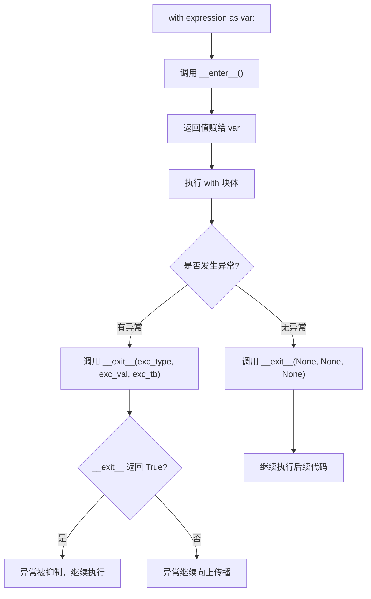
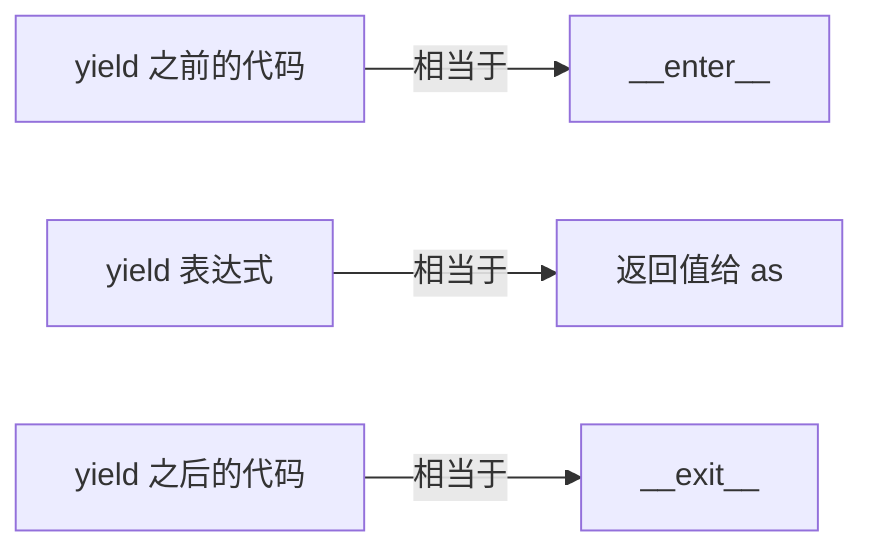
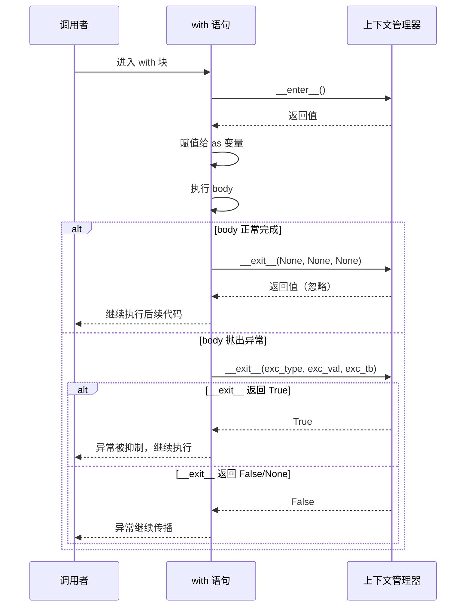
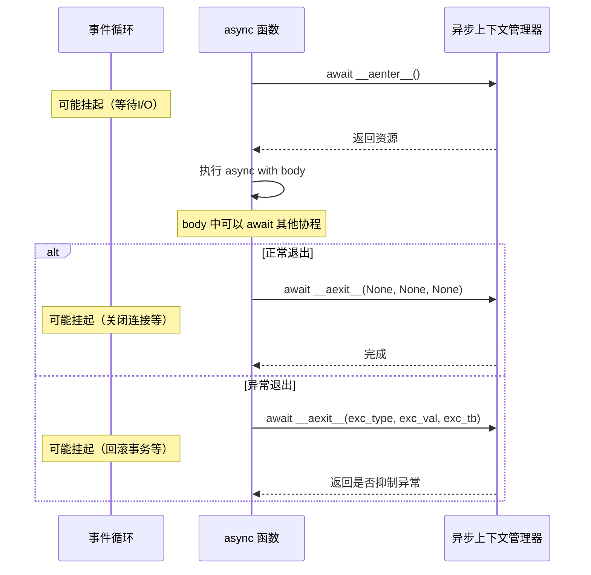

[toc]


# Python 上下文管理器


## 上下文管理器

上下文管理器是 Python 中用于**管理资源生命周期的协议**。

它确保资源在使用后被正确清理，无论代码是正常执行还是抛出异常。最常见的表现形式是 `with` 语句。

一个直观的类比：上下文管理器就像酒店的入住和退房流程——入住时分配房间（获取资源），退房时归还钥匙、打扫房间（释放资源），无论你住得是否愉快，退房流程都会执行。

除了最常见的同步上下文管理器,还有异步上下文管理器.

## 核心协议

上下文管理器协议由两个**魔术方法**定义：

| 方法                                        | 调用时机         | 职责                 | 返回值                                                 |
| ------------------------------------------- | ---------------- | -------------------- | ------------------------------------------------------ |
| `__enter__(self)`                           | 进入 `with` 块时 | 获取资源、初始化状态 | 通常返回资源对象本身，赋值给 `as` 变量                 |
| `__exit__(self, exc_type, exc_val, exc_tb)` | 离开 `with` 块时 | 释放资源、清理状态   | 返回 `True` 则抑制异常，返回 `False`/`None` 则传播异常 |

`__exit__` 的三个参数含义：

| 参数       | 含义                  | 无异常时的值 |
| ---------- | --------------------- | ------------ |
| `exc_type` | 异常类型（class）     | `None`       |
| `exc_val`  | 异常实例              | `None`       |
| `exc_tb`   | 异常的 traceback 对象 | `None`       |

## 执行流程



## 基本用法

### 文件操作——最经典的场景

```python
# 不使用上下文管理器（容易忘记关闭，异常时可能泄漏）
f = open("data.txt")
try:
    content = f.read()
finally:
    f.close()

# 使用上下文管理器（简洁、安全）
with open("data.txt") as f:
    content = f.read()
# 离开 with 块后，文件自动关闭，即使发生异常
```

### 多个上下文管理器

```python
# Python 3.1+ 支持单行多个
with open("input.txt") as src, open("output.txt", "w") as dst:
    dst.write(src.read())

# Python 3.10+ 支持括号换行，更易读
with (
    open("input.txt") as src,
    open("output.txt", "w") as dst,
    open("log.txt", "a") as log,
):
    data = src.read()
    dst.write(data)
    log.write(f"Copied {len(data)} bytes\n")
```

## 自定义上下文管理器

### 方式一：基于类

```python
import time

class Timer:
    """测量代码块执行时间的上下文管理器"""

    def __enter__(self):
        self.start = time.perf_counter()
        return self  # 返回自身，让 as 变量可以访问结果

    def __exit__(self, exc_type, exc_val, exc_tb):
        self.elapsed = time.perf_counter() - self.start
        print(f"耗时: {self.elapsed:.4f} 秒")
        return False  # 不抑制异常

with Timer() as t:
    sum(range(1_000_000))

print(f"记录的时间: {t.elapsed:.4f}s")
```

### 方式二：基于生成器（使用 contextlib）

`contextlib.contextmanager` 装饰器让你用更简洁的方式编写上下文管理器：

```python
from contextlib import contextmanager

@contextmanager
def timer():
    start = time.perf_counter()
    try:
        yield start  # yield 的值会赋给 as 变量
    finally:
        elapsed = time.perf_counter() - start
        print(f"耗时: {elapsed:.4f} 秒")

with timer() as start_time:
    sum(range(1_000_000))
```

生成器方式的结构规则：



关键点：`yield` 必须包裹在 `try/finally` 中，否则异常发生时清理代码不会执行。

### 两种方式对比

| 维度     | 基于类                        | 基于生成器（contextmanager）        |
| -------- | ----------------------------- | ----------------------------------- |
| 代码量   | 较多                          | 较少                                |
| 可读性   | 结构清晰，适合复杂逻辑        | 紧凑直观，适合简单场景              |
| 状态管理 | 天然支持（实例属性）          | 需要借助局部变量或可变对象          |
| 复用性   | 可继承、可组合                | 每次调用生成新实例                  |
| 异常处理 | 通过 `__exit__` 参数精细控制  | 通过 `try/except` 在 yield 周围处理 |
| 异步支持 | 实现 `__aenter__`/`__aexit__` | 使用 `@asynccontextmanager`         |

## 实用场景与经典用例

### 数据库事务管理

```python
@contextmanager
def transaction(connection):
    """自动提交或回滚数据库事务"""
    cursor = connection.cursor()
    try:
        yield cursor
        connection.commit()
    except Exception:
        connection.rollback()
        raise  # 重新抛出，让调用者知道失败了
    finally:
        cursor.close()

with transaction(db_conn) as cursor:
    cursor.execute("UPDATE accounts SET balance = balance - 100 WHERE id = 1")
    cursor.execute("UPDATE accounts SET balance = balance + 100 WHERE id = 2")
```

### 临时修改状态（进入/恢复模式）

```python
import os
from contextlib import contextmanager

@contextmanager
def working_directory(path):
    """临时切换工作目录，退出后恢复"""
    original = os.getcwd()
    os.chdir(path)
    try:
        yield path
    finally:
        os.chdir(original)

with working_directory("/tmp"):
    print(os.getcwd())  # /tmp
print(os.getcwd())  # 恢复到原来的目录
```

### 抑制特定异常

```python
from contextlib import suppress

# 等价于 try/except + pass，但更声明式
with suppress(FileNotFoundError):
    os.remove("maybe_exists.tmp")
```

### 锁管理（线程安全）

```python
import threading

lock = threading.Lock()

# Lock 本身就是上下文管理器
with lock:
    # 临界区代码，自动获取和释放锁
    shared_resource.update(data)
```

### 重定向输出

```python
from contextlib import redirect_stdout
import io

buffer = io.StringIO()
with redirect_stdout(buffer):
    print("这不会出现在终端")

captured = buffer.getvalue()  # "这不会出现在终端\n"
```

## 异步上下文管理器

Python 3.5+ 引入了异步版本，用于 `async with` 语句：

```python
import aiohttp
from contextlib import asynccontextmanager

# 基于类
class AsyncDBPool:
    async def __aenter__(self):
        self.pool = await create_pool(dsn="...")
        return self.pool

    async def __aexit__(self, exc_type, exc_val, exc_tb):
        await self.pool.close()
        return False

async with AsyncDBPool() as pool:
    async with pool.acquire() as conn:
        await conn.execute("SELECT 1")

# 基于生成器
@asynccontextmanager
async def http_session():
    session = aiohttp.ClientSession()
    try:
        yield session
    finally:
        await session.close()

async with http_session() as session:
    resp = await session.get("https://example.com")
```

## contextlib 标准库工具箱

| 工具                     | 用途                             | 示例场景                    |
| ------------------------ | -------------------------------- | --------------------------- |
| `@contextmanager`        | 用生成器创建同步上下文管理器     | 简单的资源管理              |
| `@asynccontextmanager`   | 用异步生成器创建异步上下文管理器 | 异步资源管理                |
| `closing(thing)`         | 为只有 `.close()` 方法的对象包装 | `urllib.request.urlopen()`  |
| `suppress(*exceptions)`  | 抑制指定异常                     | 忽略文件不存在错误          |
| `redirect_stdout/stderr` | 临时重定向标准输出/错误          | 捕获 print 输出             |
| `ExitStack`              | 动态管理多个上下文管理器         | 数量不确定的资源            |
| `nullcontext(value)`     | 什么都不做的上下文管理器         | 条件性地启用/禁用某个管理器 |
| `chdir(path)`            | 临时切换目录（Python 3.11+）     | 替代手写的目录切换          |

### ExitStack——动态管理不确定数量的资源

```python
from contextlib import ExitStack

def process_files(filenames):
    with ExitStack() as stack:
        # 动态打开任意数量的文件
        files = [stack.enter_context(open(f)) for f in filenames]
        # 所有文件在退出时自动关闭
        for f in files:
            process(f.read())
```

### nullcontext——条件性上下文管理器

```python
from contextlib import nullcontext

def compute(data, use_lock=False):
    cm = lock if use_lock else nullcontext()
    with cm:
        return expensive_operation(data)
```

## 最佳实践

### 设计原则

- `__enter__` 应该只做资源获取，保持轻量。如果获取失败就抛异常，`__exit__` 不会被调用。
- `__exit__` 必须是幂等且健壮的。即使清理过程本身出错，也不应丢失原始异常。
- 除非你明确知道自己在做什么，`__exit__` 不要返回 `True`。抑制异常会让 bug 变得隐蔽。
- 上下文管理器应该职责单一：管理一种资源或一个状态变更。

### 常见陷阱

```python
# ❌ 错误：生成器方式忘记 try/finally
@contextmanager
def bad_example():
    resource = acquire()
    yield resource
    release(resource)  # 如果 with 块抛异常，这行不会执行！

# ✅ 正确：始终用 try/finally 保护清理逻辑
@contextmanager
def good_example():
    resource = acquire()
    try:
        yield resource
    finally:
        release(resource)
# ❌ 错误：在 __exit__ 中吞掉所有异常
def __exit__(self, *args):
    self.cleanup()
    return True  # 所有异常都被静默吞掉，调试噩梦

# ✅ 正确：只抑制你明确预期的异常
def __exit__(self, exc_type, exc_val, exc_tb):
    self.cleanup()
    if exc_type is SomeExpectedException:
        return True  # 只抑制特定异常
    return False
# ❌ 错误：把上下文管理器当作普通对象复用
cm = open("file.txt")
with cm:
    pass
with cm:  # 文件已关闭，第二次进入会失败或行为未定义
    pass

# ✅ 正确：如果需要可重入，明确设计为可重入的
```

### 何时使用上下文管理器

适合使用的场景：

- 资源有明确的获取/释放生命周期（文件、连接、锁）
- 需要临时修改并恢复某个状态（目录、环境变量、配置）
- 需要保证清理逻辑一定执行（事务提交/回滚）
- 想让 API 使用者无法忘记清理步骤

不必使用的场景：

- 简单的变量赋值或计算
- 没有需要清理的资源
- 逻辑过于复杂，`with` 块反而降低可读性

## 类型标注（Python 3.9+）

```python
from contextlib import contextmanager
from typing import Generator
from collections.abc import Iterator

# 基于类
class ManagedResource:
    def __enter__(self) -> "ManagedResource":
        return self

    def __exit__(self, exc_type: type[BaseException] | None,
                 exc_val: BaseException | None,
                 exc_tb: object | None) -> bool:
        return False

# 基于生成器
@contextmanager
def managed() -> Iterator[str]:
    yield "resource"
```

Python 3.11+ 还提供了 `typing.Self` 简化返回自身的标注：

```python
from typing import Self

class Connection:
    def __enter__(self) -> Self:
        return self
```

## 总结

上下文管理器是 Python 资源管理的核心惯用法。它将"获取-使用-释放"的模式封装为协议，让代码更安全、更简洁。掌握它的关键在于理解 `__enter__`/`__exit__` 的契约，以及 `contextlib` 提供的快捷工具。当你发现代码中有 `try/finally` 模式反复出现时，就是提取上下文管理器的好时机。

# with 与 async with

- [with 复合语句 — Python 文档](https://docs.python.org/zh-cn/3/reference/compound_stmts.html#with)
- [async with 复合语句 — Python 文档](https://docs.python.org/zh-cn/3/reference/compound_stmts.html#async-with)

[`with`](https://docs.python.org/zh-cn/3/reference/compound_stmts.html#with) 语句用于**包装**带有使用**上下文管理器**定义的方法的**代码块的执行**。 这允许对普通的 [`try`](https://docs.python.org/zh-cn/3/reference/compound_stmts.html#try)...[`except`](https://docs.python.org/zh-cn/3/reference/compound_stmts.html#except)...[`finally`](https://docs.python.org/zh-cn/3/reference/compound_stmts.html#finally) 使用模式进行封装以方便地重用。

***上下文管理器*** 是一个对象，它定义了在执行 [`with`](https://docs.python.org/zh-cn/3/reference/compound_stmts.html#with) 语句时要建立的运行时上下文。 

上下文管理器处理**进入和退出**所需运行时上下文以执行代码块。 通常使用 `with` 语句，但是也可以通过直接调用它们的方法来使用。

上下文管理器的典型用法包括**保存和恢复各种全局状态，锁定和解锁资源，关闭打开的文件**等等。


## with 语句

### 本质

`with` 语句是 Python 对"设置-使用-清理"模式的语法级支持。它不是简单的语法糖——它在语言层面保证了清理逻辑的执行，即使面对异常、`return`、`break` 或 `continue`。


### 完整语法形式

with语句语法的形式化文法描述(三层)

```python
with_stmt:          "with" ( "(" with_stmt_contents ","? ")" | with_stmt_contents ) ":" suite
with_stmt_contents: with_item ("," with_item)*
with_item:          expression ["as" target]
```

常见的具体形式:

```python
# 基本形式
with expression as variable:
    body

# as 子句是可选的（不需要返回值时可省略）
with lock:
    critical_section()

# 多资源形式（Python 3.1+）
with expr1 as v1, expr2 as v2:
    body

# 括号多行形式（Python 3.10+）
with (
    expr1 as v1,
    expr2 as v2,
    expr3 as v3,
):
    body
```

### 执行语义的精确展开

> 详情请参考"with语句"文档

以下代码:

```python
with EXPRESSION as TARGET:
    SUITE
```

在语义上等价于:

```python
manager = (EXPRESSION)
enter = manager.__enter__
exit = manager.__exit__
value = enter()
hit_except = False

try:
    TARGET = value
    SUITE
except:
    hit_except = True
    if not exit(*sys.exc_info()):
        raise
finally:
    if not hit_except:
        exit(None, None, None)
```

几个关键细节：

| 细节                                | 说明                                                        |
| ----------------------------------- | ----------------------------------------------------------- |
| `as` 绑定的是 `__enter__` 的返回值  | 不是表达式本身。`open()` 返回自身，但有些管理器返回不同对象 |
| `__exit__` 总会被调用               | 即使 body 中有 `return`、`break`、`continue`                |
| 异常信息传递给 `__exit__`           | 让它有机会决定是否抑制异常                                  |
| `__enter__` 失败不会触发 `__exit__` | 资源获取失败时，没有东西需要清理                            |

### as 绑定的不一定是管理器本身

```python
# open() 的 __enter__ 返回 self，所以 f 就是文件对象
with open("data.txt") as f:
    pass

# 数据库连接池的例子
with db_pool.connection() as conn:
    # conn 是连接对象，不是池本身
    pass

# 但 ExitStack.enter_context 返回的是被管理对象的 __enter__ 结果
from contextlib import ExitStack
with ExitStack() as stack:
    # stack 是 ExitStack 实例，不是某个文件
    f = stack.enter_context(open("data.txt"))

```

### with 语句中的异常流



### 嵌套 vs 多资源单行

这两种写法语义等价，但有细微差别：

```python
# 嵌套写法
with open("a.txt") as a:
    with open("b.txt") as b:
        process(a, b)

# 单行多资源（等价于嵌套，从左到右进入，从右到左退出）
with open("a.txt") as a, open("b.txt") as b:
    process(a, b)
```

退出顺序遵循栈语义（LIFO）：

| 进入顺序 | 退出顺序 |
| -------- | -------- |
| a 先进入 | b 先退出 |
| b 后进入 | a 后退出 |

如果 `b` 的 `__enter__` 失败，`a` 的 `__exit__` 仍然会被调用。

### with 语句与 return/break/continue 的交互

```python
def read_first_line(path):
    with open(path) as f:
        return f.readline()  # return 之前，__exit__ 会先执行
    # 文件已关闭，return 的值是安全的（字符串已在内存中）

for item in items:
    with acquire_resource() as r:
        if not r.valid:
            break  # break 之前，__exit__ 会先执行
        if r.skip:
            continue  # continue 之前，__exit__ 会先执行
```

## async with 语句

### 为什么需要异步版本

同步的 `__enter__`/`__exit__` 不能包含 `await`。当资源的获取或释放涉及 I/O（网络连接、异步文件操作、数据库连接池）时，需要异步上下文管理器。

### 协议对比

| 同步协议              | 异步协议                         | 调用方式                  |
| --------------------- | -------------------------------- | ------------------------- |
| `__enter__(self)`     | `async def __aenter__(self)`     | 被 `await` 调用           |
| `__exit__(self, ...)` | `async def __aexit__(self, ...)` | 被 `await` 调用           |
| 用于 `with`           | 用于 `async with`                | 必须在 `async def` 内使用 |

### 执行语义展开

```python
async_with_stmt: "async" with_stmt
```

[asynchronous context manager](https://docs.python.org/zh-cn/3/glossary.html#term-asynchronous-context-manager) 是一种 [context manager](https://docs.python.org/zh-cn/3/glossary.html#term-context-manager)，能够在其 *enter* 和 *exit* 方法中暂停执行。

以下代码:

```python
async with EXPRESSION as TARGET:
    SUITE
```

在语义上等价于:

```python
manager = (EXPRESSION)
aenter = manager.__aenter__
aexit = manager.__aexit__
value = await aenter()
hit_except = False

try:
    TARGET = value
    SUITE
except:
    hit_except = True
    if not await aexit(*sys.exc_info()):
        raise
finally:
    if not hit_except:
        await aexit(None, None, None)
```

除非有隐式的 [特殊方法查找](https://docs.python.org/zh-cn/3/reference/datamodel.html#special-lookup) 被用于 [`__aenter__()`](https://docs.python.org/zh-cn/3/reference/datamodel.html#object.__aenter__) 和 [`__aexit__()`](https://docs.python.org/zh-cn/3/reference/datamodel.html#object.__aexit__)。

在协程函数体之外使用 `async with` 语句将引发 [`SyntaxError`](https://docs.python.org/zh-cn/3/library/exceptions.html#SyntaxError)。

和普通`with`语句的区别是 `__aenter__` 和 `__aexit__` 前面加了 `await`。

### 基于类的异步上下文管理器

> 以`aiohttp`库为例.

```python
import asyncio
import aiohttp

class AsyncHTTPClient:
    def __init__(self, base_url: str):
        self.base_url = base_url

    async def __aenter__(self):
        self.session = aiohttp.ClientSession(self.base_url)
        return self

    async def __aexit__(self, exc_type, exc_val, exc_tb):
        await self.session.close()
        return False

    async def get(self, path: str):
        async with self.session.get(path) as resp:
            return await resp.json()

# 使用
async def main():
    async with AsyncHTTPClient("https://api.example.com") as client:
        data = await client.get("/users")
```

### 基于生成器的异步上下文管理器

```python
from contextlib import asynccontextmanager
import asyncpg

@asynccontextmanager
async def db_connection(dsn: str):
    conn = await asyncpg.connect(dsn)
    try:
        yield conn
    finally:
        await conn.close()

@asynccontextmanager
async def db_transaction(conn):
    tx = conn.transaction()
    await tx.start()
    try:
        yield conn
        await tx.commit()
    except Exception:
        await tx.rollback()
        raise

# 组合使用
async def transfer(dsn, from_id, to_id, amount):
    async with db_connection(dsn) as conn:
        async with db_transaction(conn) as tx_conn:
            await tx_conn.execute(
                "UPDATE accounts SET balance = balance - $1 WHERE id = $2",
                amount, from_id
            )
            await tx_conn.execute(
                "UPDATE accounts SET balance = balance + $1 WHERE id = $2",
                amount, to_id
            )
```

### 异步上下文管理器的执行流



### 同时支持同步和异步

有时你需要一个类同时支持两种协议：

```python
class DualModeResource:
    """同时支持 with 和 async with"""

    def __enter__(self):
        self._connect_sync()
        return self

    def __exit__(self, *exc):
        self._disconnect_sync()
        return False

    async def __aenter__(self):
        await self._connect_async()
        return self

    async def __aexit__(self, *exc):
        await self._disconnect_async()
        return False
```

这种模式在库代码中常见（如 `httpx.Client` vs `httpx.AsyncClient`），但通常更推荐分成两个类，职责更清晰。

## 实际对比：同步 vs 异步

```python
# 同步版本——阻塞式
import urllib.request
from contextlib import closing

with closing(urllib.request.urlopen("https://example.com")) as response:
    html = response.read()

# 异步版本——非阻塞式
import aiohttp

async with aiohttp.ClientSession() as session:
    async with session.get("https://example.com") as response:
        html = await response.read()
```

## 常见的标准库/第三方异步上下文管理器

| 库         | 用法                                   | 管理的资源          |
| ---------- | -------------------------------------- | ------------------- |
| `aiohttp`  | `async with ClientSession() as s`      | HTTP 连接池         |
| `asyncpg`  | `async with pool.acquire() as conn`    | 数据库连接          |
| `aiofiles` | `async with aiofiles.open(...) as f`   | 异步文件 I/O        |
| `asyncio`  | `async with asyncio.TaskGroup() as tg` | 结构化并发（3.11+） |
| `asyncio`  | `async with asyncio.timeout(5)`        | 超时控制（3.11+）   |

### TaskGroup——结构化并发的上下文管理器（Python 3.11+）

```python
import asyncio

async def fetch(url: str) -> str:
    async with aiohttp.ClientSession() as session:
        async with session.get(url) as resp:
            return await resp.text()

async def main():
    async with asyncio.TaskGroup() as tg:
        task1 = tg.create_task(fetch("https://example.com"))
        task2 = tg.create_task(fetch("https://python.org"))
    # 离开 async with 时，所有任务保证已完成
    # 如果任何任务抛异常，其余任务被取消，ExceptionGroup 被抛出
    print(task1.result(), task2.result())
```

## 注意事项与最佳实践

### with 语句

- `with` 块不创建新的作用域。`as` 变量在 `with` 块结束后仍然可访问（但资源可能已关闭）。
- 不要在 `with` 块外使用已关闭的资源引用——变量存在但资源已释放。
- 多资源 `with` 的异常处理：如果后面的 `__enter__` 失败，前面已进入的管理器会正确退出。

### async with 语句

- `async with` 只能出现在 `async def` 函数内部。
- `__aenter__` 和 `__aexit__` 必须是协程函数（用 `async def` 定义）。
- 注意取消安全：如果 `__aexit__` 中的 `await` 被取消，清理可能不完整。对关键清理使用 `asyncio.shield()`：

```python
async def __aexit__(self, *exc):
    # 即使外部取消，也确保连接被归还到池中
    await asyncio.shield(self.pool.release(self.conn))
    return False
```

- 避免在 `__aexit__` 中做耗时操作——它会延迟异常传播和后续代码执行。