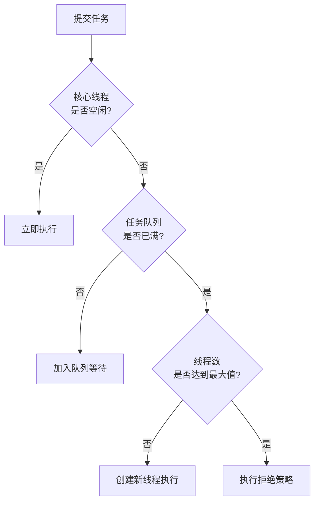

[toc]

# 线程池基本概念与理论介绍

## 一、线程池的定义与核心思想

### 1. 基本定义
线程池（Thread Pool）是一种**多线程处理形式**，它**预先创建一组线程并保持在"待命"状态**，当有任务到来时，**从池中分配一个空闲线程执行任务**，任务完成后线程返回池中等待下一次分配，而不是被销毁。

### 2. 核心思想
- **线程复用**：避免频繁创建/销毁线程的系统开销
- **资源控制**：限制并发线程数量，防止系统过载
- **任务队列**：解耦任务提交与执行，提高响应速度

## 二、线程池的组成要素

### 1. 核心组件
| 组件           | 功能描述                                    |
| -------------- | ------------------------------------------- |
| **线程管理器** | 创建、销毁线程，维护线程生命周期            |
| **工作线程**   | 实际执行任务的线程（核心线程+非核心线程）   |
| **任务队列**   | 存储待处理任务的阻塞队列                    |
| **任务接口**   | 任务提交和获取的规范（如Runnable/Callable） |

### 2. 关键参数
| 参数                 | 说明                       | 影响             |
| -------------------- | -------------------------- | ---------------- |
| **核心线程数**       | 线程池保持的最小线程数     | 资源占用基础水平 |
| **最大线程数**       | 线程池允许创建的最大线程数 | 系统负载上限     |
| **任务队列容量**     | 等待执行任务的存储空间     | 突发流量缓冲能力 |
| **空闲线程存活时间** | 非核心线程空闲时的存活时长 | 资源回收速度     |
| **拒绝策略**         | 任务过多时的处理方式       | 系统过载保护     |

## 三、线程池的工作原理

### 1. 任务处理流程


### 2. 线程生命周期管理
- **线程创建**：当任务数 > 核心线程数且队列已满时创建新线程
- **线程回收**：非核心线程空闲超时后被终止
- **线程保持**：核心线程通常保持活跃状态（可配置）

## 四、线程池的优势与价值

### 1. 性能优势
- **降低资源消耗**：线程复用减少创建/销毁开销
- **提高响应速度**：任务到达时可直接使用现有线程
- **提高系统稳定性**：避免无限制创建线程导致OOM

### 2. 管理优势
- **统一线程管理**：集中控制并发数量
- **提供监控基础**：便于统计任务执行情况
- **灵活的任务调度**：支持优先级、延迟执行等特性

## 五、线程池的典型应用场景

### 1. 适用场景
- **I/O密集型任务**：网络请求、文件读写等
- **异步处理**：日志记录、消息发送等非关键路径
- **批处理作业**：数据导入导出、报表生成等

### 2. 经典案例
- Web服务器请求处理（如Tomcat线程池）
- 数据库连接池实现
- 批量数据处理框架

## 六、线程池的拒绝策略

当线程池和队列都饱和时采取的处理策略：

| 策略类型                | 实现行为                       | 适用场景             |
| ----------------------- | ------------------------------ | -------------------- |
| **AbortPolicy**         | 抛出RejectedExecutionException | 需要明确知道系统过载 |
| **CallerRunsPolicy**    | 由提交任务的线程直接执行       | 不希望丢失任务       |
| **DiscardPolicy**       | 静默丢弃新任务                 | 允许丢弃的场景       |
| **DiscardOldestPolicy** | 丢弃队列中最旧的任务           | 优先处理新任务       |

## 七、线程池的实现模式🎈

### 1. 生产者-消费者模式
```python
while True:
    task = task_queue.get()  # 阻塞获取任务
    if task is TERMINATE_SIGNAL:
        break
    execute_task(task)
    task_queue.task_done()
```

### 2. Worker Thread模式

```java
// Java线程池的Worker实现
final void runWorker(Worker w) {
    while (task != null || (task = getTask()) != null) {
        try {
            task.run();  // 执行任务
        } finally {
            task = null;
        }
    }
}
```

## 八、线程池的监控指标

### 关键性能指标
| 指标           | 说明                 | 健康标准     |
| -------------- | -------------------- | ------------ |
| **活跃线程数** | 正在执行任务的线程数 | ≤ 最大线程数 |
| **队列大小**   | 等待执行的任务数     | ≤ 队列容量   |
| **任务完成数** | 历史累计完成任务量   | 持续增长     |
| **拒绝任务数** | 被拒绝的任务数量     | 接近0        |

### 调优方向
- **CPU使用率**：I/O密集型可增加线程数
- **内存占用**：控制队列大小防止OOM
- **吞吐量**：平衡线程数与任务处理速度

## 九、线程池的演进与变体

### 1. 常见变体类型
- **固定大小线程池**：核心线程=最大线程
- **可缓存线程池**：线程数无上限，空闲回收
- **定时线程池**：支持延迟/周期性任务
- **分阶段线程池**：Phaser控制的多阶段任务

### 2. 现代演进方向
- **工作窃取线程池**：ForkJoinPool实现负载均衡
- **协程池**：轻量级线程的调度管理
- **反应式线程池**：结合Reactive Streams

线程池作为并发编程的基础设施，其设计思想也影响着现代异步编程框架（如Go的goroutine调度、Node.js的事件循环等）。