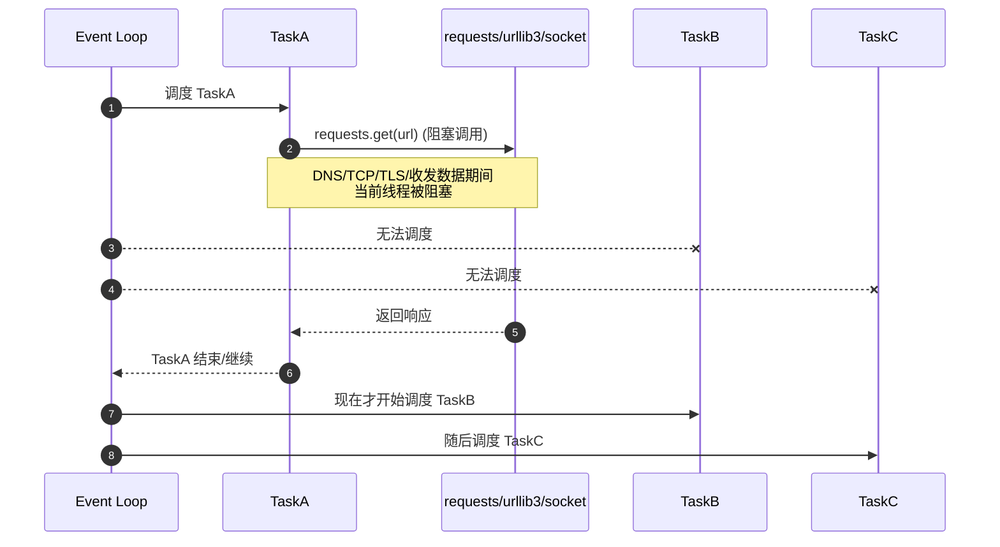
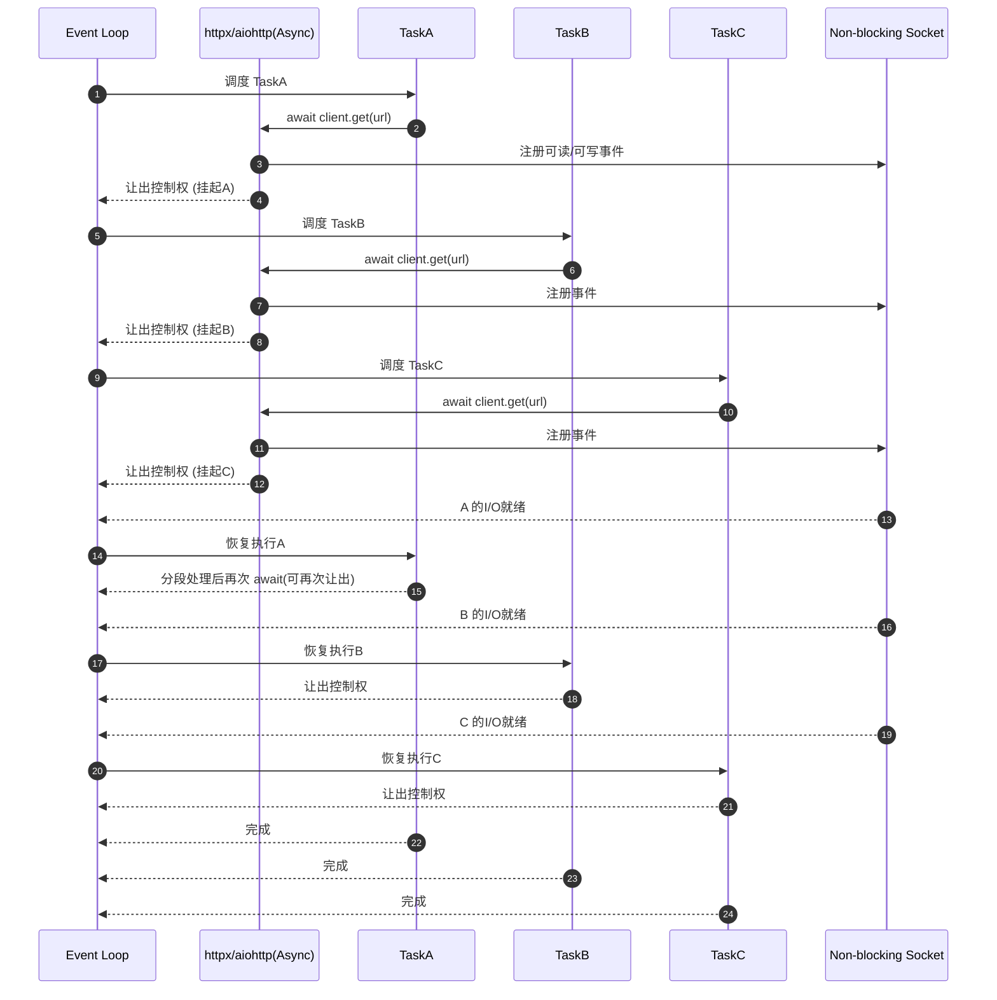

[toc]

## abstract

使用 Python 协程（Coroutine）处理并发网络请求时，最标准且高效的搭配是 `asyncio` 库和 `aiohttp` 和`httpx`库（比传统的 `requests` 更适合异步操作）。

- [encode/httpx: A next generation HTTP client for Python. 🦋](https://github.com/encode/httpx/)
- [projectdiscovery/httpx: httpx is a fast and multi-purpose HTTP toolkit that allows running multiple probes using the retryablehttp library.](https://github.com/projectdiscovery/httpx)

下面是一个典型的并发访问多个网站的示例程序。它会同时向多个网址发送请求，并异步等待它们返回，从而极大地提高了执行效率。

### 准备工作

在运行代码之前，请确保安装了异步请求库

常见的 `aiohttp` 库：

```bash
pip install aiohttp
```

------

另个一个常见选择是`httpx`:

```shell
pip install httpx
```


### 典型示例代码

#### aiohttp

```python
import asyncio
import time
import aiohttp

# 模拟需要并发访问的网站列表
URLS = [
    "https://httpbin.org/delay/2",
    "https://httpbin.org/delay/1",
    "https://httpbin.org/delay/3",
    "https://example.com",
    "https://www.python.org",
]


async def fetch_site(session, url):
    """
    一个协程任务：负责访问单个网站并返回状态码
    """
    print(head_tag := f"[开始请求] -> {url}")
    try:
        # 使用 session.get 发送异步网络请求
        async with session.get(url, timeout=5) as response:
            # 异步读取响应内容（这里只读取状态码作为演示）
            status = response.status
            print(f"[请求成功] <- {url} | 状态码: {status}")
            return url, status
    except Exception as e:
        print(f"[请求失败] x {url} | 原因: {e}")
        return url, None


async def main():
    """
    主协程：管理连接池并并发调度所有任务
    """
    # 创建一个异步 HTTP 客户端会话（连接池）
    async with aiohttp.ClientSession() as session:
        # 创建任务列表
        tasks = []
        for url in URLS:
            # 创建协程任务并加入列表
            task = asyncio.create_task(fetch_site(session, url))
            tasks.append(task)

        # 核心：使用 asyncio.gather 并发执行所有任务，并等待它们全部结束
        print("--- 开始并发访问 ---")
        results = await asyncio.gather(*tasks)
        print("--- 所有请求完成 ---\n")

        # 打印最终结果
        print("最终执行结果统计:")
        for url, status in results:
            print(f"URL: {url} -> 状态码: {status}")


if __name__ == "__main__":
    start_time = time.time()

    # 启动异步事件循环
    asyncio.run(main())

    end_time = time.time()
    print(f"\n总共耗时: {end_time - start_time:.2f} 秒")
```

------

核心要点解析

- **`async with aiohttp.ClientSession()`**：创建了一个异步的 HTTP 连接池。在协程中，我们应该复用同一个 `session`，而不是为每个请求都新建一个，这样能大幅提升性能。
- **`asyncio.create_task()`**：将协程包装成一个 Task（任务），并提交给事件循环。此时任务已经在后台开始准备执行了。
- **`await asyncio.gather(*tasks)`**：这是并发的关键。它会同时并发调度传入的所有任务。此时事件循环在遇到网络 I/O 阻塞（例如等待服务器响应）时，会自动切换到下一个网站的请求，绝不浪费时间在“死等”上。
- **运行时间**：注意到列表里有 `httpbin.org/delay/3`（服务器会故意延迟 3 秒响应）。如果使用传统的同步阻塞代码，总耗时将超过 6 秒（$2+1+3+...$）；而使用协程并发，总耗时将取决于最慢的那一个请求

#### httpx

```python
import asyncio
import time
import httpx

# 模拟需要并发访问的网站列表
URLS = [
    "https://httpbin.org/delay/2",
    "https://httpbin.org/delay/1",
    "https://httpbin.org/delay/3",
    "https://example.com",
    "https://www.python.org",
]


async def fetch_site(client, url):
    """
    一个协程任务：负责访问单个网站并返回状态码
    """
    print(f"[开始请求] -> {url}")
    try:
        # 使用 client.get 发送异步网络请求，注意这里需要 await
        response = await client.get(url, timeout=5.0)
        
        # 注意：在 httpx 中，response.status_code 是一个属性
        status = response.status_code
        print(f"[请求成功] <- {url} | 状态码: {status}")
        return url, status
    except Exception as e:
        print(f"[请求失败] x {url} | 原因: {e}")
        return url, None


async def main():
    """
    主协程：管理 httpx 的异步客户端并并发调度所有任务
    """
    # 创建一个异步客户端实例（相当于 aiohttp 的 Session，用于复用连接池）
    # 如果想开启 HTTP/2 支持，可以设置 httpx.AsyncClient(http2=True)
    async with httpx.AsyncClient() as client:
        tasks = []
        for url in URLS:
            # 创建协程任务
            task = asyncio.create_task(fetch_site(client, url))
            tasks.append(task)

        print("--- 开始并发访问 (使用 httpx) ---")
        # 并发执行所有任务
        results = await asyncio.gather(*tasks)
        print("--- 所有请求完成 ---\n")

        # 打印最终结果
        print("最终执行结果统计:")
        for url, status in results:
            print(f"URL: {url} -> 状态码: {status}")


if __name__ == "__main__":
    start_time = time.time()

    # 启动异步事件循环
    asyncio.run(main())

    end_time = time.time()
    print(f"\n总共耗时: {end_time - start_time:.2f} 秒")
```

### 代码细节差异点（httpx对比 aiohttp）

如果你仔细对比上一版 `aiohttp` 的代码，会发现 `httpx` 带来了几个非常舒服的改变：

1. **少了一层嵌套**：
   - 在 `aiohttp` 中，你需要写 `async with session.get(...) as response:`，然后再去 `await response.text()`。
   - 在 `httpx` 中，直接 `response = await client.get(...)` 即可，代码更加扁平化。
2. **属性与方法更符合直觉**：
   - 获取状态码在 `httpx` 里是 `response.status_code`（和 requests 一模一样），而在 `aiohttp` 里是 `response.status`。
   - 如果需要解析 JSON，在 `httpx` 里直接 `response.json()` 即可（不需要 await），而在 `aiohttp` 中由于是异步读取，必须写成 `await response.json()`。

## 常见异步网络库对比

在 Python 的异步编程世界中，`aiohttp` 和 `httpx` 是最主流的两个异步 HTTP 客户端库。

虽然它们都能用来做并发网络请求，但在设计理念、功能特性和使用体验上有着明显的区别。

------

###  核心定位与设计理念

- **`aiohttp` (老牌、专注、底层)**
  - **定位**：它不仅是一个 HTTP 客户端，还是一个高并发的 HTTP **服务端**框架。
  - **理念**：专注于异步性能。为了极致的性能，它的 API 设计得比较底层，写起来稍微有点繁琐（例如，每次请求都需要通过 `async with` 显式管理会话和响应）。
- **`httpx` (新潮、全面、人性化)**
  - **定位**：下一代 HTTP 客户端，完美兼容同步与异步。
  - **理念**：**“让你像用 `requests` 一样用异步”**。它的 API 设计极度模仿了经典的 `requests` 库，几乎没有学习成本，同时原生支持 HTTP/2。

------

###  功能特性对比

| **特性**                     | **aiohttp**                      | **httpx**                                      |
| ---------------------------- | -------------------------------- | ---------------------------------------------- |
| **异步支持 (Async)**         | 完美支持                         | 完美支持                                       |
| **同步支持 (Sync)**          | 不支持（只能异步）               | **支持**（提供 `httpx.Client()`）              |
| **API 相似度 (与 requests)** | 差异较大，需要适应               | **几乎 100% 相同**                             |
| **HTTP/2 支持**              | 不支持（仅支持 HTTP/1.1）        | **支持**（需安装扩展 `httpx[http2]`）          |
| **事件循环兼容性**           | 深度绑定 `asyncio`               | 兼容 `asyncio`, `trio`, `anyio` 等多种异步框架 |
| **自带 Web 服务器**          | **支持**（可直接用来写后端 API） | 不支持（纯客户端）                             |

------

###  代码写法直观对比

#### 示例：并发请求同一个 URL

**使用 `aiohttp`：**

API 层次较深，需要嵌套多层 `async with`。

```python
import asyncio
import aiohttp


async def fetch():
    # 必须先创建 session，再创建 response
    async with aiohttp.ClientSession() as session:
        async with session.get("https://httpbin.org/json") as response:
            return await response.json()


asyncio.run(fetch())
```

**使用 `httpx`：**

更加直观，语法和 `requests` 如出一辙。

```python
import asyncio
import httpx


async def fetch():
    # 写法与 requests 惊人一致，只需加上 async/await
    async with httpx.AsyncClient() as client:
        response = await client.get("https://httpbin.org/json")
        return response.json()  # 注意：json() 在 httpx 中不是协程，不需要 await


asyncio.run(fetch())
```

------

###  性能表现

- **`aiohttp` 略胜一筹**：在纯粹的并发吞吐量和极端的性能压测下，`aiohttp` 的底层的 c-ares 解析器和优化让它的速度通常比 `httpx` 快 **10% ~ 30%** 左右，内存占用也稍小一些。
- **`httpx` 足够应对绝大多数场景**：虽然比 `aiohttp` 稍慢，但对于 99% 的实际爬虫、API 对接、微服务组合场景，`httpx` 的性能瓶颈依然在于网络 I/O 延迟，而不是库本身的解析速度。

------

###  什么时候该选哪一个？

####  选择 `httpx` 的场景：

1. **从 `requests` 迁移而来**：你熟悉 `requests`，不想花时间去记 `aiohttp` 那套复杂的 API。
2. **需要同一个库兼顾同步和异步**：有些脚本需要同步跑，有些需要异步跑，`httpx` 一个人全包了。
3. **需要 HTTP/2 支持**：某些网站（如 Twitter、大规模反爬网站）强制或推荐使用 HTTP/2，`aiohttp` 无法胜任。
4. **使用了非 `asyncio` 的框架**：比如你用 `Trio` 作为异步底层。

####  选择 `aiohttp` 的场景：

1. **极致追求性能与吞吐量**：高并发的高频交易系统、大规模分布式爬虫核心引擎。
2. **你需要搭建异步服务器**：你想在一个项目里既做 HTTP 客户端发送请求，又想顺便起一个轻量级的异步 Web 服务。
3. **历史遗留项目**：许多早期的异步开源项目（如早期的 `Sanic`、老版 `FastAPI` 内部生态）生态深度依赖 `aiohttp`。

**一句话总结：** 如果你追求**开发效率、代码可读性和功能全面性（HTTP/2）**，无脑选 `httpx`；如果你追求**极致的并发性能**，并且不介意稍微繁琐的代码，选 `aiohttp`。

## 如果使用传统的同步request库,能做异步并发吗?

> **有效的执行依赖于作业的良好共享和合作**；一个贪婪的作业可能会霸占控制权，让其他作业陷入饥饿，从而使整个事件循环机制变得毫无用处。

`requests` 是“独占线程直到 I/O 完成”的**阻塞模型**，而 `httpx/aiohttp`（异步用法）是“在等待 I/O 时主动让出控制权”的**协作式并发模型**。

- `requests` 在发起 HTTP 请求后，当前线程会一直卡住，直到响应返回。
- 如果这发生在事件循环线程里，它就像“贪婪作业”一样霸占控制权，其他协程拿不到执行机会，出现饥饿，事件循环形同失效。
- `httpx.AsyncClient` 或 `aiohttp` 在网络等待阶段通过 `await` 把控制权交还给事件循环，让其他协程继续跑，形成“良好共享和合作”。

所以`requests`库和其他异步库最大差别不是语法（`await` vs 不用 `await`），而在于：**是否遵守事件循环的协作调度契约，能否在 I/O 等待时释放执行权。**

可以把“协作契约”理解成三条铁律：

1. 遇到可能长时间等待的操作，必须 `await` 让出控制权。
2. 不在事件循环线程里做阻塞调用。
3. 能被取消、能超时、能限流，避免单个任务长期霸占资源。

以 `httpx`（异步模式）为例，它大致这样遵循契约。

**1. I/O 等待点都变成可让出的 `await`**

- `await client.get(...)` 不是一次“整块阻塞”，内部会在多个阶段让出控制权。
- 包括 DNS、建连、TLS 握手、等待响应头、分块读取响应体。
- 每次底层 socket 还没就绪，就把当前协程挂起，让事件循环先跑别的任务。

**2. 底层用非阻塞 I/O + 事件循环通知**

- 异步库不是“边 while 循环边硬等”，而是把 socket 注册给事件循环。
- 事件循环通过 selector/epoll/kqueue 等机制监听可读可写事件。
- 就绪后再恢复对应协程执行，所以不会空转霸占 CPU。

**3. 任务调度由 event loop 公平推进**

- 一个请求协程在 `await` 时暂停，其他协程获得时间片。
- 这就是你说的“良好共享和合作”。
- 如果某段代码不用 `await` 且一直运行，就会破坏这种合作，导致饥饿。

**4. 连接池和并发上限防止资源被单方吃光**

- `httpx` 有连接池（复用 keep-alive）。
- 可以配置 `Limits`（最大连接数、每主机连接数）。
- 达到上限时，后续协程会等待可用连接而不是无限抢占，避免失控并发。

**5. 超时机制保证“不会无限占坑”**

- `httpx.Timeout` 可分别约束 connect/read/write/pool。
- 超时后抛异常并释放等待链路，任务结束或进入重试逻辑。
- 这能防止“坏请求”无限期拖住系统。

**6. 取消传播让任务可被回收**

- 在异步模型里，任务可被取消（如客户端断开、上层超时）。
- 库会在 `await` 边界感知取消，尽快中断 I/O 并清理资源。
- 这也是协作契约的一部分: 任务不是“你想停都停不掉”。

**7. 流式读取天然协作**

- `async for chunk in response.aiter_bytes()` 每次读一个分块。
- 分块间会让出控制权，其他任务可并发推进。
- 对大文件/长连接非常关键，不会一个响应体把循环拖死。

**8. 警戒线：异步库也可能被“误用成贪婪作业”**

- 在 `async def` 里直接用 `time.sleep()`、`requests.get()`、重 CPU 计算，都会阻塞循环。
- 正确做法是 `await asyncio.sleep()`，I/O 用异步库，CPU 密集任务丢到线程池/进程池。

`requests` 的工作方式可以理解为“同步串行 + 线程阻塞等待”：

1. 调用即阻塞
   `requests.get()` 一调用，当前线程会一直等到请求完成（或超时/异常）才返回。中间不会像 `await` 那样主动让出控制权。
2. 底层是同步 I/O 调用链
   典型路径是 `requests -> urllib3 -> socket` 的同步读写。
   DNS、TCP 连接、TLS 握手、读响应体这些阶段都在当前线程里阻塞完成。
3. 在事件循环里会“卡死协作”
   如果在 `async def` 中直接调用 `requests`，事件循环线程会被堵住。
   结果就是其他协程无法运行，正是你说的“贪婪作业霸占控制权”。
4. 并发通常靠多线程/多进程，不是协程协作
   `requests` 要提高并发，一般是 `ThreadPoolExecutor`、多进程或多机扩展。
   它不是单线程事件循环里的协作式并发模型。
5. 也有连接复用，但不等于异步协作
   `requests.Session()` 也有连接池与 keep-alive，这能减少建连开销。
   但它仍是同步阻塞模型，不具备 `await` 级别的“等待时让出执行权”。

### 时序图示意对比

requests库的同步模型



异步非阻塞模型:

> 相比于同步库,异步库更加复杂也更灵活高效.




### 小结

传统的 `requests` 库是同步阻塞（Synchronous Blocking）的。这意味着当它发送一个网络请求时，整个线程就会停下来死等服务器返回，期间什么也干不了。它内部没有使用 `async/await` 的底层机制，因此你无法直接把它放进 `asyncio` 的事件循环中去实现协程并发。

如果你强行在 `asyncio` 中使用 `requests`，代码虽然不会报错，但它会**变成串行（一个接一个）执行**，完全失去了协程的优势。

如果要用requests库做并发，通查借助于线程池并发（最常用的替代方案）

既然 `requests` 会阻塞单线程，那我们就用**多线程**。通过标准库 `concurrent.futures` 中的 `ThreadPoolExecutor`，可以让多个线程同时使用 `requests` 访问网络。
