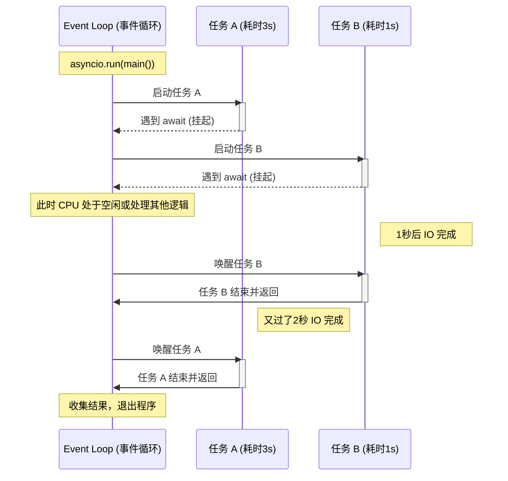

理解异步 Python 的核心在于**“非阻塞控制权转移”**。在单线程环境下，异步程序通过 `Event Loop`（事件循环）在多个任务之间快速切换，利用等待 IO（如网络请求、磁盘读写）的空档执行其他代码。

------

### 1. 典型异步代码示例

以下是一个模拟异步抓取数据的程序。注意 `await` 是如何让出执行权的。

Python

```python
import asyncio
import time

async def task_worker(name, duration):
    print(f"任务 {name}: 启动 (需耗时 {duration}s)")
    # 遇到 await，任务挂起，控制权交还给事件循环
    await asyncio.sleep(duration) 
    print(f"任务 {name}: 完成！")
    return f"{name} 的结果"

async def main():
    start = time.perf_counter()
    print("--- 开启事件循环 ---")

    # 同时创建两个并发任务
    task_1 = asyncio.create_task(task_worker("A", 3))
    task_2 = asyncio.create_task(task_worker("B", 1))

    # gather 会并发运行任务并等待它们全部完成
    results = await asyncio.gather(task_1, task_2)

    end = time.perf_counter()
    print(f"--- 全部任务结束，耗时: {end - start:.2f}s ---")
    print(f"最终结果: {results}")

if __name__ == "__main__":
    asyncio.run(main())
```

------

### 2. 执行示意图 (Mermaid)

异步执行的精髓在于：**当任务 A 进入等待状态时，CPU 立即转头去处理任务 B**，而不是原地待命。

代码段



------

### 3. 关键概念解析

- **协程 (Coroutine):** 由 `async def` 定义的特殊函数。它不会立即执行，而是返回一个协程对象。
- **事件循环 (Event Loop):** 管理所有任务的任务调度器。它会循环检查哪些任务已经从等待中恢复（例如数据已从网络返回）。
- **可等待对象 (Awaitable):** 只有在协程、任务（Task）或 Future 前面使用 `await`，程序才会在此处发生非阻塞的“暂停”。

### 4. 为什么异步更快？

- **同步模型：** 总耗时 = $任务 A + 任务 B = 4$ 秒。
- **异步模型：** 总耗时 = $\max(任务 A, 任务 B) = 3$ 秒。

> **注意：** 异步**不适合**计算密集型任务（如大矩阵运算），因为这种任务会一直霸占 CPU 导致事件循环无法切换。异步是为 **IO 密集型**（网络请求、数据库读写）而生的神器。