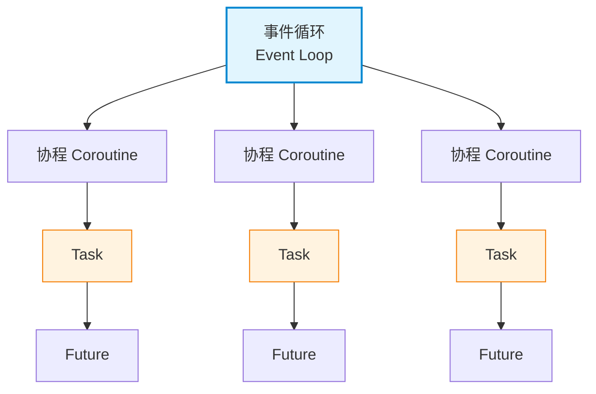
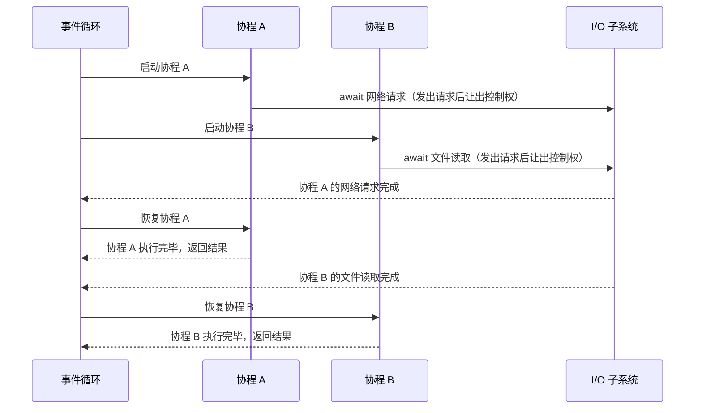
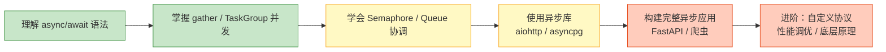

[toc]


# Python 异步编程

## 为什么需要异步编程

想象一个餐厅的场景：

- **同步模式**：一个服务员接待一位客人，等他点完菜、做完菜、吃完饭、结完账后，才去接待下一位客人。
- **异步模式**：一个服务员同时接待多位客人——给A点完菜后,交代厨房做菜，然后去给B点菜、给C上菜、给D结账(而不是等待A离开后才服务其他人)。

程序中大量操作是 **I/O 密集型** 的（网络请求、文件读写、数据库查询），CPU 大部分时间在"等待"。异步编程的核心目标就是：**在等待时去做别的事，而不是干等着**。

> 为什么 CPU 会处于“等待”状态？
>
> 在传统的**阻塞式 I/O（Blocking I/O）**模型中，程序的执行流是线性的：
>
> 1. **发起请求**：CPU 执行 `read()` 指令，请求读取数据库文件。
> 2. **陷入内核**：操作系统接收到请求，通知**磁盘控制器**寻找数据。
> 3. **挂起线程**：在磁盘准备好数据之前，当前的 CPU 核心无法继续运行这个程序的下一行代码。
> 4. **上下文切换**：为了不浪费算力，操作系统会将当前线程设为“阻塞”状态，把 CPU 分配给其他任务。
>
> 虽然 CPU 可能会去处理别的任务，但对于**原本那个程序**而言，它的逻辑是停滞的。如果你的程序是单线程的，且没有其他任务可做，那么这个 CPU 核心就真的在执行“空闲指令”（Idle Task），白白浪费电量。
>
> - 现代 CPU 在“闲着没事干”的时候，并不是真的在高速空转，而是通过一系列精密的硬件机制进入了“低功耗/休眠模式”。
>
> - 当操作系统发现没有任何任务需要处理时，它会运行一个特殊的内核线程（通常叫 `Idle Task`）。在 x86 架构中，这个线程主要执行的是 **`HLT` (Halt)** 指令。这条指令会告诉 CPU 暂停指令执行，并让核心进入低功耗状态，直到下一个硬件中断（比如你动了下鼠标或网卡收到了数据）将其唤醒。
>
> - 即使在执行空闲指令，CPU 内部依然存在两种主要的功耗来源：
>
>   静态功耗（漏电功耗）
>
>   即使晶体管不切换状态（不运算），只要通电，就会因为半导体物理特性产生**漏电流**。这就像一个关不紧的水龙头，虽然没在用水，但一直在滴水。随着制程工艺越来越先进（如 5nm, 3nm），晶体管越小，漏电控制就越挑战。
>
>   动态功耗
>
>   为了随时准备响应，CPU 的某些部分必须保持工作：
>
>   - **时钟树（Clock Tree）**：维持系统节拍的部分电路仍在震荡。
>   - **内存控制器**：需要维持与内存的数据交换。
>   - **电源管理单元**：在实时监控电压和温度。
>
> **I/O 密集型**任务的瓶颈不在于“算不过来”，而在于“**数据供不上**”。

---

## 同步和异步概念

同步和异步的核心差异是要不要"等待";

- 同步:在执行过程中，调用方（caller）必须**等待**被调用方（callee）完成操作后，才能继续执行后续步骤的一种控制方式。
  1. 阻塞（blocking）
  2. 顺序执行（sequential execution）
  3. 等待（wait）

> A 调用 B → B 执行完成 → A 继续执行

- 异步:在执行过程中，**调用方**发起请求后，**不需要等待被调用方**完成操作即可**继续执行**，待结果准备好后**通过某种机制通知调用方**的一种控制方式。
  1. 非阻塞（non-blocking）
  2. 回调（callback）
  3. 事件驱动（event-driven）
  4. Future / Promise（未来结果）

> A 调用 B → A 继续执行 → B 完成 → 通知 A

```python
import asyncio
import time


# 定义简单的log函数打印包含时间:
def log(event):
    print(time.strftime("%H:%M:%S", time.localtime()), event)


async def task():
    log("task:任务开始")
    await asyncio.sleep(1)
    log("task:任务结束")


async def main():
    log("main:create async task")
    at = asyncio.create_task(task())
    log("main:继续执行")
    log("main:await 等待异步任务结束,程序终止")
    await at
    log("main:全部任务结束")


asyncio.run(main())

```

```
 python .\async_task_line.py
14:35:26 main:create async task
14:35:26 main:继续执行
14:35:26 main:await 等待异步任务结束,程序终止
14:35:26 task:任务开始
14:35:27 task:任务结束
14:35:27 main:全部任务结束
```

### 小结:

同步：**调用后必须等待结果返回才能继续执行**

异步：**调用后无需等待结果返回，通过通知机制获取结果**

| 特性     | 同步（Synchronous）      | 异步（Asynchronous）             |
| -------- | ------------------------ | -------------------------------- |
| 执行方式 | 顺序执行（sequential）   | 可并发执行（concurrent）         |
| 是否等待 | 必须等待（blocking）     | 不等待（non-blocking）           |
| 控制权   | 被调用者完成后返回       | 调用者立即继续                   |
| 实现机制 | 函数调用栈（call stack） | 事件循环（event loop）           |
| 常见技术 | 普通函数调用             | callback / Promise / async-await |
| 性能特点 | 简单但可能低效           | 高效但复杂                       |

### 同步/异步/多线程

| **维度**     | **同步 (Sync)** | **多线程 (Threading)**  | **异步 (Asyncio)**                  |
| ------------ | --------------- | ----------------------- | ----------------------------------- |
| **资源消耗** | 低              | 高 (每个线程都有开销)   | **极低** (都在一个线程里)           |
| **切换成本** | 无              | 高 (操作系统上下文切换) | **极低** (函数级别的切换)           |
| **数据安全** | 安全            | 需加锁 (Lock)，易死锁   | **天然安全** (单线程不会同时改数据) |
| **编程难度** | 简单            | 中等                    | 较高 (需要 `async/await` 全家桶)    |

## 并发模型对比

| 模型                     | 核心机制            | 适用场景       | 优点                       | 缺点                                             |
| ------------------------ | ------------------- | -------------- | -------------------------- | ------------------------------------------------ |
| 多线程 `threading`       | OS 线程切换         | I/O 密集型     | 编程模型直观               | 老版本python有GIL 限制、线程安全问题、资源开销大 |
| 多进程 `multiprocessing` | 独立进程            | CPU 密集型     | 真正并行、绕过 GIL         | 进程间通信复杂、内存开销大                       |
| **异步 `asyncio`**       | **事件循环 + 协程** | **I/O 密集型** | **极低开销、高并发、无锁** | **不能加速 CPU 密集型任务、生态需要异步库支持**  |

**关键区别**：多线程由操作系统决定何时切换（抢占式），协程由**程序自己决定何时让出控制权**（协作式）。

---

## 核心概念全景



| 概念                      | 本质                                         | 类比                               |
| ------------------------- | -------------------------------------------- | ---------------------------------- |
| **协程 (Coroutine)**      | 用 `async def` 定义的函数，可暂停和恢复执行  | 一份可以"放下再拿起"的工作         |
| **事件循环 (Event Loop)** | 调度器，**不断检查**哪些协程可以继续运行     | 餐厅经理，分配服务员做什么         |
| **Task**                  | 协程的包装器，将**协程注册到事件循环中调度** | 贴在任务板上的工单                 |
| **Future**                | 表示一个"将来会有结果"的占位符               | 取餐号码牌                         |
| **`await`**               | **暂停当前协程**，等待另一个异步操作完成     | "这件事我先等一下，你可以去忙别的" |

---

## python的异步设计

Python 异步的逻辑就是：**利用 IO 等待的空档，让单线程不停地在多个函数之间“跳跃”执行。**

### asyncio库

[asyncio --- 异步 I/O — Python  文档](https://docs.python.org/zh-cn/3.14/library/asyncio.html)

asyncio 是用来编写 **并发** 代码的库，使用 **async/await** 语法。

asyncio 被用作多个 Python 异步框架的基础，这些框架提供高性能网络和网站服务，数据库连接库，分布式任务队列等等。

asyncio 往往是构建 IO 密集型和高层级 **结构化** 网络代码的最佳选择。

asyncio 提供一组 高层级 API 用于：

- 并发地 运行 Python 协程 并对其执行过程实现完全控制;

- 执行 网络 IO 和 IPC;

- 控制 子进程;

- 通过 队列 分发任务;

- 同步 并发代码;

此外，还有一些 低层级 API 以支持 库和框架的开发者 实现：

- 创建和管理 事件循环，它提供用于 连接网络, 运行 子进程, 处理 OS 信号 等功能的异步 API；

- 使用 transports 实现高效率协议;

- 通过 async/await 语法 桥接 基于回调的库和代码。

### 核心组件：三个关键角色

要理解异步，需要看清楚这三个概念是如何配合的：

- **事件循环 (Event Loop)：** 它是“大管家”。它维护着一个任务列表，不断循环查看哪些任务准备好了，哪些还在等待。
- **协程 (Coroutine)：** 使用 `async def` 定义的函数。它不像普通函数那样执行完就销毁，而是可以执行到一半“暂停”，稍后从原地“恢复”。
- **可等待对象 (Awaitable)：** 通常是 `await` 后面的内容（如 `asyncio.sleep` 或网络 IO）。它告诉程序：“这里需要等一会儿，你先去忙别的吧。”

### 底层原理：生成器 (Generators)

在 Python 内部，异步的演进路径是：`(yield)` -> `yield from` -> `async/await`。

- **暂停机制：** 协程本质上是一个增强版的生成器。`await` 在底层类似于 `yield`，它能保存函数当前的局部变量和执行状态。
- **调度机制：** 当代码运行到 `await` 时，协程对象会**向事件循环抛出一个信号**，事件循环接收到信号后，将该协程标记为“等待中”，然后立即转向执行队列里的下一个任务。

### 事件循环

[Event loop — Python 文档](https://docs.python.org/zh-cn/3.14/library/asyncio-eventloop.html)

关于事件循环详情,另见它文

## 基础语法

使用async和await语法:[协程与任务 — Python 文档](https://docs.python.org/zh-cn/3.14/library/asyncio-task.html)

通过 async/await 语法来声明 [协程](https://docs.python.org/zh-cn/3.14/glossary.html#term-coroutine) 是编写 asyncio 应用的推荐方式;

关键规则：

- `async def` 定义的函数**调用后**返回的是一个**协程对象**，不会立即执行
  - 简单地调用一个协程并不会使其被调度执行:

- 协程必须**被 `await` 或包装成 `Task`** 才会真正运行
  - 要实际运行一个协程，`asyncio `提供了以下几种机制：
    - [`asyncio.run()`](https://docs.python.org/zh-cn/3.14/library/asyncio-runner.html#asyncio.run) 函数用来运行最高层级的入口点 "main()" 函数 (参见上面的示例。)
    - 对**协程**(对象)执行 `await`(有使用条件:只能在`async def`函数体中使用,普通函数内不能使用)。

### await 表达式

**挂起 coroutine 的执行**以等待一个 [awaitable](https://docs.python.org/zh-cn/3.14/glossary.html#term-awaitable) 对象。 

只能在 [coroutine function](https://docs.python.org/zh-cn/3.14/glossary.html#term-coroutine-function) 内部使用(普通函数内部或函数外部都不能使用)。

### 协程运行方式(串行或并行)

异步程序不一定是并行的,也可以串行执行;需要用一定的包装才能并行执行;

- [`asyncio.create_task()`](https://docs.python.org/zh-cn/3.14/library/asyncio-task.html#asyncio.create_task) 函数用来**并发运行**作为 asyncio [`Task`](https://docs.python.org/zh-cn/3.14/library/asyncio-task.html#asyncio.Task) 的**多个协程**。
- [`asyncio.TaskGroup`](https://docs.python.org/zh-cn/3.14/library/asyncio-task.html#asyncio.TaskGroup) 类提供的 [`create_task()`](https://docs.python.org/zh-cn/3.14/library/asyncio-task.html#asyncio.create_task) 的更**现代化**的替代(通常配合`with`上下文管理,这样可以自动为我们执行task的`await`操作)

### 第一个异步程序

从串行运行开始:

```python
import asyncio

async def say_hello(name: str, delay: float) -> str:
    print(f"开始问候 {name}")
    await asyncio.sleep(delay)  # 模拟 I/O 操作，这里会让出控制权
    print(f"问候完毕 {name}")
    return f"Hello, {name}!"

async def main():
    result = await say_hello("World", 1.0)
    print(result)

asyncio.run(main())  # Python 3.7+ 推荐的入口方式
```

以下代码段会在等待 1 秒后打印 "hello"，然后 *再次* 等待 2 秒后打印 "world":

> 下面的代码是串行执行(消耗的时间并不比串行同步代码短),但也属于异步代码;

```python
import asyncio
import time


async def say_after(delay, what):
    await asyncio.sleep(delay)
    print(what)


async def main():
    print(f"started at {time.strftime('%X')}")
    # 函数内使用 await 语法启动协程(两个协程虽然都是通过await成功调用,但是串行执行的,因此并没节约时间)
    await say_after(1, "hello")
    await say_after(2, "world")
    # 最终耗时3秒
    print(f"finished at {time.strftime('%X')}")


asyncio.run(main())

```

并行化

```python
import asyncio
import time


async def say_after(delay, what):
    await asyncio.sleep(delay)
    print(what)


async def main():
    task1 = asyncio.create_task(
        say_after(1, 'hello'))

    task2 = asyncio.create_task(
        say_after(2, 'world'))

    print(f"started at {time.strftime('%X')}")

    # 等待直到两个任务都完成
    # task1,2被asyncio.crate_task函数包装后,可以并发运行,节约时间（会花费约 2 秒钟。）
    await task1
    await task2

    print(f"finished at {time.strftime('%X')}")


asyncio.run(main())

```

现代化的并行写法(上下文管理器)

```python
import asyncio
import time

async def say_after(delay, what):
    await asyncio.sleep(delay)
    print(what)


async def main():
    async with asyncio.TaskGroup() as tg:
        task1 = tg.create_task(say_after(1, "hello"))

        task2 = tg.create_task(say_after(2, "world"))

        print(f"started at {time.strftime('%X')}")

    # 当上下文管理器退出时 await 是隐式执行的,不需要手动await。
	# await task1
    # await task2
    print(f"finished at {time.strftime('%X')}")
    print(task1, task2)


asyncio.run(main())

```


### 直接调用协程函数会怎样？

```python
coro = say_hello("World", 1.0)
print(type(coro))  # <class 'coroutine'>
# ⚠️ 什么都不会执行！还会收到 RuntimeWarning
```

---

## 可等待对象

> 如果一个**对象**可以在 [`await`](https://docs.python.org/zh-cn/3.14/reference/expressions.html#await) 语句中使用`await <obj>`，那么它就是 **可等待** 对象。

许多 `asyncio API` 都被设计为**接受"可等待对象"**。

*可等待* 对象有三种主要类型：**协程**, **任务** 和 **Future**.

### 协程(coroutine)

Python 协程属于 ***可等待*** 对象，因此可以**在其他协程中被等待**:

```python
import asyncio

async def nested():
    return 42

async def main():
    # 如果我们只调用 "nested()" 则无事发生。
    # 一个协程对象被创建但是没有被等待，
    # 因此它 *根本不会运行*。
    nested()  # 将引发 "RuntimeWarning"。

    # 现在让我们等待它：
    print(await nested())  # 将打印 "42"。

asyncio.run(main())
```

#### 协程函数和协程对象

 "协程" 可用来表示两个紧密关联的概念：

- *协程函数*: 定义形式为 [`async def`](https://docs.python.org/zh-cn/3.14/reference/compound_stmts.html#async-def) 的函数;
- *协程对象*: 调用 *协程函数* 所返回的对象。

### 任务(Task)

*任务* 被用来 *并发地* 调度协程。

当一个协程被 [`asyncio.create_task()`](https://docs.python.org/zh-cn/3.14/library/asyncio-task.html#asyncio.create_task) 等函数封装为一个 *任务* 时，该协程会**被自动调度执行**:

```python
import asyncio

async def nested():
    return 42

async def main():
    # 调度 nested() 与 "main()" 并发运行。
    task = asyncio.create_task(nested())

    # 现在可以通过 "task" 来取消 "nested()"，
    # 也可以等待 "task" 直到它被完成：
    await task

asyncio.run(main())
```


简单来说，`await` 的作用是 **“非阻塞地等待结果”**。

`await task` 主要承担了以下三个职责：

------

1. 确保任务执行完毕

当你使用 `asyncio.create_task(nested())` 时，你已经向事件循环（Event Loop）提交了一个任务。但是，如果不使用 `await`，`main()` 函数会继续向下执行。

- **如果没有 `await`：** `main()` 可能会在 `nested()` 还没跑完时就直接结束了。一旦 `main()` 结束，整个程序（`asyncio.run`）也会关闭，导致 `nested()` 任务被强行中断。
- **有了 `await`：** 程序会在这里“站住”，直到 `nested()` 执行完并返回结果。

2. 获取返回值

`nested()` 函数返回了 `42`。

- 如果你写 `result = await task`，变量 `result` 就会拿到 `42`。
- 如果不 `await`，你拿到的只是一个 `Task` 对象（就像是一个还没打开的快递盒子），而不是里面的值。

3. 让出控制权（非阻塞）

这是 `await` 最神奇的地方。虽然它在“等待”，但它不会让整个程序卡死。

- 当执行到 `await task` 时，`main()` 会暂停。
- **此时，CPU 会切换去执行其他的异步任务**（如果你在 `create_task` 里创建了多个任务的话）。
- 一旦 `task` 完成了，**事件循环**会唤醒 `main()`，从刚才暂停的地方继续往下走。

### 最终结果占位(Futures)

[`Future`](https://docs.python.org/zh-cn/3.14/library/asyncio-future.html#asyncio.Future) 是一种特殊的 **低层级** 可等待对象，表示一个异步操作的 **最终结果**。

当一个 `Future` 对象 *被等待*，这意味着协程将**保持等待直到该 Future 对象在其他地方操作完毕**。

在 asyncio 中需要 Future 对象以便允许通过 `async/await` 使用基于回调的代码。

通常情况下 **没有必要** 在应用层级的代码中创建 Future 对象。

Future 对象有时会**由库和某些 asyncio API 暴露给用户，用作可等待对象**:

```python
async def main():
    await function_that_returns_a_future_object()

    # 这样也可以：
    await asyncio.gather(
        function_that_returns_a_future_object(),
        some_python_coroutine()
    )
```

一个很好的返回 Future 对象的低层级函数的示例是 [`loop.run_in_executor()`](https://docs.python.org/zh-cn/3.14/library/asyncio-eventloop.html#asyncio.loop.run_in_executor)。

### await对象

| **场景**              | **能否直接 await？** | **表现**                         | **解决方案**                                      |
| --------------------- | -------------------- | -------------------------------- | ------------------------------------------------- |
| **网络 IO / 磁盘 IO** | **能**               | 完美，释放 CPU 提高吞吐          | `async/await` 标准用法                            |
| **CPU 计算密集型**    | **不能**             | **阻塞事件循环**，导致程序无响应 | 使用 `run_in_executor` 结合 `ProcessPoolExecutor` |

## 定义协程函数

在 Python 中，编写一个“标准且完整”的协程（Coroutine）函数，通常需要遵循 `asyncio` 库的最佳实践。现代异步编程的核心在于使用 `async def` 定义，并配合 **上下文管理**、**错误处理** 以及 **任务控制**。

以下是一个 Python 异步协程函数的标准模板及其核心要素：

------

### 1. 标准协程函数模板

```python
import asyncio
import aiohttp  # 举例：异步请求库

async def my_coroutine_template(param1: str, timeout: int = 10) -> dict:
    """
    协程函数描述：这是一个符合最佳实践的异步任务模板。
    """
    # 1. 资源准备或日志记录
    print(f"Starting task with {param1}...")

    try:
        # 2. 使用 await 调用其他协程（避免阻塞）
        # asyncio.wait_for 可以防止协程无限期挂起
        result = await asyncio.wait_for(
            fetch_data_logic(param1), 
            timeout=timeout
        )
        
        # 3. 业务逻辑处理
        processed_data = {"status": "success", "data": result}
        return processed_data

    except asyncio.TimeoutError:
        # 4. 针对异步特有的超时处理
        print("Error: The operation timed out.")
        return {"status": "error", "message": "timeout"}

    except Exception as e:
        # 5. 通用的错误捕获
        print(f"An unexpected error occurred: {e}")
        raise
    
    finally:
        # 6. 清理资源（如关闭连接等）
        print("Cleaning up resources...")

async def fetch_data_logic(name: str):
    """模拟一个耗时的 I/O 操作"""
    await asyncio.sleep(1) 
    return f"Data for {name}"
```

------

### 2. 核心组成部分解析

要写出一个“高质量”的协程，你需要注意以下几点：

| **组成部分**                 | **说明**                             | **为什么重要**                                               |
| ---------------------------- | ------------------------------------ | ------------------------------------------------------------ |
| **`async def`**              | 声明这是一个原生协程。               | 只有这样才能内部使用 `await`。                               |
| **`await`**                  | 挂起当前协程，将控制权交还事件循环。 | **切记：** 不要在这里执行 `time.sleep()`，否则会阻塞整个线程。 |
| **`asyncio.wait_for`**       | 为异步操作设置超时上限。             | 网络请求或数据库查询可能永久卡死，必须有超时机制。           |
| **`try...except...finally`** | 标准的异常捕获。                     | 协程中的异常如果不捕获，可能会导致任务静默失败。             |
| **类型提示 (Typing)**        | 如 `-> dict`。                       | 增强 IDE 的代码提示，方便维护。                              |

------

### 3. 如何运行这个协程？

协程不能像普通函数那样直接调用（直接调用只会返回一个协程对象）。

#### 方式 A：作为程序主入口

（Python 3.7+）

这是最常用的启动方式：

```Python
if __name__ == "__main__":
    # 运行最高层级的入口点
    response = asyncio.run(my_coroutine_template("test_user"))
    print(response)
```

#### 方式 B：在已有的事件循环中并发运行

如果你想同时运行多个协程，使用 `asyncio.gather`：


```Python
async def main():
    # 并发执行三个任务
    results = await asyncio.gather(
        my_coroutine_template("A"),
        my_coroutine_template("B"),
        my_coroutine_template("C"),
    )
    print(results)

asyncio.run(main())
```

------

### 避坑指南

1. **不要在协程里写耗时的计算任务**：协程擅长 I/O（网络、文件、数据库），但不擅长 CPU 密集型任务（如大型矩阵运算）。如果是后者，请使用 `run_in_executor` 交给线程池处理。
2. **避免“影子阻塞”**：使用了 `async def` 却在内部调用了同步的阻塞库（比如 `requests` 或 `time.sleep`），这会导致异步程序失去意义，性能退化到同步水平。

## 并发执行：asyncio.gather 与 TaskGroup

异步编程的威力在于**并发**。如果只是依次 `await`，**和同步没有区别**：

```python
# ❌ 串行执行，总耗时 3 秒
async def sequential():
    await asyncio.sleep(1)
    await asyncio.sleep(1)
    await asyncio.sleep(1)

# ✅ 并发执行，总耗时 1 秒
async def concurrent():
    await asyncio.gather(
        asyncio.sleep(1),
        asyncio.sleep(1),
        asyncio.sleep(1),
    )
```

### asyncio.gather

同时启动多个协程，等待全部完成，**按传入顺序返回**结果：

- `awaitable asyncio.gather(*aws, return_exceptions=False)`

  *并发* 运行 *aws* 序列中的 [可等待对象](https://docs.python.org/zh-cn/3.14/library/asyncio-task.html#asyncio-awaitables)。如果 *aws* 中的某个可等待对象为协程，它将自动被作为一个任务调度。如果所有可等待对象都成功完成，结果将是一个由所有返回值聚合而成的列表。结果值的顺序与 *aws* 中可等待对象的顺序一致。

```python
import asyncio

async def fetch(url: str) -> str:
    print(f"开始请求 {url}")
    await asyncio.sleep(1)  # 模拟网络请求
    return f"{url} 的内容"

async def main():
    results = await asyncio.gather(
        fetch("https://api.example.com/a"),
        fetch("https://api.example.com/b"),
        fetch("https://api.example.com/c"),
    )
    # 逐个输出结果
    for r in results:
        print(r)
    
# 运行协程
asyncio.run(main())
```

```python
import asyncio

# 计算阶乘
async def factorial(task_name, number):
    f = 1
    for i in range(2, number + 1):
        print(f"Task {task_name}: Compute factorial({number}), currently i={i}...")
        # 每次乘法计算前睡眠1秒
        await asyncio.sleep(1)
        f *= i
    # 结束并包裹结果:
    print(f"[result:Task {task_name}]: factorial({number}) = {f}")
    return f

async def main():
    # *并发地* 调度这三次调用(一次性添加3个协程)：
    L = await asyncio.gather(
        factorial("A", 2),
        factorial("B", 3),
        factorial("C", 4),
    )
    print(L)

asyncio.run(main())
```

```
 python .\async_gather2.py
Task A: Compute factorial(2), currently i=2...
Task B: Compute factorial(3), currently i=2...
Task C: Compute factorial(4), currently i=2...
[result:Task A]: factorial(2) = 2
Task B: Compute factorial(3), currently i=3...
Task C: Compute factorial(4), currently i=3...
[result:Task B]: factorial(3) = 6
Task C: Compute factorial(4), currently i=4...
[result:Task C]: factorial(4) = 24
[2, 6, 24]
```


### TaskGroup

（Python 3.11+，推荐）

`TaskGroup` 是更现代、更安全的并发方式，提供**结构化并发**——如果任意任务抛异常，会自动取消其余任务：

> 使用`with`管理上下文,不需要手动写`await`语句;
>
> 利用TaskGroup对象的`create_task`方法**运行**协程(任务自定启动且自动非阻塞等待);

```python
async def main():
    async with asyncio.TaskGroup() as tg:
        task_a = tg.create_task(fetch("https://api.example.com/a"))
        task_b = tg.create_task(fetch("https://api.example.com/b"))
        task_c = tg.create_task(fetch("https://api.example.com/c"))
    
    # 离开 async with 块时，所有任务已完成
    print(task_a.result(), task_b.result(), task_c.result())
```

### gather vs TaskGroup

| 特性             | `asyncio.gather`                        | `asyncio.TaskGroup`                     |
| ---------------- | --------------------------------------- | --------------------------------------- |
| Python 版本      | 3.4+                                    | 3.11+                                   |
| 异常处理         | 需手动设置 `return_exceptions=True`     | 自动取消剩余任务，抛出 `ExceptionGroup` |
| 取消传播         | 不自动取消其他任务                      | 任一失败 → 全部取消                     |
| **动态添加任务** | 不支持                                  | 支持在块内动态 `create_task`            |
| **推荐度**       | 简单场景仍可用,或者希望任务尽可能运行完 | **新代码优先使用**                      |

---

## 异步执行流程



**核心机制**：当协程遇到 `await` 一个尚未完成的 I/O 操作时，它会**将控制权交还给事件循环**。事件循环去**运行其他就绪的协程**，直到 I/O 完成后再回来恢复之前的协程。

---

## 常用异步 API

### 超时控制

对于较新版本:

`asyncio.timeout()`设置超时控制,可以配合`with`上下文管理;

兼容老版本python,使用`asyncio.wait_for()`的写法;

```python
async def main():
    try:
        # Python 3.11+ 推荐
        async with asyncio.timeout(5.0):
            result = await long_running_task()
    except TimeoutError:
        print("操作超时！")
    
    # Python 3.7+ 兼容写法
    try:
        result = await asyncio.wait_for(long_running_task(), timeout=5.0)
    except asyncio.TimeoutError:
        print("操作超时！")
```

### asyncio.wait：更精细的控制

```python
async def main():
    # 使用普通的create_task()创建任务
    tasks = [asyncio.create_task(fetch(url)) for url in urls]
    

```

普通等待(逐个task做`await`)

```python
for task in tasks:
    await task
```

精细等待:按条件等待`asyncio.wait`等待任务集合的任务(个别或全部)

```python
    # 等待第一个完成
    done, pending = await asyncio.wait(tasks, return_when=asyncio.FIRST_COMPLETED)
    
    # 等待全部完成
    done, pending = await asyncio.wait(tasks, return_when=asyncio.ALL_COMPLETED)
    
    # 等待第一个异常
    done, pending = await asyncio.wait(tasks, return_when=asyncio.FIRST_EXCEPTION)
```


### as_completed：按完成顺序处理结果

```python
async def main():
    tasks = [asyncio.create_task(fetch(url)) for url in urls]
    
    # 谁先完成就先处理谁的结果
    for coro in asyncio.as_completed(tasks):
        result = await coro
        print(f"收到结果: {result}")
```

---

### python异步api和多线程api对比

| **功能**       | **异步 API (Asyncio)**               | **多线程 API (Threading)**                 |
| -------------- | ------------------------------------ | ------------------------------------------ |
| **创建任务**   | `task = asyncio.create_task(func())` | `t = threading.Thread(target=func)`        |
| **等待完成**   | `await task`                         | `t.join()`                                 |
| **延时暂停**   | `await asyncio.sleep(1)`             | `time.sleep(1)`                            |
| **获取返回值** | 直接通过 `await` 获取                | 需配合 `Queue` 或使用 `ThreadPoolExecutor` |
| **互斥锁**     | `async with asyncio.Lock():`         | `with threading.Lock():`                   |
| **取消任务**   | `task.cancel()`（支持良好）          | 极其困难（通常只能设置标志位手动退出）     |

## 异步迭代器与异步生成器

### 异步迭代器 (`async for`)

当数据源本身是异步的（如分页 API、数据库游标），使用 `async for`：

```python
class AsyncCounter:
    def __init__(self, stop: int):
        self.current = 0
        self.stop = stop

    def __aiter__(self):
        return self

    async def __anext__(self):
        if self.current >= self.stop:
            raise StopAsyncIteration
        await asyncio.sleep(0.1)  # 模拟异步数据获取
        self.current += 1
        return self.current

async def main():
    async for number in AsyncCounter(5):
        print(number)
```

### 异步生成器（更简洁）

```python
async def async_range(start: int, stop: int):
    for i in range(start, stop):
        await asyncio.sleep(0.1)
        yield i

async def main():
    async for num in async_range(0, 10):
        print(num)
```

### 异步上下文管理器 (`async with`)

```python
class AsyncDatabaseConnection:
    async def __aenter__(self):
        print("打开数据库连接")
        await asyncio.sleep(0.1)  # 模拟异步连接
        return self

    async def __aexit__(self, exc_type, exc_val, exc_tb):
        print("关闭数据库连接")
        await asyncio.sleep(0.1)  # 模拟异步关闭
        return False  # 不吞掉异常

async def main():
    async with AsyncDatabaseConnection() as db:
        print("使用数据库")
```

---

## 异步同步原语

当多个协程需要协调访问共享资源时，需要异步版本的同步工具：

| 原语                | 用途       | 示例场景                         |
| ------------------- | ---------- | -------------------------------- |
| `asyncio.Lock`      | 互斥访问   | 防止并发写入同一资源             |
| `asyncio.Semaphore` | 限制并发数 | 限制同时请求 API 的数量          |
| `asyncio.Event`     | 事件通知   | 一个协程通知其他协程某件事已发生 |
| `asyncio.Condition` | 条件等待   | 生产者-消费者模式                |
| `asyncio.Queue`     | 异步队列   | 任务分发、流水线                 |

### Semaphore 限制并发（最常用）

```python
async def fetch_with_limit(sem: asyncio.Semaphore, url: str):
    async with sem:  # 最多同时允许 N 个协程进入
        print(f"请求 {url}")
        await asyncio.sleep(1)
        return f"{url} 的结果"

async def main():
    sem = asyncio.Semaphore(5)  # 最大并发 5
    urls = [f"https://api.example.com/{i}" for i in range(100)]
    
    tasks = [fetch_with_limit(sem, url) for url in urls]
    results = await asyncio.gather(*tasks)
```

### Queue 实现生产者-消费者

```python
async def producer(queue: asyncio.Queue, n: int):
    for i in range(n):
        await asyncio.sleep(0.1)
        item = f"任务-{i}"
        await queue.put(item)
        print(f"生产: {item}")
    # 放入哨兵值通知消费者结束
    await queue.put(None)

async def consumer(queue: asyncio.Queue, name: str):
    while True:
        item = await queue.get()
        if item is None:
            await queue.put(None)  # 传递给其他消费者
            break
        print(f"[{name}] 消费: {item}")
        await asyncio.sleep(0.3)  # 模拟处理
        queue.task_done()

async def main():
    queue: asyncio.Queue[str | None] = asyncio.Queue(maxsize=10)
    
    async with asyncio.TaskGroup() as tg:
        tg.create_task(producer(queue, 20))
        tg.create_task(consumer(queue, "消费者A"))
        tg.create_task(consumer(queue, "消费者B"))
```

---

## 异步与同步的桥接

### 在异步中运行同步阻塞代码

有些库没有异步版本，直接在协程中调用会**阻塞整个事件循环**。使用 `asyncio.to_thread`（Python 3.9+）将其放到线程池：

```python
import time

def blocking_io():
    """假设这是一个没有异步版本的库函数"""
    time.sleep(2)
    return "阻塞操作的结果"

async def main():
    # ❌ 错误：会阻塞事件循环 2 秒
    # result = blocking_io()
    
    # ✅ 正确：放到线程池中运行
    result = await asyncio.to_thread(blocking_io)
    print(result)
```

### 在同步代码中调用异步函数

```python
# 最外层入口
result = asyncio.run(main())

# ⚠️ 已经在事件循环中时（如 Jupyter Notebook），使用：
# await main()  # 直接 await
# 或者使用 nest_asyncio 库
```

---

## 真实世界示例：异步 HTTP 爬虫

使用 `aiohttp`（最流行的异步 HTTP 客户端）：

```python
import asyncio
import aiohttp

async def fetch_page(
    session: aiohttp.ClientSession,
    sem: asyncio.Semaphore,
    url: str,
) -> dict:
    async with sem:
        try:
            async with session.get(url, timeout=aiohttp.ClientTimeout(total=10)) as resp:
                text = await resp.text()
                return {"url": url, "status": resp.status, "length": len(text)}
        except Exception as e:
            return {"url": url, "error": str(e)}

async def main():
    urls = [
        "https://httpbin.org/delay/1",
        "https://httpbin.org/delay/2",
        "https://httpbin.org/get",
        "https://httpbin.org/ip",
        "https://httpbin.org/headers",
    ]
    
    sem = asyncio.Semaphore(3)  # 限制并发请求数
    
    async with aiohttp.ClientSession() as session:
        tasks = [fetch_page(session, sem, url) for url in urls]
        results = await asyncio.gather(*tasks)
    
    for r in results:
        print(r)

asyncio.run(main())
```

**要点**：
- `aiohttp.ClientSession` 应当复用（不要每次请求都创建）
- 使用 `Semaphore` 防止大量并发压垮目标服务器
- 用 `async with` 确保连接正确关闭

---

## 异步生态常用库

| 领域                | 同步库              | 异步替代                                     |
| ------------------- | ------------------- | -------------------------------------------- |
| HTTP 客户端         | `requests`          | `aiohttp` / `httpx`                          |
| Web 框架            | `Flask` / `Django`  | `FastAPI` / `Starlette` / Django (ASGI)      |
| 数据库 (PostgreSQL) | `psycopg2`          | `asyncpg` / `psycopg` (v3 异步模式)          |
| 数据库 (MySQL)      | `pymysql`           | `aiomysql`                                   |
| 数据库 ORM          | `SQLAlchemy` (同步) | `SQLAlchemy` 2.0 (原生异步) / `tortoise-orm` |
| Redis               | `redis-py` (同步)   | `redis-py` (内置异步) / `aioredis`           |
| 文件 I/O            | 内置 `open()`       | `aiofiles`                                   |
| WebSocket           | —                   | `websockets`                                 |
| MongoDB             | `pymongo`           | `motor`                                      |

> **注意**：`httpx` 同时支持同步和异步 API，是从 `requests` 迁移的极佳选择。

---

## 错误处理与取消

### 异常处理

```python
async def risky_task(name: str):
    await asyncio.sleep(1)
    if name == "bad":
        raise ValueError(f"{name} 出错了！")
    return f"{name} 成功"

# 方式一：gather + return_exceptions
async def main_gather():
    results = await asyncio.gather(
        risky_task("good"),
        risky_task("bad"),
        risky_task("good2"),
        return_exceptions=True,  # 异常作为返回值而非抛出
    )
    for r in results:
        if isinstance(r, Exception):
            print(f"捕获异常: {r}")
        else:
            print(f"结果: {r}")

# 方式二：TaskGroup（Python 3.11+）
async def main_taskgroup():
    try:
        async with asyncio.TaskGroup() as tg:
            tg.create_task(risky_task("good"))
            tg.create_task(risky_task("bad"))
            tg.create_task(risky_task("good2"))
    except* ValueError as eg:
        for exc in eg.exceptions:
            print(f"捕获: {exc}")
```

> `except*` 是 Python 3.11 引入的语法，专门用于处理 `ExceptionGroup`。

### 任务取消

```python
async def long_task():
    try:
        while True:
            print("工作中...")
            await asyncio.sleep(1)
    except asyncio.CancelledError:
        print("任务被取消，执行清理...")
        # 释放资源、保存状态等
        raise  # 最佳实践：重新抛出，让调用者知道取消成功

async def main():
    task = asyncio.create_task(long_task())
    await asyncio.sleep(3)
    
    task.cancel()  # 请求取消
    try:
        await task
    except asyncio.CancelledError:
        print("确认任务已取消")
```

**取消的关键规则**：

- `cancel()` 只是"请求"取消，协程在下一次 `await` 时才会收到 `CancelledError`
- 捕获 `CancelledError` 后应当**重新抛出**，除非你有明确的理由吞掉它
- 在 `finally` 块中做清理工作是安全的

---

## 调试技巧

### 启用调试模式

```python
# 方式一：代码中
asyncio.run(main(), debug=True)

# 方式二：环境变量
# PYTHONASYNCIODEBUG=1 python script.py
```

调试模式会：
- 警告未被 `await` 的协程
- 报告执行时间过长的回调（阻塞事件循环的代码）
- 记录更详细的异常回溯

### 常见错误速查

| 症状                                               | 原因                                     | 解决方案                            |
| -------------------------------------------------- | ---------------------------------------- | ----------------------------------- |
| `RuntimeWarning: coroutine was never awaited`      | 调用了 `async def` 函数但没有 `await`    | 加上 `await` 或包装成 `Task`        |
| 程序卡住不动                                       | 在协程中调用了同步阻塞函数               | 用 `asyncio.to_thread()` 包装       |
| `RuntimeError: This event loop is already running` | 在已运行的事件循环中调用 `asyncio.run()` | 使用 `await` 或 `nest_asyncio`      |
| 并发没有提速                                       | 全部 `await` 写成了串行                  | 使用 `gather` 或 `TaskGroup` 并发   |
| `Task was destroyed but it is pending`             | 创建了 Task 但没有等待其完成             | 确保所有 Task 被 `await` 或妥善取消 |

---

## 最佳实践总结

### 应该做的

- **用 `asyncio.run()` 作为唯一入口**，不要手动管理事件循环
- **用 `TaskGroup`（3.11+）替代 `gather`**，获得更安全的异常处理
- **用 `asyncio.timeout()`（3.11+）替代 `wait_for`**
- **用 `Semaphore` 控制并发量**，避免打垮服务端或耗尽文件描述符
- **复用连接**（如 `aiohttp.ClientSession`、数据库连接池）
- **保持协程轻量**，长时间 CPU 操作移到 `to_thread()` 或进程池

### 不应该做的

```python
# ❌ 在协程中使用 time.sleep（阻塞事件循环）
async def bad():
    time.sleep(5)  # 整个程序卡 5 秒！

# ✅ 使用异步版本
async def good():
    await asyncio.sleep(5)  # 其他协程可以继续运行
```

```python
# ❌ 创建 Task 后不保存引用（可能被垃圾回收）
async def bad():
    asyncio.create_task(background_work())  # Task 可能被 GC！

# ✅ 保存引用
async def good():
    task = asyncio.create_task(background_work())
    # ... 稍后 await task 或存入集合中
```

```python
# ❌ 对 CPU 密集型任务使用 asyncio（没有加速效果）
async def bad():
    result = await compute_fibonacci(1000000)  # 纯计算，没有 I/O

# ✅ CPU 密集型任务用进程池
async def good():
    loop = asyncio.get_running_loop()
    result = await loop.run_in_executor(
        concurrent.futures.ProcessPoolExecutor(),
        compute_fibonacci,
        1000000,
    )
```

---

## 学习路线图



每个阶段确保能写出可运行的完整示例，再进入下一阶段。异步编程的直觉需要通过实践建立——**先跑通，再理解，最后优化**。