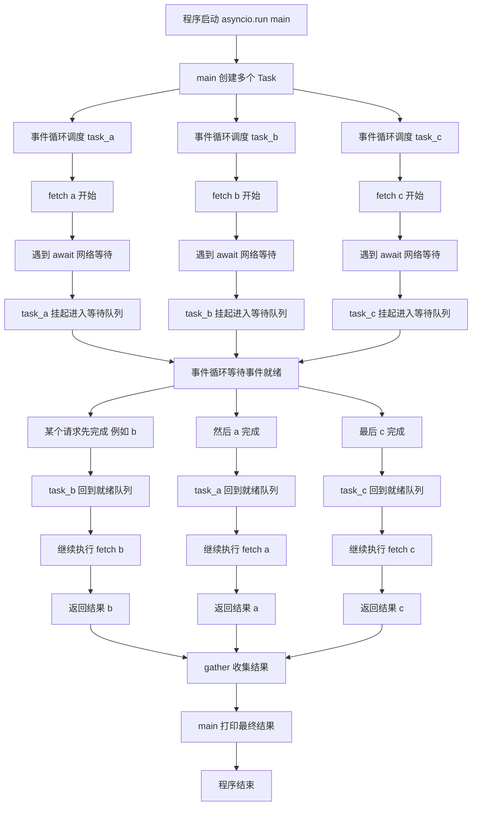

[toc]


---

##  什么是事件循环

事件循环可以理解成一个“调度中心”：

- 它不断检查有没有任务要执行
- 如果有，就把任务拿出来执行
- 如果某个任务需要等待（比如网络请求、定时器、文件IO），它不会傻等，而是先去处理别的任务
- 等待的事件准备好了，再回来继续执行对应任务

可以把它想成一个服务员：

- 有人点菜（创建任务）
- 菜还没做好（等待IO）
- 服务员不会站在厨房门口发呆，而是先去服务其他桌
- 菜好了再送回来

这就是**异步编程**的核心思想。

---

##  为什么需要事件循环

如果用传统同步方式写程序，遇到耗时操作时会阻塞：

```python
import time

def task1():
    print("task1 start")
    time.sleep(2)
    print("task1 end")

def task2():
    print("task2 start")
    time.sleep(1)
    print("task2 end")

task1()
task2()
```

执行流程：

- `task1` 先执行
- 睡眠 2 秒时，程序什么都不干
- 然后才执行 `task2`

总耗时大约 3 秒。

如果任务很多，而且大部分时间都在等待网络、数据库、磁盘等 IO，这种阻塞方式效率就比较低。

事件循环的作用就是：**在等待期间切换去做别的任务**。

---

##  Python 中的事件循环：asyncio

Python 里最常见的事件循环实现是 `asyncio`。

核心概念有几个：

- `async def`：定义协程函数
- `await`：**挂起当前协程**，**等待某个异步操作完成**
- `asyncio.run()`：**启动事件循环**并**运行协程**
- `Task`：把协程包装成可以**被事件循环调度的任务**

---

##  一个最简单的例子

```python
import asyncio

async def main():
    print("hello")
    await asyncio.sleep(1)
    print("world")

asyncio.run(main())
```

### 解释

1. `main()` 是一个协程函数
2. `asyncio.run(main())` 会创建并启动事件循环
3. 执行到 `await asyncio.sleep(1)` 时，`main` 会暂时挂起
4. **事件循环**发现现在没别的任务可做，就等 1 秒
5. 1 秒后恢复 `main`，打印 `world`

这里虽然只跑了一个任务，但已经体现出事件循环的机制：  
**遇到 await，不是阻塞整个线程，而是把控制权交回事件循环。**

---

##  并发执行多个任务

看一个更直观的例子：

```python
import asyncio

async def task(name, delay):
    print(f"{name} start")
    await asyncio.sleep(delay)
    print(f"{name} end after {delay}s")

async def main():
    t1 = asyncio.create_task(task("A", 2))
    t2 = asyncio.create_task(task("B", 1))
	# 逐个等待协程结束
    await t1
    await t2

asyncio.run(main())
```

可能输出

```python
A start
B start
B end after 1s
A end after 2s
```

为什么只要 2 秒左右

因为：

- `A` 开始后等待 2 秒
- `B` 开始后等待 1 秒
- 两个任务不是串行执行，而是都交给事件循环管理
- 事件循环在等待期间切换任务

所以总时间接近较长的那个任务，即 2 秒，而不是 3 秒。

---

##  事件循环到底在“循环”什么

可以抽象成下面这种伪代码：

```python
while True:
    检查是否有准备好的任务
    执行这些任务的一小段
    如果任务遇到 await:
        把它挂起，登记到等待队列
    如果某个IO/定时器完成:
        把对应任务放回就绪队列
```

也就是说，事件循环管理的是：

- **就绪任务队列**
- **等待中的 IO / 定时器**
- **回调函数**
- **协程恢复执行的时机**

---

##  await 的本质

很多初学者会误以为：

> `await` 就是“等待”

更准确地说：

await 表达式: 挂起 coroutine 的执行以等待一个 awaitable 对象。 只能在 coroutine function 内部使用。

> `await` 是“**把当前协程的控制权交还给事件循环，等结果准备好后再继续**”。

例如：`asyncio.sleep(2)`

```python
await asyncio.sleep(2)
```

不是说线程卡住 2 秒不动。  
而是：

- 当前协程说：“我现在要等 2 秒，你先去忙别的”
- **事件循环记录一个 2 秒后的定时器**
- 时间到了，再把这个协程恢复

---

##  create_task 的作用

如果这样写：

```python
import asyncio

async def task(name, delay):
    print(f"{name} start")
    await asyncio.sleep(delay)
    print(f"{name} end")

async def main():
    await task("A", 2)
    await task("B", 1)

asyncio.run(main())
```

这是**串行**的，总耗时约 3 秒。

> (await可以运行协程(等待协程结束),但是并不注册协程到事件循环中,所以是串行执行)

因为：

- 先完整执行 `A`
- 再执行 `B`

如果这样写：

```python
async def main():
    t1 = asyncio.create_task(task("A", 2))
    t2 = asyncio.create_task(task("B", 1))
    await t1
    await t2
```

这是**并发调度**的。

`create_task()` 的作用是：

- **把协程注册到事件循环中**
- 让它“尽快开始执行”
- 后面再通过 `await` 等它完成


---

##  asyncio.gather

如果要同时等待多个任务完成，通常会用 `await asyncio.gather`：

```python
import asyncio

async def task(name, delay):
    await asyncio.sleep(delay)
    return f"{name} done"

async def main():
    results = await asyncio.gather(
        task("A", 2),
        task("B", 1),
        task("C", 3)
    )
    print(results)

asyncio.run(main())
```

输出：

```python
['A done', 'B done', 'C done']
```

这里 3 个任务会并发执行，总耗时约 3 秒。

## 用例说明

一个更贴近实际的例子：模拟多个网络请求

```python
import asyncio
import random

async def fetch(url):
    print(f"开始请求: {url}")
    
    # 模拟网络延迟
    delay = random.randint(1, 3)
    await asyncio.sleep(delay)
    
    print(f"请求完成: {url}, 耗时 {delay}s")
    return f"{url} 的内容"

async def main():
    urls = ["https://a.com", "https://b.com", "https://c.com"]

    # 创建任务
    tasks = [asyncio.create_task(fetch(url)) for url in urls]

    print("所有请求已发出，等待结果...")

    # 并发等待所有任务完成
    results = await asyncio.gather(*tasks)

    print("\n最终结果:")
    for result in results:
        print(result)

asyncio.run(main())
```

### 执行逻辑

- 3 个“请求”几乎同时发起
- 每个请求都要等待不同时间
- 事件循环在这些等待期间切换执行
- 谁先完成就先恢复谁




---

##  事件循环适合什么场景

事件循环最适合 **IO 密集型任务**，比如：

- 网络请求
- Web 服务
- 聊天服务器
- 爬虫
- 数据库访问
- 消息队列消费者

因为这些任务经常在“等”。

## 异步代码不太适合 CPU 密集型任务

比如：

- 大量数学计算
- 图像处理
- 模型训练
- 视频编码

因为这类任务会**长时间占用 CPU，事件循环没法高效切换**。  
这时更适合：

- 多进程
- 线程池 / 进程池
- C扩展
- NumPy 等底层优化库


---

##  事件循环和线程的关系

很多人会混淆“异步”和“多线程”。

### 异步事件循环

- 通常一个线程里就可以运行
- 通过协程切换
- 切换开销小
- 适合大量 IO 等待任务

### 多线程

- 多个线程由操作系统调度
- 可以同时处理多个阻塞任务
- 编程复杂度通常更高
- 需要考虑锁、共享数据等问题

在 Python 中，`asyncio` 的并发本质上通常是：

- **单线程**
- **协作式调度**
- 任务主动在 `await` 处让出控制权

这和线程的“抢占式调度”不一样。

---

##  一个关键点：协程必须主动让出控制权

例如：

```python
import asyncio

async def bad_task():
    # 这是个设计不良的异步函数,没有await表达式来挂起耗时任务(通常是协程对象),注册到事件循环后,不会让出cpu控制器
    # 而且函数任务主体是cpu密集型任务,而不是IO,本身也不适合设计为协程函数;
    print("bad task start")
    for i in range(10**8):
        pass
    print("bad task end")

async def good_task():
    # 合理的协程函数,有合理的await表达式(这里被await的对象是通过标准库asyncio.sleep()返回的协程)
    print("good task start")
    await asyncio.sleep(1)
    print("good task end")

async def main():
    t1 = asyncio.create_task(bad_task())
    t2 = asyncio.create_task(good_task())
    await asyncio.gather(t1, t2)

asyncio.run(main())
```

这里 `bad_task()` 没有任何 `await`，会一直**占着事件循环不放**。  
结果是 `good_task()` 可能很晚才能执行。

这说明：

> 事件循环是**协作式**的，任务需要在合适的时候 `await`，**才能让其他任务运行**。

---

##  底层上事件循环在等什么

底层事件循环通常会结合**操作系统提供的 IO 多路复用机制**，例如：

- Linux: `epoll`
- macOS/BSD: `kqueue`
- Windows: `IOCP` 等

作用是：

- 用一个线程监控很多 socket / 文件描述符
- 哪个就绪了，就通知事件循环
- 事件循环再恢复对应协程

所以异步高并发网络程序的关键，不是开很多线程，而是：

- 一个事件循环
- 配合操作系统的 IO 就绪通知
- 在合适时机恢复任务

---

##  手动获取事件循环

通常推荐直接用：

```python
asyncio.run(main())
```

但有时你会看到旧一些的写法：

```python
loop = asyncio.get_event_loop()
loop.run_until_complete(main())
loop.close()
```

现代 Python 中，绝大多数场景直接使用 `asyncio.run()` 更简单、安全。

---

##  回调风格与协程风格

事件循环早期经常搭配回调函数：

```python
def callback():
    print("done")
```

现在 Python 更常用协程写法，因为更直观：

```python
result = await some_async_operation()
```

相比回调，协程代码看起来更像同步代码，可读性更好。

---

##  总结一句话

你可以把 Python 的事件循环理解为：

> 一个不断运行的调度器，负责管理协程、监听 IO/定时器事件，并在任务可继续执行时恢复它们。

---

##  最后给一个最简完整示例

```python
import asyncio

async def worker(name, delay):
    print(f"{name} started")
    await asyncio.sleep(delay)
    print(f"{name} finished after {delay}s")
    return name

async def main():
    tasks = [
        asyncio.create_task(worker("task1", 2)),
        asyncio.create_task(worker("task2", 1)),
        asyncio.create_task(worker("task3", 3)),
    ]

    results = await asyncio.gather(*tasks)
    print("results:", results)

asyncio.run(main())
```

运行结果会体现：

- 多个任务被事件循环调度
- 遇到 `await` 时挂起
- 谁先准备好谁先恢复
- 总耗时接近最长任务，而不是所有任务耗时相加

---

