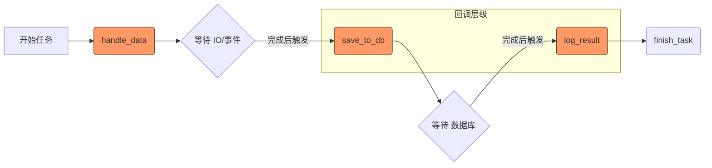

[toc]

## abstract

异步编程（Asynchronous Programming）和同步编程（Synchronous Programming）是两种不同的**程序执行模型**，主要区别在于**任务执行的顺序**和**等待机制**。

Python 的异步编程（Asynchronous Programming）是一种**高效的并发编程方式**，特别适合处理 I/O 密集型任务（如网络请求、文件读写）。

与**传统的多线程或多进程**相比，异步编程通过**事件循环和协程机制**避免了**线程切换的开销**，从而提高了**程序的性能**。

## 同步编程（Synchronous Programming）

### 1. 概念

同步编程是指程序按照代码书写的顺序**逐行执行**。当前一个任务未完成时，后续任务必须**等待**，直到前一个任务结束才能继续执行。

### 2. 工作原理

- **阻塞式**：如果一个操作需要等待（如网络请求、文件读写），整个线程会被阻塞，无法处理其他任务。
- **单线程顺序执行**：就像排队买票，一个人没买完，下一个人不能开始。

### 3. 优点

- **逻辑简单直观**：代码执行顺序与书写顺序一致，易于理解和调试。
- **状态管理简单**：不需要处理回调地狱或复杂的并发控制。

### 4. 缺点

- **效率低**：在 I/O 密集型任务中，CPU 大量时间花在等待上，资源利用率低。
- **响应性差**：如果某个任务耗时较长，整个程序会“卡住”，用户界面可能无响应。

### 5. 适用场景

- CPU 密集型任务（如复杂计算、图像处理）。
- 简单的脚本或小型应用。
- 对实时性要求不高、逻辑简单的场景。

### 示例代码

```python
import time
def fetch_data():
    print("开始获取数据...")
    time.sleep(2)  # 模拟网络延迟
    print("数据获取完成")
    return "data"


def process_data(data):
    print(f"获取到数据:{data}")
    data += " processed"
    time.sleep(1)
    print(f"数据处理完成:{data}")


# 同步执行：总耗时约 3 秒
start = time.time()
data = fetch_data()
# process_data依赖于fetch_data，因此需要等待fetch_data完成后才能执行(不能使用异步来节约时间!)
process_data(data)
print(f"总耗时: {time.time() - start:.2f} 秒")

```


## 异步编程（Asynchronous Programming）

### 1. 概念

异步编程允许程序在发起一个**耗时操作**后**不等待其完成**，而是**立即**继续执行**后续代码**。当耗时操作完成后，通过**回调函数、Promise、async/await**等方式(具体取决于不同语言的实现)通知主程序**处理结果。

### 2. 工作特点

- **非阻塞式**：发起 I/O 操作后，线程可以去做其他事情，而不是空等。
- **事件驱动/回调机制**：操作系统或运行时环境在**操作完成后触发事件**，**调用预设的处理函数**。
- **并发处理**：单个线程可以同时管理多个 I/O 操作（如 Node.js 的事件循环模型）。

#### 什么是回调机制 (Callback)？

**回调**本质上是一个**函数**，它**作为参数**传递给**另一个函数**。

**例子：** 就像你在餐厅点餐。

- **同步：** 你站在柜台盯着厨师看，直到菜做好。
- **回调：** 你点完餐，留下你的**手机号（回调函数）**。厨师做好菜后，拨打你的电话。

#### 什么是事件驱动 (Event-Driven)？

**事件驱动**是一种架构思想。**程序的流程不是由代码的顺序决定的，而是由“事件”触发的**。

1. **事件 (Event)：** 比如“数据包到达”、“定时器到期”、“用户点击按钮”。
2. **监听 (Listener)：** Event Loop 会持续监控这些事件的状态。
3. **触发 (Trigger)：** 当某个事件发生时，它会把与该事件关联的“回调函数”推入执行队列。

在 `asyncio` 底层，这个过程通常如下：

1. **注册：** 当你发起一个网络请求时，底层代码会向操作系统注册一个事件（比如：“当这个 Socket 有数据时通知我”），并关联一个回调。
2. **挂起：** 当前任务交出控制权，Event Loop 继续处理别的。
3. **触发：** 操作系统发现数据到了，发出一个信号。
4. **执行：** Event Loop 捕获到信号，找到对应的回调函数（在 `asyncio` 中通常是恢复那个被 `await` 的协程），然后执行它。

#### 用 `async/await` 语法代替直接回调

早期的异步编程（比如 Python 的 `Twisted` 框架或 JavaScript 的早期版本）大量使用显式的回调函数，这会导致著名的“回调地狱 (Callback Hell)”：

```python
# 回调地狱示例 (伪代码)
def handle_data(data):
    process_data(data, callback=save_to_db)

def save_to_db(result):
    log_result(result, callback=finish_task)

# 嵌套太深，逻辑支离破碎，极难维护
```

其中`process_data`和`log_result`是IO操作;

> 因为只有当它们是 IO 操作时，使用“回调”或“异步”才有意义。

handle_data调用等待`process_data`处理完成并回调save_to_db;

而save_to_db调用等待`log_result`处理完并回调finish_task




```python
# 现代异步写法：逻辑是连续的，不再支离破碎
async def main_task(input_data):
    # 这里的 await 相当于告诉 Event Loop：
    # "这是个 IO，你可以先去忙别的，等数据处理完了再回来跑下一行"
    data = await process_data(input_data) 
    
    result = await save_to_db(data)
    
    await log_result(result)
```


**`async/await` 的魔力：** 它在底层依然使用的是“回调”和“事件驱动”，但它在语法层面上让你像写**同步代码**一样写异步逻辑。

- `await` 标记了一个断点。
- 编译器会自动把 `await` 之后的代码包装成一个回调，等到事件完成后自动回来接着跑。

**Twisted** 是一个用 Python 编写的、开源的**事件驱动（Event-driven）网络编程框架**

传统的Twisted 非常强大且稳定，但近年来它的流行度有所下降，原因主要有两点：

1. **`asyncio` 的兴起**：Python 3 官方引入了 `asyncio` 库，并支持了更优雅的 `async/await` 语法，这使得**异步代码写起来更像同步代码**。
2. **陡峭的学习曲线**：Twisted 的早期代码风格（如大量的 `yield` 和特殊的 `Deferred` 链）对初学者来说比较晦涩。

### 3. 优点

- **高并发、高性能**：特别适合处理大量 I/O 操作（如网络请求、数据库查询）。
- **响应性好**：主线程不会被阻塞，用户界面保持流畅。
- **资源利用率高**：CPU 可以在等待 I/O 时处理其他任务。

### 4. 缺点

- **代码复杂度高**：传统写法容易出现“回调地狱”（Callback Hell），逻辑分散。
- **调试困难**：执行顺序不直观，错误堆栈可能不完整。
- **状态管理复杂**：需要处理竞态条件、数据一致性等问题。

### 5. 适用场景

- I/O 密集型应用（如 Web 服务器、API 服务）。
- 需要高并发的场景（如聊天服务器、实时数据推送）。
- 前端开发中避免 UI 冻结。

## 对比总结


| 特性             | 同步编程                       | 异步编程                       |
| ---------------- | ------------------------------ | ------------------------------ |
| 执行方式         | 顺序执行，前一个完成后才下一个 | 非阻塞，发起后立即继续         |
| 线程行为         | 阻塞等待                       | 不阻塞，可处理其他任务         |
| 代码可读性       | 高，线性逻辑                   | 较低，需处理回调或 Promise     |
| 性能（I/O 密集） | 低                             | 高                             |
| 性能（CPU 密集） | 高                             | 无优势                         |
| 典型应用场景     | 科学计算、简单脚本             | Web 服务器、前端交互、实时通信 |

---


 