[toc]


# Mermaid sequenceDiagram 完全指南

## 什么是序列图

序列图（Sequence Diagram）是 UML 中用于描述**对象之间按时间顺序交互**的图表。它展示了参与者（Participants）如何通过消息传递来协作完成某个功能或流程。

序列图的核心价值在于：
- 清晰描述系统中**谁**在**何时**向**谁**发送了**什么**消息
- 帮助理解复杂业务流程的调用链路
- 是接口设计、系统架构讨论的高效沟通工具

## 对比时序图和流程图

***流程图***回答的是"事情***怎么做***"，描述的是***步骤与逻辑***；
***时序图***回答的是"***谁***在***什么时候***跟***谁***说了***什么***"，描述的是交互与协作。


用同一个场景——**用户下单**——分别用两种图来表达：

### 流程图视角（关注步骤逻辑）


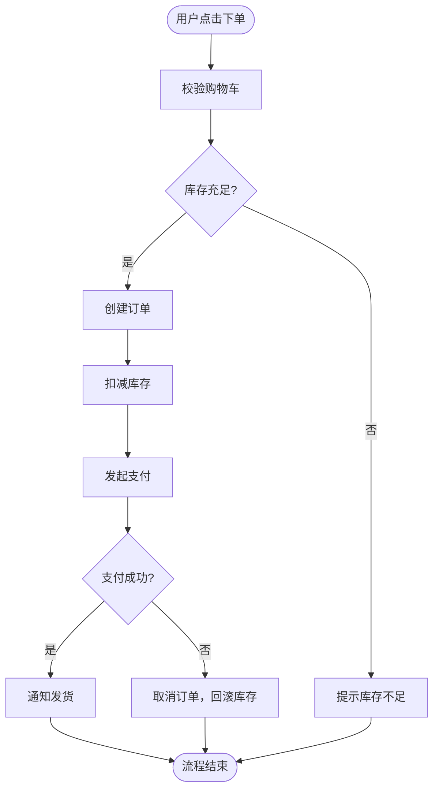

### 时序图视角（关注交互协作）


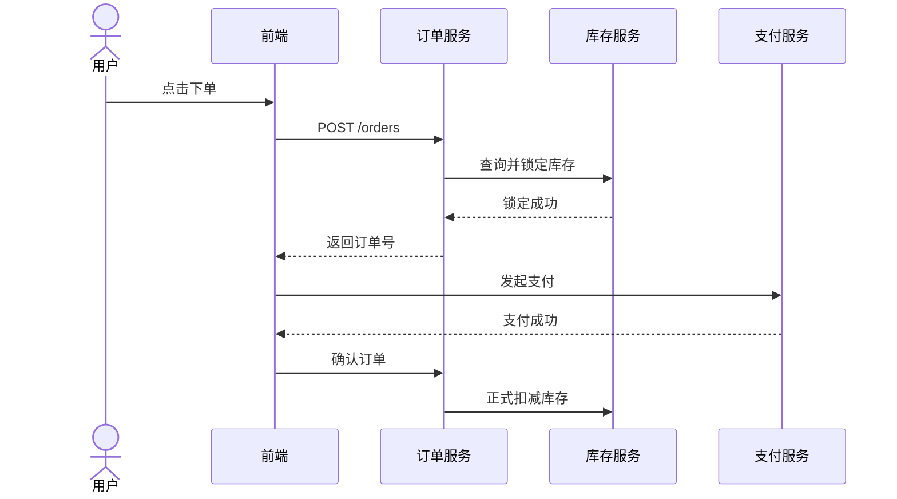

两张图描述的是**同一个业务**，但揭示的信息完全不同：流程图让你看清决策分支，时序图让你看清服务间的调用关系。

------


### 核心维度对比

| 对比维度     | 流程图               | 时序图                         |
| ------------ | -------------------- | ------------------------------ |
| **核心问题** | 怎么做？逻辑是什么？ | 谁和谁交互？顺序是什么？       |
| **时间轴**   | 无显式时间轴         | **从上到下**是明确的时间顺序   |
| **参与者**   | 不强调"谁"在执行     | 明确区分每个参与方             |
| **边界**     | 描述单一流程内部     | 描述多个系统/角色之间          |
| **分支表达** | 强，菱形判断框直观   | 弱，`alt/opt` 嵌套后可读性下降 |
| **并发表达** | 较弱                 | 强，`par` 块天然支持           |
| **消息内容** | 不关注               | 可以标注具体的消息/参数        |
| **调用方向** | 单向流动             | 双向（请求+响应）自然呈现      |

### 擅长场景对比

| 场景                         | 首选     | 原因                               |
| ---------------------------- | -------- | ---------------------------------- |
| 业务审批流程（请假、报销）   | 流程图   | 重点是步骤和判断条件               |
| 算法逻辑、代码执行路径       | 流程图   | 重点是分支和循环                   |
| 前后端接口联调               | 时序图   | 重点是谁调用谁、参数和响应         |
| 微服务调用链路分析           | 时序图   | 重点是服务间依赖和顺序             |
| 用户操作 SOP（标准作业流程） | 流程图   | 重点是操作步骤                     |
| 登录认证、OAuth 流程         | 时序图   | 涉及多方（客户端、服务端、第三方） |
| 异常处理与错误恢复           | 两者结合 | 流程图理清分支，时序图理清责任方   |
| 数据库事务流程               | 时序图   | 需要体现应用与数据库的来回交互     |

---

## 基础结构

一个最简单的序列图由以下部分构成：

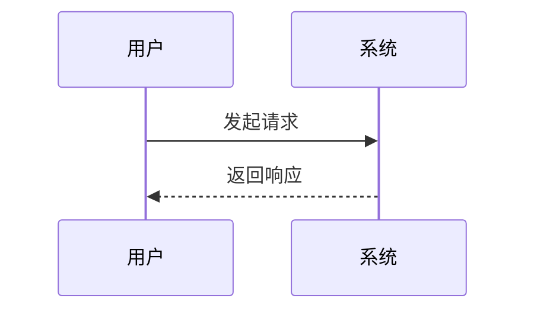

整体骨架如下：

```ini
sequenceDiagram
    participant 用户
    participant 系统
    用户->>系统: 发起请求
    系统-->>用户: 返回响应
```


- 第一行声明图表类型：`sequenceDiagram`
- 可选地声明参与者：`participant` 或 `actor`
- 之后按时间从上到下书写消息交互

---

## 参与者（Participants）

### 声明方式

| 关键字        | 含义       | 外观     |
| ------------- | ---------- | -------- |
| `participant` | 普通参与者 | 矩形框   |
| `actor`       | 人类角色   | 小人图标 |

```ini
sequenceDiagram
    actor 用户
    participant 前端
    participant 后端
    participant 数据库

    用户->>前端: 点击登录
    前端->>后端: POST /login
    后端->>数据库: 查询用户
    数据库-->>后端: 返回用户数据
    后端-->>前端: JWT Token
    前端-->>用户: 登录成功
```


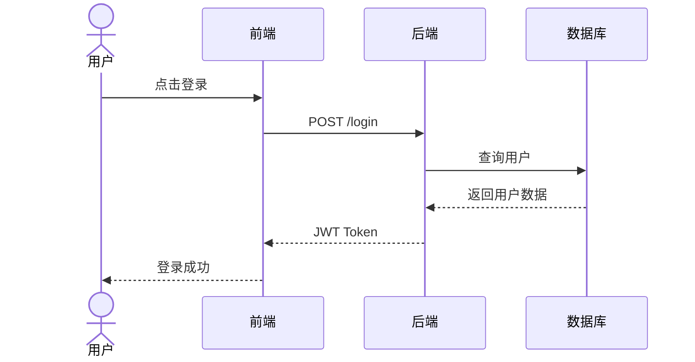

### 别名（Alias）

当参与者名字较长时，可以用别名简化书写：

```
participant B as 后端服务器
actor U as 用户张三
```

这样在后续消息中可以直接用 `B`、`U` 来引用，但图中显示的是完整名称。

### 声明顺序的意义

**参与者在图中从左到右排列的顺序，由首次出现的顺序决定。** 最佳实践是在图的开头统一 `participant` 声明，明确控制布局顺序，避免顺序混乱。

---

## 消息类型

消息是序列图的核心元素，用箭头和线型来区分不同语义。

### 箭头速查表

| 语法     | 线型 | 箭头     | 语义                            |
| -------- | ---- | -------- | ------------------------------- |
| `A->B`   | 实线 | 无箭头   | 简单连接（少用）                |
| `A-->B`  | 虚线 | 无箭头   | 简单返回（少用）                |
| `A->>B`  | 实线 | 实心箭头 | **同步调用**                    |
| `A-->>B` | 虚线 | 实心箭头 | **异步响应 / 返回值**           |
| `A-xB`   | 实线 | ×箭头    | **消息丢失 / 失败**             |
| `A--xB`  | 虚线 | ×箭头    | 异步失败                        |
| `A-)B`   | 实线 | 开放箭头 | **异步消息（fire-and-forget）** |
| `A--)B`  | 虚线 | 开放箭头 | 异步返回                        |

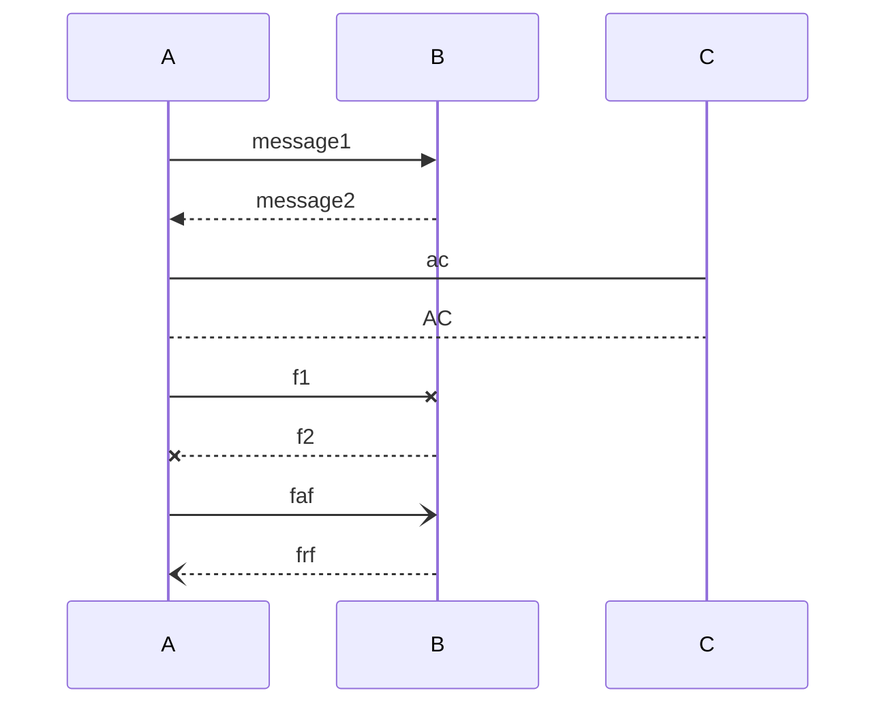


### 实际使用建议

> **最佳实践**：日常使用中，`->>` 表示请求/调用，`-->>` 表示响应/返回，这两种组合覆盖了 90% 的场景。`-)` 用于消息队列、事件推送等异步场景。

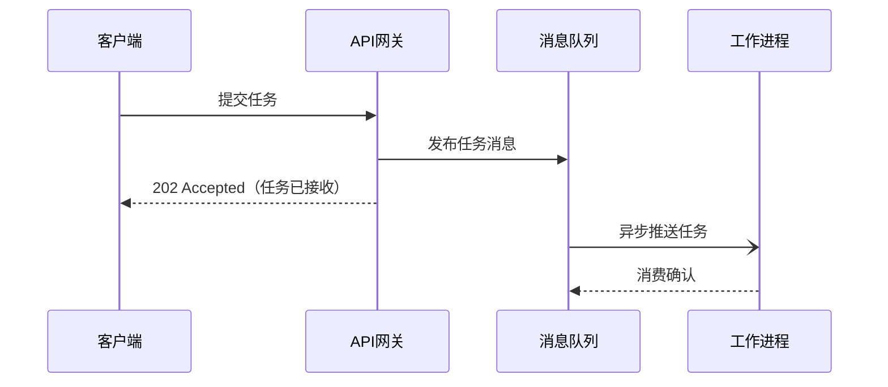

---

## 自调用消息

参与者可以向自身发送消息，表示内部处理逻辑：

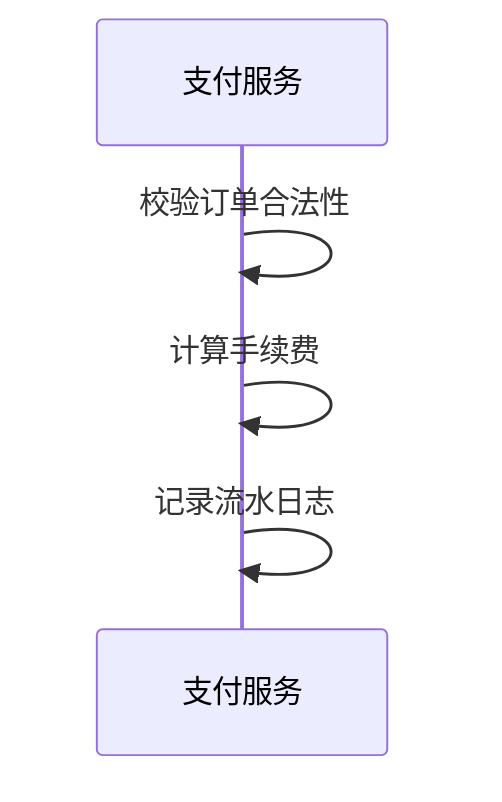

---


## 激活框（Activation）

激活框（Activation Bar）是参与者生命线上的**矩形细条**，表示该参与者**正在处理消息、处于活跃状态**。

### 两种写法

**方式一：手动标注**，在消息后加 `+` / `-`：


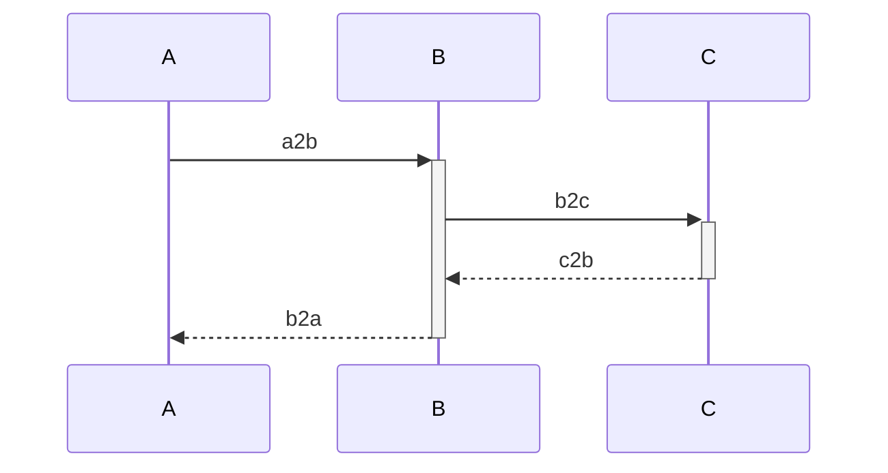


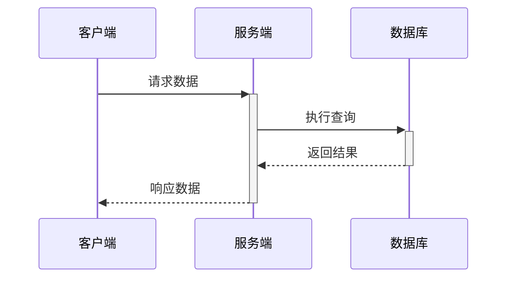


**方式二：`activate` / `deactivate` 关键字**：

```
activate 服务端
...
deactivate 服务端
```

### 嵌套激活

激活框可以嵌套，直观地展示调用栈深度，是展示同步阻塞调用链的利器。

---

## 注释（Notes）

注释用于在图中添加说明性文字，不影响流程逻辑。

### 语法

```
Note left of 参与者: 文字内容
Note right of 参与者: 文字内容
Note over 参与者A, 参与者B: 文字内容
```

| 语法              | 位置             |
| ----------------- | ---------------- |
| `Note left of X`  | X 的左侧         |
| `Note right of X` | X 的右侧         |
| `Note over X`     | 跨越 X 正上方    |
| `Note over X, Y`  | 跨越 X 和 Y 之间 |

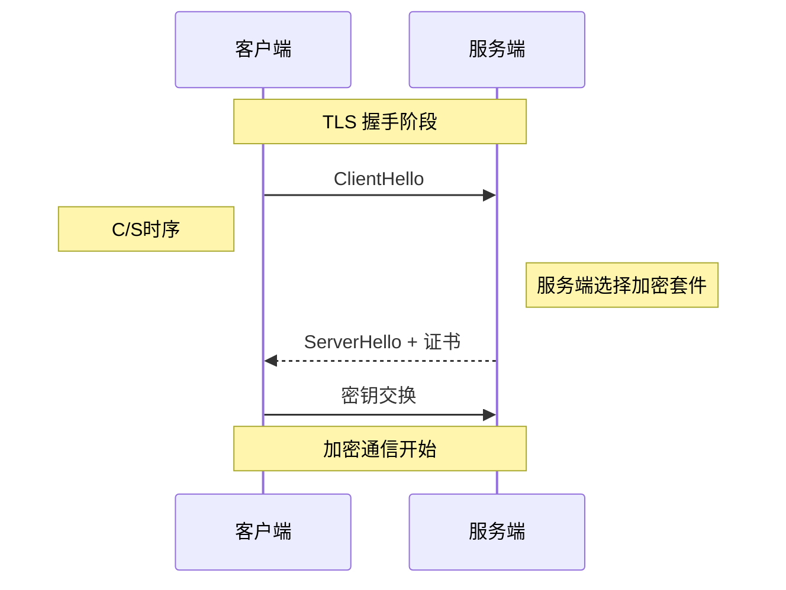

---

## 控制结构

序列图支持多种**流程控制块**，用于描述**条件分支、循环、并发**等逻辑。

### 总览

| 关键字                | 用途                   |
| --------------------- | ---------------------- |
| `loop`                | 循环                   |
| `alt` / `else`        | 条件分支（互斥）       |
| `opt`                 | 可选流程（单分支条件） |
| `par` / `and`         | 并行执行               |
| `critical` / `option` | 临界区（带可选处理）   |
| `break`               | 中断当前流程           |
| `rect`                | 背景高亮区域           |

### loop — 循环

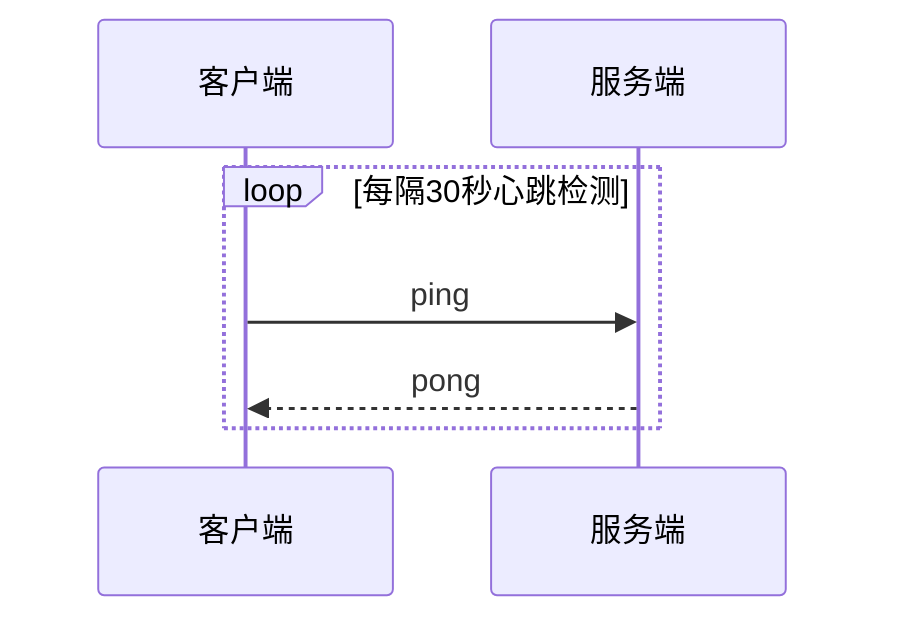

### alt / else — 条件分支

`alt` 是"alternative"的缩写，表示**互斥的多个分支**，等同于 if / else if / else。

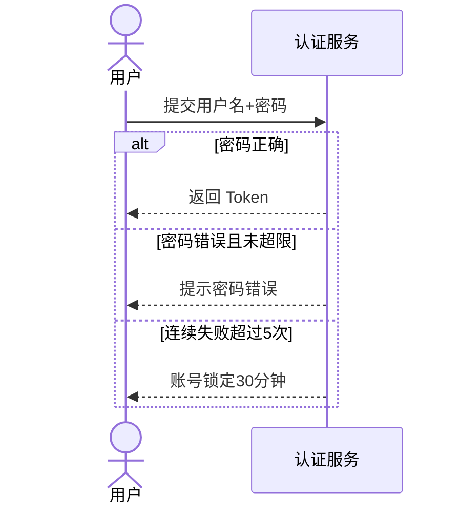

### opt — 可选流程

`opt` 表示**只有满足条件时才执行**的流程，相当于没有 else 分支的 if。

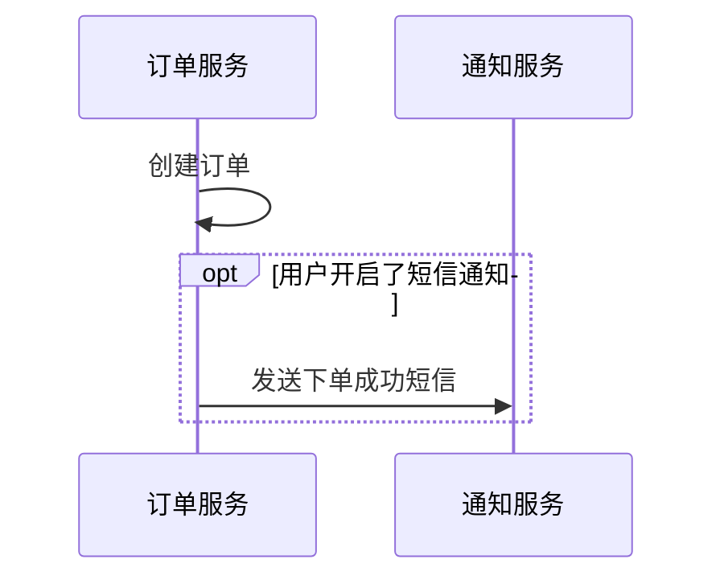

### par — 并行

`par` 表示多个操作**同时并行发生**，等同于多线程并发。

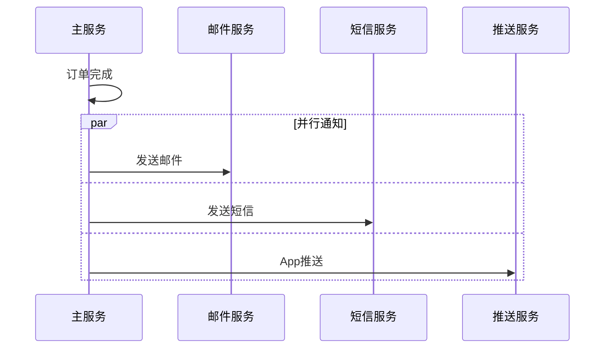

### break — 中断

`break` 表示在某种条件下**中止当前序列**，常用于错误处理场景。

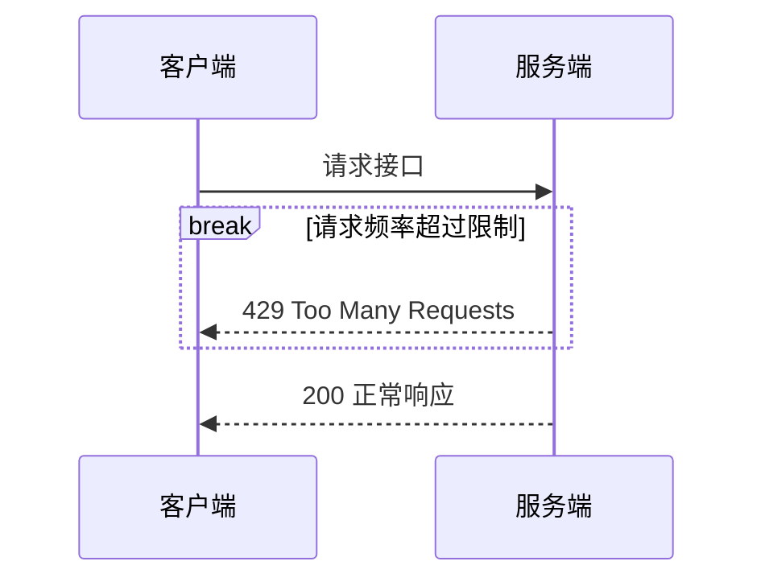

### rect — 背景高亮

`rect` 不影响逻辑，仅用于**视觉分组**，给某段流程加上背景色。

```
rect rgb(200, 230, 255)
    ...一段流程...
end
```

---


## 序号自动编号

在 `sequenceDiagram` 声明下方加入 `autonumber`，Mermaid 会自动为每条消息添加序号，便于文档引用：

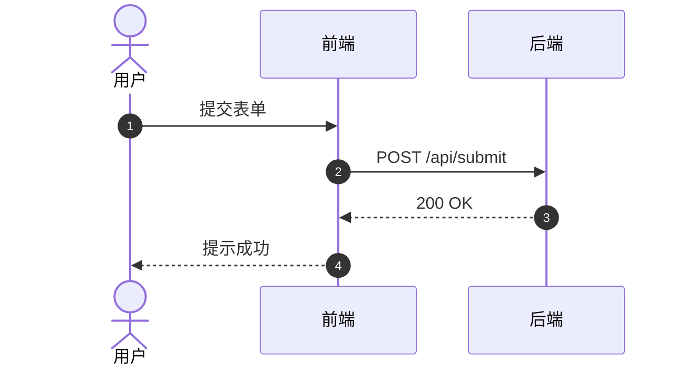

> **最佳实践**：在技术文档、API 设计说明中使用 `autonumber`，方便在文字说明中引用"步骤3"、"步骤4"等。

---

## 综合实战：用户登录完整流程

以下示例综合运用了本文介绍的主要特性：

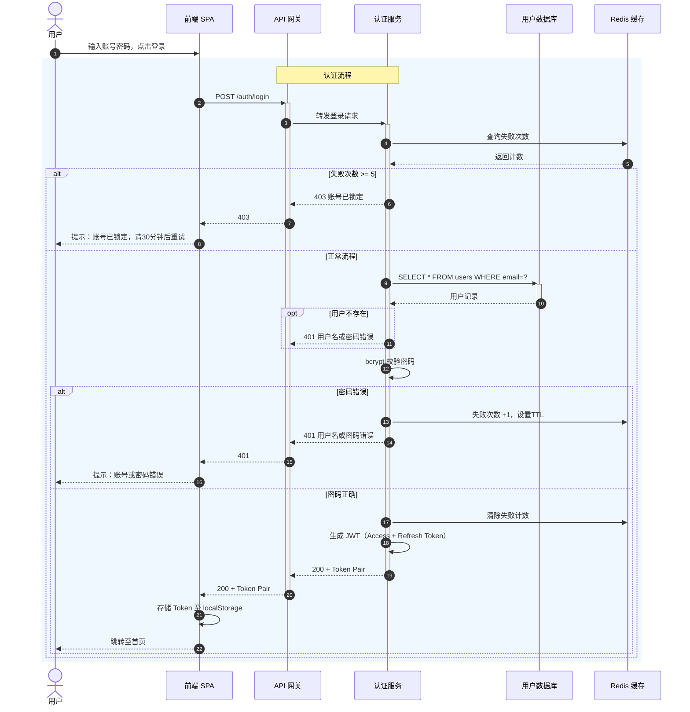

---

## 常见错误与最佳实践

### 常见错误

| 错误                   | 说明                                | 正确做法                                 |
| ---------------------- | ----------------------------------- | ---------------------------------------- |
| 参与者名含空格未加引号 | `participant API Server` 会解析出错 | 改用别名：`participant S as API Server`  |
| 嵌套块未正确关闭       | `alt` 缺少 `end`                    | 每个控制块都必须有对应的 `end`           |
| 滥用自调用             | 大量自调用使图变得复杂              | 自调用应只表示关键内部步骤               |
| 过度细化               | 把所有代码逻辑都画进去              | 序列图应聚焦**关键交互**，细节用文字补充 |

### 最佳实践总结

**聚焦目标**：一张序列图只描述一个场景或一个用例，不要试图面面俱到。

**统一声明参与者**：始终在图的顶部用 `participant`/`actor` 声明所有角色，控制从左到右的排列顺序。

**善用 `autonumber`**：当序列图作为技术文档的配图时，开启自动编号，方便正文引用特定步骤。

**用 `rect` 做视觉分层**：当流程较长时，用 `rect` 将相关步骤归组，提升可读性。

**虚线表示返回**：严格遵循 `->>` 表示请求、`-->>` 表示响应的惯例，让读者形成稳定的阅读预期。

**别名保持简短**：别名建议用1-2个大写字母，如 `U`、`FE`、`DB`，减少图源码的视觉噪音。