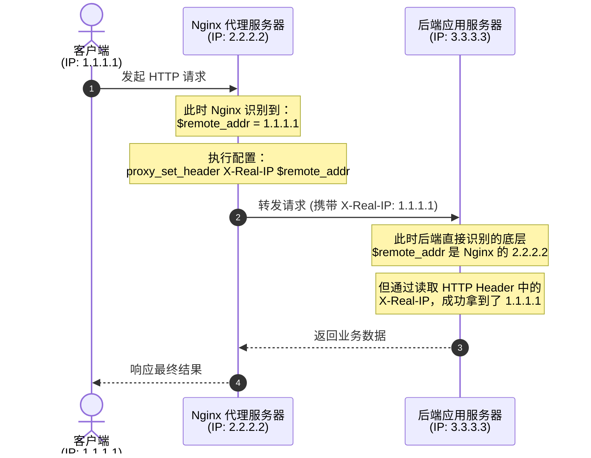
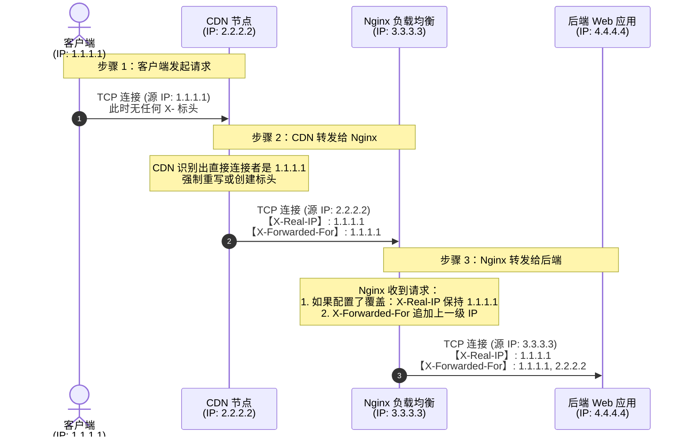
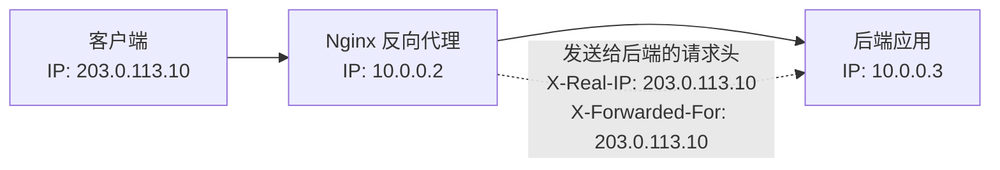
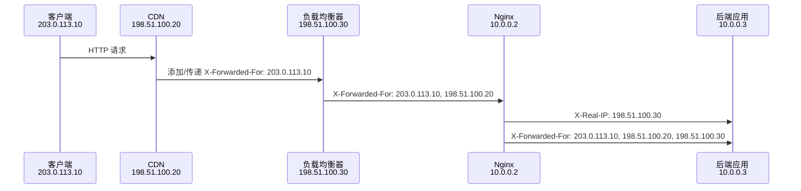
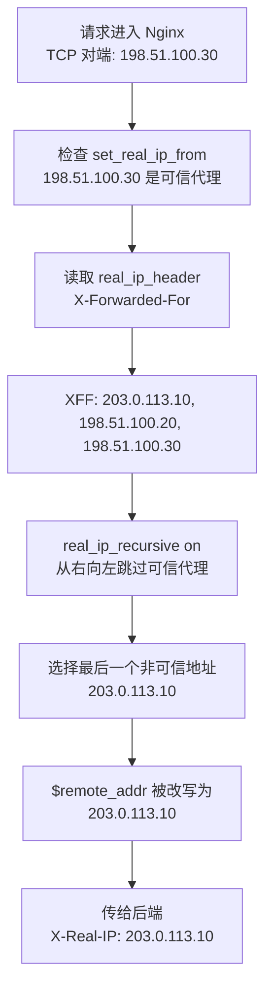

[toc]


在 Nginx 和其他反向代理（如 CDN、负载均衡器）的配置中，**`X-Real-IP` 是一个自定义的 HTTP 请求标头（Header），用于记录客户端的真实 IP 地址。**

当一个客户端（你的电脑）访问一个网站时，如果中间隔了代理服务器，后端真正的 Web 服务器就很容易“迷失”客户端的真实身份。`X-Real-IP` 就是为了解决这个问题而诞生的。

## 为什么需要 X-Real-IP？

要理解它，我们先来看一个典型的架构模型：

### 1. 没有代理的情况

- 客户端（IP: `1.1.1.1`）直接访问后端服务器（IP: `3.3.3.3`）。
- 后端服务器通过网络连接的套接字（Socket）直接获取底层变量 `$remote_addr`，得到的就是 `1.1.1.1`。

### 2. 有反向代理（如 Nginx）的情况

- 客户端（IP: `1.1.1.1`）访问 Nginx 代理服务器（IP: `2.2.2.2`）。
- Nginx 接受请求后，再将请求转发给后端服务器（IP: `3.3.3.3`）。
- **问题来了：** 此时对于后端服务器来说，直接和它建立连接的是 Nginx。如果后端服务器再去读取 `$remote_addr`，拿到的将是 Nginx 的 IP（`2.2.2.2`），而不是客户端的真实 IP。

为了让后端服务器知道是谁在访问，**Nginx 在转发请求时**，会主动加上一个暗号：`X-Real-IP: 1.1.1.1`。



如果是多级代理,例如:




**`$remote_addr` 永远在变**：它永远代表**上一跳**的物理连接 IP。对 CDN 来说它是客户端，对 Nginx 来说它是 CDN，对后端来说它是 Nginx。

**`X-Real-IP` 保持不变（推荐做法）**：在第一层代理（CDN）捕获到客户端真实 IP `1.1.1.1` 并写入 `X-Real-IP` 后，后续的 Nginx 应该**只透传，不覆盖**它，这样后端应用直接读取 `X-Real-IP` 就能拿到 `1.1.1.1`。

**`X-Forwarded-For` 越滚越大**：每经过一级代理，该代理就会把**它眼中的 `$remote_addr`** 追随到原有列表的末尾，因此形成了 IP 链。

## 如何在 Nginx 中配置 X-Real-IP？

如果你作为**代理服务器的管理员**，需要在 Nginx 的 `location` 块中**显式地将"客户端的 IP" 写入这个标头**，然后传递给后端：


```nginx
location / {
    proxy_pass http://backend_server;
    
    # 将客户端的直接连接 IP ($remote_addr) 赋值给 X-Real-IP 标头
    proxy_set_header X-Real-IP $remote_addr;
    
    # 顺便提一下另一个常用的相关标头
    proxy_set_header X-Forwarded-For $proxy_add_x_forwarded_for;
}
```


## 安全防范：IP 伪造漏洞（Spoofing）

`X-Real-IP` 是一个 HTTP 标头，这意味着**客户端可以任意伪造它**。

如果你的 Nginx 代理直接信任了客户端传过来的 `X-Real-IP`，或者后端服务器没有经过校验就直接拿来使用（比如用于异地登录提示、防刷限流、甚至是基于 IP 的鉴权），就会带来严重的漏洞。攻击者只需要在请求头里加上 `X-Real-IP: 8.8.8.8`，就能轻易伪装成谷歌的服务器。

**防范标准：**

1. 在最外层的边缘代理服务器（直接对公网提供服务的 Nginx）上，**必须强制覆盖** `X-Real-IP`，将其设置为真正的底层连接 IP（`$remote_addr`），不允许客户端伪造的输入传递到后端。
2. 在后端应用中，如果需要获取该值，确保只信任可信赖的反向代理传过来的标头。

## 详解

下面以 **Nginx 反向代理** 场景为核心，严谨解释 `X-Real-IP`，再对比 `X-Forwarded-For`。

## 1. 先明确：后端默认看到的 IP 是谁？

假设请求链路是：

```text
浏览器客户端 203.0.113.10 #(后续会提到)
        ↓
Nginx 反向代理 10.0.0.2
        ↓
后端应用 10.0.0.3
```

如果 Nginx 不额外传递客户端 IP，后端应用看到的 TCP 对端地址通常是：

```text
10.0.0.2
```

也就是 **Nginx 反向代理服务器的 IP**，不是浏览器用户的真实 IP。

MDN 对 `X-Forwarded-For` 的说明也强调：当请求经过代理时，服务器通常只能看到最后一个代理的 IP，因此需要额外头部(例如`X-Forwarded-For`)传递更有用的客户端地址信息。([developer.mozilla.org](https://developer.mozilla.org/en-US/docs/Web/HTTP/Reference/Headers/X-Forwarded-For))

------

## 2. `X-Real-IP` 是什么？

`X-Real-IP` 是一个常见但非标准化的 HTTP 请求头，**通常由反向代理设置**，用来告诉后端应用：

> 这个请求在到达我这个代理时，直接连接我的客户端 IP 是谁。

在 Nginx 里最常见写法是：

```nginx
location / {
    proxy_pass http://127.0.0.1:3000;

    proxy_set_header Host $host;
    proxy_set_header X-Real-IP $remote_addr;
}
```

这里的关键是：

```nginx
proxy_set_header X-Real-IP $remote_addr;
```

Nginx 官方 `proxy_set_header` 文档说明，该指令用于重新定义或追加**传给被代理服务器**的请求头；它可以写在 `http`、`server` 或 `location` 上下文中。([nginx.org](https://nginx.org/en/docs/http/ngx_http_proxy_module.html))

`$remote_addr` 是 Nginx 当前看到的直接连接方 IP。也就是说：

```text
X-Real-IP = "Nginx 看到的直接上游客户端 IP"
```

在最简单的单层反向代理中：

```text
用户浏览器 → Nginx → 后端
```

`$remote_addr` 就是用户浏览器的公网 IP，因此：

```http
X-Real-IP: 203.0.113.10
```

------

## 3. 单层反向代理示例

### Nginx 配置

```nginx
server {
    listen 80;
    server_name app.example.com;

    location / {
        proxy_pass http://127.0.0.1:3000;

        proxy_set_header Host $host;
        proxy_set_header X-Real-IP $remote_addr;
        proxy_set_header X-Forwarded-For $proxy_add_x_forwarded_for;
        proxy_set_header X-Forwarded-Proto $scheme;
    }
}
```

### 请求链路示意图



此时后端应用收到：

```http
Host: app.example.com
X-Real-IP: 203.0.113.10
X-Forwarded-For: 203.0.113.10
X-Forwarded-Proto: http
```

在这个简单场景中，`X-Real-IP` 和 `X-Forwarded-For` 看起来差不多。

------

## 4. `X-Forwarded-For` 是什么？

`X-Forwarded-For`，常简称 XFF，是事实标准头部，用于标识客户端经过代理连接到 Web 服务时的原始 IP。MDN 描述它的基本格式是：

```http
X-Forwarded-For: <client>, <proxy>
X-Forwarded-For: <client>, <proxy>, ..., <proxyN>
```

也就是说，它不是单个 IP，而是一个 **逗号分隔的 IP 链表**。

左侧通常是原始客户端，右侧越靠近当前服务器。

> MDN 明确说明：如果请求经过多个代理，每个后续代理的 IP 会被列出；最右侧是最近的代理，最左侧是原始客户端，前提是客户端和代理都行为正常。([developer.mozilla.org](https://developer.mozilla.org/en-US/docs/Web/HTTP/Reference/Headers/X-Forwarded-For))

Nginx 官方变量 `$proxy_add_x_forwarded_for` 的定义是：

```text
原始 X-Forwarded-For 请求头 + 逗号 + $remote_addr
```

如果原请求没有 `X-Forwarded-For`，则该变量等于 `$remote_addr`。([nginx.org](https://nginx.org/en/docs/http/ngx_http_proxy_module.html))

所以常见配置是：

```nginx
proxy_set_header X-Forwarded-For $proxy_add_x_forwarded_for;
```

------

## 5. 多层代理下的差异

假设链路变复杂：

```text
客户端 203.0.113.10
  ↓
CDN 198.51.100.20
  ↓
负载均衡器 198.51.100.30
  ↓
Nginx 10.0.0.2
  ↓
后端应用 10.0.0.3
```

此时 Nginx 看到的 `$remote_addr` 是谁？

```text
198.51.100.30
```

因为直接连接 Nginx 的不是浏览器，而是负载均衡器。

如果 Nginx 配置如下：

```nginx
proxy_set_header X-Real-IP $remote_addr;
proxy_set_header X-Forwarded-For $proxy_add_x_forwarded_for;
```

那么后端可能收到：

```http
X-Real-IP: 198.51.100.30
X-Forwarded-For: 203.0.113.10, 198.51.100.20, 198.51.100.30
```

#### 示意图：



这里可以看出核心区别：

```text
X-Real-IP        通常是一个 IP，表示 Nginx 当前认为的“真实客户端”
X-Forwarded-For  是一个 IP 链，表示请求经过的代理路径
```

但注意：在多层代理中，如果你没有正确配置 Nginx 的 realip 模块，`X-Real-IP: $remote_addr` 可能只是上一跳代理 IP，而不是最终用户 IP。

------

## 6. `X-Real-IP` 与 Nginx realip 模块的关系

Nginx 有一个 `ngx_http_realip_module` 模块，用来把 Nginx 里的客户端地址替换成某个请求头传来的地址。

> 官方文档说明，该模块用于把客户端地址和可选端口改成指定头字段中发送的值；但该模块不是默认内建，编译时需要启用 `--with-http_realip_module`。([nginx.org](https://nginx.org/en/docs/http/ngx_http_realip_module.html))

典型配置：

```nginx
set_real_ip_from 198.51.100.20;
set_real_ip_from 198.51.100.30;

real_ip_header X-Forwarded-For;
real_ip_recursive on; #在多级代理下比较有用,如果是单级代理,则看不出差别.
```

含义：

> 我信任 198.51.100.20 和 198.51.100.30 这些代理；
> 请从 `X-Forwarded-For` 中推导真实客户端 IP；
> 如果有多层代理，(从右往左)**递归查找**最后一个非受信任地址。

官方文档说明，

- `set_real_ip_from` 用于定义可信地址；
- `real_ip_header` 定义用哪个请求头替换客户端地址；
- `real_ip_recursive on` 时，会把原客户端地址替换为请求头中最后一个非可信地址。([nginx.org](https://nginx.org/en/docs/http/ngx_http_realip_module.html))

配置后，Nginx 的 `$remote_addr` 可能**被改写成真正的客户端 IP**(注意用的是`X-Forwarded-For`而非`X-Real-IP`)。于是：

```nginx
proxy_set_header X-Real-IP $remote_addr;
```

此时传给后端的 `X-Real-IP` 就更可能是最终用户 IP，而不是上一跳代理 IP。

示意图：



------

## 7. 对比：`X-Real-IP` vs `X-Forwarded-For`

| 对比项         | `X-Real-IP`                                                 | `X-Forwarded-For`                                            |
| -------------- | ----------------------------------------------------------- | ------------------------------------------------------------ |
| 常见用途       | 给后端一个“当前判断出的真实客户端 IP”                       | 保留请求经过的代理链                                         |
| 值的形式       | 通常是单个 IP                                               | 逗号分隔的多个 IP                                            |
| 是否标准化     | 常见约定，不是 HTTP 标准头                                  | 事实标准，但 MDN 说明标准化版本是 `Forwarded`，而 `Forwarded` 使用较少 ([developer.mozilla.org](https://developer.mozilla.org/en-US/docs/Web/HTTP/Reference/Headers/X-Forwarded-For)) |
| Nginx 常见配置 | `proxy_set_header X-Real-IP $remote_addr;`                  | `proxy_set_header X-Forwarded-For $proxy_add_x_forwarded_for;` |
| 多层代理表现   | 默认只反映 Nginx 当前看到的直接客户端；**可能是上一跳代理** | 能表达完整链路，例如 `client, proxy1, proxy2`                |
| 后端解析难度   | 简单，直接读一个 IP                                         | 复杂，需要从列表中选择可信 IP                                |
| 安全风险       | 如果直接信任外部传入的 `X-Real-IP`，可被伪造                | 如果直接信任左侧 IP，也可被伪造；MDN 明确警告错误使用有安全风险 ([developer.mozilla.org](https://developer.mozilla.org/en-US/docs/Web/HTTP/Reference/Headers/X-Forwarded-For)) |
| 推荐使用场景   | 后端只需要一个经 Nginx 处理后的客户端 IP                    | 需要审计代理链、排查链路、支持多级代理                       |

------

## 8. 安全重点：不要盲目信任客户端传来的这些头

客户端可以自己**伪造**请求头，例如：

```bash
curl http://app.example.com \
  -H 'X-Real-IP: 1.2.3.4' \
  -H 'X-Forwarded-For: 8.8.8.8'
```

如果你的后端直接相信这些头，就可能被绕过限流、IP 黑名单、地理位置判断或审计记录。

MDN 明确提醒：如果任何代理是恶意或配置错误的，那么不是由可信代理添加的部分可能被伪造；如果服务器可以从公网直接访问，即使它也位于可信反向代理后面，也不能把 `X-Forwarded-For` IP 列表用于安全相关用途。([developer.mozilla.org](https://developer.mozilla.org/en-US/docs/Web/HTTP/Reference/Headers/X-Forwarded-For))

因此生产环境应遵守：

> 只信任你控制的反向代理、负载均衡器、CDN 添加的头。
> 后端服务不要直接暴露到公网。
> 应用层不要盲目取 X-Forwarded-For 的第一个 IP,谨防伪造。

------

## 9. 推荐配置方式

### 场景 A：只有一层 Nginx，客户端直接访问 Nginx

```nginx
location / {
    proxy_pass http://127.0.0.1:3000;

    proxy_set_header Host $host;
    proxy_set_header X-Real-IP $remote_addr;
    proxy_set_header X-Forwarded-For $proxy_add_x_forwarded_for;
    proxy_set_header X-Forwarded-Proto $scheme;
}
```

此时：

```text
X-Real-IP ≈ 用户真实 IP
X-Forwarded-For ≈ 用户真实 IP
```

### 场景 B：Nginx 前面还有 CDN 或负载均衡器

假设可信代理是：

```text
198.51.100.20  # CDN
198.51.100.30  # LB
```

可以这样：

```nginx
set_real_ip_from 198.51.100.20;
set_real_ip_from 198.51.100.30;

real_ip_header X-Forwarded-For; # 改写$remote_addr
real_ip_recursive on;

server {
    listen 80;
    server_name app.example.com;

    location / {
        proxy_pass http://127.0.0.1:3000;

        proxy_set_header Host $host;
        proxy_set_header X-Real-IP $remote_addr;
        proxy_set_header X-Forwarded-For $proxy_add_x_forwarded_for;
        proxy_set_header X-Forwarded-Proto $scheme;
    }
}
```

此时 Nginx 会先根据可信代理列表和 `X-Forwarded-For` 推导真实客户端 IP，再把改写后的 `$remote_addr` 放进 `X-Real-IP`。

------

## 10. 后端应用应该怎么取？

如果后端只在你的 Nginx 后面，且后端无法被公网直连，通常优先取：

```text
X-Real-IP
```

因为它简单，通常已经由 Nginx 处理过。

如果你需要完整链路审计，则记录：

```text
X-Forwarded-For
```

但安全相关判断不要简单取最左侧 IP。

MDN 建议在选择可信 IP 时，应基于**可信**代理数量或可信代理列表，从右向左推导；可信代理列表方法是从最右侧开始跳过所有可信代理，遇到的**第一个非可信地址才是目标地址**。([developer.mozilla.org](https://developer.mozilla.org/en-US/docs/Web/HTTP/Reference/Headers/X-Forwarded-For))

------

## 11. 最佳实践总结

推荐反向代理时同时传：

```nginx
proxy_set_header X-Real-IP $remote_addr;
proxy_set_header X-Forwarded-For $proxy_add_x_forwarded_for;
```

但两者承担不同职责：

- X-Real-IP:
      给后端一个“当前 Nginx 认为的客户端 IP”。
- X-Forwarded-For:
      保留代理链路，便于多级代理、审计和排障。

生产环境最稳妥的策略是：

1. 后端只允许来自 Nginx / LB 的内网访问；
2. Nginx 前面有 CDN/LB 时，配置 set_real_ip_from；
3. 用 real_ip_header X-Forwarded-For；
4. 开启 real_ip_recursive on；
5. 传 X-Real-IP 给后端作为应用使用的客户端 IP；
6. 同时记录 X-Forwarded-For 用于审计；
7. 不要信任公网客户端直接带来的 X-Real-IP 或 X-Forwarded-For。

一句话概括：

- X-Real-IP 是“代理整理后的单个客户端 IP”；
- X-Forwarded-For 是“请求经过代理链的 IP 列表”。