[toc]

## abstract

我有多个服务器a1,a2，...（部署了一些网站）要严格保护ip，以及一个对外的服务器b，用来对外直接服务，或者绑定cdn(可以暴露给cdn).
如果我希望所有客户的请求都通过b间接访问a类服务器，可以怎么做?
我打算全部服务器使用nginx，那么应该怎么配置？(a类站点是一些wp站点)
如果我的a类服务器不做负载均衡，都是互不相同的网站？

## 推荐架构

B 是唯一入口，A 类服务器只做源站

你的目标本质上是 **隐藏源站 IP**：所有用户只访问 B，B 再反向代理到不同的 A 服务器。

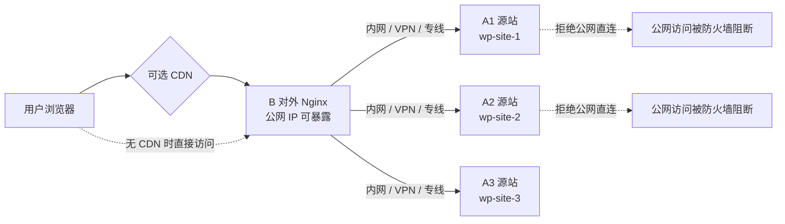

核心原则是：

| 层级       | 职责                                                     |
| ---------- | -------------------------------------------------------- |
| CDN，可选  | 抗 DDoS、缓存静态资源、隐藏 B 的部分真实访问压力         |
| B 服务器   | 唯一公网入口，处理 HTTPS、域名分发、反代、日志、限流     |
| A 类服务器 | 只接受来自 B 的请求，运行 WordPress、PHP-FPM、数据库连接 |
| 防火墙     | A 类服务器禁止公网访问 80/443，只允许 B 的内网/VPN IP    |
| DNS        | 所有站点域名只解析到 B 或 CDN，不解析到 A                |

Nginx 反向代理的基本机制就是用 `proxy_pass` 把请求传给后端，并可通过 `proxy_set_header` 改写传给后端的请求头；Nginx 官方文档也把这种方式作为反向代理的标准配置。([Nginx](https://nginx.org/en/docs/http/ngx_http_proxy_module.html?utm_source=chatgpt.com))

## 你的场景不需要负载均衡，而是“按域名路由”

你说 A 类站点是互不相同的网站，不做负载均衡。那就不要把 A1、A2、A3 放进同一个 upstream 池里轮询，而是：

| 域名        | B 上的路由目标                 | 源站 |
| ----------- | ------------------------------ | ---- |
| `site1.com` | `proxy_pass http://10.10.0.11` | A1   |
| `site2.com` | `proxy_pass http://10.10.0.12` | A2   |
| `site3.com` | `proxy_pass http://10.10.0.13` | A3   |

Nginx 会根据请求里的 `Host` 头选择对应的 `server_name`，如果没有匹配到，会落入该端口的默认 server；这是 Nginx 虚拟主机选择的核心规则。([Nginx](https://nginx.org/en/docs/http/request_processing.html?utm_source=chatgpt.com))

## 网络层最佳实践

### 最安全的连接方式

强烈建议 B 到 A 之间走 **私有网络或 WireGuard VPN**，不要让 B 通过 A 的公网 IP 回源。

| 方案                                   | 安全性 | 推荐度 | 说明                          |
| -------------------------------------- | ------ | ------ | ----------------------------- |
| B 通过公网 IP 访问 A                   | 低     | 不推荐 | A 的公网 IP 仍可能被扫到      |
| A 防火墙只允许 B 公网 IP               | 中     | 可用   | 简单，但 A 的 IP 仍存在公网面 |
| B 与 A 走内网/VPC                      | 高     | 推荐   | 云服务器同区域同 VPC 很适合   |
| B 与 A 走 WireGuard/Tailscale/ZeroTier | 高     | 推荐   | 跨云厂商、跨机房尤其适合      |
| A 无公网 IP，只挂内网                  | 最高   | 最推荐 | 真正隐藏源站                  |

如果你追求“严格保护 IP”，最佳方案是：**A 类服务器不要绑定公网 IP，或者即使有公网 IP，也用防火墙彻底关闭公网入站 80/443。**

## B 服务器 Nginx 配置

下面示例假设：

| 服务器 | 内网/VPN IP  |
| ------ | ------------ |
| B      | `10.10.0.1`  |
| A1     | `10.10.0.11` |
| A2     | `10.10.0.12` |
| A3     | `10.10.0.13` |

### 公共反代参数

建议把公共代理头单独放到一个文件，例如：

```nginx
# /etc/nginx/snippets/proxy-common.conf

proxy_http_version 1.1;

proxy_set_header Host              $host;
proxy_set_header X-Real-IP         $remote_addr;
proxy_set_header X-Forwarded-For   $proxy_add_x_forwarded_for;
proxy_set_header X-Forwarded-Host  $host;
proxy_set_header X-Forwarded-Proto $scheme;
proxy_set_header X-Forwarded-Port  $server_port;

proxy_connect_timeout 5s;
proxy_send_timeout    60s;
proxy_read_timeout    60s;

proxy_buffering on;
proxy_redirect off;
```

对 WordPress 来说，最关键的是：

| Header              | 作用                                           |
| ------------------- | ---------------------------------------------- |
| `Host`              | 让源站 WordPress 知道用户访问的真实域名        |
| `X-Real-IP`         | 传递真实客户端 IP                              |
| `X-Forwarded-For`   | 传递代理链路上的客户端 IP                      |
| `X-Forwarded-Proto` | 告诉源站用户外部访问协议是 `https` 还是 `http` |
| `X-Forwarded-Host`  | 传递原始域名                                   |

WordPress 在反向代理后面时，常见问题是后台登录、跳转、资源链接、Cookie 安全标记因为源站误以为自己是 HTTP 而异常；WordPress Core Trac 中也长期讨论过需要通过 `HTTP_X_FORWARDED_PROTO=https` 让后端识别外部 HTTPS 的问题。([core.trac.wordpress.org](https://core.trac.wordpress.org/ticket/15733?utm_source=chatgpt.com))

### B 的默认拒绝配置

先写一个默认站点，拒绝所有未绑定域名的请求：

```nginx
server {
    listen 80 default_server;
    server_name _;
    return 444;
}

server {
    listen 443 ssl default_server;
    http2 on;
    server_name _;

    ssl_certificate     /etc/nginx/certs/default.crt;
    ssl_certificate_key /etc/nginx/certs/default.key;

    return 444;
}
```

这样别人用 IP 直接访问 B，或者用乱七八糟的 Host 头访问，不会被转发到任何 A 服务器。

### B 上为每个 WordPress 站点配置一个 server

例如 `site1.com` 转发到 A1：

```nginx
server {
    listen 80;
    server_name site1.com www.site1.com;

    return 301 https://site1.com$request_uri;
}

server {
    listen 443 ssl;
    http2 on;
    server_name site1.com www.site1.com;

    ssl_certificate     /etc/letsencrypt/live/site1.com/fullchain.pem;
    ssl_certificate_key /etc/letsencrypt/live/site1.com/privkey.pem;

    location / {
        proxy_pass http://10.10.0.11;
        include /etc/nginx/snippets/proxy-common.conf;
    }
}
```

`site2.com` 转发到 A2：

```nginx
server {
    listen 80;
    server_name site2.com www.site2.com;

    return 301 https://site2.com$request_uri;
}

server {
    listen 443 ssl;
    http2 on;
    server_name site2.com www.site2.com;

    ssl_certificate     /etc/letsencrypt/live/site2.com/fullchain.pem;
    ssl_certificate_key /etc/letsencrypt/live/site2.com/privkey.pem;

    location / {
        proxy_pass http://10.10.0.12;
        include /etc/nginx/snippets/proxy-common.conf;
    }
}
```

`site3.com` 转发到 A3：

```nginx
server {
    listen 80;
    server_name site3.com www.site3.com;

    return 301 https://site3.com$request_uri;
}

server {
    listen 443 ssl;
    http2 on;
    server_name site3.com www.site3.com;

    ssl_certificate     /etc/letsencrypt/live/site3.com/fullchain.pem;
    ssl_certificate_key /etc/letsencrypt/live/site3.com/privkey.pem;

    location / {
        proxy_pass http://10.10.0.13;
        include /etc/nginx/snippets/proxy-common.conf;
    }
}
```

这不是负载均衡，而是 **域名级反向代理路由**。

## A 类服务器 Nginx 配置

A 服务器上仍然运行 Nginx + PHP-FPM + WordPress。关键是：**A 只监听内网/VPN 地址，或防火墙只允许 B 访问。**

A1 示例：

```nginx
server {
    listen 10.10.0.11:80;
    server_name site1.com www.site1.com;

    root /var/www/site1.com/public;
    index index.php index.html;

    access_log /var/log/nginx/site1.access.log;
    error_log  /var/log/nginx/site1.error.log warn;

    location / {
        try_files $uri $uri/ /index.php?$args;
    }

    location ~ \.php$ {
        include fastcgi_params;
        fastcgi_param SCRIPT_FILENAME $document_root$fastcgi_script_name;
        fastcgi_param HTTP_X_FORWARDED_PROTO $http_x_forwarded_proto;
        fastcgi_param HTTP_X_FORWARDED_FOR   $http_x_forwarded_for;
        fastcgi_param HTTP_X_REAL_IP         $http_x_real_ip;
        fastcgi_pass unix:/run/php/php8.3-fpm.sock;
    }

    location ~* \.(log|sql|bak|old|swp)$ {
        deny all;
    }

    location ~ /\. {
        deny all;
    }
}
```

A2、A3 类似，只需要改：

| 项目           | A1                          | A2                          | A3                          |
| -------------- | --------------------------- | --------------------------- | --------------------------- |
| `listen`       | `10.10.0.11:80`             | `10.10.0.12:80`             | `10.10.0.13:80`             |
| `server_name`  | `site1.com`                 | `site2.com`                 | `site3.com`                 |
| `root`         | `/var/www/site1.com/public` | `/var/www/site2.com/public` | `/var/www/site3.com/public` |
| PHP-FPM socket | 按系统实际路径              | 按系统实际路径              | 按系统实际路径              |

## A 服务器防火墙必须做

只靠 Nginx 配置不够，必须在防火墙层限制。

### UFW 示例

A1：

```bash
ufw default deny incoming
ufw default allow outgoing

ufw allow from 10.10.0.1 to any port 80 proto tcp
ufw allow from 你的管理IP to any port 22 proto tcp

ufw enable
```

A2：

```bash
ufw default deny incoming
ufw default allow outgoing

ufw allow from 10.10.0.1 to any port 80 proto tcp
ufw allow from 你的管理IP to any port 22 proto tcp

ufw enable
```

重点是：A 类服务器的 80/443 不要对公网开放，只允许 B 的内网/VPN IP 访问。

## WordPress 需要适配反向代理 HTTPS

在 A 类服务器的 WordPress `wp-config.php` 里建议加入：

```php
if (
    isset($_SERVER['HTTP_X_FORWARDED_PROTO']) &&
    $_SERVER['HTTP_X_FORWARDED_PROTO'] === 'https'
) {
    $_SERVER['HTTPS'] = 'on';
}

define('WP_HOME', 'https://site1.com');
define('WP_SITEURL', 'https://site1.com');
```

每个站点改成自己的域名。

如果你的 B 强制把所有用户跳到 HTTPS，但 A 与 B 之间走 HTTP，那么 WordPress 默认可能认为自己运行在 HTTP 下，从而产生后台跳转错误、混合内容、Cookie 异常、重复重定向等问题。`X-Forwarded-Proto` 就是解决这个问题的关键。

## CDN 场景

如果你前面还有 CDN，链路变成：


这时有两个防护点：

| 防护点                                | 目的                    |
| ------------------------------------- | ----------------------- |
| B 的防火墙只允许 CDN IP 段访问 80/443 | 防止用户绕过 CDN 直连 B |
| A 的防火墙只允许 B 访问               | 防止用户绕过 B 直连 A   |

如果 CDN 会传递真实用户 IP，你需要在 B 上配置 `real_ip`。Nginx 的 `ngx_http_realip_module` 用于把客户端地址替换为指定请求头中的地址；但必须通过 `set_real_ip_from` 明确信任哪些代理地址，不能无条件信任任意来源的 `X-Forwarded-For`。([Nginx](https://nginx.org/en/docs/http/ngx_http_realip_module.html?utm_source=chatgpt.com))

示意：

```nginx
# 这里只是示意，实际要填 CDN 官方公布的 IP 段
set_real_ip_from 203.0.113.0/24;
set_real_ip_from 2001:db8::/32;

real_ip_header X-Forwarded-For;
real_ip_recursive on;
```

如果是某些 CDN，例如 Cloudflare，常见做法是使用它提供的专用真实 IP 头，例如 `CF-Connecting-IP`。但具体 IP 段必须定期从 CDN 官方列表同步，不能手写后长期不管。

## B 到 A 用 HTTP 还是 HTTPS

| 回源方式         | 适合场景                         | 建议           |
| ---------------- | -------------------------------- | -------------- |
| B → A 使用 HTTP  | B 和 A 在同一私有网络/VPN 内     | 简单、常用     |
| B → A 使用 HTTPS | 跨公网、跨不可信网络、合规要求高 | 更安全         |
| B → A 使用 mTLS  | 高安全、多租户、企业内网         | 更严格，但复杂 |

如果你已经用 WireGuard/VPC 保护 B 到 A 的链路，B 到 A 使用 HTTP 可以接受。
如果 B 到 A 走公网，即使 A 防火墙只允许 B，也建议使用 HTTPS。

B 到 A 使用 HTTPS 时：

```nginx
location / {
    proxy_pass https://10.10.0.11;
    proxy_ssl_server_name on;
    proxy_ssl_name site1.com;

    include /etc/nginx/snippets/proxy-common.conf;
}
```

A 上也需要监听 443 并配置证书。可以用内网 CA、自签证书，或者正式证书。

## 多个站点是否可以写得更简洁

可以用 `map` 按 Host 分发，但新手和生产维护上，我更建议 **一个域名一个 server 文件**，例如：

```text
/etc/nginx/sites-available/
  site1.com.conf
  site2.com.conf
  site3.com.conf

/etc/nginx/sites-enabled/
  site1.com.conf -> ../sites-available/site1.com.conf
  site2.com.conf -> ../sites-available/site2.com.conf
  site3.com.conf -> ../sites-available/site3.com.conf
```

原因是：

| 写法                            | 优点                         | 缺点                                       |
| ------------------------------- | ---------------------------- | ------------------------------------------ |
| 每站一个 server                 | 清晰、好排错、适合 WordPress | 文件多                                     |
| `map $host $backend`            | 简洁、适合大量同构站点       | 证书、跳转、特殊规则不好管理               |
| 一个 location 里动态 proxy_pass | 灵活                         | DNS、变量 proxy_pass、缓存、日志更容易踩坑 |

对你这种“多个独立 WP 站点”的情况，建议保持简单：**每个域名一个 B 端 server block，每个 A 端一个对应站点配置。**

## 是否需要在 A 上配置真实 IP

如果你希望 A 上的 WordPress、Nginx 日志、安全插件看到真实用户 IP，而不是只看到 B 的 IP，那么 A 上也可以配置 realip。

A1 上：

```nginx
set_real_ip_from 10.10.0.1;
real_ip_header X-Forwarded-For;
real_ip_recursive on;
```

但要注意：A 只能信任 B，不要信任全网。因为 `X-Forwarded-For` 是请求头，用户可以伪造；只有经过可信代理覆盖或追加后，才有安全意义。

## WordPress 缓存建议

WordPress 后面挂 B 反代时，缓存要谨慎。

| 内容                                    | 是否适合在 B 缓存  |
| --------------------------------------- | ------------------ |
| 图片、CSS、JS、字体                     | 适合               |
| 未登录用户的文章页                      | 可以，但要认真设计 |
| `/wp-admin/`                            | 不缓存             |
| `/wp-login.php`                         | 不缓存             |
| 带 `wordpress_logged_in_` Cookie 的请求 | 不缓存             |
| WooCommerce 购物车、结账、账户页        | 不缓存             |
| REST API                                | 看接口性质         |

B 上可以先只缓存静态资源：

```nginx
location ~* \.(jpg|jpeg|png|gif|webp|svg|css|js|woff2?)$ {
    proxy_pass http://10.10.0.11;
    include /etc/nginx/snippets/proxy-common.conf;

    expires 30d;
    add_header Cache-Control "public, max-age=2592000, immutable" always;
}
```

WordPress 页面级缓存建议先交给成熟插件或 CDN，等你对 Cookie、登录态、后台路径、移动端缓存差异足够熟悉后，再考虑在 B 上做 `proxy_cache`。

## 安全清单

| 项目         | 做法                                               |
| ------------ | -------------------------------------------------- |
| A 的 DNS     | 不要把任何站点域名解析到 A                         |
| A 的公网入站 | 关闭 80/443，只允许 B                              |
| A 的 SSH     | 只允许你的固定管理 IP 或 VPN                       |
| B 的默认站点 | `default_server` 返回 444                          |
| B 的域名配置 | 每个域名明确转发到对应 A                           |
| B 到 A       | 优先内网/VPN，不建议公网裸连                       |
| WordPress    | 设置 `WP_HOME`、`WP_SITEURL`、HTTPS 代理识别       |
| 日志         | B 和 A 都记录，B 记录用户入口，A 记录源站处理      |
| 邮件         | WordPress 发信尽量走外部 SMTP，避免邮件头泄露 A IP |
| 备份文件     | 禁止访问 `.sql`、`.bak`、`.zip`、隐藏文件          |
| CDN          | 如启用 CDN，B 可只允许 CDN IP 段访问               |
| 证书         | B 上放公网证书；A 上可 HTTP、内网 HTTPS 或 mTLS    |

## 推荐最终方案


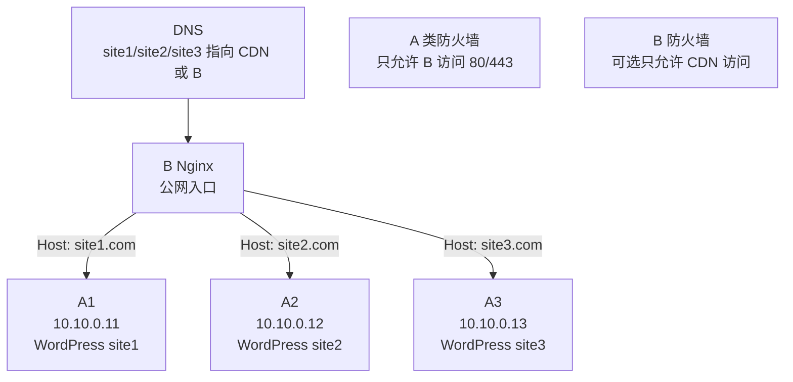

最简洁可靠的配置策略是：

| 位置      | 配置方式                                              |
| --------- | ----------------------------------------------------- |
| DNS       | 所有域名指向 B 或 CDN                                 |
| B         | 每个域名一个 `server`，用 `proxy_pass` 指向对应 A     |
| A         | 每个 WordPress 正常用 Nginx + PHP-FPM，只监听内网/VPN |
| 防火墙    | A 只允许 B；如果有 CDN，B 只允许 CDN                  |
| WordPress | 配置 HTTPS 代理识别，固定 `WP_HOME` 和 `WP_SITEURL`   |

你这种“不做负载均衡、每台 A 都是不同网站”的情况，**不要把多个 A 配成同一个 upstream 轮询池**。正确做法是 **B 根据域名精准转发到对应 A**。


## 负载权衡方案的优缺点


| 情况                            | 是否适合负载均衡                                 |
| ------------------------------- | ------------------------------------------------ |
| 服务器A1、A2、A3 是不同网站     | 不适合做同一个负载均衡池                         |
| A1、A2 都部署同一个 `site1.com` | 适合                                             |
| 一个 WordPress 站点流量很大     | 适合，但要改造成多副本架构                       |
| 只是想隐藏 A 服务器 IP          | 不需要负载均衡，反向代理即可                     |
| 想让某个站点高可用              | 可以做负载均衡，但数据库、上传文件、缓存也要配套 |

你的原始场景是：

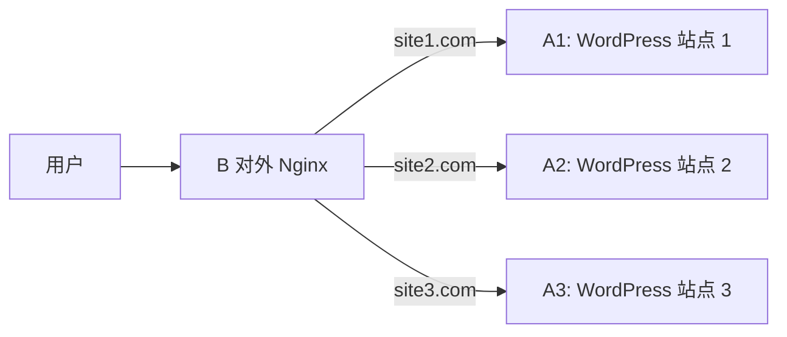

这叫 **按域名反向代理**，不是负载均衡。

负载均衡应该是这样：

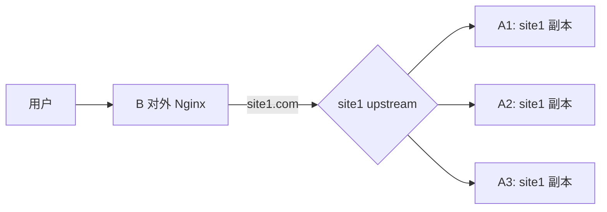

也就是说，**负载均衡的前提是多个后端提供同一个网站或同一个服务**。

------

## 负载均衡的优点

| 优点       | 解释                                 | 对 WordPress 的意义                  |
| ---------- | ------------------------------------ | ------------------------------------ |
| 提高可用性 | 某台后端故障时，流量可以转到其他后端 | A1 挂了，site1 还能由 A2 提供        |
| 横向扩展   | 流量大时增加更多 Web 节点            | 访问量上涨时加机器，而不是只升级单机 |
| 方便维护   | 可以逐台下线维护                     | 先摘掉 A1，升级后再放回              |
| 分摊压力   | 请求分布到多个后端                   | PHP-FPM、Nginx、CPU 压力降低         |
| 灰度发布   | 一部分流量走新版，一部分走旧版       | 新主题、新插件、新代码可小流量验证   |
| 容灾基础   | 多机、多可用区部署更容易             | 单台机器故障不至于整站不可用         |

如果只是静态资源或无状态 API，负载均衡相对简单。
但 **WordPress 是有状态应用**，做负载均衡会复杂很多。

------

## 负载均衡的缺点

| 缺点                | 解释                                  | WordPress 场景中的典型问题            |
| ------------------- | ------------------------------------- | ------------------------------------- |
| 架构复杂度上升      | 不再是一台机器一个站点                | 部署、备份、排障都更复杂              |
| 文件一致性问题      | 多台 Web 节点必须看到同一份文件       | 上传图片到 A1，用户访问 A2 时图片 404 |
| 插件/主题一致性问题 | 每台节点代码必须一致                  | A1 插件已更新，A2 还是旧版本          |
| 数据库仍可能是瓶颈  | Web 多副本不代表数据库高可用          | MySQL 单点故障仍会导致整站不可用      |
| 缓存一致性问题      | 页面缓存、对象缓存可能分散            | 登录态、购物车、后台预览可能异常      |
| 排障难度增加        | 同一个请求可能打到不同节点            | “我刷新一下就好了”这种问题更难查      |
| 成本增加            | 多机器、共享存储、Redis、监控都要成本 | 小站可能得不偿失                      |
| 安全面增加          | 多台源站都要维护                      | 每台都要打补丁、加固、防火墙          |

------

## WordPress 做负载均衡时最容易踩的坑

### 上传文件问题

WordPress 默认把上传文件放在：

```text
wp-content/uploads/
```

如果你有两个后端：

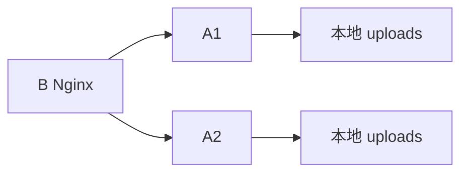

用户上传图片时，如果请求落到 A1，图片只存在 A1。下一次访问如果被分到 A2，就可能 404。

解决方式：

| 方案                          | 说明                                       |
| ----------------------------- | ------------------------------------------ |
| 共享存储 NFS/GlusterFS/CephFS | 多台 Web 节点挂载同一个 `uploads`          |
| 对象存储 S3/MinIO/OSS/COS     | 上传文件放对象存储，WordPress 通过插件接入 |
| 文件同步 rsync/lsyncd         | 简单但有延迟，不适合高并发写入             |
| 只负载均衡只读节点            | 后台上传固定到主节点，前台多节点读         |

比较推荐：**对象存储** 或 **共享存储**。

------

### 数据库问题

即使 Web 层有多台：

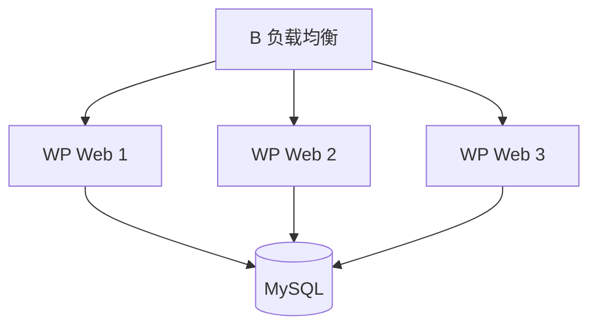

如果 MySQL 只有一台，那么数据库仍然是单点。

| 架构                    | 效果                           |
| ----------------------- | ------------------------------ |
| 多台 Web + 单台 MySQL   | Web 层高可用，数据库仍单点     |
| 多台 Web + 主从 MySQL   | 读能力可扩展，但写入仍依赖主库 |
| 多台 Web + 高可用 MySQL | 更完整，但复杂度明显增加       |
| 托管数据库              | 对新手最友好，成本略高         |

所以负载均衡不是银弹。它主要解决 **Web 层压力和 Web 节点故障**，不自动解决数据库高可用。

------

### 登录态、Cookie 和后台问题

WordPress 登录态主要依赖 Cookie，通常不强依赖服务器本地 Session，因此比某些应用好处理。

但仍要保证：

| 项目                                     | 要求             |
| ---------------------------------------- | ---------------- |
| `wp-config.php` 中的 `AUTH_KEY` 等 salts | 所有节点必须一致 |
| `WP_HOME`、`WP_SITEURL`                  | 所有节点必须一致 |
| 插件版本                                 | 所有节点必须一致 |
| 主题文件                                 | 所有节点必须一致 |
| PHP 版本                                 | 尽量一致         |
| 缓存插件配置                             | 必须一致         |
| 上传目录                                 | 必须共享或外置   |

如果每台机器配置不一致，后台会出现很诡异的问题。

------

### 缓存问题

WordPress 常见缓存层：

| 缓存层                 | 位置            | 负载均衡时注意点             |
| ---------------------- | --------------- | ---------------------------- |
| 浏览器缓存             | 用户浏览器      | 问题不大                     |
| CDN 缓存               | CDN             | 要正确清理缓存               |
| B 上 Nginx 缓存        | 反向代理层      | 要绕过登录用户、后台、购物车 |
| WordPress 页面缓存插件 | A 节点本地      | 多节点时容易不一致           |
| Redis Object Cache     | 独立 Redis      | 推荐统一使用                 |
| PHP OPcache            | 每个 A 节点本地 | 发布后要逐台 reload 或清理   |

负载均衡 WordPress 时，建议把对象缓存统一放到 Redis：

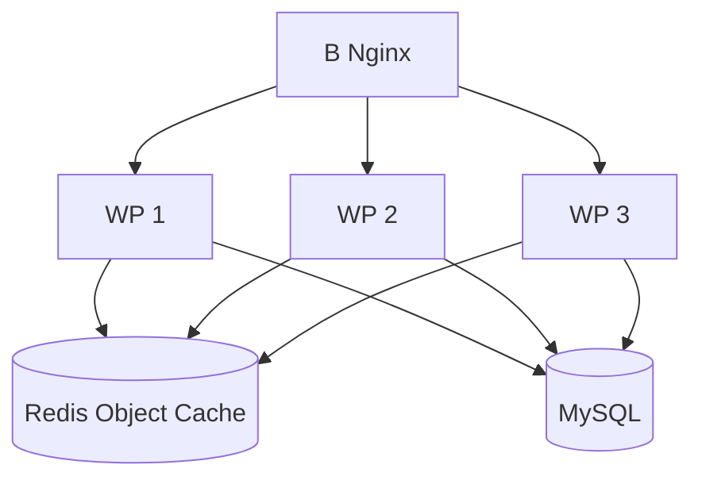

------

## B 上如何配置负载均衡

如果 `site1.com` 同时部署在 A1、A2、A3，可以这样：

```nginx
upstream site1_backend {
    least_conn;

    server 10.10.0.11:80 max_fails=3 fail_timeout=30s;
    server 10.10.0.12:80 max_fails=3 fail_timeout=30s;
    server 10.10.0.13:80 max_fails=3 fail_timeout=30s;
}

server {
    listen 443 ssl;
    http2 on;
    server_name site1.com www.site1.com;

    ssl_certificate     /etc/letsencrypt/live/site1.com/fullchain.pem;
    ssl_certificate_key /etc/letsencrypt/live/site1.com/privkey.pem;

    location / {
        proxy_pass http://site1_backend;

        proxy_set_header Host              $host;
        proxy_set_header X-Real-IP         $remote_addr;
        proxy_set_header X-Forwarded-For   $proxy_add_x_forwarded_for;
        proxy_set_header X-Forwarded-Proto $scheme;

        proxy_connect_timeout 5s;
        proxy_read_timeout 60s;
        proxy_send_timeout 60s;
    }
}
```

常见算法：

| 算法     | 配置                            | 适合场景                     |
| -------- | ------------------------------- | ---------------------------- |
| 轮询     | 默认                            | 通用                         |
| 权重     | `server 10.0.0.1 weight=2;`     | 后端性能不同                 |
| 最少连接 | `least_conn;`                   | 请求耗时不均                 |
| IP 哈希  | `ip_hash;`                      | 希望同一用户尽量落到同一后端 |
| 一致哈希 | `hash $request_uri consistent;` | 缓存、分片场景               |

对 WordPress，新手阶段可以优先考虑：

```nginx
least_conn;
```

如果遇到登录、购物车、后台状态问题，可以临时考虑：

```nginx
ip_hash;
```

但注意：`ip_hash` 不是根本解决方案，它只是让同一个 IP 更可能固定到同一台后端。真正可靠的方案仍然是共享上传文件、统一 Redis、统一数据库、统一配置。

------

## 主动健康检查的问题

开源 Nginx 默认主要依赖被动失败判断，例如连接失败、超时、返回错误后暂时认为某个后端不可用。更完善的主动健康检查通常属于 NGINX Plus 或第三方方案。

所以如果你用开源 Nginx，至少要配置：

```nginx
server 10.10.0.11:80 max_fails=3 fail_timeout=30s;
server 10.10.0.12:80 max_fails=3 fail_timeout=30s;
```

这表示在一定时间内失败多次后，暂时不再转发给该后端。

如果你需要更强的健康检查，可以考虑：

| 方案               | 说明                         |
| ------------------ | ---------------------------- |
| NGINX Plus         | 原生主动健康检查，企业方案   |
| HAProxy            | 负载均衡和健康检查能力很成熟 |
| Traefik / Envoy    | 云原生、服务发现友好         |
| Keepalived + Nginx | 解决 B 自身单点问题          |
| Kubernetes Ingress | 容器化场景常见               |

------

## 负载均衡后，B 会不会成为单点？

会。

如果只有一台 B：

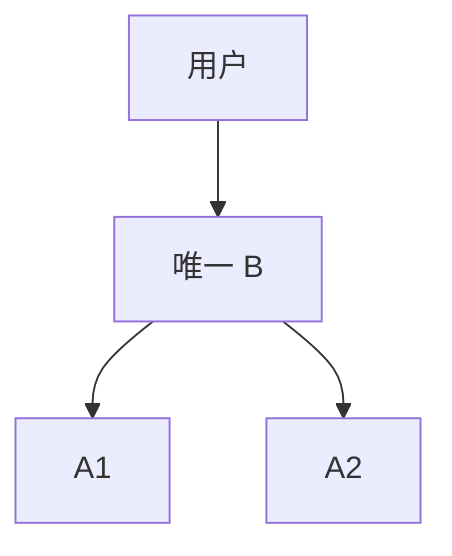

那么 A1、A2 再多，B 挂了也全站不可访问。

更完整的架构是：

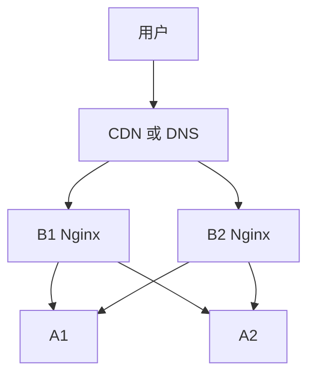

或者：

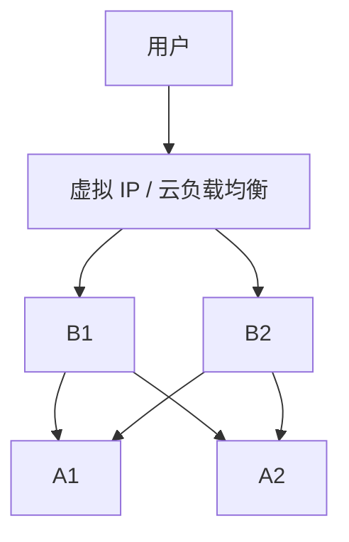

所以高可用要分层看：

| 层级       | 单点风险                   |
| ---------- | -------------------------- |
| CDN        | 通常由 CDN 厂商处理        |
| B 反向代理 | 单 B 会是单点              |
| A Web 节点 | 负载均衡后可减少单点       |
| 数据库     | 常常仍是单点               |
| Redis      | 如果只有一台，也可能是单点 |
| 共享存储   | 如果只有一套，也可能是单点 |

------

## 你的场景该不该做负载均衡？

我建议按这个判断：

| 需求                               | 建议                                          |
| ---------------------------------- | --------------------------------------------- |
| 只是隐藏 A 服务器 IP               | 不需要负载均衡                                |
| 多个不同 WP 站点分别在不同 A 上    | 不需要负载均衡                                |
| 某一个 WP 站点流量很大             | 可以只给这个站点做负载均衡                    |
| 希望某个站点不停机维护             | 可以做，但要配共享文件和统一数据库            |
| 只是小型博客、企业站               | 先别做，反向代理 + 备份 + 监控更实际          |
| 有 WooCommerce、会员系统、频繁登录 | 做负载均衡要更谨慎                            |
| 预算充足且追求高可用               | 可以做 B 双机 + A 多副本 + 托管数据库 + Redis |

------

## 最推荐的演进路线

### 当前阶段：反向代理隐藏源站

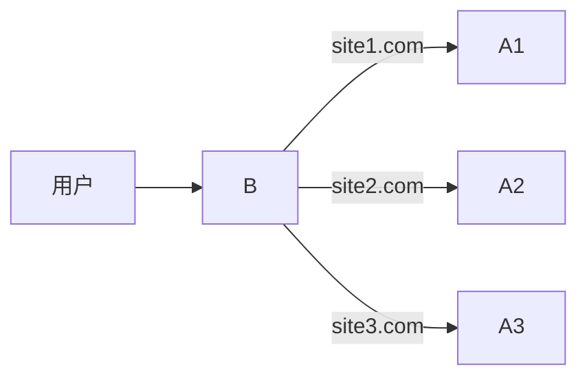

这是你现在最应该先做好的。

重点是：

| 项目                      | 要求     |
| ------------------------- | -------- |
| A 不暴露公网 80/443       | 必须     |
| 所有域名只解析到 B 或 CDN | 必须     |
| B 按域名转发到对应 A      | 必须     |
| WordPress 识别 HTTPS 代理 | 必须     |
| B 和 A 之间走内网/VPN     | 强烈推荐 |

### 下一阶段：只给高流量站点做负载均衡

比如只有 `site1.com` 变成多副本：

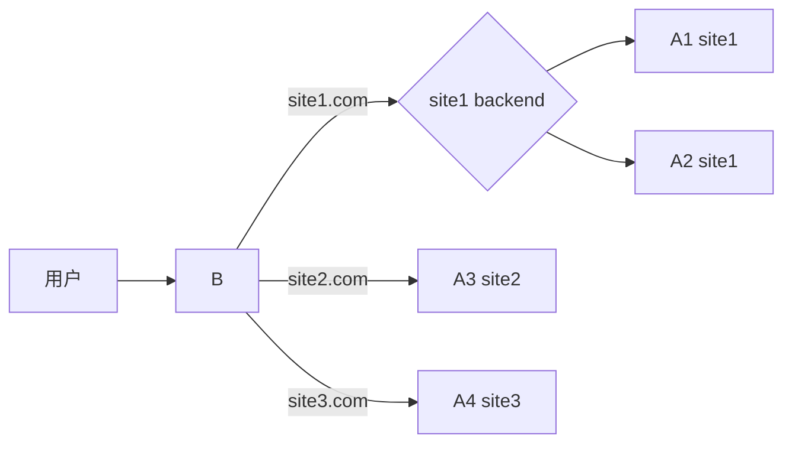

这样不会把所有站点架构都复杂化。

### 成熟阶段：完整高可用

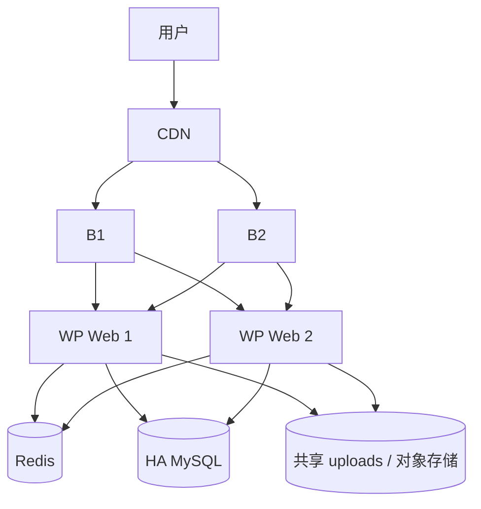

------

## 一句话总结

负载均衡的优点是 **高可用、可扩展、便于维护、能分摊压力**；缺点是 **复杂度、成本、数据一致性、缓存一致性和排障难度都会明显上升**。

对你现在的场景，**不同网站分别在不同 A 服务器上，不应该做成同一个负载均衡池**。你应该先用 B 做按域名反向代理，把 A 的 IP 严格隐藏起来。只有当某一个 WordPress 站点需要多台服务器共同承载时，再单独为这个站点设计负载均衡。