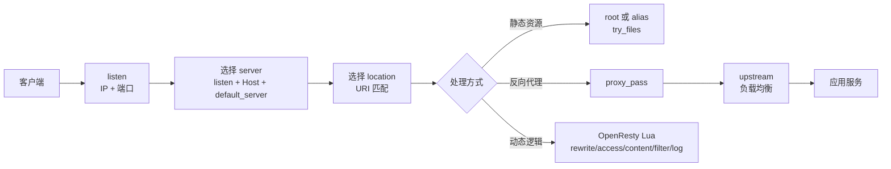
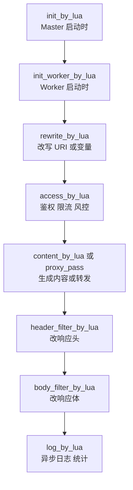

[toc]


## Nginx 是什么

Nginx 既是 Web 服务器，也是反向代理、内容缓存、负载均衡器、TCP/UDP 代理和邮件代理。

它的核心价值是：**用较少资源稳定处理大量并发连接**。官方也明确把它定位为 HTTP Web server、reverse proxy、content cache、load balancer、TCP/UDP proxy server 等。([Nginx](https://nginx.org/))

| 角色            | 典型用途                                           | 新手理解                     |
| --------------- | -------------------------------------------------- | ---------------------------- |
| 静态 Web 服务器 | 托管 HTML、CSS、JS、图片、下载文件                 | “直接从磁盘把文件发给浏览器” |
| 反向代理        | 把请求转发给 Node.js、Java、Go、Python、PHP 等后端 | “统一入口，后端藏在内网”     |
| 负载均衡        | 多台后端之间分摊流量                               | “把请求分给多个服务实例”     |
| TLS 终止        | 处理 HTTPS 证书与加密连接                          | “让应用不用直接处理证书”     |
| 缓存层          | 缓存后端响应，降低后端压力                         | “热点内容先从 Nginx 返回”    |
| API 网关基础层  | 鉴权、限流、路由、灰度、日志                       | “服务入口治理”               |
| TCP/UDP 代理    | MySQL、Redis、MQTT、DNS、游戏协议等转发            | “不只支持 HTTP”              |

## Nginx、NGINX Plus、OpenResty 的关系

| 名称              | 定位                                          | 适合场景                                                 |
| ----------------- | --------------------------------------------- | -------------------------------------------------------- |
| NGINX Open Source | 开源 Nginx 主体                               | 静态站点、反向代理、基础负载均衡、缓存、TLS              |
| NGINX Plus        | F5 提供的商业版本                             | 需要商业支持、动态配置 API、增强健康检查、企业级功能     |
| OpenResty         | 基于 Nginx + LuaJIT + Lua 模块生态的 Web 平台 | 需要在网关层写业务逻辑，如动态鉴权、限流、灰度、协议适配 |

OpenResty 官方定义为一个完整 Web 平台，集成增强版 Nginx Core、LuaJIT、Lua 库和第三方 Nginx 模块，用于构建可扩展 Web 应用、服务和动态网关。([OpenResty](https://openresty.org/))

## 核心心智模型

Nginx 不是“每个请求一个线程”的传统模型，而是典型的 **master + worker + 事件驱动**模型。master 负责读取配置、管理 worker；worker 负责实际处理请求；worker 数量可以固定，也可以按 CPU 核数自动设置。([Nginx](https://nginx.org/en/docs/beginners_guide.html))



一个请求进入 Nginx 后，大致经历三步：先按 `listen` 找到监听地址和端口，再按 `Host` 选择 `server`，最后按 URI 选择最合适的 `location`。官方文档说明：若 Host 不匹配任何 `server_name`，请求会落到该端口的默认 server；默认 server 是 listen 端口的属性，而不是 server name 的属性。([Nginx](https://nginx.org/en/docs/http/request_processing.html))

## 配置文件结构

Nginx 配置是“上下文嵌套”的结构，不是脚本语言。常见结构如下：

```nginx
user nginx;
worker_processes auto;

events {
    worker_connections 4096;
}

http {
    include       mime.types;
    default_type  application/octet-stream;

    server {
        listen 80;
        server_name example.com;

        location / {
            root /usr/share/nginx/html;
            index index.html;
        }
    }
}
```

| 上下文   | 作用          | 常见指令                                        |
| -------- | ------------- | ----------------------------------------------- |
| main     | 全局配置      | `user`、`worker_processes`、`error_log`、`pid`  |
| events   | 连接事件模型  | `worker_connections`、`use`、`multi_accept`     |
| http     | HTTP 全局配置 | `log_format`、`gzip`、`proxy_cache_path`、`map` |
| server   | 一个虚拟主机  | `listen`、`server_name`、`ssl_certificate`      |
| location | URI 路由规则  | `root`、`alias`、`try_files`、`proxy_pass`      |
| upstream | 后端服务池    | `server`、`least_conn`、`keepalive`             |
| stream   | TCP/UDP 代理  | `proxy_pass`、`upstream`、`listen`              |

新手最容易混淆的是：**配置不是从上到下执行所有行**，而是 Nginx 先根据请求选择特定的 `server` 和 `location`，再使用对应上下文里的指令。

## server 选择规则

| 规则                  | 说明                                          |
| --------------------- | --------------------------------------------- |
| 先看 `listen`         | IP + 端口先匹配                               |
| 再看 `Host`           | 请求头中的 Host 与 `server_name` 匹配         |
| 找不到 Host 匹配      | 使用该端口的 `default_server`                 |
| 没写 `default_server` | 通常使用同一端口第一个 server                 |
| 拒绝未知域名          | 可以专门写一个 default server 返回 444 或 403 |

常见兜底配置：

```nginx
server {
    listen 80 default_server;
    listen 443 ssl default_server;
    server_name _;

    ssl_certificate     /etc/nginx/certs/default.crt;
    ssl_certificate_key /etc/nginx/certs/default.key;

    return 444;
}
```

`444` 是 Nginx 的非标准状态码，作用是直接关闭连接。官方示例也使用过 `return 444` 来拒绝无 Host 的请求。([Nginx](https://nginx.org/en/docs/http/request_processing.html))

## location 匹配规则

`location` 是 Nginx 学习中的核心难点。官方规则是：先检查前缀匹配，记住最长前缀；再按配置顺序检查正则；第一个匹配的正则胜出；如果没有正则命中，则使用先前记住的最长前缀。`^~` 会让最长前缀命中后跳过正则；`=` 是精确匹配，命中后立即结束。([Nginx](https://nginx.org/en/docs/http/ngx_http_core_module.html))

| 写法                   | 含义                     | 优先级理解       |
| ---------------------- | ------------------------ | ---------------- |
| `location = /login`    | 精确匹配 `/login`        | 最高，命中即停止 |
| `location ^~ /static/` | 前缀匹配，并阻止后续正则 | 适合静态资源目录 |
| `location ~ \.php$`    | 区分大小写正则           | 按出现顺序匹配   |
| `location ~* .(jpg     | png)$`                   | 不区分大小写正则 |
| `location /api/`       | 普通前缀匹配             | 取最长前缀       |
| `location /`           | 兜底匹配                 | 最后兜底         |

推荐写法：

```nginx
server {
    server_name example.com;

    location = /healthz {
        return 200 "ok\n";
    }

    location ^~ /assets/ {
        root /var/www/app;
        expires 30d;
        access_log off;
    }

    location /api/ {
        proxy_pass http://api_backend;
    }

    location / {
        root /var/www/app;
        try_files $uri $uri/ /index.html;
    }
}
```

## root、alias、try_files

| 指令        | 用法                              | 容易犯错点                                              |
| ----------- | --------------------------------- | ------------------------------------------------------- |
| `root`      | 把 URI 拼到目录后面               | `location /img/ { root /data; }` 会找 `/data/img/a.png` |
| `alias`     | 用指定目录替换 location 前缀      | 目录型 alias 通常要求 location 和 alias 都以 `/` 结尾   |
| `try_files` | 按顺序尝试文件，不存在则 fallback | SPA 常用 `/index.html` 兜底                             |
| `index`     | 目录默认首页                      | 只对目录请求生效                                        |

静态站点：

```nginx
location / {
    root /var/www/site;
    index index.html;
    try_files $uri $uri/ =404;
}
```

前端 SPA，例如 React、Vue、Svelte：

```nginx
location / {
    root /var/www/app;
    try_files $uri $uri/ /index.html;
}
```

目录映射：

```nginx
location /downloads/ {
    alias /data/files/;
    autoindex off;
}
```

经验规则：**能用 `root` 就别用 `alias`；需要把 URL 前缀替换成另一个文件系统路径时再用 `alias`。**

## 反向代理

反向代理是 Nginx 最常见用途：浏览器访问 Nginx，Nginx 再把请求转给后端应用。

```nginx
upstream api_backend {
    server 10.0.1.10:8080;
    server 10.0.1.11:8080;
}

server {
    listen 443 ssl;
    http2 on;
    server_name api.example.com;

    ssl_certificate     /etc/letsencrypt/live/api.example.com/fullchain.pem;
    ssl_certificate_key /etc/letsencrypt/live/api.example.com/privkey.pem;

    location / {
        proxy_pass http://api_backend;

        proxy_set_header Host              $host;
        proxy_set_header X-Real-IP         $remote_addr;
        proxy_set_header X-Forwarded-For   $proxy_add_x_forwarded_for;
        proxy_set_header X-Forwarded-Proto $scheme;

        proxy_connect_timeout 3s;
        proxy_send_timeout    30s;
        proxy_read_timeout    30s;
    }
}
```

从 NGINX 1.25.1 起，HTTP/2 官方示例推荐在 `server` 中使用 `http2 on;`，而不是旧式 `listen 443 ssl http2;`。([Nginx](https://nginx.org/en/docs/http/ngx_http_v2_module.html))

### proxy_pass 的斜杠规则

这是新手最常踩的坑之一。

| 配置                                                | 后端收到的 URI 倾向                   |
| --------------------------------------------------- | ------------------------------------- |
| `location /api/ { proxy_pass http://backend; }`     | 保留原始 `/api/...`                   |
| `location /api/ { proxy_pass http://backend/; }`    | 去掉 `/api/` 前缀，把剩余部分拼到 `/` |
| `location /api/ { proxy_pass http://backend/v1/; }` | 去掉 `/api/`，替换为 `/v1/`           |

常见建议：
如果后端本身就识别 `/api/users`，用：

```nginx
location /api/ {
    proxy_pass http://backend;
}
```

如果后端只识别 `/users`，用：

```nginx
location /api/ {
    proxy_pass http://backend/;
}
```

## WebSocket 代理

WebSocket 需要处理 `Upgrade` 和 `Connection` 头：

```nginx
map $http_upgrade $connection_upgrade {
    default upgrade;
    ''      close;
}

server {
    location /ws/ {
        proxy_pass http://websocket_backend;

        proxy_http_version 1.1;
        proxy_set_header Upgrade    $http_upgrade;
        proxy_set_header Connection $connection_upgrade;
        proxy_set_header Host       $host;

        proxy_read_timeout 1h;
    }
}
```

`map` 比在 `location` 里写复杂 `if` 更清晰，也更容易维护。

## 负载均衡

最基础写法：

```nginx
upstream app_backend {
    server 10.0.1.10:8080 weight=2;
    server 10.0.1.11:8080;
    server 10.0.1.12:8080 backup;
}

server {
    location / {
        proxy_pass http://app_backend;
    }
}
```

| 方法     | 配置                            | 适合场景                 |
| -------- | ------------------------------- | ------------------------ |
| 轮询     | 默认                            | 通用场景                 |
| 权重     | `server ... weight=3`           | 机器性能不同             |
| 最少连接 | `least_conn;`                   | 请求耗时差异较大         |
| IP 哈希  | `ip_hash;`                      | 简单会话保持             |
| 一致哈希 | `hash $request_uri consistent;` | 缓存、分片               |
| 随机     | `random two;`                   | 大规模实例下减少调度开销 |

NGINX 官方文档说明，HTTP 负载均衡先在 `http` 上下文里定义 `upstream`，再用 `proxy_pass` 转给该 upstream。部分能力如 slow-start、某些会话保持、主动健康检查等在 NGINX Plus 中更完整。([NGINX文档](https://docs.nginx.com/nginx/admin-guide/load-balancer/http-load-balancer/))

现代版本中还要注意 upstream keepalive。官方 upstream 文档显示，从 1.29.7 起 upstream keepalive 默认启用，默认每个 worker 保留 32 个空闲连接；连接数设置过大也可能挤占后端新连接能力。([Nginx](https://nginx.org/en/docs/http/ngx_http_upstream_module.html))

## 缓存

Nginx 缓存适合热点接口、静态化页面、图片代理、下载资源、后端保护。

```nginx
proxy_cache_path /var/cache/nginx/api
    levels=1:2
    keys_zone=api_cache:100m
    max_size=10g
    inactive=60m
    use_temp_path=off;

server {
    location /api/public/ {
        proxy_cache api_cache;
        proxy_cache_key "$scheme$request_method$host$request_uri";

        proxy_cache_valid 200 10m;
        proxy_cache_valid 404 1m;

        proxy_cache_use_stale error timeout updating http_500 http_502 http_503 http_504;
        proxy_cache_lock on;

        add_header X-Cache-Status $upstream_cache_status always;

        proxy_pass http://api_backend;
    }
}
```

| 指令                     | 作用                                   |
| ------------------------ | -------------------------------------- |
| `proxy_cache_path`       | 定义缓存目录、共享内存区、最大大小     |
| `proxy_cache`            | 在 server 或 location 中启用某个缓存区 |
| `proxy_cache_key`        | 定义缓存键                             |
| `proxy_cache_valid`      | 定义哪些状态码缓存多久                 |
| `proxy_cache_use_stale`  | 后端异常时返回过期缓存                 |
| `proxy_cache_lock`       | 防止缓存击穿时大量请求同时打到后端     |
| `$upstream_cache_status` | 调试 HIT、MISS、BYPASS、EXPIRED        |

官方文档提醒：`keys_zone` 的大小限制的是缓存元数据共享内存，不等于磁盘缓存总大小；磁盘大小要用 `max_size` 限制。缓存还涉及 cache manager 和 cache loader 进程。([NGINX文档](https://docs.nginx.com/nginx/admin-guide/content-cache/content-caching/))

## 限流与连接控制

基础限流：

```nginx
http {
    limit_req_zone $binary_remote_addr zone=per_ip:10m rate=10r/s;

    server {
        location /login {
            limit_req zone=per_ip burst=20 nodelay;
            proxy_pass http://auth_backend;
        }
    }
}
```

| 指令               | 作用                                   |
| ------------------ | -------------------------------------- |
| `limit_req_zone`   | 定义限流共享内存区和速率               |
| `limit_req`        | 在具体 server 或 location 中应用限流   |
| `burst`            | 允许短时间突发                         |
| `nodelay`          | 突发请求不排队等待，允许立即处理一部分 |
| `limit_req_status` | 设置被限流时返回的状态码               |

官方 `limit_req` 模块使用 leaky bucket 方法限制某个 key 的请求处理速率，常见 key 是 `$binary_remote_addr`，即按客户端 IP 限流。([Nginx](https://nginx.org/en/docs/http/ngx_http_limit_req_module.html))

实践建议：登录、短信验证码、注册、搜索、导出、AI 接口、支付回调等位置单独限流；普通静态资源不要一刀切限得太狠。

## 真实客户端 IP

当 Nginx 前面还有 CDN、云负载均衡、Ingress、WAF 时，`$remote_addr` 可能是上一层代理 IP，不是真实用户 IP。此时需要只信任明确的上游代理。

```nginx
set_real_ip_from 10.0.0.0/8;
set_real_ip_from 192.168.0.0/16;
real_ip_header X-Forwarded-For;
real_ip_recursive on;
```

`ngx_http_realip_module` 用于把客户端地址替换为指定请求头中的地址；`set_real_ip_from` 必须配置可信代理地址，`real_ip_recursive on` 会在多级代理场景中取最后一个非可信地址。([Nginx](https://nginx.org/en/docs/http/ngx_http_realip_module.html))

错误做法是无条件信任所有来源的 `X-Forwarded-For`，这样客户端可以伪造 IP，影响日志、限流、审计和安全策略。

## HTTPS、HTTP/2、HTTP/3

现代 HTTPS 基础配置：

```nginx
server {
    listen 443 ssl;
    http2 on;
    server_name example.com;

    ssl_certificate     /etc/letsencrypt/live/example.com/fullchain.pem;
    ssl_certificate_key /etc/letsencrypt/live/example.com/privkey.pem;

    ssl_protocols TLSv1.2 TLSv1.3;
    ssl_session_cache shared:SSL:10m;
    ssl_session_timeout 1d;

    add_header Strict-Transport-Security "max-age=31536000; includeSubDomains" always;
}
```

HTTP/3 基于 QUIC，需要 UDP 端口可达。NGINX 的 HTTP/3 模块官方文档仍标注为 experimental，并要求构建时启用 `--with-http_v3_module`；示例使用同一端口同时监听 QUIC 和 HTTPS，并通过 `Alt-Svc` 告知客户端 HTTP/3 可用。([Nginx](https://nginx.org/en/docs/http/ngx_http_v3_module.html))

```nginx
server {
    listen 443 ssl;
    listen 443 quic reuseport;

    http2 on;
    http3 on;

    server_name example.com;

    ssl_certificate     /etc/letsencrypt/live/example.com/fullchain.pem;
    ssl_certificate_key /etc/letsencrypt/live/example.com/privkey.pem;
    ssl_protocols TLSv1.2 TLSv1.3;

    add_header Alt-Svc 'h3=":443"; ma=86400' always;
}
```

QUIC 要求 TLSv1.3，官方文档也建议排查运行时 SSL 库、构建参数以及客户端是否真的通过 QUIC 请求。([Nginx](https://nginx.org/en/docs/quic.html))

## 压缩

```nginx
gzip on;
gzip_min_length 1024;
gzip_comp_level 5;
gzip_vary on;
gzip_types
    text/plain
    text/css
    application/json
    application/javascript
    application/xml
    image/svg+xml;
```

`ngx_http_gzip_module` 可以压缩响应，官方说明它通常能显著减少传输数据量；但 HTTPS 下压缩响应可能涉及 BREACH 风险，所以不要对包含敏感 token 的动态 HTML 盲目启用压缩。([Nginx](https://nginx.org/en/docs/http/ngx_http_gzip_module.html))

Brotli 在现代 Web 中也很常见，但 Nginx 开源版通常需要额外模块或发行版集成，生产中要确认模块来源、维护状态和安全更新。

## 日志与可观测性

建议一开始就设计好日志格式，尤其是反向代理场景：

```nginx
log_format main_ext
    '$remote_addr "$request" $status $body_bytes_sent '
    'rt=$request_time '
    'urt=$upstream_response_time '
    'uaddr=$upstream_addr '
    'cache=$upstream_cache_status '
    'xff="$http_x_forwarded_for" '
    'ua="$http_user_agent"';

access_log /var/log/nginx/access.log main_ext;
error_log  /var/log/nginx/error.log warn;
```

| 字段                      | 价值             |
| ------------------------- | ---------------- |
| `$request_time`           | 整个请求耗时     |
| `$upstream_response_time` | 后端响应耗时     |
| `$upstream_addr`          | 命中的后端实例   |
| `$status`                 | Nginx 返回状态码 |
| `$upstream_status`        | 后端返回状态码   |
| `$upstream_cache_status`  | 缓存状态         |
| `$request_id`             | 链路追踪和排障   |

排查问题时优先看：状态码、Nginx error log、upstream 状态、连接超时、DNS、证书、真实客户端 IP、是否命中错误的 `server` 或 `location`。

## 常见生产级模板

一个“前端静态站点 + API 反代 + 缓存 + 限流”的简化模板：

```nginx
worker_processes auto;

events {
    worker_connections 4096;
}

http {
    include mime.types;
    default_type application/octet-stream;

    log_format main_ext
        '$remote_addr "$request" $status $body_bytes_sent '
        'rt=$request_time urt=$upstream_response_time '
        'uaddr=$upstream_addr cache=$upstream_cache_status';

    access_log /var/log/nginx/access.log main_ext;
    error_log  /var/log/nginx/error.log warn;

    sendfile on;
    tcp_nopush on;
    keepalive_timeout 65;

    gzip on;
    gzip_min_length 1024;
    gzip_types text/plain text/css application/json application/javascript image/svg+xml;

    limit_req_zone $binary_remote_addr zone=api_per_ip:10m rate=20r/s;

    proxy_cache_path /var/cache/nginx/api
        levels=1:2
        keys_zone=api_cache:100m
        max_size=5g
        inactive=30m
        use_temp_path=off;

    upstream api_backend {
        least_conn;
        server 10.0.1.10:8080;
        server 10.0.1.11:8080;
    }

    server {
        listen 80;
        server_name example.com www.example.com;
        return 301 https://example.com$request_uri;
    }

    server {
        listen 443 ssl;
        http2 on;
        server_name example.com;

        ssl_certificate     /etc/letsencrypt/live/example.com/fullchain.pem;
        ssl_certificate_key /etc/letsencrypt/live/example.com/privkey.pem;
        ssl_protocols TLSv1.2 TLSv1.3;

        root /var/www/app;

        location = /healthz {
            access_log off;
            return 200 "ok\n";
        }

        location ^~ /assets/ {
            expires 30d;
            add_header Cache-Control "public, immutable" always;
            try_files $uri =404;
        }

        location /api/ {
            limit_req zone=api_per_ip burst=40 nodelay;

            proxy_cache api_cache;
            proxy_cache_valid 200 1m;
            proxy_cache_use_stale error timeout updating http_500 http_502 http_503 http_504;
            proxy_cache_lock on;
            add_header X-Cache-Status $upstream_cache_status always;

            proxy_pass http://api_backend;

            proxy_set_header Host              $host;
            proxy_set_header X-Real-IP         $remote_addr;
            proxy_set_header X-Forwarded-For   $proxy_add_x_forwarded_for;
            proxy_set_header X-Forwarded-Proto $scheme;

            proxy_connect_timeout 3s;
            proxy_read_timeout 30s;
            proxy_send_timeout 30s;
        }

        location / {
            try_files $uri $uri/ /index.html;
        }
    }
}
```

## OpenResty 补充

OpenResty 的核心是：**在 Nginx 的高性能事件模型里嵌入 Lua/LuaJIT，让网关层可以写逻辑**。官方 `lua-nginx-module` 文档说明，它把 Lua 或 LuaJIT 嵌入 Nginx Core，并通过 cosocket 和 Nginx subrequest 把 Lua 协程整合进 Nginx 事件模型。([OpenResty](https://openresty.org/en/lua-nginx-module.html))

### OpenResty 适合做什么

| 场景         | 是否适合 OpenResty | 原因                                      |
| ------------ | ------------------ | ----------------------------------------- |
| 普通静态站点 | 不太需要           | Nginx 原生足够                            |
| 简单反向代理 | 不太需要           | 原生 `proxy_pass` 更稳定简单              |
| 动态鉴权     | 适合               | `access_by_lua` 可查 Redis、JWT、内部服务 |
| 动态路由     | 适合               | 可根据租户、Header、灰度规则决定 upstream |
| 复杂限流     | 适合               | 可用 shared dict、Redis、令牌桶           |
| API 网关     | 很适合             | APISIX、Kong 等都与此类模型有关           |
| 响应改写     | 适合但谨慎         | header/body filter 可处理响应             |
| 大量业务代码 | 不建议             | 业务复杂度高时应放回应用服务              |

### Lua 阶段模型



| 阶段                   | 典型用途                         |
| ---------------------- | -------------------------------- |
| `init_by_lua`          | 加载模块、初始化全局只读数据     |
| `init_worker_by_lua`   | 启动定时器、初始化 worker 级资源 |
| `rewrite_by_lua`       | URI 改写、灰度变量计算           |
| `access_by_lua`        | 鉴权、限流、黑白名单             |
| `content_by_lua`       | 直接生成响应                     |
| `balancer_by_lua`      | 动态选择后端                     |
| `header_filter_by_lua` | 修改响应头                       |
| `body_filter_by_lua`   | 修改响应体，注意性能和流式处理   |
| `log_by_lua`           | 请求结束后记录日志、上报指标     |

### 最小 OpenResty 示例

```nginx
worker_processes auto;

events {
    worker_connections 4096;
}

http {
    lua_shared_dict counters 10m;

    server {
        listen 8080;

        location /hello {
            content_by_lua_block {
                ngx.say("hello from OpenResty")
            }
        }

        location /count {
            content_by_lua_block {
                local dict = ngx.shared.counters
                local n, err = dict:incr("hits", 1, 0)
                if not n then
                    ngx.status = 500
                    ngx.say(err)
                    return
                end
                ngx.say("hits: ", n)
            }
        }
    }
}
```

### 用 OpenResty 做简单鉴权

```nginx
server {
    listen 8080;

    location /api/ {
        access_by_lua_block {
            local token = ngx.var.http_authorization

            if not token or token ~= "Bearer demo-token" then
                ngx.status = ngx.HTTP_UNAUTHORIZED
                ngx.say("unauthorized")
                return ngx.exit(ngx.HTTP_UNAUTHORIZED)
            end
        }

        proxy_pass http://api_backend;
    }
}
```

这类逻辑适合网关层；但真正复杂的 RBAC、审计、租户策略，仍建议放在专门认证服务或应用层，OpenResty 只做高性能调用和结果缓存。

## OpenResty 最佳实践

| 建议                         | 说明                                                      |
| ---------------------------- | --------------------------------------------------------- |
| 优先用 Nginx 原生命令        | 静态文件、反代、缓存、基础限流不要强行 Lua 化             |
| Lua 只做网关逻辑             | 鉴权、动态路由、轻量转换、限流、灰度                      |
| 禁止阻塞 IO                  | 不要在 Lua 里直接用阻塞文件、阻塞 socket、长时间 CPU 计算 |
| 使用 cosocket 库             | Redis、MySQL、HTTP 调用要使用 OpenResty 生态的非阻塞库    |
| 善用 `lua_shared_dict`       | 存 token 缓存、限流计数、配置快照                         |
| 注意 worker 级内存           | 全局表会在 worker 内存在，避免无限增长                    |
| 生产开启 `lua_code_cache on` | `off` 只适合开发调试                                      |
| 外部调用必须有超时           | Redis、HTTP、DNS 都要设置 connect/read/send timeout       |
| 失败时降级                   | 鉴权服务、配置服务、限流服务异常时要定义明确策略          |
| 定期升级                     | OpenResty 也需要跟进 Nginx、OpenSSL、LuaJIT、模块 CVE     |

## Nginx 配置常见坑

| 坑                         | 后果                      | 建议                                    |
| -------------------------- | ------------------------- | --------------------------------------- |
| 忘记 `nginx -t`            | reload 后失败或配置未生效 | 每次变更先测试                          |
| 混淆 `root` 和 `alias`     | 静态文件 404              | 目录映射优先检查真实文件路径            |
| `proxy_pass` 斜杠写错      | 后端路径多一段或少一段    | 明确后端要不要 `/api` 前缀              |
| 盲目信任 `X-Forwarded-For` | IP 可伪造                 | 只信任明确代理 IP                       |
| 所有接口统一大缓存         | 数据错乱                  | 按路径、方法、Header、Cookie 设计缓存键 |
| `if` 滥用在 `location`     | 行为难预测                | 优先用 `map`、`return`、`try_files`     |
| 日志字段太少               | 排障困难                  | 记录 upstream、耗时、cache、request_id  |
| 超时时间无脑很大           | 连接堆积                  | connect 短、read/send 按业务设置        |
| 限流直接上线               | 误伤用户                  | 先观察日志，再逐步收紧                  |
| 使用过旧版本               | 暴露 CVE                  | 跟进官方 stable 或发行版安全回补        |

## 学习路线

| 阶段      | 应掌握内容                                       | 练习项目                                |
| --------- | ------------------------------------------------ | --------------------------------------- |
| 入门      | 安装、启动、reload、server、location、静态文件   | 部署一个静态站点                        |
| 基础反代  | `proxy_pass`、请求头、超时、WebSocket            | 反代一个 Node/FastAPI/Go 服务           |
| 路由规则  | `server_name`、`default_server`、location 优先级 | 一个域名下区分 `/api/`、`/assets/`、SPA |
| HTTPS     | 证书、TLS、HTTP/2、HSTS                          | 给站点启用 HTTPS                        |
| 负载均衡  | upstream、权重、least_conn、keepalive            | 两个后端实例轮询                        |
| 缓存      | `proxy_cache`、缓存键、stale、lock               | 给公开 API 加缓存                       |
| 安全      | real IP、限流、请求体大小、Header                | 登录接口限流                            |
| 观测      | access log、error log、upstream 耗时             | 根据日志定位 502/504                    |
| OpenResty | Lua 阶段、shared dict、cosocket                  | 写一个 API key 鉴权网关                 |
| 生产化    | 灰度、回滚、配置拆分、CI 检查                    | 配置仓库 + 自动 `nginx -t`              |

## 关键原则

Nginx 的学习重点不是背指令，而是建立这几个判断：

| 问题                    | 判断方式                                          |
| ----------------------- | ------------------------------------------------- |
| 请求会进哪个 server？   | 看 `listen`、`server_name`、`default_server`      |
| 请求会进哪个 location？ | 精确、`^~`、正则、最长前缀                        |
| 是静态还是代理？        | `root/alias/try_files` 或 `proxy_pass`            |
| 后端收到什么路径？      | 看 `proxy_pass` 是否带 URI 和尾部 `/`             |
| 用户真实 IP 是谁？      | 看前面是否有可信代理和 realip 配置                |
| 慢在哪里？              | 比较 `$request_time` 与 `$upstream_response_time` |
| 能否缓存？              | 看方法、状态码、用户态数据、缓存键                |
| 是否需要 OpenResty？    | 原生 Nginx 做不到或难维护时再引入 Lua             |

Nginx 的最佳实践可以概括为一句话：**简单场景用原生命令，复杂网关逻辑才引入 OpenResty；配置变更先验证，线上行为靠日志确认，安全更新持续跟进。**