[toc]


## Nginx 与 OpenResty 概览

Nginx 是一个高性能的 Web 服务器、反向代理服务器、负载均衡器、HTTP 缓存服务器，也常用于 API 网关、TLS 终止、静态资源服务等场景。

OpenResty 是基于 Nginx 的扩展平台，它将 Nginx 与 LuaJIT、ngx_lua、丰富的 Lua 库整合在一起，使 Nginx 具备更强的动态处理能力。可以把 OpenResty 理解为：

> Nginx 的高性能网络能力 + Lua 的可编程能力 + 一套成熟的生态库

二者关系大致如下：

| 项目          | 定位                                      | 适合场景                                               |
| ------------- | ----------------------------------------- | ------------------------------------------------------ |
| Nginx         | 高性能 Web 服务器 / 反向代理 / 负载均衡器 | 静态资源、反向代理、TLS、负载均衡、缓存                |
| OpenResty     | 可编程 Nginx 平台                         | API 网关、动态鉴权、灰度发布、限流、复杂路由、边缘逻辑 |
| Tengine       | 阿里维护的 Nginx 分支                     | 国内部分企业环境、高级负载均衡特性                     |
| Apache APISIX | 基于 OpenResty 的 API 网关                | 网关治理、插件化、服务发现、限流鉴权                   |
| Kong          | 基于 OpenResty 的 API 网关                | 企业 API 网关、插件体系                                |

------

## Nginx 适合解决什么问题

Nginx 最常见的角色如下：

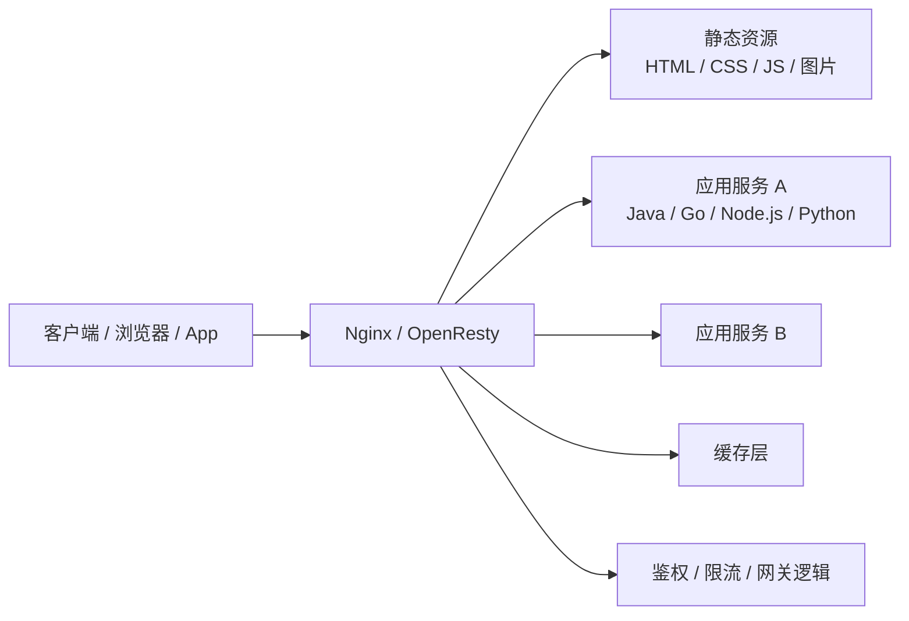

典型用途：

| 用途             | 说明                                     |
| ---------------- | ---------------------------------------- |
| 静态资源服务器   | 直接提供 HTML、CSS、JS、图片、视频等文件 |
| 反向代理         | 接收客户端请求，再转发给后端应用服务     |
| 负载均衡         | 将请求分发到多个后端实例                 |
| TLS/HTTPS 终止   | 由 Nginx 负责 HTTPS，后端服务使用 HTTP   |
| HTTP 缓存        | 缓存后端响应，降低后端压力               |
| API 网关基础设施 | 路由、鉴权、限流、日志、灰度等           |
| WebSocket 代理   | 转发 WebSocket 长连接                    |
| 请求限流         | 防刷、防突发流量冲击                     |
| 访问控制         | IP 黑白名单、Basic Auth、JWT 鉴权等      |
| 日志与监控入口   | 记录访问日志、错误日志、性能指标         |

------

## 为什么 Nginx 性能高

Nginx 的高性能主要来自以下设计：

| 机制           | 说明                                                   |
| -------------- | ------------------------------------------------------ |
| 事件驱动       | 不为每个连接创建一个线程，而是通过事件循环处理大量连接 |
| 异步非阻塞 I/O | 等待网络、磁盘时不阻塞整个工作进程                     |
| 多 worker 进程 | 通常每个 CPU 核心对应一个 worker                       |
| 零拷贝优化     | 静态文件传输时减少内核态和用户态之间的数据复制         |
| 内存占用低     | 连接数增加时资源开销相对较小                           |
| 配置热加载     | 修改配置后可平滑 reload，不中断已有连接                |

传统的“一个连接一个线程”模型在高并发下会有大量线程切换开销，而 Nginx 更像是少量 worker 进程同时管理大量连接。

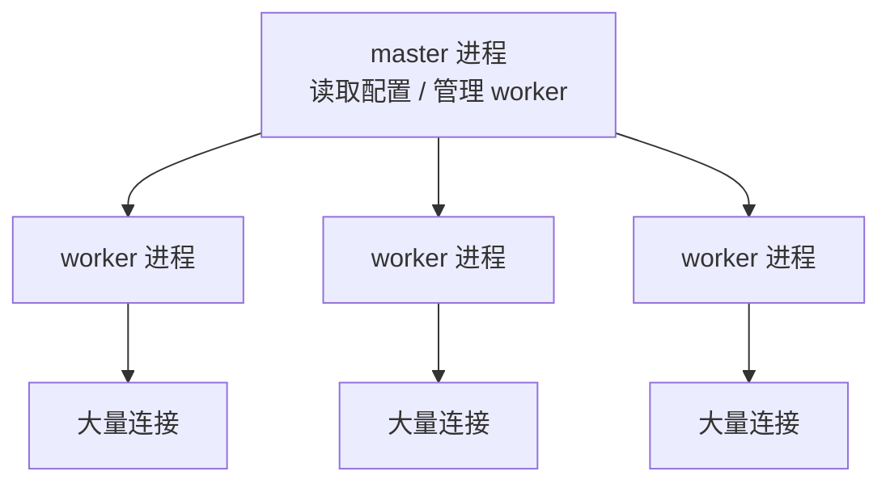

------

## Nginx 的核心进程模型

Nginx 通常由一个 master 进程和多个 worker 进程组成。

| 进程          | 作用                                           |
| ------------- | ---------------------------------------------- |
| master        | 读取配置、管理 worker、处理信号、平滑升级      |
| worker        | 处理实际请求、网络连接、代理转发、静态文件响应 |
| cache manager | 管理缓存文件                                   |
| cache loader  | 启动时加载磁盘缓存元数据                       |

常见信号操作：

| 操作               | 命令              | 作用               |
| ------------------ | ----------------- | ------------------ |
| 检查配置           | `nginx -t`        | 验证配置是否正确   |
| 启动               | `nginx`           | 启动 Nginx         |
| 重新加载           | `nginx -s reload` | 平滑加载新配置     |
| 快速停止           | `nginx -s stop`   | 立即停止           |
| 优雅停止           | `nginx -s quit`   | 等待请求完成后停止 |
| 查看版本与编译模块 | `nginx -V`        | 查看编译参数和模块 |

实际生产中，修改配置后的标准流程是：

```bash
nginx -t
nginx -s reload
```

如果使用 systemd：

```bash
sudo nginx -t
sudo systemctl reload nginx
```

------

## Nginx 配置文件结构

Nginx 配置是分层的，常见结构如下：

```nginx
main 全局配置 {
    events {
        事件模型配置
    }

    http {
        HTTP 全局配置

        upstream {
            后端服务池
        }

        server {
            虚拟主机配置

            location {
                路由匹配配置
            }
        }
    }
}
```

典型配置文件位置：

| 系统 / 安装方式 | 常见路径                                                     |
| --------------- | ------------------------------------------------------------ |
| Debian / Ubuntu | `/etc/nginx/nginx.conf`                                      |
| CentOS / RHEL   | `/etc/nginx/nginx.conf`                                      |
| 官方包          | `/etc/nginx/nginx.conf`                                      |
| OpenResty       | `/usr/local/openresty/nginx/conf/nginx.conf` 或 `/etc/openresty/nginx.conf` |
| Docker 镜像     | `/etc/nginx/nginx.conf`                                      |

常见目录：

| 目录                          | 作用                  |
| ----------------------------- | --------------------- |
| `/etc/nginx/nginx.conf`       | 主配置文件            |
| `/etc/nginx/conf.d/*.conf`    | 子配置文件            |
| `/etc/nginx/sites-available/` | Debian 风格的站点配置 |
| `/etc/nginx/sites-enabled/`   | 已启用站点软链接      |
| `/var/log/nginx/access.log`   | 访问日志              |
| `/var/log/nginx/error.log`    | 错误日志              |
| `/usr/share/nginx/html`       | 默认静态文件目录      |

------

## 配置上下文

Nginx 指令只能放在特定上下文中。

| 上下文   | 作用          | 常见指令                                    |
| -------- | ------------- | ------------------------------------------- |
| main     | 全局配置      | `worker_processes`、`user`、`pid`           |
| events   | 连接事件配置  | `worker_connections`、`use`                 |
| http     | HTTP 全局配置 | `include`、`log_format`、`gzip`、`upstream` |
| server   | 虚拟主机配置  | `listen`、`server_name`、`ssl_certificate`  |
| location | URI 路由配置  | `root`、`proxy_pass`、`try_files`           |
| upstream | 后端服务组    | `server`、`keepalive`                       |
| stream   | TCP/UDP 代理  | MySQL、Redis、TCP 负载均衡                  |
| mail     | 邮件代理      | SMTP、IMAP、POP3                            |

示例：

```nginx
worker_processes auto;

events {
    worker_connections 1024;
}

http {
    include       mime.types;
    default_type  application/octet-stream;

    server {
        listen 80;
        server_name example.com;

        location / {
            return 200 "Hello Nginx\n";
        }
    }
}
```

------

## 基础静态站点配置

最简单的静态站点配置：

```nginx
server {
    listen 80;
    server_name example.com;

    root /var/www/example;
    index index.html index.htm;

    location / {
        try_files $uri $uri/ =404;
    }
}
```

访问流程：

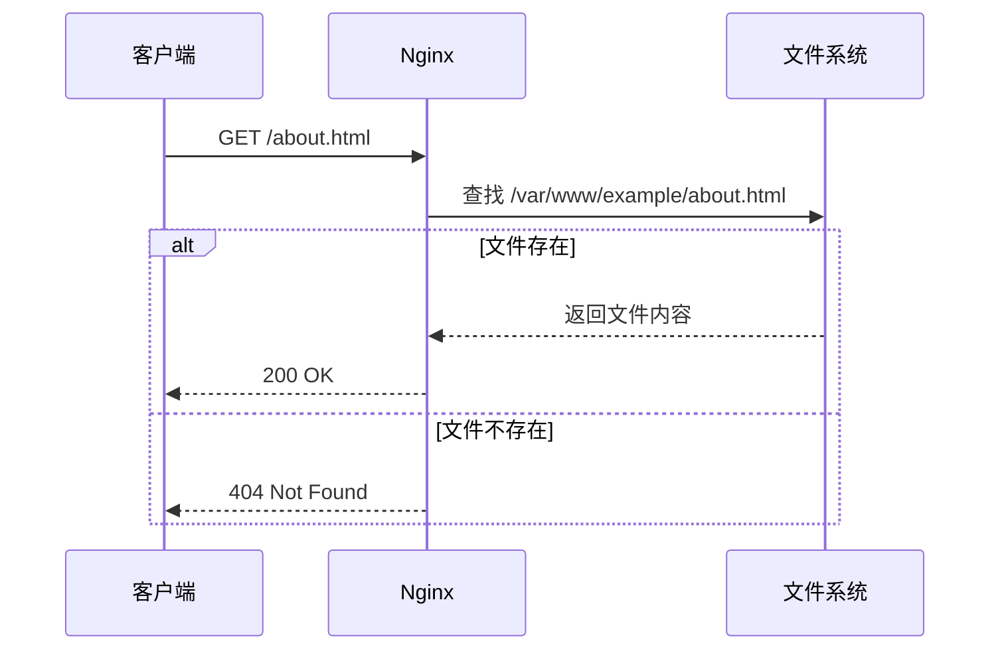

------

## root 与 alias 的区别

这是新手非常容易混淆的地方。

### root

`root` 会把请求 URI 拼接到指定目录后面。

```nginx
location /images/ {
    root /var/www;
}
```

请求：

```text
/images/a.png
```

实际文件路径：

```text
/var/www/images/a.png
```

### alias

`alias` 会用指定目录替换 location 前缀。

```nginx
location /images/ {
    alias /data/pictures/;
}
```

请求：

```text
/images/a.png
```

实际文件路径：

```text
/data/pictures/a.png
```

对比：

| 指令                     | 行为         | 示例 URI        | 实际路径                |
| ------------------------ | ------------ | --------------- | ----------------------- |
| `root /var/www;`         | 拼接完整 URI | `/images/a.png` | `/var/www/images/a.png` |
| `alias /data/pictures/;` | 替换匹配前缀 | `/images/a.png` | `/data/pictures/a.png`  |

使用 `alias` 时要特别注意尾部 `/`，通常建议 location 和 alias 都保持一致的斜杠风格：

```nginx
location /static/ {
    alias /var/www/assets/;
}
```

------

## try_files 的作用

`try_files` 用来按顺序尝试文件路径，如果都不存在，则执行最后一个参数。

常见静态站点：

```nginx
location / {
    try_files $uri $uri/ =404;
}
```

含义：

| 顺序    | 尝试内容           |
| ------- | ------------------ |
| `$uri`  | 查找同名文件       |
| `$uri/` | 查找同名目录       |
| `=404`  | 都不存在时返回 404 |

单页应用 SPA 常见配置：

```nginx
location / {
    try_files $uri $uri/ /index.html;
}
```

例如 Vue、React、Angular 的前端路由，如果用户直接访问 `/user/profile`，服务器上可能并没有这个文件，此时应回退到 `index.html`，由前端路由处理。

------

## location 匹配规则

`location` 是 Nginx 路由系统的核心。

常见语法：

```nginx
location = /exact {
    return 200 "exact\n";
}

location ^~ /static/ {
    return 200 "static\n";
}

location ~ \.php$ {
    return 200 "php regex\n";
}

location / {
    return 200 "prefix\n";
}
```

匹配类型：

| 类型                   | 示例                   | 含义                           |
| ---------------------- | ---------------------- | ------------------------------ |
| 精确匹配               | `location = /login`    | 只匹配 `/login`                |
| 优先前缀匹配           | `location ^~ /static/` | 匹配前缀，且命中后不再检查正则 |
| 正则匹配，区分大小写   | `location ~ \.php$`    | 匹配 PHP 文件                  |
| 正则匹配，不区分大小写 | `location ~* .(jpg     | png)$`                         |
| 普通前缀匹配           | `location /api/`       | 匹配 `/api/xxx`                |
| 默认匹配               | `location /`           | 所有请求兜底                   |

匹配大致流程：

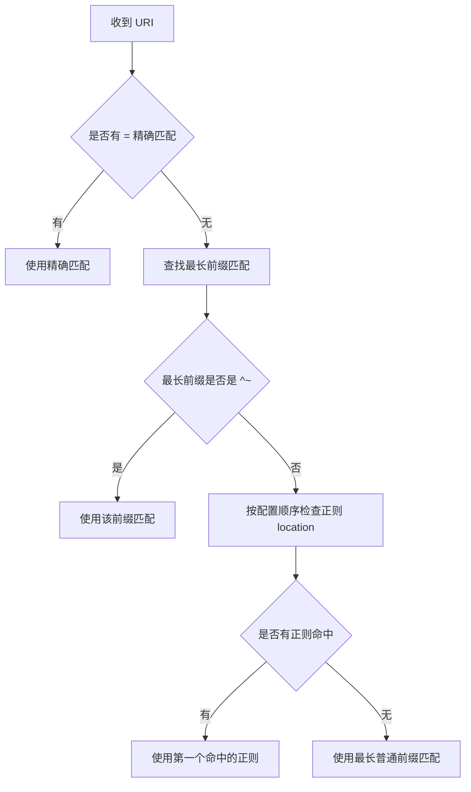

最佳实践：

| 建议                       | 说明                          |
| -------------------------- | ----------------------------- |
| 静态资源用 `^~ /static/`   | 避免不必要的正则匹配          |
| 精确路径用 `=`             | 如 `/healthz`、`/favicon.ico` |
| 正则 location 不宜过多     | 会增加匹配复杂度              |
| 兜底使用 `location /`      | 避免无意遗漏                  |
| 不要依赖“看起来像顺序匹配” | location 匹配不是简单从上到下 |

------

## 反向代理

反向代理是 Nginx 最常用的功能之一。

```nginx
server {
    listen 80;
    server_name api.example.com;

    location / {
        proxy_pass http://127.0.0.1:8080;

        proxy_set_header Host $host;
        proxy_set_header X-Real-IP $remote_addr;
        proxy_set_header X-Forwarded-For $proxy_add_x_forwarded_for;
        proxy_set_header X-Forwarded-Proto $scheme;
    }
}
```

访问流程：

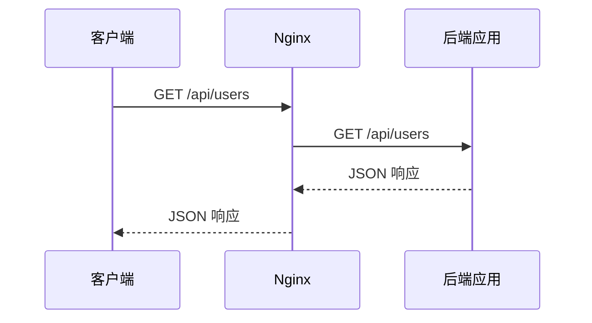

关键代理头：

| 请求头              | 作用                               |
| ------------------- | ---------------------------------- |
| `Host`              | 保留原始域名                       |
| `X-Real-IP`         | 传递客户端真实 IP                  |
| `X-Forwarded-For`   | 记录经过的代理链路 IP              |
| `X-Forwarded-Proto` | 告诉后端原始请求是 HTTP 还是 HTTPS |
| `X-Forwarded-Host`  | 传递原始 Host                      |
| `X-Forwarded-Port`  | 传递原始端口                       |

常用增强配置：

```nginx
location / {
    proxy_pass http://127.0.0.1:8080;

    proxy_http_version 1.1;
    proxy_set_header Connection "";

    proxy_connect_timeout 5s;
    proxy_send_timeout 60s;
    proxy_read_timeout 60s;

    proxy_buffering on;
    proxy_buffers 16 16k;
    proxy_busy_buffers_size 64k;
}
```

------

## proxy_pass 路径拼接规则

`proxy_pass` 是否带 URI，会影响转发路径。

示例：

```nginx
location /api/ {
    proxy_pass http://backend/;
}
```

请求：

```text
/api/users
```

转发到：

```text
http://backend/users
```

因为 `/api/` 被替换成了 `/`。

另一个示例：

```nginx
location /api/ {
    proxy_pass http://backend;
}
```

请求：

```text
/api/users
```

转发到：

```text
http://backend/api/users
```

对比：

| 配置                                             | 请求 URI     | 后端收到                 |
| ------------------------------------------------ | ------------ | ------------------------ |
| `location /api/ { proxy_pass http://backend/; }` | `/api/users` | `/users`                 |
| `location /api/ { proxy_pass http://backend; }`  | `/api/users` | `/api/users`             |
| `location /api { proxy_pass http://backend/; }`  | `/api/users` | 可能产生不符合预期的路径 |

最佳实践：

| 场景             | 推荐写法                                          |
| ---------------- | ------------------------------------------------- |
| 保留原始路径     | `proxy_pass http://backend;`                      |
| 去掉某个路径前缀 | `location /api/ { proxy_pass http://backend/; }`  |
| 避免歧义         | location 路径和 proxy_pass URI 的斜杠风格保持清晰 |

------

## upstream 与负载均衡

`upstream` 用来定义后端服务池。

```nginx
upstream app_backend {
    server 10.0.0.11:8080;
    server 10.0.0.12:8080;
    server 10.0.0.13:8080;
}

server {
    listen 80;
    server_name app.example.com;

    location / {
        proxy_pass http://app_backend;
    }
}
```

常见负载均衡策略：

| 策略     | 配置                            | 说明                                      |
| -------- | ------------------------------- | ----------------------------------------- |
| 轮询     | 默认                            | 请求依次分配                              |
| 加权轮询 | `server 10.0.0.11 weight=3;`    | 权重越高，流量越多                        |
| 最少连接 | `least_conn;`                   | 分配给当前连接数最少的节点                |
| IP Hash  | `ip_hash;`                      | 同一客户端 IP 尽量分配到同一节点          |
| Hash     | `hash $request_uri consistent;` | 基于变量的一致性哈希                      |
| 随机     | `random;`                       | 随机选择后端，部分版本支持 two least_conn |

示例：

```nginx
upstream app_backend {
    least_conn;

    server 10.0.0.11:8080 max_fails=3 fail_timeout=10s;
    server 10.0.0.12:8080 max_fails=3 fail_timeout=10s;
    server 10.0.0.13:8080 backup;
}
```

参数说明：

| 参数           | 说明                                    |
| -------------- | --------------------------------------- |
| `weight`       | 权重                                    |
| `max_fails`    | 在 `fail_timeout` 时间内允许失败次数    |
| `fail_timeout` | 失败统计窗口，同时也是临时摘除时间      |
| `backup`       | 备用节点，主节点不可用时启用            |
| `down`         | 标记节点不可用                          |
| `resolve`      | 配合动态 DNS 解析，商业版或部分场景可用 |

需要注意：

> 开源 Nginx 的 upstream 健康检查主要是被动健康检查。主动健康检查通常需要 Nginx Plus、第三方模块、Tengine、OpenResty 生态或上层服务发现系统支持。

------

## 长连接与 keepalive

Nginx 与客户端、Nginx 与后端都可以使用长连接。

### 客户端到 Nginx

```nginx
http {
    keepalive_timeout 65s;
    keepalive_requests 1000;
}
```

### Nginx 到后端

```nginx
upstream app_backend {
    server 127.0.0.1:8080;
    keepalive 64;
}

server {
    location / {
        proxy_pass http://app_backend;

        proxy_http_version 1.1;
        proxy_set_header Connection "";
    }
}
```

后端 keepalive 可以减少 TCP 建连成本，尤其适合高 QPS 内部服务调用。

------

## HTTPS 与 TLS 配置

现代生产环境基本都应该使用 HTTPS。

基础配置：

```nginx
server {
    listen 443 ssl http2;
    server_name example.com;

    ssl_certificate     /etc/letsencrypt/live/example.com/fullchain.pem;
    ssl_certificate_key /etc/letsencrypt/live/example.com/privkey.pem;

    ssl_protocols TLSv1.2 TLSv1.3;
    ssl_session_cache shared:SSL:10m;
    ssl_session_timeout 1d;
    ssl_session_tickets off;

    location / {
        root /var/www/example;
        index index.html;
    }
}

server {
    listen 80;
    server_name example.com;

    return 301 https://$host$request_uri;
}
```

现代 TLS 建议：

| 配置项        | 建议                                               |
| ------------- | -------------------------------------------------- |
| 协议版本      | 只启用 TLS 1.2 和 TLS 1.3                          |
| 证书          | 使用可信 CA，如 Let's Encrypt、ZeroSSL、云厂商证书 |
| HTTP 到 HTTPS | 使用 301 重定向                                    |
| HSTS          | 确认全站 HTTPS 稳定后再开启                        |
| Session cache | 开启，减少握手开销                                 |
| OCSP Stapling | 视证书链情况开启                                   |
| 弱加密套件    | 禁用                                               |

HSTS 示例：

```nginx
add_header Strict-Transport-Security "max-age=31536000; includeSubDomains" always;
```

开启 HSTS 前一定确认：

| 检查项                 | 原因                                 |
| ---------------------- | ------------------------------------ |
| 主域和子域都支持 HTTPS | `includeSubDomains` 会影响所有子域   |
| 证书自动续期可靠       | 否则证书过期后用户无法通过 HTTP 回退 |
| 不再需要纯 HTTP        | HSTS 会让浏览器强制使用 HTTPS        |

------

## HTTP/2 与 HTTP/3

### HTTP/2

HTTP/2 常用于 HTTPS 站点，可以提升多资源加载性能。

```nginx
server {
    listen 443 ssl http2;
    server_name example.com;
}
```

HTTP/2 特点：

| 特性         | 说明                        |
| ------------ | --------------------------- |
| 多路复用     | 一个 TCP 连接上并发多个请求 |
| 头部压缩     | 减少重复 Header 开销        |
| 二进制帧     | 传输效率更好                |
| 通常基于 TLS | 浏览器基本要求 HTTPS        |

### HTTP/3 / QUIC

HTTP/3 基于 QUIC，运行在 UDP 之上。较新的 Nginx 版本已经支持 HTTP/3，但在不同发行版中支持情况不同，编译模块和 OpenSSL/QUIC 库也会影响可用性。

示意配置：

```nginx
server {
    listen 443 ssl http2;
    listen 443 quic reuseport;

    server_name example.com;

    ssl_certificate     /path/fullchain.pem;
    ssl_certificate_key /path/privkey.pem;

    add_header Alt-Svc 'h3=":443"; ma=86400' always;
}
```

HTTP/3 部署建议：

| 建议               | 说明                                |
| ------------------ | ----------------------------------- |
| 先保证 HTTP/2 稳定 | HTTP/3 应作为增强而非替代           |
| 放通 UDP 443       | 防火墙、安全组、负载均衡都要支持    |
| 监控协议命中率     | 确认真实客户端使用情况              |
| 注意版本差异       | 不同 Nginx 包的 HTTP/3 支持差异很大 |

------

## gzip、Brotli 与静态资源压缩

### gzip

```nginx
gzip on;
gzip_comp_level 5;
gzip_min_length 1024;
gzip_vary on;
gzip_types
    text/plain
    text/css
    text/javascript
    application/javascript
    application/json
    application/xml
    image/svg+xml;
```

建议：

| 类型                      | 是否压缩             |
| ------------------------- | -------------------- |
| HTML/CSS/JS/JSON/XML/SVG  | 推荐                 |
| JPEG/PNG/GIF/WebP/MP4/ZIP | 不推荐，通常已经压缩 |
| 小于 1KB 的文件           | 压缩收益小，不建议   |

### Brotli

Brotli 对文本资源压缩率通常优于 gzip，但 Nginx 官方开源版本一般需要额外模块支持。

适合：

| 场景           | 说明                     |
| -------------- | ------------------------ |
| 前端静态资源   | JS/CSS/HTML 效果明显     |
| CDN 边缘       | 常见支持                 |
| 构建阶段预压缩 | 生成 `.br` 和 `.gz` 文件 |

现代前端资源推荐：

| 文件   | 建议                              |
| ------ | --------------------------------- |
| JS/CSS | 构建阶段压缩、hash 文件名、长缓存 |
| HTML   | 不宜长期强缓存                    |
| 图片   | 使用 WebP/AVIF，按需懒加载        |
| 大文件 | 使用 CDN、Range 请求              |

------

## 浏览器缓存策略

静态资源缓存非常关键。

### 带 hash 的静态资源

例如：

```text
/app.a8f3c1.js
/style.f92aa2.css
```

可以设置长期缓存：

```nginx
location ^~ /assets/ {
    root /var/www/example;
    expires 1y;
    add_header Cache-Control "public, immutable";
}
```

### HTML 文件

HTML 通常不应长期强缓存：

```nginx
location = /index.html {
    root /var/www/example;
    add_header Cache-Control "no-cache";
}
```

推荐策略：

| 资源类型            | Cache-Control                         |
| ------------------- | ------------------------------------- |
| HTML                | `no-cache`                            |
| 带 hash 的 JS/CSS   | `public, max-age=31536000, immutable` |
| 不带 hash 的 JS/CSS | 较短缓存或 no-cache                   |
| 图片字体            | 视是否带 hash 决定                    |
| API 响应            | 根据业务语义设置                      |

------

## Nginx 代理缓存

Nginx 可以缓存后端响应，适合内容相对稳定、读取量大的场景。

```nginx
proxy_cache_path /var/cache/nginx levels=1:2 keys_zone=api_cache:100m
                 max_size=10g inactive=60m use_temp_path=off;

server {
    listen 80;
    server_name api.example.com;

    location / {
        proxy_cache api_cache;
        proxy_cache_valid 200 302 10m;
        proxy_cache_valid 404 1m;

        proxy_cache_key "$scheme$request_method$host$request_uri";

        add_header X-Cache-Status $upstream_cache_status;

        proxy_pass http://app_backend;
    }
}
```

常见变量：

| 变量                     | 含义                                  |
| ------------------------ | ------------------------------------- |
| `$upstream_cache_status` | `HIT`、`MISS`、`BYPASS`、`EXPIRED` 等 |
| `$request_uri`           | 原始请求 URI，含查询字符串            |
| `$uri`                   | 规范化后的 URI，不含查询字符串        |
| `$host`                  | 请求 Host                             |
| `$scheme`                | HTTP 或 HTTPS                         |

缓存状态：

| 状态       | 说明                     |
| ---------- | ------------------------ |
| `MISS`     | 未命中缓存，从后端获取   |
| `HIT`      | 命中缓存                 |
| `EXPIRED`  | 缓存过期，重新向后端请求 |
| `BYPASS`   | 绕过缓存                 |
| `STALE`    | 使用过期缓存             |
| `UPDATING` | 正在更新缓存             |

防止缓存击穿：

```nginx
proxy_cache_lock on;
proxy_cache_lock_timeout 5s;
proxy_cache_use_stale error timeout updating http_500 http_502 http_503 http_504;
```

不缓存登录态请求：

```nginx
set $skip_cache 0;

if ($http_authorization != "") {
    set $skip_cache 1;
}

if ($http_cookie ~* "session|token") {
    set $skip_cache 1;
}

proxy_no_cache $skip_cache;
proxy_cache_bypass $skip_cache;
```

注意：Nginx 中的 `if` 有一些使用限制，简单设置变量通常可以接受，但复杂逻辑更推荐使用 `map` 或 OpenResty。

------

## map 指令

`map` 用于基于变量生成新变量，比滥用 `if` 更安全、更清晰。

```nginx
map $http_upgrade $connection_upgrade {
    default upgrade;
    ""      close;
}

map $http_authorization $skip_cache {
    default 1;
    ""      0;
}
```

常见用途：

| 用途             | 示例                                      |
| ---------------- | ----------------------------------------- |
| WebSocket 连接头 | 根据 `$http_upgrade` 设置 `Connection`    |
| 缓存控制         | 根据 Cookie 或 Authorization 决定是否缓存 |
| 灰度发布         | 根据 Header、Cookie 选择 upstream         |
| 日志脱敏         | 根据条件控制日志内容                      |
| 跨域策略         | 根据 Origin 判断是否允许                  |

------

## WebSocket 代理

WebSocket 需要升级 HTTP 连接。

```nginx
map $http_upgrade $connection_upgrade {
    default upgrade;
    ""      close;
}

server {
    listen 80;
    server_name ws.example.com;

    location /ws/ {
        proxy_pass http://127.0.0.1:8080;

        proxy_http_version 1.1;
        proxy_set_header Upgrade $http_upgrade;
        proxy_set_header Connection $connection_upgrade;

        proxy_read_timeout 3600s;
        proxy_send_timeout 3600s;
    }
}
```

关键点：

| 配置                     | 作用                            |
| ------------------------ | ------------------------------- |
| `proxy_http_version 1.1` | WebSocket 需要 HTTP/1.1 Upgrade |
| `Upgrade`                | 协议升级头                      |
| `Connection`             | 控制连接升级                    |
| 较长 timeout             | WebSocket 是长连接              |

------

## 限流与限并发

Nginx 提供基础限流能力，常用于防刷和保护后端。

### 请求速率限制

```nginx
limit_req_zone $binary_remote_addr zone=per_ip:10m rate=10r/s;

server {
    location /api/ {
        limit_req zone=per_ip burst=20 nodelay;
        proxy_pass http://app_backend;
    }
}
```

参数说明：

| 参数                  | 说明                                 |
| --------------------- | ------------------------------------ |
| `$binary_remote_addr` | 客户端 IP 的二进制形式，节省内存     |
| `zone=per_ip:10m`     | 共享内存区域名称和大小               |
| `rate=10r/s`          | 平均每秒 10 个请求                   |
| `burst=20`            | 突发队列容量                         |
| `nodelay`             | 突发请求不排队等待，能处理就立即处理 |

### 并发连接限制

```nginx
limit_conn_zone $binary_remote_addr zone=addr_conn:10m;

server {
    location /download/ {
        limit_conn addr_conn 5;
    }
}
```

限流建议：

| 场景     | 建议                                   |
| -------- | -------------------------------------- |
| 登录接口 | 严格限流，按 IP、账号、设备等综合判断  |
| API 接口 | 根据业务容量设置                       |
| 下载接口 | 限并发、限速                           |
| 内网服务 | 不要误伤内部调用                       |
| 真实 IP  | 如果前面有 CDN/LB，要先正确恢复真实 IP |

------

## 获取真实客户端 IP

如果 Nginx 前面还有 CDN、云负载均衡或其他代理，`$remote_addr` 可能是上游代理 IP，而不是用户真实 IP。

配置示例：

```nginx
set_real_ip_from 10.0.0.0/8;
set_real_ip_from 192.168.0.0/16;
set_real_ip_from 172.16.0.0/12;

real_ip_header X-Forwarded-For;
real_ip_recursive on;
```

如果使用 Cloudflare、阿里云 CDN、腾讯云 CDN 等，需要只信任其官方 IP 段。

安全原则：

| 原则                           | 说明                             |
| ------------------------------ | -------------------------------- |
| 只信任可信代理 IP              | 不要对全网信任 `X-Forwarded-For` |
| 不要直接相信客户端传来的 IP 头 | 客户端可以伪造 Header            |
| 边界代理统一清洗 Header        | 在入口处覆盖或规范化             |
| 日志记录原始与解析后 IP        | 便于排查                         |

------

## 访问控制

### IP 黑白名单

```nginx
location /admin/ {
    allow 10.0.0.0/8;
    allow 192.168.1.0/24;
    deny all;

    proxy_pass http://admin_backend;
}
```

### Basic Auth

```nginx
location /private/ {
    auth_basic "Restricted";
    auth_basic_user_file /etc/nginx/.htpasswd;
}
```

生成密码文件：

```bash
sudo apt install apache2-utils
htpasswd -c /etc/nginx/.htpasswd alice
```

### 安全响应头

```nginx
add_header X-Content-Type-Options "nosniff" always;
add_header X-Frame-Options "SAMEORIGIN" always;
add_header Referrer-Policy "strict-origin-when-cross-origin" always;
add_header Permissions-Policy "geolocation=(), microphone=(), camera=()" always;
```

常见安全头：

| Header                      | 作用                     |
| --------------------------- | ------------------------ |
| `Strict-Transport-Security` | 强制 HTTPS               |
| `X-Content-Type-Options`    | 防止 MIME 嗅探           |
| `X-Frame-Options`           | 限制页面被 iframe 嵌入   |
| `Content-Security-Policy`   | 控制资源加载来源，防 XSS |
| `Referrer-Policy`           | 控制 Referer 泄露        |
| `Permissions-Policy`        | 控制浏览器能力访问       |

CSP 功能强大但容易影响业务，建议逐步引入：

```nginx
add_header Content-Security-Policy "default-src 'self'; img-src 'self' data: https:; script-src 'self'; style-src 'self' 'unsafe-inline'" always;
```

------

## CORS 跨域

CORS 是浏览器安全策略，不是 Nginx 特有功能。Nginx 可以代替后端返回跨域头。

简单配置：

```nginx
location /api/ {
    add_header Access-Control-Allow-Origin "https://www.example.com" always;
    add_header Access-Control-Allow-Methods "GET, POST, PUT, DELETE, OPTIONS" always;
    add_header Access-Control-Allow-Headers "Authorization, Content-Type" always;
    add_header Access-Control-Allow-Credentials "true" always;

    if ($request_method = OPTIONS) {
        return 204;
    }

    proxy_pass http://api_backend;
}
```

注意事项：

| 问题                   | 说明                                        |
| ---------------------- | ------------------------------------------- |
| 带 Cookie 时不能用 `*` | `Access-Control-Allow-Origin` 不能是 `*`    |
| OPTIONS 预检请求       | 复杂请求会先发 OPTIONS                      |
| Header 必须匹配        | 前端自定义 Header 要在 Allow-Headers 中声明 |
| 建议白名单             | 不要随意反射所有 Origin                     |

更推荐使用 `map` 做 Origin 白名单：

```nginx
map $http_origin $cors_origin {
    default "";
    "https://www.example.com" $http_origin;
    "https://admin.example.com" $http_origin;
}

server {
    location /api/ {
        add_header Access-Control-Allow-Origin $cors_origin always;
        add_header Access-Control-Allow-Credentials "true" always;
    }
}
```

------

## 日志系统

### 访问日志

自定义日志格式：

```nginx
log_format main_json escape=json
    '{'
    '"time":"$time_iso8601",'
    '"remote_addr":"$remote_addr",'
    '"request":"$request",'
    '"status":$status,'
    '"body_bytes_sent":$body_bytes_sent,'
    '"request_time":$request_time,'
    '"upstream_addr":"$upstream_addr",'
    '"upstream_status":"$upstream_status",'
    '"upstream_response_time":"$upstream_response_time",'
    '"http_referer":"$http_referer",'
    '"http_user_agent":"$http_user_agent",'
    '"request_id":"$request_id"'
    '}';

access_log /var/log/nginx/access.log main_json;
```

关键变量：

| 变量                      | 说明                         |
| ------------------------- | ---------------------------- |
| `$request_time`           | 从接收请求到响应完成的总耗时 |
| `$upstream_response_time` | 后端响应耗时                 |
| `$upstream_addr`          | 实际访问的后端地址           |
| `$status`                 | HTTP 状态码                  |
| `$body_bytes_sent`        | 响应体字节数                 |
| `$request_id`             | 请求 ID，便于链路追踪        |
| `$http_user_agent`        | User-Agent                   |

### 错误日志

```nginx
error_log /var/log/nginx/error.log warn;
```

日志级别：

| 级别     | 说明                           |
| -------- | ------------------------------ |
| `debug`  | 调试信息，需编译支持，生产慎用 |
| `info`   | 普通信息                       |
| `notice` | 重要事件                       |
| `warn`   | 警告                           |
| `error`  | 错误                           |
| `crit`   | 严重错误                       |
| `alert`  | 需要立即处理                   |
| `emerg`  | 系统不可用                     |

生产建议：

| 建议              | 说明                                |
| ----------------- | ----------------------------------- |
| 使用 JSON 日志    | 方便采集到 ELK、Loki、ClickHouse    |
| 记录 request_id   | 便于和后端日志关联                  |
| 区分 access/error | 分别处理访问和错误                  |
| 配置 logrotate    | 防止日志占满磁盘                    |
| 对敏感信息脱敏    | Token、手机号、身份证等不应直接记录 |

------

## 常见状态码排查

| 状态码 | 常见原因                           | 排查方向                             |
| ------ | ---------------------------------- | ------------------------------------ |
| 400    | 请求格式错误、Header 过大          | 查看 error_log、调整 header buffer   |
| 403    | 权限不足、目录无权限、deny 规则    | 检查文件权限、访问控制               |
| 404    | 文件不存在、location/root 配置错误 | 检查 URI 与实际路径                  |
| 413    | 请求体太大                         | 调整 `client_max_body_size`          |
| 499    | 客户端主动断开                     | 客户端超时、网络问题、后端慢         |
| 500    | Nginx 内部错误或后端错误           | 查看 error_log 和后端日志            |
| 502    | 后端不可达或返回非法响应           | 检查 upstream、端口、协议            |
| 503    | 服务不可用、限流、维护             | 检查限流、后端状态                   |
| 504    | 后端超时                           | 检查 `proxy_read_timeout` 和后端耗时 |

常用排查命令：

```bash
nginx -t
nginx -T
tail -f /var/log/nginx/error.log
tail -f /var/log/nginx/access.log
curl -v http://example.com/
curl -I https://example.com/
ss -lntp
```

`nginx -T` 会打印完整展开后的配置，非常适合排查 include 后的真实配置。

------

## 客户端请求体与上传

上传文件时常见配置：

```nginx
server {
    client_max_body_size 100m;

    location /upload/ {
        proxy_pass http://upload_backend;

        proxy_request_buffering on;
        proxy_connect_timeout 10s;
        proxy_read_timeout 300s;
    }
}
```

相关指令：

| 指令                      | 说明                             |
| ------------------------- | -------------------------------- |
| `client_max_body_size`    | 限制请求体大小                   |
| `client_body_timeout`     | 读取请求体超时时间               |
| `client_body_buffer_size` | 请求体缓冲区大小                 |
| `proxy_request_buffering` | 是否先完整读取请求体再转发给后端 |

`proxy_request_buffering`：

| 值    | 行为                               | 适合                 |
| ----- | ---------------------------------- | -------------------- |
| `on`  | Nginx 先缓冲完整请求体，再发给后端 | 保护后端，默认推荐   |
| `off` | 边收边发给后端                     | 流式上传、大文件直传 |

------

## 文件下载与限速

```nginx
location /download/ {
    root /data;

    limit_rate_after 10m;
    limit_rate 1m;
}
```

含义：

| 指令                   | 说明               |
| ---------------------- | ------------------ |
| `limit_rate_after 10m` | 前 10MB 不限速     |
| `limit_rate 1m`        | 之后限速为约 1MB/s |

支持断点续传通常依赖 Range 请求，Nginx 静态文件服务默认支持 Range。

------

## sendfile、tcp_nopush 与静态文件优化

```nginx
sendfile on;
tcp_nopush on;
tcp_nodelay on;
```

说明：

| 指令          | 说明                                     |
| ------------- | ---------------------------------------- |
| `sendfile`    | 使用内核 sendfile 发送文件，减少数据拷贝 |
| `tcp_nopush`  | 尽量合并数据包，常配合 sendfile          |
| `tcp_nodelay` | 减少小包延迟，适合 keepalive 连接        |

常见静态资源优化：

```nginx
open_file_cache max=10000 inactive=60s;
open_file_cache_valid 120s;
open_file_cache_min_uses 2;
open_file_cache_errors on;
```

------

## Nginx 变量

Nginx 中有许多内置变量。

| 变量                  | 说明                           |
| --------------------- | ------------------------------ |
| `$uri`                | 规范化后的 URI，不含查询字符串 |
| `$request_uri`        | 原始 URI，包含查询字符串       |
| `$args`               | 查询字符串                     |
| `$arg_name`           | 查询参数 `name` 的值           |
| `$host`               | 请求 Host                      |
| `$http_user_agent`    | 请求头 User-Agent              |
| `$http_authorization` | 请求头 Authorization           |
| `$remote_addr`        | 客户端 IP                      |
| `$server_name`        | 当前 server_name               |
| `$scheme`             | http 或 https                  |
| `$request_method`     | GET、POST 等                   |
| `$request_id`         | 请求 ID                        |
| `$time_iso8601`       | ISO8601 时间                   |
| `$upstream_addr`      | 上游地址                       |
| `$upstream_status`    | 上游状态码                     |

注意：

> Nginx 变量有些是惰性求值的，只有被使用时才计算。变量过度使用、复杂正则和频繁 rewrite 都可能增加运行成本。

------

## rewrite 与 return

### return

`return` 用于直接返回状态码或重定向，简单高效。

```nginx
return 301 https://$host$request_uri;
```

### rewrite

`rewrite` 用于 URI 重写。

```nginx
rewrite ^/old/(.*)$ /new/$1 permanent;
```

常见 flag：

| flag        | 说明                                     |
| ----------- | ---------------------------------------- |
| `last`      | 停止当前 rewrite，重新进行 location 匹配 |
| `break`     | 停止 rewrite，不重新匹配 location        |
| `redirect`  | 302 临时重定向                           |
| `permanent` | 301 永久重定向                           |

最佳实践：

| 建议                           | 说明                                 |
| ------------------------------ | ------------------------------------ |
| 能用 `return` 就不用 `rewrite` | 更清晰、更高效                       |
| 避免复杂 rewrite 链            | 容易造成循环和维护困难               |
| 重定向注意保留查询参数         | 根据业务决定是否保留 `$is_args$args` |
| 301 谨慎使用                   | 浏览器会缓存，错误后不容易立刻恢复   |

------

## Nginx 中的 if 问题

Nginx 有一句著名说法：

> If is evil.

准确理解是：

> 在 `location` 中滥用 `if` 可能导致不可预期行为，但不是所有 if 都不能用。

相对安全的用法：

```nginx
if ($request_method = OPTIONS) {
    return 204;
}

if ($http_authorization != "") {
    set $skip_cache 1;
}
```

不推荐在 `if` 中放复杂指令，例如某些 `proxy_pass`、`try_files`、嵌套逻辑等。

替代方案：

| 需求         | 推荐                            |
| ------------ | ------------------------------- |
| 条件设置变量 | `map`                           |
| 条件路由     | 多个 location、map + upstream   |
| 复杂逻辑     | OpenResty Lua                   |
| 鉴权         | `auth_request`、OpenResty、网关 |
| 灰度         | map、split_clients、OpenResty   |

------

## 灰度发布与流量拆分

### split_clients

```nginx
split_clients "${remote_addr}${http_user_agent}" $variant {
    10%     canary;
    *       stable;
}

upstream stable_backend {
    server 10.0.0.11:8080;
}

upstream canary_backend {
    server 10.0.0.12:8080;
}

map $variant $target_backend {
    stable stable_backend;
    canary canary_backend;
}

server {
    location / {
        proxy_pass http://$target_backend;
    }
}
```

适合：

| 场景           | 说明                          |
| -------------- | ----------------------------- |
| 小比例灰度     | 例如 1%、5%、10%              |
| 按用户稳定分流 | 使用 IP、Cookie、用户 ID 哈希 |
| A/B 测试       | 分配不同版本                  |

注意：

> 使用变量形式的 `proxy_pass` 时，DNS 解析和 upstream 行为可能与普通写法不同。生产中需要仔细测试，复杂灰度建议使用 OpenResty 或 API 网关。

------

## auth_request 鉴权子请求

Nginx 可以通过 `auth_request` 模块实现统一鉴权。

```nginx
location /api/ {
    auth_request /auth;

    proxy_pass http://api_backend;
}

location = /auth {
    internal;

    proxy_pass http://auth_service/verify;
    proxy_pass_request_body off;
    proxy_set_header Content-Length "";
    proxy_set_header X-Original-URI $request_uri;
    proxy_set_header Authorization $http_authorization;
}
```

流程：

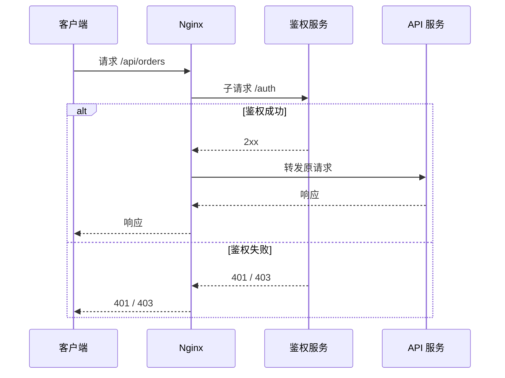

适合：

| 优点           | 限制                       |
| -------------- | -------------------------- |
| 与业务服务解耦 | 每次请求可能多一次内部调用 |
| 配置简单       | 复杂鉴权逻辑较难表达       |
| 可复用鉴权服务 | 高性能鉴权建议配合缓存     |

------

## stream TCP/UDP 代理

除了 HTTP，Nginx 也可以代理 TCP/UDP。

```nginx
stream {
    upstream mysql_backend {
        server 10.0.0.11:3306;
        server 10.0.0.12:3306 backup;
    }

    server {
        listen 3306;
        proxy_pass mysql_backend;
    }
}
```

常见场景：

| 协议            | 说明         |
| --------------- | ------------ |
| MySQL           | TCP 代理     |
| Redis           | TCP 代理     |
| MQTT            | TCP 长连接   |
| DNS             | UDP 代理     |
| 自定义 TCP 服务 | 四层负载均衡 |

注意：

> Nginx 的 stream 是四层代理，不理解 HTTP 语义，因此不能基于 URL、Header 做路由。

------

## Nginx 模块体系

Nginx 功能来自模块。

| 模块类型    | 说明                                      |
| ----------- | ----------------------------------------- |
| 核心模块    | 进程、事件、配置基础能力                  |
| HTTP 模块   | 反向代理、gzip、rewrite、access、limit 等 |
| Stream 模块 | TCP/UDP 代理                              |
| Mail 模块   | 邮件代理                                  |
| 第三方模块  | Brotli、Lua、Headers More、VTS 等         |
| 动态模块    | 可在运行时通过 `load_module` 加载         |

查看已编译模块：

```bash
nginx -V
```

常见重要模块：

| 模块                           | 功能                |
| ------------------------------ | ------------------- |
| `ngx_http_proxy_module`        | HTTP 反向代理       |
| `ngx_http_fastcgi_module`      | FastCGI，如 PHP-FPM |
| `ngx_http_rewrite_module`      | rewrite、if、return |
| `ngx_http_ssl_module`          | HTTPS               |
| `ngx_http_gzip_module`         | gzip                |
| `ngx_http_realip_module`       | 真实 IP             |
| `ngx_http_auth_request_module` | 子请求鉴权          |
| `ngx_http_limit_req_module`    | 请求限流            |
| `ngx_http_limit_conn_module`   | 连接限制            |
| `ngx_http_stub_status_module`  | 基础状态页          |
| `ngx_stream_core_module`       | TCP/UDP 代理        |

------

## OpenResty 是什么

OpenResty 将 Nginx 扩展成一个高性能可编程平台。

核心组件：

| 组件               | 作用                      |
| ------------------ | ------------------------- |
| Nginx              | 网络服务器基础            |
| LuaJIT             | 高性能 Lua 运行时         |
| ngx_lua            | 在 Nginx 请求阶段执行 Lua |
| lua-resty-core     | OpenResty 核心 Lua API    |
| lua-resty-lrucache | 本地 LRU 缓存             |
| lua-resty-redis    | Redis 客户端              |
| lua-resty-mysql    | MySQL 客户端              |
| lua-resty-http     | HTTP 客户端               |
| lua-resty-lock     | 分布式/本地锁辅助         |
| lua-resty-string   | 字符串、加密相关工具      |

OpenResty 常用于：

| 场景     | 说明                             |
| -------- | -------------------------------- |
| 动态鉴权 | JWT、签名、API Key               |
| API 网关 | 插件化路由、限流、熔断           |
| 动态路由 | 根据 Redis/配置中心选择 upstream |
| 灰度发布 | 按用户、租户、Header 分流        |
| WAF      | 请求检查、规则拦截               |
| 边缘计算 | 在入口层做轻量业务逻辑           |
| 缓存控制 | 本地缓存 + Redis + 后端          |
| 日志增强 | 异步上报、结构化日志             |

------

## OpenResty 与普通 Nginx 的关系

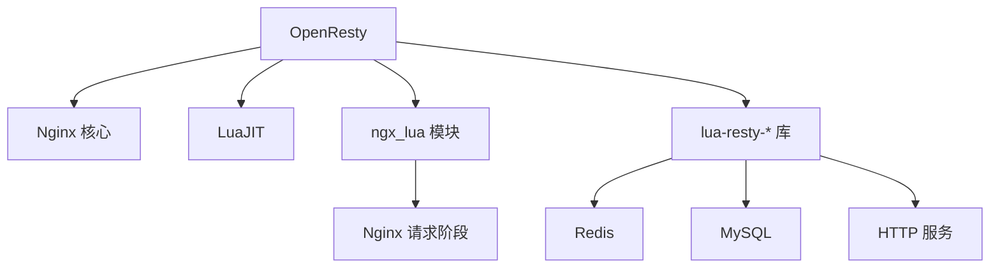

对比：

| 能力             | Nginx  | OpenResty                |
| ---------------- | ------ | ------------------------ |
| 静态文件         | 很强   | 很强                     |
| 反向代理         | 很强   | 很强                     |
| 负载均衡         | 强     | 强，可动态增强           |
| 配置复杂逻辑     | 有限   | 强                       |
| 鉴权             | 基础   | 强                       |
| 接入 Redis/MySQL | 不适合 | 适合，但需注意非阻塞库   |
| 编写业务逻辑     | 不适合 | 可做轻量逻辑             |
| 大型业务系统     | 不适合 | 也不建议替代完整应用服务 |

重要原则：

> OpenResty 适合在接入层做高性能、轻量、请求相关的逻辑，不建议把复杂业务系统全部写在 Nginx/Lua 中。

------

## OpenResty 请求处理阶段

OpenResty 可以在 Nginx 的多个阶段执行 Lua 代码。

| 阶段               | 指令                           | 常见用途                 |
| ------------------ | ------------------------------ | ------------------------ |
| 初始化 master      | `init_by_lua_block`            | 加载模块、初始化全局数据 |
| 初始化 worker      | `init_worker_by_lua_block`     | 定时任务、连接池预热     |
| TLS 阶段           | `ssl_certificate_by_lua_block` | 动态证书                 |
| rewrite 阶段       | `rewrite_by_lua_block`         | URI 改写、路由决策       |
| access 阶段        | `access_by_lua_block`          | 鉴权、限流、黑白名单     |
| content 阶段       | `content_by_lua_block`         | 直接生成响应             |
| header_filter 阶段 | `header_filter_by_lua_block`   | 修改响应头               |
| body_filter 阶段   | `body_filter_by_lua_block`     | 修改响应体               |
| log 阶段           | `log_by_lua_block`             | 异步日志、指标上报       |

请求阶段示意：

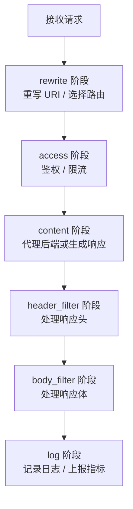

------

## OpenResty Hello World

```nginx
server {
    listen 8080;

    location /hello {
        content_by_lua_block {
            ngx.say("Hello OpenResty")
        }
    }
}
```

访问：

```bash
curl http://127.0.0.1:8080/hello
```

响应：

```text
Hello OpenResty
```

------

## ngx 对象常用 API

| API                       | 说明               |
| ------------------------- | ------------------ |
| `ngx.say()`               | 输出内容并追加换行 |
| `ngx.print()`             | 输出内容不追加换行 |
| `ngx.var.xxx`             | 访问 Nginx 变量    |
| `ngx.req.get_headers()`   | 获取请求头         |
| `ngx.req.get_uri_args()`  | 获取查询参数       |
| `ngx.req.read_body()`     | 读取请求体         |
| `ngx.req.get_body_data()` | 获取请求体内容     |
| `ngx.status`              | 设置响应状态码     |
| `ngx.header`              | 设置响应头         |
| `ngx.exit()`              | 结束请求           |
| `ngx.log()`               | 写错误日志         |
| `ngx.now()`               | 当前时间           |
| `ngx.time()`              | 当前 Unix 时间戳   |
| `ngx.shared.DICT`         | 共享字典           |
| `ngx.timer.at()`          | 创建定时器         |
| `ngx.location.capture()`  | 发起 Nginx 子请求  |

示例：

```nginx
location /whoami {
    content_by_lua_block {
        ngx.say("ip: ", ngx.var.remote_addr)
        ngx.say("uri: ", ngx.var.uri)
        ngx.say("user-agent: ", ngx.req.get_headers()["user-agent"] or "")
    }
}
```

------

## OpenResty 鉴权示例

```nginx
location /api/ {
    access_by_lua_block {
        local token = ngx.var.http_authorization

        if not token or token == "" then
            ngx.status = ngx.HTTP_UNAUTHORIZED
            ngx.say("missing authorization")
            return ngx.exit(ngx.HTTP_UNAUTHORIZED)
        end

        if token ~= "Bearer demo-token" then
            ngx.status = ngx.HTTP_FORBIDDEN
            ngx.say("invalid token")
            return ngx.exit(ngx.HTTP_FORBIDDEN)
        end
    }

    proxy_pass http://app_backend;
}
```

这只是教学示例。生产中不应硬编码 token，而应使用 JWT、公钥校验、Redis、鉴权服务或网关插件体系。

------

## OpenResty 共享字典

共享字典可以在多个 worker 之间共享少量数据，常用于缓存、限流计数、配置快照等。

```nginx
lua_shared_dict my_cache 10m;

server {
    location /cache {
        content_by_lua_block {
            local cache = ngx.shared.my_cache

            local value = cache:get("foo")
            if not value then
                value = "bar"
                cache:set("foo", value, 60)
            end

            ngx.say(value)
        }
    }
}
```

特点：

| 特性          | 说明                           |
| ------------- | ------------------------------ |
| worker 间共享 | 多个 worker 可见               |
| 存储在内存    | 速度快                         |
| 容量固定      | 需要规划大小                   |
| 支持过期时间  | `set(key, value, ttl)`         |
| 不适合大对象  | 大对象会占用共享内存并增加碎片 |
| 重启丢失      | 不是持久化存储                 |

------

## OpenResty 限流示例

简单 IP 限流：

```nginx
lua_shared_dict rate_limit 10m;

location /api/ {
    access_by_lua_block {
        local dict = ngx.shared.rate_limit
        local key = ngx.var.binary_remote_addr
        local limit = 100
        local window = 60

        local current, err = dict:incr(key, 1)
        if not current then
            dict:set(key, 1, window)
            current = 1
        end

        if current > limit then
            ngx.status = 429
            ngx.say("too many requests")
            return ngx.exit(429)
        end
    }

    proxy_pass http://app_backend;
}
```

这个示例是固定窗口限流，简单但不够平滑。生产中更推荐：

| 算法       | 特点                      |
| ---------- | ------------------------- |
| 固定窗口   | 简单，但边界突刺明显      |
| 滑动窗口   | 更平滑，成本略高          |
| 漏桶       | 平滑出流量                |
| 令牌桶     | 允许一定突发，常用        |
| 分布式限流 | 使用 Redis 或专门限流服务 |

OpenResty 生态中可以使用 `lua-resty-limit-traffic`。

------

## OpenResty 访问 Redis

需要使用非阻塞 cosocket 库，例如 `lua-resty-redis`。

```nginx
location /redis {
    content_by_lua_block {
        local redis = require "resty.redis"
        local red = redis:new()

        red:set_timeout(1000)

        local ok, err = red:connect("127.0.0.1", 6379)
        if not ok then
            ngx.status = 500
            ngx.say("failed to connect redis: ", err)
            return
        end

        local res, err = red:get("hello")
        if not res then
            ngx.status = 500
            ngx.say("failed to get key: ", err)
            return
        end

        if res == ngx.null then
            ngx.say("not found")
        else
            ngx.say(res)
        end

        local ok, err = red:set_keepalive(10000, 100)
        if not ok then
            ngx.log(ngx.WARN, "failed to set redis keepalive: ", err)
        end
    }
}
```

要点：

| 要点                 | 说明                      |
| -------------------- | ------------------------- |
| 使用 `set_timeout`   | 避免 Redis 慢导致请求卡住 |
| 使用 `set_keepalive` | 复用连接，提升性能        |
| 处理 `ngx.null`      | Redis nil 与 Lua nil 不同 |
| 不要使用阻塞 Lua 库  | 会阻塞 worker             |
| 外部依赖要有降级策略 | Redis 故障不能拖垮入口层  |

------

## OpenResty 本地缓存模式

常见模式：

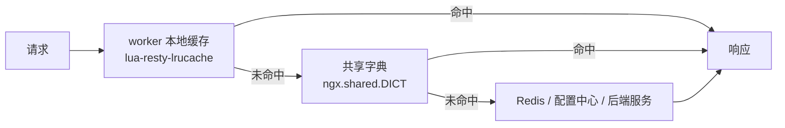

缓存层级：

| 层级            | 优点          | 缺点                   |
| --------------- | ------------- | ---------------------- |
| worker 本地 LRU | 极快，无锁    | worker 间不共享        |
| shared dict     | worker 间共享 | 容量有限，有锁竞争     |
| Redis           | 可分布式共享  | 网络开销，依赖外部服务 |
| 后端服务        | 数据权威      | 延迟高，成本高         |

最佳实践：

| 建议               | 说明                   |
| ------------------ | ---------------------- |
| 热点配置放本地缓存 | 降低 Redis 压力        |
| 设置合理 TTL       | 防止长期脏数据         |
| 使用锁防击穿       | 避免大量请求同时回源   |
| 错误时使用旧值     | 提升可用性             |
| 缓存对象不要太大   | 避免内存碎片和 GC 压力 |

------

## OpenResty 动态路由示例

根据请求头路由到不同后端：

```nginx
upstream stable_backend {
    server 10.0.0.11:8080;
}

upstream beta_backend {
    server 10.0.0.12:8080;
}

server {
    location / {
        set $target_backend "stable_backend";

        rewrite_by_lua_block {
            local version = ngx.var.http_x_app_version

            if version == "beta" then
                ngx.var.target_backend = "beta_backend"
            end
        }

        proxy_pass http://$target_backend;
    }
}
```

注意：

> 动态 upstream、DNS、连接复用、健康检查等细节较多。复杂动态路由建议基于成熟网关，如 Apache APISIX、Kong，或使用服务发现系统。

------

## OpenResty 的性能原则

OpenResty 性能很好，但前提是写法正确。

| 原则                  | 说明                                 |
| --------------------- | ------------------------------------ |
| 不要阻塞 worker       | 禁用阻塞 I/O、阻塞 DNS、阻塞系统调用 |
| 使用 cosocket 库      | Redis、HTTP、MySQL 都要用 resty 库   |
| 控制 Lua 逻辑复杂度   | 接入层只做轻量逻辑                   |
| 复用连接              | Redis/HTTP/MySQL 使用 keepalive      |
| 控制外部依赖超时      | 例如 50ms、100ms、500ms 按场景设置   |
| 做好降级              | 外部依赖失败时返回默认策略或旧缓存   |
| 避免大对象频繁分配    | 降低 Lua GC 压力                     |
| 注意共享字典容量      | 防止 `no memory`                     |
| 不在 log 阶段做慢操作 | 日志上报应异步、短超时               |
| 使用压测验证          | 不要凭感觉上线                       |

------

## Nginx 与 OpenResty 选择建议

| 需求             | 推荐                              |
| ---------------- | --------------------------------- |
| 静态资源服务     | Nginx                             |
| 简单反向代理     | Nginx                             |
| TLS 终止         | Nginx                             |
| 基础负载均衡     | Nginx                             |
| 简单限流         | Nginx                             |
| 简单鉴权子请求   | Nginx `auth_request`              |
| JWT/API Key 鉴权 | OpenResty 或 API 网关             |
| 复杂灰度发布     | OpenResty / APISIX / Kong         |
| 动态路由         | OpenResty / API 网关              |
| 插件化 API 网关  | APISIX / Kong                     |
| 复杂业务逻辑     | 后端应用服务，不建议写在 Nginx 层 |

------

## 生产配置基础模板

下面是一个较通用的现代 Nginx HTTP 配置模板，可按需裁剪。

```nginx
user nginx;
worker_processes auto;
pid /var/run/nginx.pid;

events {
    worker_connections 4096;
    multi_accept on;
}

http {
    include       mime.types;
    default_type  application/octet-stream;

    server_tokens off;

    sendfile on;
    tcp_nopush on;
    tcp_nodelay on;

    keepalive_timeout 65s;
    keepalive_requests 1000;

    client_max_body_size 20m;

    log_format main_json escape=json
        '{'
        '"time":"$time_iso8601",'
        '"remote_addr":"$remote_addr",'
        '"request":"$request",'
        '"status":$status,'
        '"request_time":$request_time,'
        '"upstream_addr":"$upstream_addr",'
        '"upstream_status":"$upstream_status",'
        '"upstream_response_time":"$upstream_response_time",'
        '"request_id":"$request_id"'
        '}';

    access_log /var/log/nginx/access.log main_json;
    error_log  /var/log/nginx/error.log warn;

    gzip on;
    gzip_comp_level 5;
    gzip_min_length 1024;
    gzip_vary on;
    gzip_types
        text/plain
        text/css
        application/json
        application/javascript
        application/xml
        image/svg+xml;

    map $http_upgrade $connection_upgrade {
        default upgrade;
        ""      close;
    }

    upstream app_backend {
        least_conn;
        server 127.0.0.1:8080 max_fails=3 fail_timeout=10s;
        keepalive 64;
    }

    server {
        listen 80;
        server_name example.com;

        location = /healthz {
            access_log off;
            return 200 "ok\n";
        }

        location ^~ /assets/ {
            root /var/www/example;
            expires 1y;
            add_header Cache-Control "public, immutable";
        }

        location / {
            proxy_pass http://app_backend;

            proxy_http_version 1.1;
            proxy_set_header Connection "";

            proxy_set_header Host $host;
            proxy_set_header X-Real-IP $remote_addr;
            proxy_set_header X-Forwarded-For $proxy_add_x_forwarded_for;
            proxy_set_header X-Forwarded-Proto $scheme;

            proxy_connect_timeout 5s;
            proxy_send_timeout 60s;
            proxy_read_timeout 60s;
        }
    }
}
```

------

## 容器化部署建议

Nginx 和 OpenResty 常运行在容器中。

### Dockerfile 示例

```dockerfile
FROM nginx:stable-alpine

COPY nginx.conf /etc/nginx/nginx.conf
COPY dist/ /usr/share/nginx/html/

EXPOSE 80
```

### 容器部署注意事项

| 项目         | 建议                                     |
| ------------ | ---------------------------------------- |
| 前台运行     | 官方镜像已使用 `daemon off;`             |
| 日志         | 输出到 stdout/stderr，便于容器平台采集   |
| 配置         | 使用 ConfigMap、挂载文件或镜像内置       |
| 健康检查     | 提供 `/healthz`                          |
| reload       | Kubernetes 中通常通过滚动更新替代 reload |
| 文件权限     | 确保 worker 用户可读静态文件             |
| 只读文件系统 | 生产可考虑增强安全性                     |
| 缓存目录     | 如需 proxy_cache，要挂载可写目录         |

Docker 中不要依赖传统 logrotate，推荐日志输出到标准输出。

------

## Kubernetes Ingress 与 Nginx

在 Kubernetes 中，常见 Nginx 相关组件有：

| 组件                     | 说明                                         |
| ------------------------ | -------------------------------------------- |
| ingress-nginx            | Kubernetes 社区常用 Nginx Ingress Controller |
| NGINX Ingress Controller | NGINX 官方产品，有开源与商业版本             |
| OpenResty 网关           | 可自建，也可使用 APISIX/Kong                 |
| Service                  | Kubernetes 内部负载均衡                      |
| ConfigMap                | 管理 Ingress Controller 配置                 |

关系：

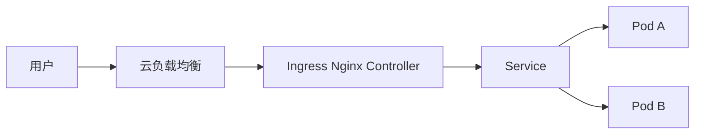

新手要理解：

| 概念               | 说明                          |
| ------------------ | ----------------------------- |
| Ingress            | 路由规则对象                  |
| Ingress Controller | 真正执行规则的控制器          |
| Service            | Pod 的稳定访问入口            |
| Pod                | 应用实例                      |
| ConfigMap          | 控制 Nginx 行为               |
| Annotation         | 针对某个 Ingress 的细粒度配置 |

------

## 常见最佳实践清单

| 分类      | 建议                                         |
| --------- | -------------------------------------------- |
| 配置管理  | 配置文件拆分清晰，避免一个巨大文件           |
| 上线流程  | 每次 reload 前执行 `nginx -t`                |
| HTTPS     | 只启用 TLS 1.2/1.3                           |
| 日志      | 使用 JSON 日志，记录请求耗时和 upstream 信息 |
| 安全      | 关闭 `server_tokens`，设置安全头             |
| 静态资源  | hash 文件名配合长期缓存                      |
| 代理      | 设置合理超时，不要无限等待                   |
| 后端连接  | upstream 开启 keepalive                      |
| 限流      | 对登录、短信、搜索等接口限流                 |
| 真实 IP   | 只信任可信代理，正确配置 realip              |
| 缓存      | 明确缓存 key、TTL、绕过条件                  |
| 错误页    | 提供友好的 404/50x 页面                      |
| 文件上传  | 设置 `client_max_body_size`                  |
| 监控      | 关注 4xx/5xx、499、502、504、延迟            |
| 灰度      | 小流量逐步扩大，随时可回滚                   |
| OpenResty | 所有外部 I/O 使用非阻塞 resty 库             |
| 容器      | 日志输出 stdout/stderr                       |
| 权限      | 尽量非 root worker，文件权限最小化           |
| 备份      | 证书、配置、关键脚本纳入版本管理             |

------

## 新手学习路径

建议按这个顺序学习：

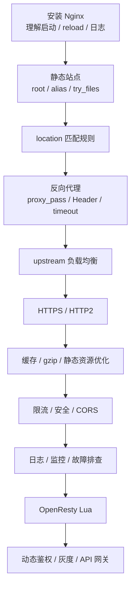

推荐练习项目：

| 阶段      | 练习                              |
| --------- | --------------------------------- |
| 入门      | 部署一个静态 HTML 网站            |
| 基础      | 配置多个域名虚拟主机              |
| 代理      | 代理一个本地 Node.js/Go/Java 服务 |
| 负载均衡  | 启动三个后端实例做 upstream       |
| HTTPS     | 使用 Let's Encrypt 配置证书       |
| SPA       | 部署 React/Vue 项目并处理前端路由 |
| 缓存      | 配置静态资源长期缓存              |
| 限流      | 给登录接口加限流                  |
| 日志      | 输出 JSON 日志并用 jq 分析        |
| OpenResty | 写一个 Lua 鉴权和 Redis 查询示例  |

------

## 容易踩坑总结

| 坑                       | 表现                    | 建议                           |
| ------------------------ | ----------------------- | ------------------------------ |
| `root` 与 `alias` 混淆   | 文件路径不对，404       | 明确拼接规则                   |
| `proxy_pass` 斜杠问题    | 后端路径异常            | 保留路径或去前缀要明确         |
| location 匹配误解        | 请求进入了意外 location | 掌握精确、前缀、正则优先级     |
| 忘记传代理头             | 后端拿不到真实 IP/协议  | 设置 `X-Forwarded-*`           |
| 前面有 CDN 却没配 realip | 日志 IP 都是 CDN        | 只信任 CDN IP 段               |
| CORS 乱配 `*`            | 带 Cookie 请求失败      | 使用明确 Origin 白名单         |
| 超时时间过长             | 后端慢拖垮连接          | 设置合理 timeout               |
| 日志没 upstream 时间     | 难排查慢请求            | 记录 `$upstream_response_time` |
| 不执行 `nginx -t`        | reload 后失败           | 上线前强制检查                 |
| OpenResty 使用阻塞库     | worker 被卡死           | 使用 cosocket resty 库         |
| 共享字典太小             | `no memory`             | 规划容量并监控                 |
| 301 配错                 | 浏览器长期缓存错误跳转  | 测试阶段用 302                 |
| HSTS 过早开启            | HTTPS 出问题无法回退    | 确认稳定后再开启               |

------

## 总结

Nginx 的核心价值是：

> 以极低资源消耗处理大量连接，并在入口层完成静态资源、反向代理、负载均衡、TLS、缓存、安全控制等通用工作。

OpenResty 的核心价值是：

> 在 Nginx 高性能模型上增加 Lua 可编程能力，让入口层可以处理动态鉴权、限流、灰度、路由和网关逻辑。

学习时建议先掌握 Nginx 的基础模型和配置规则，再逐步深入缓存、TLS、安全、监控，最后根据需要学习 OpenResty。对于生产环境，要始终关注可观测性、可回滚性、安全边界和配置可维护性。