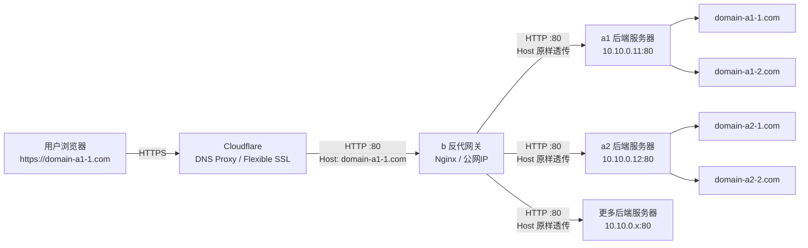
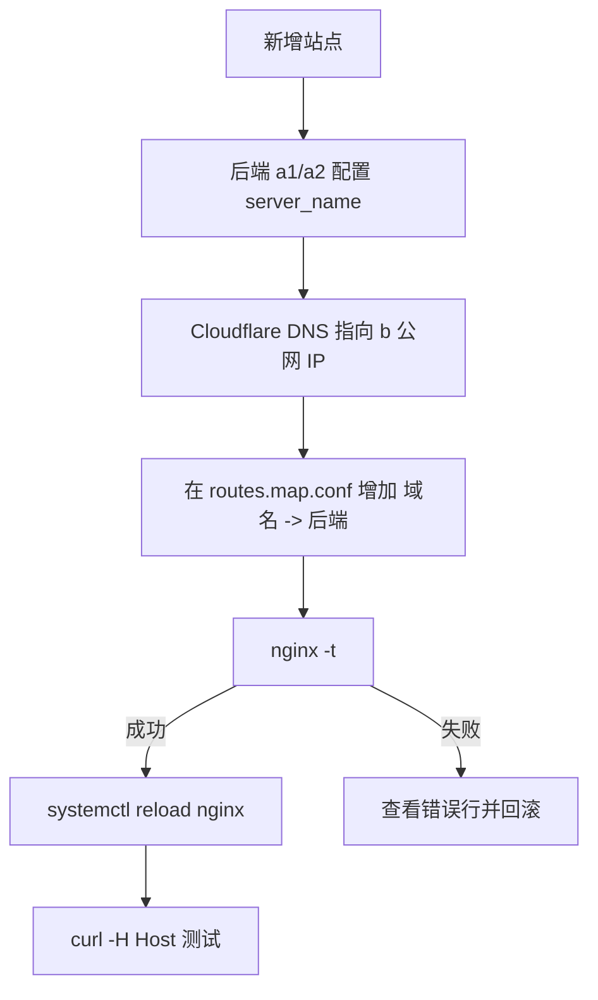

## abstract

下面方案的核心思路是：

**Cloudflare 只指向 `b` 的公网 IP；`b` 上 Nginx 只开一个通用反代入口；用 `map $host $backend_origin` 根据访问域名选择后端服务器。以后新增站点时，通常只改 `/etc/nginx/gateway/maps/routes.map.conf` 一行。**

Cloudflare 的 **Flexible** 模式表示：浏览器到 Cloudflare 是 HTTPS，Cloudflare 到源站 `b` 是 HTTP，因此 `b` 暂时只需要监听 80；但不要在 `b` 上强制把 HTTP 重定向到 HTTPS，否则容易产生 Cloudflare Flexible 常见的重定向循环。

Cloudflare 官方也明确说明 Flexible 下 Cloudflare 到 origin 是 HTTP 明文连接。([Cloudflare Docs](https://developers.cloudflare.com/ssl/origin-configuration/ssl-modes/flexible/))

------

## 总体架构



建议 `b -> a1/a2/...` 之间使用 **内网 IP** 等固定地址。若只能走公网 IP，也要在 `a1/a2` 防火墙中只允许 `b` 的 IP 访问 80 端口。

------

## 配置目标

最终效果：

| 访问域名          | Cloudflare DNS   | 到达 b                  | b 转发到               |
| ----------------- | ---------------- | ----------------------- | ---------------------- |
| `domain-a1-1.com` | 代理到 b 公网 IP | `Host: domain-a1-1.com` | `http://10.10.0.11:80` |
| `domain-a1-2.com` | 代理到 b 公网 IP | `Host: domain-a1-2.com` | `http://10.10.0.11:80` |
| `domain-a2-1.com` | 代理到 b 公网 IP | `Host: domain-a2-1.com` | `http://10.10.0.12:80` |

Nginx 的 `map` 模块正适合这种“根据 Host 生成变量”的场景；官方文档说明 `map` 可按变量生成新变量，并且即使声明大量 map，变量只有在使用时才求值，不会因为 map 很大就给每个请求额外增加声明成本。([Nginx](https://nginx.org/en/docs/http/ngx_http_map_module.html))

------

# 一、Cloudflare 侧配置

每个域名都这样配置：

| 类型 | 名称       | 内容          | 代理状态       |
| ---- | ---------- | ------------- | -------------- |
| A    | `@`        | `b` 的公网 IP | Proxied / 橙云 |
| A    | `www`      | `b` 的公网 IP | Proxied / 橙云 |
| A    | 其他子域名 | `b` 的公网 IP | Proxied / 橙云 |

SSL/TLS 模式选择：

```text
SSL/TLS -> Overview -> Flexible
```

注意：

1. Flexible 模式下，`b` 只需要监听 HTTP 80。
2. `b` 上暂时不要写 `return 301 https://$host$request_uri;`。
3. 后端 `a1/a2` 也不要强制 HTTP 跳 HTTPS，除非你已经改成 Cloudflare Full / Full Strict。
4. 如果网站有登录、支付、后台管理，长期建议改为 Full Strict。Cloudflare 官方也建议涉及敏感信息时使用 Full 或 Full Strict。([Cloudflare Docs](https://developers.cloudflare.com/ssl/origin-configuration/ssl-modes/flexible/))

------

# 二、后端服务器 a1/a2 的要求

每台后端服务器仍然正常配置自己的虚拟主机。

例如 `a1` 上：

```nginx
server {
    listen 80;
    server_name domain-a1-1.com www.domain-a1-1.com;

    root /var/www/domain-a1-1.com;
    index index.html index.htm index.php;

    location / {
        try_files $uri $uri/ =404;
    }
}

server {
    listen 80;
    server_name domain-a1-2.com www.domain-a1-2.com;

    root /var/www/domain-a1-2.com;
    index index.html index.htm index.php;

    location / {
        try_files $uri $uri/ =404;
    }
}
```

`b` 会把原始 `Host` 头传给后端。Nginx 官方示例也说明反代时通常需要用 `proxy_set_header Host ...` 把 Host 传给上游。([Nginx](https://nginx.org/en/docs/http/ngx_http_proxy_module.html))

------

# 三、b 服务器安装 Nginx

在 Ubuntu 上：

```bash
sudo apt update
sudo apt install -y nginx
sudo systemctl enable nginx
sudo systemctl start nginx
```

验证：

```bash
nginx -v
sudo systemctl status nginx --no-pager
curl -I http://127.0.0.1
```

如果能看到 `HTTP/1.1 200 OK`、`403 Forbidden` 或默认 Nginx 页面，说明 Nginx 已经在运行。

------

# 四、b 上规划目录结构

创建专门的网关配置目录：

```bash
sudo mkdir -p /etc/nginx/gateway/maps
sudo mkdir -p /etc/nginx/gateway/snippets
sudo mkdir -p /var/log/nginx/gateway
```

建议结构：

```text
/etc/nginx/
├── nginx.conf
├── conf.d/
│   └── gateway.conf
└── gateway/
    ├── maps/
    │   └── routes.map.conf
    └── snippets/
        ├── proxy-common.conf

```

> `cf-realip.conf`可以考虑放在`conf.d`(或者其他安装方式的类似目录)中,nginx通常会自动导入.
>
> 或者放在`snippets`中,需要在配置中手动导入.

为什么这样拆？

| 文件                                            | 作用                               |
| ----------------------------------------------- | ---------------------------------- |
| `/etc/nginx/conf.d/gateway.conf`                | 网关主配置                         |
| `/etc/nginx/gateway/maps/routes.map.conf`            | 域名到后端的路由表，以后主要改这里 |
| `/etc/nginx/gateway/snippets/proxy-common.conf` | 通用反代头、超时、WebSocket 设置   |
| `/etc/nginx/gateway/snippets/cf-realip.conf`    | 还原 Cloudflare 后面的真实用户 IP  |

Nginx `include` 指令支持包含单个文件或通配符文件，官方文档也给出了 `include vhosts/*.conf;` 这类用法。([Nginx](https://nginx.org/en/docs/ngx_core_module.html))

------

# 五、配置 Cloudflare 真实 IP

如果不配置，`b` 的访问日志里看到的大多是 Cloudflare 节点 IP，不是真实访客 IP。

参考官方 IP 列表：https://www.cloudflare.com/ips/,并使用脚本定期更新(详情参考其他文档.)

> Cloudflare 官方维护 IP ranges 页面，并提供 IPv4/IPv6 段；
>
> 这里的配置应以官方列表为准定期核对。([Cloudflare](https://www.cloudflare.com/ips/))

典型的存放目录:将生成的配置保存到`/etc/nginx/conf.d/cf_realip.conf`,这会被自动引用.

------

# 六、配置通用反代参数

创建：

```bash
sudo nano /etc/nginx/gateway/snippets/proxy-common.conf
```

写入：

```nginx
# 反代到后端时使用 HTTP/1.1，便于 WebSocket / keep-alive。
proxy_http_version 1.1;

# 把原始 Host 传给后端。
# 这样 a1/a2 上仍然可以通过 server_name 区分不同站点。
proxy_set_header Host $host;

# 真实客户端 IP。
# 如果已通过 real_ip_header 还原，则 $remote_addr 会变成真实访客 IP。
proxy_set_header X-Real-IP $remote_addr;

# 代理链路 IP。
proxy_set_header X-Forwarded-For $proxy_add_x_forwarded_for;

# 用户访问 Cloudflare 时的协议。
# Flexible 模式下，Cloudflare 到 b 是 HTTP，但浏览器到 Cloudflare 通常是 HTTPS。
# Cloudflare 通常会带 X-Forwarded-Proto: https。
proxy_set_header X-Forwarded-Proto $http_x_forwarded_proto;

# 也保留原始 Host。
proxy_set_header X-Forwarded-Host $host;

# WebSocket 支持。
proxy_set_header Upgrade $http_upgrade;
proxy_set_header Connection $connection_upgrade;

# 常用超时，可按业务调整。
proxy_connect_timeout 10s;
proxy_send_timeout 60s;
proxy_read_timeout 60s;

# 大文件上传按需调整。
client_max_body_size 100m;

# 因为 proxy_pass 使用变量，不能使用 proxy_redirect default。
# 保持后端返回的跳转头不自动改写。
proxy_redirect off;
```

这里的 `proxy_set_header Host $host;` 很关键。Nginx 官方文档说明，默认情况下 Host 会被重定义为 `$proxy_host`；如果想传递原始 Host，应显式设置 `proxy_set_header Host $host;` 或 `$http_host`。([Nginx](https://nginx.org/en/docs/http/ngx_http_proxy_module.html))

------

# 七、配置大规模 map 路由

创建路由表：

```bash
sudo nano /etc/nginx/gateway/maps/routes.map.conf
```

示例内容：

```nginx
# 格式：
# 域名                      后端地址;
#
# 注意：
# 1. 每行末尾必须有分号。
# 2. 后端地址建议写成完整 URL，例如 http://10.10.0.11:80。
# 3. 这里不要写 map { } 外壳，只写映射条目。
# 4. 如果一个根域和所有子域都走同一后端，可以用 .example.com。

domain-a1-1.com              http://10.10.0.11:80;
www.domain-a1-1.com          http://10.10.0.11:80;

domain-a1-2.com              http://10.10.0.11:80;
www.domain-a1-2.com          http://10.10.0.11:80;

domain-a2-1.com              http://10.10.0.12:80;
www.domain-a2-1.com          http://10.10.0.12:80;

domain-a2-2.com              http://10.10.0.12:80;
www.domain-a2-2.com          http://10.10.0.12:80;

# 示例：根域和任意子域都走 a3
.example-a3.com              http://10.10.0.13:80;
```

`.example-a3.com` 的含义是同时匹配：

```text
example-a3.com
*.example-a3.com
```

Nginx `map` 的 `hostnames` 参数支持这类主机名通配，官方文档明确说明 `example.com` 与 `*.example.com` 可以合并为 `.example.com`。([Nginx](https://nginx.org/en/docs/http/ngx_http_map_module.html))

------

# 八、配置 b 的网关主配置

创建：

```bash
sudo nano /etc/nginx/conf.d/gateway.conf
```

写入完整配置：

```nginx
# =========================================================
# b 服务器：Cloudflare 后面的统一反代网关
# 适用场景：
# - Cloudflare Flexible SSL
# - Cloudflare -> b 使用 HTTP :80
# - b 根据 Host 反代到 a1/a2/...
# =========================================================


# ---------------------------------------------------------
# 解决大量 map 域名时的 hash 警告：
#
# nginx: [warn] could not build optimal map_hash...
#
# 这两个指令必须放在 http 上下文中，并且要放在 map 定义之前。
# conf.d/*.conf 通常是在 nginx.conf 的 http {} 里 include 的，
# 所以这里可以写。
#
# 几千个域名建议从以下值起步：
# - map_hash_bucket_size 128;
# - map_hash_max_size 65536;
#
# 如果域名特别长，或者仍然报警，再提高 bucket_size 到 256。
# 如果域名数量继续增加，再提高 max_size 到 131072 或 262144。
# ---------------------------------------------------------
map_hash_bucket_size 128;
map_hash_max_size 65536;


# ---------------------------------------------------------
# WebSocket Connection 头映射
# ---------------------------------------------------------
map $http_upgrade $connection_upgrade {
    default upgrade;
    ''      close;
}


# ---------------------------------------------------------
# Host -> 后端 origin 映射
#
# hostnames 必须写在映射列表之前。
# default 空字符串表示未知域名，不转发。
# ---------------------------------------------------------
map $host $backend_origin {
    hostnames;

    default "";

    include /etc/nginx/gateway/maps/routes.map.conf;
}


# ---------------------------------------------------------
# 日志格式：专门用于网关调试
# ---------------------------------------------------------
#log_format gateway_main escape=json
log_format gateway_main
    '"remote_addr":"$remote_addr",'
    '"time":"$time_iso8601",'
    '"cf_ip":"$http_cf_connecting_ip",'
    '"cf_ray":"$http_cf_ray",'
    '"host":"$host",'
    '"request":"$request",'
    '"status":$status,'
    '"body_bytes_sent":$body_bytes_sent,'
    '"request_time":$request_time,'
    '"upstream_addr":"$upstream_addr",'
    '"upstream_status":"$upstream_status",'
    '"upstream_connect_time":"$upstream_connect_time",'
    '"upstream_header_time":"$upstream_header_time",'
    '"upstream_response_time":"$upstream_response_time",'
    '"backend_origin":"$backend_origin",'
    '"xff":"$http_x_forwarded_for",'
    '"xfp":"$http_x_forwarded_proto",'
    '"referer":"$http_referer",'
    '"user_agent":"$http_user_agent"'
    ;


# ---------------------------------------------------------
# 默认 HTTP 入口
#
# default_server 用来接住所有访问 b:80 的请求。
# 不需要为几千个域名单独写 server_name。
# Nginx 的虚拟主机选择由 listen/server_name 决定；
# catch-all 应通过 default_server，而不是 server_name *。
# ---------------------------------------------------------
server {
    listen 80 default_server;
    listen [::]:80 default_server;

    # 不要写几千个 server_name。
    # "_" 只是占位，不是通配域名。
    server_name _;
	# 导入cf-realip.conf(是否手动导入取决于存放路径和nginx.conf中的配置,放在conf.d中一般自动导入)
    # include /etc/nginx/gateway/snippets/cf-realip.conf;

    access_log /var/log/nginx/gateway/access.log gateway_main;
    error_log  /var/log/nginx/gateway/error.log warn;

    # 健康检查接口，只给自己调试用。
    location = /__gateway_health {
        access_log off;
        return 200 "gateway ok\n";
        add_header Content-Type text/plain;
    }

    # 未登记域名：直接断开连接。
    # 也可以改成 return 404 "unknown host\n";
    if ($backend_origin = "") {
        return 444;
    }

    location / {
        include /etc/nginx/gateway/snippets/proxy-common.conf;

        # 注意：这里使用变量。
        # routes.map.conf 里必须写完整 URL，例如 http://10.10.0.11:80。
        proxy_pass $backend_origin;
    }
}
```

为什么不用几千个 `server_name`？

Nginx 的 `server_name` 用来选择具体 server block，支持精确名、通配名和正则名；但你这里的场景并不需要为每个域名创建一个 server block，只需要一个 `default_server` 接住所有请求，然后在里面按 `$host` 做路由。Nginx 官方也说明，默认 server 是 `listen` 的属性，不是靠 `server_name *` 实现。([Nginx](https://nginx.org/en/docs/http/server_names.html))

------

# 九、避免 map_hash 警告的重点

默认配置在,大量的map映射可能导致:

```text
nginx: [warn] could not build optimal map_hash, you should increase either map_hash_max_size: 2048 or map_hash_bucket_size: 128; ignoring map_hash_bucket_size
```

> 上述配置已经包含扩大相关参数值的配置,这里做进一步解释.

原因通常是：

1. `map` 条目太多。
2. 域名太长。
3. 默认 `map_hash_max_size 2048` 不够。
4. `map_hash_bucket_size` 不够。
5. 参数写在了 `map` 后面，导致没有正确生效。

官方文档里 `map_hash_bucket_size` 默认依赖 CPU cache line，可能是 32、64 或 128；`map_hash_max_size` 默认是 2048。几千域名时，默认值经常不够。([Nginx](https://nginx.org/en/docs/http/ngx_http_map_module.html))

建议起步值：

```nginx
map_hash_bucket_size 128;
map_hash_max_size 65536;
```

如果仍然报警，改成：

```nginx
map_hash_bucket_size 256;
map_hash_max_size 131072;
```

如果几万域名：

```nginx
map_hash_bucket_size 256;
map_hash_max_size 262144;
```

调整原则：

| 现象                     | 优先调整                    |
| ------------------------ | --------------------------- |
| 域名很多                 | 增大 `map_hash_max_size`    |
| 域名很长                 | 增大 `map_hash_bucket_size` |
| 仍有 warning             | 两者都增大                  |
| 配置测试慢一点但运行正常 | 可以接受                    |
| reload 后无 warning      | 合格                        |

验证：

```bash
sudo nginx -t
```

你要看到类似：

```text
nginx: the configuration file /etc/nginx/nginx.conf syntax is ok
nginx: configuration file /etc/nginx/nginx.conf test is successful
```

并且不能再出现 `could not build optimal map_hash`。

------

# 十、启用配置并验证

检查配置：

```bash
sudo nginx -t
```

重载：

```bash
sudo systemctl reload nginx
```

检查监听端口：

```bash
sudo ss -lntp | grep nginx
```

应该看到：

```text
LISTEN 0 511 0.0.0.0:80
LISTEN 0 511 [::]:80
```

本机健康检查：

```bash
curl -i http://127.0.0.1/__gateway_health
```

应返回：

```text
HTTP/1.1 200 OK
gateway ok
```

------

# 十一、在不经过 Cloudflare 的情况下测试路由

假设 `b` 的公网 IP 是：

```text
1.2.3.4
```

测试 `domain-a1-1.com` 是否会被 `b` 转发到 `a1`：

```bash
curl -I http://1.2.3.4/ -H "Host: domain-a1-1.com"
```

或者：

```bash
curl -v http://1.2.3.4/ -H "Host: domain-a1-1.com"
```

如果后端正常，应看到来自 `a1` 对应站点的响应。

测试未知域名：

```bash
curl -v http://1.2.3.4/ -H "Host: unknown-example.com"
```

如果使用 `return 444;`，curl 可能显示：

```text
Empty reply from server
```

这是正常的，表示未登记域名被直接断开。

------

# 十二、经过 Cloudflare 测试

DNS 生效后：

```bash
curl -I https://domain-a1-1.com
```

再查看 `b` 的日志：

```bash
sudo tail -f /var/log/nginx/gateway/access.log
```

你应该能看到类似：

```json
{
  "host":"domain-a1-1.com",
  "status":200,
  "upstream_addr":"10.10.0.11:80",
  "backend_origin":"http://10.10.0.11:80",
  "xfp":"https"
}
```

重点看这些字段：

| 字段                     | 正常含义                     |
| ------------------------ | ---------------------------- |
| `host`                   | 用户访问的域名               |
| `backend_origin`         | map 命中的后端               |
| `upstream_addr`          | 实际连接的后端 IP:端口       |
| `upstream_status`        | 后端返回状态码               |
| `request_time`           | 总耗时                       |
| `upstream_response_time` | 后端响应耗时                 |
| `cf_ray`                 | Cloudflare 请求标识          |
| `cf_ip`                  | Cloudflare 传来的真实访客 IP |

Nginx 官方文档也建议在日志里记录 upstream 连接、响应时间等变量，方便排查慢请求和后端问题。([NGINX 文档](https://docs.nginx.com/nginx/admin-guide/monitoring/logging/))

------

# 十三、新增站点时怎么操作

例如 `a1` 新增：

```text
new-site.com
www.new-site.com
```

只需要在 `b` 的路由表`/etc/nginx/gateway/maps/routes.map.conf`加映射内容：

追加：

```nginx
new-site.com          http://10.10.0.11:80;
www.new-site.com      http://10.10.0.11:80;
```

然后：

```bash
sudo nginx -t
sudo systemctl reload nginx
```

验证：

```bash
curl -I http://b的公网IP/ -H "Host: new-site.com"
```

Cloudflare 侧再把 `new-site.com` 的 DNS A 记录指向 `b` 的公网 IP，并打开橙云代理。

------

# 十四、后端 a1/a2 的防火墙建议

如果 `a1/a2` 使用公网 IP，建议只允许 `b` 访问后端 80。

在 `a1` 上，例如 `b` 的公网 IP 是 `1.2.3.4`：

```bash
sudo ufw allow from 1.2.3.4 to any port 80 proto tcp
sudo ufw deny 80/tcp
sudo ufw enable
sudo ufw status
```

如果 `b -> a1/a2` 走 WireGuard 内网，例如：

```text
b  = 10.10.0.1
a1 = 10.10.0.11
a2 = 10.10.0.12
```

则后端只监听内网 IP 更好：

```nginx
server {
    listen 10.10.0.11:80;
    server_name domain-a1-1.com;
    ...
}
```

或者防火墙只允许 `10.10.0.1` 访问。

------

# 十五、建议限制 b 只接受 Cloudflare 访问

因为所有网站都通过 Cloudflare 代理，`b` 的 80 端口最好只允许 Cloudflare IP 访问，避免别人绕过 Cloudflare 直接打源站。

简单版思路：

```bash
sudo ufw default deny incoming
sudo ufw allow ssh
```

然后根据 Cloudflare 官方 IP ranges 添加 80 端口白名单。Cloudflare IP 段需要以官方列表为准定期更新。([Cloudflare](https://www.cloudflare.com/ips/))

如果你暂时不想做自动更新，至少先不要把后端 `a1/a2` 暴露给全网。

------

# 十六、常见问题排查

## 访问返回 444 / Empty reply

说明域名没有命中 `routes.map.conf`。

检查：

```bash
grep "你的域名" /etc/nginx/gateway/maps/routes.map.conf
sudo nginx -t
sudo systemctl reload nginx
```

也可以看日志：

```bash
sudo tail -f /var/log/nginx/gateway/access.log
```

如果 `backend_origin` 是空，说明 map 没命中。

------

## 访问返回 502 Bad Gateway

说明 `b` 找到了后端，但连接失败。

检查：

```bash
curl -I http://10.10.0.11:80 -H "Host: domain-a1-1.com"
ping 10.10.0.11
nc -vz 10.10.0.11 80
```

同时看：

```bash
sudo tail -f /var/log/nginx/gateway/error.log
```

常见原因：

| 原因                 | 解决                       |
| -------------------- | -------------------------- |
| 后端 Nginx 没启动    | 启动后端 Nginx             |
| 后端防火墙拦截 b     | 放行 b 的 IP               |
| routes.map.conf 写错 IP   | 修正后 reload              |
| 后端只监听 127.0.0.1 | 改为监听内网 IP 或 0.0.0.0 |

------

## 网站跳转异常

Flexible 模式下，后端看到的是 HTTP 请求。如果应用程序根据本地协议生成跳转，可能跳到 `http://` 或反复跳转。

解决思路：

1. 后端应用信任：

```text
X-Forwarded-Proto: https
```

1. 在后端应用里设置可信代理。
2. 不要在 `b` 或后端强制 HTTP 跳 HTTPS。
3. 长期改 Cloudflare Full Strict。

------

## WebSocket 失败

确认有这些配置：

```nginx
proxy_http_version 1.1;
proxy_set_header Upgrade $http_upgrade;
proxy_set_header Connection $connection_upgrade;
```

然后查看日志里的状态码是否为 `101`。

------

# 十七、最终推荐维护方式

当站点达到几千个后，不建议人工长期编辑 `routes.map.conf`，建议维护一个源数据文件，例如：

```csv
domain,backend
domain-a1-1.com,http://10.10.0.11:80
www.domain-a1-1.com,http://10.10.0.11:80
domain-a2-1.com,http://10.10.0.12:80
```

然后脚本生成：

```nginx
domain-a1-1.com      http://10.10.0.11:80;
www.domain-a1-1.com  http://10.10.0.11:80;
domain-a2-1.com      http://10.10.0.12:80;
```

部署流程固定为：

```bash
sudo nginx -t && sudo systemctl reload nginx
```

这样最稳：



------

## 最小可运行配置总结

你真正需要长期维护的主要是这个文件：

```text
/etc/nginx/gateway/maps/routes.map.conf
```

新增站点只加：

```nginx
新域名.com        http://对应后端IP:80;
www.新域名.com    http://对应后端IP:80;
```

`b` 上 Nginx 主逻辑保持不变：

```nginx
map $host $backend_origin {
    hostnames;
    default "";
    include /etc/nginx/gateway/maps/routes.map.conf;
}

server {
    listen 80 default_server;
    server_name _;

    if ($backend_origin = "") {
        return 444;
    }

    location / {
        proxy_set_header Host $host;
        proxy_set_header X-Real-IP $remote_addr;
        proxy_set_header X-Forwarded-For $proxy_add_x_forwarded_for;
        proxy_set_header X-Forwarded-Proto $http_x_forwarded_proto;
        proxy_pass $backend_origin;
    }
}
```

这是你这个场景下最适合的 Ubuntu 标准 Nginx 方案：**单入口、Host 路由、map 集中维护、支持几千站点、避免大量 server block、可逐步迁移到 Full Strict。**