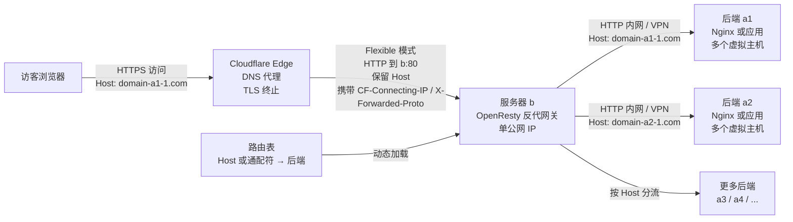
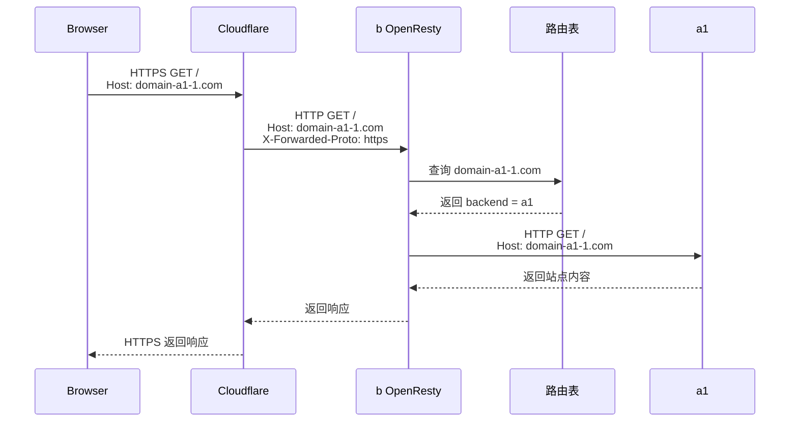
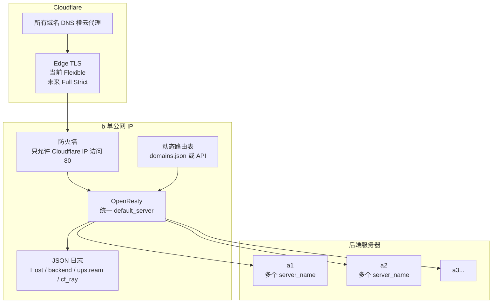

[toc]

## abstract

将一个服务器(vps,记为`b`)为多个后端服务器(分别记为`a1`,`a2`,...)做反代。

> 假设`b`有且只有1个公网ip,也记为`b`;
>
> 已知`a1`和`a2`,...都有多个互不相同的站点:
>
> > `a1`上存在站点`domain-a1-1.com`,`domain-a1-2.com`,...;
> >
> > `a2`上存在站点`domain-a2-1.com`,`domain-a2-2.com`,...;
> >
> > ...(其他更多后端服务器)

现在要求把服务器`b`配置成反代网关,让`b`为所有后端服务器做反代,客户访问的不同网站能够被正确代理到对应的服务器上).

要求:后续服务器`a1`和`a2`上面增加站点时,`b`上的配置尽量少变动;

我将`b`的ip提供给**cloudflare**,通过**cloudflare**代理所有网站(其中ssl加密方式采用flexible,且暂不考虑full模式).

> 被反代的站包括包括所有已有和将来可能新增的站.

服务器软件选择：nginx(openresty);

请规划并设计好网络架构图示意图(mermaid语言描述),给出详细且具体的配置方案,要求在合适的步骤(阶段)给出验证是否配置正确的方法,包括适合调试的日志设置,完善的注释和说明.

下面给出的是一套**以 `b` 为统一入口、Cloudflare 代理所有域名、OpenResty/Nginx 按 Host 动态分发到后端服务器**的方案。核心目标是：新增站点时，尽量不改 `b` 的 Nginx 主配置；最多只改一份“路由表”，甚至可以让 `a1/a2/...` 自动发布路由表片段。

## 路由方式

`b` 要把请求转发到正确后端，**必须知道“域名 → 后端服务器”的映射关系**。对于没有命名规律的独立域名，例如：

- `domain-a1-1.com → a1`
- `domain-a1-2.com → a1`
- `domain-a2-1.com → a2`

`b` 不可能自动猜出新域名属于谁。

### 方案选择

必须至少选择一种路由事实来源：

| 路由方式                                                     | 新增站点时 `b` 是否改 Nginx 配置 | 适用场景             | 推荐度         |
| ------------------------------------------------------------ | -------------------------------- | -------------------- | -------------- |
| Nginx `map` 文件                                             | 只更新 map 文件并 reload         | 新手、站点数量中等   | 高             |
| OpenResty 动态路由表，JSON/数据库/API                        | 不需要改 Nginx，只更新路由数据   | 域名很多、经常新增   | 最高           |
| 固定命名规则，例如 `*.a1.example.com → a1`,但是实际上域之间往往关联性不强,这个方案不是和普适. | 不需要                           | 域名有统一后缀或规则 | 特定用途下可行 |
| 每个域名写一个 `server` 块                                   | 频繁改配置                       | 小规模、临时方案     | 低             |

# openresty方案

本文主推：**OpenResty 动态路由表方案**。但也附上Nginx方案

Nginx/OpenResty 负责统一入口，后端 `a1/a2/...` 继续用自己的虚拟主机配置根据 `Host` 提供不同站点。OpenResty 是基于 Nginx、LuaJIT 和 Lua 库构建的 Web 平台，适合做这种动态网关逻辑。

## 整体架构



请求流程：



Cloudflare 的 Flexible 模式只加密“访客 ↔ Cloudflare”，而 “Cloudflare ↔ 源站 b” 使用 HTTP，因此源站不需要证书，但这只是部分安全。Cloudflare 官方也建议能用 Full 或 Full Strict 时尽量使用它们，尤其有登录、隐私数据、后台管理等敏感内容时不建议长期使用 Flexible。([Cloudflare Docs](https://developers.cloudflare.com/ssl/origin-configuration/ssl-modes/flexible/?utm_source=chatgpt.com))

## 关键原理

### 依靠 Host 头分流

浏览器访问：

```text
https://domain-a1-1.com/path
```

Cloudflare 代理后，请求到达 `b` 时仍然会带有：

```text
Host: domain-a1-1.com
```

`b` 根据 `Host` 查路由表：

```text
domain-a1-1.com → a1
domain-a2-1.com → a2
```

然后把请求转发给对应后端，并且继续保留原始 `Host`：

```text
Host: domain-a1-1.com
```

这样 `a1` 上的 Nginx 就可以通过自己的 `server_name domain-a1-1.com;` 选择正确站点。

### 为什么不是按端口转发

因为 `b` 只有一个公网 IP，而且 Cloudflare 代理的是 HTTP/HTTPS 网站流量。最自然、最可扩展的方式是**按域名 Host 分流**，而不是给每个后端或站点分配不同端口。

### Flexible 模式下的 HTTPS 识别

在 Flexible 模式下，Cloudflare 到 `b` 是 HTTP，但用户访问 Cloudflare 可能是 HTTPS。Cloudflare 会设置 `X-Forwarded-Proto`，用于标识访客连接 Cloudflare 时使用的是 HTTP 还是 HTTPS；Cloudflare 文档说明该请求头会被设置为客户端使用的协议。([Cloudflare Docs](https://developers.cloudflare.com/fundamentals/reference/http-headers/))

因此，`b` 转发给后端时应继续传递：

```nginx
proxy_set_header X-Forwarded-Proto $visitor_scheme;
```

后端应用要信任这个头，否则可能生成错误的 `http://` 链接，或者出现 HTTPS 重定向循环。

## 推荐网络规划

| 组件               | 建议                                                   |
| ------------------ | ------------------------------------------------------ |
| Cloudflare DNS     | 所有被代理域名的 A/AAAA/CNAME 指向 `b`，开启橙云代理   |
| Cloudflare SSL/TLS | 当前按你的要求使用 Flexible                            |
| `b` 公网入口       | 只开放 HTTP 80 给 Cloudflare IP 段                     |
| `b` 到后端         | 优先走内网、VPC、WireGuard、Tailscale、ZeroTier 或专线 |
| `a1/a2/...`        | 只允许 `b` 访问其 Web 端口                             |
| 后端站点           | 继续按 `server_name` 或应用层 Host 识别站点            |
| 未知 Host          | 返回 421 或 404，不要落到默认站点                      |

## Cloudflare 侧配置

每个网站所在的 Cloudflare Zone 中配置 DNS：

| 记录       | 值                                  | 代理           |
| ---------- | ----------------------------------- | -------------- |
| `A @`      | `b` 的公网 IP                       | Proxied / 橙云 |
| `A www`    | `b` 的公网 IP                       | Proxied / 橙云 |
| 其他子域名 | `b` 的公网 IP 或 CNAME 到已代理记录 | Proxied / 橙云 |

SSL/TLS 模式：

| 项           | 建议                                              |
| ------------ | ------------------------------------------------- |
| 当前阶段     | Flexible                                          |
| 后续最佳实践 | Full Strict                                       |
| 强制 HTTPS   | 优先在 Cloudflare Edge 做，例如 Always Use HTTPS  |
| 源站证书     | Flexible 阶段 `b` 不需要；迁移 Full Strict 时再加 |

Cloudflare Universal SSL 通常覆盖 apex 域名和一级子域名；更深层级的代理主机名可能需要更高级证书能力，例如 Total TLS 或高级证书配置。([Cloudflare Docs](https://developers.cloudflare.com/ssl/?utm_source=chatgpt.com))

## `b` 上的目录结构

建议使用如下结构：

```text
/etc/openresty/
├── nginx.conf
├── conf.d/
│   ├── 00-cloudflare-realip.conf
│   └── 10-gateway.conf
└── router/
    └── domains.json

/usr/local/openresty/lualib/
└── gateway_router.lua

/var/log/openresty/
├── gateway_access.log
└── gateway_error.log
```

## 路由表设计

### 动态路由表

`/etc/openresty/router/domains.json`：

```json
{
  "debug": false,
  "backends": {
    "a1": {
      "scheme": "http",
      "host": "10.10.0.11",
      "port": 80
    },
    "a2": {
      "scheme": "http",
      "host": "10.10.0.12",
      "port": 80
    },
    "a3": {
      "scheme": "http",
      "host": "10.10.0.13",
      "port": 80
    }
  },
  "routes": {
    "domain-a1-1.com": "a1",
    "www.domain-a1-1.com": "a1",
    "domain-a1-2.com": "a1",

    "domain-a2-1.com": "a2",
    "www.domain-a2-1.com": "a2",

    "*.tenant-a1.example.com": "a1",
    "*.tenant-a2.example.com": "a2"
  }
}
```

设计原则：

| 项                          | 说明                                                 |
| --------------------------- | ---------------------------------------------------- |
| `routes` 只写域名到后端 key | 防止把任意 URL 直接塞进 `proxy_pass`，降低 SSRF 风险 |
| `backends` 统一定义后端地址 | 后端 IP 变化时只改一处                               |
| 支持精确域名                | `domain-a1-1.com → a1`                               |
| 支持通配符                  | `*.tenant-a1.example.com → a1`                       |
| 未命中直接返回 421          | 避免 Host Header 攻击或误落到默认站点                |

注意：独立 apex 域名，例如 `new-customer.com`，如果没有规律，仍然必须出现在路由表里。能“不改 `b` Nginx 配置”，但不能“不告诉网关这个域名属于谁”。

## OpenResty Lua 路由模块

创建 `/usr/local/openresty/lualib/gateway_router.lua`：

```lua
local cjson = require "cjson.safe"

local _M = {}

local config_path = "/etc/openresty/router/domains.json"
local cache = nil
local loaded_at = 0
local ttl = 3

local function normalize_host(host)
    if not host then
        return nil
    end

    -- 去掉端口、尾部点，并转小写
    host = host:lower()
    host = host:gsub(":%d+$", "")
    host = host:gsub("%.$", "")

    -- 只接受常规 ASCII 域名。中文域名应写成 Punycode。
    if not host:match("^[a-z0-9.-]+$") then
        return nil
    end

    -- 防止空标签、连续点等异常 Host
    if host == "" or host:find("%.%.", 1, true) then
        return nil
    end

    return host
end

local function load_config()
    local f, err = io.open(config_path, "rb")
    if not f then
        return nil, "cannot open route config: " .. tostring(err)
    end

    local data = f:read("*a")
    f:close()

    local tbl, json_err = cjson.decode(data)
    if not tbl then
        return nil, "invalid route json: " .. tostring(json_err)
    end

    if type(tbl.backends) ~= "table" or type(tbl.routes) ~= "table" then
        return nil, "route json must contain backends and routes"
    end

    cache = tbl
    loaded_at = ngx.now()

    return cache, nil
end

local function get_config()
    if cache and ngx.now() - loaded_at < ttl then
        return cache, nil
    end

    local cfg, err = load_config()

    -- 如果新配置加载失败，但旧缓存存在，继续使用旧配置，避免全站中断
    if not cfg and cache then
        ngx.log(ngx.ERR, err, "; continue using old route cache")
        return cache, nil
    end

    return cfg, err
end

local function wildcard_lookup(routes, host)
    local labels = {}

    for label in host:gmatch("[^.]+") do
        table.insert(labels, label)
    end

    -- www.foo.example.com 依次尝试：
    -- *.foo.example.com
    -- *.example.com
    -- *.com
    for i = 1, #labels - 1 do
        local suffix_parts = {}

        for j = i + 1, #labels do
            table.insert(suffix_parts, labels[j])
        end

        local candidate = "*." .. table.concat(suffix_parts, ".")
        local backend_key = routes[candidate]

        if backend_key then
            return backend_key
        end
    end

    return nil
end

function _M.route(host)
    local cfg, err = get_config()
    if not cfg then
        return nil, "route_config_error: " .. tostring(err)
    end

    local normalized = normalize_host(host)
    if not normalized then
        return nil, "invalid_host"
    end

    local routes = cfg.routes
    local backends = cfg.backends

    -- 精确匹配优先
    local backend_key = routes[normalized]

    -- 再尝试通配符匹配
    if not backend_key then
        backend_key = wildcard_lookup(routes, normalized)
    end

    if not backend_key then
        return nil, "no_route_for_host"
    end

    local backend = backends[backend_key]
    if not backend then
        return nil, "backend_not_found: " .. tostring(backend_key)
    end

    if not backend.host then
        return nil, "backend_host_missing: " .. tostring(backend_key)
    end

    backend.scheme = backend.scheme or "http"
    backend.port = backend.port or 80

    return {
        key = backend_key,
        scheme = backend.scheme,
        host = backend.host,
        port = tostring(backend.port),
        debug = cfg.debug == true
    }, nil
end

return _M
```

## `nginx.conf`

`/etc/openresty/nginx.conf`：

```nginx
user www-data;
worker_processes auto;
pid /run/openresty.pid;

events {
    worker_connections 4096;
    multi_accept on;
}

http {
    include       mime.types;
    default_type  application/octet-stream;

    server_tokens off;

    # OpenResty Lua 模块搜索路径
    lua_package_path "/usr/local/openresty/lualib/?.lua;;";

    # 如果后端 host 使用域名而不是 IP，proxy_pass 中有变量时需要 resolver
    resolver 1.1.1.1 1.0.0.1 valid=300s ipv6=off;
    resolver_timeout 3s;

    # WebSocket 支持
    map $http_upgrade $connection_upgrade {
        default upgrade;
        ""      close;
    }

    # Cloudflare 会设置 X-Forwarded-Proto。
    # 如果没有该头，则退回 Nginx 自己看到的 scheme。
    map $http_x_forwarded_proto $visitor_scheme {
        default $scheme;
        http    http;
        https   https;
    }

    map $visitor_scheme $forwarded_ssl {
        default off;
        https   on;
    }

    map $visitor_scheme $forwarded_port {
        default 80;
        https   443;
    }

    # JSON access log，方便 jq / Loki / ELK 分析
    log_format gateway escape=json
      '{'
        '"time":"$time_iso8601",'
        '"request_id":"$request_id",'
        '"remote_addr":"$remote_addr",'
        '"realip_remote_addr":"$realip_remote_addr",'
        '"host":"$host",'
        '"http_host":"$http_host",'
        '"backend":"$backend_key",'
        '"upstream_addr":"$upstream_addr",'
        '"upstream_status":"$upstream_status",'
        '"status":$status,'
        '"request_time":$request_time,'
        '"upstream_response_time":"$upstream_response_time",'
        '"method":"$request_method",'
        '"uri":"$request_uri",'
        '"xff":"$http_x_forwarded_for",'
        '"cf_ray":"$http_cf_ray",'
        '"user_agent":"$http_user_agent"'
      '}';

    access_log /var/log/openresty/gateway_access.log gateway;
    error_log  /var/log/openresty/gateway_error.log warn;

    sendfile on;
    tcp_nopush on;
    tcp_nodelay on;

    keepalive_timeout 65;

    client_max_body_size 100m;
    client_body_timeout 60s;
    client_header_timeout 15s;

    proxy_connect_timeout 3s;
    proxy_send_timeout 60s;
    proxy_read_timeout 60s;

    # Cloudflare 真实 IP 配置，建议由脚本自动生成
    include /etc/openresty/conf.d/00-cloudflare-realip.conf;

    # 网关 server
    include /etc/openresty/conf.d/10-gateway.conf;
}
```

Nginx 的 `proxy_pass` 支持变量；当变量中的地址是域名时，Nginx 会先查已定义的 upstream 组，未找到时再用 resolver 解析。([Nginx](https://nginx.org/en/docs/http/ngx_http_proxy_module.html))

## Cloudflare 真实 IP 配置

Cloudflare 到源站时，源站默认看到的是 Cloudflare 的 IP；真实访客 IP 会通过 `CF-Connecting-IP` 请求头传递。Cloudflare 官方说明可以通过该头恢复访客真实 IP。([Cloudflare Docs](https://developers.cloudflare.com/support/troubleshooting/restoring-visitor-ips/restoring-original-visitor-ips/))

建议不要手写 Cloudflare IP 段，而是用脚本从官方地址生成。Cloudflare 官方 IP ranges 页面是其当前 IP 段的权威来源。([Cloudflare](https://www.cloudflare.com/ips/?utm_source=chatgpt.com))

创建 `/usr/local/sbin/update-cloudflare-realip.sh`：

```bash
#!/usr/bin/env bash
set -euo pipefail

out="/etc/openresty/conf.d/00-cloudflare-realip.conf"
tmp="$(mktemp)"

{
  echo "# Generated by update-cloudflare-realip.sh"
  echo "# Do not edit manually."
  echo

  for url in "https://www.cloudflare.com/ips-v4" "https://www.cloudflare.com/ips-v6"; do
    curl -fsSL "$url" | sed '/^\s*$/d' | while read -r cidr; do
      printf 'set_real_ip_from %s;\n' "$cidr"
    done
  done

  echo
  echo "real_ip_header CF-Connecting-IP;"
  echo "real_ip_recursive on;"
} > "$tmp"

install -m 0644 "$tmp" "$out"
rm -f "$tmp"

openresty -t
systemctl reload openresty
```

执行：

```bash
chmod +x /usr/local/sbin/update-cloudflare-realip.sh
/usr/local/sbin/update-cloudflare-realip.sh
```

可加 cron：

```bash
cat >/etc/cron.d/update-cloudflare-realip <<'EOF'
17 3 * * * root /usr/local/sbin/update-cloudflare-realip.sh >/var/log/update-cloudflare-realip.log 2>&1
EOF
```

## 网关配置

`/etc/openresty/conf.d/10-gateway.conf`：

```nginx
server {
    listen 80 default_server reuseport;
    server_name _;

    # 这些变量会被 Lua 动态赋值
    set $upstream_scheme "";
    set $upstream_host "";
    set $upstream_port "";
    set $backend_key "";

    # 本机健康检查，不走动态路由
    location = /_gateway/health {
        access_log off;
        default_type text/plain;
        return 200 "ok\n";
    }

    # 临时调试端点。生产环境建议删除，或只允许可信 IP。
    location = /_gateway/debug {
        default_type text/plain;

        # 如果你已经启用 Cloudflare real_ip，
        # 这里的 $remote_addr 会是访客真实 IP。
        return 200
"remote_addr=$remote_addr
realip_remote_addr=$realip_remote_addr
host=$host
http_host=$http_host
x_forwarded_proto=$http_x_forwarded_proto
visitor_scheme=$visitor_scheme
cf_ray=$http_cf_ray
";
    }

    location / {
        access_by_lua_block {
            local router = require "gateway_router"

            local backend, err = router.route(ngx.var.host)

            if not backend then
                ngx.log(
                    ngx.WARN,
                    "route failed: host=", ngx.var.host,
                    ", err=", err
                )

                ngx.status = ngx.HTTP_MISDIRECTED_REQUEST
                ngx.header["Content-Type"] = "text/plain; charset=utf-8"
                ngx.say("421 Misdirected Request: unknown host")
                return ngx.exit(ngx.HTTP_MISDIRECTED_REQUEST)
            end

            ngx.var.upstream_scheme = backend.scheme
            ngx.var.upstream_host = backend.host
            ngx.var.upstream_port = backend.port
            ngx.var.backend_key = backend.key

            if backend.debug then
                ngx.log(
                    ngx.INFO,
                    "route ok: host=", ngx.var.host,
                    ", backend=", backend.key,
                    ", target=", backend.scheme, "://",
                    backend.host, ":", backend.port
                )
            end
        }

        proxy_http_version 1.1;

        # 关键：保留用户访问的原始域名
        proxy_set_header Host $host;
        proxy_set_header X-Forwarded-Host $host;

        # 真实客户端信息
        proxy_set_header X-Real-IP $remote_addr;
        proxy_set_header X-Forwarded-For $proxy_add_x_forwarded_for;

        # HTTPS 语义，Flexible 模式下尤其重要
        proxy_set_header X-Forwarded-Proto $visitor_scheme;
        proxy_set_header X-Forwarded-Ssl $forwarded_ssl;
        proxy_set_header X-Forwarded-Port $forwarded_port;

        # 保留 Cloudflare 调试信息
        proxy_set_header CF-Connecting-IP $http_cf_connecting_ip;
        proxy_set_header CF-Ray $http_cf_ray;
        proxy_set_header CF-Visitor $http_cf_visitor;

        # WebSocket / SSE 友好
        proxy_set_header Upgrade $http_upgrade;
        proxy_set_header Connection $connection_upgrade;

        # 出错时可尝试下一个 upstream；
        # 当前动态方案通常一个 backend 一个地址，未来做多节点时有用。
        proxy_next_upstream error timeout http_502 http_503 http_504;
        proxy_next_upstream_tries 2;

        # 默认开启响应缓冲。大文件下载、SSE、流式响应可按站点单独调整。
        proxy_buffering on;

        # 不在 proxy_pass 后面附加 URI，保留原始 request_uri。
        proxy_pass $upstream_scheme://$upstream_host:$upstream_port;
    }
}
```

## 后端 `a1/a2` 示例配置

以 `a1` 为例，`a1` 上继续使用普通 Nginx 虚拟主机：

```nginx
server {
    listen 80;
    server_name domain-a1-1.com www.domain-a1-1.com;

    root /var/www/domain-a1-1.com/public;
    index index.html index.php;

    access_log /var/log/nginx/domain-a1-1.access.log;
    error_log  /var/log/nginx/domain-a1-1.error.log warn;

    location / {
        try_files $uri $uri/ /index.html;
    }
}

server {
    listen 80;
    server_name domain-a1-2.com www.domain-a1-2.com;

    root /var/www/domain-a1-2.com/public;
    index index.html index.php;

    location / {
        try_files $uri $uri/ /index.html;
    }
}
```

如果 `a1` 后面还有 PHP-FPM、Node.js、Python、Java 等应用，要把代理头继续传给应用。例如：

```nginx
location / {
    proxy_pass http://127.0.0.1:3000;

    proxy_set_header Host $host;
    proxy_set_header X-Real-IP $remote_addr;
    proxy_set_header X-Forwarded-For $proxy_add_x_forwarded_for;
    proxy_set_header X-Forwarded-Proto $http_x_forwarded_proto;
    proxy_set_header X-Forwarded-Host $host;
}
```

后端应用也要配置“信任反向代理”，否则可能出现：

| 现象                 | 常见原因                                          |
| -------------------- | ------------------------------------------------- |
| 生成 `http://` 链接  | 应用没有信任 `X-Forwarded-Proto`                  |
| 无限 HTTP/HTTPS 跳转 | Flexible 下后端按本地 `$scheme=http` 强制跳 HTTPS |
| 获取到的是 `b` 的 IP | 后端没有继续处理 `X-Real-IP` / `X-Forwarded-For`  |
| 站点错乱             | `b` 没有保留 `Host`，或后端 `server_name` 配错    |

## 新增站点流程

假设要在 `a1` 新增：

```text
new-site.com
www.new-site.com
```

### 在 Cloudflare 配 DNS

| 记录    | 值                  |
| ------- | ------------------- |
| `A @`   | `b` 的公网 IP，橙云 |
| `A www` | `b` 的公网 IP，橙云 |

### 在 `a1` 增加站点配置

`a1` 上添加：

```nginx
server {
    listen 80;
    server_name new-site.com www.new-site.com;

    root /var/www/new-site.com/public;
    index index.html;

    location / {
        try_files $uri $uri/ /index.html;
    }
}
```

验证 `a1` 本地：

```bash
nginx -t && systemctl reload nginx

curl -sv -H 'Host: new-site.com' http://127.0.0.1/
```

如果 `b` 到 `a1` 走内网 IP：

```bash
curl -sv -H 'Host: new-site.com' http://10.10.0.11/
```

### 更新路由表

在 `b` 的 `/etc/openresty/router/domains.json` 中添加：

```json
"new-site.com": "a1",
"www.new-site.com": "a1"
```

完整片段示例：

```json
{
  "debug": false,
  "backends": {
    "a1": {
      "scheme": "http",
      "host": "10.10.0.11",
      "port": 80
    },
    "a2": {
      "scheme": "http",
      "host": "10.10.0.12",
      "port": 80
    }
  },
  "routes": {
    "domain-a1-1.com": "a1",
    "www.domain-a1-1.com": "a1",
    "new-site.com": "a1",
    "www.new-site.com": "a1",
    "domain-a2-1.com": "a2"
  }
}
```

验证 JSON 格式：

```bash
python3 -m json.tool /etc/openresty/router/domains.json >/dev/null
```

这个动态方案默认几秒内自动加载新路由，不需要 reload OpenResty。为了稳妥，也可以手动看日志确认。

### 从 `b` 本机验证路由

```bash
curl -sv \
  -H 'Host: new-site.com' \
  -H 'X-Forwarded-Proto: https' \
  -H 'CF-Connecting-IP: 203.0.113.10' \
  http://127.0.0.1/
```

查看日志：

```bash
tail -f /var/log/openresty/gateway_access.log
```

如果装了 `jq`：

```bash
tail -f /var/log/openresty/gateway_access.log | jq 'select(.host=="new-site.com")'
```

你应该能看到类似字段：

```json
{
  "host": "new-site.com",
  "backend": "a1",
  "upstream_addr": "10.10.0.11:80",
  "status": 200
}
```

### 端到端验证

```bash
curl -svI https://new-site.com/
```

关注：

| 检查项      | 期望                           |
| ----------- | ------------------------------ |
| HTTP 状态码 | `200`、`301`、`302` 等符合预期 |
| 响应头      | 通常能看到 `cf-ray`            |
| 网关日志    | `backend` 是 `a1`              |
| 后端日志    | `Host` 是 `new-site.com`       |

## 自动发布路由表

如果你希望 `a1/a2/...` 新增站点时完全不用人工登录 `b`，可以让每台后端维护自己的片段，然后由 CI/CD 或定时任务合并。

例如 `a1` 发布：

```json
{
  "backend": "a1",
  "hosts": [
    "domain-a1-1.com",
    "www.domain-a1-1.com",
    "new-site.com",
    "www.new-site.com"
  ]
}
```

`a2` 发布：

```json
{
  "backend": "a2",
  "hosts": [
    "domain-a2-1.com",
    "www.domain-a2-1.com"
  ]
}
```

`b` 上合并为统一 `domains.json`。合并时要做这些检查：

| 检查             | 原因                                |
| ---------------- | ----------------------------------- |
| 域名格式是否合法 | 防止异常 Host                       |
| 是否重复声明     | 同一个域名不能同时属于 `a1` 和 `a2` |
| backend 是否存在 | 防止路由到不存在的后端              |
| JSON 是否有效    | 防止新配置损坏                      |
| 原子替换         | 防止写一半被 OpenResty 读取         |

原子替换示意：

```bash
python3 build-routes.py > /etc/openresty/router/domains.json.tmp
python3 -m json.tool /etc/openresty/router/domains.json.tmp >/dev/null
mv /etc/openresty/router/domains.json.tmp /etc/openresty/router/domains.json
```

# Nginx 方案

## 更简单的 Nginx `map` 方案

如果你暂时不想用 Lua，可以先用 Nginx 原生 `map`。

Nginx `map` 可以根据变量生成另一个变量，并且支持 `hostnames`、通配符和 include；

大量 `map` 变量只有被使用时才求值，因此适合做路由表。([Nginx](https://nginx.org/en/docs/http/ngx_http_map_module.html))

> 路径说明:下面的openresty对应于普通版本的nginx,根据自己的路径替换即可

`/etc/openresty/conf.d/routes.map`：

```nginx
hostnames;

default "";

domain-a1-1.com      a1;
www.domain-a1-1.com  a1;
domain-a1-2.com      a1;

domain-a2-1.com      a2;
www.domain-a2-1.com  a2;

*.tenant-a1.example.com a1;
*.tenant-a2.example.com a2;
```

`nginx.conf` 的 `http` 块中：

```nginx
upstream a1 {
    server 10.10.0.11:80;
    keepalive 64;
}

upstream a2 {
    server 10.10.0.12:80;
    keepalive 64;
}

map $host $backend_name {
    include /etc/openresty/conf.d/routes.map;
}
```

`server` 中：

```nginx
location / {
    if ($backend_name = "") {
        return 421;
    }

    proxy_http_version 1.1;

    proxy_set_header Host $host;
    proxy_set_header X-Real-IP $remote_addr;
    proxy_set_header X-Forwarded-For $proxy_add_x_forwarded_for;
    proxy_set_header X-Forwarded-Proto $visitor_scheme;
    proxy_set_header X-Forwarded-Host $host;

    proxy_pass http://$backend_name;
}
```

Nginx 的主机名匹配支持精确名、通配符和正则，且会按精确名、最长前缀通配符、最长后缀通配符、正则的优先级选择；特殊形式 `.example.org` 可同时匹配 `example.org` 和 `*.example.org`。([Nginx](https://nginx.org/en/docs/http/server_names.html))

这个方案的缺点是：新增域名后需要：

```bash
openresty -t && systemctl reload openresty
```

优点是：性能好、概念简单、Nginx 原生支持。

## 防火墙与安全限制

### `b` 只允许 Cloudflare 访问 80

因为 Flexible 下 Cloudflare 到 `b` 是 HTTP，任何人如果知道 `b` 的公网 IP，理论上都可以绕过 Cloudflare 直接请求：

```bash
curl -H 'Host: some-domain.com' http://b的公网IP/
```

所以必须做源 IP 限制：**80 端口只允许 Cloudflare IP 段访问**。

如果使用 UFW，可以用官方 IP 段生成允许规则。示意：

```bash
ufw default deny incoming
ufw allow from 你的管理IP to any port 22 proto tcp

for url in "https://www.cloudflare.com/ips-v4" "https://www.cloudflare.com/ips-v6"; do
  curl -fsSL "$url" | while read -r cidr; do
    ufw allow proto tcp from "$cidr" to any port 80
  done
done

ufw enable
ufw status numbered
```

注意 SSH 不要把自己锁外面。生产环境更建议用云防火墙、安全组、nftables 或 ipset 管理 Cloudflare IP 段。

### 后端只允许 `b` 访问

在 `a1/a2/...` 上限制 Web 端口：

| 来源                   | 端口 | 动作  |
| ---------------------- | ---- | ----- |
| `b` 的内网 IP / VPN IP | 80   | allow |
| 其他来源               | 80   | deny  |

这样即使后端有公网 IP，也不会绕过网关访问。

### 未知 Host 不要代理

未知域名返回 421：

```text
421 Misdirected Request
```

不要把未知 Host 转发到某个默认站点，否则容易出现：

- 站点串线
- Host Header 攻击
- 搜索引擎误收录
- 证书或跳转混乱
- 被人把陌生域名解析到你的 IP 后借站

## 日志与调试

### 网关 access log 字段

前面的 JSON 日志包含这些关键字段：

| 字段                     | 用途                                           |
| ------------------------ | ---------------------------------------------- |
| `host`                   | 用户访问的域名                                 |
| `backend`                | 路由到哪个后端                                 |
| `upstream_addr`          | 实际连接的后端 IP:端口                         |
| `status`                 | `b` 返回给 Cloudflare 的状态码                 |
| `upstream_status`        | 后端返回给 `b` 的状态码                        |
| `request_time`           | 整体耗时                                       |
| `upstream_response_time` | 后端响应耗时                                   |
| `remote_addr`            | 还原后的访客真实 IP                            |
| `realip_remote_addr`     | 原始连接 IP，通常是 Cloudflare IP              |
| `cf_ray`                 | Cloudflare 请求 ID，便于和 Cloudflare 日志对应 |

### 常用排错命令

检查 OpenResty 配置：

```bash
openresty -t
```

重载：

```bash
systemctl reload openresty
```

看网关错误日志：

```bash
tail -f /var/log/openresty/gateway_error.log
```

看网关访问日志：

```bash
tail -f /var/log/openresty/gateway_access.log
```

筛选某个域名：

```bash
jq 'select(.host=="domain-a1-1.com")' /var/log/openresty/gateway_access.log
```

筛选 5xx：

```bash
jq 'select(.status >= 500)' /var/log/openresty/gateway_access.log
```

筛选未命中路由：

```bash
jq 'select(.status == 421)' /var/log/openresty/gateway_access.log
```

### 阶段性验证清单

| 阶段               | 命令                                                      | 预期                                                         |
| ------------------ | --------------------------------------------------------- | ------------------------------------------------------------ |
| 后端站点可用       | `curl -H 'Host: domain-a1-1.com' http://10.10.0.11/`      | 返回 a1 上正确站点                                           |
| 路由 JSON 正确     | `python3 -m json.tool /etc/openresty/router/domains.json` | 无报错                                                       |
| OpenResty 配置正确 | `openresty -t`                                            | syntax is ok                                                 |
| 网关本地分流       | `curl -H 'Host: domain-a1-1.com' http://127.0.0.1/`       | 返回 a1 站点                                                 |
| 未知域名拒绝       | `curl -i -H 'Host: unknown.com' http://127.0.0.1/`        | 421                                                          |
| Cloudflare 端到端  | `curl -I https://domain-a1-1.com/`                        | 正常状态码，带 Cloudflare 响应头                             |
| 真实 IP            | 查看 access log                                           | `remote_addr` 是访客 IP，`realip_remote_addr` 是 Cloudflare IP |

## 常见问题

### 出现 421

说明 `b` 没有找到该域名的路由。

检查：

```bash
grep -n 'domain-a1-1.com' /etc/openresty/router/domains.json
python3 -m json.tool /etc/openresty/router/domains.json
tail -n 50 /var/log/openresty/gateway_error.log
```

### 出现 502

通常是 `b` 连不上后端。

检查：

```bash
curl -sv http://10.10.0.11/
curl -sv -H 'Host: domain-a1-1.com' http://10.10.0.11/
```

还要检查：

| 检查项              | 说明                     |
| ------------------- | ------------------------ |
| 后端 Nginx 是否启动 | `systemctl status nginx` |
| 后端防火墙          | 是否允许 `b` 访问 80     |
| 路由表 IP           | 是否写错                 |
| 后端监听地址        | 是否只监听 `127.0.0.1`   |
| 内网/VPN            | 是否连通                 |

### 出现无限跳转

Flexible 模式最常见问题。

原因通常是：

```text
用户 → Cloudflare 是 HTTPS
Cloudflare → b 是 HTTP
b → a1 是 HTTP
a1 看到本地 scheme 是 HTTP，于是强制跳 HTTPS
Cloudflare 再次用 HTTP 访问源站
循环
```

解决建议：

| 做法                             | 说明                                          |
| -------------------------------- | --------------------------------------------- |
| 优先在 Cloudflare 做 HTTPS 跳转  | 不要让 Flexible 源站按本地 `$scheme` 强制跳转 |
| 后端应用信任 `X-Forwarded-Proto` | 让应用知道用户原始访问是 HTTPS                |
| 长期迁移到 Full Strict           | 根治源站链路明文和跳转语义问题                |

### 后端拿不到真实 IP

检查 `b`：

```bash
cat /etc/openresty/conf.d/00-cloudflare-realip.conf
```

检查日志：

```bash
tail -f /var/log/openresty/gateway_access.log | jq .
```

如果 `remote_addr` 仍是 Cloudflare IP，通常是：

- Cloudflare IP 段没有更新
- 没有 include `00-cloudflare-realip.conf`
- 请求不是从 Cloudflare 来的
- 防火墙没有限制，直接访问了源站

## 最佳实践建议

### 路由数据进入版本控制

把路由表放进 Git，新增域名通过 PR/MR：

```text
routes/
├── a1.json
├── a2.json
└── a3.json
```

CI 做：

- JSON 语法检查
- 域名合法性检查
- 重复域名检查
- backend 是否存在检查
- 生成最终 `domains.json`
- 原子发布到 `b`

### 用内网或 VPN 连接 `b` 和后端

推荐：

| 方式                  | 说明               |
| --------------------- | ------------------ |
| 同云厂商 VPC 内网     | 延迟低，安全性好   |
| WireGuard             | 简单、稳定、性能好 |
| Tailscale / Headscale | 运维简单           |
| ZeroTier              | 类似虚拟局域网     |
| 公网 IP + 防火墙      | 可用但不优先       |

### 逐步迁移到 Full Strict

虽然你当前暂不考虑 Full，但长期建议迁移。Cloudflare Full Strict 要求源站支持 HTTPS，并提供有效证书；Cloudflare Origin CA 证书可用于加密 Cloudflare 到源站的链路，并兼容 Strict SSL 模式。([Cloudflare Docs](https://developers.cloudflare.com/ssl/origin-configuration/ssl-modes/full-strict/?utm_source=chatgpt.com))

迁移路线可以是：


### 不要在 `b` 上为每个站点写 server block

不推荐：

```nginx
server {
    server_name domain-a1-1.com;
    proxy_pass http://a1;
}

server {
    server_name domain-a1-2.com;
    proxy_pass http://a1;
}
```

站点越来越多时会变成配置地狱。更好的方式是：

- 一个 default_server
- 一个动态路由表
- 统一转发逻辑

## 网络架构总结



这套方案的核心是：**Cloudflare 统一代理公网入口，`b` 只做 Host 路由和安全边界，后端继续负责具体站点配置**。新增站点时，Cloudflare 增 DNS、后端增站点、路由表增一条映射；`b` 的 OpenResty 主配置不需要随着站点数量膨胀。
