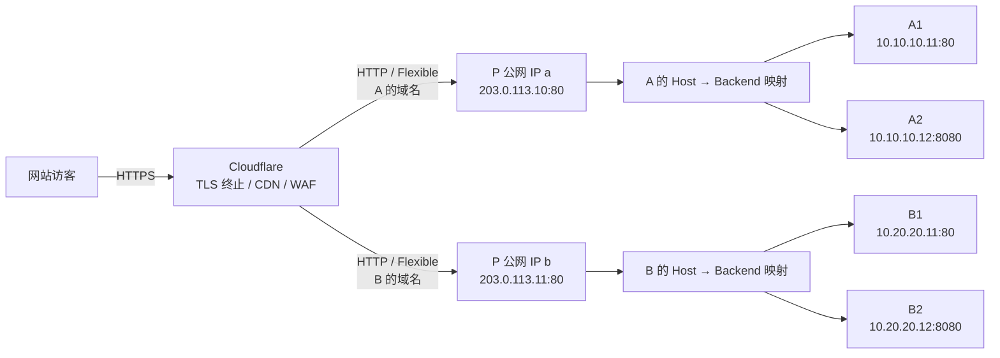
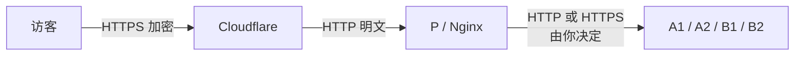
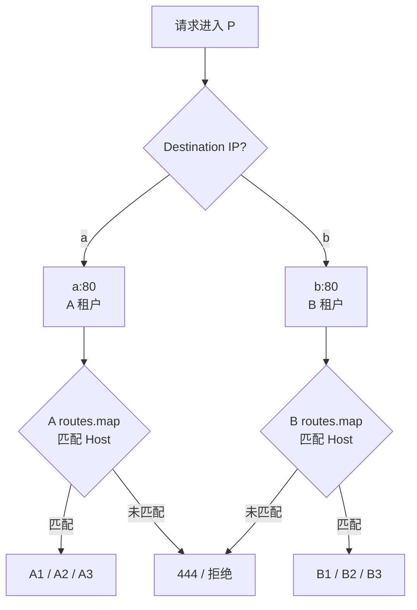
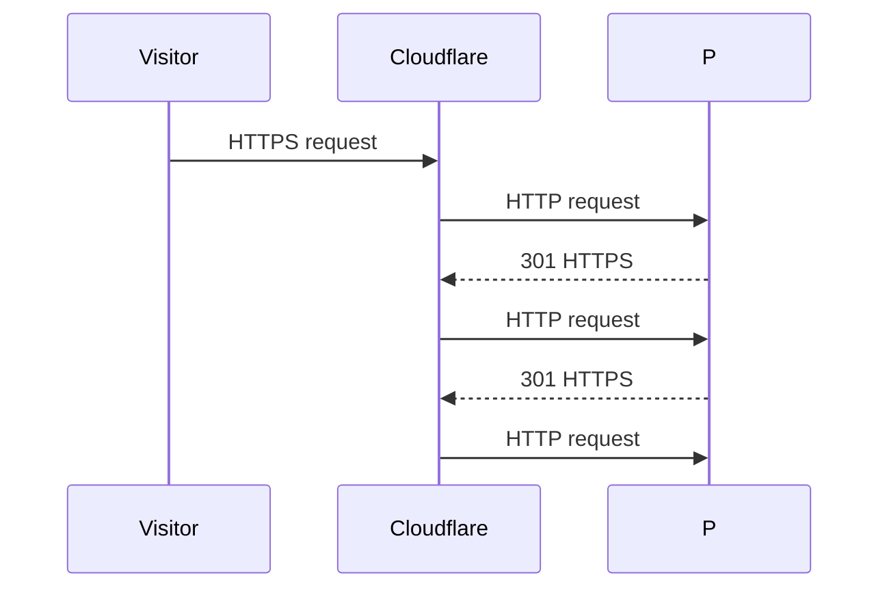
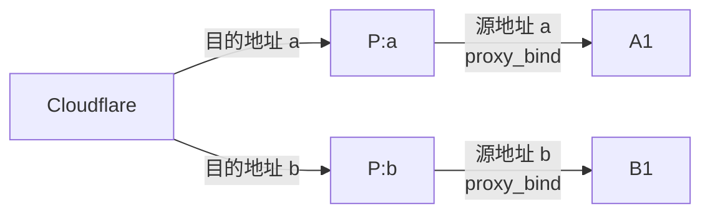
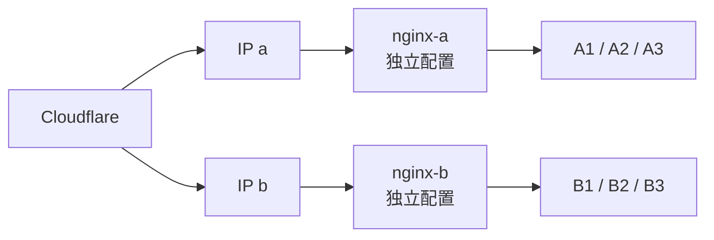
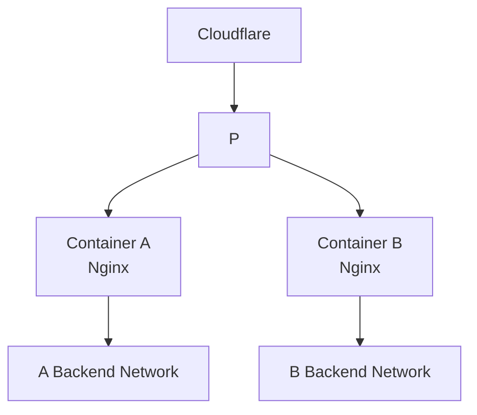
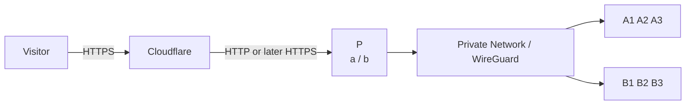

[toc]

## abstract

假设我有一个服务器`P`具有2个公网ip(`a,b`); 

我使用`cloudflare`将网站和P的ip绑定起来.(目前仅考虑使用`flex`的加密方式,而非`full`) 

我打算分别分配给两个网站管理员(`A,B`),做`nginx`反向代理; 

A,B两人各自有许多网站服务器`(A1,A2,...),(B1,B2,...)` 我希望能够实现通过a为A的网站做反代;通过b为B的网站做反代

> 此前我使用`nginx`的`map`将访问的`host`(例如`url`中的域名,例如`domain.com`)和其代理目标(网站所在的服务器)ip关联起来(`HOST->BACKEND`); 
>
> 但现在要复杂一些,要把进入P的流量分流给两个人;

下面假定：

| 对象   | 示例值             | 用途           |
| ------ | ------------------ | -------------- |
| P      | 反向代理服务器     | 统一入口       |
| IP `a` | `203.0.113.10`     | 分配给管理员 A |
| IP `b` | `203.0.113.11`     | 分配给管理员 B |
| A1     | `10.10.10.11:80`   | A 的后端服务器 |
| A2     | `10.10.10.12:8080` | A 的后端服务器 |
| B1     | `10.20.20.11:80`   | B 的后端服务器 |
| B2     | `10.20.20.12:8080` | B 的后端服务器 |

这里使用 RFC 文档地址作为示例，实际配置时替换成你的真实 IP。

------

## 整体架构

最清晰的做法是把路由拆成两层：

1. **第一层：由 Cloudflare DNS + P 上 Nginx 的监听地址决定属于 A 还是 B**
   - A 的网站在 Cloudflare 中把源站地址指向公网 IP `a`
   - B 的网站把源站地址指向公网 IP `b`
   - P 上 Nginx 分别监听 `a:80`、`b:80`
2. **第二层：进入对应 IP 后，再使用各自独立的 `map` 根据 Host 决定最终后端**
   - `a:80` 只查询 A 的映射表
   - `b:80` 只查询 B 的映射表

因此，即使有人把一个属于 B 的 Host 请求故意发送到 `a`，也不会被路由到 B 的后端，而是直接拒绝。

Nginx 官方的请求选择机制恰好非常适合这种架构：它首先根据请求到达的 **IP 地址和端口** 匹配 `listen`，然后才在这一组 Server 中根据 `Host`/`server_name` 继续选择。([Nginx](https://nginx.org/en/docs/http/request_processing.html))

推荐架构如下：



对于 Flexible 模式，这一点尤其重要：



> Cloudflare 当前文档明确说明，**Flexible 只加密访客到 Cloudflare 的这一段；Cloudflare 到源站使用 HTTP**。因此 P 上实际上只需要接收 HTTP `80` 即可。
>
> Cloudflare 也明确警告：如果源站在 Flexible 模式下强制把 HTTP 重定向到 HTTPS，会形成重定向循环。([Cloudflare Docs](https://developers.cloudflare.com/ssl/origin-configuration/ssl-modes/flexible/?utm_source=chatgpt.com)),这一点容易理解.

这也意味着：**不要在 P 上做普通的 `http -> https` 301/308 强制跳转。**

如果希望用户访问 HTTP 时自动变成 HTTPS，应在 Cloudflare 边缘开启 HTTPS 重定向，而不是让 P 做。

------

## Cloudflare 在这里到底如何区分 a 和 b

一个常见误区是：

> 开启橙云以后 DNS 查询出来的不都是 Cloudflare IP 吗？Cloudflare 怎么知道应该去 a 还是 b？

答案是：Cloudflare DNS 记录内部仍然保存着你填写的源站地址。

例如：

### A 管理的网站

| 类型 | 名称                      | Content / 源站 | Proxy   |
| ---- | ------------------------- | -------------- | ------- |
| A    | `site-a1.example.com`     | `203.0.113.10` | Proxied |
| A    | `site-a2.example.com`     | `203.0.113.10` | Proxied |
| A    | `www.site-a2.example.com` | `203.0.113.10` | Proxied |

### B 管理的网站

| 类型 | 名称                  | Content / 源站 | Proxy   |
| ---- | --------------------- | -------------- | ------- |
| A    | `site-b1.example.net` | `203.0.113.11` | Proxied |
| A    | `site-b2.example.net` | `203.0.113.11` | Proxied |

访问者查询这些域名时，看到的是 Cloudflare Anycast IP，而不是 `a` 或 `b`；但是 Cloudflare 自己知道对应记录真正的 Origin IP，并据此向 `a` 或 `b` 发起连接。([Cloudflare Docs](https://developers.cloudflare.com/dns/proxy-status/?utm_source=chatgpt.com))

所以你实际上已经获得了一层非常天然的“租户划分”：

```text
A 的 Cloudflare DNS
        → origin = a
        → P:a:80
        → A 的 Nginx 路由

B 的 Cloudflare DNS
        → origin = b
        → P:b:80
        → B 的 Nginx 路由
```

------

## 推荐的目录结构

建议不要继续把所有内容塞进 `/etc/nginx/nginx.conf`。

采用：

```text
/etc/nginx/
├── nginx.conf
├── conf.d/
│   ├── 00-cloudflare-realip.conf
│   ├── 10-common-map.conf
│   ├── 20-tenant-maps.conf
│   └── 30-tenant-gateways.conf
│
└── tenants/
    ├── a/
    │   └── routes.map
    │
    └── b/
        └── routes.map
```

职责非常明确：

| 文件                        | 谁维护   | 用途                 |
| --------------------------- | -------- | -------------------- |
| `nginx.conf`                | P 管理员 | Nginx 全局配置       |
| `00-cloudflare-realip.conf` | P 管理员 | Cloudflare 真实 IP   |
| `10-common-map.conf`        | P 管理员 | WebSocket 等公共变量 |
| `20-tenant-maps.conf`       | P 管理员 | 定义 A/B 两张 map    |
| `30-tenant-gateways.conf`   | P 管理员 | `a:80` / `b:80` 入口 |
| `tenants/a/routes.map`      | A        | A 的域名和后端       |
| `tenants/b/routes.map`      | B        | B 的域名和后端       |

这样 A 和 B 日常添加网站时，只需要维护自己的映射表。

------

## 确认 P 已经真正拥有 a 和 b

首先：

```bash
ip addr
```

应该能看到两个公网地址。

例如：

```bash
ip -4 addr show
```

结果中应该包含：

```text
203.0.113.10
203.0.113.11
```

再确认：

```bash
ip route
```

如果 IP 没有绑定，需要按照你的 VPS/云厂商方式添加。

临时测试可以：

```bash
# 这里的ip仅为模拟的,根据真实ip填写
sudo ip addr add 203.0.113.10/32 dev eth0
sudo ip addr add 203.0.113.11/32 dev eth0
# 或者直接用ip addr 查看所有可用ip
ip addr

```

但是**不要盲目把这一段作为永久网络配置使用**。

不同云厂商对额外公网 IP 有几种常见实现：

- Secondary IP 直接配置在接口
- `/32` Routed IP
- Floating IP
- NAT 公网 IP
- 需要 Virtual MAC 的 Failover IP

因此永久配置应以你的服务商提供的网络方式为准。

关键验证标准只有一个：

```bash
curl --interface 203.0.113.10 https://ifconfig.me
```

以及：

```bash
curl --interface 203.0.113.11 https://ifconfig.me
```

如果运营商/路由允许分别绑定源地址，两者应该能够正常建立连接。

不过这里又涉及之前提到的一个区别：

**这只是测试出站源 IP，Cloudflare 入站分流本身并不要求 P 的出站也使用相同 IP。**

------

## 安装 Nginx

Debian/Ubuntu：

```bash
sudo apt update
sudo apt install nginx
```

检查：

```bash
nginx -v
```

以及：

```bash
sudo nginx -t
```

查看服务：

```bash
systemctl status nginx
```

------

## 配置 Cloudflare 真实客户端 IP

经过 Cloudflare 后，如果不进行额外配置，P 直接看到的 TCP 对端是 Cloudflare 节点，而不是最终访客。

Cloudflare通过：

```text
CF-Connecting-IP
```

提供实际访客 IP。Cloudflare 官方推荐 Nginx 使用 `ngx_http_realip_module` 并信任 Cloudflare 的代理网段。([Cloudflare Docs](https://developers.cloudflare.com/support/troubleshooting/restoring-visitor-ips/restoring-original-visitor-ips/?utm_source=chatgpt.com))

创建：

```bash
sudo nano /etc/nginx/conf.d/00-cloudflare-realip.conf
```

当前 Cloudflare 官方公布的 IPv4 网段为：([Cloudflare](https://www.cloudflare.com/ips/?utm_source=chatgpt.com))

```nginx
set_real_ip_from 173.245.48.0/20;
set_real_ip_from 103.21.244.0/22;
set_real_ip_from 103.22.200.0/22;
set_real_ip_from 103.31.4.0/22;
set_real_ip_from 141.101.64.0/18;
set_real_ip_from 108.162.192.0/18;
set_real_ip_from 190.93.240.0/20;
set_real_ip_from 188.114.96.0/20;
set_real_ip_from 197.234.240.0/22;
set_real_ip_from 198.41.128.0/17;
set_real_ip_from 162.158.0.0/15;
set_real_ip_from 104.16.0.0/13;
set_real_ip_from 104.24.0.0/14;
set_real_ip_from 172.64.0.0/13;
set_real_ip_from 131.0.72.0/22;

set_real_ip_from 2400:cb00::/32;
set_real_ip_from 2606:4700::/32;
set_real_ip_from 2803:f800::/32;
set_real_ip_from 2405:b500::/32;
set_real_ip_from 2405:8100::/32;
set_real_ip_from 2a06:98c0::/29;
set_real_ip_from 2c0f:f248::/32;

real_ip_header CF-Connecting-IP;
real_ip_recursive on;
```

这里非常重要：

> **只有在来源确实是 Cloudflare 时才能相信 `CF-Connecting-IP`。**

否则攻击者可以直接访问你的公网 IP，并自己伪造：

```http
CF-Connecting-IP: 1.2.3.4
```

所以后面还要通过防火墙让 `80` 端口原则上只接受 Cloudflare 网络。

Cloudflare 官方也建议这样保护 Origin。([Cloudflare Docs](https://developers.cloudflare.com/fundamentals/security/protect-your-origin-server/?utm_source=chatgpt.com))

------

## 公共 Nginx map

创建：

```bash
sudo nano /etc/nginx/conf.d/10-common-map.conf
```

加入：

```nginx
map $http_upgrade $connection_upgrade {
    default upgrade;
    ''      close;
}

map $http_x_forwarded_proto $forwarded_port {
    default 80;
    https   443;
}
```

第一张 map 用于 WebSocket。

第二张主要解决 Flexible 模式下的协议问题。

为什么不能简单使用：

```nginx
proxy_set_header X-Forwarded-Proto $scheme;
```

因为从 Cloudflare 到 P 是 HTTP，所以 P 看到：

```text
$scheme = http
```

即使真正访客使用的是：

```text
https://example.com
```

Cloudflare 会设置 `X-Forwarded-Proto`，表示访客连接 Cloudflare 时所使用的原始 HTTP/HTTPS 协议；Cloudflare 当前文档明确说明这一 Header 会被覆盖为真正的客户端协议。([Cloudflare Docs](https://developers.cloudflare.com/fundamentals/reference/http-headers/?utm_source=chatgpt.com))

因此应该继续向 A1/B1 传：

```nginx
proxy_set_header X-Forwarded-Proto $http_x_forwarded_proto;
```

这对于 WordPress、Laravel、Django、Node.js 等应用正确判断 HTTPS 非常重要。

------

## 建立 A 和 B 的独立路由表

创建目录：

```bash
sudo mkdir -p /etc/nginx/tenants/a
sudo mkdir -p /etc/nginx/tenants/b
```

创建：

```bash
sudo nano /etc/nginx/conf.d/20-tenant-maps.conf
```

内容：

```nginx
map $host $a_backend {
    hostnames;
    default "";

    include /etc/nginx/tenants/a/routes.map;
}

map $host $b_backend {
    hostnames;
    default "";

    include /etc/nginx/tenants/b/routes.map;
}
```

Nginx 官方 `map` 模块支持通过 `include` 引入独立映射文件，也支持 Hostname 匹配。([Nginx](https://nginx.org/en/docs/http/ngx_http_map_module.html?utm_source=chatgpt.com))

------

## A 的 routes.map

创建：

```bash
sudo nano /etc/nginx/tenants/a/routes.map
```

例如：

```nginx
site-a1.example.com       10.10.10.11:80;
www.site-a1.example.com   10.10.10.11:80;

site-a2.example.com       10.10.10.12:8080;
www.site-a2.example.com   10.10.10.12:8080;

api.site-a2.example.com   10.10.10.13:8000;
```

如果：

```text
site-a1.example.com
```

进入 `a`，那么：

```text
$a_backend = 10.10.10.11:80
```

------

## B 的 routes.map

```bash
sudo nano /etc/nginx/tenants/b/routes.map
```

例如：

```nginx
site-b1.example.net       10.20.20.11:80;
www.site-b1.example.net   10.20.20.11:80;

site-b2.example.net       10.20.20.12:8080;
www.site-b2.example.net   10.20.20.12:8080;
```

这时两人的维护范围已经天然分开。

------

## 配置 a 和 b 两个入口

这是整个方案最核心的部分。

创建：

```bash
sudo nano /etc/nginx/conf.d/30-tenant-gateways.conf
```

完整配置：

```nginx
server {
    listen 203.0.113.10:80 default_server;

    server_name _;

    access_log /var/log/nginx/tenant-a-access.log;
    error_log  /var/log/nginx/tenant-a-error.log warn;

    if ($a_backend = "") {
        return 444;
    }

    location / {
        proxy_pass http://$a_backend;

        proxy_http_version 1.1;

        proxy_set_header Host $host;

        proxy_set_header X-Real-IP $remote_addr;
        proxy_set_header X-Forwarded-For $remote_addr;

        proxy_set_header X-Forwarded-Host $host;
        proxy_set_header X-Forwarded-Proto $http_x_forwarded_proto;
        proxy_set_header X-Forwarded-Port $forwarded_port;

        proxy_set_header CF-Connecting-IP $remote_addr;
        proxy_set_header CF-Ray $http_cf_ray;

        proxy_set_header Upgrade $http_upgrade;
        proxy_set_header Connection $connection_upgrade;

        proxy_connect_timeout 5s;
        proxy_send_timeout 60s;
        proxy_read_timeout 60s;
    }
}


server {
    listen 203.0.113.11:80 default_server;

    server_name _;

    access_log /var/log/nginx/tenant-b-access.log;
    error_log  /var/log/nginx/tenant-b-error.log warn;

    if ($b_backend = "") {
        return 444;
    }

    location / {
        proxy_pass http://$b_backend;

        proxy_http_version 1.1;

        proxy_set_header Host $host;

        proxy_set_header X-Real-IP $remote_addr;
        proxy_set_header X-Forwarded-For $remote_addr;

        proxy_set_header X-Forwarded-Host $host;
        proxy_set_header X-Forwarded-Proto $http_x_forwarded_proto;
        proxy_set_header X-Forwarded-Port $forwarded_port;

        proxy_set_header CF-Connecting-IP $remote_addr;
        proxy_set_header CF-Ray $http_cf_ray;

        proxy_set_header Upgrade $http_upgrade;
        proxy_set_header Connection $connection_upgrade;

        proxy_connect_timeout 5s;
        proxy_send_timeout 60s;
        proxy_read_timeout 60s;
    }
}
```

Nginx 官方支持明确指定：

```nginx
listen address:port;
```

并且官方请求处理文档确认：**Nginx 会先根据 IP/port 找对应虚拟服务器，然后才比较 Host。**([Nginx](https://nginx.org/en/docs/http/request_processing.html))

这就是本方案安全边界成立的关键。

------

## 为什么这比 `$server_addr:$host` 大 map 更好

理论上你完全可以这样：

```nginx
map "$server_addr:$host" $backend {
    default "";

    "203.0.113.10:site-a1.example.com" 10.10.10.11:80;
    "203.0.113.11:site-b1.example.net" 10.20.20.11:80;
}
```

技术上没有问题。

但是我不推荐作为主要方案。

因为最终会变成：

```text
a + A1
a + A2
a + A3
b + B1
b + B2
b + B3
...
```

全部混在一起。

而我们的架构是：

```text
IP 负责租户隔离
Host 负责租户内部路由
```

因此职责非常清楚：



------

## 一个很重要的安全性质：Host 不能跨租户

假设：

```text
site-b1.example.net
```

本来属于 B。

Cloudflare 正确配置应该是：

```text
site-b1.example.net → b
```

但是攻击者故意请求：

```bash
curl \
  -H 'Host: site-b1.example.net' \
  http://203.0.113.10/
```

也就是：

```text
B 的 Host
+
A 的 IP
```

进入的是：

```nginx
listen 203.0.113.10:80;
```

这里查询：

```text
$a_backend
```

而不是：

```text
$b_backend
```

所以结果：

```text
$a_backend = ""
```

最终：

```nginx
return 444;
```

不会因为 Host 属于 B 而跳进 B 的反代规则。

这正是“双层路由”的价值。

------

## 为什么使用 `proxy_set_header Host $host`

默认情况下，Nginx 反向代理并不一定按照你期望的方式原样传递 Host；Nginx 官方文档推荐在需要保持原始站点 Host 时明确设置：

```nginx
proxy_set_header Host $host;
```

([Nginx](https://nginx.org/en/docs/http/ngx_http_proxy_module.html))

例如用户访问：

```text
https://site-a1.example.com/article
```

A1 收到：

```http
Host: site-a1.example.com
```

这对后端再次使用虚拟主机尤其重要。

例如 A1 自己也是：

```nginx
server {
    server_name site-a1.example.com;
}
```

那么 Host 必须继续保留下去。

------

## 关于 X-Forwarded-For

这里我使用了：

```nginx
proxy_set_header X-Forwarded-For $remote_addr;
```

而不是常见的：

```nginx
proxy_set_header X-Forwarded-For $proxy_add_x_forwarded_for;
```

原因是你的架构非常明确：

```text
客户端
→ Cloudflare
→ P
→ A1
```

在 P 已经：

```nginx
real_ip_header CF-Connecting-IP;
```

以后：

```text
$remote_addr
```

就是我们信任的最终访客 IP。

所以直接设置：

```text
X-Forwarded-For = 真实访客 IP
```

反而干净。

Cloudflare 自己也明确指出，`CF-Connecting-IP` 的格式稳定且只包含一个客户端地址，而 `X-Forwarded-For` 可能包含之前的代理链。([Cloudflare Docs](https://developers.cloudflare.com/fundamentals/reference/http-headers/?utm_source=chatgpt.com))

如果你有多级可信代理体系，需要保留完整链路，再考虑 `$proxy_add_x_forwarded_for`。

------

## Flexible 下千万不要这么配置

不要：

```nginx
server {
    listen 203.0.113.10:80;

    return 301 https://$host$request_uri;
}
```

工作流程会变成：



最终用户看到：

```text
ERR_TOO_MANY_REDIRECTS
```

Cloudflare 官方专门警告 Flexible + Origin HTTP→HTTPS redirect 会造成这种循环。([Cloudflare Docs](https://developers.cloudflare.com/ssl/origin-configuration/ssl-modes/flexible/?utm_source=chatgpt.com))

如果你要求：

```text
http://example.com
```

变成：

```text
https://example.com
```

应该在 Cloudflare 侧启用 HTTPS 强制跳转。

------

## Cloudflare 配置步骤

对 A 管理的每一个网站：

进入：

```text
Cloudflare
→ DNS
→ Records
```

添加：

```text
Type: A
Name: @ 或 www / app / api 等
Content: a
Proxy status: Proxied
```

例如：

```text
site-a.example
→ 203.0.113.10
→ Proxied
```

对 B：

```text
site-b.example
→ 203.0.113.11
→ Proxied
```

Cloudflare 官方建议用于 Web HTTP/HTTPS 服务的 A/AAAA/CNAME 记录开启代理。([Cloudflare Docs](https://developers.cloudflare.com/dns/proxy-status/use-cases/?utm_source=chatgpt.com))

------

## 设置 Flexible

每一个相应 Zone：

```text
Cloudflare
→ SSL/TLS
→ Overview
→ Encryption Mode
→ Flexible
```

现在连接关系：

| 连接              | 协议            |
| ----------------- | --------------- |
| 用户 → Cloudflare | HTTPS           |
| Cloudflare → P    | HTTP            |
| P → A1/B1         | 当前配置为 HTTP |

Cloudflare 目前也支持通过 Configuration Rules 对特定 Host 设置不同的 SSL/TLS 模式，所以未来同一个 Zone 中一部分 Host 迁移到 Full (strict) 也是可行的。([Cloudflare Docs](https://developers.cloudflare.com/ssl/origin-configuration/ssl-modes/?utm_source=chatgpt.com))

------

## 强烈建议限制 P:80 只能由 Cloudflare 访问

这是整个安全方案中非常重要的一步。

否则：

```text
Internet
→ 直接请求 a/b
→ 绕过 Cloudflare
```

攻击者就可以绕开：

- Cloudflare WAF
- Rate Limiting
- Bot protection
- DDoS filtering
- 部分访问控制策略

而且还能尝试伪造 Cloudflare Header。

Cloudflare 官方建议 Origin 允许 Cloudflare IP 范围并限制直接访问。([Cloudflare Docs](https://developers.cloudflare.com/fundamentals/concepts/cloudflare-ip-addresses/?utm_source=chatgpt.com))

如果系统使用 `nftables`，可以建立一张专门的表。

先查看：

```bash
sudo nft list ruleset
```

**不要直接覆盖现有规则。**

可以新增：

```bash
sudo nano /etc/nftables.d/cloudflare-origin.nft
```

示意：

```nft
table inet cloudflare_origin {
    set cloudflare_v4 {
        type ipv4_addr
        flags interval

        elements = {
            173.245.48.0/20,
            103.21.244.0/22,
            103.22.200.0/22,
            103.31.4.0/22,
            141.101.64.0/18,
            108.162.192.0/18,
            190.93.240.0/20,
            188.114.96.0/20,
            197.234.240.0/22,
            198.41.128.0/17,
            162.158.0.0/15,
            104.16.0.0/13,
            104.24.0.0/14,
            172.64.0.0/13,
            131.0.72.0/22
        }
    }

    chain input {
        type filter hook input priority -10;
        policy accept;

        iifname "lo" accept

        tcp dport 80 ip saddr @cloudflare_v4 accept
        tcp dport 80 drop
    }
}
```

这张表：

- 不修改 SSH
- 不修改其它端口
- 只对 TCP 80 做限制

应用前：

```bash
sudo nft -c -f /etc/nftables.d/cloudflare-origin.nft
```

确认无错误再加载。

具体持久化方法取决于发行版现有 nftables 结构。

------

## Cloudflare IP 列表不要永久写死

当前列表可以从：

[Cloudflare 官方 IP ranges](https://www.cloudflare.com/ips/?utm_source=chatgpt.com)

获取。

Cloudflare 将这个页面描述为其当前 IP 范围的权威来源。([Cloudflare](https://www.cloudflare.com/ips/?utm_source=chatgpt.com))

生产环境最好有一个小脚本定期同步，例如：

```bash
curl -fsS https://www.cloudflare.com/ips-v4
```

和：

```bash
curl -fsS https://www.cloudflare.com/ips-v6
```

然后生成：

```nginx
set_real_ip_from ...;
```

以及 nftables Set。

不要几年不更新。

------

## 让 A 和 B 只能修改自己的映射文件

如果 Linux 用户分别为：

```text
admin-a
admin-b
```

建立组：

```bash
sudo groupadd nginx-a
sudo groupadd nginx-b
```

加入用户：

```bash
sudo usermod -aG nginx-a admin-a
sudo usermod -aG nginx-b admin-b
```

修改目录：

```bash
sudo chown root:nginx-a /etc/nginx/tenants/a
sudo chown root:nginx-b /etc/nginx/tenants/b
```

设置 Set-GID：

```bash
sudo chmod 2770 /etc/nginx/tenants/a
sudo chmod 2770 /etc/nginx/tenants/b
```

文件：

```bash
sudo chown root:nginx-a /etc/nginx/tenants/a/routes.map
sudo chown root:nginx-b /etc/nginx/tenants/b/routes.map
```

权限：

```bash
sudo chmod 660 /etc/nginx/tenants/a/routes.map
sudo chmod 660 /etc/nginx/tenants/b/routes.map
```

这样：

```text
A → routes.map(A)
B → routes.map(B)
```

正常情况下不能相互修改。

重新登录后组权限才会生效。

------

## 不要直接给两个人 `sudo systemctl reload nginx`

可以做一个受控 Reload 脚本：

```bash
sudo nano /usr/local/sbin/nginx-safe-reload
```

内容：

```bash
#!/usr/bin/env bash

set -euo pipefail

/usr/sbin/nginx -t
/bin/systemctl reload nginx
```

设置：

```bash
sudo chown root:root /usr/local/sbin/nginx-safe-reload
sudo chmod 755 /usr/local/sbin/nginx-safe-reload
```

sudoers：

```bash
sudo visudo
```

增加：

```text
%nginx-a ALL=(root) NOPASSWD: /usr/local/sbin/nginx-safe-reload
%nginx-b ALL=(root) NOPASSWD: /usr/local/sbin/nginx-safe-reload
```

那么 A 添加网站：

```bash
nano /etc/nginx/tenants/a/routes.map
```

之后：

```bash
sudo /usr/local/sbin/nginx-safe-reload
```

脚本首先执行：

```bash
nginx -t
```

只有语法正确才会 Reload。

Nginx Reload 是平滑重载，已有连接一般不会因为普通配置重载被粗暴中断。

------

## A 添加一个新站的完整流程

假设 A 获得：

```text
blog.example.com
```

后端：

```text
10.10.10.99:8080
```

### A 修改自己的 map

```bash
nano /etc/nginx/tenants/a/routes.map
```

增加：

```nginx
blog.example.com      10.10.10.99:8080;
www.blog.example.com  10.10.10.99:8080;
```

### Cloudflare DNS

设置：

| Type | Name       | Content        | Proxy   |
| ---- | ---------- | -------------- | ------- |
| A    | `blog`     | `203.0.113.10` | Proxied |
| A    | `www.blog` | `203.0.113.10` | Proxied |

### 测试配置

```bash
sudo /usr/local/sbin/nginx-safe-reload
```

### 验证

```bash
curl -I https://blog.example.com
```

完成。

整个过程中完全不需要修改：

```text
B routes.map
```

也不需要增加新的 Nginx Server Block。

------

## B 添加网站也完全一样

例如：

```text
shop.example.net
→ B2
→ 10.20.20.12:8080
```

修改：

```bash
nano /etc/nginx/tenants/b/routes.map
```

加入：

```nginx
shop.example.net 10.20.20.12:8080;
```

Cloudflare：

```text
shop.example.net
→ b
→ Proxied
```

Reload。

完成。

------

## 上线前先测试 Origin，不经过 Cloudflare

防火墙开放前，可以直接测试。

A：

```bash
curl -v \
    -H 'Host: site-a1.example.com' \
    http://203.0.113.10/
```

应该进入：

```text
A1
```

测试 A2：

```bash
curl -v \
    -H 'Host: site-a2.example.com' \
    http://203.0.113.10/
```

应该进入：

```text
A2
```

------

## 测试跨租户是否被拒绝

非常值得做。

把 B 的域名打到 a：

```bash
curl -v \
    -H 'Host: site-b1.example.net' \
    http://203.0.113.10/
```

预期：

```text
Empty reply from server
```

因为 Nginx：

```nginx
return 444;
```

反过来：

```bash
curl -v \
    -H 'Host: site-a1.example.com' \
    http://203.0.113.11/
```

同样应该被拒绝。

这两个测试通过，才能证明你的：

```text
a ↔ A
b ↔ B
```

隔离确实成立。

------

## 测试 Cloudflare 完整链路

然后：

```bash
curl -I https://site-a1.example.com
```

以及：

```bash
curl -I https://site-b1.example.net
```

应该能够看到类似：

```text
server: cloudflare
cf-ray: ...
```

P 查看 A：

```bash
sudo tail -f /var/log/nginx/tenant-a-access.log
```

B：

```bash
sudo tail -f /var/log/nginx/tenant-b-access.log
```

你应该能非常清楚地看到流量分别进入不同日志。

------

## 建议升级日志格式

默认日志对于这种多租户网关信息不够丰富。

可以在 `http` 中定义：

```nginx
log_format gateway
    '$remote_addr '
    'host=$host '
    'server_addr=$server_addr '
    'request="$request" '
    'status=$status '
    'upstream=$upstream_addr '
    'upstream_status=$upstream_status '
    'request_time=$request_time '
    'upstream_time=$upstream_response_time '
    'cf_ray=$http_cf_ray';
```

然后：

```nginx
access_log /var/log/nginx/tenant-a-access.log gateway;
```

以及：

```nginx
access_log /var/log/nginx/tenant-b-access.log gateway;
```

日志可能变成：

```text
198.51.100.100 host=site-a1.example.com server_addr=203.0.113.10 request="GET / HTTP/1.1" status=200 upstream=10.10.10.11:80 upstream_status=200 request_time=0.032 upstream_time=0.031 cf_ray=...
```

一眼就能知道：

```text
访客是谁
Host 是什么
进入 P 哪个 IP
反代到哪里
后端返回什么状态
耗时多少
Cloudflare Ray ID 是什么
```

排障会非常方便。

------

## 如果 A/B 后端本身也使用虚拟主机

当前：

```nginx
proxy_set_header Host $host;
```

意味着：

```text
site-a1.example.com
```

到 A1 后仍然是：

```http
Host: site-a1.example.com
```

这是绝大多数情况需要的。

但是某些后端可能要求：

```http
Host: internal-a1.example.local
```

那么你实际上还需要第二个映射值，例如：

```text
外部 Host
→ Backend
→ Backend Host
```

这时可以增加另一张 `map`：

```nginx
map $host $a_backend_host {
    default "";

    site-a1.example.com internal-a1.example.local;
}
```

然后：

```nginx
proxy_set_header Host $a_backend_host;
```

不过如果目前所有 A1/A2 都能接受公网域名 Host，就没有必要增加这一层复杂性。

------

## 如果 A1/B1 使用 HTTPS

Cloudflare Flexible 只决定：

```text
Cloudflare → P
```

使用什么协议。

它**不限制**：

```text
P → A1
```

使用什么协议。

因此完全可以：

```text
Visitor
HTTPS
→ Cloudflare
HTTP
→ P
HTTPS
→ A1
```

例如 map 不再只保存地址，而保存完整 URL：

```nginx
site-a1.example.com https://10.10.10.11:443;
```

然后：

```nginx
proxy_pass $a_backend;
```

不过 HTTPS 后端涉及：

- SNI
- 后端证书验证
- `proxy_ssl_name`
- `proxy_ssl_server_name`
- CA trust

建议有需要时单独规范配置，而不是把 HTTP/HTTPS 混在一个简单 map 中。

------

## 关于“从 a 进入”和“从 a 出去”是两回事

这是双公网 IP 场景中特别值得强调的知识点。

当前架构保证：

```text
A：
Cloudflare → a → A routes.map

B：
Cloudflare → b → B routes.map
```

但是：

```text
P → A1
P → B1
```

这两个出站连接默认使用哪个源公网 IP，是 Linux 路由表决定的。

例如可能全部使用：

```text
a
```

作为源地址。

如果你的后端 A1/B1根本不关心 P 的 Source IP，就完全没问题。

但假设：

```text
A1 防火墙只允许 a
B1 防火墙只允许 b
```

那就需要进一步控制。

Nginx 提供：

```nginx
proxy_bind
```

用于指定与上游建立连接时采用的本地源 IP。Nginx 官方明确说明，它可以让到被代理服务器的连接从指定本地 IP 发起。([Nginx](https://nginx.org/en/docs/http/ngx_http_proxy_module.html))

于是 A 可以增加：

```nginx
proxy_bind 203.0.113.10;
```

B：

```nginx
proxy_bind 203.0.113.11;
```

最终：

```nginx
server {
    listen 203.0.113.10:80 default_server;

    ...

    location / {
        proxy_bind 203.0.113.10;

        proxy_pass http://$a_backend;

        ...
    }
}
```

B：

```nginx
server {
    listen 203.0.113.11:80 default_server;

    ...

    location / {
        proxy_bind 203.0.113.11;

        proxy_pass http://$b_backend;

        ...
    }
}
```

于是：



不过只有当后端有这种 IP 白名单需求时才建议加。

------

## `proxy_bind` 还有一个容易踩的坑

假设：

```text
a = 203.0.113.10
```

但是你的云厂商实际上通过 NAT 提供公网 IP：

```text
203.0.113.10
    NAT
10.0.0.10
```

P 的网卡上真正拥有的是：

```text
10.0.0.10
```

那么：

```nginx
proxy_bind 203.0.113.10;
```

可能直接失败：

```text
Cannot assign requested address
```

所以执行：

```bash
ip addr
```

如果公网 IP 不是真正绑定在本机接口上的，不要直接使用公网 IP 做 `proxy_bind`。

这种环境应根据实际私网地址和 NAT/策略路由设计。

------

## 如果 Backend 使用域名而不是 IP

例如你希望：

```nginx
site-a1.example.com backend-a1.internal.example:8080;
```

然后：

```nginx
proxy_pass http://$a_backend;
```

需要额外注意：

> 当 `proxy_pass` 的主机名来自变量时，Nginx 通常需要明确配置 DNS `resolver`。

所以对这种大规模静态反代，我更推荐：

```text
map → IP:port
```

例如：

```nginx
site-a1.example.com 10.10.10.11:8080;
```

这样：

- 不需要运行时 DNS
- 路由行为可预测
- DNS 故障不会影响网关
- 排查简单

------

## 如果同一个网站有多个后端

例如：

```text
site-a1.example.com
```

实际想做负载均衡：

```text
A1-1
A1-2
A1-3
```

这时不要直接在 map 写三个 IP。

应该：

```nginx
upstream a_site1 {
    server 10.10.10.11:80;
    server 10.10.10.12:80;
    server 10.10.10.13:80;
}
```

map：

```nginx
site-a1.example.com a_site1;
```

但由于变量 `proxy_pass` 和 upstream name 的组合有一些解析和配置细节，大规模使用时我更建议升级为：

```text
每站一个 upstream
+
自动生成 Nginx 配置
```

如果你目前是简单：

```text
一个 Host → 一个后端
```

现在的 map 方案反而最简洁。

------

## 关于配置管理员权限：这里存在一个安全边界

目前的逻辑权限是：

```text
A 只能编辑 A routes.map
B 只能编辑 B routes.map
```

这对“合作型管理员”非常合适。

但是它不是强安全沙箱。

例如 A 可以把：

```nginx
evil.example.com 127.0.0.1:8080;
```

写进自己的映射表。

于是可以让 Nginx 请求 P 本机服务。

甚至：

```text
内部数据库管理面板
云平台 Metadata 地址
其它内部 HTTP 服务
```

只要 P 能连接，就可能形成类似 **SSRF（Server-Side Request Forgery，服务端请求伪造）能力**。

所以需要根据 A/B 信任程度做选择。

------

## 两种权限模型应该怎么选

| 情况                       | 推荐方案                                 |
| -------------------------- | ---------------------------------------- |
| A/B 都是你的团队成员       | 单 Nginx + 独立 map                      |
| A/B 是可信合作伙伴         | 单 Nginx + 独立 map + Backend 白名单验证 |
| A/B 互不信任               | 两套独立 Nginx                           |
| A/B 是不同客户             | 容器 / Network Namespace 隔离            |
| A/B 需要独立 reload        | 两套 Nginx                               |
| A/B 需要独立日志/配置/资源 | 两套 Nginx 或容器                        |

如果“管理员 A/B”实际上是两个彼此不应影响的租户，我建议更进一步。

------

# 增强方案：真正实现 A/B 管理隔离

你可以在同一台 P 上运行：

```text
nginx-a
nginx-b
```

而不是：

```text
一个 nginx
```

架构：



其中：

```text
nginx-a
只监听 a:80

nginx-b
只监听 b:80
```

这样：

- A 的配置错误不会阻止 B Reload
- B 的 Nginx 崩溃不影响 A
- 日志完全分开
- PID 分开
- Runtime 目录分开
- 管理权限更容易切割

------

## 双 Nginx 实例目录

例如：

```text
/etc/nginx-a/
├── nginx.conf
└── routes.map

/etc/nginx-b/
├── nginx.conf
└── routes.map
```

Runtime：

```text
/run/nginx-a.pid
/run/nginx-b.pid
```

日志：

```text
/var/log/nginx-a/
/var/log/nginx-b/
```

------

## nginx-a 示例

`/etc/nginx-a/nginx.conf`：

```nginx
user www-data;
worker_processes auto;

pid /run/nginx-a.pid;

events {
    worker_connections 4096;
}

http {
    include /etc/nginx/mime.types;

    map $host $backend {
        hostnames;
        default "";

        include /etc/nginx-a/routes.map;
    }

    map $http_upgrade $connection_upgrade {
        default upgrade;
        '' close;
    }

    server {
        listen 203.0.113.10:80 default_server;

        server_name _;

        access_log /var/log/nginx-a/access.log;
        error_log /var/log/nginx-a/error.log;

        if ($backend = "") {
            return 444;
        }

        location / {
            proxy_pass http://$backend;

            proxy_http_version 1.1;

            proxy_set_header Host $host;

            proxy_set_header X-Real-IP $remote_addr;
            proxy_set_header X-Forwarded-For $remote_addr;
            proxy_set_header X-Forwarded-Proto $http_x_forwarded_proto;

            proxy_set_header Upgrade $http_upgrade;
            proxy_set_header Connection $connection_upgrade;

            proxy_connect_timeout 5s;
            proxy_read_timeout 60s;
        }
    }
}
```

------

## nginx-b 示例

只需要改：

```nginx
pid /run/nginx-b.pid;
```

以及：

```nginx
include /etc/nginx-b/routes.map;
```

监听：

```nginx
listen 203.0.113.11:80 default_server;
```

日志：

```nginx
access_log /var/log/nginx-b/access.log;
error_log /var/log/nginx-b/error.log;
```

其余基本一致。

------

## 建立两个 systemd Service

A：

```bash
sudo nano /etc/systemd/system/nginx-a.service
```

例如：

```ini
[Unit]
Description=Nginx Reverse Proxy for Tenant A
After=network-online.target
Wants=network-online.target

[Service]
Type=forking

PIDFile=/run/nginx-a.pid

ExecStartPre=/usr/sbin/nginx -t -c /etc/nginx-a/nginx.conf
ExecStart=/usr/sbin/nginx -c /etc/nginx-a/nginx.conf

ExecReload=/bin/kill -HUP $MAINPID
ExecStop=/bin/kill -QUIT $MAINPID

PrivateTmp=true

[Install]
WantedBy=multi-user.target
```

B：

```bash
sudo nano /etc/systemd/system/nginx-b.service
```

改为：

```ini
[Unit]
Description=Nginx Reverse Proxy for Tenant B
After=network-online.target
Wants=network-online.target

[Service]
Type=forking

PIDFile=/run/nginx-b.pid

ExecStartPre=/usr/sbin/nginx -t -c /etc/nginx-b/nginx.conf
ExecStart=/usr/sbin/nginx -c /etc/nginx-b/nginx.conf

ExecReload=/bin/kill -HUP $MAINPID
ExecStop=/bin/kill -QUIT $MAINPID

PrivateTmp=true

[Install]
WantedBy=multi-user.target
```

然后：

```bash
sudo systemctl daemon-reload
```

测试 A：

```bash
sudo nginx -t -c /etc/nginx-a/nginx.conf
```

测试 B：

```bash
sudo nginx -t -c /etc/nginx-b/nginx.conf
```

启动：

```bash
sudo systemctl enable --now nginx-a
sudo systemctl enable --now nginx-b
```

确认：

```bash
ss -lntp | grep ':80'
```

应该分别看到对应 IP。

------

## 双实例模式下不要启动默认 nginx.service

否则默认 Nginx 如果有：

```nginx
listen 80;
```

相当于：

```text
0.0.0.0:80
```

会抢占：

```text
a:80
b:80
```

导致另外两个实例出现：

```text
bind() ... failed (98: Address already in use)
```

所以双实例模式应该：

```bash
sudo systemctl disable --now nginx
```

然后只运行：

```text
nginx-a.service
nginx-b.service
```

------

## 单实例和双实例如何选择

你的当前规模下我建议这样判断。

### 如果 A/B 是可信管理员

采用：

```text
一个 Nginx
+
listen a:80
+
listen b:80
+
A routes.map
+
B routes.map
```

优点最大：

- 配置简单
- 内存占用低
- 更新方便
- 性能没有问题
- 十几、几十乃至大量 Host 都很好维护

这就是我前面给出的主要方案。

### 如果 A/B 真正需要权限隔离

采用：

```text
nginx-a
nginx-b
```

更合理。

特别是：

> 如果你准备真的把某种 sudo/reload 权限交给 A 和 B，而不是由你统一运维，我更推荐双实例甚至容器。

------

## 更进一步的生产级隔离

如果以后变成：

```text
P
├── 客户 A
├── 客户 B
├── 客户 C
├── 客户 D
...
```

建议逐渐演进：



可以使用：

- Docker/Podman
- Linux Network Namespace
- systemd sandboxing
- 独立网桥
- nftables egress ACL

真正限制：

```text
A Nginx
只能连接 A1/A2/A3

B Nginx
只能连接 B1/B2/B3
```

这样才属于真正的多租户安全隔离。

------

## 后端防火墙也建议做白名单

例如 A1 不应该允许整个互联网连接它。

理想：

```text
Internet
    X
    |
    v

A1

P
|
+----> A1
```

也就是说：

```text
A1:80
只允许 P
```

如果 A1 是公网服务器：

```text
allow a/b 或 P 的实际出站地址
deny all
```

如果 P 和 A1 有 WireGuard/VPC/内网：

最好直接：

```text
P → Private IP → A1
```

而不是：

```text
P → Internet → A1 public IP
```

这既安全又减少公网链路。

------

## 我更推荐 P 与后端之间使用私网或 WireGuard

理想终态：



例如：

```text
A1 = 10.100.1.11
A2 = 10.100.1.12

B1 = 10.100.2.11
B2 = 10.100.2.12
```

这样 Backend 完全不需要开放 Web 服务到公网。

------

## Flexible 只是阶段性方案，不建议作为最终形态

你已经明确说“目前只考虑 Flexible”，所以整个主方案都是按照 Flexible 设计的。

但是这里必须说明安全边界。

Cloudflare 官方当前明确说明：

> Flexible 模式下 Cloudflare → Origin 为未加密 HTTP；如果网站包含敏感数据、登录等内容，应使用 Full 或 Full (strict)。Cloudflare 本身也推荐在可能的情况下使用 Full (strict)。([Cloudflare Docs](https://developers.cloudflare.com/ssl/origin-configuration/ssl-modes/flexible/?utm_source=chatgpt.com))

也就是说：

```text
Visitor
→ Cloudflare
```

虽然安全，

但：

```text
Cloudflare
→ P
```

仍然可以在网络链路层被窃听或篡改。

如果有：

- 登录密码
- Session Cookie
- API Token
- 用户私人数据
- 管理后台
- 支付信息

Flexible 不应该是最终状态。

------

## 未来升级到 Full (strict) 时架构几乎不用改

这套设计的另一个优点是：

```text
a ↔ A
b ↔ B
Host ↔ Backend
```

这些路由设计与 TLS 模式基本无关。

未来只需要让：

```text
a:443
b:443
```

支持 Origin Certificate，然后 Cloudflare：

```text
Flexible
→ Full (strict)
```

整体架构仍然是：

```text
Cloudflare
→ a
→ A map
→ A1

Cloudflare
→ b
→ B map
→ B1
```

只不过：

```text
Cloudflare → P
```

从：

```text
HTTP
```

升级为：

```text
HTTPS
```

因此你今天采用这套方案不会造成未来重构。

------

## 常见故障与判断方式

| 现象                              | 优先检查                              |
| --------------------------------- | ------------------------------------- |
| Cloudflare 521                    | P:80 未监听、防火墙阻止 CF            |
| 502 Bad Gateway                   | A1/B1 不通或端口错误                  |
| 504 Gateway Timeout               | Backend 响应超时                      |
| 无限 HTTPS 跳转                   | Flexible + Origin HTTP→HTTPS redirect |
| 所有日志都是 CF IP                | `real_ip_header` 未配置               |
| 后端认为请求是 HTTP               | `X-Forwarded-Proto` 设置错误          |
| A 的网站进入 B                    | Cloudflare Origin IP 配错             |
| Host 未配置却打开其它网站         | 缺少 default reject                   |
| `bind() failed`                   | 80 已被其它进程/默认 Nginx 占用       |
| `Cannot assign requested address` | `listen`/`proxy_bind` IP 不属于本机   |
| WebSocket 不工作                  | Upgrade/Connection Header             |
| Nginx `proxy_pass` 域名解析失败   | Variable + hostname 缺少 resolver     |

------

## 推荐上线检查清单

最后按这个顺序做，可以减少很多排障成本。

- P 上确认 `a`、`b` 网络配置正确。
- `ss -lntp` 确认 Nginx 分别监听 `a:80`、`b:80`。
- 配置 Cloudflare IP Real-IP。
- 建立 A/B 独立 `routes.map`。
- 建立 `listen a:80` 和 `listen b:80` 两个入口。
- 测试 A Host → a → A1。
- 测试 B Host → b → B1。
- 测试 B Host → a 必须失败。
- 测试 A Host → b 必须失败。
- Cloudflare A 域名 Origin 指向 a。
- Cloudflare B 域名 Origin 指向 b。
- DNS 开启 Proxied。
- SSL/TLS 设 Flexible。
- P 不做 HTTP→HTTPS Redirect。
- 正确透传 `X-Forwarded-Proto`。
- 防火墙限制 P:80 只接受 Cloudflare。
- Backend 尽量只允许 P 访问。
- 给 A/B 分离映射文件权限。
- Reload 前始终执行 `nginx -t`。
- A/B 不可信时升级成双 Nginx 实例或容器。
- 有条件后迁移到 Full (strict)。

------

## 最终推荐结构

如果是我来部署你目前这个场景，我会采用：

```text
Cloudflare
│
├── A 的所有域名
│     Origin = a
│
└── B 的所有域名
      Origin = b

                 P
                 │
        ┌────────┴────────┐
        │                 │
      a:80              b:80
        │                 │
     A map              B map
        │                 │
  ┌─────┼─────┐     ┌─────┼─────┐
  A1    A2    A3     B1    B2    B3
```

也就是：

```nginx
listen a:80;
→ map $host $a_backend;

listen b:80;
→ map $host $b_backend;
```

而不是：

```text
所有请求
→ 一张巨大 map
→ 同时判断 IP + Host + 管理员
```

前一种设计把：

- **IP 层：租户**
- **Host 层：站点**
- **Backend 层：实际应用**

三个概念彻底分开，后续即使从 20 个站增长到几百个站，也仍然容易维护。

如果 A/B 只是你内部的两个运维人员，采用**单 Nginx + 两张 map**即可；如果 A/B 是两个真正独立、彼此不应信任的管理员，则直接采用**两个 Nginx 实例/容器，一人一个 IP**，不要把共享主 Nginx 的配置权限交给两人。

另外，由于 Cloudflare 的 Origin IP 范围、SSL/TLS 行为以及 Nginx 本身都可能继续变化，这套设计中特意把这些外部变化限制在 `Cloudflare Real-IP/防火墙` 和 TLS 层，而不影响核心的 `a→A、b→B` 路由模型。