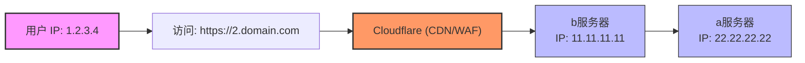
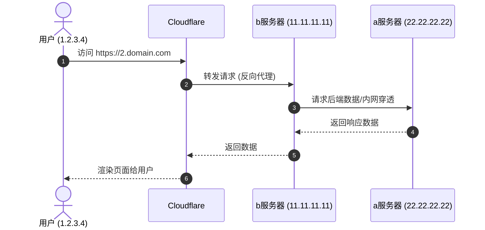

[toc]

# abstract

## 任务描述

假设有两个服务器,其中服务器`a`是普通服务器,`b`是用于反向代理的服务器,用来绑定cloudflare.
目标网络架构为:`client->CF->b->a`

1. 假设已经将域名`2.domain.com`(测试域名)的dns指向服务器b的ip,且使用的是`flexible`模式提供https服务(暂不考虑full). 

   > 已知服务器a此前购买了第三方的ip保护服务(记为c),使得我可以通过cf绑定c来让c反代a
   > 现在我希望自己实现类似效果,b反代a.

2. 服务器b上尽可能一次性配置好,后续服务器a上新增站点都能够有相同的效果(从b反代到a).

3. 服务器a已经安装了宝塔(nginx-openresty),服务器b安装了nginx.

给出详细且具体的配置方案,要求每个步骤(阶段)都给出验证是否配置成功的方法,包括适合调试的日志设置.

也就是**把服务器 B 配成一个“通用反代网关”**,之后服务器 A 上新增宝塔站点时，只要满足两个条件，就不需要再改 B：

```text
1. Cloudflare DNS 能把该域名解析到 B，并开启橙云代理
2. A 的宝塔站点已经绑定该域名
```

B 只负责把请求里的 `Host` 原样转发给 A，由 A 的宝塔 / OpenResty 根据域名匹配对应站点。

## 更加具体的目标

目标设计：**Cloudflare Flexible → b 的 80 端口 → b 反代到 a 的 80 端口 → a 上宝塔/OpenResty 按 Host 分发站点**。

核心原则是：b 不需要知道 a 后续新增了哪些站点，只要把原始 Host 原样传给 a，a 上宝塔新增站点并绑定对应域名即可自动生效。([Cloudflare Docs](https://developers.cloudflare.com/ssl/origin-configuration/ssl-modes/flexible/?utm_source=chatgpt.com)) 把原始主机名传给上游，这正是让 a 继续按域名匹配站点的关键。([Nginx](https://nginx.org/en/docs/http/ngx_http_proxy_module.html?utm_source=chatgpt.com))

```text
client
  ↓ HTTPS
Cloudflare
  ↓ HTTP，Flexible 模式
server b: nginx，反代入口
  ↓ HTTP
server a: 宝塔 nginx-openresty，真实业务站点
```


### 示意图



> 这里的ip仅是举例.





## cloudflare flexible 加密方式说明

Cloudflare Flexible 模式的含义是：访客到 Cloudflare 可以是 HTTPS，但 Cloudflare 到源站是 HTTP，源站不需要 HTTPS 证书。([Cloudflare Docs](https://developers.cloudflare.com/ssl/origin-configuration/ssl-modes/flexible/?utm_source=chatgpt.com))标里“后续 a 新增站点，b 不用再配”成立的前提是：

```text
新增站点域名 DNS → 指向 b
b → 保留 Host 反代给 a
a → 宝塔里绑定这个域名
```

例如：

```text
2.domain.com      → CF → b → a
test.domain.com   → CF → b → a
api.domain.com    → CF → b → a
```

如果希望所有二级子域名自动指向 b，Cloudflare DNS 里建议加：

```text
A     *.domain.com    b 的公网 IP    Proxied
A     domain.com      b 的公网 IP    Proxied   # 如根域也要用
A     2.domain.com    b 的公网 IP    Proxied   # 可保留显式记录
```

------

## 一键配置脚本

本文大部分是在解释配置,实际上用到的代码或者配置不多,为了方便服务器管理员使用,本文也提供了配套的部署脚本:

> 请事先安装好nginx.
>
> bash命令行后半段`#`号后面是命令参数示例

```bash
# 从github上获取一键部署脚本(适用于反代服务器上运行.)
bash  <(curl -SfL https://raw.githubusercontent.com/xuchaoxin1375/scripts/refs/heads/main/wp/woocommerce/woo_df/sh/update_repos_vps.sh) -h # 使用-h查看脚本帮助.然后构建你自己的命令行参数(如果需要自定义的话)


```

根据你的情况填写参数,如果你的反代服务器是ubuntu/nginx,则`-c,-d,-l`无需填写

```bash
# 对于宝塔安装的nginx(openresty),使用考虑使用下面的参数组代替脚本的默认值
-c /www/server/nginx/conf -d /www/server/panel/vhost/nginx -l /www/logs/ 

# 指定需要向客户端(包括cdn)隐藏的后端服务器ip
-i <upstream_ip>
```


> 通常这个

## 反代服务器ip利用说明

本文仅涉及反代服务器是单ip的情况(即便有多个ip,也仅利用其中的一个)的最简单情况.

关于如何将一个具有多个ip的反代服务器分别为不同的后端服务器做反代,以及如何只利用一个ip为多个后端服务器反代的问题,请参考另外的文档.


# 阶段 1：确认 a 上业务站点本身可用

先在 **a 服务器** 上确认nginx/OpenResty 能按 Host 正确返回站点。

假设：

```text
a 内网或公网 IP：A_IP
b 公网 IP：B_IP
测试域名：2.domain.com
```

在 b 上执行：

```bash
curl -I -H "Host: 2.domain.com" http://A_IP/
```

期望看到：

```http
HTTP/1.1 200 OK
```

或者你的业务本身返回 `301/302/403` 也可以，但必须确认返回的是 **a 上对应站点**，如果是宝塔默认页,建议稍加修改,便于区分。

如果你想看页面内容：

```bash
curl -s -H "Host: 2.domain.com" http://A_IP/ | head
```

如果这里都不对，先去 a 的宝塔里检查：

```text
网站 → 对应站点 → 域名管理 → 是否绑定 2.domain.com
```

以及 a 上 OpenResty 是否监听 80：

```bash
ss -lntp | grep ':80'
```

------

# 阶段 2：在 b 上配置 Cloudflare 真实 IP

Cloudflare 到源站时，Nginx 默认看到的是 Cloudflare 节点 IP。

> Cloudflare 官方说明，真实访客 IP 会放在 `CF-Connecting-IP` 请求头中；
>
> 如果不额外配置，源站日志默认会记录 Cloudflare IP。([Cloudflare Docs](https://developers.cloudflare.com/support/troubleshooting/restoring-visitor-ips/restoring-original-visitor-ips/?utm_source=chatgpt.com))

在**b 服务器** 上创建 Cloudflare IP 配置文件：

## 配置cf-realip.conf

推荐脚本配置比较简单,且适合定时任务运行.

### 脚本配置

将下面的内容保存到反代服务器中合适的位置,例如

- `/etc/nginx/update_cf_ip_configs.sh`(后续以这个路径为例.)
- 或者家目录下:`$HOME/update_cf_ip_configs.sh`.

```bash
#!/bin/bash
# update_cf_ip_configs.sh
# 适用于定时任务中自动更新CF IP列表的脚本.
# 生成`cf-realip.conf`配置文件.可以通过命令行选项指定保存位置,默认保存到`/www/server/nginx/conf/cf-realip.conf`(宝塔用户的默认路径).
# 其他情况(非宝塔环境,例如轻量的vps环境),可以指定保存到其他路径,例如ubuntu(debian)系统,可以放到`/etc/nginx/conf.d/cf-realip.conf`中.
set -e
# 参数解析
usage="
拉取Cloudflare IP列表并生成Nginx配置文件
Usage:
  $(basename "$0") [options]
Options:
  -h, --help      显示帮助信息
  -n, --no-reload-nginx  更新cf的ip列表配置后不主动重载nginx
"
reload_nginx=true
# === 可配置保存路径 ===
# SAVE_DIR="/etc/nginx/conf.d"   # 可根据需要修改
SAVE_DIR="/www/server/nginx/conf" # 保存路径
# 获取命令行参数
args_pos=()
while [[ $# -gt 0 ]]; do
  case "$1" in
    -h | --help)
      echo "$usage"
      exit 0
      ;;
    -s | --save-dir)
      SAVE_DIR="$2"
      shift
      ;;
    -n | --no-reload-nginx)
      reload_nginx=false
      ;;
    --)
      shift
      break
      ;;
    -?*)
      echo "Unknown option: " >&2
      echo "$usage"
      exit 2
      ;;
    *)
      args_pos+=("$1")
      ;;
  esac
  shift
done
set -- "${args_pos[@]}"
# 参数解析并调整完毕
# 如果路径不存在,则创建此目录
if [ ! -d "$SAVE_DIR" ]; then
  mkdir -p "$SAVE_DIR"
fi
CF_IPV4_FILE="$SAVE_DIR/cf-ips-v4.txt"
CF_IPV6_FILE="$SAVE_DIR/cf-ips-v6.txt"
# 生成nginx配置文件
CF_REALIP_CONF="$SAVE_DIR/cf-realip.conf"

# 下载 Cloudflare IP 列表(保存到普通文本文件中)
curl -s https://www.cloudflare.com/ips-v4 -o "$CF_IPV4_FILE"
curl -s https://www.cloudflare.com/ips-v6 -o "$CF_IPV6_FILE"

# 生成 Nginx 配置(读取 Cloudflare IP 列表文件)
{
  echo "# Cloudflare IPs [update at $(date +"%Y-%m-%d %H:%M:%S %Z")]"
  
  echo "# Cloudflare IPv4"
  while IFS= read -r ip; do
    echo "set_real_ip_from $ip;"
  done < "$CF_IPV4_FILE"

  echo "# Cloudflare IPv6"
  while IFS= read -r ip; do
    echo "set_real_ip_from $ip;"
  done < "$CF_IPV6_FILE"
  echo "# 末尾nginx配置行:real_ip_header语句."
  echo "real_ip_header CF-Connecting-IP;"

} > "$CF_REALIP_CONF" # 将符合语句中的两个循环中产生的标准输出内容重定向到指定文件中.
echo "[INFO]:Cloudflare IPs have been updated."
# 检查配置 & 重载 Nginx
if [[ $reload_nginx == true ]]; then
  # nginx -t && systemctl reload nginx
  if command -v nginx > /dev/null; then
    echo "Nginx is installed. Reloading nginx config."
    nginx -t && nginx -s reload
  else
    echo "Nginx is not installed. Skipping nginx -t and nginx -s reload." >&2
  fi
  echo "Nginx configuration has been reloaded."
else
  echo "Please reload nginx configuration to make the changes take effect.(nginx -t && nginx -s reload)"
fi

```

终端中运行`bash /etc/nginx/update_cf_ip_configs.sh -s /etc/nginx/conf.d/cf-realip.conf  && nginx -t && nginx -s reload `

> 如果顺利运行,则继续配置自动任务,否则请修复运行方式,知道正确为止,然后配置到自动任务中

然后配置定时任务,定期更新,以`crontab`为例:

```bash
# 每天凌晨3点更新cf_realip.sh,并重载nginx.(路径适用于ubuntu/debian vps)
0 3 * * * bash /etc/nginx/update_cf_ip_configs.sh -s /etc/nginx/conf.d/cf-realip.conf  && nginx -t && nginx -s reload 

```

> 前缀`0 3 * * * `加在bash命令前面.更严谨的,`bash`写成`/bin/bash`

### 手动配置

手动配置仅供参考,ip段可能过期,不推荐.

> `conf.d`中的配置文件通常是nginx自动include.

> 也可以使用vim之外的编辑器,例如nano,或者使用重定向直接覆盖相关文件.

```bash
mkdir -p /etc/nginx/conf.d
vim /etc/nginx/conf.d/cf-realip.conf
```

写入：

```nginx
# /etc/nginx/conf.d/cf-realip.conf
# Cloudflare IPv4
set_real_ip_from 173.245.48.0/20;
set_real_ip_from 103.21.244.0/22;
set_real_ip_from 103.22.200.0/22;
set_real_ip_from 103.31.4.0/22;
set_real_ip_from 141.101.64.0/18;
set_real_ip_from 108.162.192.0/18;
set_real_ip_from 190.93.240.0/20;
set_real_ip_from 188.114.96.0/20;
set_real_ip_from 197.234.240.0/22;
set_real_ip_from 198.41.128.0/17;
set_real_ip_from 162.158.0.0/15;
set_real_ip_from 104.16.0.0/13;
set_real_ip_from 104.24.0.0/14;
set_real_ip_from 172.64.0.0/13;
set_real_ip_from 131.0.72.0/22;

# Cloudflare IPv6
set_real_ip_from 2400:cb00::/32;
set_real_ip_from 2606:4700::/32;
set_real_ip_from 2803:f800::/32;
set_real_ip_from 2405:b500::/32;
set_real_ip_from 2405:8100::/32;
set_real_ip_from 2a06:98c0::/29;
set_real_ip_from 2c0f:f248::/32;

real_ip_header CF-Connecting-IP; # 将和后续的反代配置配合.
real_ip_recursive on;
```

Cloudflare 维护官方 IP ranges 页面，建议后续用脚本定期同步，避免 Cloudflare IP 段变化后误拦或取不到真实 IP。([Cloudflare](https://www.cloudflare.com/ips/?utm_source=chatgpt.com))b 的 Nginx 是否带 realip 模块：

```bash
nginx -V 2>&1 | grep -- '--with-http_realip_module'
```

有输出即可。

验证配置语法：

```bash
nginx -t
```

------

# 阶段 3：在 b 上配置统一反向代理

在 b 上创建一个通用反代配置：

```bash
vim /etc/nginx/conf.d/reverse-to-a.conf
```

写入下面这份配置，把 `A_IP` 换成服务器 a 的 IP。

> 为了便于调试,日志格式`cf_proxy_main`定义了较多相关字段(包括代理链路和响应时间等性能指标),调通后可以考虑简化日志字段.
>
> 日志文件位置定义在server上下文块中
>
> ```nginx
>     access_log /var/log/nginx/b_to_a_access.log cf_proxy_main;
>     error_log  /var/log/nginx/b_to_a_error.log warn;
> ```

## 完整配置内容

```nginx
# /etc/nginx/conf.d/reverse-to-a.conf
# 反向网关配置

log_format cf_proxy_main
    '$remote_addr - $remote_user [$time_local] "$request" '
    'status=$status body=$body_bytes_sent '
    'host="$host" server_name="$server_name" '
    'request_time=$request_time '
    'upstream_addr="$upstream_addr" '
    'upstream_status="$upstream_status" '
    'upstream_response_time="$upstream_response_time" '
    'cf_ray="$http_cf_ray" '
    'cf_connecting_ip="$http_cf_connecting_ip" '
    'xff="$http_x_forwarded_for" '
    'realip_remote_addr="$realip_remote_addr" '
    'referer="$http_referer" '
    'ua="$http_user_agent"';
# 使用upstream,为将来可能的负载均衡做准备(一开始就用 upstream,而不是用proxy_pass)
upstream server_a_backend {
    server A_IP:80;
    keepalive 32; # b和a之间保留32个TCP连接,避免反复握手,降低CPU占用和延迟。
}

server {
    # 监听80端口,并将此服务器设置为默认服务器
    listen 80 default_server;
    listen [::]:80 default_server;

    # 通配所有 Host，后续 a 新增站点时 b 不需要新增 server 块
    server_name _; # 任何请求域名全部进这个server。

    access_log /var/log/nginx/b_to_a_access.log cf_proxy_main;
    error_log  /var/log/nginx/b_to_a_error.log warn;

    # 可选健康检查路径，便于确认 b 自身 nginx 正常
    location = /__b_health {
        access_log off;
        return 200 "b nginx ok\n";
        add_header Content-Type text/plain;
    }

    location / {
        proxy_pass http://server_a_backend;

        # 关键：保留原始 Host，让 a 的宝塔/OpenResty 按域名分发站点
        proxy_set_header Host $host; # 服务器a能够正确区分不同请求访问的站点的关键.

        # 把真实客户端信息传给 a
        proxy_set_header X-Real-IP $remote_addr;
        proxy_set_header X-Forwarded-For $proxy_add_x_forwarded_for;

        # Cloudflare Flexible 下，CF 会告诉源站访客原始协议
        # 这种情况下,不要简单写 $scheme，因为 b 收到 CF 的请求通常是 http
        proxy_set_header X-Forwarded-Proto $http_x_forwarded_proto;
        proxy_set_header X-Forwarded-Ssl $http_x_forwarded_proto;

        # 传递 Cloudflare 常用头，便于 a 上日志/程序调试
        proxy_set_header CF-Connecting-IP $http_cf_connecting_ip;
        proxy_set_header CF-Ray $http_cf_ray;
        proxy_set_header CF-Visitor $http_cf_visitor;
        proxy_set_header CDN-Loop $http_cdn_loop;

        # WebSocket / SSE 兼容
        proxy_http_version 1.1;
        proxy_set_header Upgrade $http_upgrade;
        proxy_set_header Connection $connection_upgrade;

        # 超时与上传大小，按需调整
        client_max_body_size 512m;
        proxy_connect_timeout 10s;
        proxy_send_timeout 120s;
        proxy_read_timeout 120s;

        # 调试上游情况
        add_header X-Debug-Upstream-Addr $upstream_addr always;
        add_header X-Debug-Upstream-Status $upstream_status always;
        add_header X-Debug-Proxy-Host $host always;
    }
}

map $http_upgrade $connection_upgrade {
    default upgrade;
    '' close;
}
```

### 关于`proxy_set_header`

```nginx
proxy_set_header field value;
```

**`field`**：要发送给后端的请求头名称（不区分大小写，通常首字母大写，用连字符连接）,例如`X-Real-IP`。

**`value`**：请求头的值。可以是文本字符串、Nginx 变量，或者是它们的组合,例如变量`$remote_addr`。

**特殊情况**：如果 `value` 的值为空字符串 `""`，那么这个请求头将**不会**被转发到后端，可以用来在转发时屏蔽某些敏感的客户端请求头。

### 关于`proxy_set_header X-Real-IP $remote_addr;`

- **`proxy_set_header`**：Nginx 的一个指令，用于在向后端服务器转发请求时，重新定义或添加 HTTP 请求头。
- **`X-Real-IP`**：自定义的 HTTP 请求头名称。虽然它不是 HTTP 的官方标准头部，但它是整个互联网行业中事实上的标准名称，用来传递用户的真实 IP。
- **`$remote_addr`**：Nginx 的内置核心变量，它记录了直接向 Nginx 发起连接的客户端 IP 地址。

常用组合

```nginx
# 传递用户的真实 IP
proxy_set_header X-Real-IP $remote_addr;

# 传递一个 IP 列表，记录请求一路上经过的所有代理服务器的 IP
proxy_set_header X-Forwarded-For $proxy_add_x_forwarded_for;

# 传递用户原本请求的域名（Host 头部），防止后端服务器找不到对应的虚拟主机
proxy_set_header Host $http_host;
```

### 避免死循环 `X-Forwarded-Proto`

Cloudflare Flexible模式需要注意.

> Cloudflare Flexible 模式下的 301 循与解决方案

在 Cloudflare 的 Flexible 模式下，用户虽然通过 **HTTPS** 访问 CF，但 CF 转发给源站（Nginx）时用的是 **HTTP**。

**错误配置与无限重定向：**

```nginx
# 错误写法
proxy_set_header X-Forwarded-Proto $scheme; 
```

**逻辑链条：** CF 传给 Nginx 的是 HTTP $\rightarrow$ `$scheme` 变量变成 `http` $\rightarrow$ Nginx 将 `X-Forwarded-Proto: http` 传给后端应用 $\rightarrow$ 后端应用误以为用户在用 HTTP 访问 $\rightarrow$ 触发强制跳转 HTTPS $\rightarrow$ **导致 `301 ERR_TOO_MANY_REDIRECTS` 无限循环**。

**正确解决方案：**

```nginx
# 正确写法
proxy_set_header X-Forwarded-Proto $http_x_forwarded_proto;
```

- **逻辑链条：** 直接透传 Cloudflare 携带的原始请求头（`X-Forwarded-Proto: https`） $\rightarrow$ 后端应用成功识别用户原本访问的是 **HTTPS**，避免误跳转。


### 关于map块位置

注意：`map` 最好放在 `http {}` 级别。多数发行版的 `/etc/nginx/conf.d/*.conf` 是被包含在 `http {}` 里的，所以这样写通常可以。

如果你的 Nginx 报错，就把 `map` 挪到 `/etc/nginx/nginx.conf` 的 `http {}` 内部。

### 服务器b上的真实日志参考

`/var/log/nginx/b_to_a_access.log`

> 这里预览日志格式供读者参考.
>
> 注意,读者在这个阶段尚且看不到日志,等服务器a配完才能看到.
>
> > 其中`A_IP`是被反代的服务器的IP,我将其脱敏.

```bash
207.46.13.128 - - [02/Jun/2026:17:12:00 +0800] "GET /product/banila-co-lip-and-eye-remover-clear-100ml-31774/ HTTP/1.1" status=200 body=109104 host="www.beautylaneshop.com" server_name="_" request_time=2.937 upstream_addr="A_IP:80" upstream_status="200" upstream_response_time="2.936" cf_ray="a0555566aa3eb091-SEA" cf_connecting_ip="207.46.13.128" xff="207.46.13.128" realip_remote_addr="108.162.246.135" referer="-" ua="Mozilla/5.0 AppleWebKit/537.36 (KHTML, like Gecko; compatible; bingbot/2.0; +http://www.bing.com/bingbot.htm) Chrome/116.0.1938.76 Safari/537.36"
205.210.31.184 - - [02/Jun/2026:17:12:00 +0800] "GET / HTTP/1.1" status=502 body=157 host="pikeroduk.com" server_name="_" request_time=0.352 upstream_addr="A_IP:80" upstream_status="502" upstream_response_time="0.352" cf_ray="a05555776b48f1b7-GRU" cf_connecting_ip="205.210.31.184" xff="205.210.31.184" realip_remote_addr="172.69.138.127" referer="http://pikeroduk.com/" ua="Hello from Palo Alto Networks, find out more about our scans in https://docs-cortex.paloaltonetworks.com/r/1/Cortex-Xpanse/Scanning-activity"
```

(可选)可以在这里改编你的日志格式定义:

```nginx
log_format lite_format
    '$remote_addr - $remote_user [$time_local] "$host/$request" '
    'status=$status body=$body_bytes_sent '
    # 上游服务器信息
    'upstream_addr="$upstream_addr" ' 
    'upstream_status="$upstream_status" '
    # 来自cloudflare的信息
#    'cf_ray="$http_cf_ray" ' #这个非常适合排查问题。根据用户反馈此id过滤问题日志.
    'cf_connecting_ip="$http_cf_connecting_ip" ' # 客户真实ip
    'xff="$http_x_forwarded_for" ' # 本文的网络架构下,也是客户真实ip(cf传递过来的.)
    'realip_remote_addr="$realip_remote_addr" ' # cloudflare的ip
    'referer="$http_referer" '
    'ua="$http_user_agent"';
```

| 字段                   | 含义                 | 示例                 |
| ---------------------- | -------------------- | -------------------- |
| remote_addr            | b识别出的真实访客IP  | 1.2.3.4              |
| remote_user            | HTTP认证用户         | -                    |
| time_local             | 访问时间             | 02/Jun/2026          |
| request                | 请求内容             | GET /index.php       |
| status                 | 返回状态码           | 200                  |
| body_bytes_sent        | 返回字节数           | 15432                |
| host                   | 用户访问域名         | 2.domain.com         |
| server_name            | 命中的server块       | _                    |
| request_time           | 整个请求耗时         | 0.123                |
| upstream_addr          | 实际转发到的a server | 22.22.22.22:80       |
| upstream_status        | a返回的状态码        | 200                  |
| upstream_response_time | a处理耗时            | 0.118                |
| cf_ray                 | Cloudflare请求ID     | 95c22f45...          |
| cf_connecting_ip       | CF记录的真实IP       | 1.2.3.4              |
| xff                    | X-Forwarded-For链    | 1.2.3.4              |
| realip_remote_addr     | Cloudflare节点IP     | 173.245.xx.xx        |
| referer                | 来源页               | `https://google.com` |
| ua                     | 浏览器UA             | Mozilla/5.0          |

## 阶段验证：

```bash
nginx -t
systemctl reload nginx
```

确认 b 本机健康检查：

```bash
curl -i http://127.0.0.1/__b_health
```

期望：

```http
HTTP/1.1 200 OK

b nginx ok
```

测试 b 到 a 的反代：

```bash
curl -I -H "Host: 2.domain.com" http://127.0.0.1/
```

或者：

```bash
curl -I -H "Host: 2.domain.com" http://B_IP/
```

期望看到：

```http
HTTP/1.1 200 OK
X-Debug-Upstream-Addr: A_IP:80
X-Debug-Upstream-Status: 200
X-Debug-Proxy-Host: 2.domain.com
```

如果返回宝塔默认站点，说明 a 上没有正确绑定该 Host，或 b 没有把 Host 传过去。

## 日志路径配置

建议将日志目录`/var/log/nginx`创建一个在`/etc/nginx`中的符号链接便于观察日志.

```bash
ln -snfv /var/log/nginx /etc/nginx/log
# 这会创建/etc/nginx/log,包含nginx日志
```


------

# 阶段 4：Cloudflare DNS 与 SSL/TLS 设置

Cloudflare 里检查：

```text
DNS:
2.domain.com   A   B_IP   Proxied / 橙云
```

如果希望后续新增子域名不改 DNS：

```text
*.domain.com   A   B_IP   Proxied / 橙云
```

SSL/TLS：

```text
SSL/TLS encryption mode: Flexible
```

Cloudflare 官方说明 Flexible 模式下，Cloudflare 到源站使用 HTTP，不需要源站证书。([Cloudflare Docs](https://developers.cloudflare.com/ssl/origin-configuration/ssl-modes/flexible/?utm_source=chatgpt.com))DNS 是否走 Cloudflare：

```bash
dig +short 2.domain.com
```

正常情况下，返回的不是 b 的真实 IP，而是 Cloudflare 的边缘 IP。

从外部访问：

```bash
curl -I https://2.domain.com/
```

期望：

```http
HTTP/2 200
server: cloudflare
cf-ray: ...
```

再看 b 日志：

```bash
tail -f /var/log/nginx/b_to_a_access.log
```

你应该能看到：

```text
status=200
host="2.domain.com"
upstream_addr="A_IP:80"
cf_ray="..."
cf_connecting_ip="真实访客IP"
```

------

# 阶段 5：a 上恢复真实客户端 IP

声明:a上几乎可以不用做额外的配置,只要把宝塔的"cdn来源ip解析"功能启用即可.

> 但这种简单的配置安全性不足,容易被伪造访客ip.
>
> 如果愿意,请继续配置:

另外,如果使用了本文提供的代码仓库部署过限流,那么尤其要注意:

> - [scripts/wp/woocommerce/woo_df/sh/nginx_conf/Readme@nginx_conf.md at main · xuchaoxin1375/scripts](https://github.com/xuchaoxin1375/scripts/blob/main/wp/woocommerce/woo_df/sh/nginx_conf/Readme@nginx_conf.md)
>
> 请使用如下命令覆盖服务器a上的nginx(openresty)配置.这会禁用`/www/server/nginx/conf/cf-realip.conf;`
>
> 否则服务器a只能获得反代服务器b的ip,而导致所有请求都被识别为来自同一个ip,造成限流策略失常(比如不正常的429频率)
>
> ```bash
> bash <(curl -SfL https://github.com/xuchaoxin1375/scripts/raw/main/wp/woocommerce/woo_df/sh/deploy_srv.sh) -f -R # 关键在于-R,启用后也要关闭宝塔自带的"cdn来源ip解析"(或者通过命令)
> 
> ```
>
> 

现在 b 已经能拿到真实客户端 IP,并且传递足够的信息给a,也包含了访客的真实ip.

但 a 默认看到的来源 IP 仍可能是 b。需要在 a 的 OpenResty 里信任 b，并使用 `X-Forwarded-For` 恢复真实 IP。

在 **a 服务器** 上创建：

```bash
# 这里是宝塔安装的nginx(openresty)配置文件路径
vim /www/server/nginx/conf/conf.d/realip-from-b.conf
```

写入：(注意替换B_IP为真实值)

```nginx
set_real_ip_from B_IP;
real_ip_header X-Forwarded-For;
real_ip_recursive on;
```

然后检查宝塔 OpenResty 配置并重载

```
nginx -t && nginx -s reload
```

或者分步执行:

```bash
/www/server/nginx/sbin/nginx -t
```

重载：

```bash
/etc/init.d/nginx reload
```

如果你的宝塔路径不同，可以用：

```bash
# 获取nginx路径.
ps -ef | grep nginx 
```

验证 a 是否拿到真实 IP：

先在 a 上临时看访问日志：

```bash
tail -f /www/wwwlogs/2.domain.com.log
```

然后从外部访问：

```bash
curl -I https://2.domain.com/
```

如果 a 的日志第一列变成真实访客 IP，而不是 b 的 IP，说明成功。

如果仍然显示 b 的 IP，检查：

```bash
grep -R "real_ip_header" /www/server/nginx/conf/
grep -R "log_format" /www/server/nginx/conf/
```

宝塔有时站点日志格式没有使用 `$remote_addr`，或者某些全局配置覆盖了 realip 设置。

------

# 阶段 6：调试日志建议

## b 上推荐日志

已经在前面的 `log_format cf_proxy_main` 里包含了关键字段：

```text
$remote_addr                b 识别到的真实访客 IP
$realip_remote_addr         Cloudflare 节点 IP
$http_cf_connecting_ip      Cloudflare 传来的真实 IP 头
$host                       用户访问的域名
$upstream_addr              b 实际转发到的 a 地址
$upstream_status            a 返回给 b 的状态码
$upstream_response_time     a 的响应耗时
$http_cf_ray                Cloudflare 请求 ID
```

实时查看：

```bash
tail -f /var/log/nginx/b_to_a_access.log
tail -f /var/log/nginx/b_to_a_error.log
```

如果需要短时间开启 debug：

```nginx
error_log /var/log/nginx/b_to_a_error.log debug;
```

然后：

```bash
nginx -t && systemctl reload nginx
```

调试完建议改回：

```nginx
error_log /var/log/nginx/b_to_a_error.log warn;
```

否则日志量会非常大。

------

## a 上推荐日志

宝塔站点日志通常在：

```bash
/www/wwwlogs/
```

查看某站点：

```bash
tail -f /www/wwwlogs/2.domain.com.log
tail -f /www/wwwlogs/2.domain.com.error.log
```

如果想给 a 增加更详细日志格式，可以在 a 的 OpenResty `http {}` 内添加类似：

```nginx
log_format bt_proxy_debug
    '$remote_addr - [$time_local] "$request" '
    'status=$status body=$body_bytes_sent '
    'host="$host" '
    'xff="$http_x_forwarded_for" '
    'x_real_ip="$http_x_real_ip" '
    'request_time=$request_time '
    'referer="$http_referer" '
    'ua="$http_user_agent"';
```

然后某个站点里临时使用：

```nginx
access_log /www/wwwlogs/2.domain.com.proxy_debug.log bt_proxy_debug;
```

验证：

```bash
/www/server/nginx/sbin/nginx -t
/etc/init.d/nginx reload
tail -f /www/wwwlogs/2.domain.com.proxy_debug.log
```

------

# 阶段 7：安全收口，隐藏 a 和 b 的真实入口

## 7.1 b 只允许 Cloudflare 访问 80/443

因为你的公开入口应该是：

```text
client → Cloudflare → b
```

所以 b 的 Web 端口应尽量只允许 Cloudflare IP 段访问。Cloudflare 官方维护其 IP ranges，建议以官方列表为准。([Cloudflare](https://www.cloudflare.com/ips/?utm_source=chatgpt.com))用 UFW，思路如下：

```bash
ufw allow 22/tcp
ufw default deny incoming
```

然后允许 Cloudflare IPv4/IPv6 到 80：

```bash
for ip in $(curl -s https://www.cloudflare.com/ips-v4); do
  ufw allow from $ip to any port 80 proto tcp
done

for ip in $(curl -s https://www.cloudflare.com/ips-v6); do
  ufw allow from $ip to any port 80 proto tcp
done

ufw enable
ufw status numbered
```

如果你之后 b 也监听 443，再同样允许 443。

验证：

```bash
curl -I http://B_IP/
```

从普通网络直接访问应失败或超时。

通过 Cloudflare 访问应成功：

```bash
curl -I https://2.domain.com/
```

------

## 7.2 a 只允许 b 访问 80

a 不应该继续暴露真实业务端口给公网。只允许 b 访问 a 的 80：

UFW 示例：

```bash
ufw allow 22/tcp
ufw allow from B_IP to any port 80 proto tcp
ufw deny 80/tcp
ufw enable
ufw status numbered
```

验证：

在 b 上：

```bash
curl -I -H "Host: 2.domain.com" http://A_IP/
```

应成功。

在你本地或其他机器：

```bash
curl -I -H "Host: 2.domain.com" http://A_IP/
```

应失败或被拒绝。

这一步很重要，否则别人如果知道 a 的真实 IP，仍然可以绕过 Cloudflare 和 b 直接打 a。

------

# 阶段 8：新增站点时的操作流程

以后在 a 的宝塔新增站点，例如：

```text
new.domain.com
```

只需要做：

1. 宝塔 a 上新增网站，绑定 `new.domain.com`
2. Cloudflare DNS 添加：

```text
new.domain.com   A      B_IP   Proxied
```

或者如果已有：

```text
*.domain.com     A      B_IP   Proxied
```

则 DNS 不用再动。

1. 验证：

```bash
curl -I https://new.domain.com/
```

1. 看 b 是否正确反代：

```bash
tail -f /var/log/nginx/b_to_a_access.log
```

你应看到：

```text
host="new.domain.com"
upstream_addr="A_IP:80"
upstream_status="200"
```

------

# 常见问题排查

## 1. 访问后出现宝塔默认页

原因通常是 a 没有绑定对应域名，或者 b 没有传 Host。

在 b 上测：

```bash
curl -I -H "Host: 2.domain.com" http://A_IP/
```

如果这里就是默认页，问题在 a 的宝塔站点绑定。

如果这里正常，但访问 Cloudflare 不正常，看 b 配置是否有：

```nginx
proxy_set_header Host $host;
```

------

## 2. 出现无限重定向

Flexible 模式常见问题是：用户访问 HTTPS，但源站看到的是 HTTP，于是程序或宝塔强制跳 HTTPS，Cloudflare 再用 HTTP 回源，形成循环。

先检查响应：

```bash
curl -I https://2.domain.com/
```

如果看到反复 `301/302`，重点检查：

```nginx
proxy_set_header X-Forwarded-Proto $http_x_forwarded_proto;
```

同时在应用里确认它信任 `X-Forwarded-Proto: https`。

如果宝塔站点里配置了强制 HTTPS，而 Cloudflare 还是 Flexible，也容易循环。当前阶段建议：

```text
Cloudflare 负责访客侧 HTTPS
a 上暂时不要强制 HTTPS
```

等你改为 Full 或 Full(strict) 后，再考虑 a 上 HTTPS。

------

## 3. a 上日志只显示 b 的 IP

检查 a 是否配置：

```nginx
set_real_ip_from B_IP;
real_ip_header X-Forwarded-For;
real_ip_recursive on;
```

检查 b 是否传递：

```nginx
proxy_set_header X-Real-IP $remote_addr;
proxy_set_header X-Forwarded-For $proxy_add_x_forwarded_for;
```

Cloudflare 真实 IP 依赖 `CF-Connecting-IP`，Cloudflare 官方文档也说明这是恢复原始访客 IP 的关键头。([Cloudflare Docs](https://developers.cloudflare.com/support/troubleshooting/restoring-visitor-ips/restoring-original-visitor-ips/?utm_source=chatgpt.com))

## 4. b 日志里的 `$remote_addr` 仍是 Cloudflare IP

检查 b 是否 include 了：

```nginx
include /etc/nginx/conf.d/cloudflare-realip.conf;
```

如果你的 `/etc/nginx/nginx.conf` 已经包含：

```nginx
include /etc/nginx/conf.d/*.conf;
```

那就不用额外 include。

检查：

```bash
nginx -T | grep -A5 -B5 CF-Connecting-IP
```

------

## 5. 某些接口 WebSocket 失败

确认 b 的配置里有：

```nginx
proxy_http_version 1.1;
proxy_set_header Upgrade $http_upgrade;
proxy_set_header Connection $connection_upgrade;
```

然后看 b 的错误日志：

```bash
tail -f /var/log/nginx/b_to_a_error.log
```

------

# 推荐最终配置摘要

b 上最终核心是：

```nginx
server {
    listen 80 default_server;
    listen [::]:80 default_server;
    server_name _;

    location / {
        proxy_pass http://server_a_backend;
        proxy_set_header Host $host;
        proxy_set_header X-Real-IP $remote_addr;
        proxy_set_header X-Forwarded-For $proxy_add_x_forwarded_for;
        proxy_set_header X-Forwarded-Proto $http_x_forwarded_proto;
        proxy_set_header CF-Connecting-IP $http_cf_connecting_ip;
        proxy_set_header CF-Ray $http_cf_ray;
    }
}
```

a 上最终核心是：

```nginx
set_real_ip_from B_IP;
real_ip_header X-Forwarded-For;
real_ip_recursive on;
```

防火墙最终目标是：

```text
b: 80 只允许 Cloudflare IP 访问
a: 80 只允许 b 访问
```

这样就能实现：

```text
用户访问任意已绑定到 b 的域名
→ Cloudflare 提供 HTTPS
→ b 统一反代
→ a 的宝塔按 Host 自动分发到对应站点
```

后续 a 新增站点时，b 不需要新增 Nginx 配置。