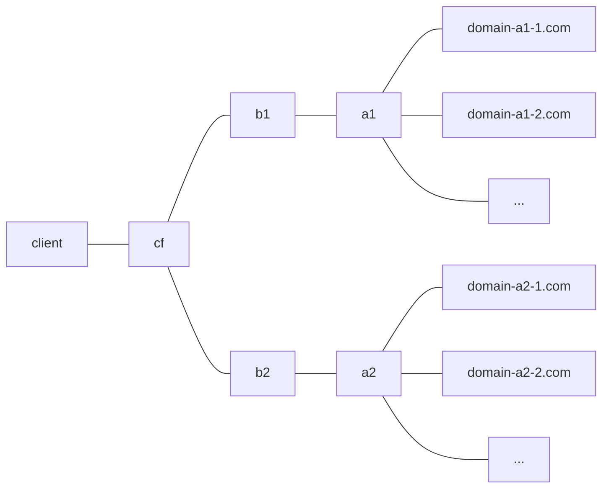
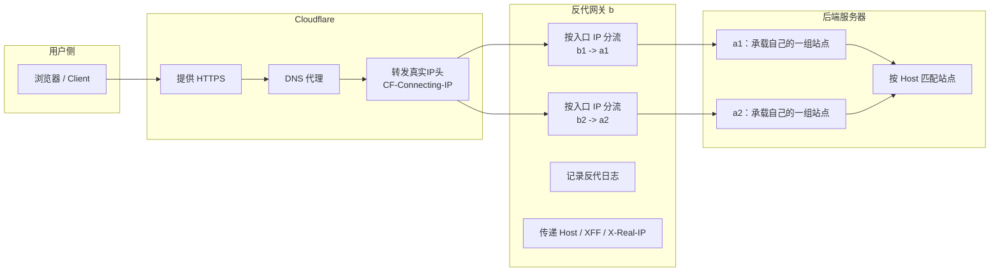
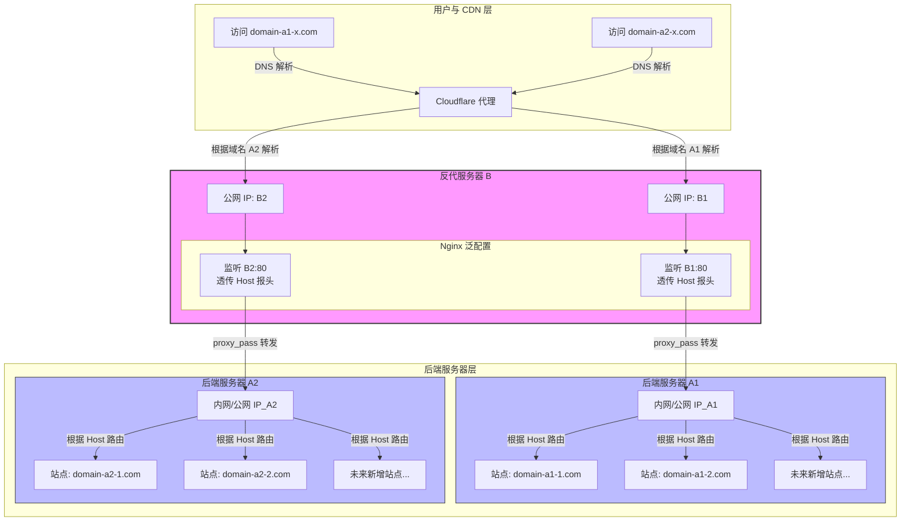
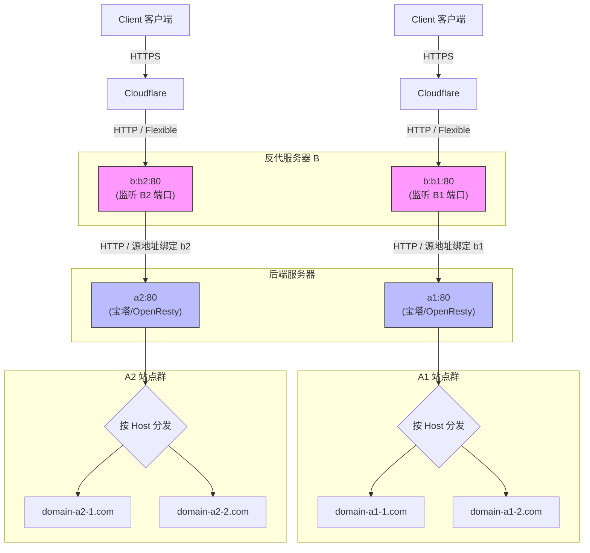
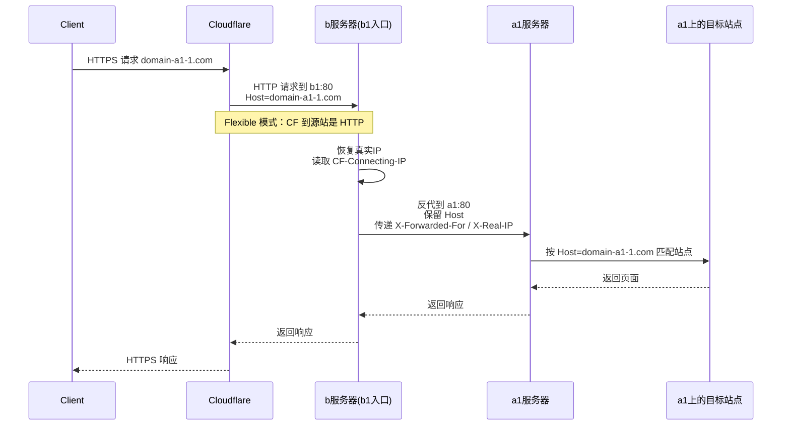
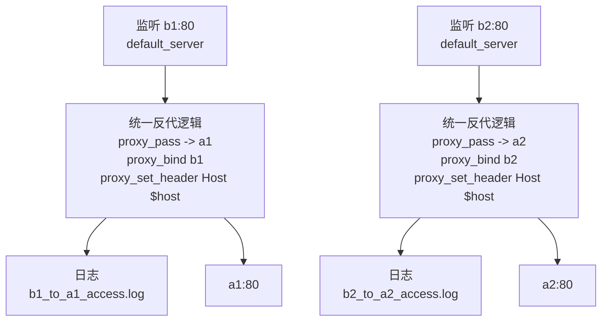
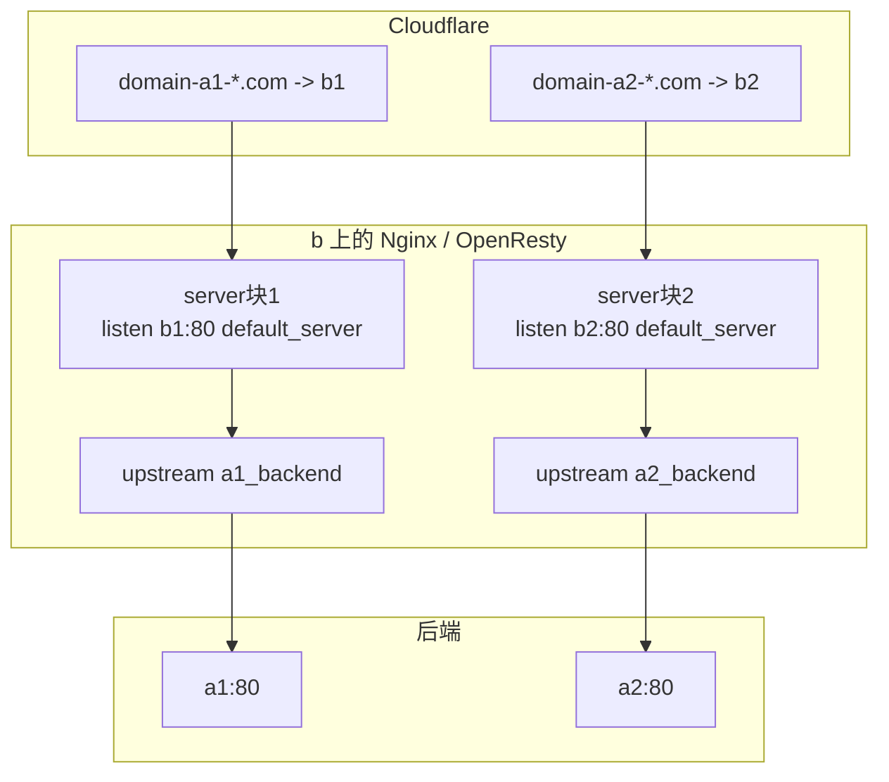
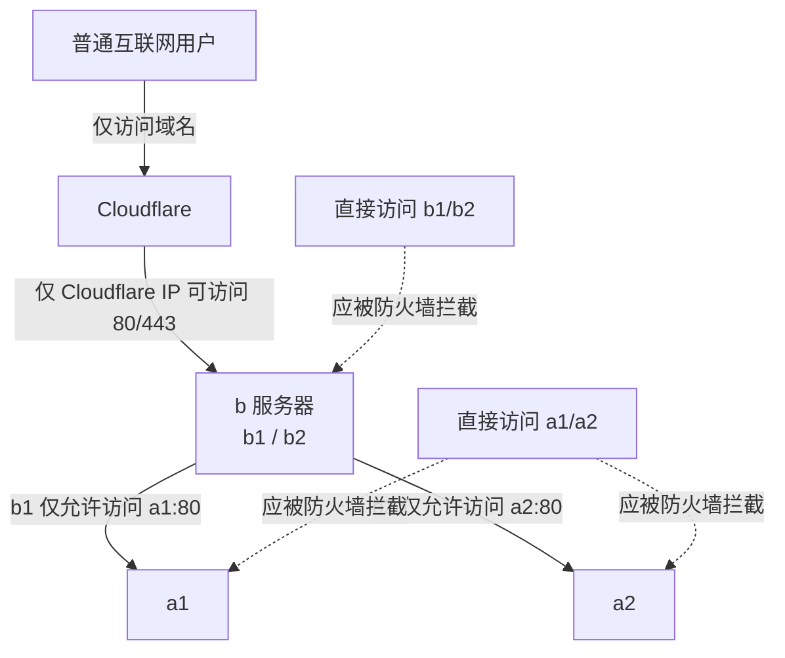
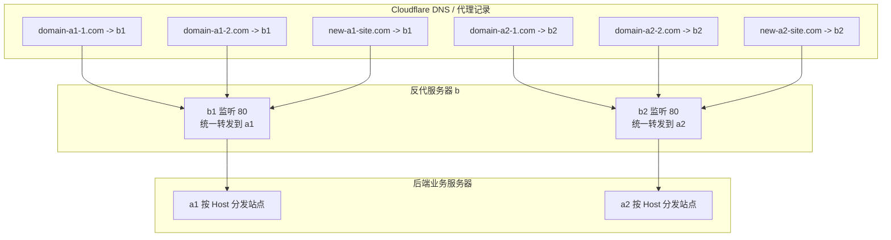

[toc]

# 摘要:任务说明

将一个具有多个ip的服务器(vps,记为`b`)为多个后端服务器(分被记为`a1`,`a2`)做反代。

> 假设反代服务器`b`有2个公网ip,分别记为`b1`,`b2`；
>
> 已知`a1`和`a2`都有多个互不相同的站点:
>
> > 例如`a1`上存在站点`domain-a1-1.com`,`domain-a1-2.com`,...;
> >
> > 而`a2`上存在站点`domain-a2-1.com`,`domain-a2-2.com`,...;

现在要求把服务器`b`配置成反代网关,尽可能一次性配置,使得后续服务器`a1`和`a2`上面增加站点也不用修改`b`上的配置;

我通过**cloudflare**代理(ssl加密方式采用flexible,且暂不考虑full模式),并且通过ip`b1`对服务器`a1`做反代,`b2`对应服务器`a2`做反代;

> 被反代的站包括包括所有已有和将来可能新增的站.

服务器软件选择：nginx(openresty);



稍微具体一点.

```mermaid
flowchart LR
    U[Client / 浏览器用户] -->|HTTPS| CF[Cloudflare]

    CF -->|HTTP / Flexible<br/>目标IP=b1| B1[b 服务器<br/>公网IP b1]
    CF -->|HTTP / Flexible<br/>目标IP=b2| B2[b 服务器<br/>公网IP b2]

    B1 -->|反向代理 HTTP<br/>保留 Host| A1[a1 服务器<br/>Nginx / OpenResty]
    B2 -->|反向代理 HTTP<br/>保留 Host| A2[a2 服务器<br/>Nginx / OpenResty]

    A1 --> S11[domain-a1-1.com]
    A1 --> S12[domain-a1-2.com]
    A1 --> S13[...未来新增站点]

    A2 --> S21[domain-a2-1.com]
    A2 --> S22[domain-a2-2.com]
    A2 --> S23[...未来新增站点]
```




## 一键配置方案

为了方便服务器管理员使用,本文也提供了配套的部署脚本:

```bash
bash <(curl -SfL https://raw.githubusercontent.com/xuchaoxin1375/scripts/refs/heads/main/wp/woocommerce/woo_df/sh/update_repos_vps_multi.sh) -h # 通过-h选项获取脚本帮助(使用说明)
```

适用于宝塔安装的nginx(openresty),具体参数可以根据自己的情况调整.

> `-m,-M`都是用来指定映射关系的,根据自己的喜好来使用就行.
>
> 有几组映射需要就指定几组,只有1组也行,超过2组也可以

```bash
# 包管理器或官方nginx标准安装:
bash <(curl -SfL https://raw.githubusercontent.com/xuchaoxin1375/scripts/refs/heads/main/wp/woocommerce/woo_df/sh/update_repos_vps_multi.sh) \
  -m 'B1_IP:A1_IP' \
  -m 'B2_IP:A2_IP' 
```

另一情况是宝塔用户:

```bash
# 适用于宝塔安装的nginx(openresty)
bash <(curl -SfL https://raw.githubusercontent.com/xuchaoxin1375/scripts/refs/heads/main/wp/woocommerce/woo_df/sh/update_repos_vps_multi.sh) \
-c /www/server/nginx/conf \
-d /www/server/panel/vhost/nginx \
-l /www/wwwlogs/ \
-M <(
echo "
# 一行一个映射关系,修改为真实映射组
B1_IP:A1_IP
B2_IP:A2_IP
"
)

```


# 一、可行性分析

设计要点:**用 b 的“本地监听 IP”决定转发到哪个后端**。

也就是：

```text
domain-a1-*.com → Cloudflare → b1:80 → a1:80
domain-a2-*.com → Cloudflare → b2:80 → a2:80
```

Cloudflare Flexible 模式下，浏览器到 Cloudflare 是 HTTPS，Cloudflare 到源站 b 是 HTTP，源站不需要证书。([Cloudflare Docs](https://developers.cloudflare.com/ssl/origin-configuration/ssl-modes/flexible/?utm_source=chatgpt.com))
Nginx 可以通过 `listen b1:80 default_server` 和 `listen b2:80 default_server` 明确区分请求进入的是哪个本地 IP；Nginx 官方也说明，`default_server` 可以在 `listen` 上显式指定默认虚拟主机。([Nginx](https://nginx.org/en/docs/http/request_processing.html?utm_source=chatgpt.com))


```text
b1 作为 a1 的统一入口
b2 作为 a2 的统一入口
```

b 上不按域名分流，而是按“请求打到 b 的哪个公网 IP”分流：

```nginx
listen b1:80 default_server;  →  proxy_pass http://a1_backend;

listen b2:80 default_server;  →  proxy_pass http://a2_backend;
```

这样后续 a1、a2 上新增站点时，b 不需要改配置。

------

# 二、本方案的前提条件

## 1. Cloudflare DNS 必须正确指向 b1 或 b2

例如：

```text
domain-a1-1.com   A   b1   Proxied
domain-a1-2.com   A   b1   Proxied

domain-a2-1.com   A   b2   Proxied
domain-a2-2.com   A   b2   Proxied
```

如果是子域名很多，可以用：

```text
*.domain-a1.com   A   b1   Proxied
*.domain-a2.com   A   b2   Proxied
```

但如果是完全不同的根域名，例如：

```text
aaa.com
bbb.net
ccc.org
```

那 Cloudflare 里仍然需要给每个域名添加 DNS 记录。**b 不用改，但 DNS 不能省。**

------

## 2. 不要给同一个站点同时配置 b1 和 b2

不要这样：

```text
domain-a1-1.com   A   b1   Proxied
domain-a1-1.com   A   b2   Proxied
```

因为 Cloudflare 对同一个 hostname 配多个 A/AAAA 记录会形成 DNS 级分发/轮询，官方文档也把这种方式描述为随机分发到多个服务器的 round-robin DNS。([Cloudflare Docs](https://developers.cloudflare.com/dns/manage-dns-records/how-to/round-robin-dns/?utm_source=chatgpt.com))

本例的需求不是负载均衡，而是：

```text
b1 固定去 a1
b2 固定去 a2
```

所以每个站点应明确只落到对应的 b IP。

------

## 3. b 到 a1/a2 的源地址注意事项和限制方案

b 有多个公网 IP 时，Linux 对外连接 a1/a2 时，默认源 IP 不一定就是 b1 或 b2。

例如：

```text
Cloudflare → b1 → a1
```

但 b 连接 a1 时，源 IP 可能仍然是 b 的主 IP，而不是 b1。

如果你希望 a1 防火墙只允许 b1、a2 防火墙只允许 b2，那么 b 的 Nginx 里建议使用：

```nginx
proxy_bind b1;
```

和：

```nginx
proxy_bind b2;
```

这样可以强制 b 到 a1 使用 b1 作为源 IP，b 到 a2 使用 b2 作为源 IP。

------

# 三、网络架构示意图

简图




------

### 完整示意图:






### 时序图

> 这里以访问服务器`a1`上的站点`domain-a1-1.com`为例(访问`a2`上的站点`domain-a2...com`类似.)




# 四、b 服务器 IP 配置检查

先确认 b 上确实有两个公网 IP。

```bash
ip addr
```

假设结果中有：

```text
b1 = 11.11.11.11
b2 = 22.22.22.22
```

测试本机是否能分别监听：

```bash
ss -lntp | grep ':80'
```

如果 b 上已有其他服务占用 80，需要先处理。

------

# 五、b 上 Cloudflare 真实 IP 配置

> **这部分建议使用脚本定时更新,参考其他文档.**

在反代服务器 `b` 上创建`cf_real_ip.conf`,并定期更新.

# 六、b 上统一反代配置




假设：

```text
b1 = 11.11.11.11
b2 = 22.22.22.22

a1 = 10.10.10.1 或 a1公网IP
a2 = 10.10.10.2 或 a2公网IP
```

创建：

```bash
nano /usr/local/openresty/nginx/conf/conf.d/reverse_multi_ip.conf
```

### 配置示意图




### 完整配置

> 仅演示2个ip的情况,并简单写在同一个文件中.
>
> 更多ip的映射建议使用脚本生成.

```nginx
map $http_upgrade $connection_upgrade {
    default upgrade;
    ''      close;
}

map $http_x_forwarded_proto $proxy_x_forwarded_proto {
    default $http_x_forwarded_proto;
    ''      $scheme;
}

log_format cf_proxy_main
    '$remote_addr - $remote_user [$time_local] "$request" '
    'status=$status body=$body_bytes_sent '
    'host="$host" server_name="$server_name" '
    'server_addr="$server_addr" '
    'request_time=$request_time '
    'upstream_addr="$upstream_addr" '
    'upstream_status="$upstream_status" '
    'upstream_response_time="$upstream_response_time" '
    'cf_ray="$http_cf_ray" '
    'cf_connecting_ip="$http_cf_connecting_ip" '
    'xff="$http_x_forwarded_for" '
    'realip_remote_addr="$realip_remote_addr" '
    'referer="$http_referer" '
    'ua="$http_user_agent"';

upstream a1_backend {
    server A1_IP:80;
    keepalive 32;
}

upstream a2_backend {
    server A2_IP:80;
    keepalive 32;
}

server {
    listen B1_IP:80 default_server;
    server_name _;

    access_log /var/log/nginx/b1_to_a1_access.log cf_proxy_main;
    error_log  /var/log/nginx/b1_to_a1_error.log warn;

    location = /__b_health {
        access_log off;
        return 200 "b1 -> a1 gateway ok\n";
        add_header Content-Type text/plain;
    }

    location / {
        proxy_pass http://a1_backend;

        # 强制 b 连接 a1 时使用 b1 作为源 IP
        proxy_bind B1_IP;

        # 保留原始 Host，让 a1 上的宝塔/OpenResty 按域名分发
        proxy_set_header Host $host;

        # 真实访客 IP 链路
        proxy_set_header X-Real-IP $remote_addr;
        proxy_set_header X-Forwarded-For $proxy_add_x_forwarded_for;

        # Flexible 模式下不要简单使用 $scheme
        proxy_set_header X-Forwarded-Proto $proxy_x_forwarded_proto;
        proxy_set_header X-Forwarded-Ssl $proxy_x_forwarded_proto;

        # Cloudflare 调试头
        proxy_set_header CF-Connecting-IP $http_cf_connecting_ip;
        proxy_set_header CF-Ray $http_cf_ray;
        proxy_set_header CF-Visitor $http_cf_visitor;

        # WebSocket/SSE
        proxy_http_version 1.1;
        proxy_set_header Upgrade $http_upgrade;
        proxy_set_header Connection $connection_upgrade;

        client_max_body_size 512m;
        proxy_connect_timeout 10s;
        proxy_send_timeout 120s;
        proxy_read_timeout 120s;

        # 调试阶段建议开启，稳定后可删除
        add_header X-Debug-Gateway "b1-to-a1" always;
        add_header X-Debug-Server-Addr $server_addr always;
        add_header X-Debug-Upstream-Addr $upstream_addr always;
        add_header X-Debug-Upstream-Status $upstream_status always;
    }
}

server {
    listen B2_IP:80 default_server;
    server_name _;

    access_log /var/log/nginx/b2_to_a2_access.log cf_proxy_main;
    error_log  /var/log/nginx/b2_to_a2_error.log warn;

    location = /__b_health {
        access_log off;
        return 200 "b2 -> a2 gateway ok\n";
        add_header Content-Type text/plain;
    }

    location / {
        proxy_pass http://a2_backend;

        # 强制 b 连接 a2 时使用 b2 作为源 IP
        proxy_bind B2_IP;

        proxy_set_header Host $host;

        proxy_set_header X-Real-IP $remote_addr;
        proxy_set_header X-Forwarded-For $proxy_add_x_forwarded_for;

        proxy_set_header X-Forwarded-Proto $proxy_x_forwarded_proto;
        proxy_set_header X-Forwarded-Ssl $proxy_x_forwarded_proto;

        proxy_set_header CF-Connecting-IP $http_cf_connecting_ip;
        proxy_set_header CF-Ray $http_cf_ray;
        proxy_set_header CF-Visitor $http_cf_visitor;

        proxy_http_version 1.1;
        proxy_set_header Upgrade $http_upgrade;
        proxy_set_header Connection $connection_upgrade;

        client_max_body_size 512m;
        proxy_connect_timeout 10s;
        proxy_send_timeout 120s;
        proxy_read_timeout 120s;

        add_header X-Debug-Gateway "b2-to-a2" always;
        add_header X-Debug-Server-Addr $server_addr always;
        add_header X-Debug-Upstream-Addr $upstream_addr always;
        add_header X-Debug-Upstream-Status $upstream_status always;
    }
}
```

替换：

```text
B1_IP → b1
B2_IP → b2
A1_IP → a1
A2_IP → a2
```

例如：

```nginx
listen 11.11.11.11:80 default_server;
proxy_bind 11.11.11.11;
listen 22.22.22.22:80 default_server;
proxy_bind 22.22.22.22;
```

------

# 验证步骤

## 1. 验证 b 的 Nginx 配置

```bash
/usr/local/openresty/nginx/sbin/nginx -t
```

成功后重载：

```bash
/usr/local/openresty/nginx/sbin/nginx -s reload
```

或者：

```bash
systemctl reload openresty
```

------

## 2. 验证 b1 是否进入 a1 网关

在 b 本机执行：

```bash
curl -i --interface B1_IP http://B1_IP/__b_health
```

期望：

```text
b1 -> a1 gateway ok
```

或者从外部机器：

```bash
curl -i http://B1_IP/__b_health
```

期望响应头中看到：

```http
HTTP/1.1 200 OK
```

正文：

```text
b1 -> a1 gateway ok
```

------

## 3. 验证 b2 是否进入 a2 网关

```bash
curl -i http://B2_IP/__b_health
```

期望：

```text
b2 -> a2 gateway ok
```

------

## 4. 验证 b1 反代 a1 的 Host 分发

假设 a1 上已有：

```text
domain-a1-1.com
```

执行：

```bash
curl -I -H "Host: domain-a1-1.com" http://B1_IP/
```

期望看到：

```http
HTTP/1.1 200 OK
X-Debug-Gateway: b1-to-a1
X-Debug-Server-Addr: B1_IP
X-Debug-Upstream-Addr: A1_IP:80
```

如果返回宝塔默认页，说明 a1 上没有正确绑定 `domain-a1-1.com`，或者 b 没有正确传递 Host。

------

## 5. 验证 b2 反代 a2 的 Host 分发

```bash
curl -I -H "Host: domain-a2-1.com" http://B2_IP/
```

期望：

```http
HTTP/1.1 200 OK
X-Debug-Gateway: b2-to-a2
X-Debug-Server-Addr: B2_IP
X-Debug-Upstream-Addr: A2_IP:80
```

------

## 6. 验证 Cloudflare 访问

Cloudflare DNS 设置：

```text
domain-a1-1.com   A   B1_IP   Proxied
domain-a2-1.com   A   B2_IP   Proxied
```

然后：

```bash
curl -I https://domain-a1-1.com/
```

期望：

```http
HTTP/2 200
server: cloudflare
x-debug-gateway: b1-to-a1
```

再测试：

```bash
curl -I https://domain-a2-1.com/
```

期望：

```http
HTTP/2 200
server: cloudflare
x-debug-gateway: b2-to-a2
```

调试完成后，建议删除这些响应头：

```nginx
add_header X-Debug-Gateway ...
add_header X-Debug-Server-Addr ...
add_header X-Debug-Upstream-Addr ...
add_header X-Debug-Upstream-Status ...
```

避免暴露后端结构。

------

# a1/a2 上恢复真实访客 IP

因为 b 是反代，a1/a2 默认看到的是 b 的 IP。

在 a1 上配置：

```nginx
set_real_ip_from B1_IP;
real_ip_header X-Forwarded-For;
real_ip_recursive on;
```

在 a2 上配置：

```nginx
set_real_ip_from B2_IP;
real_ip_header X-Forwarded-For;
real_ip_recursive on;
```

如果你没有使用 `proxy_bind`，a1/a2 实际看到的源 IP 可能不是 b1/b2，而是 b 的主 IP。此时要么加 `proxy_bind`，要么在 a1/a2 上信任 b 实际出口 IP。

宝塔/OpenResty 常见位置：

```bash
/www/server/nginx/conf/conf.d/realip-from-b.conf
```

或者：

```bash
/usr/local/openresty/nginx/conf/conf.d/realip-from-b.conf
```

检查：

```bash
nginx -t
```

或：

```bash
/www/server/nginx/sbin/nginx -t
```

重载：

```bash
systemctl reload nginx
```

或：

```bash
/etc/init.d/nginx reload
```

------

# 防火墙建议




## b 服务器

b 的 80 端口建议只允许 Cloudflare IP 访问。

原因是：

```text
用户应该只能通过 Cloudflare → b
不应该绕过 Cloudflare 直接访问 b1/b2
```

Cloudflare 官方维护 IP 段，并且文档说明 Cloudflare 代理后源站默认会看到 Cloudflare IP，恢复真实访客 IP 需要使用其转发头。([Cloudflare Docs](https://developers.cloudflare.com/support/troubleshooting/restoring-visitor-ips/restoring-original-visitor-ips/?utm_source=chatgpt.com))

UFW 思路：

```bash
ufw default deny incoming
ufw allow 22/tcp
```

然后允许 Cloudflare IP 到 80。

示例：

```bash
for ip in $(curl -s https://www.cloudflare.com/ips-v4); do
  ufw allow from $ip to any port 80 proto tcp
done

for ip in $(curl -s https://www.cloudflare.com/ips-v6); do
  ufw allow from $ip to any port 80 proto tcp
done

ufw enable
```

验证：

```bash
curl -I http://B1_IP/
curl -I http://B2_IP/
```

普通网络直连应失败。

通过 Cloudflare：

```bash
curl -I https://domain-a1-1.com/
curl -I https://domain-a2-1.com/
```

应成功。

------

## a1 服务器

只允许 b1 访问 a1 的 80：

```bash
ufw allow 22/tcp
ufw allow from B1_IP to any port 80 proto tcp
ufw deny 80/tcp
```

------

## a2 服务器

只允许 b2 访问 a2 的 80：

```bash
ufw allow 22/tcp
ufw allow from B2_IP to any port 80 proto tcp
ufw deny 80/tcp
```

如果 b 到 a1/a2 使用的是内网 IP，例如：

```text
b 内网 IP：172.16.0.10
a1 内网 IP：172.16.0.11
a2 内网 IP：172.16.0.12
```

那 a1/a2 防火墙应允许 b 的内网 IP，而不是公网 b1/b2。

------

# 日志设计建议

当前日志里建议增加一个字段：

```nginx
server_addr="$server_addr"
```

这个字段非常重要。

它能告诉你：

```text
这条请求是打到 b1 还是 b2
```

例如日志：

```text
host="domain-a1-1.com" server_addr="B1_IP" upstream_addr="A1_IP:80"
```

说明：

```text
domain-a1-1.com → b1 → a1
```

如果看到：

```text
host="domain-a1-1.com" server_addr="B2_IP" upstream_addr="A2_IP:80"
```

说明 Cloudflare DNS 配错了，把 a1 的站点指到了 b2。

------

# 常见故障判断

| 现象                          | 大概率原因                     | 检查方法                                    |
| ----------------------------- | ------------------------------ | ------------------------------------------- |
| a1 站点跑到 a2                | Cloudflare DNS 把域名指向了 b2 | 看 b 日志里的 `server_addr`                 |
| 返回宝塔默认页                | 后端没有绑定该 Host            | 在 b 上 `curl -H "Host:域名" http://A1_IP/` |
| 无限 301/302                  | Flexible 下后端强制 HTTPS      | 检查 `X-Forwarded-Proto` 和宝塔强制 HTTPS   |
| a1 日志显示 b 的 IP           | a1 没配置 realip               | 检查 `set_real_ip_from`                     |
| a1 防火墙放行 b1 但仍 502     | b 到 a1 源 IP 不是 b1          | 加 `proxy_bind B1_IP`                       |
| 同一个域名偶尔进 a1 偶尔进 a2 | 同一 hostname 配了多个 A 记录  | Cloudflare DNS 只保留一个目标 IP            |
| WebSocket 失败                | 缺少 Upgrade/Connection 配置   | 检查 `proxy_http_version 1.1`               |

------

# 后续新增站点流程




## 新增 a1 站点

例如新增：

```text
new-a1-site.com
```

操作：

```text
1. a1 宝塔新增网站，绑定 new-a1-site.com
2. Cloudflare DNS：new-a1-site.com A B1_IP Proxied
3. b 不用改
```

验证：

```bash
curl -I https://new-a1-site.com/
```

看 b 日志：

```bash
tail -f /var/log/nginx/b1_to_a1_access.log
```

应看到：

```text
host="new-a1-site.com"
server_addr="B1_IP"
upstream_addr="A1_IP:80"
```

------

## 新增 a2 站点

例如新增：

```text
new-a2-site.com
```

操作：

```text
1. a2 宝塔新增网站，绑定 new-a2-site.com
2. Cloudflare DNS：new-a2-site.com A B2_IP Proxied
3. b 不用改
```

验证：

```bash
curl -I https://new-a2-site.com/
```

看 b 日志：

```bash
tail -f /var/log/nginx/b2_to_a2_access.log
```

应看到：

```text
host="new-a2-site.com"
server_addr="B2_IP"
upstream_addr="A2_IP:80"
```

------

