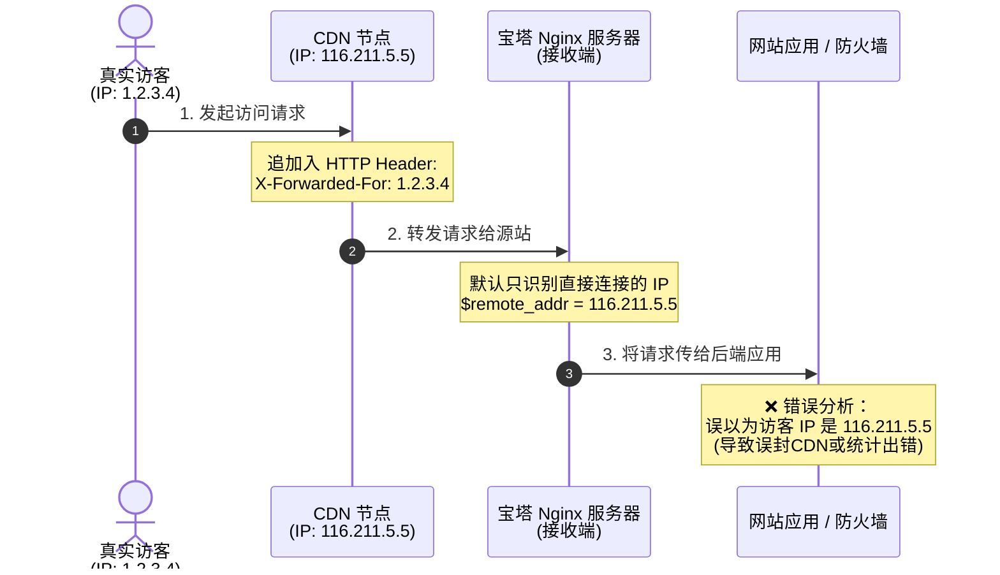
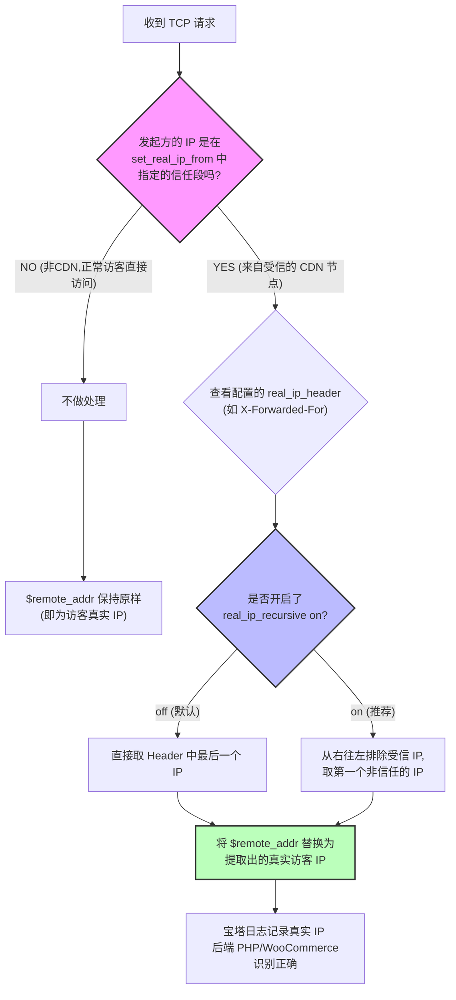

[toc]


## 一、 核心工作原理

当用户访问接入 CDN 的网站时，HTTP 请求头中会被 CDN 附加一些特定的文本字段，用来记录原始访客的痕迹：

- `X-Forwarded-For`: 最常见的协议头，格式通常为 `访客IP, CDN节点IP1, CDN节点IP2...`
- `X-Real-IP`: 通常由前置代理直接设置为**真正访客的 IP**。
- `CF-Connecting-IP`: Cloudflare 特有的传递真实访客 IP 的请求头。

当你为网站接入了 CDN（如阿里云 CDN、腾讯云 CDN、Cloudflare 等）后，所有的用户请求都会先到达 CDN 节点，再由 CDN 节点转发给你的服务器。

“CDN 来源 IP 解析”本质上是配置 Nginx 的 `real_ip` 模块。

它的逻辑是：**“信任指定的 CDN 节点 IP 范围，当请求来自这些 IP 时，将 Nginx 内置的 `$remote_addr`（远端地址变量）替换为请求头（如 `X-Forwarded-For`）中记录的真实访客 IP。”**

## 二、 宝塔面板中的配置实现分类

在宝塔面板（宝塔Linux面板）的管理生态中，**“CDN来源IP解析”**（通常表现为配置 `ngx_http_realip_module` 模块）是一个非常核心的功能。

如果不做处理，宝塔的 Nginx 日志、WordPress/WooCommerce 等应用获取到的访客 IP，都会变成 **CDN 节点的公网 IP**。

> 这会导致一系列问题：无法准确统计访客地域、安全防火墙（如宝塔系统防火墙、Fail2ban）误封 CDN 节点、风控系统失效等。

### 配置类型

在宝塔中，根据你的需求（全局生效还是单站点生效），主要有以下两种配置方式：

### 1. 方案 A：单站点配置（推荐，灵活度高）

如果你只有部分站点接入了 CDN，建议直接在对应站点的配置文件中修改。

1. 进入宝塔面板 -> **网站** -> 找到目标站点点击 **设置**。
2. 选择 **配置文件** 选项卡。
3. 在 `server { ... }` 内部的空白处（通常建议放在防盗链或 `location` 规则之前），添加如下配置：

```nginx
# 1. 定义信任的 CDN 节点 IP段（以下为示例，需根据你的CDN服务商提供的数据填写）
set_real_ip_from 116.211.0.0/16;
set_real_ip_from 185.199.108.0/22;
# 如果是 Cloudflare，需要填入 CF 的官方 IP 段

# 2. 指定从哪个 HTTP 请求头中获取真实 IP
real_ip_header X-Forwarded-For;

# 3. 开启递归解析（防止伪造请求头）
real_ip_recursive on;
```

1. 点击 **保存**。宝塔会自动重载 Nginx 配置。

### 2. 方案 B：Nginx 全局配置

如果你服务器上的所有网站都接入了同一家 CDN，可以直接修改 Nginx 的全局全局配置。

1. 进入宝塔面板 -> **软件商店** -> 找到 **Nginx** 点击 **设置**。
2. 选择 **配置修改**。
3. 在 `http { ... }` 作用域内，添加上述 `set_real_ip_from` 和 `real_ip_header` 的代码。
4. 保存并重启/重载 Nginx。

## 三、 核心配置指令详解

为了针对不同的 CDN 服务商进行微调，你需要理解这三个核心指令：

### 1. `set_real_ip_from`

- **含义**：告诉 Nginx，哪些 IP 发过来的请求是可以信任的。
- **注意**：**绝对不能写成 `0.0.0.0/0`（信任所有人）**。如果信任了所有人，恶意攻击者可以通过在本地电脑上伪造一个 `X-Forwarded-For: 8.8.8.8` 的请求头，直接欺骗你的服务器和应用，导致防火墙和风控形同虚设。必须严格填写 CDN 厂商给出的 IP 段。

### 2. `real_ip_header`

- **含义**：指定从哪个 Header 里面提取真实 IP。
- - **常规 CDN**：一般使用 `X-Forwarded-For`。
- - **Cloudflare**：建议使用 `CF-Connecting-IP`。
- - **部分国内 CDN**：支持 `X-Real-IP`。

### 3. `real_ip_recursive on`

- **含义**：是否开启递归解析。
- **详解**：当 `real_ip_header` 设为 `X-Forwarded-For` 时，该字段可能包含多个 IP（如：`访客IP, CDN节点A, CDN节点B`）。
  - 如果设为 `off`：Nginx 会直接取**最后一个** IP（即 CDN 节点 B），这往往不是我们想要的。
  - 如果设为 `on`：Nginx 会从右往左排除掉你在 `set_real_ip_from` 中配置的“信任 IP”，直到遇到第一个**不被信任的 IP**，并将其认定为“真实访客 IP”。因此，**强烈建议保持 `on` 状态**。

## 四、 常见 CDN 服务商的特殊处理

### 1. Cloudflare (CF)

Cloudflare 的 IP 段是公开且频繁变动的。如果你使用 CF，宝塔的配置中应该这样写：

```nginx
# 仅举例部分，实际应获取 CF 最新 IPv4/IPv6 列表
set_real_ip_from 103.21.244.0/22;
set_real_ip_from 173.245.48.0/12;
set_real_ip_from 2400:cb00::/32; # 支持IPv6

real_ip_header CF-Connecting-IP; # CF专用头，更安全
```

### 2. 宝塔自建 CDN / 宝塔云 WAF

如果你使用了宝塔官方的集群 CDN 或使用了前置的宝塔云 WAF 堡垒机，在上游节点的 Nginx 中通常默认已经开启了 `proxy_set_header X-Forwarded-For $proxy_add_x_forwarded_for;`。你只需要在**源站**的宝塔中，将 `set_real_ip_from` 指向**你的 WAF 节点或 CDN 节点的 IP** 即可。

## 五、 配置后的验证与排查

配置完成后，如何确定它生效了？

1. **检查 Nginx 访问日志**：

   进入宝塔站点设置 -> **网站日志**。观察新进来的请求。如果显示的 IP 已经是手机或本地宽带的公网 IP，而不是 CDN 节点的 IP，说明配置成功。

2. **PHP/WordPress 层验证**：

   在网站根目录下建立一个临时的 `ip.php`，写入以下代码并访问：

   ```php
   <?php
   echo "REMOTE_ADDR: " . $_SERVER['REMOTE_ADDR'] . "<br>";
   echo "HTTP_X_FORWARDED_FOR: " . ($_SERVER['HTTP_X_FORWARDED_FOR'] ?? 'None');
   ?>
   ```

   - 如果 `REMOTE_ADDR` 显示的是你的真实 IP，说明宝塔与 Nginx 级别的解析完全正常，你的 WordPress、WooCommerce、数据库日志等均能直接获取正确访客 IP。

## 示意图

第一个展示 **未配置时的痛点（为什么需要这个功能）**，第二个展示 **配置后的数据流向与 Nginx 的解析逻辑**。

### 1. 未配置时：CDN 导致的“IP 掩盖”现象

当没有配置 `real_ip` 模块时，Nginx 只能看到直接与它建立 TCP 连接的节点（即 CDN 节点），导致真实访客 IP 被淹没在请求头中，而服务器日志和应用只能抓取到 CDN IP。



### 2. 配置后：宝塔 CDN 来源 IP 解析控制流

配置了 `set_real_ip_from` 和 `real_ip_header` 后，Nginx 会执行一套**验证与替换**逻辑。它会检查“谁发起的连接”，如果是信任的 CDN，就从 Header 中提取真实的访客 IP。

> 在 Nginx 的网络处理层面上，这里所谓的“**发起方**”（在没有配置[ CDN 解析]前，Nginx 认定的 `$remote_addr`），指的是直接与你的服务器建立 TCP 三次握手、发送网络数据包的那台机器的公网 IP(使用了CDN的情况下一般就是CDN节点)。
>
> 如果没有 CDN（直连状态）
>
> - **场景**：用户直接访问你的服务器。
> - **发起方**：**访客的电脑/手机**。
>
> 如果接入了 CDN（代理状态）
>
> - **场景**：用户访问网站 $\rightarrow$ CDN 节点 $\rightarrow$ 宝塔服务器。
> - **发起方**：**CDN 的边缘节点服务器**。



### 结合图解的核心总结

- **`set_real_ip_from`** 的作用就是上图中的 **第2步（判断是否在信任段内）**。如果这一步写成 `0.0.0.0/0`，意味着任何人都可以伪造 Header 走右侧的替换逻辑，防火墙就会失效。
- **`real_ip_recursive on`** 的作用体现在 **第5步（递归判断）**。它保证了即便请求经过了多层 CDN 转发，Nginx 也能通过“剥洋葱”的方式，过滤掉所有已知的 CDN 节点 IP，精准定位到最左侧的 `1.2.3.4`（真实访客）。