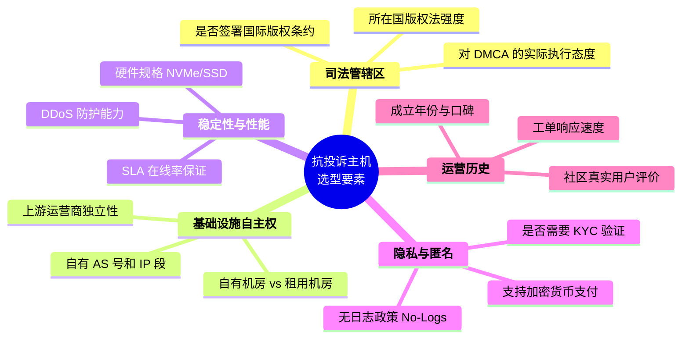
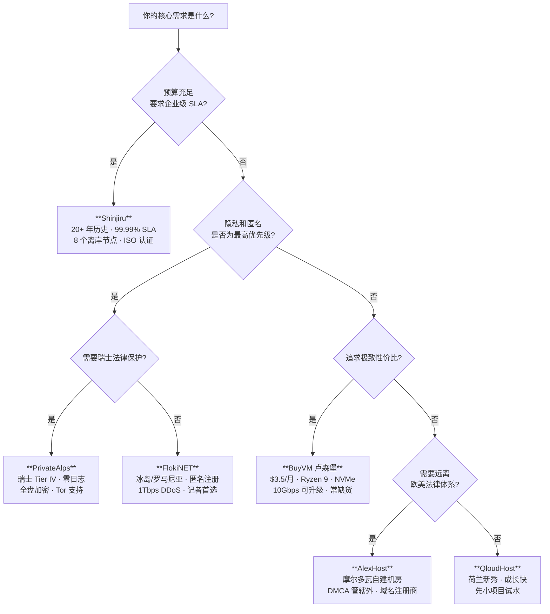

[toc]

## 抗投诉（DMCA Ignored / Offshore）VPS 与服务器推荐 — 稳定优先

> **信息来源：** WebsitePlanet、HostAdvice、HotFrameworks、BlackHatWorld 论坛、Trustpilot 用户评价、P3TERX ZONE、VPS之家、国外主机测评等多个综合评测与社区平台。各服务商官网信息截至 **2026 年 9 月**。

### 核心概念：什么是"抗投诉"托管？

**抗投诉托管**（Offshore Hosting / DMCA Ignored Hosting）指的是将服务器部署在**不受美国 DMCA（Digital Millennium Copyright Act，数字千年版权法）直接管辖的司法区域**，使得来自美国的版权投诉（Takedown Notice）**不具有法律约束力**。

DMCA 的执行力取决于司法管辖权——DMCA 是美国联邦法律，因此选择服务器位于不受 DMCA 约束的国家的主机商，是关键。

但需要注意：

- 有些主机商虽然宣传"DMCA Ignored"，但其实仍然依赖上游运营商（Upstream Carrier），一旦上游收到大量投诉，照样可以断线。
- 社区实战经验表明，即使主机商声称"无视 DMCA"，也可能悄悄转发滥用通知（abuse）；只有**自有基础设施**或与上游关系紧密的服务商，实际表现才更好。

### 选择服务商的关键评估维度

HostAdvice 的评测方法是：部署真实内容并监控 Takedown 响应、在线率和隐私保障，从法律管辖、基础设施质量、匿名性功能和社区声誉多维度评估，只有始终保护内容、尊重隐私并提供真正离岸优势的主机商才会入选。

---

### 推荐服务商详解

以下按**稳定性优先**排序，分为三个梯队：

---

#### 第一梯队：稳定性与抗投诉兼得（商业级/长期运营首选）

##### Shinjiru — 老牌离岸托管巨头（马来西亚，成立于 2000 年）

Shinjiru 是一家高端离岸托管服务商，提供共享主机、VPS 和独立服务器方案，总部位于马来西亚吉隆坡，成立于 2000 年，目前服务超过 40,000 名客户。

**稳定性方面的核心优势：**

- Shinjiru 提供 **99.99% 在线率保证（SLA）**，这在离岸托管行业中极为罕见，因为大多数离岸主机商以高延迟和不理想的在线率著称。
- 他们拥有完整的 Anti-DDoS 攻击防护网络、数千台独立服务器和 IP 地址、24/7 监控和支持。其各网络的 SLA 最高可达 **99.999%** 在线率，数据中心配备故障转移、电力冗余和先进的安全系统。
- 由于在东南亚和欧洲拥有**8 个数据中心**，加载速度优于只在单一国家设有服务器的大多数离岸主机商。
- Shinjiru 是**唯一拥有 ISO 9001:2008 质量保证认证**的离岸托管服务商。

**抗投诉方面：**

- Shinjiru 在匿名和离岸 DMCA Ignored 托管领域有超过 **20 年**的专注经验，公司核心使命是保护网站、网站所有者和用户自由。
- 所有 DMCA Ignored 离岸方案均含不限流量带宽、免费迁移，并运行 LiteSpeed 技术，可从 **8 个离岸司法区**中自由选择。

**注意事项：**

- 有 Trustpilot 用户反馈曾遭遇 DDoS 攻击导致"超过 36 小时总计停机"的案例。大规模 DDoS 攻击是所有服务商的共同挑战，但这说明即使是老牌服务商也不能完全避免极端情况。
- 在美洲和大洋洲没有数据中心，这些地区的用户可能延迟较高。

| 项目           | 详情                                      |
| -------------- | ----------------------------------------- |
| **司法管辖区** | 马来西亚（总部）+ 8 个离岸节点            |
| **SLA**        | 99.99%（部分网络达 99.999%）              |
| **成立年份**   | 2000 年                                   |
| **VPS 起步价** | 约 $30/月起（Offshore VPS）               |
| **支付方式**   | 加密货币、PayPal 等，支持匿名支付         |
| **适合场景**   | 商业项目、电商、需要企业级 SLA 的长期运营 |

---

##### FlokiNET — 隐私活动家的堡垒（冰岛/罗马尼亚/芬兰/荷兰，成立于 2012 年）

FlokiNET 专注于为记者、维权人士、NGO、揭秘平台等需要主机商不会屈服于政治或法律压力的用户提供离岸隐私托管。数据中心分布在冰岛、罗马尼亚、芬兰和荷兰——均为在言论自由和数据隐私方面拥有较强法律保护的司法区。

**稳定性方面的核心优势：**

- VPS 起步价约 **€7.99/月**，配备 NVMe 存储和 DDoS 防护。技术表现扎实，采用现代硬件和**多条 10 Gbps 上联链路**。
- 所有地点的 VPS 均运行 **KVM 虚拟化**，配备全 root 访问权限、NVMe SSD 存储、虚拟 IPMI 控制台（服务器无响应时也可远程管理），以及默认包含的 **1Tbps+ DDoS 防护**——不是附加付费项。
- 2026 年初，FlokiNET 扩展了整个网络——增加上游容量、强化 DDoS 缓解能力、改善到欧洲主要骨干网的路由。

**抗投诉方面：**

- FlokiNET 明确标注 **DMCA-Ignored**——在冰岛和罗马尼亚法律下运营，不受美国版权法管辖，美国 DMCA 通知对其服务器无管辖权。
- 注册只需一个电子邮件地址，无需姓名、地址或身份验证。
- 支持比特币、门罗币（Monero）、以太坊、莱特币等多种加密货币支付，可实现完全匿名的托管方案。

**各节点定位：**

| 节点位置     | 核心优势                                            | 起步价   |
| ------------ | --------------------------------------------------- | -------- |
| **罗马尼亚** | 性价比最高，€7.99/月，最佳价格-带宽比，含 DDoS 防护 | €7.99/月 |
| **冰岛**     | 司法管辖保护最强，100% 绿色能源                     | 较高     |
| **荷兰**     | EU 法律覆盖，带宽略优于冰岛                         | 中等     |
| **芬兰**     | 另一个注重隐私的北欧司法区                          | 中等     |

---

##### PrivateAlps — 瑞士法律保护（瑞士，较新品牌）

PrivateAlps 提供匿名、高性能的瑞士离岸托管，围绕隐私、安全和无审查基础设施构建。服务涵盖 Linux VPS、Windows RDP、Web 托管、VPN 托管、独立服务器、高带宽服务器、GPU 服务器、存储 VPS 和渗透测试工作站，强调零日志托管、离岸司法管辖、匿名访问和全盘加密。

**稳定性方面：**

- 拥有 **1 Tbps 网络**，确保超低延迟和高性能托管，采用 **Tier IV 基础设施**，承诺 **99.9% 在线率**。
- Trustpilot 用户评价："keeps my servers online and performant 100% of the time"；另有用户反馈"support reply under 45 minutes"，VPS 虽略贵但物有所值。

**独特优势：** 瑞士以极强的数据保护法和政治中立性著称，这让 PrivateAlps 在法律层面享有独特的保护位置。

| 项目           | 详情                                     |
| -------------- | ---------------------------------------- |
| **司法管辖区** | 瑞士                                     |
| **SLA**        | 99.9%                                    |
| **支付方式**   | 加密货币、传统支付                       |
| **适合场景**   | 高隐私需求、金融敏感数据、法律保护级托管 |

---

#### 第二梯队：性价比突出的实战型选择

##### BuyVM (Frantech) — 社区口碑之王（卢森堡节点，成立于约 2010 年）

BuyVM 是一家 2010 年成立的加拿大公司，运营美国（拉斯维加斯、纽约、迈阿密）和卢森堡机房的 VPS，默认采用 **AMD Ryzen 9** 系列 CPU、**纯 NVMe** 硬盘，**1Gbps 带宽不限流量**。

**抗投诉关键点：**

- **卢森堡节点**是其抗投诉核心——卢森堡 VPS 无视版权投诉。使用 3 个月后，可发工单将带宽免费升级到 **10Gbps**，依旧不限流量。

**性价比优势：**

- VPS 低至 **$3.5/月**，附加 256GB 存储块仅 **$1.25/月**，总共仅 **$4.75/月** 即可拥有 256GB 不限流量大容量方案。由于极具性价比，经常处于缺货状态。

**注意事项：** BuyVM 的抗投诉能力主要限于**卢森堡节点**；美国节点受 DMCA 管辖，不具备抗投诉特性。另外由于性价比极高，热门配置**长期缺货**，需抢购。

| 项目           | 详情                                        |
| -------------- | ------------------------------------------- |
| **司法管辖区** | 卢森堡（抗投诉节点）                        |
| **硬件**       | AMD Ryzen 9 + NVMe                          |
| **带宽**       | 1Gbps 不限流量（可升 10Gbps）               |
| **起步价**     | $3.5/月                                     |
| **适合场景**   | BT 下载、大存储、流媒体、预算有限的个人项目 |

---

##### AlexHost — 摩尔多瓦自建机房的硬核选择（成立较早）

AlexHost 是少数明确承诺代你无视 DMCA Takedown 请求的离岸主机商之一，此服务专门针对其离岸托管方案，包括共享 LiteSpeed、VPS（托管和非托管）以及 KVM VDS 配置。

- AlexHost 同时是注册域名商，可安全注册域名而无需第三方。其主数据中心位于**摩尔多瓦**，也在**瑞典、保加利亚和荷兰**提供数据中心。
- 优势包括：摩尔多瓦司法管辖在美国/欧盟法律影响之外、真正的 DMCA Ignored 政策、匿名加密货币支付、高速 SSD 服务器 99.9% 在线率、透明的无日志隐私政策、价格亲民。

**注意事项：**

- 从用户反馈来看，"服务器性能中规中矩，偶尔会有短暂的网络波动"。

| 项目           | 详情                                       |
| -------------- | ------------------------------------------ |
| **司法管辖区** | 摩尔多瓦（主） + 瑞典/保加利亚/荷兰        |
| **SLA**        | 99.9%                                      |
| **特色**       | 自有机房、域名注册商资质                   |
| **适合场景**   | 预算有限、需要最大程度远离 DMCA 执行的项目 |

---

#### 第三梯队：新兴但值得关注

##### QloudHost — 荷兰新秀（成立于 2022 年）

QloudHost 虽然成立时间不长（2022 年），但在抗投诉 VPS 领域发展迅速，已建立了良好的声誉。荷兰数据中心位于版权法相对宽松的区域，使用 NVMe SSD，提供 24/7 技术支持。

- WebHostVoice 社区认为 QloudHost 在 2026 年的表现"balanced"——"offering true DMCA tolerance, strong infrastructure, and professional support"。

**注意事项：** 作为新兴商家，其长期稳定性还有待观察。建议先用小项目测试。

---

### 综合对比总表

| 服务商          | 司法区                  | 成立年份 | SLA            | VPS 起步价  | DDoS 防护           | 自有基础设施 | 稳定性评级      |
| --------------- | ----------------------- | -------- | -------------- | ----------- | ------------------- | ------------ | --------------- |
| **Shinjiru**    | 马来西亚 + 8 节点       | 2000     | 99.99%         | ~$30/月     | 自有 Anti-DDoS 网络 | 部分自有     | **S**           |
| **FlokiNET**    | 冰岛/罗马尼亚/芬兰/荷兰 | 2012     | 未公开具体数字 | €7.99/月    | **1Tbps+ 默认包含** | 高度自主     | **A+**          |
| **PrivateAlps** | 瑞士                    | 较新     | 99.9%          | 较高        | 包含                | 自有         | **A**           |
| **BuyVM**       | 卢森堡（抗投诉节点）    | ~2010    | 未公开         | **$3.5/月** | 可选附加            | 否           | **A-**          |
| **AlexHost**    | 摩尔多瓦 + 多节点       | 较早     | 99.9%          | 低          | 可选                | **自建机房** | **B+**          |
| **QloudHost**   | 荷兰                    | 2022     | 未公开         | 低          | 包含                | 否           | **B**（待观察） |

---

### 决策流程图

---

### 实践建议

**关于"上游断线"风险 — 抗投诉最大的隐患**

有些主机商激进宣传"DMCA Ignored"，但实际仍依赖上游运营商，上游在反复收到投诉后可以断开服务器连接。降低此风险的方法：

- 优先选择**自有 AS 号（Autonomous System Number）和 IP 段**的服务商（如 FlokiNET、AlexHost）
- 或选择运营历史足够长、已证明能抗住投诉压力的服务商（如 Shinjiru 运营 25 年+）
- 前端务必套一层 **CDN**（如 Cloudflare），隐藏源站 IP，降低 DDoS 和投诉直达的风险

**关于中国大陆访问延迟**

以上所有服务商的数据中心均在欧洲或东南亚，中国大陆直连延迟通常在 **150ms ~ 300ms** 之间。如果需要面向大陆用户提供服务，建议：
- 使用 **Cloudflare 或其他支持亚洲节点的 CDN** 加速
- 或选择 Shinjiru 的东南亚节点，地理上离大陆更近

**法律底线提醒**

抗投诉托管提供的是更大的内容自由度，但仍需负责任地使用——了解你所在托管国家的法律，保持合规。所有正规离岸主机商均**严格禁止**：儿童色情（CSAM）、恐怖主义内容、钓鱼/诈骗、僵尸网络等明确违法行为。