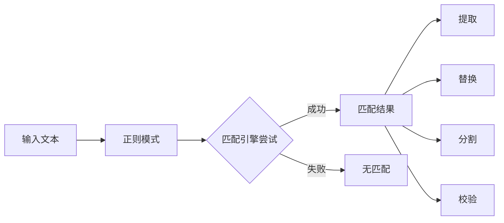
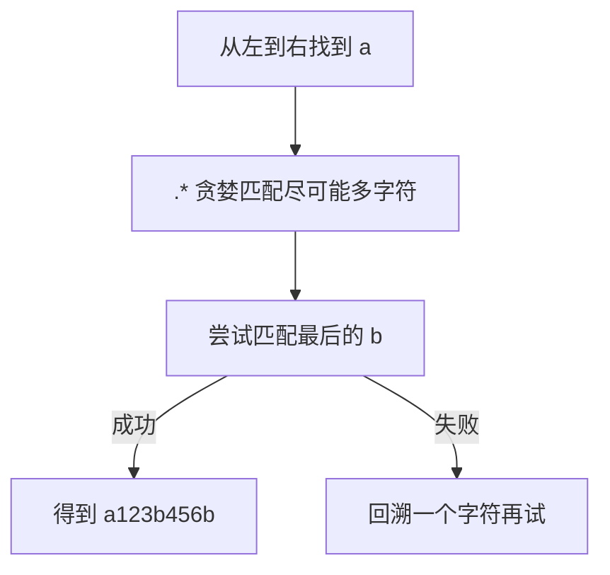
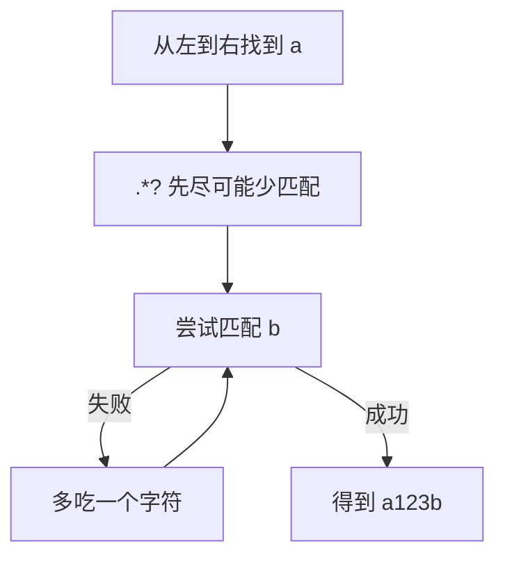
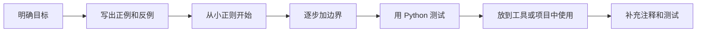

[toc]


## 正则表达式是什么

正则表达式，简称 regex / regexp，是一种**描述文本模式**的语言。它不是在“找某个固定字符串”，而是在“找符合某种规则的一类字符串”。

例如：

| 目标                     | 普通搜索       | 正则表达式                      |
| ------------------------ | -------------- | ------------------------------- |
| 找到 `cat`               | `cat`          | `cat`                           |
| 找到任意 4 位年份        | 很难用普通搜索 | `\d{4}`                         |
| 找到邮箱的大致形状       | 很难用普通搜索 | `[\w.-]+@[\w.-]+\.\w+`          |
| 找到 Markdown 标题       | 很难用普通搜索 | `^#{1,6}\s+.+$`                 |
| 把 `姓, 名` 改成 `名 姓` | 很难批量处理   | `(\w+),\s*(\w+)` 替换为 `\2 \1` |

Python 标准库使用 `re` 模块处理正则；它的模式和被搜索文本可以是 Unicode 字符串或 bytes，但二者不能混用。Python 官方也建议非平凡场景使用编译后的正则对象，并区分 `match()`、`search()`、`fullmatch()` 等不同匹配入口。([Python documentation](https://docs.python.org/3/library/re.html?utm_source=chatgpt.com))

------

## 学习正则的核心思维

不要把正则看成“神秘符号串”。它本质上由几类基本积木组成：



正则的常见用途可以归纳为：

| 用途 | 典型问题                           |
| ---- | ---------------------------------- |
| 搜索 | 日志里有没有错误码？               |
| 校验 | 用户输入是否像手机号、邮箱、日期？ |
| 提取 | 从文本中取出 IP、金额、时间、ID    |
| 替换 | 批量改格式、重命名、清洗文本       |
| 分割 | 按多个分隔符切开字符串             |
| 高亮 | 编辑器、搜索工具、语法分析辅助     |

------

## 字面量与元字符

最简单的正则就是普通文本：

| 正则    | 能匹配  |
| ------- | ------- |
| `cat`   | `cat`   |
| `hello` | `hello` |
| `2026`  | `2026`  |

但正则中有一些字符拥有特殊含义，称为**元字符**：

| 元字符  | 含义                         |
| ------- | ---------------------------- |
| `.`     | 任意单个字符，通常不含换行   |
| `*`     | 前一个元素重复 0 次或多次    |
| `+`     | 前一个元素重复 1 次或多次    |
| `?`     | 前一个元素重复 0 次或 1 次   |
| `{m,n}` | 前一个元素重复 m 到 n 次     |
| `[]`    | 字符集合                     |
| `()`    | 分组                         |
| `       | `                            |
| `^`     | 行首或字符串开头，取决于模式 |
| `$`     | 行尾或字符串结尾，取决于模式 |
| `\`     | 转义或特殊序列               |

如果你想匹配元字符本身，需要转义：

| 想匹配 | 正则 |
| ------ | ---- |
| `.`    | `\.` |
| `+`    | `\+` |
| `?`    | `\?` |
| `(`    | `\(` |
| `\`    | `\\` |

在 Python 里，正则经常写成**原始字符串**，也就是 `r"..."`。这样可以减少反斜杠被 Python 字符串本身先解释的问题。Python 文档也提示，普通字符串里的无效转义现在会产生 `SyntaxWarning`，未来会变成 `SyntaxError`，因此写正则时优先用原始字符串是现代 Python 的好习惯。([Python documentation](https://docs.python.org/3/library/re.html))

```python
import re

text = "price is $9.99"

print(re.search(r"\$9\.99", text).group())
```

------

## 字符类

字符类用于表示“这里可以是某一类字符”。

| 正则        | 含义                   | 示例                  |
| ----------- | ---------------------- | --------------------- |
| `[abc]`     | `a`、`b`、`c` 任意一个 | `cat` 可匹配 `c`      |
| `[a-z]`     | 小写英文字母           | `x`                   |
| `[A-Z]`     | 大写英文字母           | `Q`                   |
| `[0-9]`     | 数字                   | `7`                   |
| `[^0-9]`    | 非数字                 | `a`、空格             |
| `[A-Za-z_]` | 英文字母或下划线       | Python 标识符开头常用 |

常用简写：

| 简写 | 大致含义   |
| ---- | ---------- |
| `\d` | 数字       |
| `\D` | 非数字     |
| `\w` | 单词字符   |
| `\W` | 非单词字符 |
| `\s` | 空白字符   |
| `\S` | 非空白字符 |

在 Python 的 Unicode 字符串模式中，`\d` 默认匹配 Unicode 十进制数字，不只是 `[0-9]`；使用 `re.ASCII` 或内联 `(?a)` 时，`\d`、`\w`、`\s` 等会转成 ASCII 语义。([Python documentation](https://docs.python.org/3/library/re.html))

```python
import re

print(bool(re.fullmatch(r"\d+", "123")))     # True
print(bool(re.fullmatch(r"\d+", "１２３")))  # True，Unicode 全角数字
print(bool(re.fullmatch(r"\d+", "１２３", flags=re.ASCII)))  # False
```

新手容易误解的是：`[.]` 里面的 `.` 通常只是普通点号，而外面的 `.` 是“任意字符”。

```python
import re

print(re.findall(r"a.c", "abc a-c a.c"))    # ['abc', 'a-c', 'a.c']
print(re.findall(r"a[.]c", "abc a-c a.c"))  # ['a.c']
```

------

## 量词

量词控制前一个元素重复多少次。

| 量词    | 含义        |
| ------- | ----------- |
| `*`     | 0 次或多次  |
| `+`     | 1 次或多次  |
| `?`     | 0 次或 1 次 |
| `{n}`   | 正好 n 次   |
| `{m,}`  | 至少 m 次   |
| `{m,n}` | m 到 n 次   |

示例：

| 正则                | 能匹配                     |
| ------------------- | -------------------------- |
| `colou?r`           | `color`、`colour`          |
| `\d{4}`             | 4 位数字                   |
| `\d{4}-\d{2}-\d{2}` | `2026-05-26`               |
| `[A-Za-z_]\w*`      | 类似 Python 变量名的字符串 |

```python
import re

text = "id=7, id=42, id=1001"
print(re.findall(r"id=\d+", text))
```

输出：

```python
['id=7', 'id=42', 'id=1001']
```

------

## 贪婪、懒惰与占有量词

默认量词是**贪婪的**：能多吃就多吃。

```python
import re

html = "<b>one</b><b>two</b>"
print(re.findall(r"<b>.*</b>", html))
```

结果是：

```python
['<b>one</b><b>two</b>']
```

因为 `.*` 尽可能匹配到了最后一个 `</b>`。

加上 `?` 可以变成**懒惰量词**：

```python
import re

html = "<b>one</b><b>two</b>"
print(re.findall(r"<b>.*?</b>", html))
```

结果：

```python
['<b>one</b>', '<b>two</b>']
```

Python 现代版本还支持**占有量词**，例如 `*+`、`++`、`?+`、`{m,n}+`。它们也会尽量多匹配，但不会为后续失败而回溯；Python 文档称这些为 possessive quantifiers。Python 也支持原子组 `(?>...)`，该特性在 Python 3.11 加入。([Python documentation](https://docs.python.org/3/library/re.html))

| 类型   | 例子      | 行为                         |
| ------ | --------- | ---------------------------- |
| 贪婪   | `.*`      | 先多吃，失败后可回溯         |
| 懒惰   | `.*?`     | 先少吃，需要时再扩张         |
| 占有   | `.*+`     | 先多吃，失败也不吐回去       |
| 原子组 | `(?>...)` | 组内匹配完成后不回溯组内状态 |

占有量词和原子组常用于优化复杂正则，避免灾难性回溯，但新手不必一开始就滥用。

------

## 锚点与边界

锚点不匹配具体字符，而是匹配**位置**。

| 正则 | 含义                                     |
| ---- | ---------------------------------------- |
| `^`  | 字符串开头；多行模式下也可表示行首       |
| `$`  | 字符串结尾或行尾；多行模式下也可表示行尾 |
| `\A` | 整个字符串开头                           |
| `\z` | 整个字符串结尾，Python 3.14 新增         |
| `\b` | 单词边界                                 |
| `\B` | 非单词边界                               |

Python 3.14 文档中，`\z` 表示只匹配字符串末尾，`\Z` 为兼容旧版本而保留为相同语义。([Python documentation](https://docs.python.org/3/library/re.html))

例子：

```python
import re

text = "error\nwarning\nerror again"

print(re.findall(r"^error", text))
print(re.findall(r"^error", text, flags=re.MULTILINE))
```

输出：

```python
['error']
['error', 'error']
```

校验整个字符串时，Python 推荐用 `fullmatch()`，而不是手写 `^...$`。因为 `fullmatch()` 的意图更清晰，也避免多行、结尾换行等细节带来的误解。Python 官方文档明确区分：`match()` 只检查开头，`search()` 检查任意位置，`fullmatch()` 检查整个字符串。([Python documentation](https://docs.python.org/3/library/re.html))

```python
import re

pattern = r"\d{4}-\d{2}-\d{2}"

print(bool(re.search(pattern, "date=2026-05-26")))      # True
print(bool(re.match(pattern, "date=2026-05-26")))       # False
print(bool(re.fullmatch(pattern, "2026-05-26")))        # True
print(bool(re.fullmatch(pattern, "2026-05-26 extra")))  # False
```

------

## 分组

分组有几个用途：

| 用途             | 示例                      |
| ---------------- | ------------------------- |
| 把多个字符当整体 | `(ab)+`                   |
| 捕获内容         | `(\d{4})-(\d{2})-(\d{2})` |
| 后续引用         | `\1`、`\g<1>`             |
| 替换重排         | `\2/\3/\1`                |
| 只分组不捕获     | `(?:...)`                 |
| 命名捕获         | `(?P<name>...)`           |

普通捕获组：

```python
import re

m = re.search(r"(\d{4})-(\d{2})-(\d{2})", "today is 2026-05-26")

print(m.group(0))  # 完整匹配
print(m.group(1))  # 年
print(m.group(2))  # 月
print(m.group(3))  # 日
```

命名捕获更适合真实项目：

```python
import re

pattern = re.compile(r"(?P<year>\d{4})-(?P<month>\d{2})-(?P<day>\d{2})")
m = pattern.search("today is 2026-05-26")

print(m.group("year"))
print(m.groupdict())
```

输出：

```python
2026
{'year': '2026', 'month': '05', 'day': '26'}
```

命名组让代码更可读，尤其适合日志解析、配置解析、数据清洗。

------

## 或、优先级与非捕获组

`|` 表示“或者”。

```python
import re

print(re.findall(r"cat|dog", "cat dog bird"))
```

但要注意优先级：

| 正则        | 含义                         |
| ----------- | ---------------------------- |
| `cat        | dog`                         |
| `gr(a       | e)y`                         |
| `https?://` | 匹配 `http://` 或 `https://` |

如果只是为了控制范围，不想捕获，优先使用非捕获组 `(?:...)`：

```python
import re

pattern = r"https?://(?:www\.)?example\.com"
print(bool(re.search(pattern, "visit https://www.example.com")))
```

这样可以减少无意义捕获组，避免后续分组编号混乱。

------

## 前瞻、后顾与零宽断言

断言也是匹配“位置”，不消耗字符。

| 语法       | 名称     | 含义         |
| ---------- | -------- | ------------ |
| `(?=...)`  | 正向前瞻 | 后面必须满足 |
| `(?!...)`  | 负向前瞻 | 后面不能满足 |
| `(?<=...)` | 正向后顾 | 前面必须满足 |
| `(?<!...)` | 负向后顾 | 前面不能满足 |

例子：匹配后面跟着 `元` 的数字，但不把 `元` 包含进结果。

```python
import re

text = "苹果 8元，香蕉 12元，库存 30"
print(re.findall(r"\d+(?=元)", text))
```

输出：

```python
['8', '12']
```

例子：匹配不是以 `test_` 开头的函数名。

```python
import re

names = "test_login login logout test_logout"
print(re.findall(r"\b(?!test_)\w+\b", names))
```

注意：Python 标准 `re` 的后顾通常要求固定长度。复杂变长后顾可以考虑调整写法，或者在确有必要时使用第三方 `regex` 库。

------

## 反向引用

反向引用用于匹配“前面某个捕获组已经匹配到的内容”。

经典例子：匹配重复单词。

```python
import re

text = "this is is a test"
print(re.search(r"\b(\w+)\s+\1\b", text).group())
```

输出：

```python
is is
```

命名组也可以被引用：

```python
import re

text = "'hello' \"world\" 'broken\""
pattern = r"(?P<quote>['\"]).*?(?P=quote)"

print(re.findall(pattern, text))
```

注意：反向引用强大但可能降低性能，也不是所有工具都支持。例如 ripgrep 默认正则引擎不支持 look-around 和 backreferences，需要启用 PCRE2。([GitHub](https://github.com/burntsushi/ripgrep))

------

## 标志 flags

标志会改变正则的整体行为。

| Python flag     | 内联写法 | 作用                                  |
| --------------- | -------- | ------------------------------------- |
| `re.IGNORECASE` | `(?i)`   | 忽略大小写                            |
| `re.MULTILINE`  | `(?m)`   | `^`、`$` 按行工作                     |
| `re.DOTALL`     | `(?s)`   | `.` 可以匹配换行                      |
| `re.VERBOSE`    | `(?x)`   | 允许正则中写空白和注释                |
| `re.ASCII`      | `(?a)`   | 让 `\w`、`\d`、`\s` 等使用 ASCII 语义 |

示例：

```python
import re

text = "Error\nwarning\nERROR"

print(re.findall(r"^error", text, flags=re.IGNORECASE | re.MULTILINE))
```

------

## 可读性更好的 VERBOSE 模式

复杂正则不要硬写成一行。Python 的 `re.VERBOSE` 可以把正则写得像配置说明：

```python
import re

date_pattern = re.compile(
    r"""
    (?P<year>\d{4})   # 年
    -
    (?P<month>\d{2})  # 月
    -
    (?P<day>\d{2})    # 日
    """,
    flags=re.VERBOSE,
)

m = date_pattern.fullmatch("2026-05-26")
print(m.groupdict())
```

输出：

```python
{'year': '2026', 'month': '05', 'day': '26'}
```

真实项目里，复杂正则最好配合：

| 做法         | 好处                         |
| ------------ | ---------------------------- |
| 命名组       | 结果含义清晰                 |
| `re.VERBOSE` | 易读、易维护                 |
| 单元测试     | 防止误匹配                   |
| 小步骤组合   | 降低调试难度                 |
| 注释说明边界 | 让未来维护者知道为什么这样写 |

------

## Python 中的常用函数

| 函数             | 用途                   | 返回                   |
| ---------------- | ---------------------- | ---------------------- |
| `re.search()`    | 找任意位置的第一个匹配 | `Match` 或 `None`      |
| `re.match()`     | 只从字符串开头匹配     | `Match` 或 `None`      |
| `re.fullmatch()` | 整个字符串必须匹配     | `Match` 或 `None`      |
| `re.findall()`   | 找所有非重叠匹配       | 列表                   |
| `re.finditer()`  | 找所有非重叠匹配       | 迭代器，元素是 `Match` |
| `re.sub()`       | 替换                   | 新字符串               |
| `re.split()`     | 分割                   | 列表                   |
| `re.compile()`   | 编译正则               | `Pattern` 对象         |

Python 官方文档也强调，`match()`、`search()`、`fullmatch()` 是三种不同的基本操作，不应混用。([Python documentation](https://docs.python.org/3/library/re.html))

### search

```python
import re

m = re.search(r"\d+", "order id: 1024")
if m:
    print(m.group())
```

### findall

```python
import re

text = "a=1 b=22 c=333"
print(re.findall(r"\w+=\d+", text))
```

### finditer

`finditer()` 更适合需要位置、分组、逐个处理的场景：

```python
import re

text = "a=1 b=22 c=333"

for m in re.finditer(r"(?P<key>\w+)=(?P<value>\d+)", text):
    print(m.group("key"), m.group("value"), m.span())
```

### sub

```python
import re

text = "2026-05-26"
result = re.sub(r"(\d{4})-(\d{2})-(\d{2})", r"\3/\2/\1", text)
print(result)
```

输出：

```python
26/05/2026
```

替换时，推荐使用 `\g<name>` 或 `\g<1>`，可读性更好，也避免 `\10` 这种歧义：

```python
import re

text = "2026-05-26"
result = re.sub(
    r"(?P<year>\d{4})-(?P<month>\d{2})-(?P<day>\d{2})",
    r"\g<day>/\g<month>/\g<year>",
    text,
)
print(result)
```

### sub 使用函数替换

当替换逻辑比较复杂时，用函数：

```python
import re

def mask_email(match: re.Match) -> str:
    name = match.group("name")
    domain = match.group("domain")
    return name[0] + "***@" + domain

text = "contact alice@example.com or bob@test.org"
pattern = r"(?P<name>[\w.-]+)@(?P<domain>[\w.-]+\.\w+)"

print(re.sub(pattern, mask_email, text))
```

------

## 常见任务示例

### 提取日期

```python
import re

text = "created: 2026-05-26, updated: 2026-06-01"
pattern = r"\b\d{4}-\d{2}-\d{2}\b"

print(re.findall(pattern, text))
```

### 粗略校验邮箱

```python
import re

email_pattern = re.compile(r"^[A-Za-z0-9._%+-]+@[A-Za-z0-9.-]+\.[A-Za-z]{2,}$")

for email in ["a@example.com", "bad@", "x.y+z@test.co"]:
    print(email, bool(email_pattern.fullmatch(email)))
```

说明：这个邮箱正则适合“普通业务粗校验”，不等于完整 RFC 邮箱解析。真实系统一般还要结合发送验证邮件、DNS、业务规则。

### 提取日志字段

```python
import re

line = '2026-05-26 10:30:12 INFO user=alice action=login ip=192.168.1.8'

pattern = re.compile(
    r"""
    (?P<date>\d{4}-\d{2}-\d{2})\s+
    (?P<time>\d{2}:\d{2}:\d{2})\s+
    (?P<level>[A-Z]+)\s+
    user=(?P<user>\w+)\s+
    action=(?P<action>\w+)\s+
    ip=(?P<ip>\d{1,3}(?:\.\d{1,3}){3})
    """,
    re.VERBOSE,
)

m = pattern.fullmatch(line)
print(m.groupdict())
```

### 删除多余空白

```python
import re

text = "hello     world \t python\nregex"
print(re.sub(r"\s+", " ", text).strip())
```

### 拆分多个分隔符

```python
import re

text = "apple, banana; orange|pear"
print(re.split(r"[,;|]\s*", text))
```

------

## 常用工具中的正则

不同工具的正则**不是完全一样的**。这是新手最容易踩坑的地方。

| 工具               | 常见用途                | 注意点                                                 |
| ------------------ | ----------------------- | ------------------------------------------------------ |
| Python `re`        | 程序内校验、提取、替换  | 默认 Unicode；推荐 raw string；复杂场景用 `compile()`  |
| VS Code            | 当前文件或项目搜索替换  | 支持正则搜索；替换中常用 `$1`、`${name}` 风格          |
| GNU grep           | 命令行搜索文本          | 有 BRE、ERE、PCRE 等模式                               |
| ripgrep `rg`       | 快速代码搜索            | 默认跳过 gitignore、隐藏文件、二进制文件；可启用 PCRE2 |
| sed                | 命令行流式替换          | 更适合简单批量替换                                     |
| awk                | 文本列处理              | 正则常和字段处理结合                                   |
| JavaScript         | 前端与 Node.js 文本处理 | 正则是 `RegExp` 对象                                   |
| GitHub Code Search | 搜索仓库代码            | 正则用 `/.../` 包裹                                    |
| 数据库 SQL         | 文本过滤                | 各数据库差异大，不要假设通用                           |

GNU grep 官方文档说明，GNU grep 理解 basic、extended 和 Perl-compatible 三种正则语法；在 GNU grep 中，BRE 和 ERE 主要是不同记法，而其他实现可能不同。([gnu.org](https://www.gnu.org/s/grep/manual/html_node/Regular-Expressions.html?utm_source=chatgpt.com))

ripgrep 官方 README 说明，`rg` 默认递归搜索并尊重 `.gitignore`，会跳过隐藏文件和二进制文件；它默认使用 Rust regex 引擎，若要 look-around 和 backreferences，可用 `-P/--pcre2` 或自动混合引擎。([GitHub](https://github.com/burntsushi/ripgrep?utm_source=chatgpt.com))

VS Code 官方文档说明，VS Code 支持在搜索框中使用正则，并支持在当前文件和工作区中查找替换。([Visual Studio Code](https://code.visualstudio.com/docs/editing/codebasics?utm_source=chatgpt.com))

MDN 文档说明，JavaScript 中正则是 `RegExp` 对象，并可与 `exec()`、`test()`、字符串的 `match()`、`replace()`、`search()`、`split()` 等方法配合使用。([developer.mozilla.org](https://developer.mozilla.org/en-US/docs/Web/JavaScript/Guide/Regular_expressions?utm_source=chatgpt.com))

GitHub Code Search 文档说明，代码搜索支持正则，写法是用斜杠包裹，例如 `/sparse.*index/`。([GitHub](https://github.com/github/docs/blob/main/content/search-github/github-code-search/understanding-github-code-search-syntax.md?utm_source=chatgpt.com))

------

## VS Code 中的正则搜索替换

常用入口：

| 操作         | Windows / Linux | macOS          |
| ------------ | --------------- | -------------- |
| 当前文件查找 | `Ctrl+F`        | `Cmd+F`        |
| 当前文件替换 | `Ctrl+H`        | `Cmd+Option+F` |
| 全项目搜索   | `Ctrl+Shift+F`  | `Cmd+Shift+F`  |
| 全项目替换   | `Ctrl+Shift+H`  | `Cmd+Shift+H`  |

例子：把 Markdown 里的一级标题改成二级标题。

查找：

```regex
^# (.+)$
```

替换：

```text
## $1
```

例子：把 `姓, 名` 改成 `名 姓`。

查找：

```regex
(\w+),\s*(\w+)
```

替换：

```text
$2 $1
```

注意：VS Code 替换框里通常使用 `$1`、`$2` 引用捕获组，而 Python `re.sub()` 更常见的是 `\1`、`\g<1>` 或 `\g<name>`。这是工具差异，不是你记错了。

------

## grep 与 ripgrep

### grep

常见命令：

```bash
grep "error" app.log
grep -i "error" app.log
grep -n "error" app.log
grep -r "TODO" .
grep -E "error|warning" app.log
grep -P "\d{4}-\d{2}-\d{2}" app.log
```

| 参数 | 含义                        |
| ---- | --------------------------- |
| `-i` | 忽略大小写                  |
| `-n` | 显示行号                    |
| `-r` | 递归搜索目录                |
| `-E` | 使用扩展正则 ERE            |
| `-P` | 使用 PCRE，支持更多高级特性 |
| `-v` | 反选，不匹配的行            |
| `-o` | 只输出匹配部分              |

### ripgrep

ripgrep 更适合现代代码项目：

```bash
rg "TODO"
rg -n "TODO"
rg -i "error|warning"
rg -t py "import\s+requests"
rg -g "*.md" "^## "
rg -P "(?<=user=)\w+"
```

| 参数        | 含义                    |
| ----------- | ----------------------- |
| `-n`        | 显示行号                |
| `-i`        | 忽略大小写              |
| `-t py`     | 只搜 Python 文件        |
| `-g "*.md"` | glob 过滤               |
| `-P`        | 启用 PCRE2              |
| `--hidden`  | 搜隐藏文件              |
| `-uuu`      | 关闭多种默认过滤        |
| `--json`    | 输出 JSON，适合脚本处理 |

经验上，搜代码优先用 `rg`，系统脚本兼容性优先用 `grep`。

------

## sed 中的正则替换

`sed` 常用于命令行批量替换。

```bash
sed 's/error/warning/g' app.log
```

把日期从 `YYYY-MM-DD` 改成 `DD/MM/YYYY`：

```bash
sed -E 's/([0-9]{4})-([0-9]{2})-([0-9]{2})/\3\/\2\/\1/g' dates.txt
```

注意点：

| 点            | 说明                                   |
| ------------- | -------------------------------------- |
| `s/old/new/g` | 替换所有匹配                           |
| `-E`          | 使用扩展正则，少写反斜杠               |
| `\1`          | 替换中引用捕获组                       |
| 原地修改      | 不同系统 `sed -i` 行为有差异，谨慎使用 |

------

## awk 中的正则

`awk` 适合“按行 + 按列”处理文本。

找包含 `ERROR` 的行：

```bash
awk '/ERROR/' app.log
```

打印第二列：

```bash
awk '/ERROR/ {print $2}' app.log
```

按分隔符处理：

```bash
awk -F, '$3 ~ /active/ {print $1, $3}' users.csv
```

| awk 表达式      | 含义                   |
| --------------- | ---------------------- |
| `/regex/`       | 当前行匹配 regex       |
| `$3 ~ /regex/`  | 第三列匹配 regex       |
| `$3 !~ /regex/` | 第三列不匹配 regex     |
| `-F,`           | 使用逗号作为字段分隔符 |

------

## JavaScript 中的正则对照

Python：

```python
import re

bool(re.search(r"\d+", "abc123"))
```

JavaScript：

```javascript
/\d+/.test("abc123")
```

常见用法：

```javascript
const text = "id=42 name=alice";

console.log(/\d+/.test(text));
console.log(text.match(/\w+=\w+/g));
console.log(text.replace(/(\w+)=(\w+)/g, "$1: $2"));
```

和 Python 的主要差异：

| 主题       | Python          | JavaScript                |
| ---------- | --------------- | ------------------------- |
| 正则对象   | `re.Pattern`    | `RegExp`                  |
| 字面量     | `r"\d+"`        | `/\d+/`                   |
| 全局匹配   | `findall()`     | `/.../g`                  |
| 替换组引用 | `\g<1>`、`\1`   | `$1`                      |
| 命名组     | `(?P<name>...)` | `(?<name>...)`            |
| 标志       | `re.I`、`re.M`  | `/i`、`/m`、`/s`、`/u` 等 |

------

## 常见正则模式库

这些不是万能答案，但适合学习和改造。

| 目标          | 示例正则                                           | 说明                       |
| ------------- | -------------------------------------------------- | -------------------------- |
| 整数          | `^[+-]?\d+$`                                       | 可带正负号                 |
| 小数          | `^[+-]?(?:\d+.\d+                                  | \d+                        |
| 日期          | `^\d{4}-\d{2}-\d{2}$`                              | 只校验形状，不校验真实日期 |
| 时间          | `^\d{2}:\d{2}:\d{2}$`                              | 只校验形状                 |
| 标识符        | `^[A-Za-z_]\w*$`                                   | 类 Python 变量名           |
| 简单邮箱      | `^[A-Za-z0-9._%+-]+@[A-Za-z0-9.-]+\.[A-Za-z]{2,}$` | 业务粗校验                 |
| IPv4 粗略版   | `^\d{1,3}(?:\.\d{1,3}){3}$`                        | 不限制 0-255               |
| Markdown 标题 | `^#{1,6}\s+.+$`                                    | 多行时配合 `MULTILINE`     |
| URL 粗略版    | `https?://[^\s]+`                                  | 适合提取，不适合严格校验   |
| 多个空白      | `\s+`                                              | 清洗文本常用               |

更严格的 IPv4：

```regex
^(?:(?:25[0-5]|2[0-4]\d|1\d\d|[1-9]?\d)\.){3}(?:25[0-5]|2[0-4]\d|1\d\d|[1-9]?\d)$
```

这个例子说明：正则越严格，可读性和维护成本往往越高。真实项目里要权衡。

------

## 正则的匹配过程

以模式 `a.*b` 匹配文本 `a123b456b` 为例：



以模式 `a.*?b` 匹配同一文本：



理解“贪婪、懒惰、回溯”，是从入门走向熟练的关键。

------

## 灾难性回溯与性能陷阱

某些正则在失败时会尝试大量组合，导致运行极慢。典型危险模式：

```regex
^(a+)+$
```

遇到这种输入时可能很慢：

```text
aaaaaaaaaaaaaaaaaaaa!
```

原因是 `(a+)+` 存在嵌套重复，失败后引擎会尝试大量不同切分方式。

更安全的思路：

| 危险写法         | 改进方向                  |
| ---------------- | ------------------------- |
| `(.*)+`          | 避免重复嵌套              |
| `(a+)+`          | 改成单层量词              |
| `.*foo`          | 尽量加边界或限定字符      |
| `(.              | \n)*`                     |
| 复杂校验全靠正则 | 正则初筛 + 程序逻辑精校验 |

Python 现代版本可以用原子组或占有量词减少某些回溯，但最好的优化仍然是：写更明确、更窄的模式。

------

## 正则最佳实践

| 实践                             | 说明                                     |
| -------------------------------- | ---------------------------------------- |
| 优先写清楚边界                   | 例如 `\b`、`^`、`$`、`fullmatch()`       |
| 不要滥用 `.*`                    | 它经常过度匹配                           |
| 能用字符类就不用点号             | `[^\n]+` 往往比 `.+` 更明确              |
| 复杂正则用命名组                 | 代码更可读                               |
| 复杂正则用 `re.VERBOSE`          | 方便注释和维护                           |
| 先写测试样例                     | 包括应该匹配和不应该匹配的样例           |
| 注意工具方言                     | Python、JS、grep、rg、VS Code 不完全一样 |
| 用户输入要转义                   | 用 `re.escape()`                         |
| 校验整个字符串用 `fullmatch()`   | 比 `search()` 更准确                     |
| 不要用正则解析复杂 HTML/JSON/XML | 用专门解析器                             |

用户输入转义示例：

```python
import re

keyword = "a+b?"
text = "literal a+b? here"

pattern = re.escape(keyword)
print(bool(re.search(pattern, text)))
```

没有 `re.escape()` 时，`+` 和 `?` 会被当成正则语法，而不是普通字符。

------

## 学习路径建议

| 阶段   | 重点                            | 推荐练习                     |
| ------ | ------------------------------- | ---------------------------- |
| 入门   | 字面量、字符类、量词、锚点      | 找数字、日期、单词           |
| 进阶   | 分组、替换、flags、贪婪/懒惰    | 批量格式转换                 |
| 实战   | 命名组、`finditer()`、`VERBOSE` | 解析日志、清洗 CSV-like 文本 |
| 高级   | 前瞻后顾、回溯、性能优化        | 处理复杂边界和大文本         |
| 工具化 | grep、rg、VS Code、Python 脚本  | 项目内批量搜索替换           |

一个不错的训练方式是：每次写正则都准备三类样例。

| 样例类型   | 示例                           |
| ---------- | ------------------------------ |
| 应该匹配   | `2026-05-26`                   |
| 不应该匹配 | `2026-5-26`                    |
| 边界样例   | `x2026-05-26y`、换行、空字符串 |

------

## 一个完整练习：清洗日志

目标：从日志中提取时间、级别、用户和 IP。

```python
import re

logs = [
    "2026-05-26 10:30:12 INFO user=alice ip=192.168.1.8",
    "2026-05-26 10:31:01 ERROR user=bob ip=10.0.0.2",
    "bad line",
]

pattern = re.compile(
    r"""
    ^
    (?P<date>\d{4}-\d{2}-\d{2})
    \s+
    (?P<time>\d{2}:\d{2}:\d{2})
    \s+
    (?P<level>INFO|WARN|ERROR)
    \s+
    user=(?P<user>[A-Za-z_]\w*)
    \s+
    ip=(?P<ip>\d{1,3}(?:\.\d{1,3}){3})
    $
    """,
    re.VERBOSE,
)

records = []

for line in logs:
    m = pattern.fullmatch(line)
    if not m:
        continue
    records.append(m.groupdict())

print(records)
```

这个例子综合了：

| 技术点     | 对应写法                 |
| ---------- | ------------------------ |
| 整行匹配   | `^...$` 或 `fullmatch()` |
| 命名组     | `(?P<date>...)`          |
| 或         | `INFO                    |
| 非捕获组   | `(?:\.\d{1,3}){3}`       |
| 可读正则   | `re.VERBOSE`             |
| 结构化输出 | `groupdict()`            |

------

## 常见误区

| 误区                            | 正确理解                             |
| ------------------------------- | ------------------------------------ |
| 正则越短越好                    | 可读、可测、可维护更重要             |
| `.*` 可以解决一切               | 它经常造成过度匹配和性能问题         |
| `search()` 可以做校验           | 校验整个字符串应使用 `fullmatch()`   |
| 所有工具正则都一样              | Python、JS、grep、rg、VS Code 有差异 |
| 邮箱、URL 一个正则完全解决      | 真实业务通常需要正则初筛 + 逻辑验证  |
| 看到 `\w` 就等于 `[A-Za-z0-9_]` | 在 Python Unicode 模式下不一定       |
| 反向引用哪里都能用              | 很多高性能工具默认不支持             |
| 正则可以解析任意嵌套结构        | 复杂 HTML/XML/JSON 应使用解析器      |

------

## 速查表

| 目标          | 正则            |
| ------------- | --------------- |
| 数字          | `\d+`           |
| 非数字        | `\D+`           |
| 空白          | `\s+`           |
| 单词          | `\w+`           |
| 行首          | `^`             |
| 行尾          | `$`             |
| 单词边界      | `\b`            |
| 任意字符      | `.`             |
| 点号本身      | `\.`            |
| 0 次或多次    | `*`             |
| 1 次或多次    | `+`             |
| 可选          | `?`             |
| n 次          | `{n}`           |
| m 到 n 次     | `{m,n}`         |
| 字符集合      | `[abc]`         |
| 排除集合      | `[^abc]`        |
| 分组          | `(abc)`         |
| 非捕获组      | `(?:abc)`       |
| 命名组 Python | `(?P<name>...)` |
| 或            | `a              |
| 正向前瞻      | `(?=...)`       |
| 负向前瞻      | `(?!...)`       |
| 正向后顾      | `(?<=...)`      |
| 负向后顾      | `(?<!...)`      |

------

## 总结

正则学习的关键不是背所有符号，而是形成这个流程：



先掌握字符类、量词、分组、锚点、替换这五块，就已经能解决大部分日常问题。

高级特性如前瞻、后顾、原子组、占有量词，应在需要表达复杂边界或解决性能问题时再使用。