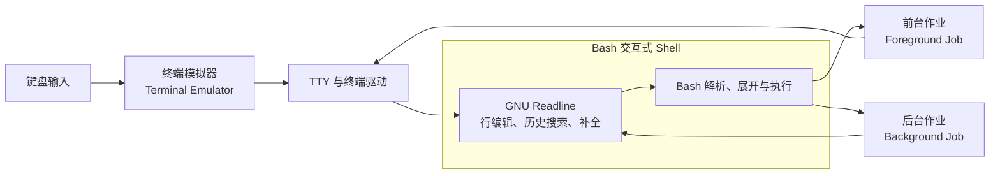

[toc]


# bash 交互式操作技巧

Bash 不仅是一种脚本语言，也是一套功能完整的交互式命令行环境。熟练使用 Bash，并不等于记住大量命令，而是能够高效完成以下操作：

- 快速移动和修改当前命令行
- 从历史记录中定位、修改并复用命令
- 利用补全机制减少输入和拼写错误
- 在多个目录之间快速切换
- 管理前台、后台和暂停状态的进程
- 判断命令究竟来自别名、函数、内建命令还是外部程序
- 通过 `~/.bashrc` 和 `~/.inputrc` 构建稳定的交互环境
- 在提高效率的同时，避免通配符、历史展开和危险别名带来的误操作

GNU Bash 的交互式命令行编辑主要由 GNU Readline 库提供。Readline 默认采用类似 Emacs 的快捷键，也支持 Vi 风格的编辑模式。本文按照 GNU Bash 5.3 参考手册整理；实际系统可能使用 Bash 4.x、5.1、5.2 或由发行版打过补丁的版本，因此配置前应先检查本机版本。([GNU](https://www.gnu.org/software/bash/manual/html_node/Command-Line-Editing.html?utm_source=chatgpt.com))

------

## 内容大纲

| 模块           | 学习目标                          | 核心内容                                       |
| -------------- | --------------------------------- | ---------------------------------------------- |
| 交互环境基础   | 理解终端、Bash 与 Readline 的关系 | 交互式 Shell、TTY、前台作业、提示符            |
| 当前命令行编辑 | 不重新输入整条命令即可完成修改    | 光标移动、按单词移动、删除、剪切、粘贴、撤销   |
| 历史记录       | 快速找到并复用以前执行过的命令    | `history`、`fc`、增量搜索、历史展开            |
| 自动补全       | 减少输入和拼写错误                | Tab 补全、Readline 补全设置、可编程补全        |
| 作业控制       | 管理长时间运行的交互式任务        | `jobs`、`fg`、`bg`、`disown`、信号             |
| 目录导航       | 在多个项目目录之间快速切换        | `cd -`、目录栈、`pushd`、`popd`、`CDPATH`      |
| 命令组合       | 在终端中组织复杂操作              | 管道、条件执行、后台执行、命令分组             |
| 命令解析       | 判断系统实际执行了什么            | `type`、`command`、`builtin`、`hash`           |
| 别名与函数     | 封装重复操作                      | `alias`、Shell 函数、参数处理                  |
| 通配符与展开   | 高效生成路径和参数                | Brace Expansion、Globbing、参数展开            |
| 提示符与配置   | 建立稳定、清晰的交互环境          | `PS1`、`PROMPT_COMMAND`、`.bashrc`、`.inputrc` |
| 安全与排错     | 避免交互式操作中的常见陷阱        | 历史泄密、通配符误删、快捷键冲突、配置失效     |

------

## 理解 Bash 的交互链路

很多所谓“Bash 快捷键”，严格来说并不是 Bash 自己实现的，而是由 Readline、终端模拟器和操作系统的终端驱动共同完成。



各部分的职责可以概括为：

- **终端模拟器（Terminal Emulator）**：显示字符、接收按键，例如 GNOME Terminal、Konsole、Windows Terminal、iTerm2。
- **TTY 或伪终端（Pseudo Terminal，PTY）**：维护前台进程组、终端属性和控制字符。
- **Bash**：解析命令、完成变量展开、通配符展开、重定向、管道和命令执行。
- **Readline**：处理当前命令行的光标移动、删除、撤销、历史搜索和补全。
- **前台作业**：当前占用终端并接收键盘信号的进程或管道。
- **后台作业**：由 Bash 管理，但不占据终端输入的进程或管道。

Bash 的交互式 Shell 默认启用 Readline、命令历史和作业控制。([GNU](https://www.gnu.org/software/bash/manual/html_node/Interactive-Shell-Behavior.html?utm_source=chatgpt.com))

------

## 确认当前使用的 Shell

在学习快捷键和配置文件前，先确认当前终端是否真的运行 Bash。

```bash
printf '当前进程名称：%s\n' "$0"
printf 'Bash 版本：%s\n' "$BASH_VERSION"
printf '当前进程 PID：%s\n' "$$"
```

更可靠地查看当前 Shell 进程：

```bash
ps -p "$$" -o pid=,comm=,args=
```

判断当前 Bash 是否是交互式 Shell：

```bash
if [[ $- == *i* ]]; then
    printf '当前是交互式 Bash\n'
else
    printf '当前不是交互式 Bash\n'
fi
```

判断是否为登录 Shell：

```bash
if shopt -q login_shell; then
    printf '当前是登录 Shell\n'
else
    printf '当前不是登录 Shell\n'
fi
```

需要特别注意：

```bash
echo "$SHELL"
```

`$SHELL` 通常表示用户账户配置的登录 Shell，不一定等于当前正在运行的 Shell。例如，用户可以从 Zsh 中临时运行 `bash`，此时 `$SHELL` 仍可能显示 Zsh。

查看当前编辑模式：

```bash
set -o | grep -E '^(emacs|vi)'
```

查看 Bash 的 Shell 选项：

```bash
set -o
```

查看 `shopt` 管理的 Bash 扩展选项：

```bash
shopt
```

查看 Readline 当前设置：

```bash
bind -V
```

Bash 官方建议通过特殊参数 `$-` 中是否包含 `i` 判断当前 Shell 是否具有交互属性。([GNU](https://www.gnu.org/software/bash/manual/html_node/Is-this-Shell-Interactive_003f.html?utm_source=chatgpt.com))

------

## 快捷键表示方法

GNU Readline 文档通常使用以下记法：

| 记法      | 含义                 | 常见写法                |
| --------- | -------------------- | ----------------------- |
| `C-a`     | 按住 Ctrl，再按 A    | `Ctrl+A`                |
| `M-b`     | 按住 Meta，再按 B    | 通常为 `Alt+B`          |
| `ESC b`   | 先按 Esc，松开后按 B | `Alt+B` 的替代方式      |
| `C-x C-e` | 依次按下两个组合键   | `Ctrl+X`，然后 `Ctrl+E` |
| `DEL`     | 删除光标左侧字符     | 通常是 Backspace        |
| `RET`     | 提交当前命令行       | Enter 或 Return         |

某些终端、桌面环境或窗口管理器会拦截 `Alt` 快捷键。遇到这种情况，可以用“先按 Esc，再按对应字符”的方式代替，例如：

```text
Alt+B 约等于 Esc，然后按 B
Alt+. 约等于 Esc，然后按 .
```

------

## 当前命令行中的光标移动

熟练移动光标，是提高 Bash 交互效率最重要的第一步。Readline 默认使用 Emacs 风格的快捷键。([GNU](https://www.gnu.org/s/bash/manual/html_node/Readline-Bare-Essentials.html?utm_source=chatgpt.com))

| 快捷键          | Readline 操作             | 作用                     |
| --------------- | ------------------------- | ------------------------ |
| `Ctrl+A`        | `beginning-of-line`       | 移动到行首               |
| `Ctrl+E`        | `end-of-line`             | 移动到行尾               |
| `Ctrl+B`        | `backward-char`           | 向左移动一个字符         |
| `Ctrl+F`        | `forward-char`            | 向右移动一个字符         |
| `Alt+B`         | `backward-word`           | 向左移动一个单词         |
| `Alt+F`         | `forward-word`            | 向右移动一个单词         |
| 左方向键        | `backward-char`           | 向左移动一个字符         |
| 右方向键        | `forward-char`            | 向右移动一个字符         |
| `Ctrl+L`        | `clear-display`           | 清屏并重新显示当前命令行 |
| `Ctrl+X Ctrl+X` | `exchange-point-and-mark` | 在光标与标记位置之间切换 |

例如，已经输入：

```bash
sudo systemctl restart nginx.service
```

发现开头不应使用 `sudo`，不必一直按退格键：

1. 按 `Ctrl+A` 到达行首。
2. 按 `Alt+D` 删除 `sudo`。
3. 继续修改或执行。

在长路径和长参数中，按单词移动通常比使用左右方向键更高效：

```bash
docker compose --project-directory /srv/example/project up --detach
```

使用 `Alt+B` 和 `Alt+F` 可以快速在 `docker`、`compose`、参数名和路径片段之间跳转。

------

## 删除、替换与撤销

### 基础删除操作

| 快捷键          | 作用                               |
| --------------- | ---------------------------------- |
| Backspace       | 删除光标左侧字符                   |
| `Ctrl+D`        | 删除光标所在位置的字符             |
| `Ctrl+T`        | 交换光标前的两个字符               |
| `Alt+T`         | 交换相邻的两个单词                 |
| `Alt+U`         | 将当前单词从光标处到词尾转换为大写 |
| `Alt+L`         | 将当前单词从光标处到词尾转换为小写 |
| `Alt+C`         | 将当前单词首字母转换为大写         |
| `Ctrl+_`        | 撤销上一次编辑                     |
| `Ctrl+X Ctrl+U` | 撤销上一次编辑                     |
| `Ctrl+C`        | 放弃当前命令行，返回新提示符       |

`Ctrl+_` 中的下划线在不少键盘上需要按：

```text
Ctrl+Shift+-
```

Readline 支持连续撤销，能够一直撤回到本次命令行开始编辑时的状态。([GNU](https://www.gnu.org/s/bash/manual/html_node/Readline-Bare-Essentials.html?utm_source=chatgpt.com))

### 使用外部编辑器编辑命令

当命令过长时，可以按：

```text
Ctrl+X Ctrl+E
```

这会调用 Readline 的 `edit-and-execute-command`，把当前命令放入外部编辑器。保存并退出编辑器后，Bash 会执行编辑后的命令。

编辑器通常由以下变量决定：

```bash
printf 'VISUAL=%s\n' "${VISUAL-}"
printf 'EDITOR=%s\n' "${EDITOR-}"
```

可以在 `~/.bashrc` 中设置：

```bash
export VISUAL=vim
export EDITOR=vim
```

或者：

```bash
export VISUAL=nano
export EDITOR=nano
```

这个功能特别适合：

- 很长的 `curl` 命令
- 包含多个管道和重定向的命令
- 较长的 SQL、Git 或 Docker 命令
- 需要重新排版的多行命令
- 需要仔细检查后再执行的管理命令

### 临时保存当前命令

按：

```text
Alt+#
```

Readline 会在当前命令前插入历史注释字符，通常是 `#`，并将其作为注释接受。这样可以暂时不执行命令，但仍把它保存到历史记录中。

例如已经输入一条复杂命令，临时需要执行其他操作：

```bash
find /srv/data -type f -mtime +30 -name '*.log' -delete
```

按 `Alt+#` 后，该命令会作为注释进入历史。稍后可以通过上方向键或 `Ctrl+R` 找回来，删除开头的 `#`，检查后再执行。

------

## 剪切、复制和粘贴

Readline 将“剪切”称为 **Kill**，将“粘贴”称为 **Yank**。被删除的内容会进入 Readline 的剪切环（Kill Ring），之后可以重新插入。连续执行的 Kill 操作通常会合并到一起。([GNU](https://www.gnu.org/s/bash/manual/html_node/Readline-Killing-Commands.html?utm_source=chatgpt.com))

| 快捷键          | 作用                                     |
| --------------- | ---------------------------------------- |
| `Ctrl+K`        | 删除从光标到行尾的内容                   |
| `Ctrl+U`        | 删除从光标到行首的内容                   |
| `Ctrl+W`        | 向左删除到前一个空白边界                 |
| `Alt+D`         | 删除从光标到当前或下一个单词末尾         |
| `Alt+Backspace` | 向左删除一个单词                         |
| `Ctrl+Y`        | 粘贴最近一次 Kill 的内容                 |
| `Alt+Y`         | 在执行 `Ctrl+Y` 后，轮换剪切环中的旧内容 |

示例：

```bash
sudo docker compose --project-name demo restart web
```

需要把前面的 `sudo docker compose` 移到其他位置：

1. 按 `Ctrl+A` 到达行首。
2. 连续使用 `Alt+D` 删除前三个单词。
3. 移动到目标位置。
4. 按 `Ctrl+Y` 粘贴。

### `Ctrl+W` 与 `Alt+Backspace` 的区别

二者都可以向左删除，但边界判断不同：

- `Ctrl+W` 主要按空白字符划分。
- `Alt+Backspace` 使用 Readline 的单词边界。

例如：

```bash
/path/to/my-project/file.txt
```

在路径末尾操作时，两者删除的范围可能不同。编辑路径时，通常值得分别尝试并形成自己的使用习惯。

------

## 快速复用上一条命令的参数

### 使用 `Alt+.`

`Alt+.` 会插入上一条命令的最后一个参数。

例如：

```bash
mkdir -p /srv/projects/example
```

下一条命令输入：

```bash
cd 
```

然后按 `Alt+.`，会得到：

```bash
cd /srv/projects/example
```

连续按 `Alt+.`，可以继续向更早的历史命令中查找最后一个参数。

如果 `Alt+.` 被终端拦截，可以按：

```text
Esc，然后按 .
```

### 使用 `$_`

Bash 的特殊参数 `$_` 通常保存上一条命令展开后的最后一个参数：

```bash
mkdir -p /srv/projects/example
cd -- "$_"
```

但 `$_` 与历史展开中的 `!$` 并不完全等价。`$_` 是当前 Shell 状态中的参数，而 `!$` 来自历史记录展开。

交互操作中：

- 想看见参数再执行，优先使用 `Alt+.`
- 想直接在组合命令中引用，可考虑 `$_`
- 想使用历史展开，应开启验证机制并先检查展开结果

------

## 历史记录的基本使用

Bash 在交互式 Shell 中默认启用命令历史。启动时从 `$HISTFILE` 读取历史，退出时将历史写回文件。默认历史文件通常是：

```bash
~/.bash_history
```

历史长度主要由以下变量控制：

```bash
printf 'HISTFILE=%s\n' "$HISTFILE"
printf 'HISTSIZE=%s\n' "$HISTSIZE"
printf 'HISTFILESIZE=%s\n' "$HISTFILESIZE"
```

其中：

- `HISTSIZE`：当前 Shell 内存中保留多少条历史。
- `HISTFILESIZE`：历史文件最多保留多少行。
- `HISTFILE`：历史文件路径。
- `HISTCONTROL`：控制哪些命令不写入历史。
- `HISTIGNORE`：通过模式排除特定命令。
- `HISTTIMEFORMAT`：控制 `history` 输出中的时间格式。

Bash 在保存历史时还会受 `histappend`、`cmdhist` 和 `lithist` 等选项影响。([GNU](https://www.gnu.org/s/bash/manual/html_node/Bash-History-Facilities.html?utm_source=chatgpt.com))

查看历史：

```bash
history
```

查看最近 20 条：

```bash
history 20
```

显示时间：

```bash
HISTTIMEFORMAT='%F %T  '
history 20
```

其中：

- `%F` 表示 `YYYY-MM-DD`
- `%T` 表示 `HH:MM:SS`

可以在 `~/.bashrc` 中永久配置：

```bash
HISTTIMEFORMAT='%F %T  '
```

------

## 使用方向键和前缀搜索历史

最简单的历史操作是：

| 快捷键   | 作用           |
| -------- | -------------- |
| 上方向键 | 上一条历史命令 |
| 下方向键 | 下一条历史命令 |
| `Ctrl+P` | 上一条历史命令 |
| `Ctrl+N` | 下一条历史命令 |

默认的上、下方向键通常按时间顺序浏览整个历史，并不会自动根据已经输入的内容筛选。

例如输入：

```bash
git
```

然后按上方向键，默认情况下不一定只显示以 `git` 开头的命令。

可以在 `~/.inputrc` 中把方向键改为前缀搜索：

```text
$if Bash
"\e[A": history-search-backward
"\e[B": history-search-forward
$endif
```

重新加载：

```bash
bind -f ~/.inputrc
```

之后输入：

```bash
docker
```

再按上方向键，Readline 会优先寻找以 `docker` 开头的历史命令。

这种配置非常适合经常重复使用以下命令的场景：

- `git ...`
- `docker ...`
- `kubectl ...`
- `ssh ...`
- `systemctl ...`
- `journalctl ...`

------

## 使用 `Ctrl+R` 搜索历史

`Ctrl+R` 启动反向增量搜索（Reverse Incremental Search）。

操作流程：

1. 按 `Ctrl+R`。
2. 输入命令中的任意片段。
3. 再按一次 `Ctrl+R`，继续寻找更早的匹配。
4. 按左右方向键，进入匹配结果并继续编辑。
5. 按 Enter，直接执行。
6. 按 `Ctrl+G` 或 `Ctrl+C`，取消搜索。

例如，曾经执行过：

```bash
journalctl -u nginx.service --since today --no-pager
```

按 `Ctrl+R` 后输入：

```text
nginx
```

即可定位包含 `nginx` 的历史命令。

常见相关快捷键：

| 快捷键          | 作用               |
| --------------- | ------------------ |
| `Ctrl+R`        | 向后增量搜索       |
| 再次按 `Ctrl+R` | 查找更早的匹配     |
| `Ctrl+S`        | 向前增量搜索       |
| `Ctrl+G`        | 取消当前搜索       |
| 左右方向键      | 接受结果并开始编辑 |
| Enter           | 接受并执行结果     |

Readline 提供历史搜索功能，但 `Ctrl+S` 可能被终端的 XON/XOFF 软件流控制拦截。([GNU](https://www.gnu.org/software/bash/manual/html_node/Searching.html?utm_source=chatgpt.com))

### `Ctrl+S` 导致终端“冻结”

如果误按 `Ctrl+S` 后终端不再输出，通常不是 Bash 卡死，而是终端启用了 XON/XOFF 流控制：

- `Ctrl+S`：暂停输出
- `Ctrl+Q`：恢复输出

先按：

```text
Ctrl+Q
```

如不需要软件流控制，可以在当前终端关闭：

```bash
stty -ixon
```

恢复：

```bash
stty ixon
```

如希望每次启动 Bash 都关闭，可以把以下命令放入交互式 `~/.bashrc`：

```bash
stty -ixon 2>/dev/null
```

关闭后，`Ctrl+S` 才更可能正常传递给 Readline，用于正向历史搜索。

------

## 使用 `history` 管理历史记录

常用操作：

```bash
history 20
```

查看最近 20 条。

```bash
history -d 1234
```

删除历史编号为 `1234` 的条目。

```bash
history -c
```

清空当前 Shell 内存中的历史。

```bash
history -w
```

把当前内存历史写入历史文件。

```bash
history -a
```

把当前会话中新产生的历史追加到历史文件。

```bash
history -n
```

读取历史文件中当前会话尚未读取的新条目。

```bash
history -r
```

从历史文件读取内容，并追加到当前历史列表。

这些操作由 Bash 的 `history` 内建命令提供。([GNU](https://www.gnu.org/s/bash/manual/html_node/Bash-History-Builtins.html?utm_source=chatgpt.com))

### 删除历史时的注意事项

执行：

```bash
history -d 1234
```

只修改当前 Shell 内存中的历史列表。为了让修改反映到历史文件，通常还需要：

```bash
history -w
```

但如果同时打开了多个 Bash 会话，直接重写历史文件可能覆盖其他会话产生的内容。因此，多终端场景应先设计统一的历史同步策略，而不是随意执行 `history -w`。

------

## 使用 `fc` 编辑和重放历史

`fc` 是 Bash 中经常被忽略但非常强大的历史命令。

查看最近几条历史，不显示编号：

```bash
fc -ln -10
```

列出指定范围：

```bash
fc -l 1000 1010
```

打开最近一条命令进行编辑：

```bash
fc
```

指定编辑器：

```bash
FCEDIT=vim fc
```

重新执行上一条命令，并替换其中的字符串：

```bash
fc -s old=new
```

例如上一条命令是：

```bash
systemctl status ngnix
```

可以执行：

```bash
fc -s ngnix=nginx
```

从历史中查找最近以 `docker` 开头的命令，并执行替换：

```bash
fc -s compose='compose --ansi never' docker
```

`fc` 的优势在于：

- 可以先编辑，再执行
- 不依赖复杂的 `!` 历史展开语法
- 适合修改长命令
- 可以明确指定历史范围
- 可以调用熟悉的文本编辑器

Bash 官方将 `fc` 定义为用于列出、编辑并重新执行历史命令的内建工具。([GNU](https://www.gnu.org/s/bash/manual/html_node/Bash-History-Facilities.html?utm_source=chatgpt.com))

------

## 历史展开

Bash 支持类似 C Shell 的历史展开（History Expansion）。它通常以 `!` 开头。([GNU](https://www.gnu.org/s/bash/manual/html_node/History-Interaction.html?utm_source=chatgpt.com))

### 事件选择符

| 写法       | 含义                        |
| ---------- | --------------------------- |
| `!!`       | 上一条命令                  |
| `!-2`      | 倒数第二条命令              |
| `!123`     | 历史编号为 123 的命令       |
| `!git`     | 最近一条以 `git` 开头的命令 |
| `!?nginx?` | 最近一条包含 `nginx` 的命令 |
| `!#`       | 当前命令行已经输入的部分    |

示例：

```bash
apt update
sudo !!
```

展开后相当于：

```bash
sudo apt update
```

### 参数选择符

| 写法    | 含义                         |
| ------- | ---------------------------- |
| `!^`    | 上一条命令的第一个参数       |
| `!$`    | 上一条命令的最后一个参数     |
| `!*`    | 上一条命令的全部参数         |
| `!:0`   | 上一条命令的命令名           |
| `!:2`   | 上一条命令的第二个参数       |
| `!:2-4` | 上一条命令的第二到第四个参数 |

例如：

```bash
tar -xf archive.tar.gz -C /srv/data
```

随后：

```bash
ls -la !$
```

会展开为：

```bash
ls -la /srv/data
```

### 快速替换

```bash
^旧内容^新内容^
```

例如：

```bash
systemctl status ngnix
^ngnix^nginx^
```

相当于重新执行：

```bash
systemctl status nginx
```

### 只显示展开结果，不执行

```bash
!!:p
```

或者：

```bash
!docker:p
```

`:p` 会打印展开后的命令，并将其加入历史，但不立即执行。

### 推荐开启 `histverify`

历史展开的主要风险是：按 Enter 后，展开结果可能立即执行，用户未必看清实际内容。

建议在 `~/.bashrc` 中开启：

```bash
shopt -s histverify
```

开启后，在使用 Readline 时，历史展开结果会先出现在当前命令行，供用户检查和修改，而不是直接交给解析器执行。([GNU](https://www.gnu.org/s/bash/manual/html_node/History-Interaction.html?utm_source=chatgpt.com))

### 历史展开的最佳实践

历史展开适合熟悉 Bash 的用户，但新手应优先使用：

- `Ctrl+R`
- 上方向键
- `Alt+.`
- `fc`
- `history`

尤其是涉及以下命令时，应避免盲目使用 `!!`：

```bash
rm
mv
chmod
chown
dd
mkfs
iptables
nft
kubectl delete
docker system prune
```

执行前先让命令回到编辑区，确认参数、路径、通配符和重定向方向。

关闭历史展开：

```bash
set +H
```

重新启用：

```bash
set -H
```

------

## 配置更实用的历史记录

可以在 `~/.bashrc` 中加入：

```bash
HISTSIZE=10000
HISTFILESIZE=20000
HISTCONTROL=ignoreboth
HISTTIMEFORMAT='%F %T  '

shopt -s histappend
shopt -s cmdhist
shopt -s histverify
```

含义如下：

| 配置                 | 作用                                   |
| -------------------- | -------------------------------------- |
| `HISTSIZE=10000`     | 当前 Bash 会话保存 10000 条历史        |
| `HISTFILESIZE=20000` | 历史文件最多保存 20000 行              |
| `ignoreboth`         | 同时启用 `ignorespace` 和 `ignoredups` |
| `histappend`         | 退出时追加历史，而不是覆盖历史文件     |
| `cmdhist`            | 尽量把多行命令保存为一个历史条目       |
| `histverify`         | 历史展开后先进入编辑区                 |
| `HISTTIMEFORMAT`     | `history` 输出显示时间                 |

`ignoreboth` 包含：

- `ignorespace`：以空格开头的命令不进入历史。
- `ignoredups`：不连续保存两条完全相同的命令。

需要注意，以空格开头不写入 Bash 历史并不等于“安全输入秘密”。命令仍可能出现在：

- 进程参数
- 审计日志
- 终端回滚缓冲区
- 远程会话日志
- 应用自身日志
- Shell 会话记录工具

因此，不应直接把密码、访问令牌和私钥内容写在命令行中。

### 多终端同步历史

当同时打开多个 Bash 窗口时，可以在每次显示提示符前：

1. 把当前会话的新历史追加到文件。
2. 读取其他会话刚追加的历史。

```bash
__bash_sync_history() {
    history -a
    history -n
}

PROMPT_COMMAND+=('__bash_sync_history')
```

这里利用了 Bash 的 `PROMPT_COMMAND`：其中的命令会在显示主提示符 `PS1` 前执行。较新的 Bash 支持把 `PROMPT_COMMAND` 定义为数组，按顺序执行其中各项。([GNU](https://www.gnu.org/software/bash/manual/html_node/Bash-Variables.html?utm_source=chatgpt.com))

多终端同步后的历史顺序反映的是写入历史文件的先后顺序，不一定严格等于不同终端中命令开始或结束的真实时间。

------

## Tab 补全

按 Tab 是 Bash 交互中收益最高的习惯之一。

常见行为：

- 补全命令名
- 补全文件和目录
- 补全变量名
- 补全用户名
- 补全主机名
- 补全支持可编程补全的命令参数

例如：

```bash
sys<Tab>
```

可能补全为：

```bash
systemctl
```

输入：

```bash
cd /var/lo<Tab>
```

可能补全为：

```bash
cd /var/log/
```

当存在多个候选项时：

- 第一次 Tab：补全共同前缀
- 再按 Tab：列出候选项

Readline 会先检查当前命令是否定义了可编程补全；否则再按变量、用户名、主机名、命令或文件名等规则处理。([GNU](https://www.gnu.org/s/bash/manual/html_node/Commands-For-Completion.html?utm_source=chatgpt.com))

### 查看当前补全定义

查看所有可编程补全：

```bash
complete -p
```

查看某个命令：

```bash
complete -p git
```

若没有输出，说明当前 Shell 中可能没有为该命令加载专门的补全定义。

生成命令名候选：

```bash
compgen -A command -- sys
```

生成目录候选：

```bash
compgen -A directory -- /var/l
```

生成变量候选：

```bash
compgen -A variable -- BAS
```

Bash 使用 `complete` 定义补全规则，使用 `compgen` 生成候选项，使用 `compopt` 在补全过程中调整选项。([GNU](https://www.gnu.org/software/bash/manual/html_node/Programmable-Completion-Builtins.html?utm_source=chatgpt.com))

------

## 编写简单的可编程补全

假设有一个自定义命令：

```bash
serve start
serve stop
serve restart
serve status
serve logs
```

可以为它编写补全函数：

```bash
_serve_complete() {
    local current

    current=${COMP_WORDS[COMP_CWORD]}

    mapfile -t COMPREPLY < <(
        compgen -W 'start stop restart status logs' -- "$current"
    )
}

complete -F _serve_complete serve
```

输入：

```bash
serve st<Tab>
```

可以补全或列出：

```text
start
status
stop
```

补全函数中常见变量：

| 变量              | 含义                                 |
| ----------------- | ------------------------------------ |
| `COMP_WORDS`      | 当前命令行按补全规则拆分后的单词数组 |
| `COMP_CWORD`      | 当前正在补全的单词索引               |
| `COMP_LINE`       | 当前完整命令行                       |
| `COMP_POINT`      | 当前光标在命令行中的位置             |
| `COMPREPLY`       | 补全函数返回的候选数组               |
| `COMP_WORDBREAKS` | Readline 用来划分单词的字符集合      |

这些变量只在可编程补全函数或相关上下文中具有特殊意义。([GNU](https://www.gnu.org/software/bash/manual/html_node/Bash-Variables.html?utm_source=chatgpt.com))

------

## 配置 Readline 补全行为

Readline 的用户级配置文件通常是：

```bash
~/.inputrc
```

可以加入：

```text
$if Bash

set editing-mode emacs
set completion-ignore-case on
set show-all-if-ambiguous on
set mark-directories on
set colored-stats on

"\e[A": history-search-backward
"\e[B": history-search-forward

"\C-x\C-r": re-read-init-file

$endif
```

常见设置说明：

| 设置                        | 作用                         |
| --------------------------- | ---------------------------- |
| `editing-mode emacs`        | 使用 Emacs 风格编辑模式      |
| `completion-ignore-case on` | 补全文件时忽略大小写         |
| `show-all-if-ambiguous on`  | 存在多个候选时直接显示       |
| `mark-directories on`       | 在补全结果中的目录后添加 `/` |
| `colored-stats on`          | 根据文件类型显示颜色         |
| `history-search-backward`   | 按已输入前缀向后搜索历史     |
| `history-search-forward`    | 按已输入前缀向前搜索历史     |

修改后重新加载：

```bash
bind -f ~/.inputrc
```

或者使用已经绑定的：

```text
Ctrl+X Ctrl+R
```

Readline 的配置文件支持变量设置、按键绑定和 `$if` 条件结构。`bind -p` 可以输出适合写回配置文件的绑定格式。([GNU](https://www.gnu.org/software/bash/manual/html_node/Readline-Init-File-Syntax.html?utm_source=chatgpt.com))

------

## 查看和修改快捷键绑定

列出当前 Readline 函数及其快捷键：

```bash
bind -P
```

输出更适合配置文件的格式：

```bash
bind -p
```

查询某个函数绑定了哪些按键：

```bash
bind -q backward-word
```

查询历史搜索：

```bash
bind -q reverse-search-history
```

临时绑定快捷键：

```bash
bind '"\C-o": clear-display'
```

解除某个按键：

```bash
bind -r '"\C-o"'
```

重新读取 `~/.inputrc`：

```bash
bind -f ~/.inputrc
```

把快捷键绑定到 Shell 命令：

```bash
bind -x '"\C-g":git status --short'
```

此后按 `Ctrl+G` 会执行：

```bash
git status --short
```

但需要注意，`Ctrl+G` 默认常用于取消 Readline 操作。覆盖标准快捷键可能破坏已有习惯，应优先选择未占用的组合键。

`bind -x` 执行时，Bash 会提供：

- `READLINE_LINE`
- `READLINE_POINT`
- `READLINE_MARK`
- `READLINE_ARGUMENT`

修改这些变量，可以直接修改当前编辑中的命令行。([GNU](https://www.gnu.org/s/bash/manual/html_node/Bash-Builtins.html?utm_source=chatgpt.com))

例如，为当前命令添加 `sudo `前缀：

```bash
__prepend_sudo() {
    if [[ $READLINE_LINE != sudo\ * ]]; then
        READLINE_LINE="sudo $READLINE_LINE"
        (( READLINE_POINT += 5 ))
    fi
}

bind -x '"\C-x\C-s":__prepend_sudo'
```

按 `Ctrl+X Ctrl+S` 后：

```bash
systemctl restart nginx
```

会变成：

```bash
sudo systemctl restart nginx
```

------

## Emacs 模式与 Vi 模式

Readline 默认使用 Emacs 模式，也支持 Vi 模式。([GNU](https://www.gnu.org/software/bash/manual/html_node/Readline-vi-Mode.html?utm_source=chatgpt.com))

临时切换到 Emacs 模式：

```bash
set -o emacs
```

临时切换到 Vi 模式：

```bash
set -o vi
```

永久设置可以写入 `~/.bashrc`：

```bash
set -o vi
```

也可以在 `~/.inputrc` 中设置：

```text
set editing-mode vi
```

### 两种模式的选择

| 模式       | 特点                       | 更适合                                  |
| ---------- | -------------------------- | --------------------------------------- |
| Emacs 模式 | 所有操作基本通过组合键完成 | 新手、默认 Bash 用户、快捷键驱动型用户  |
| Vi 模式    | 区分插入模式和命令模式     | 已熟悉 Vim、希望复用 Vim 操作习惯的用户 |

### Vi 模式常用操作

进入 Vi 模式后，每次开始输入通常处于插入模式。

按 Esc 进入命令模式。

| 按键 | 作用                       |
| ---- | -------------------------- |
| `i`  | 在当前位置进入插入模式     |
| `a`  | 在当前位置之后进入插入模式 |
| `I`  | 在行首进入插入模式         |
| `A`  | 在行尾进入插入模式         |
| `0`  | 移动到行首                 |
| `$`  | 移动到行尾                 |
| `h`  | 向左移动                   |
| `l`  | 向右移动                   |
| `w`  | 向前移动一个单词           |
| `b`  | 向后移动一个单词           |
| `x`  | 删除当前字符               |
| `dw` | 删除一个单词               |
| `cw` | 修改一个单词               |
| `D`  | 删除到行尾                 |
| `C`  | 修改到行尾                 |
| `u`  | 撤销                       |
| `k`  | 上一条历史                 |
| `j`  | 下一条历史                 |
| `/`  | 向后搜索历史               |
| `v`  | 使用外部编辑器编辑当前命令 |

Readline 的 Vi 模式并不等同于完整 Vim，但提供了足够的基本行编辑功能。([GNU](https://www.gnu.org/software/bash/manual/html_node/Readline-vi-Mode.html?utm_source=chatgpt.com))

------

## 命令连接与条件执行

### 顺序执行

```bash
command1; command2
```

无论 `command1` 成功还是失败，都会继续执行 `command2`。

例如：

```bash
cd /srv/app; ls -la
```

### 前一个命令成功才继续

```bash
command1 && command2
```

例如：

```bash
mkdir -p build && cd build
```

只有目录创建成功，才会进入该目录。

### 前一个命令失败才执行

```bash
command1 || command2
```

例如：

```bash
ping -c 1 server.example.com || printf '服务器不可达\n' >&2
```

### 组合成功与失败分支

```bash
command \
    && printf '执行成功\n' \
    || printf '执行失败\n' >&2
```

这种写法只有在中间成功分支本身不会失败时，才可近似理解为 `if/else`。更可靠的写法是：

```bash
if command; then
    printf '执行成功\n'
else
    printf '执行失败\n' >&2
fi
```

### 管道

```bash
journalctl -u nginx.service | grep 'error'
```

前一个命令的标准输出进入后一个命令的标准输入。

同时传递标准输出和标准错误：

```bash
command |& less
```

大体相当于：

```bash
command 2>&1 | less
```

在 Markdown 表格中书写管道时，需要转义竖线；普通代码块中则不需要。

### 在当前 Shell 中分组

```bash
{
    cd /srv/app || return
    printf '当前目录：%s\n' "$PWD"
    ls -la
}
```

大括号组在当前 Shell 环境中执行。末尾命令后需要有分号或换行。

### 在子 Shell 中分组

```bash
(
    cd /srv/app || exit
    export APP_ENV=test
    ./run-tests
)
```

圆括号中的目录变化和变量修改不会影响外层 Bash。

------

## 退出状态

大多数命令都会返回一个退出状态（Exit Status）：

- `0` 通常表示成功
- 非 `0` 表示失败或其他状态

查看上一条命令的退出状态：

```bash
printf '%s\n' "$?"
```

例如：

```bash
grep 'root' /etc/passwd
printf 'grep 状态：%s\n' "$?"
```

应在目标命令执行后立即读取 `$?`，因为任何后续命令都会覆盖它。

保存退出状态：

```bash
command
status=$?

printf '退出状态：%d\n' "$status"
```

GNU 工具通常以零表示成功、非零表示失败，但具体非零值的含义由各命令自行定义。([GNU](https://www.gnu.org/software/coreutils/manual/html_node/Exit-status.html?utm_source=chatgpt.com))

### 管道状态

默认情况下：

```bash
command1 | command2 | command3
```

整个管道的状态通常取决于最后一个命令。

临时开启：

```bash
set -o pipefail
```

开启后，管道返回最右侧失败命令的状态；若所有命令成功，则返回零。Bash 默认关闭 `pipefail`。([GNU](https://www.gnu.org/s/bash/manual/bash.html?utm_source=chatgpt.com))

查看每个管道元素的状态：

```bash
command1 | command2 | command3
printf '%s\n' "${PIPESTATUS[@]}"
```

必须立即读取 `PIPESTATUS`，因为后续命令会更新它。

------

## 作业控制

作业控制（Job Control）允许用户暂停、继续、前台运行或后台运行一个进程或管道。

Bash 把一条管道视为一个作业，并为其分配作业编号。([GNU](https://www.gnu.org/s/bash/manual/html_node/Job-Control-Basics.html?utm_source=chatgpt.com))

### 直接后台运行

```bash
long-running-command &
```

例如：

```bash
find /srv -type f -name '*.log' >files.txt 2>find.err &
```

Bash 通常会输出：

```text
[1] 25647
```

其中：

- `1` 是作业编号
- `25647` 是相关进程的 PID

查看作业：

```bash
jobs
```

显示 PID：

```bash
jobs -l
```

只显示正在运行的作业：

```bash
jobs -r
```

只显示暂停的作业：

```bash
jobs -s
```

### 暂停前台作业

当前台程序正在运行时，按：

```text
Ctrl+Z
```

终端会向前台进程组发送暂停信号，Bash 随后重新获得终端控制权。

查看：

```bash
jobs
```

可能显示：

```text
[1]+  Stopped    vim large-file.txt
```

让作业在后台继续：

```bash
bg %1
```

让作业回到前台：

```bash
fg %1
```

如果只有一个当前作业，也可以直接：

```bash
bg
```

或：

```bash
fg
```

Bash 使用 `bg`、`fg`、`jobs` 和 `kill` 等内建命令管理作业。([GNU](https://www.gnu.org/software/bash/manual/html_node/Job-Control-Builtins.html?utm_source=chatgpt.com))

### 常见作业标识

| 写法         | 含义                         |
| ------------ | ---------------------------- |
| `%1`         | 作业编号 1                   |
| `%2`         | 作业编号 2                   |
| `%+` 或 `%%` | 当前作业                     |
| `%-`         | 上一个作业                   |
| `%vim`       | 命令行以 `vim` 开头的作业    |
| `%?server`   | 命令行中包含 `server` 的作业 |

### 终止作业

发送默认终止信号：

```bash
kill %1
```

发送中断信号：

```bash
kill -INT %1
```

发送强制终止信号：

```bash
kill -KILL %1
```

`SIGKILL` 不允许进程执行清理操作，只应作为程序无法正常退出时的最后手段。

### 等待后台作业

等待指定作业结束：

```bash
wait %1
```

等待指定 PID：

```bash
wait "$pid"
```

等待当前 Shell 的所有后台任务：

```bash
wait
```

获取刚启动后台任务的 PID：

```bash
long-running-command &
pid=$!

printf '后台 PID：%s\n' "$pid"
wait "$pid"
status=$?

printf '后台任务状态：%d\n' "$status"
```

### `disown`

将作业从 Bash 的作业表中移除：

```bash
disown %1
```

保留在作业表中，但标记为 Shell 收到 `SIGHUP` 时不向它发送该信号：

```bash
disown -h %1
```

需要理解的是：

- `cmd &` 只是后台运行。
- `disown` 主要修改 Bash 对作业的管理。
- `disown -h` 不等于完整的会话持久化方案。
- 程序仍可能依赖当前终端的输入、输出或控制终端。
- SSH 断开、终端关闭或系统服务管理策略仍可能影响进程。

对必须长期运行的任务，更稳妥的方案通常是：

- `systemd`
- `tmux`
- `screen`
- 容器编排系统
- 专门的进程管理器

这些工具不属于 Bash 本身。

------

## 常用终端控制键

| 快捷键   | 常见作用                                 |
| -------- | ---------------------------------------- |
| `Ctrl+C` | 向前台作业发送中断信号，或取消当前命令行 |
| `Ctrl+Z` | 暂停前台作业                             |
| `Ctrl+\` | 向前台作业发送退出信号                   |
| `Ctrl+D` | 发送 EOF；空命令行时可能退出 Shell       |
| `Ctrl+S` | 在启用 XON/XOFF 时暂停终端输出           |
| `Ctrl+Q` | 恢复被 XON/XOFF 暂停的输出               |
| `Ctrl+L` | 清屏并重绘当前命令行                     |

### 防止误按 `Ctrl+D` 退出

在空命令行按 `Ctrl+D` 时，Bash 会读取到 EOF，通常退出当前 Shell。

可临时开启：

```bash
set -o ignoreeof
```

关闭：

```bash
set +o ignoreeof
```

也可以设置允许连续按多少次 `Ctrl+D` 后退出：

```bash
IGNOREEOF=3
```

如果 `IGNOREEOF` 设为非数字或空值，默认阈值通常是 10。该行为只影响交互式 Shell。([GNU](https://www.gnu.org/s/bash/manual/bash.html?utm_source=chatgpt.com))

不应把 `ignoreeof` 当作安全机制，它只是防止误操作。需要退出时仍可使用：

```bash
exit
```

------

## 快速切换目录

### 返回主目录

```bash
cd
```

或者：

```bash
cd ~
```

### 返回上一个目录

```bash
cd -
```

例如：

```bash
cd /srv/project-a
cd /var/log
cd -
```

会返回：

```text
/srv/project-a
```

再次执行 `cd -`，会在两个目录间来回切换。

相关变量：

```bash
printf 'PWD=%s\n' "$PWD"
printf 'OLDPWD=%s\n' "$OLDPWD"
```

### 使用目录栈

Bash 提供目录栈（Directory Stack）：

```bash
pushd /srv/project-a
pushd /var/log
pushd /etc/nginx
```

查看目录栈：

```bash
dirs
```

每行显示，并附带编号：

```bash
dirs -v
```

示例输出：

```text
0  /etc/nginx
1  /var/log
2  /srv/project-a
3  ~
```

切换到编号 2：

```bash
pushd +2
```

弹出栈顶并进入新的栈顶目录：

```bash
popd
```

删除指定栈元素：

```bash
popd +2
```

清空目录栈：

```bash
dirs -c
```

当前目录始终是目录栈的第一个元素。`pushd` 会添加或旋转目录栈，`popd` 会移除元素，`dirs` 用于显示目录栈。([GNU](https://www.gnu.org/software/bash/manual/html_node/Directory-Stack-Builtins.html?utm_source=chatgpt.com))

### 使用 `CDPATH`

`CDPATH` 类似目录导航专用的 `PATH`。

例如：

```bash
CDPATH=.:~/projects:/srv/projects
```

此后：

```bash
cd example
```

Bash 会依次寻找：

```text
./example
~/projects/example
/srv/projects/example
```

建议保留开头的 `.`：

```bash
CDPATH=.:~/projects:/srv/projects
```

否则当前目录中的同名子目录可能不会优先匹配。

`CDPATH` 会改变 `cd` 的查找行为，有时还会使 `cd` 输出最终路径。它适合个人交互环境，但不建议未经控制地导出给脚本：

```bash
CDPATH=.:~/projects:/srv/projects
```

通常不必：

```bash
export CDPATH
```

------

## 目录导航相关 `shopt` 选项

开启自动进入目录：

```bash
shopt -s autocd
```

之后直接输入目录名：

```bash
/srv/project
```

如果它是目录，Bash 会将其视为：

```bash
cd /srv/project
```

开启轻微拼写修正：

```bash
shopt -s cdspell
```

例如：

```bash
cd /srv/proejct
```

Bash 可能尝试修正为：

```text
/srv/project
```

开启补全时目录拼写修正：

```bash
shopt -s dirspell
```

让补全后的目录名直接更新到当前命令行：

```bash
shopt -s direxpand
```

建议新手谨慎开启 `autocd` 和 `cdspell`。它们虽然方便，但会改变错误命令的表现，可能掩盖拼写习惯问题。

------

## 判断一个命令究竟是什么

同一个名称可能对应：

- 别名
- Shell 函数
- Bash 内建命令
- 哈希缓存中的外部命令
- `$PATH` 中的可执行文件

使用：

```bash
type ls
```

查看所有可能来源：

```bash
type -a ls
```

示例：

```text
ls is aliased to `ls --color=auto'
ls is /usr/bin/ls
ls is /bin/ls
```

查看更详细描述：

```bash
command -V ls
```

判断命令是否存在：

```bash
if command -v git >/dev/null 2>&1; then
    printf 'git 可用\n'
fi
```

脚本中检查命令是否存在，通常优先使用：

```bash
command -v command_name
```

而不是依赖外部 `which`。

原因是 `type` 和 `command -v` 能理解 Bash 的：

- 别名
- 函数
- 内建命令
- 关键字
- 外部程序

Bash 查找命令时，会先考虑函数和内建命令，再根据 `$PATH` 查找外部可执行文件，并可能使用内部哈希表缓存路径。([GNU](https://www.gnu.org/software/bash/manual/html_node/Command-Search-and-Execution.html?utm_source=chatgpt.com))

### 绕过别名

```bash
\ls
```

或者：

```bash
command ls
```

### 绕过函数，使用内建命令或外部命令

如果定义了同名函数：

```bash
cd() {
    printf '自定义 cd\n'
}
```

调用 Bash 内建 `cd`：

```bash
builtin cd /tmp
```

调用外部命令并绕过同名函数：

```bash
command printf '%s\n' hello
```

不过 `printf` 本身也可能是 Bash 内建命令；`command` 主要绕过函数和别名，并不强制选择外部程序。

明确执行外部路径：

```bash
/usr/bin/printf '%s\n' hello
```

### 刷新命令路径缓存

安装、移动或替换程序后，Bash 可能仍记着旧路径。

清空全部哈希缓存：

```bash
hash -r
```

查看缓存：

```bash
hash
```

查看某个命令的缓存路径：

```bash
hash -t python
```

------

## 别名的正确使用方式

别名（Alias）适合简单、固定的文本替换。

```bash
alias ll='ls -alF'
alias la='ls -A'
alias l='ls -CF'
```

查看别名：

```bash
alias
```

查看某个别名：

```bash
alias ll
```

删除别名：

```bash
unalias ll
```

删除所有别名：

```bash
unalias -a
```

### 适合别名的场景

```bash
alias gs='git status --short --branch'
alias gd='git diff'
alias ..='cd ..'
alias ...='cd ../..'
alias c='clear'
```

### 不适合别名的场景

需要参数判断、循环、条件或局部变量时，不应强行使用别名。

错误思路：

```bash
alias mkcd='mkdir -p "$1" && cd "$1"'
```

别名没有独立的 `$1` 参数上下文。

应改用函数：

```bash
mkcd() {
    if [[ $# -ne 1 ]]; then
        printf '用法：mkcd DIRECTORY\n' >&2
        return 2
    fi

    mkdir -p -- "$1" && cd -- "$1"
}
```

### 别名值末尾的空格

如果别名展开值以空格结尾，Bash 会继续尝试对下一个单词进行别名展开。([GNU](https://www.gnu.org/s/bash/manual/html_node/Bash-Builtins.html?utm_source=chatgpt.com))

例如：

```bash
alias sudo='sudo '
alias ll='ls -alF'
```

输入：

```bash
sudo ll
```

下一个单词 `ll` 也可能继续展开。

这种技巧有用，但会增加命令展开的隐蔽性，应控制使用范围。

### 避免危险别名

不建议使用会悄悄改变关键命令语义的别名，例如：

```bash
alias rm='rm -rf'
alias cp='cp -f'
alias mv='mv -f'
```

这些别名会放大误操作风险。

即使是：

```bash
alias rm='rm -i'
```

也可能让用户形成“删除前总会询问”的错误预期。当切换到脚本、容器、远程服务器或其他账户时，这种保护可能不存在。

更好的方式是：

- 明确输入选项
- 使用回收站工具
- 对危险操作编写具名函数
- 执行前检查通配符展开结果
- 对重要目录使用权限、快照或版本管理保护

------

## 使用 Shell 函数封装操作

函数比别名更适合需要参数和逻辑的任务。

### 创建并进入目录

```bash
mkcd() {
    if [[ $# -ne 1 ]]; then
        printf '用法：mkcd DIRECTORY\n' >&2
        return 2
    fi

    mkdir -p -- "$1" && cd -- "$1"
}
```

### 返回 Git 仓库根目录

```bash
croot() {
    local root

    root=$(git rev-parse --show-toplevel 2>/dev/null) || {
        printf '当前目录不在 Git 仓库中\n' >&2
        return 1
    }

    cd -- "$root"
}
```

### 创建备份

```bash
backup() {
    if [[ $# -ne 1 ]]; then
        printf '用法：backup FILE\n' >&2
        return 2
    fi

    cp -a -- "$1" "$1.bak"
}
```

### 解压常见归档文件

```bash
extract() {
    if [[ $# -ne 1 || ! -f $1 ]]; then
        printf '用法：extract ARCHIVE\n' >&2
        return 2
    fi

    case $1 in
        *.tar.gz|*.tgz)
            tar -xzf -- "$1"
            ;;
        *.tar.bz2|*.tbz2)
            tar -xjf -- "$1"
            ;;
        *.tar.xz|*.txz)
            tar -xJf -- "$1"
            ;;
        *.tar)
            tar -xf -- "$1"
            ;;
        *.zip)
            unzip -- "$1"
            ;;
        *.gz)
            gzip -dk -- "$1"
            ;;
        *)
            printf '不支持的归档格式：%s\n' "$1" >&2
            return 1
            ;;
    esac
}
```

函数中的最佳实践：

- 参数展开通常使用双引号：`"$1"`
- 文件参数前使用 `--`
- 失败时使用 `return`，不要在交互函数中随意 `exit`
- 错误信息写入标准错误：`>&2`
- 用 `local` 限制临时变量作用域
- 保留被调用命令的退出状态
- 不要依赖未声明的全局变量

------

## 花括号展开

花括号展开（Brace Expansion）可以快速生成多个字符串。

### 创建多个目录

```bash
mkdir -p project/{src,tests,docs,config}
```

展开为：

```text
project/src
project/tests
project/docs
project/config
```

### 创建分层目录

```bash
mkdir -p project/{src,tests}/{unit,integration}
```

### 创建备份

```bash
cp -- nginx.conf{,.bak}
```

展开为：

```bash
cp -- nginx.conf nginx.conf.bak
```

### 批量生成数字

```bash
touch file-{01..10}.txt
```

### 指定步长

```bash
printf '%s\n' {0..20..5}
```

输出：

```text
0
5
10
15
20
```

花括号展开是纯文本生成，不会检查对应文件是否存在。

例如：

```bash
mv report.{txt,md}
```

首先展开为：

```bash
mv report.txt report.md
```

这表示重命名，而不是匹配两种扩展名。

------

## 文件名通配符

Bash 的文件名展开（Filename Expansion）常称为 Globbing。

| 模式     | 含义                     |
| -------- | ------------------------ |
| `*`      | 匹配任意长度字符串       |
| `?`      | 匹配任意单个字符         |
| `[abc]`  | 匹配集合中的一个字符     |
| `[0-9]`  | 匹配指定范围             |
| `[!abc]` | 匹配不在集合中的一个字符 |

例如：

```bash
printf '%s\n' -- *.log
printf '%s\n' -- file-?.txt
printf '%s\n' -- image-[0-9].png
```

### 执行危险命令前先预览

不要直接执行：

```bash
rm -rf -- /srv/data/*
```

先查看展开结果：

```bash
printf '<%q>\n' /srv/data/*
```

确认无误后再执行。

`%q` 会以可重新作为 Shell 输入的形式显示参数，有助于看清：

- 空格
- 制表符
- 换行符
- 引号
- 通配符
- 特殊字符

### `nullglob`

默认情况下，如果通配符没有匹配到文件，模式可能保持为原样：

```bash
printf '%s\n' -- *.not-exist
```

可能输出：

```text
*.not-exist
```

开启：

```bash
shopt -s nullglob
```

未匹配的模式会被删除，不产生参数。

这在数组中很有用：

```bash
shopt -s nullglob

files=(./*.log)

printf '匹配数量：%d\n' "${#files[@]}"
```

但也要注意：

```bash
rm -- *.log
```

如果没有匹配项，启用 `nullglob` 后可能变成：

```bash
rm --
```

不同命令对此有不同反应，因此仍需检查参数。

### `failglob`

开启：

```bash
shopt -s failglob
```

如果模式没有匹配，Bash 会报错并拒绝执行当前命令。([GNU](https://www.gnu.org/s/bash/manual/html_node/Filename-Expansion.html?utm_source=chatgpt.com))

这对交互式防错很有价值：

```bash
rm -- *.lg
```

如果本来想写 `*.log`，`failglob` 可以避免把错误模式原样传给程序。

但 `failglob` 会改变条件、函数和命令替换中的控制流程，不建议不加评估地全局启用。

### `globstar`

开启：

```bash
shopt -s globstar
```

之后：

```bash
**/*.log
```

可以递归匹配当前目录及子目录中的 `.log` 文件。([GNU](https://www.gnu.org/s/bash/manual/html_node/Pattern-Matching.html?utm_source=chatgpt.com))

预览：

```bash
printf '%s\n' -- **/*.log
```

递归目录很大时，`globstar` 展开可能生成大量参数。此时更适合使用：

```bash
find . -type f -name '*.log'
```

------

## 扩展通配符

开启扩展通配符：

```bash
shopt -s extglob
```

之后可以使用：

| 模式         | 含义                     |
| ------------ | ------------------------ |
| `?(pattern)` | 匹配零次或一次           |
| `*(pattern)` | 匹配零次或多次           |
| `+(pattern)` | 匹配一次或多次           |
| `@(pattern)` | 匹配其中一个模式         |
| `!(pattern)` | 匹配不符合指定模式的内容 |

例如匹配 `.jpg` 或 `.png`：

```bash
printf '%s\n' -- *.@(jpg|png)
```

在 Markdown 表格外的代码块中，竖线可直接书写。

匹配除 `.bak` 外的文件：

```bash
printf '%s\n' -- !(*.bak)
```

扩展通配符功能强大，但模式可读性会迅速下降。复杂筛选任务通常更适合：

- `find`
- `case`
- 数组
- 明确的条件判断

Bash 只有在开启 `extglob` 后才识别这些扩展模式。([GNU](https://www.gnu.org/s/bash/manual/html_node/The-Shopt-Builtin.html?utm_source=chatgpt.com))

------

## 引号与交互式安全

### 单引号

```bash
printf '%s\n' '$HOME'
```

输出字面量：

```text
$HOME
```

单引号内部几乎不进行 Shell 展开，也不能直接包含单引号本身。

### 双引号

```bash
printf '%s\n' "$HOME"
```

会进行参数展开，但通常不会进行单词分割和文件名展开。

路径和变量参数通常应写为：

```bash
cd -- "$directory"
cp -- "$source" "$destination"
rm -- "$file"
```

### 不加引号

```bash
printf '%s\n' $variable
```

可能发生：

- 参数展开
- 单词分割
- 文件名展开

交互环境中有时会刻意利用这些行为，但不应形成无条件省略引号的习惯。

### ANSI-C 引号

```bash
printf '%s' $'line1\nline2\n'
```

`$'...'` 支持：

- `\n`
- `\t`
- `\r`
- `\xNN`
- `\uNNNN`
- `\UNNNNNNNN`

### 处理以连字符开头的文件名

假设文件名是：

```text
-rf
```

危险写法：

```bash
rm -rf
```

正确写法：

```bash
rm -- -rf
```

或：

```bash
rm ./-rf
```

`--` 表示后续内容不再作为选项解析，这是交互式文件操作中非常重要的习惯。

------

## 多行命令

当 Bash 检测到命令尚未完整时，会显示次级提示符 `PS2`，默认常为：

```text
>
```

例如：

```bash
printf '%s\n' \
> one \
> two \
> three
```

反斜杠加换行表示续行。

也可以在语法结构中自然换行：

```bash
if [[ -f /etc/nginx/nginx.conf ]]; then
    printf '配置存在\n'
else
    printf '配置不存在\n'
fi
```

管道可以放在行尾：

```bash
journalctl -u nginx.service |
    grep -i error |
    tail -n 20
```

逻辑操作符也可放在行尾：

```bash
mkdir -p /srv/project &&
    cd /srv/project &&
    printf '当前目录：%s\n' "$PWD"
```

如果意外进入多行提示符，通常是因为：

- 引号没有闭合
- 括号没有闭合
- `if` 缺少 `fi`
- `case` 缺少 `esac`
- `for` 或 `while` 缺少 `done`
- 行尾存在反斜杠
- Here Document 尚未遇到终止标记

可以按：

```text
Ctrl+C
```

放弃当前未完成命令。

------

## 重定向的交互技巧

### 覆盖输出文件

```bash
command >output.txt
```

### 追加输出

```bash
command >>output.txt
```

### 重定向标准错误

```bash
command 2>error.log
```

### 同时保存标准输出和标准错误

```bash
command >all.log 2>&1
```

在 Bash 中也可以写：

```bash
command &>all.log
```

追加：

```bash
command &>>all.log
```

### 一边显示，一边保存

```bash
command 2>&1 | tee output.log
```

追加：

```bash
command 2>&1 | tee -a output.log
```

### 丢弃输出

只丢弃标准输出：

```bash
command >/dev/null
```

只丢弃标准错误：

```bash
command 2>/dev/null
```

全部丢弃：

```bash
command >/dev/null 2>&1
```

### 防止意外覆盖文件

开启 `noclobber`：

```bash
set -o noclobber
```

此时：

```bash
printf 'new\n' >existing-file
```

可能因文件已存在而失败。

确实需要覆盖时：

```bash
printf 'new\n' >|existing-file
```

关闭：

```bash
set +o noclobber
```

------

## 进程替换与命令替换

### 命令替换

```bash
current_branch=$(git branch --show-current)
printf '当前分支：%s\n' "$current_branch"
```

命令替换会捕获命令的标准输出，并删除末尾连续换行。

不建议使用旧式反引号：

```bash
current_branch=`git branch --show-current`
```

优先使用：

```bash
current_branch=$(git branch --show-current)
```

原因包括：

- 嵌套更清晰
- 引号更容易处理
- 可读性更好

### 进程替换

比较两个命令的输出：

```bash
diff <(sort file1.txt) <(sort file2.txt)
```

把命令输出当作输入文件：

```bash
while IFS= read -r line; do
    printf '读取：%s\n' "$line"
done < <(find . -maxdepth 1 -type f -print)
```

进程替换是 Bash 扩展，并非所有 `/bin/sh` 都支持。

------

## 提示符配置

Bash 的主提示符由 `PS1` 控制。

查看：

```bash
printf '%s\n' "$PS1"
```

常见转义：

| 写法 | 含义                            |
| ---- | ------------------------------- |
| `\u` | 当前用户名                      |
| `\h` | 短主机名                        |
| `\H` | 完整主机名                      |
| `\w` | 当前完整目录，主目录缩写为 `~`  |
| `\W` | 当前目录的最后一级              |
| `\t` | 24 小时时间                     |
| `\A` | 小时和分钟                      |
| `\d` | 日期                            |
| `\j` | 当前作业数量                    |
| `\!` | 历史编号                        |
| `\#` | 当前会话命令编号                |
| `\$` | 普通用户显示 `$`，root 显示 `#` |
| `\n` | 换行                            |
| `\[` | 非打印字符序列开始              |
| `\]` | 非打印字符序列结束              |

([GNU](https://www.gnu.org/software/bash/manual/html_node/Controlling-the-Prompt.html?utm_source=chatgpt.com))

### 简洁提示符

```bash
PS1='\u@\h:\w\$ '
```

效果类似：

```text
alice@server:~/project$
```

限制路径显示层级：

```bash
PROMPT_DIRTRIM=3
PS1='\u@\h:\w\$ '
```

较长路径会只保留末尾若干层级。

### 带颜色的提示符

```bash
PS1='\[\e[1;32m\]\u@\h\[\e[0m\]:\[\e[1;34m\]\w\[\e[0m\]\$ '
```

颜色控制序列必须放在：

```text
\[
\]
```

之间，告诉 Readline 这些字符不占显示宽度。

如果漏掉 `\[` 和 `\]`，可能出现：

- 长命令换行位置错误
- 光标覆盖已有字符
- 历史命令重绘错位
- 删除字符时显示异常

### 使用 `PROMPT_COMMAND`

`PROMPT_COMMAND` 中的内容会在显示每个主提示符前执行。

例如显示上一条命令的失败状态：

```bash
__prompt_status() {
    local status=$?

    if (( status != 0 )); then
        printf '\n上一条命令退出状态：%d\n' "$status" >&2
    fi
}

PROMPT_COMMAND+=('__prompt_status')
```

编写 `PROMPT_COMMAND` 时要注意：

- 它每次显示提示符都会执行。
- 不要放入缓慢的网络请求。
- 不要每次扫描大型 Git 仓库。
- 不要覆盖系统或其他插件已有的 `PROMPT_COMMAND`。
- 优先追加函数，而不是直接覆盖变量。
- 函数开头应立即保存 `$?`，否则会丢失上一条命令状态。

------

## `~/.bashrc` 与启动文件

交互式非登录 Bash 通常读取：

```bash
~/.bashrc
```

交互式登录 Bash通常依次检查：

```text
~/.bash_profile
~/.bash_login
~/.profile
```

并读取第一个存在且可读的文件。

因此，常见做法是在 `~/.bash_profile` 中主动加载 `~/.bashrc`：

```bash
if [[ -f ~/.bashrc ]]; then
    . ~/.bashrc
fi
```

登录 Shell 和非登录 Shell 的启动文件规则不同，是“配置写了但没有生效”的常见原因。([GNU](https://www.gnu.org/software/bash/manual/html_node/Bash-Startup-Files?utm_source=chatgpt.com))

### 重新加载配置

```bash
source ~/.bashrc
```

`.` 是 `source` 的 POSIX 风格同义写法：

```bash
. ~/.bashrc
```

重新读取配置前，建议先检查语法：

```bash
bash -n ~/.bashrc
```

如果没有输出，通常表示未发现语法错误。

### 交互式保护

某些环境可能在非交互上下文读取 `~/.bashrc`。因此可以在文件开头加入：

```bash
case $- in
    *i*)
        ;;
    *)
        return
        ;;
esac
```

这样别名、提示符、`stty` 和 Readline 设置只在交互式 Bash 中运行。

------

## 一份实用的 `~/.bashrc` 基础模板

```bash
# 仅用于交互式 Bash
case $- in
    *i*)
        ;;
    *)
        return
        ;;
esac

# 历史记录
HISTSIZE=10000
HISTFILESIZE=20000
HISTCONTROL=ignoreboth
HISTTIMEFORMAT='%F %T  '

shopt -s histappend
shopt -s cmdhist
shopt -s histverify

# 每次显示提示符前同步历史
__bash_sync_history() {
    history -a
    history -n
}

PROMPT_COMMAND+=('__bash_sync_history')

# 目录导航
shopt -s cdspell
shopt -s direxpand

# 可选：递归通配符
shopt -s globstar

# 防止 Ctrl+S 暂停输出
if [[ -t 0 ]]; then
    stty -ixon 2>/dev/null
fi

# 提示符
PROMPT_DIRTRIM=3
PS1='\u@\h:\w\$ '

# 常用别名
alias ll='ls -alF'
alias la='ls -A'
alias l='ls -CF'
alias ..='cd ..'
alias ...='cd ../..'

# 创建并进入目录
mkcd() {
    if [[ $# -ne 1 ]]; then
        printf '用法：mkcd DIRECTORY\n' >&2
        return 2
    fi

    mkdir -p -- "$1" && cd -- "$1"
}

# 返回 Git 仓库根目录
croot() {
    local root

    root=$(git rev-parse --show-toplevel 2>/dev/null) || {
        printf '当前目录不在 Git 仓库中\n' >&2
        return 1
    }

    cd -- "$root"
}
```

重新加载：

```bash
source ~/.bashrc
```

配置前建议备份：

```bash
cp -- ~/.bashrc ~/.bashrc.bak
```

还可以把个人配置纳入 Git 管理，但应避免提交：

- 密码
- 访问令牌
- 私钥
- 内网地址
- 个人身份信息
- 机器专属秘密变量

------

## 一份实用的 `~/.inputrc` 基础模板

```text
$if Bash

set editing-mode emacs

set completion-ignore-case on
set show-all-if-ambiguous on
set mark-directories on
set colored-stats on

"\e[A": history-search-backward
"\e[B": history-search-forward

"\C-x\C-r": re-read-init-file

$endif
```

重新加载：

```bash
bind -f ~/.inputrc
```

查看是否生效：

```bash
bind -V
bind -q history-search-backward
```

`.bashrc` 与 `.inputrc` 的分工可以概括为：

| 文件         | 主要负责                                            |
| ------------ | --------------------------------------------------- |
| `~/.bashrc`  | Bash 变量、函数、别名、Shell 选项、提示符、历史配置 |
| `~/.inputrc` | Readline 编辑模式、快捷键、补全和行编辑行为         |

------

## 不建议在交互式 Shell 中全局开启的设置

### `set -e`

```bash
set -e
```

`errexit` 的规则存在大量语法上下文例外。在交互式 Shell 中全局启用，不会简单地变成“出错就停止”，反而可能让函数、条件链和命令替换出现难以预测的控制流。

需要测试严格模式时，更适合启动临时子 Shell：

```bash
bash
set -e
```

用完后退出：

```bash
exit
```

### `set -u`

```bash
set -u
```

访问未定义变量时会报错。交互环境中的提示符、补全函数和发行版脚本未必都兼容这一选项。

脚本中可根据需要使用，但不建议不加评估地写入全局 `~/.bashrc`。

### 全局修改 `IFS`

不要在交互环境中长期修改：

```bash
IFS=:
```

`IFS` 会影响单词分割、`read` 和大量 Shell 代码。

应在局部范围使用：

```bash
while IFS=: read -r user _ uid _; do
    printf '%s %s\n' "$user" "$uid"
done </etc/passwd
```

### 把当前目录放到 `$PATH` 前面

危险配置：

```bash
PATH=.:$PATH
```

这会使当前目录中的同名恶意程序优先于系统命令。

更安全的做法是：

- 不把 `.` 加入 `$PATH`
- 明确使用 `./program`
- 把个人脚本放到 `~/.local/bin`
- 将可信目录放入 `$PATH`

例如：

```bash
PATH="$HOME/.local/bin:$PATH"
export PATH
```

------

## 常见故障排查

| 现象                          | 常见原因                                        | 处理方法                                             |
| ----------------------------- | ----------------------------------------------- | ---------------------------------------------------- |
| 按 `Ctrl+S` 后终端不输出      | XON/XOFF 暂停输出                               | 按 `Ctrl+Q`；必要时执行 `stty -ixon`                 |
| 按 `Ctrl+D` 退出 Shell        | 空行发送 EOF                                    | 使用 `set -o ignoreeof` 或 `IGNOREEOF=3`             |
| `Alt+B`、`Alt+F` 无效         | 终端或桌面拦截 Alt                              | 使用 Esc 前缀；检查终端键盘设置                      |
| 方向键出现 `^[[A`             | Readline 未启用、终端类型异常或程序处于特殊模式 | 检查是否为交互 Bash、`TERM` 和编辑模式               |
| 修改 `.bashrc` 后无效         | 文件未重新加载，或当前是登录 Shell              | 执行 `source ~/.bashrc`；检查 `.bash_profile`        |
| 新安装命令仍执行旧路径        | Bash 命令哈希未刷新                             | 执行 `hash -r`                                       |
| 提示符换行错位                | 颜色控制字符未放入 `\[` 与 `\]`                 | 修正 `PS1`                                           |
| 多个终端历史互相覆盖          | 未开启 `histappend` 或未及时同步                | 开启 `histappend`，使用 `history -a` 与 `history -n` |
| 某命令没有参数补全            | 补全定义未加载                                  | 使用 `complete -p command` 检查                      |
| `Ctrl+R` 搜不到命令           | 命令未进入历史或被 `HISTCONTROL` 排除           | 检查 `history`、`HISTFILE` 和历史配置                |
| 别名看似没有生效              | 非交互 Shell 默认不展开别名                     | 使用函数，或确认当前 Shell 为交互式                  |
| 命令结果与预期来源不同        | 同名别名、函数、内建或外部命令                  | 使用 `type -a command`                               |
| 补全大小写行为异常            | `.inputrc` 设置或文件系统大小写规则不同         | 查看 `bind -V`                                       |
| `source ~/.bashrc` 后配置重复 | 配置不是幂等的                                  | 避免重复追加变量、重复注册函数和提示符钩子           |

------

## 测试配置的安全方法

### 不读取 `~/.bashrc` 启动 Bash

```bash
bash --norc
```

适合判断问题是否来自个人配置。

### 使用临时配置文件

```bash
bash --rcfile /tmp/test-bashrc
```

### 检查配置语法

```bash
bash -n ~/.bashrc
```

### 跟踪配置执行过程

```bash
bash -x ~/.bashrc
```

不建议直接在当前 Shell 中执行：

```bash
set -x
source ~/.bashrc
```

因为跟踪输出可能非常多。使用独立 Bash 进程更容易控制。

### 检查启动耗时

```bash
time bash -i -c exit
```

交互 Shell 启动明显变慢时，重点检查：

- 每次启动都执行的网络请求
- Git 状态扫描
- 版本管理器初始化
- 大型补全脚本
- 重复加载同一文件
- 多次调用外部程序
- 提示符插件

------

## 建议优先掌握的快捷键

| 快捷键          | 核心用途                     |
| --------------- | ---------------------------- |
| `Ctrl+A`        | 行首                         |
| `Ctrl+E`        | 行尾                         |
| `Alt+B`         | 向左一个单词                 |
| `Alt+F`         | 向右一个单词                 |
| `Ctrl+U`        | 删除到行首                   |
| `Ctrl+K`        | 删除到行尾                   |
| `Alt+Backspace` | 向左删除一个单词             |
| `Alt+D`         | 向右删除一个单词             |
| `Ctrl+Y`        | 粘贴刚删除的内容             |
| `Ctrl+_`        | 撤销                         |
| `Ctrl+R`        | 搜索历史                     |
| `Alt+.`         | 插入上一条命令的最后一个参数 |
| `Ctrl+L`        | 清屏                         |
| `Ctrl+C`        | 取消当前命令或中断前台作业   |
| `Ctrl+Z`        | 暂停前台作业                 |
| `Ctrl+X Ctrl+E` | 用外部编辑器编辑命令         |

只熟练掌握这些快捷键，就能显著减少重复输入。

------

## 经典操作场景

### 创建目录后立即进入

传统操作：

```bash
mkdir -p /srv/project/demo
cd /srv/project/demo
```

利用上一参数：

```bash
mkdir -p /srv/project/demo
cd -- "$_"
```

或者输入：

```bash
cd 
```

再按 `Alt+.`。

更适合长期使用的函数：

```bash
mkcd /srv/project/demo
```

### 暂停正在运行的程序，先处理其他事情

启动：

```bash
vim large-file.txt
```

按：

```text
Ctrl+Z
```

后台继续：

```bash
bg
```

查看：

```bash
jobs -l
```

返回前台：

```bash
fg
```

### 找回很久以前的命令

按：

```text
Ctrl+R
```

输入命令中的特征片段，例如：

```text
journalctl
```

多次按 `Ctrl+R`，找到目标后用左右方向键进入编辑状态，检查后执行。

### 在两个项目间切换

```bash
cd /srv/project-a
cd /srv/project-b
cd -
```

需要管理多个目录：

```bash
pushd /srv/project-a
pushd /srv/project-b
pushd /srv/project-c

dirs -v
pushd +2
popd
```

### 修改上一条长命令中的拼写

上一条命令：

```bash
docker compose --project-name exmaple up --detach
```

可使用：

```bash
fc -s exmaple=example
```

更安全的方式是按上方向键，使用 `Alt+B` 移动到拼写错误处，修正后执行。

### 执行危险通配符前预览

准备删除日志：

```bash
printf '<%q>\n' -- /srv/app/logs/*.log
```

确认列表后：

```bash
rm -- /srv/app/logs/*.log
```

------

## 交互式 Bash 的最佳实践

### 优先搜索和编辑，不要重复输入

推荐顺序：

1. 使用 `Ctrl+R` 搜索。
2. 使用方向键或 `Alt+B`、`Alt+F` 移动。
3. 使用 Kill/Yank 修改。
4. 使用 `Ctrl+X Ctrl+E` 编辑超长命令。
5. 最后才考虑重新输入整条命令。

### 优先使用补全

输入路径和命令名时，尽早按 Tab：

```bash
systemc<Tab>
```

相比完整手输，补全可以同时减少：

- 拼写错误
- 路径错误
- 大小写错误
- 命令不存在问题

### 对破坏性命令保持可视化

执行以下操作前，应让所有参数清晰可见：

- 删除
- 覆盖
- 移动
- 修改权限
- 修改所有者
- 操作磁盘
- 修改防火墙
- 删除容器或集群资源

避免直接执行未经检查的历史展开：

```bash
sudo !!
```

更稳妥的方式是：

```bash
shopt -s histverify
```

让展开结果先进入编辑区。

### 复杂逻辑使用函数

别名用于简短替换，函数用于：

- 接收参数
- 参数校验
- 条件判断
- 循环
- 局部变量
- 错误处理
- 返回退出状态

### 保持 `.bashrc` 幂等

多次执行：

```bash
source ~/.bashrc
```

不应造成：

- `$PATH` 重复追加
- `PROMPT_COMMAND` 重复注册
- 同一后台进程重复启动
- 同一补全脚本重复加载
- 提示符越来越长

例如，添加路径时可以判断：

```bash
case ":$PATH:" in
    *":$HOME/.local/bin:"*)
        ;;
    *)
        PATH="$HOME/.local/bin:$PATH"
        ;;
esac

export PATH
```

### 保持提示符快速

提示符每次显示都要计算。避免在 `PS1` 或 `PROMPT_COMMAND` 中直接运行：

- 网络请求
- 大范围文件扫描
- 包管理器查询
- 容器集群查询
- 大型 Git 仓库全量状态检查

提示符应优先显示真正有助于决策的信息：

- 用户和主机
- 当前目录
- 权限身份
- Git 分支
- 上一条命令状态
- 活跃虚拟环境

### 区分交互配置与脚本配置

适合 `~/.bashrc`：

- 别名
- 提示符
- 历史设置
- Readline 绑定
- 交互函数
- 目录导航选项

不应假设脚本能使用：

- 个人别名
- 交互提示符
- 本地快捷键
- 用户机器上的补全脚本
- 非标准环境变量
- 未声明的 Shell 选项

脚本应显式声明解释器和所需行为。

------

## 学习路线建议

### 入门阶段

先掌握：

- `Ctrl+A`
- `Ctrl+E`
- `Alt+B`
- `Alt+F`
- `Ctrl+U`
- `Ctrl+K`
- `Ctrl+R`
- Tab
- `Ctrl+C`
- `Ctrl+L`
- `cd -`

目标是减少方向键、退格键和整行重输。

### 熟练阶段

继续掌握：

- `Alt+.`
- `Ctrl+Y`
- `Alt+Y`
- `Ctrl+_`
- `Ctrl+X Ctrl+E`
- `history`
- `fc`
- `jobs`
- `fg`
- `bg`
- `pushd`
- `popd`
- `type -a`
- `hash -r`

目标是能够高效修改长命令，并管理多个目录和后台任务。

### 进阶阶段

进一步学习：

- `~/.inputrc`
- `bind`
- `bind -x`
- 可编程补全
- `PROMPT_COMMAND`
- 历史同步
- Shell 函数
- `nullglob`
- `failglob`
- `globstar`
- `extglob`
- 目录栈
- 自定义提示符
- 幂等化 Dotfiles 配置

目标是形成稳定、可迁移、可维护的个人命令行工作流。

------

## 总结

高效使用 Bash 的核心并不是不断收集零散技巧，而是建立一套稳定的交互模型：

- Readline 负责编辑当前命令行。
- 历史系统负责保存和复用过去的操作。
- 补全系统负责减少输入和错误。
- Bash 负责展开、解析和执行命令。
- 作业控制负责管理前台与后台进程。
- `.bashrc` 负责配置 Bash 的交互行为。
- `.inputrc` 负责配置 Readline 的编辑和快捷键行为。

新手最值得优先形成的习惯是：

- 用 `Ctrl+R` 找命令，而不是重新输入。
- 用 `Alt+B` 和 `Alt+F` 移动，而不是连续按方向键。
- 用 `Ctrl+U`、`Ctrl+K` 和 `Ctrl+Y` 修改长命令。
- 用 Tab 补全命令和路径。
- 用 `type -a` 判断命令来源。
- 用 `jobs`、`fg` 和 `bg` 管理交互任务。
- 用 `printf '%q\n'` 预览危险通配符。
- 用函数封装复杂操作，而不是编写晦涩别名。
- 修改配置后先检查语法，再重新加载。
- 不把历史排除、交互确认或别名当作真正的安全边界。

这份内容已经按完整教程结构展开，也可进一步整理成“速查手册版”或拆分为系列章节。