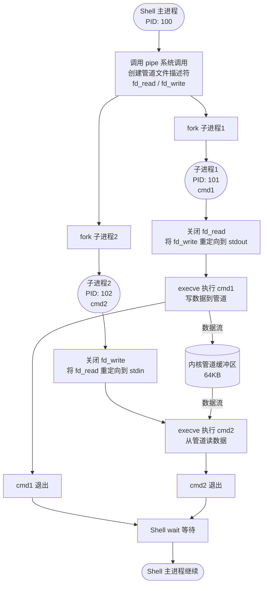
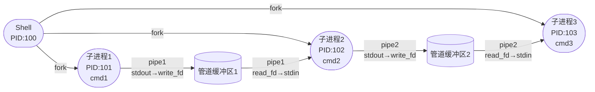
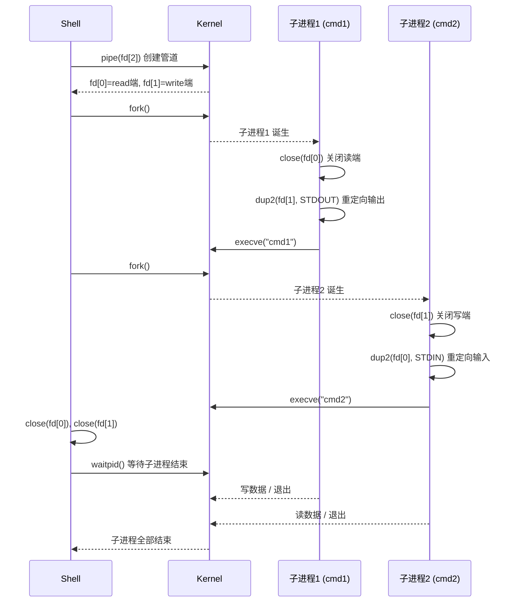

[toc]

## shell运行内置命令与shell进程

bash运行内置命令(比如echo ,type)时会创建子进程吗?

简单直接的回答是：**通常情况下，不会。**

这是内置命令（Builtin commands）存在的意义之一。为了让你更清楚地理解背后的逻辑，我们可以从以下几个维度来拆解：

------

###  为什么不创建子进程？

在 Linux/Unix 系统中，创建一个子进程（通过 `fork()` 系统调用）是有开销的：内核需要分配 PID、复制内存页表、设置文件描述符等。

- **内置命令（Builtins）：** 比如 `echo`、`cd`、`type`、`export`。它们直接运行在当前的 Shell 进程空间内。Shell 只需要调用内部的一个函数即可完成任务。
- **外部命令（External Commands）：** 比如 `ls`、`grep`、`find`。这些是独立的二进制文件（通常在 `/bin` 或 `/usr/bin` 下）。Shell 必须通过 `fork()` 创建子进程，然后通过 `exec()` 加载这些程序。

###  必须在当前进程运行的情况

有些命令**必须**在当前进程运行，否则它们将毫无意义。

- **`cd`：** 如果 `cd` 在子进程中运行，改变的只是子进程的工作目录，一旦命令结束回到父进程（Shell），你发现路径根本没变。
- **`export` / `set`：** 只有在当前进程操作，才能修改当前的变量和环境。

###  特殊情况：什么时候会产生子进程？

虽然内置命令本身不要求子进程，但如果你在以下**结构**中使用它们，Shell 会强制为它们创建一个“子进程环境”（通常称为 **Subshell**）,并按需替换进程：

- **管道操作 (`|`)：**

  ```bash
  echo "hello" | cat
  ```

  在大多数 Shell（如 Bash）中，管道两边的命令都会在子进程中运行。

  > cat命令通常是外部命令(例如gnu cat)

- **后台运行 (`&`)：**

  ```bash
  echo "running in back" &
  ```

- **显式的 Subshell (`()`)：**

  ```bash
  (echo "I am in a subshell")
  ```

------

###  如何验证？

你可以使用 Bash 内置的变量 `$BASHPID`（它代表当前真正的进程 ID）来做个小实验：

| **命令**              | **现象**                | **结论**            |
| --------------------- | ----------------------- | ------------------- |
| `echo $BASHPID`       | 输出一个 PID（如 1234） | 正常在主进程运行    |
| `echo $BASHPID | cat` | 输出一个**不同**的 PID  | 管道触发了子进程    |
| `(echo $BASHPID)`     | 输出一个**不同**的 PID  | 括号触发了 Subshell |

### 总结

运行 `echo` 或 `type` 时，Shell 就像是在执行自己内部的一个“插件”或“函数”，**不会**去申请新的进程。这正是内置命令运行速度极快的原因。

## Bash中管道与子进程

管道中的每个命令都会创建子进程;

典型用例:

```bash
echo "hello" | grep "hello"
echo "hello" | grep "hello" | wc -l

```


当你在 Shell 中执行 `a|b` 这样的命令时，Shell 会为你创建两个新的子进程，它们之间是“兄弟”关系。

### 创建哪些进程？

Shell 会为管道符 `|` 两边的命令分别创建一个子进程：

- 一个子进程用于执行命令 `a`。
- 另一个子进程用于执行命令 `b`。

### 进程关系是什么？

这两个新创建的进程（执行 `a` 的进程和执行 `b` 的进程）之间不存在父子关系，它们是“兄弟进程”。它们的共同父进程是当前的 Shell 本身。

### 背后是如何工作的？

为了实现 `a` 的输出作为 `b` 的输入，Shell 在后台执行了以下步骤：

1. **创建管道**：Shell 首先调用 `pipe()` 系统调用，在内核中创建一个管道。这个管道会得到两个文件描述符：一个用于读取（读端），一个用于写入（写端）。
2. **创建子进程**：Shell 调用两次 `fork()`，创建两个子进程。
3. **重定向标准输入/输出**：
   - 在第一个子进程（执行 `a`）中，Shell 会将其标准输出（stdout）重定向到管道的写端。这样，命令 `a` 的输出就会被写入管道，而不是显示在终端上。
   - 在第二个子进程（执行 `b`）中，Shell 会将其标准输入（stdin）重定向到管道的读端。这样，命令 `b` 就会从管道中读取数据，而不是等待用户从键盘输入。
4. **执行命令**：最后，两个子进程分别执行各自的命令 `a` 和 `b`，数据流便通过内核中的管道连接了起来。

### 管道符两侧的命令类型

管道符 `|` 后的命令 `b` 既可以是外部命令，也可以是 Shell 内置命令。

###  外部命令

外部命令（如 `grep`, `sed`, `awk`, `ls` 等）是独立的程序文件。当它们被用在管道中时，Shell 会为它们创建一个子进程来执行。这是最常见和预期的用法。

**示例：**

```bash
ps aux | grep nginx
```

在这个例子中，`grep` 是一个外部命令。Shell 会为 `ps aux` 和 `grep nginx` 分别创建一个子进程，`ps` 的输出通过管道传递给 `grep` 的标准输入。

##  Shell 内置命令和shell进程

Shell 内置命令（如 `read`, `echo`, `cd`, `export` 等）是 Shell 程序本身的一部分。它们**可以**被用在管道符后面，但有一个关键特性：**它们会在一个子 Shell 中执行**。

这意味着，内置命令对 Shell 环境造成的任何改变（例如修改变量、切换目录）都只在它自己的那个子进程中生效，**不会影响到你当前正在操作的 Shell 主进程**。

### 典型例子：`read` 命令

`read` 命令常用于从标准输入读取数据并赋值给变量。当它被用在管道中时，由于它在子 Shell 中运行，所以它设置的变量在管道执行结束后就会消失。

**错误用法（变量会丢失）：**

```bash
echo "hello" | read my_var
echo $my_var
# 输出为空，因为 my_var 是在子进程中定义的，管道结束后该变量就消失了
```

**正确用法（在当前 Shell 中设置变量）：**
如果你想用 `read` 在当前 Shell 环境中设置变量，应该使用**输入重定向** `<` 或 Here String `<<<`，而不是管道 `|`。

```bash
read my_var <<< "hello"
echo $my_var
# 输出: hello
# 变量 my_var 在当前 Shell 中成功设置
```

### 例子：`cd` 命令

`cd` 也是一个内置命令，它不接受标准输入。因此，将它放在管道后面通常没有意义，甚至会导致错误。

```bash
echo "/tmp" | cd
# 这不会切换目录，cd 命令会忽略管道的输入，你仍然在原来的目录
```

### 总结

| 命令类型           | 能否在管道后使用 | 执行环境 | 对当前 Shell 的影响                            |
| ------------------ | ---------------- | -------- | ---------------------------------------------- |
| **外部命令**       | **可以**         | 子进程   | 无直接影响                                     |
| **Shell 内置命令** | **可以**         | 子 Shell | **无影响** (例如，变量修改、`cd` 等均不会生效) |

因此，虽然语法上允许，但在将内置命令（尤其是 `read`、`cd`、`export` 等会改变 Shell 状态的命令）放在管道后使用时，需要特别注意其作用域仅限于子 Shell。

### 管道和子进程数

对于管道:`c1|c2|...|cn`:(bash为例)

**标准行为：** 通常`N` 个管道段落通常会产生 `N` 个子进程。

**例外：** 当开启 `lastpipe` 时，管道的最后一个命令可以“寄生”在父进程中运行，从而只产生 $N-1$ 个子进程。

```bash
shopt -s lastpipe
set +m # 关闭作业控制
echo "hello" | read var
echo $var # 输出 hello，因为 read 在当前进程运行
```


**注意：** 其他 Shell（如 `zsh` 或 `ksh`）默认行为可能与 Bash 不同，它们通常倾向于让管道的最后一个命令直接在当前进程运行。

## 管道创建子进程的流程

底层系统调用流程

```
Bash父进程
    │
    ├─ 1. 调用 pipe() 系统调用，创建管道文件描述符
    │       pipe_fd[0] = 读端
    │       pipe_fd[1] = 写端
    │
    ├─ 2. 调用 fork() 创建子进程1（左边命令）
    │       子进程1: stdout → pipe_fd[1]（写端）
    │
    ├─ 3. 调用 fork() 创建子进程2（右边命令）
    │       子进程2: stdin  ← pipe_fd[0]（读端）
    │
    └─ 4. 父进程等待所有子进程结束（wait）
```


### 管道创建流程



---

### 多级管道：`cmd1 | cmd2 | cmd3`



---

## 关键系统调用时序




---

## 用代码验证（查看PID）

### 方法1：`echo $$`
```bash
# $$ 在子Shell中仍显示父进程PID（特殊变量）
# 用 $BASHPID 才能显示真实PID

echo "父进程PID: $$"

echo "left" | bash -c 'echo "子进程PID=$$,打印父进程PID: $PPID"'
```

子进程(shell)中打印子进程PID

```bash
echo 'echo $$'|bash
```


### 方法2：直接打印BASHPID

在bash中做试验,可以使用`BASHPID`这个环境变量;

```bash
$ echo $BASHPID; echo $BASHPID|cat
17860
94472
# 两个BASHPID不同，证明是不同子进程

$ echo $BASHPID;{ echo $BASHPID; echo $BASHPID; } |  cat
17860
3442
3442
# 第2个和第3个PID打印出来是一样的,管道中`|`左侧复合语句中,两个echo语句共用一个子shell进程

```

第一个例子中,第一个句子打印当前shell进程的PID;

而第二个语句`echo $BASHPID|cat`打印的不是当前的shell的id,而是因为管道,当前shell要创建子进程来执行,即便echo是shell内置的命令,也要创建一个子shell,然后在子shell中计算`$BASHPID`,然后传递给第二个命令(管道的另一端将值输出来)

```bash
true | true | true
# 每个true都是独立子进程
```


### 方法3：用pstree观察

```bash
# 执行一个耗时管道命令，另一个终端观察
sleep 10 | sleep 10 | sleep 10 &

pstree -p $$
# 输出：
# bash(1234)─┬─sleep(1235)
#            ├─sleep(1236)
#            └─sleep(1237)
```

---

## 重要特性：管道在子进程执行

### 关键影响：变量修改不影响父Shell

```bash
count=0

# 管道中修改变量
echo "a b c" | while read word; do
    count=$((count + 1))
done

echo $count   # 输出: 0  ← 不是3！
              # 因为while在子进程中运行，修改的是子进程的count
```

### 解决方案

```bash
# 方案1：使用进程替换（不创建子Shell）
count=0
while read word; do
    count=$((count + 1))
done < <(echo "a b c")
echo $count   # 输出: 3 ✓

# 方案2：使用lastpipe选项（Bash 4.2+）
shopt -s lastpipe
count=0
echo "a b c" | while read word; do
    count=$((count + 1))
done
echo $count   # 输出: 3 ✓

# 方案3：用临时文件
echo "a b c" > /tmp/words
count=0
while read word; do
    count=$((count + 1))
done < /tmp/words
echo $count   # 输出: 3 ✓
```

---

## 管道退出状态

```bash
# 默认：取最后一个命令的退出状态
false | true
echo $?   # 0（取true的退出状态）

# 使用pipefail：任何一个失败则整体失败
set -o pipefail
false | true
echo $?   # 1（false失败了）

# PIPESTATUS数组：保存每个命令的退出状态
ls /notexist | grep foo | wc -l
echo ${PIPESTATUS[@]}   # 输出: 2 1 0
#                                │ │ └── wc退出状态
#                                │ └──── grep退出状态
#                                └────── ls退出状态
```

## 总结

> 本质 = `fork() + pipe() + dup2() + exec()`

| 概念           | 说明                                   |
| -------------- | -------------------------------------- |
| **fork**       | 每个管道命令都 fork 一个子进程         |
| **pipe()**     | 内核创建单向字节流，有 ~64KB 缓冲区    |
| **dup2()**     | 将管道 fd 重定向到标准输入/输出        |
| **execve()**   | 用实际命令替换子进程镜像               |
| **阻塞机制**   | 缓冲区满时写端阻塞，缓冲区空时读端阻塞 |
| **变量作用域** | 子进程的变量修改**不会**影响父 Shell   |


| 特性       | 说明                                   |
| ---------- | -------------------------------------- |
| 子进程创建 | 管道每个命令都 `fork()` 出子进程       |
| 并行执行   | 所有子进程**同时运行**，不是顺序执行   |
| 数据传递   | 通过内核管道缓冲区传递，无需临时文件   |
| 变量隔离   | 子进程变量修改**不影响**父Shell        |
| 父进程行为 | 父Shell `wait()` 等待所有子进程完成    |
| 退出状态   | 默认取最后命令；`pipefail`可改变此行为 |

