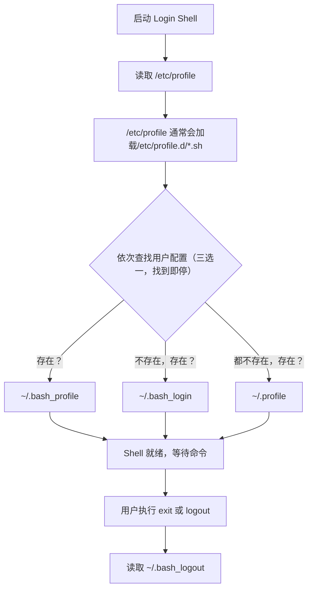
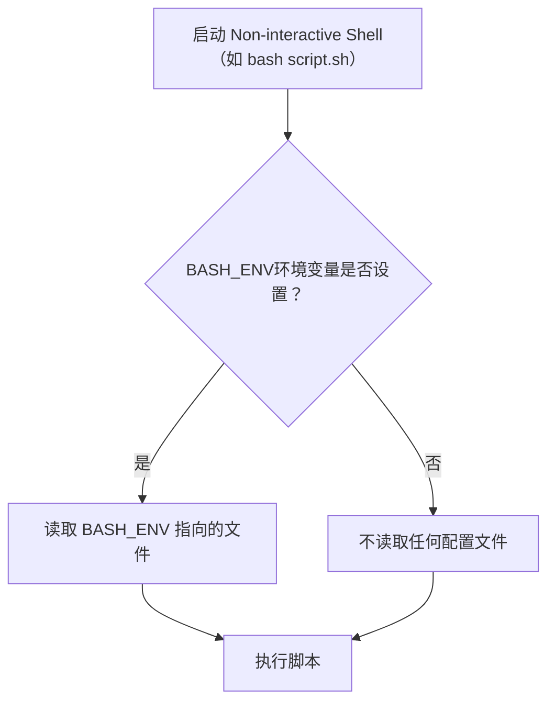
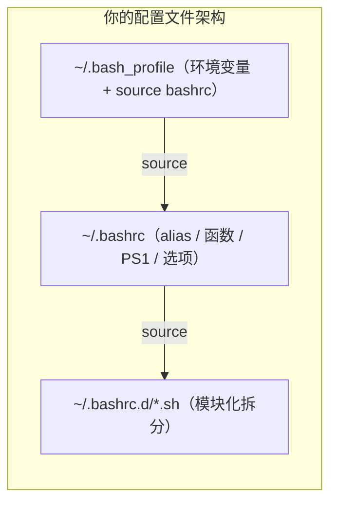

[toc]


# Bash 配置文件加载机制


## Shell 加载配置的两个维度

Bash 启动时有两个独立的维度来决定加载哪些配置文件：

### Login vs Non-login

| 维度                | 含义                           | 典型场景                                                   |
| ------------------- | ------------------------------ | ---------------------------------------------------------- |
| **Login Shell**     | 用户"登录"时启动的第一个 Shell | SSH 登录、tty 控制台登录、`bash --login`                   |
| **Non-login Shell** | 登录后再打开的 Shell           | 在已有终端中输入 `bash`、大多数 GUI 终端模拟器打开新标签页 |

### Interactive vs Non-interactive

| 维度                | 含义                       | 典型场景                      |
| ------------------- | -------------------------- | ----------------------------- |
| **Interactive**     | 有提示符，等待用户输入命令 | 你正常使用的终端              |
| **Non-interactive** | 不与用户交互，执行完就退出 | `bash script.sh`、`cron` 任务 |

执行 `shopt login_shell` 可以看到是否是 Login Shell。

例如:

```bash
$ shopt login_shell
login_shell             off
```

**判断方法：** 在终端中执行 `echo $-`，如果结果包含字母 `i`，说明是 Interactive Shell。

```bash
[[ $- == *i* ]] && echo "Interactive Shell."
```

或者判断命令提示符变量`PS1`,脚本环境(非交互式)中此变量取值为空字符串;

```bash
[[ $PS1 ]] && echo "Interactive Shell."
```

两个维度组合出四种场景，其中**最重要的是前两种**：

| 组合                        | 场景举例                            |
| --------------------------- | ----------------------------------- |
| Login + Interactive         | SSH 登录远程服务器                  |
| Non-login + Interactive     | GUI 桌面打开终端窗口                |
| Non-login + Non-interactive | 执行 Shell 脚本                     |
| Login + Non-interactive     | `bash --login -c "command"`（罕见） |

---

## 配置文件说明

### 涉及的文件

| 文件路径                                                  | 作用范围         | 用途说明                                         |
| --------------------------------------------------------- | ---------------- | ------------------------------------------------ |
| `/etc/profile`                                            | 全局（所有用户） | Login Shell 的全局初始化                         |
| `/etc/profile.d/*.sh`                                     | 全局（所有用户） | 通常被 `/etc/profile` 自动加载，模块化的全局配置 |
| `/etc/bash.bashrc`（Debian系）<br>`/etc/bashrc`（RHEL系） | 全局（所有用户） | Interactive Shell 的全局配置                     |
| `~/.bash_profile`                                         | 当前用户         | Login Shell 的用户级初始化（优先级最高）         |
| `~/.bash_login`                                           | 当前用户         | Login Shell 的用户级初始化（第二优先）           |
| `~/.profile`                                              | 当前用户         | Login Shell 的用户级初始化（第三优先，兼容 sh）  |
| `~/.bashrc`                                               | 当前用户         | Interactive Non-login Shell 的用户级配置         |
| `~/.bash_logout`                                          | 当前用户         | Login Shell 退出时执行                           |
| `BASH_ENV` 指向的文件                                     | 取决于设置       | Non-interactive Shell 启动时加载                 |

---

### 不同 Shell 场景的加载文件清单

如果你想知道某个特定文件会在什么时机被触发，参考下表：

| 文件路径           | 加载时机                | 建议用途                               |
| :----------------- | :---------------------- | :------------------------------------- |
| `/etc/profile`     | 全局 Login Shell        | 系统范围的环境变量设置                 |
| `/etc/bash.bashrc` | 全局 Non-Login Shell    | 系统范围的别名、补全配置               |
| `~/.bash_profile`  | 用户级 Login Shell      | 设置 `$PATH` 等只执行一次的环境变量    |
| `~/.bashrc`        | 用户级 Non-Login Shell  | 别名 (alias)、提示符 (PS1)、补全、函数 |
| `~/.bash_logout`   | 用户退出 Login Shell 时 | 清理操作 (删除临时文件、清屏)          |
| `$BASH_ENV`        | 执行脚本时              | 非交互环境下的自定义初始化             |


## 加载流程示意图

### Login Shell 的加载流程



```bash
# /etc/profile 中的典型片段
if [ -d /etc/profile.d ]; then
    for i in /etc/profile.d/*.sh; do
        if [ -r "$i" ]; then
            . "$i"    # source 每个 .sh 文件
        fi
    done
fi
```

这个机制的作用

| 特性           | 说明                                                         |
| -------------- | ------------------------------------------------------------ |
| **模块化配置** | 每个软件包可以把自己的初始化脚本放入 `/etc/profile.d/`，无需修改 `/etc/profile` 本身 |
| **自动加载**   | 登录时自动 source，用户无需手动干预                          |
| **易于管理**   | 安装/卸载软件时只需添加/删除对应的 `.sh` 文件                |

**关键规则：三个用户配置文件只会读取第一个找到的。** 

这意味着如果 `~/.bash_profile` 存在，`~/.profile` 就不会被读取——除非你在 `~/.bash_profile` 中手动 source 它。(`~/.bash_profile`优先级高,配置不合理可能会有覆盖或跳过执行`~/.profile`配置的现象)

`profile`系列的配置主要服务于**login shell**,其他交互式shell是不执行的.

更值得注意的是,**login shell**并不必然执行`~/.bashrc`,除非在某个`*profile`中添加执行`~/.bashrc`的代码片段!

```bash
[[ -f ~/.bashrc ]] && . ~/.bashrc
```

但是profile系列中可能设置环境变量,那么login shell中启动的其他shell进程可能会间接受到profile配置的影响

### Non-login Interactive Shell 的加载流程

流程非常简单——**只读 `~/.bashrc`**，不碰任何 `profile` 文件。

> 不过`~/.bashrc` 通常会加载`/etc/bashrc` 或 `/etc/bash.bashrc`(到底是两者中的哪一个取决于发型版!)
>
> 例如,archlinux是` /etc/bash.bashrc `

### Non-interactive Shell 的加载流程

常见的运行bash脚本时的情况.

**脚本执行时默认不加载任何配置文件**，这是出于性能和安全考虑。

如果脚本需要某些环境变量，应该在脚本内部显式设置，或依赖从父进程继承的 `export` 变量。



---

## 完整判断汇总

| 场景                        | `/etc/profile` | `~/.bash_profile` 等 | `~/.bashrc` | `BASH_ENV`  |
| --------------------------- | :------------: | :------------------: | :---------: | :---------: |
| Login + Interactive         |       ✅        |     ✅（三选一）      |     ❌*      |      ❌      |
| Non-login + Interactive     |       ❌        |          ❌           |      ✅      |      ❌      |
| Non-login + Non-interactive |       ❌        |          ❌           |      ❌      | ✅（若设置） |
| Login + Non-interactive     |       ✅        |     ✅（三选一）      |     ❌*      | ✅（若设置） |

> `❌*` 表示 Bash 本身不会自动加载，但几乎所有发行版的 `~/.bash_profile` 都会手动 source `~/.bashrc`，所以**实际效果**是会加载的。

---

## 最佳实践：如何组织你的配置

### 黄金法则

> **环境变量放 `~/.profile`（或 `~/.bash_profile`），其他一切放 `~/.bashrc`，然后确保 profile 文件 source bashrc。**

### 推荐的文件分工

| 应该放在哪里                      | 内容类型                                             | 为什么                                                     |
| --------------------------------- | ---------------------------------------------------- | ---------------------------------------------------------- |
| `~/.profile` 或 `~/.bash_profile` | `export PATH=...`、`export EDITOR=...` 等环境变量    | **环境变量**只需设置一次，会被子进程继承，属于"登录级"配置 |
| `~/.bashrc`                       | alias、函数、提示符（`PS1`）、`shopt` 选项、补全配置 | **这些不会被子进程继承，每个新 Shell 都需要重新设置**      |
| `~/.bash_logout`                  | 清屏、清除临时文件等清理工作                         | 退出登录时的收尾操作                                       |

### 推荐的 `~/.bash_profile` 写法

```bash
# ~/.bash_profile — Login Shell 专属配置

# 设置环境变量（只在登录时执行一次）
export EDITOR="vim"
export LANG="en_US.UTF-8"
export PATH="$HOME/.local/bin:$HOME/go/bin:$PATH"

# 关键：加载 ~/.bashrc，确保 login shell 也能获得 alias、函数等配置
if [ -f "$HOME/.bashrc" ]; then
    source "$HOME/.bashrc"
fi
```

### 推荐的 `~/.bashrc` 写法

```bash
# ~/.bashrc — 每个 Interactive Shell 都会加载

# 非交互式 Shell 直接返回（保护性判断，很多发行版默认包含）
case $- in
    *i*) ;;
      *) return;;
esac

# ---------- 别名 ----------
alias ll='ls -alF --color=auto'
alias gs='git status'
alias ..='cd ..'

# ---------- 提示符 ----------
PS1='\[\e[32m\]\u@\h\[\e[0m\]:\[\e[34m\]\w\[\e[0m\]\$ '

# ---------- Shell 选项 ----------
shopt -s histappend       # 追加历史而非覆盖
shopt -s checkwinsize     # 窗口大小变化时自动调整

# ---------- 历史记录 ----------
HISTSIZE=10000
HISTFILESIZE=20000
HISTCONTROL=ignoreboth    # 忽略重复和空格开头的命令

# ---------- 第三方补全 ----------
if [ -f /usr/share/bash-completion/bash_completion ]; then
    source /usr/share/bash-completion/bash_completion
fi

# ---------- 按需加载其他模块 ----------
for f in ~/.bashrc.d/*.sh; do
    [ -r "$f" ] && source "$f"
done
```

### 模块化管理

当配置越来越复杂时，建议拆分到 `~/.bashrc.d/` 目录下：

```
~/.bashrc.d/
├── aliases.sh
├── functions.sh
├── docker.sh
├── kubernetes.sh
└── fzf.sh
```

在 `~/.bashrc` 中用上面展示的 `for` 循环统一加载即可。

---

## 常见陷阱与排错

### 陷阱一：`~/.bash_profile` 存在导致 `~/.profile` 被忽略

很多新手把 `PATH` 写在 `~/.profile`（有些发行版默认只有这个文件），后来创建了 `~/.bash_profile`，结果 `~/.profile` 中的配置全部失效。

**解决方案：** 在 `~/.bash_profile` 开头加上：

```bash
[ -f "$HOME/.profile" ] && source "$HOME/.profile"
```

### 陷阱二：macOS 终端的特殊行为

macOS 的 Terminal.app 和 iTerm2 默认将每个新窗口/标签页视为 **Login Shell**（而非 Linux 桌面终端常见的 Non-login Shell）。这意味着在 macOS 上：

| 操作             | Linux 桌面                 | macOS Terminal               |
| ---------------- | -------------------------- | ---------------------------- |
| 打开新终端标签页 | Non-login → 读 `~/.bashrc` | Login → 读 `~/.bash_profile` |

所以在 macOS 上，如果你只写了 `~/.bashrc` 而没有 `~/.bash_profile` 去 source 它，配置可能不生效。

### 陷阱三：`sudo su` vs `sudo su -` vs `sudo -i`

| 命令                     | Shell 类型      | 加载的配置                                    |
| ------------------------ | --------------- | --------------------------------------------- |
| `sudo su`                | Non-login       | 目标用户的 `~/.bashrc`                        |
| `sudo su -` 或 `sudo -i` | Login           | 目标用户的 `/etc/profile` + `~/.bash_profile` |
| `sudo command`           | Non-interactive | 几乎不加载配置，继承部分 `env_keep` 变量      |

### 陷阱四：SSH 远程执行命令

```bash
ssh user@host 'echo $PATH'
```

这种方式启动的是 **Non-interactive Non-login Shell**，不会加载任何配置文件。如果你的命令依赖 `~/.bashrc` 中的 PATH，可以改为：

```bash
ssh user@host 'bash --login -c "echo \$PATH"'
```

---

## 调试技巧

在排查"为什么我的配置没生效"时，可以在每个配置文件的开头加上调试行：

```bash
echo ">>> Loading ~/.bashrc" >&2
```

或者使用更系统的方式，在启动 Shell 时开启 trace：

```bash
# 观察 Bash 读取了哪些文件
bash -x --login 2>&1 | head -50
```

也可以用 `PS4` 变量让 trace 输出更有信息量：

```bash
PS4='+ ${BASH_SOURCE}:${LINENO}: ' bash -x --login
```

---

## 总结速查



**记住这三条就够了：**

1. **Login Shell 读 profile，Non-login Shell 读 bashrc** — 这是一切的基础
2. **让 profile source bashrc** — 确保任何场景下 alias 和函数都可用
3. **环境变量放 profile，其他放 bashrc** — 各司其职，干净清晰