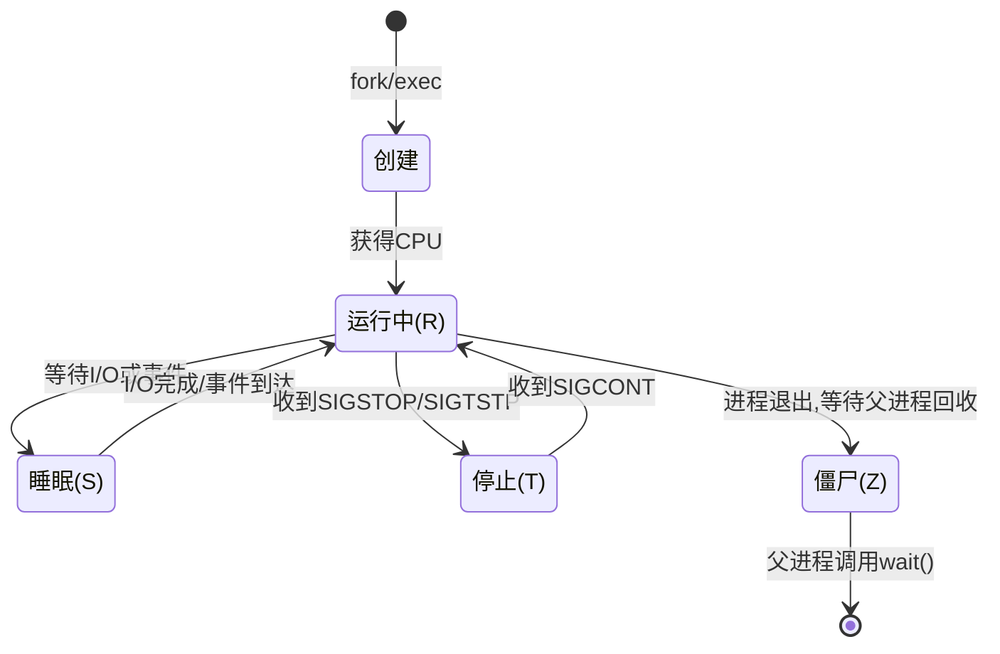
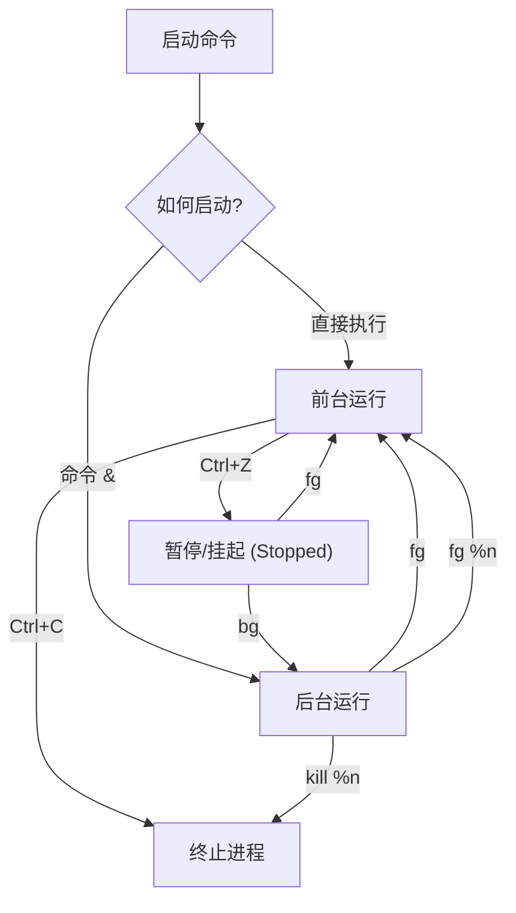
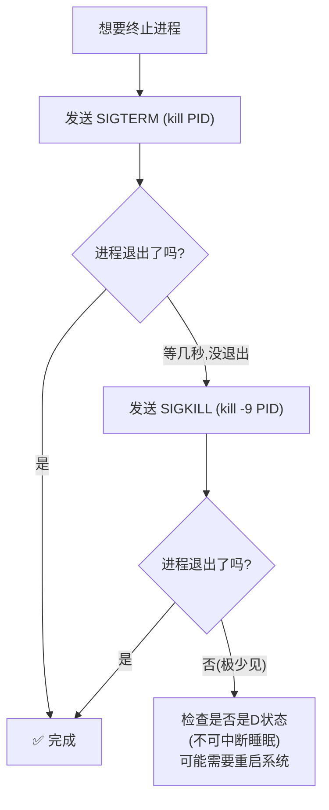

[toc]


## 基础知识


**进程**是**程序**在**内存中运行**的**实例**。每个进程都由一个称为**进程标识符** **(PID)** 的数字标识。

每个进程都有自己**私有的内存区域**，其他进程无法访问该区域。进程将自身的变量和其他数据存储在这个区域内。

内核会跟踪所有这些进程，并在***进程表***中存储一些关于它们的**基本元数据**。

然而，在大多数情况下，每个进程都是自主的，在其内核授予的权限范围内运行。**一旦进程启动，除了挂起（暂停）或终止它之外，很难对其进行任何操作** 。

内核存储的元数据包括**进程“名称”和“命令行”**。这些信息并**不可靠**；

- 进程的“名称”取决于你**运行它时指定的参数**，可能与**程序的文件名**没有任何关系。（在某些系统中，运行中的进程还可以更改自身名称。例如，sendmail 就使用这种方式来显示其状态。）
- 因此，在操作进程时，你***必须***知道它的**进程 ID (PID,ProcessID)** 才能对其进行任何可靠的操作。
- 总之,通过**名称**查找进程极其**不可靠**。


## 核心概念

###  什么是进程？

进程是**正在运行的程序的实例**。当你在 Bash 中执行一条命令时，系统会创建一个进程来完成这项工作。

每个进程都拥有：

| 属性       | 说明                         | 示例                   |
| ---------- | ---------------------------- | ---------------------- |
| **PID**    | 进程唯一标识符（Process ID） | `1234`                 |
| **PPID**   | 父进程 ID（Parent PID）      | `1230`                 |
| **UID**    | 运行该进程的用户 ID          | `1000`                 |
| **状态**   | 进程当前的运行状态           | 运行、睡眠、停止、僵尸 |
| **优先级** | 进程获得 CPU 时间的优先程度  | `NI=0`（默认）         |

父子进程关系

| **特征**          | **描述**                                                     |
| ----------------- | ------------------------------------------------------------ |
| **PID (进程 ID)** | 每个进程都有唯一的身份证号。父进程有自己的 PID，而子进程会记录其 **PPID (父进程 ID)** 以便找到“爸爸”。 |
| **资源分配**      | 父进程通常会为子进程分配资源（如内存、打开的文件句柄），或者与之共享部分资源。 |
| **生命周期管理**  | 子进程结束时，会向父进程发送一个信号。父进程负责“收尸”（读取子进程的退出状态并释放剩余资源）。 |

特殊类型的进程

| **进程类型**     | **是否有父进程**         | **说明**                             |
| ---------------- | ------------------------ | ------------------------------------ |
| **普通进程**     | 是                       | 由 shell、应用或服务 fork 出来。     |
| **孤儿进程**     | 是 (被收养)              | 原父进程退出后，被 PID 1 自动收养。  |
| **PID 1 (init)** | 比较特殊,可以认为是PID 0 | 它是用户空间的始祖，由内核直接引导。 |
| **PID 0**        | **否**                   | 内核自身的一部分。                   |

###  进程的生命周期

一个进程由其父进程创建



###  前台进程 vs 后台进程

| 特性              | 前台进程             | 后台进程                                                     |
| ----------------- | -------------------- | ------------------------------------------------------------ |
| **启动方式**      | 直接执行命令         | 通常命令末尾加 `&`,或者前台命令通过发送信号送入后台继续运行. |
| **终端占用**      | ✅ 占用终端，阻塞输入 | ❌ 不占用终端                                                 |
| **Ctrl+C 可中断** | ✅ 是                 | ❌ 否                                                         |
| **输出**          | 直接显示在终端       | 也会显示（可能混乱）                                         |
| **典型场景**      | 交互式操作           | 长时间运行的任务                                             |

---

## 查看进程

###  常用查看命令对比

| 命令     | 用途                | 特点                       |
| -------- | ------------------- | -------------------------- |
| `ps`     | 查看进程快照        | 静态，一次性输出           |
| `top`    | 实时监控进程        | 动态刷新，交互式           |
| `htop`   | 增强版 top          | 彩色界面，更直观（需安装） |
| `pgrep`  | 按名称/条件搜索进程 | 只输出 PID，适合脚本       |
| `pstree` | 树状显示进程关系    | 直观展示父子关系           |

###  `ps` 命令详解

```bash
# 查看当前终端的进程
ps

# 查看所有进程（最常用的两种风格）
ps aux          # BSD 风格（无横杠）
ps -ef          # UNIX/System V 风格

# 查看特定用户的进程
ps -u username

# 自定义输出列
ps -eo pid,ppid,user,%cpu,%mem,stat,cmd --sort=-%cpu

# 查看进程树
ps -ejH
ps axjf
```

**`ps aux` 输出解读：**

```
USER       PID %CPU %MEM    VSZ   RSS TTY    STAT START   TIME COMMAND
root         1  0.0  0.1 169516 13092 ?      Ss   09:00   0:02 /sbin/init
alice     3456  2.1  1.5 524680 61440 pts/0  Sl   10:15   1:30 /usr/bin/python3 app.py
```

| 列        | 含义                                   |
| --------- | -------------------------------------- |
| `USER`    | 进程所有者                             |
| `PID`     | 进程 ID                                |
| `%CPU`    | CPU 使用率                             |
| `%MEM`    | 内存使用率                             |
| `VSZ`     | 虚拟内存大小（KB）                     |
| `RSS`     | 实际内存使用（KB）                     |
| `TTY`     | 关联终端（`?` 表示无终端，即守护进程） |
| `STAT`    | 进程状态                               |
| `COMMAND` | 启动命令                               |

**STAT 状态码含义：**

| 状态码 | 含义       | 说明                        |
| ------ | ---------- | --------------------------- |
| `R`    | Running    | 正在运行或在运行队列中      |
| `S`    | Sleeping   | 可中断的睡眠（等待事件）    |
| `D`    | Disk sleep | 不可中断的睡眠（通常是I/O） |
| `T`    | Stopped    | 被信号停止                  |
| `Z`    | Zombie     | 僵尸进程，已终止但未被回收  |
| `s`    | 小写 s     | 会话首领（Session leader）  |
| `l`    | 小写 l     | 多线程                      |
| `+`    |            | 前台进程组成员              |
| `<`    |            | 高优先级                    |
| `N`    |            | 低优先级                    |

###  `top` / `htop` 实时监控

```bash
# 启动 top
top

# 常用交互快捷键（在 top 界面内）：
# q     - 退出
# k     - 杀死进程（输入 PID）
# M     - 按内存排序
# P     - 按 CPU 排序
# 1     - 显示每个 CPU 核心
# h     - 帮助

# htop（更现代的替代品，需安装）
sudo apt install htop   # Debian/Ubuntu
sudo dnf install htop   # Fedora/RHEL
htop
```

###  `pgrep` 按名称查找进程

```bash
# 查找名为 nginx 的进程 PID
pgrep nginx

# 显示完整命令行
pgrep -a nginx

# 查找特定用户的进程
pgrep -u alice python

# 列出进程名和 PID
pgrep -l ssh
```

---

## 前台与后台进程管理

###  核心操作流程



###  实操演示

```bash
# ① 启动一个前台进程
sleep 300

# ② Ctrl+Z 暂停它
# 输出: [1]+  Stopped     sleep 300

# ③ 查看所有后台作业
jobs
# 输出: [1]+  Stopped     sleep 300

# ④ 将暂停的作业放到后台继续运行
bg %1
# 输出: [1]+ sleep 300 &

# ⑤ 直接启动一个后台进程
sleep 600 &
# 输出: [2] 12345

# ⑥ 查看所有作业
jobs -l
# 输出:
# [1]  11111 Running    sleep 300 &
# [2]- 12345 Running    sleep 600 &

# ⑦ 将后台作业调回前台
fg %1

# ⑧ Ctrl+C 终止前台进程
```

###  `jobs` 命令详解

```bash
jobs        # 列出当前 shell 的所有作业
jobs -l     # 同时显示 PID
jobs -r     # 只显示运行中的作业
jobs -s     # 只显示已停止的作业
```

**作业标识符：**

| 标识符       | 含义                            |
| ------------ | ------------------------------- |
| `%1`         | 作业编号 1                      |
| `%+` 或 `%%` | 当前作业（最近一个后台/暂停的） |
| `%-`         | 上一个作业                      |
| `%string`    | 命令以 string 开头的作业        |
| `%?string`   | 命令包含 string 的作业          |

```bash
# 示例
fg %1           # 将作业 1 调到前台
bg %2           # 让作业 2 在后台继续运行
kill %1         # 终止作业 1
fg %sleep       # 将以 "sleep" 开头的命令调到前台
fg %?app.py     # 将包含 "app.py" 的命令调到前台
```

---

## 信号（Signal）与进程控制

###  什么是信号？

信号是操作系统向进程发送的**异步通知**，用于通知进程某个事件已发生。可以理解为"拍一下进程的肩膀，告诉它该做什么"。

###  常用信号一览

| 信号编号 | 信号名    | 快捷键   | 含义                           | 能否被捕获 |
| -------- | --------- | -------- | ------------------------------ | ---------- |
| `1`      | `SIGHUP`  | —        | 终端挂断/重新加载配置          | ✅          |
| `2`      | `SIGINT`  | `Ctrl+C` | 中断进程（礼貌请求退出）       | ✅          |
| `3`      | `SIGQUIT` | `Ctrl+\` | 退出并生成 core dump           | ✅          |
| `9`      | `SIGKILL` | —        | **强制杀死**（无法捕获）       | ❌          |
| `15`     | `SIGTERM` | —        | 终止进程（默认信号，优雅退出） | ✅          |
| `18`     | `SIGCONT` | —        | 继续已停止的进程               | ✅          |
| `19`     | `SIGSTOP` | —        | **强制停止**（无法捕获）       | ❌          |
| `20`     | `SIGTSTP` | `Ctrl+Z` | 终端停止（可捕获的暂停）       | ✅          |

> 📌 **记住这个优先级**：先尝试 `SIGTERM`(15) → 不行再用 `SIGKILL`(9)

###  `kill` 命令

```bash
# 语法
kill [-signal] PID

# 发送默认信号 SIGTERM（优雅终止）
kill 12345

# 发送 SIGKILL（强制杀死）
kill -9 12345
kill -KILL 12345
kill -SIGKILL 12345    # 三种写法等价

# 发送 SIGHUP（通常用于重载配置）
kill -1 12345
kill -HUP 12345

# 查看所有可用信号
kill -l

# 杀死作业
kill %1
```

###  `killall` 和 `pkill`

```bash
# killall：按进程名杀死所有匹配进程
killall nginx
killall -9 python3

# pkill：按模式匹配杀死进程（更灵活）
pkill -f "python3 app.py"    # -f 匹配完整命令行
pkill -u alice               # 杀死用户 alice 的所有进程
pkill -STOP -u alice         # 暂停用户 alice 的所有进程
```

###  终止进程的最佳实践流程



> ⚠️ **为什么不要直接用 `kill -9`？**
> - `SIGTERM` 允许进程清理资源（关闭文件、释放锁、保存数据）
> - `SIGKILL` 是暴力终止，可能导致数据损坏、临时文件残留、锁未释放

---

## 定义一个模拟耗时有输出的函数(`demo_job`)

可以将下面的bash函数放到脚本文件中并为其设置可执行权限.

```bash
#!/bin/bash
# demo_job.sh
# 将一个每秒钟打印1个数字,可以指定最多打印的次数(从1开始打印)
demo_job() {
    local max=${1:-20}  # 默认运行 20 秒
    local i=1
    # 根据调用时间的纳秒部分生成一个随机 ID,以区分不同的作业实例
    ID=$(date +%N)
    echo "--- 作业开始 (PID: $$, 预计运行 ${max}s)  (输入 Ctrl+Z 挂起此任务)---"
    while [ $i -le "$max" ]; do
        # 打印当前秒数和进程 ID
        printf "[$ID][$(date +%F-%T)]任务进度: [%2d/%2d] \n" $i "$max"
        sleep 1
        ((i++))
    done
    echo "--- 作业完成 ---"
}
```


## 后台长期任务管理

简单任务:使用`nohup`或`disown`(用于后期将前台作业从shell作业表中移除)

**长期复杂任务**：学习使用 **`tmux`**。它能让你在断开连接后随时“滚回来”看实时日志，比 `nohup` 和 `disown` 都要优雅得多。

### `nohup`命令

问题：终端关闭，进程也死了？

默认情况下，当你关闭终端时，终端会向其所有子进程发送 `SIGHUP` 信号，导致进程被终止。

`nohup` 是 Linux 和 Unix 系统中一个非常实用的命令，全称是 **"no hang up"**。它的核心作用是：让你在退出终端或关闭 SSH 连接后，程序依然能在后台继续运行。

以GNU nohup为例

> nohup (1)            - run a command immune to hangups, with output to a non-tty
>
> ```bash
> Usage: nohup COMMAND [ARG]...
>   or:  nohup OPTION
> ```
>
> Run COMMAND, ignoring hangup signals.
>
> 如果需要后台运行,并且免疫`SIGHUP`信号,则运行的命令形式
>
> ```
> nohup COMMAND [arg...] &
> ```
>
> 这种情况下,末尾的**`&`**: 极其重要。由于 `nohup` 只负责屏蔽信号，如果你不加 `&`，程序依然会占用你的当前前端界面。加上 `&` 才能真正让它在后台静默运行。

在默认情况下，当你关闭终端时，系统会向该终端运行的所有进程发送一个 `SIGHUP`（挂断）信号，导致这些进程被迫停止。

`nohup` 的作用就是**拦截这个信号**，告诉进程：“别理会挂断信号，继续跑你的。”

- 若标准输入(stdin)为终端，则将其**重定向至一个不可读的文件**。 
- 若标准输出(stdout)为终端，则尽可能将输出追加至 `'nohup.out'`； 若不可行，则追加至 `'$HOME/nohup.out'`。 
- 若标准错误(stderr)为终端，则将其重定向至标准输出。 

若要将输出保存至指定文件（FILE），请使用 `'nohup COMMAND > FILE'`。

> **自动重定向**：它非常智能，如果它发现你在终端里直接运行，它会自动帮你把日志塞进 `nohup.out`，防止日志刷屏。
>
> **错误合并**：它默认把“错误信息”和“普通信息”合在一起（即 `2>&1` 的逻辑），这样你只需要看一个日志文件就能掌握全部情况。

> 你所使用的 Shell 可能拥有其自带的 nohup 版本，该版本通常会覆盖此处所述的版本。 请查阅你所使用的 Shell 文档，以了解其支持的选项详情。

**退出状态：**

- **125**：若 nohup 命令本身执行失败
- **126**：若找到了命令（COMMAND）但无法调用
- **127**：若找不到命令（COMMAND）
- **其他**：返回命令（COMMAND）本身的退出状态

### nohup运行shell函数问题

`nohup` 是一个外部的可执行程序（通常位于 `/usr/bin/nohup`），它只能看到文件系统中的**二进制文件**或**脚本文件**。而 Bash 函数只存在于当前 Shell 的**内存**中，外部程序无法直接访问。

有三种方法(添加一些操作)可以让shell函数运行于nohup.

| **方法**        | **优点**                  | **缺点**                            |
| --------------- | ------------------------- | ----------------------------------- |
| **`export -f`** | 最接近 `nohup` 的原生用法 | 仅限于 Bash，不适用于 `sh` 或 `zsh` |
| 子 Shell + `&`  | 语法最简洁,`(my_task &) ` | 容易丢失输出日志，除非手动重定向    |
| 编写为独立脚本  | 结构清晰，兼容性最强      | 需要额外管理一个文件                |

如果逻辑非常复杂，最稳妥的方法还是将函数内容写入一个独立的 `.sh` 文件，然后直接 `nohup sh script.sh &`。

###  解决方案对比

| 方法      | 命令示例               | 适用场景                 | 现代推荐度 |
| --------- | ---------------------- | ------------------------ | ---------- |
| `nohup`   | `nohup cmd &`          | 简单的一次性任务         | ⭐⭐⭐        |
| `disown`  | 先 `cmd &` 再 `disown` | 忘记加 nohup 的补救      | ⭐⭐         |
| `screen`  | `screen -S name`       | 需要重新连接的交互式任务 | ⭐⭐⭐        |
| `tmux`    | `tmux new -s name`     | 同 screen，更现代        | ⭐⭐⭐⭐⭐      |
| `systemd` | 编写 .service 文件     | 生产环境的守护进程       | ⭐⭐⭐⭐⭐      |

###  `nohup` 用法

```bash
# 基本用法：输出默认写入 nohup.out
nohup long_running_script.sh &

# 自定义输出重定向（最佳实践）
nohup ./my_task.sh > output.log 2>&1 &

# 记录 PID 方便后续管理
nohup ./my_task.sh > output.log 2>&1 &
echo $!     # $! 是最近一个后台进程的 PID
echo $! > /tmp/my_task.pid   # 保存 PID 到文件
```

###  `disown` 

```bash
disown: disown [-h] [-ar] [jobspec ... | pid ...]
    Remove jobs from current shell.

    Removes each JOBSPEC argument from the table of active jobs.  Without
    any JOBSPECs, the shell uses its notion of the current job.
```

`disown`:**从 Shell 的作业表（Job Table）中移除某个任务**。这样，当你关闭终端时，Shell 就不会向该进程发送 `SIGHUP` 信号。

它不会自动重定向输出！如果你不手动重定向，关闭终端后程序的输出可能会丢失或导致程序报错。

使用 `disown` 时，最容易犯的错误是**忘记处理标准输出（stdout）和标准错误（stderr）**。

```bash
# 场景：已经在后台运行了，但忘了加 nohup
./long_task.sh &
# [1] 56789

# 补救：从 shell 的作业表中移除，不再受 SIGHUP 影响
disown %1

# 或者移除所有后台作业
disown -a

# 如果进程还在前台运行：
# 1. Ctrl+Z 暂停
# 2. bg 放到后台
# 3. disown 脱离终端
```

### 重定向后台作业输出防止后台任务刷屏

```bash
# (base) cxxu@CxxuDesk 17:38:29> <~>
$ demo_job 15 >> log.log 2>&1 & P1=$!
[2] 520735

# (base) cxxu@CxxuDesk 17:38:40> <~>
$ demo_job 10 >> log.log 2>&1 & P2=$!
[3] 520747

# (base) cxxu@CxxuDesk 17:38:44> <~>
$ jobs
[1]+  Stopped                    ( demo_job )
[2]   Running                    demo_job 15 >> log.log 2>&1 &
[3]-  Running                    demo_job 10 >> log.log 2>&1 &

# (base) cxxu@CxxuDesk 17:38:48> <~>
$ tail -f log.log
[2026-03-01-17:38:45]任务进度: [ 6/15]
[2026-03-01-17:38:45]任务进度: [ 2/10]
[2026-03-01-17:38:46]任务进度: [ 7/15]
[2026-03-01-17:38:46]任务进度: [ 3/10]
```

###  `wait`等待进程或后台作业完成

```bash
wait: wait [-fn] [-p var] [id ...]
    Wait for job completion and return exit status.
```

`wait`: `wait [-fn] [-p 变量名] [ID ...]` **等待任务完成并返回退出状态码。**

- **基本功能**：等待由 **ID**（进程 ID 或 作业标识符(jobspec)）指定的每个进程，并报告其结束状态。

- **默认行为**：如果没有提供 **ID**，则等待当前所有活跃的子进程，此时返回值为 0。如果 **ID** 是一个jobspec（如 `%1`），则等待该任务流水线中的所有进程。

- **`-n` 选项**：等待 ID 列表中的**任意一个**任务完成；如果没有提供 ID，则等待**下一个**完成的任务，并返回该任务的退出状态。

  > 借助`-n`,我们可以在bash(4+)上模拟进程池.

- **`-p` 选项**：配合 `-n` 使用。将**获取到状态的**任务 ID 或进程 ID 赋值给指定的变量 `VAR`。在赋值前，该变量会被清空。

- **`-f` 选项**：如果启用了作业控制（job control），则强制等待指定的 ID **终止（terminate）**，而不是仅仅等待其状态改变（比如停止/暂停）。

**退出状态：** 返回最后一个 ID 的状态码；如果 ID 无效或给出了错误选项则失败。如果使用了 `-n` 但 shell 当前没有正在运行的子进程，也会返回失败。

下面是手册中的说明:

`wait`等待每个 id 指定的子进程退出，并**返回最后一个 id 的退出状态**。每个 id 可以是进程 ID pid 或者作业说明符 jobspec；

如果提供了作业说明符， `wait` 会等待该作业中的所有进程。

如果没有提供选项或 id， `wait` 会等待**所有正在运行的后台作业**以及**最后执行的进程替换**(如果其进程 ID 与`$!`相同的话)，并且返回状态为零。

> 对“进程替换” (Process Substitution) 的特殊处理
>
> 这是文档中较难理解的部分。**进程替换**是指类似 `<(command)` 或 `>(command)` 的语法。
>
> - **背景**：通常情况下，进程替换生成的异步进程是不受 `wait` 直接管理的。
> - **特殊条件**：如果进程替换生成的进程 ID (PID) 正好是 **`$!`**（即 Shell 中最近一个启动的后台进程 ID），那么执行 `wait` 时也会顺便等待它。
>
> **注：** `$!` 总是保存最近一个后台进程的 PID。如果你刚运行了一个进程替换，它的 PID 就会被记录在 `$!` 中。

| **命令形式**        | **行为**                 | **返回值 (Exit Status)**    |
| ------------------- | ------------------------ | --------------------------- |
| **`wait`** (无参数) | 等待**所有**后台任务完成 | **始终为 0**                |
| **`wait $PID`**     | 仅等待指定的 PID 完成    | 返回**该 PID 的退出状态码** |

如果提供了 `-n` 选项， `wait` 会等待任何一个 id 指定的作业或进程替换完成，并返回其退出状态。

如果未提供任何 id， `wait` 会等待任何作业或进程替换完成。如果提供的 id 中没有一个是 shell 的子进程，或者未提供参数且 shell 没有未等待的子进程，则退出状态为 127。

如果提供了 -p 选项， `wait` 会将返回退出状态的作业或进程替换的标识符赋值给由选项参数指定的变量 varname。该变量在任何赋值之前都会被初始化为未设置状态，且不能是只读变量。此功能仅在与 -n 选项一起使用时才有用。

提供 -f 选项，当启用了作业控制时，会强制 `wait` 在每个 id 终止后才返回其状态，而不是在状态改变时就返回。

如果没有任何 id 指定了 shell 的活动子进程，返回状态为 127。如果 `wait` 被信号中断，任何 varname 都将保持未设置，返回状态将大于 128，如上所述（参见信号）。否则，返回状态是最后一个 id 的退出状态。

#### 无选项wait用例

```bash
echo "">|log.log
demo_job 5 >> log.log 2>&1 & P1=$!
demo_job 3 >> log.log 2>&1 & P2=$!
echo $P1 $P2
wait $P1 $P2
```

本例中,调用demo_job 函数模拟后台耗时任务,并且将输出都重定向到`log.log`文件中

```bash
demo_job 5 >> log.log 2>&1 &
```

第一个任务耗时5秒,末尾的`&`表示作业送入后台运行,`&`还可以作为语句分隔符,拼接着一个变量赋值语句`P1=$!`;

类似的,第二个任务耗时3秒,应用相同的设置.

```bash
# 直接输出到终端
demo_job 5 a & P1=$!
demo_job 3 b & P2=$!
echo $P1 $P2
wait $P1 $P2
```

```bash
# output
[1] 522003
--- [a]作业开始 (PID: 521026, 预计运行 5s)  (输入 Ctrl+Z 挂起此任务)---
[2] 522004
522003 522004
--- [b]作业开始 (PID: 521026, 预计运行 3s)  (输入 Ctrl+Z 挂起此任务)---
[a][2026-03-01-18:11:58]任务进度: [ 1/ 5]
[b][2026-03-01-18:11:58]任务进度: [ 1/ 3]
[a][2026-03-01-18:11:59]任务进度: [ 2/ 5]
[b][2026-03-01-18:11:59]任务进度: [ 2/ 3]
[a][2026-03-01-18:12:00]任务进度: [ 3/ 5]
[b][2026-03-01-18:12:00]任务进度: [ 3/ 3]
--- [b]作业完成 ---
[a][2026-03-01-18:12:01]任务进度: [ 4/ 5]
[a][2026-03-01-18:12:02]任务进度: [ 5/ 5]
--- [a]作业完成 ---
[1]-  Done                       demo_job 5 a
[2]   Done                       demo_job 3 b
```


```bash

# 获取退出状态
demo_job 2 &
wait $!
echo "退出码: $?"
```

###  子shell 与进程替换

```bash
# 子shell（在子进程中执行，不影响当前 shell）
(cd /tmp && tar czf backup.tar.gz .)
pwd    # 仍然在原来的目录

# 管道中的每个命令都是独立进程
cat file.txt | grep "error" | wc -l
# 这里创建了 3 个进程，通过管道连接

# 查看当前 shell 的 PID
echo $$

# 查看最近后台进程的 PID
echo $!
```

###  常用特殊变量

| 变量       | 含义                              | 示例                    |
| ---------- | --------------------------------- | ----------------------- |
| `$$`       | 当前 shell 的 PID                 | `echo $$` → `3456`      |
| `$!`       | 最近一个后台进程的 PID            | `sleep 10 & echo $!`    |
| `$?`       | 上一个命令的退出码                | `echo $?` → `0` (成功)  |
| `$BASHPID` | 当前 bash 进程的 PID（含子shell） | 在子shell中与 `$$` 不同 |

```bash
# $$ vs $BASHPID 的区别
echo "Shell PID: $$"                     # 主 shell PID
(echo "子shell \$\$: $$")               # 仍显示主 shell PID
(echo "子shell BASHPID: $BASHPID")      # 显示子 shell 的真实 PID
```

###  使用 `trap` 捕获信号

```bash
#!/bin/bash
# 优雅退出示例

# 定义清理函数
cleanup() {
    echo "正在清理临时文件..."
    rm -f /tmp/my_app_*.tmp
    echo "清理完成，退出"
    exit 0
}

# 捕获 SIGTERM 和 SIGINT 信号
trap cleanup SIGTERM SIGINT

# 捕获脚本退出事件（无论什么原因退出都执行）
trap 'echo "脚本结束"' EXIT

echo "程序运行中 (PID: $$)，按 Ctrl+C 退出..."

# 模拟长时间运行
while true; do
    echo "工作中... $(date)"
    sleep 5
done
```

---

## 综合实战示例

###  并行处理文件并等待完成

```bash
#!/bin/bash
# 并行压缩当前目录下的所有 .log 文件

PIDS=()

for file in *.log; do
    [ -f "$file" ] || continue
    echo "正在压缩: $file"
    gzip "$file" &
    PIDS+=($!)       # 记录每个后台进程的 PID
done

echo "等待所有压缩任务完成..."
for pid in "${PIDS[@]}"; do
    wait "$pid"
    echo "进程 $pid 完成，退出码: $?"
done

echo "✅ 所有文件压缩完成"
```

###  超时控制

```bash
#!/bin/bash
# 方法 1：使用 timeout 命令（推荐）
timeout 10 ./slow_command.sh
if [ $? -eq 124 ]; then
    echo "命令超时"
fi

# 方法 2：手动实现超时
./slow_command.sh &
PID=$!

sleep 10 &
TIMER=$!

# 等待任一完成
wait -n $PID $TIMER 2>/dev/null

if kill -0 $PID 2>/dev/null; then
    # slow_command 仍在运行，说明是计时器先到
    echo "超时，终止进程"
    kill $PID
else
    # slow_command 已完成，取消计时器
    kill $TIMER 2>/dev/null
    echo "命令正常完成"
fi
```

###  监控进程是否存活

```bash
#!/bin/bash
# 简单的进程守护脚本

APP="./my_server.sh"

while true; do
    if ! pgrep -f "$APP" > /dev/null; then
        echo "$(date): 进程未运行，正在重启..."
        nohup $APP >> /var/log/my_server.log 2>&1 &
    fi
    sleep 30
done
```

---

## 速查总结

### 快捷键速查

| 快捷键   | 作用                               |
| -------- | ---------------------------------- |
| `Ctrl+C` | 发送 `SIGINT`，中断前台进程        |
| `Ctrl+Z` | 发送 `SIGTSTP`，暂停前台进程       |
| `Ctrl+\` | 发送 `SIGQUIT`，退出并 core dump   |
| `Ctrl+D` | 发送 EOF（不是信号），关闭标准输入 |

### 命令速查

| 需求         | 命令                          |
| ------------ | ----------------------------- |
| 后台运行     | `cmd &`                       |
| 查看作业     | `jobs -l`                     |
| 恢复到前台   | `fg %n`                       |
| 后台继续运行 | `bg %n`                       |
| 优雅终止     | `kill PID`                    |
| 强制终止     | `kill -9 PID`                 |
| 按名终止     | `killall name` / `pkill name` |
| 按名查找     | `pgrep -a name`               |
| 断线保活     | `nohup cmd &`                 |
| 等待后台完成 | `wait PID`                    |
| 捕获信号     | `trap 'handler' SIGNAL`       |
| 查看进程树   | `pstree -p`                   |

💡 **给新手的建议**：

> 1. 先熟练使用 `ps aux | grep xxx`、`Ctrl+C`、`Ctrl+Z`、`bg`、`fg`
> 2. 养成使用 `SIGTERM` 优先于 `SIGKILL` 的习惯
> 3. 长期任务优先考虑 `tmux`/`screen` 而非 `nohup`
> 4. 生产环境的守护进程应使用 `systemd` 管理，而非脚本循环
