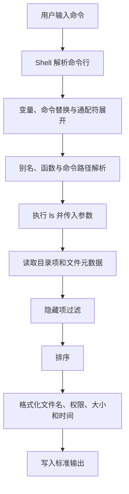

[toc]


## 学习大纲

| 学习模块     | 核心问题                                    | 学习目标                                    |
| ------------ | ------------------------------------------- | ------------------------------------------- |
| 命令定位     | `ls` 是什么，由谁执行                       | 理解 Shell、别名与外部程序之间的关系        |
| 基本语法     | 选项和路径参数如何组合                      | 能列出当前目录、指定目录或指定文件          |
| 工作原理     | 通配符、过滤、排序和格式化发生在哪里        | 避免把 Shell 展开误认为 `ls` 功能           |
| 文件筛选     | 如何显示隐藏文件、目录本身或递归内容        | 掌握 `-a`、`-A`、`-d`、`-R`                 |
| 输出格式     | 简洁、长格式、单列、分类标记如何选择        | 掌握 `-l`、`-1`、`-F`、`-h`                 |
| 元数据解读   | 权限、所有者、大小、时间分别表示什么        | 能读懂 `ls -l` 的每一列                     |
| 排序规则     | 如何按名称、时间、大小和版本排序            | 掌握 `-t`、`-S`、`-r`、`-v`                 |
| 时间语义     | `mtime`、`ctime`、`atime`、创建时间有何区别 | 避免把 `ctime` 误解为创建时间               |
| 链接处理     | 如何查看符号链接本身或目标                  | 理解 `-H`、`-L`、`-P` 的差异                |
| 跨平台差异   | GNU、BSD、BusyBox 为什么选项不同            | 编写更可移植的命令和脚本                    |
| 安全与自动化 | 为什么不应解析 `ls` 输出                    | 为脚本选择 `find`、`stat`、Shell 数组等工具 |
| 实战与排错   | 常见需求如何组合选项                        | 能独立解决日常文件查看问题                  |

本文以 POSIX.1-2024 的标准行为作为可移植性基线，主要使用 GNU Coreutils 9.11 说明 Linux 上常见的扩展功能，同时指出 FreeBSD/BSD 和 BusyBox 的主要差异。([The Open Group](https://pubs.opengroup.org/onlinepubs/9799919799/utilities/ls.html?utm_source=chatgpt.com))

------

## `ls` 是什么

`ls` 来自英文 **list**，用于列出文件和目录的信息。

最常见的语法是：

```bash
ls [OPTION]... [FILE]...
```

其中：

- `OPTION`：选项，例如 `-l`、`-a`、`-h`。
- `FILE`：操作数（operand），可以是文件、目录或多个路径。
- 不提供路径时，默认操作当前目录 `.`。
- 路径是普通文件时，显示该文件的信息。
- 路径是目录时，默认显示目录中的条目，而不是目录对象本身。
- 使用 `-d` 后，目录会像普通文件一样被列出，不再展开其内容。([GNU](https://www.gnu.org/software/coreutils/manual/coreutils.html?utm_source=chatgpt.com))

```bash
ls
ls .
ls /etc
ls README.md
ls /etc /var/log README.md
```

`ls` 的核心用途是“查看”。它不会因为列出了文件就修改文件内容，但某些文件系统或挂载策略可能因读取目录元数据而发生系统级时间更新；这不是日常使用 `ls` 时需要依赖的行为。

------

## 先确认你实际运行的是哪个 `ls`

在交互式终端中输入 `ls`，执行的未必只是 `/usr/bin/ls`。Shell 可能先处理：

- 别名（alias）
- Shell 函数（shell function）
- Shell 内建命令（builtin）
- `PATH` 中的外部程序

例如很多 Linux 发行版会设置：

```bash
alias ls='ls --color=auto'
```

因此，终端中的默认颜色可能来自别名，而不是 `ls` 在无选项时的默认行为。

在 Bash 中可使用：

```bash
type ls
type -a ls
alias ls
command -V ls
```

典型结果可能是：

```text
ls is aliased to `ls --color=auto'
ls is /usr/bin/ls
```

`type -a` 会列出命令名对应的别名、函数、内建命令以及可执行文件位置，是判断命令来源时比 `which` 更完整的工具。Bash 的命令查找会依次考虑函数、内建命令和 `PATH` 中的程序。([GNU](https://www.gnu.org/s/bash/manual/html_node/Bash-Builtins.html?utm_source=chatgpt.com))

查看本机实现及文档：

```bash
ls --version
ls --help
man ls
info coreutils 'ls invocation'
```

注意：

- GNU `ls` 通常支持 `--version` 和长选项。
- BSD 系统的 `ls` 通常不支持 GNU 风格的全部长选项。
- BusyBox 提供的是精简版 `ls`，可用选项取决于编译配置。

```bash
busybox ls --help
```

BusyBox 将许多精简的 Unix 工具实现为同一个可执行文件中的“小程序”（applet），因此选项数量通常少于 GNU Coreutils。([BusyBox](https://busybox.net/BusyBox.html?utm_source=chatgpt.com))

------

## `ls` 的工作流程

理解下面的流程，可以解决大量“为什么 `ls` 表现和想象不同”的问题。



这里最重要的一点是：

> `*.txt`、`file?.log`、`[ab]*` 等通配模式通常由 Shell 展开，不是由 `ls` 展开。

执行：

```bash
ls *.txt
```

Bash 通常会先把 `*.txt` 替换为匹配的文件名列表：

```text
ls notes.txt report.txt todo.txt
```

然后才执行 `ls`。

Bash 的文件名展开（filename expansion，也称 globbing）主要识别：

| 模式     | 含义                     | 示例            |
| -------- | ------------------------ | --------------- |
| `*`      | 匹配任意数量的字符       | `*.txt`         |
| `?`      | 匹配一个字符             | `file?.txt`     |
| `[abc]`  | 匹配集合中的一个字符     | `file[123].txt` |
| `[0-9]`  | 匹配指定范围中的一个字符 | `log[0-9].txt`  |
| `[!abc]` | 匹配集合之外的一个字符   | `[!0-9]*`       |

默认情况下，Bash 中的 `*` 不会匹配以 `.` 开头的名称；点号必须显式匹配，或者启用 `dotglob`。若模式没有匹配结果，默认 Bash 会保留原模式字符串，因此 `ls *.xyz` 可能变成让 `ls` 查找一个字面名称为 `*.xyz` 的文件。([GNU](https://www.gnu.org/s/bash/manual/html_node/Filename-Expansion.html?utm_source=chatgpt.com))

例如：

```bash
ls *.xyz
```

可能报错：

```text
ls: cannot access '*.xyz': No such file or directory
```

这不代表 `ls` 自己尝试进行模式匹配后失败，而通常意味着 Shell 没有找到匹配项，于是把原字符串交给了 `ls`。

------

## 基础用法

### 列出当前目录

```bash
ls
```

等价于：

```bash
ls .
```

默认情况下：

- 不显示以 `.` 开头的名称。
- 通常按当前区域设置（locale）的名称排序。
- 输出到终端时，GNU `ls` 通常采用多列布局。
- 输出被重定向或通过管道传递时，通常改为每行一个条目。([GNU](https://www.gnu.org/software/coreutils/ls?utm_source=chatgpt.com))

### 列出指定目录

```bash
ls /var/log
ls ~/Downloads
ls ./src
```

### 列出指定文件

```bash
ls README.md
ls /etc/hosts
```

使用长格式查看文件元数据：

```bash
ls -l README.md
```

### 同时列出多个路径

```bash
ls README.md src tests
```

当存在多个路径参数时，`ls` 通常会分别显示各目录内容，并用目录名作为分组标题。

### 路径中包含空格

必须进行引用或转义：

```bash
ls "Project Files"
ls 'Project Files'
ls Project\ Files
```

变量中保存路径时，通常应使用双引号：

```bash
directory="Project Files"
ls -l "$directory"
```

不要写成：

```bash
ls -l $directory
```

未引用的变量展开可能触发字段分割（word splitting）和文件名展开，使一个路径意外变成多个参数。

------

## 显示隐藏文件

Unix 类系统并没有专门的“隐藏文件属性”。通常只要名称以 `.` 开头，就被工具和图形界面视为隐藏名称，例如：

```text
.git
.env
.bashrc
.config
```

### 显示所有条目

```bash
ls -a
```

`-a` 是 `--all` 的缩写，会包括：

- 普通文件
- 点文件
- 当前目录 `.`
- 父目录 `..`

### 排除 `.` 和 `..`

GNU 和许多 BSD 实现支持：

```bash
ls -A
```

`-A` 即 `--almost-all`，显示点文件，但排除 `.` 和 `..`：

```text
.env
.git
.gitignore
README.md
```

`-a` 属于 POSIX 标准选项；`-A` 很常见，但不是编写严格可移植脚本时应无条件假定存在的选项。([GNU](https://www.gnu.org/software/coreutils/manual/html_node/Which-files-are-listed.html?utm_source=chatgpt.com))

### 常用组合

```bash
ls -la
ls -lah
ls -lA
```

在短选项中，以下写法通常等价：

```bash
ls -l -a -h
ls -lah
```

------

## 目录参数与 `-d`

这是初学者最容易混淆的规则之一。

假设存在目录：

```text
project/
├── README.md
└── src/
```

执行：

```bash
ls project
```

列出的是 `project` 的内容：

```text
README.md  src
```

执行：

```bash
ls -ld project
```

列出的是目录 `project` 本身的元数据：

```text
drwxr-xr-x 3 alice staff 4096 Jul 26 10:30 project
```

常见用途：

```bash
ls -ld /var/log
ls -ld */
ls -ld .git
```

`-d` 的含义不是“只显示目录”，而是：将目录操作数当作普通文件处理，不展开目录内容。

因此，下面的命令能否“只显示当前目录下的目录”，还取决于 Shell 是否先把 `*/` 展开为目录路径：

```bash
ls -d */
```

这里的“匹配目录”主要由尾部斜杠的 Shell 通配展开实现，而 `-d` 只是阻止 `ls` 展开每个目录的内容。([GNU](https://www.gnu.org/software/coreutils/manual/html_node/Which-files-are-listed.html?utm_source=chatgpt.com))

包含隐藏目录时，简单的 `*/` 不会匹配它们。若需要可靠地筛选目录，`find` 通常更合适：

```bash
find . -mindepth 1 -maxdepth 1 -type d
```

------

## 输出格式

### 长格式 `-l`

```bash
ls -l
```

`-l` 即长格式（long format），用于显示**文件类型、权限、链接数、所有者、组、大小和时间戳**等信息。([GNU](https://www.gnu.org/s/coreutils/manual/html_node/What-information-is-listed.html?utm_source=chatgpt.com))

### 人类可读大小 `-h`

```bash
ls -lh
```

`-h` 即 human-readable，需要和会**显示大小的选项一起使用**，最常见的是 `-l` 或 `-s`。

```text
-rw-r--r-- 1 alice staff 1.4K Jul 26 10:30 notes.txt
-rw-r--r-- 1 alice staff 3.8M Jul 26 10:31 archive.bin
```

GNU `ls -h` 使用 1024 的幂：

- `K`：1024 字节
- `M`：1024² 字节
- `G`：1024³ 字节

GNU 的 `--si` 则使用 1000 的幂。([GNU](https://www.gnu.org/s/coreutils/manual/html_node/What-information-is-listed.html?utm_source=chatgpt.com))

```bash
ls -lh
ls -l --si
```

### 强制每行一个名称

```bash
ls -1
```

这里是数字 `1`，不是小写字母 `l`。

适合：

- 截图或复制
- 快速查看名称
- 减少多列排版造成的视觉混淆

但它仍然不是安全的机器可解析格式，因为文件名本身可以包含换行符。

### 多列输出

```bash
ls -C
```

通常终端默认已经使用多列格式。

### 横向填充多列

```bash
ls -x
```

`-C` 与 `-x` 都输出多列，但条目在列中的排列方向不同。

### 逗号分隔

```bash
ls -m
```

示意：

```text
README.md, src, tests, package.json
```

### 添加文件类型标记

```bash
ls -F
```

常见后缀：

| 后缀 | 类型             |
| ---- | ---------------- |
| `/`  | 目录             |
| `*`  | 可执行普通文件   |
| `@`  | 符号链接         |
| `=`  | 套接字           |
| `|`  | 命名管道（FIFO） |

例如：

```text
build/
deploy.sh*
latest@
service.sock=
```

GNU 与 BSD 对部分特殊文件标记可能存在细节差异，但目录 `/`、可执行文件 `*` 和符号链接 `@` 非常常见。FreeBSD 的当前手册明确规定了这些分类后缀。([FreeBSD手册](https://man.freebsd.org/cgi/man.cgi?query=ls))

只给目录添加 `/`：

```bash
ls -p
```

### 彩色输出

GNU 常见写法：

```bash
ls --color=auto
```

取值通常包括：

```bash
ls --color=always
ls --color=auto
ls --color=never
```

最佳实践是交互终端使用 `auto`：

```bash
alias ls='ls --color=auto'
```

不要在**管道、日志和机器处理**场景中使用 `--color=always`，因为它会在输出中加入 ANSI 转义序列，可能污染文本。

FreeBSD 等 BSD 实现常使用：

```bash
ls -G
```

其颜色配置通常涉及 `CLICOLOR` 和 `LSCOLORS`；GNU 常使用 `LS_COLORS`。这些接口不能简单视为完全相同。([FreeBSD手册](https://man.freebsd.org/cgi/man.cgi?query=ls))

------

##  `ls -l`(字段说明)🎈

示例：

```text
-rw-r----- 1 alice developers 1536 Jul 26 10:30 report.txt
```

可以拆成：

| 字段           | 示例           | 含义                                            |
| -------------- | -------------- | ----------------------------------------------- |
| 文件类型与权限 | `-rw-r-----`   | 文件类型、所有者、组及其他用户权限              |
| 硬链接数       | `1`            | 指向同一 inode 的目录项数量                     |
| 所有者         | `alice`        | 用户名                                          |
| 所属组         | `developers`   | 组名                                            |
| 大小           | `1536`         | 普通文件的表观大小，通常以**字节**(B或byte)显示 |
| 时间           | `Jul 26 10:30` | 默认通常是数据修改时间                          |
| 名称           | `report.txt`   | 文件名                                          |

GNU 和 POSIX 对长格式的基本字段进行了规范，但 ACL、安全上下文、文件标志等扩展可能增加额外字符或列。([GNU](https://www.gnu.org/s/coreutils/manual/html_node/What-information-is-listed.html?utm_source=chatgpt.com))

------

## 文件类型字符

权限字符串的第一个字符表示文件类型：

| 字符 | 英文术语          | 含义                                |
| ---- | ----------------- | ----------------------------------- |
| `-`  | regular file      | 普通文件                            |
| `d`  | directory         | 目录                                |
| `l`  | symbolic link     | 符号链接                            |
| `c`  | character device  | 字符设备                            |
| `b`  | block device      | 块设备                              |
| `p`  | FIFO / named pipe | 命名管道                            |
| `s`  | socket            | 套接字                              |
| `w`  | whiteout          | 某些 BSD 文件系统中的 whiteout 条目 |

例如：

```text
drwxr-xr-x  project
-rw-r--r--  README.md
lrwxrwxrwx  latest -> releases/v3
srwxr-xr-x  app.sock
```

FreeBSD 当前手册列出了上述类型字符；不同系统是否支持某种特殊文件类型取决于内核与文件系统。([FreeBSD手册](https://man.freebsd.org/cgi/man.cgi?query=ls))

------

## 权限字符串

以：

```text
-rwxr-x---
```

为例：

```text
-  rwx  r-x  ---
│   │    │    │
│   │    │    └── 其他用户 other
│   │    └─────── 所属组 group
│   └──────────── 所有者 user
└──────────────── 文件类型
```

每组三个字符依次表示：

| 字符 | 英文术语 | 对普通文件的含义 |
| ---- | -------- | ---------------- |
| `r`  | read     | 可读取文件内容   |
| `w`  | write    | 可修改文件内容   |
| `x`  | execute  | 可作为程序执行   |
| `-`  | absent   | 没有该权限       |

对目录而言，权限含义不同：

| 权限 | 对目录的含义                                               |
| ---- | ---------------------------------------------------------- |
| `r`  | 能读取目录项名称列表                                       |
| `w`  | 能在目录中创建、删除或重命名目录项，但通常还受其他权限影响 |
| `x`  | 能搜索或穿过目录，访问已知名称的下级路径                   |

因此，目录的 `x` 更准确的含义是 **search/traverse permission**，而不是“执行目录”。

例如：

```text
drwx------  private
drwxr-xr-x  public
```

- `private` 仅所有者可进入和查看。
- `public` 所有用户可进入和读取名称，但只有所有者可修改目录内容。

权限位的具体访问结果还会受到 ACL、父目录权限、只读挂载、安全模块以及进程特权等因素影响。

### 特殊权限位

执行位置还可能出现：

| 字符 | 含义                                          |
| ---- | --------------------------------------------- |
| `s`  | 执行位与 set-user-ID 或 set-group-ID 同时设置 |
| `S`  | 设置了 set-ID，但没有对应执行位               |
| `t`  | 执行位与 sticky bit 同时设置                  |
| `T`  | 设置了 sticky bit，但没有对应执行位           |

典型公共临时目录：

```text
drwxrwxrwt  /tmp
```

末尾的 `t` 表示 sticky bit。FreeBSD 的 `ls` 手册对 `s`、`S`、`t`、`T` 的显示规则有完整说明。([FreeBSD手册](https://man.freebsd.org/cgi/man.cgi?query=ls))

### 尾部的 `+` 或 `.`

可能看到：

```text
-rw-r-----+ 1 alice staff ...
-rw-r-----. 1 alice staff ...
```

这些额外标记通常表示传统权限位以外还存在访问控制或安全元数据，例如：

- ACL（Access Control List，访问控制列表）
- SELinux 安全上下文
- 其他实现相关的访问机制

GNU `ls` 通常用 `+` 表示存在替代访问方法，用 `.` 表示存在安全上下文但没有其他替代访问方法。要查看详细 ACL，应使用系统提供的 `getfacl` 等工具。([GNU](https://www.gnu.org/software/coreutils/manual/coreutils.html?utm_source=chatgpt.com))

------

## 硬链接数

长格式中的第二列是硬链接数：

```text
-rw-r--r-- 2 alice staff 1280 Jul 26 10:30 data.txt
```

数字 `2` 表示有**两个目录项**指向同一个文件对象，即同一个 inode。

GNU 系统中可配合 inode 编号观察：

```bash
ls -li file-a file-b
```

示例：

```text
123456 -rw-r--r-- 2 alice staff 1280 Jul 26 10:30 file-a
123456 -rw-r--r-- 2 alice staff 1280 Jul 26 10:30 file-b
```

相同 inode 编号和链接数通常表明二者是硬链接。

`-i` 或 `--inode` 会显示 inode 编号。inode 在单个文件系统内标识文件对象，并记录权限、所有者、时间戳等元数据。([GNU](https://www.gnu.org/s/coreutils/manual/html_node/What-information-is-listed.html?utm_source=chatgpt.com))

目录的链接数与子目录结构有关，但具体规则可能受到文件系统实现影响，不建议仅凭链接数精确推算目录数量。

------

## 文件大小并不等于磁盘占用

### `ls -l` 的大小

对于普通文件：

```bash
ls -l file.bin
```

大小列通常表示文件的**表观大小**（apparent size），也就是逻辑上的字节长度。

```text
-rw-r--r-- 1 alice staff 1048576 Jul 26 10:30 file.bin
```

表示逻辑长度为 1,048,576 字节。

### `ls -s` 的块占用

```bash
ls -s file.bin
```

显示文件占用的块数。块单位受实现、选项和环境变量影响。

GNU 中可显式控制单位：

```bash
ls -s --block-size=1K file.bin
```

### 稀疏文件

稀疏文件（sparse file）的逻辑长度可能很大，但实际占用很小。因此：

```bash
ls -l sparse.img
du -h sparse.img
```

可能得到明显不同的数值：

- `ls -l`：逻辑字节长度。
- `du`：文件系统实际分配的空间。

GNU 文档明确区分表观大小与文件系统占用，并以稀疏文件作为典型例子。([GNU](https://www.gnu.org/s/coreutils/manual/html_node/du-invocation.html?utm_source=chatgpt.com))

### 目录大小

下面的大小：

```bash
ls -ld project
drwxr-xr-x 8 alice staff 4096 Jul 26 10:30 project
```

`4096` 不是 `project` 中所有文件大小的总和，而是目录对象自身的文件系统相关大小。

查看目录递归占用应使用：

```bash
du -sh project
```

查看各直接子项：

```bash
du -sh project/*
```

注意 `project/*` 默认不包含隐藏项。

------

## `total` 表示什么

执行：

```bash
ls -l
```

第一行可能是：

```text
total 24
```

它通常表示当前列出条目所占用的文件系统块总数，不是：

- 文件数量
- 所有文件字节数的简单总和
- 目录递归总大小

块单位可能受实现和环境影响。GNU Coreutils 中，块输出可受到 `BLOCK_SIZE`、`BLOCKSIZE`、`POSIXLY_CORRECT` 及相关选项影响；普通 `ls -l` 文件大小列则通常仍是字节计数。([GNU](https://www.gnu.org/s/coreutils/manual/html_node/Block-size.html?utm_source=chatgpt.com))

------

## 时间戳

Unix 文件通常涉及多个时间概念。

| 名称         | 英文术语           | 含义                                       |
| ------------ | ------------------ | ------------------------------------------ |
| `mtime`      | modification time  | 文件数据内容最后修改时间                   |
| `ctime`      | status change time | inode 状态最后变化时间                     |
| `atime`      | access time        | 文件最后访问时间                           |
| `birth time` | creation time      | 文件创建时间，是否可用取决于系统与文件系统 |

### 默认：`mtime`

```bash
ls -l
```

通常显示 `mtime`。

修改文件内容通常会更新它：

```bash
printf 'new data\n' >> report.txt
ls -l report.txt
```

### 显示 `atime`

```bash
ls -lu report.txt
```

按访问时间排序：

```bash
ls -ltu
```

### 显示 `ctime`

```bash
ls -lc report.txt
```

按状态变化时间排序：

```bash
ls -ltc
```

修改权限、所有者、链接关系等 inode 状态通常会改变 `ctime`：

```bash
chmod 600 report.txt
ls -lc report.txt
```

最重要的规则：

> `ctime` 中的 `c` 表示 change，不表示 creation。

### 创建时间

当前 GNU `ls` 支持：

```bash
ls -l --time=birth
ls -lt --time=birth
```

也可写作：

```bash
ls -l --time=creation
```

GNU Coreutils 9.11 的行为是：长格式下优先显示创建时间；如果创建时间不可用，则回退到修改时间。其他实现可能没有该选项，或采用不同的回退和显示方式。([GNU](https://www.gnu.org/software/coreutils/manual/coreutils.html?utm_source=chatgpt.com))

若需要明确判断时间字段是否真实可用，`stat` 通常比 `ls` 更合适：

```bash
stat report.txt
```

### ISO 时间格式

GNU 扩展：

```bash
ls -l --time-style=long-iso
```

示例：

```text
-rw-r--r-- 1 alice staff 1536 2026-07-26 10:30 report.txt
```

完整精度：

```bash
ls -l --time-style=full-iso
```

自定义：

```bash
ls -l --time-style='+%Y-%m-%d %H:%M:%S'
```

这些 GNU 长选项不应直接用于要求兼容所有 POSIX 或 BSD 系统的脚本。GNU 手册对时间格式提供了专门说明。([GNU](https://www.gnu.org/software/coreutils/manual/coreutils.pdf?utm_source=chatgpt.com))

------

## 排序

### 默认按名称

```bash
ls
```

默认按名称排序，但结果受区域设置影响。

例如：

```bash
LC_ALL=C ls
```

常用于获得更稳定、接近字节序的排序结果。

在非 POSIX locale 中：

- 大小写的相对顺序可能不同。
- 标点符号的处理可能不同。
- 重音字符和非 ASCII 字符可能按语言规则排序。

GNU 文档明确指出，`ls` 的默认排序受当前 locale 影响。([GNU](https://www.gnu.org/software/coreutils/ls?utm_source=chatgpt.com))

### 按修改时间

```bash
ls -lt
```

最新修改的条目在前。

反转后，最旧的在前：

```bash
ls -ltr
```

### 按大小

```bash
ls -lS
ls -lhS
```

默认从大到小。

从小到大：

```bash
ls -lhSr
```

### 反转顺序

```bash
ls -r
```

`-r` 即 reverse，会反转当前排序规则，而不只是“按名称倒序”。

### 版本排序

GNU 和部分 BSD 实现支持：

```bash
ls -v
```

假设存在：

```text
file1
file2
file9
file10
```

普通词法排序可能产生：

```text
file1
file10
file2
file9
```

版本排序通常产生：

```text
file1
file2
file9
file10
```

GNU `-v` 会将连续数字序列按数字意义参与版本排序。([GNU](https://www.gnu.org/software/coreutils/manual/coreutils.html?utm_source=chatgpt.com))

### 按扩展名排序

GNU 扩展：

```bash
ls -X
```

常用于按文件扩展名分组，但不属于最便携的选项。

### 不排序

GNU：

```bash
ls -U
```

表示按目录存储顺序输出，不排序。对包含海量目录项的目录，这可能减少排序开销，但输出顺序没有稳定语义。

```bash
ls -f
```

也会关闭排序，但通常还隐含显示所有条目等行为，副作用更多。只想跳过排序时，GNU 下更清晰的是 `-U`。([GNU](https://www.gnu.org/software/coreutils/manual/coreutils.html?utm_source=chatgpt.com))

### 常用排序组合

| 需求                   | 命令       |
| ---------------------- | ---------- |
| 最新修改优先           | `ls -lt`   |
| 最旧修改优先           | `ls -ltr`  |
| 最大文件优先           | `ls -lhS`  |
| 最小文件优先           | `ls -lhSr` |
| 自然版本顺序           | `ls -lv`   |
| 显示隐藏项并按时间排序 | `ls -lat`  |
| 跳过 GNU 名称排序      | `ls -U`    |

选项组合建议按“输出格式、筛选、时间、排序、反转”的思路阅读：

```bash
ls -l a t r
```

实际写作：

```bash
ls -latr
```

即：

- `-l`：长格式
- `-a`：全部条目
- `-t`：按时间
- `-r`：反转

选项书写顺序一般不决定处理阶段，但互相冲突的选项通常由实现按照“后出现者覆盖前者”等规则处理。为了可读性，不应依赖复杂的冲突覆盖。

------

## 符号链接

创建示例：

```bash
ln -s releases/v3 latest
```

### 长格式查看链接本身

```bash
ls -l latest
```

通常显示：

```text
lrwxrwxrwx 1 alice staff 11 Jul 26 10:30 latest -> releases/v3
```

这里：

- 开头 `l` 表示符号链接。
- `latest` 是链接自身的名称。
- `releases/v3` 是链接中保存的目标路径文本。
- 目标路径可能是相对路径。

### 跟随命令行中的链接

不同实现对 `-H`、`-L`、`-P` 的细节存在差异，但通用概念是：

| 选项 | 常见含义                         |
| ---- | -------------------------------- |
| `-H` | 跟随命令行参数位置的符号链接     |
| `-L` | 跟随遇到的符号链接，显示目标信息 |
| `-P` | 不跟随链接，显示链接本身         |

GNU 常见示例：

```bash
ls -lL latest
```

显示目标对象的元数据，而不是链接自身元数据。

递归跟随链接要格外谨慎：

```bash
ls -RL some-directory
```

符号链接可能构成环路、跨越意料之外的目录边界，或进入大型挂载目录。GNU 的实现包含递归环路检测，但这不意味着递归跟随链接没有性能和范围风险。FreeBSD 也明确区分 `-H`、`-L` 与 `-P`。([FreeBSD手册](https://man.freebsd.org/cgi/man.cgi?query=ls))

查看链接中存储的目标路径，通常使用：

```bash
readlink latest
```

------

## 递归列出

```bash
ls -R
```

`-R` 即 recursive，会递归列出子目录。

```bash
ls -R project
```

输出大致如下：

```text
project:
README.md
src

project/src:
main.c
util.c
```

适合：

- 快速查看规模不大的目录树。
- 确认某个目录下大致有哪些内容。

不适合：

- 搜索满足复杂条件的文件。
- 对结果执行批量操作。
- 遍历非常大的目录树。
- 要求结构化或安全可解析的输出。

这些场景通常应使用：

```bash
find project -type f
```

若主要为了人类浏览树状结构，可使用专门的 `tree` 工具，但它不一定默认安装。

------

## 筛选名称

### 让 Shell 筛选

```bash
ls *.txt
ls report-?.csv
ls image-[0-9].png
```

目录中的匹配：

```bash
ls logs/*.log
```

多个模式：

```bash
ls *.jpg *.png
```

注意：

- 模式由 Shell 展开。
- 匹配结果可能很多，超过系统命令行参数长度限制。
- 默认不匹配点文件。
- 未匹配模式在 Bash 默认设置下会原样传给 `ls`。([GNU](https://www.gnu.org/s/bash/manual/html_node/Filename-Expansion.html?utm_source=chatgpt.com))

### GNU `--hide`

```bash
ls --hide='*.tmp'
```

隐藏匹配模式的名称，但显式作为命令行参数传入的名称仍可能被显示。

### GNU `--ignore`

```bash
ls --ignore='*.tmp'
ls -I '*.tmp'
```

可重复使用：

```bash
ls -I '*.tmp' -I '*.bak'
```

这些模式是 Shell 风格模式，不是正则表达式。由于参数中包含 `*`，应引用它，避免 Shell 提前展开：

```bash
ls -I '*.tmp'
```

而不是：

```bash
ls -I *.tmp
```

GNU 手册将 `--hide` 和 `--ignore` 归类为决定列出哪些文件的选项。([GNU](https://www.gnu.org/software/coreutils/manual/html_node/Which-files-are-listed.html?utm_source=chatgpt.com))

复杂筛选推荐使用 `find`：

```bash
find . -maxdepth 1 -type f -name '*.txt'
```

------

## 文件名可能包含特殊字符

Unix 文件名可以包含：

- 空格
- 制表符
- 换行符
- 引号
- 反斜杠
- 终端控制字符
- 以 `-` 开头的字符

唯一不能出现在单个路径分量中的字符通常是 `/`，NUL 字节也不能构成文件名的一部分。

因此，一个文件名可能看起来像：

```text
annual report.txt
```

也可能包含真实换行：

```text
first line
second line
```

这正是不能把 `ls` 输出当成稳定记录格式的重要原因。

### GNU 文件名引用方式

GNU `ls` 支持：

```bash
ls --quoting-style=shell-escape
ls --quoting-style=c
ls --quoting-style=escape
ls -Q
ls -b
```

例如：

```bash
ls -lb
```

可能将换行显示为：

```text
first\nsecond
```

GNU 9.11 的默认引用方式还会根据输出是否连接终端而变化；终端输出通常更偏向可读和安全显示，非终端输出可能采用字面格式。([GNU](https://gnu.org/software/coreutils/manual/coreutils.pdf?utm_source=chatgpt.com))

### 处理以 `-` 开头的名称

假设文件名是：

```text
-rf
```

下面的命令会把它误认为选项：

```bash
ls -rf
```

应使用 `--` 表示选项结束：

```bash
ls -- -rf
```

或者显式加路径前缀：

```bash
ls ./-rf
```

这是所有接受 `--` 的命令都值得养成的习惯：

```bash
rm -- "$filename"
cp -- "$source" "$destination"
ls -- "$filename"
```

在脚本中处理来源不受控制的文件名时尤其重要。

------

## 为什么不要解析 `ls` 输出

下面的写法看似常见，但不可靠：

```bash
for file in $(ls); do
    printf '%s\n' "$file"
done
```

问题包括：

- 命令替换会移除尾部换行。
- Shell 会按空白字符重新分割结果。
- 文件名中的空格、制表符和换行会被破坏。
- `ls` 的引用、颜色和列格式取决于终端、locale、选项和别名。
- 单列输出 `-1` 也不能解决文件名中包含换行的问题。
- `ls -l` 是面向人类的显示，不是稳定的数据格式。

GNU `ls` 提供多种文件名引用样式，本身就说明其输出会根据显示需求进行转换；Bash 还会对未引用的命令替换结果执行字段分割和文件名展开。([GNU](https://gnu.org/software/coreutils/manual/coreutils.pdf?utm_source=chatgpt.com))

### 当前目录中的 Shell 循环

Bash 中：

```bash
for file in ./*; do
    printf '%s\n' "$file"
done
```

优势：

- 文件名作为独立 Shell 参数传递。
- 空格和多数特殊字符不会导致再次分割。
- `./` 还能避免名称以 `-` 开头时被后续命令解释为选项。

处理普通文件：

```bash
for file in ./*; do
    [[ -f $file ]] || continue
    printf 'file: %q\n' "$file"
done
```

这里的 `%q` 是 Bash `printf` 扩展，适合生成便于检查的 Shell 转义表示。

### 递归、安全处理任意文件名

Bash 示例：

```bash
find . -type f -print0 |
while IFS= read -r -d '' file; do
    printf 'processing: %q\n' "$file"
done
```

这里使用 NUL 字节作为记录分隔符，因为 NUL 不可能出现在 Unix 文件名中。

更适合 POSIX Shell 的批处理方式：

```bash
find . -type f -exec sh -c '
    for file do
        printf "%s\n" "$file"
    done
' sh {} +
```

### 获取结构化元数据

不要解析：

```bash
ls -l file
```

应优先使用：

```bash
stat file
```

GNU 下可定制字段：

```bash
stat --format='%n %s %Y' -- file
```

其中可按需求输出名称、字节数和时间戳，避免依赖 `ls -l` 的空格对齐。

------

## `ls` 与相关工具如何分工

| 任务                 | 推荐工具        | 原因                             |
| -------------------- | --------------- | -------------------------------- |
| 人工浏览当前目录     | `ls`            | 简洁直观                         |
| 查看文件权限和所有者 | `ls -l`、`stat` | `ls` 适合概览，`stat` 更完整     |
| 计算目录占用         | `du`            | `ls` 不递归汇总目录空间          |
| 查看文件系统剩余空间 | `df`            | 面向文件系统而不是单个文件       |
| 按条件递归查找       | `find`          | 支持类型、名称、时间、大小等条件 |
| 查看符号链接目标     | `readlink`      | 直接读取链接保存的路径           |
| 查看文件类型         | `file`          | 基于内容和特征判断               |
| 获取机器可用元数据   | `stat`          | 字段明确、可定制                 |
| 浏览树状结构         | `tree`          | 面向层级可视化                   |
| 统计条目数量         | Shell、`find`   | 不应通过解析 `ls` 完成           |

例如，查找大文件应使用：

```bash
find . -type f -size +100M
```

而不是先运行 `ls -lhR` 再人工筛选。

------

## 常用场景

### 查看当前目录详情，包括隐藏项

```bash
ls -lah
```

GNU/Linux 交互环境中最常用的组合之一：

- `-l`：长格式
- `-a`：隐藏项
- `-h`：可读大小

若不想显示 `.` 与 `..`：

```bash
ls -lAh
```

### 查看最新修改的文件

```bash
ls -lt
```

只看前几项：

```bash
ls -lt | head
```

这里仅用于人类查看。不要根据这段文本进一步执行危险批处理。

GNU 下更明确地每行显示一个条目：

```bash
ls -lt --time-style=long-iso
```

### 查看最大的条目

```bash
ls -lhS
```

注意：

- 目录大小列不是目录内容总量。
- 若要找占用最大的目录，应使用 `du`。

```bash
du -sh ./* | sort -h
```

### 查看目录本身权限

```bash
ls -ld /srv/app
```

不要使用：

```bash
ls -l /srv/app
```

后者显示的是目录内容。

### 查看父目录中的所有条目

```bash
ls -la ..
```

### 只查看目录

简单交互用法：

```bash
ls -d */
```

更可靠的条件查询：

```bash
find . -mindepth 1 -maxdepth 1 -type d
```

### 显示 inode

```bash
ls -li
```

常用于：

- 判断两个名称是否为硬链接。
- 排查文件被删除但进程仍持有等 inode 相关问题。
- 与 `find -inum` 配合定位同 inode 条目。

### 查看数值用户和组 ID

```bash
ls -ln
```

`-n` 在长格式中显示 UID 和 GID，而不是解析为用户名和组名：

```text
-rw-r--r-- 1 1000 1000 1536 Jul 26 10:30 report.txt
```

适合：

- 容器环境
- 网络文件系统
- 用户数据库不可用
- 排查 UID/GID 映射问题

GNU 和 FreeBSD 都支持此类数值显示。([GNU](https://www.gnu.org/s/coreutils/manual/html_node/What-information-is-listed.html?utm_source=chatgpt.com))

### 查看 SELinux 上下文

GNU/Linux 上若实现支持：

```bash
ls -Z
```

示例：

```text
-rw-r--r--. alice staff system_u:object_r:etc_t:s0 config
```

这不是 POSIX 通用选项，在非 SELinux 或非 GNU 系统上可能不存在。

### 显示完整路径

`ls` 没有统一的“把所有结果转换成绝对路径”的可移植选项。可根据目标使用：

```bash
printf '%s\n' "$PWD"/*
```

或：

```bash
find "$PWD" -maxdepth 1 -mindepth 1
```

注意前者默认不包括隐藏项。

------

## 管道与重定向

### 分页查看

```bash
ls -lah | less
```

保留颜色需要 GNU 扩展，并让 `less` 解释颜色控制序列：

```bash
ls -lah --color=always | less -R
```

但在保存日志时应关闭颜色：

```bash
ls -lah --color=never > listing.txt
```

### 搜索显示结果

简单人工查看：

```bash
ls -1 | grep 'report'
```

这不是严格的文件名安全处理方式，因为文件名可能含换行，而且 `grep` 看到的是格式化文本。

真正按名称查找：

```bash
find . -maxdepth 1 -name '*report*'
```

### 保存清单

```bash
LC_ALL=C ls -1A --color=never > listing.txt
```

这可以作为方便人阅读和比较的清单，但仍不能作为能无损还原任意文件名的数据格式。

需要无损记录文件名时：

```bash
find . -mindepth 1 -maxdepth 1 -print0 > listing.bin
```

------

## 跨平台差异

### POSIX 基线

需要提高可移植性时，优先使用常见的 POSIX 选项，例如：

```text
-a -c -d -f -g -i -l -n -o -p -q -r -R -s -t -u -x -1 -C -F -H -L
```

具体组合和冲突规则仍应查看目标系统的 `man ls`。POSIX.1-2024 定义了 `ls` 的标准接口，但实现可增加扩展选项。([The Open Group](https://pubs.opengroup.org/onlinepubs/9799919799/utilities/ls.html?utm_source=chatgpt.com))

### GNU Coreutils

GNU/Linux 上常见扩展包括：

```text
--color
--group-directories-first
--hide
--ignore
--quoting-style
--time-style
--time=birth
--sort=version
--sort=name
--si
```

当前 GNU Coreutils 9.11 手册包含这些现代选项，其中 `--sort=name` 可显式恢复默认名称排序，`--time=birth` 可使用创建时间。([GNU](https://www.gnu.org/software/coreutils/manual/coreutils.html?utm_source=chatgpt.com))

### BSD 与 macOS

BSD 风格 `ls`：

- 通常采用单字母选项为主。
- 常使用 `-G` 开启颜色。
- 可能支持文件标志、创建时间、ACL 或 MAC 标签相关选项。
- 某些与 GNU 同名的短选项可能含义不同。
- 不应假定支持 GNU 的 `--color=auto`、`--time-style` 等长选项。

FreeBSD 当前 `ls` 提供 `-G`、`-D format`、文件标志和 `LSCOLORS` 等扩展，同时明确标注了哪些选项不属于 POSIX。([FreeBSD手册](https://man.freebsd.org/cgi/man.cgi?query=ls))

因此，macOS 或 BSD 上遇到下面的错误并不奇怪：

```text
ls: illegal option -- -
```

应查看：

```bash
man ls
```

而不是直接复制 GNU/Linux 教程中的全部选项。

### BusyBox

BusyBox 常见于：

- 嵌入式 Linux
- 精简容器镜像
- 恢复环境
- 安装程序
- 路由器与设备固件

其 `ls` 功能由编译配置决定，不能假定存在 GNU 长选项。

```bash
busybox ls --help
```

在脚本需要兼容 BusyBox 时：

- 少用 GNU 长选项。
- 避免依赖颜色和复杂时间格式。
- 在目标镜像中实际测试。
- 不要只在完整 Ubuntu 或 Fedora 环境中验证。([BusyBox](https://busybox.net/BusyBox.html?utm_source=chatgpt.com))

### 对比表

| 功能                        | POSIX         | GNU             | FreeBSD/BSD 常见            | BusyBox      |
| --------------------------- | ------------- | --------------- | --------------------------- | ------------ |
| `-l` 长格式                 | 是            | 是              | 是                          | 通常是       |
| `-a` 隐藏项                 | 是            | 是              | 是                          | 通常是       |
| `-A` 排除 `.` 和 `..`       | 非标准        | 是              | 常见                        | 取决于构建   |
| `-h` 可读大小               | 非 POSIX 基线 | 是              | 常见                        | 常见但不保证 |
| `--color=auto`              | 否            | 是              | 通常不同                    | 取决于构建   |
| `-G` 颜色                   | 否            | 含义不宜假定    | 常见                        | 不保证       |
| `--time-style`              | 否            | 是              | 通常无                      | 通常无       |
| `--time=birth`              | 否            | 是              | 可能使用其他选项            | 通常无       |
| `-Z` 安全上下文             | 否            | 部分 Linux 支持 | FreeBSD 有实现相关含义      | 取决于构建   |
| `--group-directories-first` | 否            | 是              | 当前 FreeBSD 也支持兼容形式 | 通常无       |

判断原则：

> 先查看本机 `man ls` 或 `ls --help`，不要仅凭选项名称猜测其语义。

------

## 最佳实践

### 交互查看与脚本处理分开

交互查看可以追求可读性：

```bash
ls -lah --color=auto
```

脚本中应追求：

- 明确的数据边界
- 不受颜色影响
- 不受列宽影响
- 不受 locale 影响
- 不受别名影响
- 能处理特殊文件名

脚本应优先使用：

```bash
find
stat
printf
Shell glob
Shell array
```

### 始终引用变量

推荐：

```bash
ls -ld -- "$path"
```

不推荐：

```bash
ls -ld $path
```

前者同时防止：

- 空格分割
- 通配符重新展开
- 以 `-` 开头的名称被解释为选项

### 对外部输入使用 `--`

```bash
ls -- "$filename"
```

即使变量当前看起来安全，也应养成这一习惯。

### 不依赖颜色表达重要信息

颜色适合辅助人类识别，但可能：

- 被主题配置改变。
- 在不同终端中显示不同。
- 在重定向后消失。
- 对色觉障碍用户不友好。
- 被日志系统保留为控制字符。

需要明确文件类型时，使用：

```bash
ls -F
ls -l
stat
file
```

### 显式设置 locale 以获得稳定排序

临时执行：

```bash
LC_ALL=C ls -1
```

脚本中：

```bash
LC_ALL=C
export LC_ALL
```

但这会影响整个脚本中的字符分类、排序和消息语言，应根据范围谨慎设置。

### 大目录避免不必要的元数据读取

普通名称列表通常比长格式便宜：

```bash
ls
```

长格式需要获取每个条目的更多元数据：

```bash
ls -l
```

排序也会增加处理成本。GNU 的：

```bash
ls -U
```

可以跳过排序，但输出顺序不稳定。只在明确不需要排序语义时使用。([GNU](https://www.gnu.org/s/coreutils/manual/html_node/Sorting-the-output.html?utm_source=chatgpt.com))

### 不把 `ls` 当作搜索工具

不推荐：

```bash
ls -R | grep config
```

推荐：

```bash
find . -name '*config*'
```

若搜索文件内容：

```bash
grep -R 'keyword' .
```

任务应该交给语义最匹配的工具。

### 别名只用于交互环境

适合交互使用：

```bash
alias ll='ls -alF'
alias la='ls -A'
alias l='ls -CF'
```

脚本不应依赖用户的别名。脚本应直接写出所需选项：

```bash
ls -la
```

而不是：

```bash
ll
```

------

## 常见误区

| 误区                           | 正确理解                                                |
| ------------------------------ | ------------------------------------------------------- |
| `ls -l directory` 显示目录本身 | 它默认显示目录内容；查看目录本身要用 `ls -ld directory` |
| `-d` 表示只筛选目录            | `-d` 表示不展开目录内容                                 |
| `ctime` 是创建时间             | `ctime` 是状态变化时间                                  |
| `ls -lh` 显示实际磁盘占用      | 它主要显示表观大小；实际占用看 `du`                     |
| 目录大小列是目录内容总量       | 它是目录对象自身大小，通常无递归汇总意义                |
| `total` 是文件数               | 它通常是已列条目的分配块总量                            |
| `*.txt` 由 `ls` 匹配           | 通常由 Shell 在运行 `ls` 前展开                         |
| `ls -1` 可以安全供脚本解析     | 文件名可能含换行，仍不安全                              |
| `ls -a` 只显示隐藏文件         | 它显示全部条目，包括普通文件                            |
| `-A` 属于所有 Unix 系统        | 很常见，但不是严格 POSIX 基线                           |
| GNU 长选项可在 macOS 使用      | macOS/BSD 的实现和选项集合不同                          |
| `ls -R` 适合批量处理           | 搜索和批处理通常应使用 `find`                           |
| 权限末尾 `+` 是文件名一部分    | 通常表示 ACL 或其他访问机制                             |
| 彩色输出可以可靠判断文件类型   | 颜色取决于实现、配置和终端                              |

------

## 推荐的学习顺序

先熟练掌握以下命令：

```bash
ls
ls -l
ls -a
ls -la
ls -lh
ls -ld directory
ls -lt
ls -lhS
ls -F
ls -i
ls -R
```

然后理解以下概念：

- Shell 通配展开
- 点文件
- 文件类型
- 用户、组与权限
- inode 和硬链接
- 符号链接
- 表观大小与磁盘占用
- `mtime`、`ctime` 与 `atime`
- locale 排序
- GNU、BSD 和 BusyBox 差异
- 为什么脚本不解析 `ls`

最后掌握替代工具：

```bash
stat
find
du
df
file
readlink
```

------

## 练习

### 练习：查看当前目录所有条目的详细信息

```bash
ls -la
```

### 练习：以可读大小显示，但不显示 `.` 和 `..`

GNU 或支持 `-A` 的系统：

```bash
ls -lAh
```

### 练习：查看 `/var/log` 目录对象自身权限

```bash
ls -ld /var/log
```

### 练习：按修改时间从旧到新排列

```bash
ls -ltr
```

### 练习：按大小从大到小排列

```bash
ls -lhS
```

### 练习：判断两个名称是不是硬链接

```bash
ls -li file-a file-b
```

观察 inode 编号是否相同。

### 练习：查看符号链接本身

```bash
ls -l link-name
```

### 练习：显示 GNU `ls` 的创建时间

```bash
ls -l --time=birth file
```

同时用：

```bash
stat file
```

确认文件系统是否真正提供创建时间。

### 练习：列出当前目录下普通文件并安全处理空格

Bash：

```bash
for file in ./*; do
    [[ -f $file ]] || continue
    printf '%q\n' "$file"
done
```

### 练习：递归处理所有 `.txt` 文件

```bash
find . -type f -name '*.txt' -exec sh -c '
    for file do
        printf "%s\n" "$file"
    done
' sh {} +
```

------

## 速查表

| 需求                     | 命令                          |
| ------------------------ | ----------------------------- |
| 当前目录                 | `ls`                          |
| 指定目录                 | `ls path`                     |
| 详细信息                 | `ls -l`                       |
| 所有条目                 | `ls -a`                       |
| 隐藏项但排除 `.` 和 `..` | `ls -A`                       |
| 可读大小                 | `ls -lh`                      |
| 查看目录自身             | `ls -ld directory`            |
| 文件类型标记             | `ls -F`                       |
| 每行一个                 | `ls -1`                       |
| 按时间排序               | `ls -lt`                      |
| 从旧到新                 | `ls -ltr`                     |
| 按大小排序               | `ls -lhS`                     |
| 从小到大                 | `ls -lhSr`                    |
| 版本排序                 | `ls -v`                       |
| inode 编号               | `ls -i`                       |
| 数值 UID/GID             | `ls -ln`                      |
| 递归                     | `ls -R`                       |
| 不排序，GNU              | `ls -U`                       |
| ISO 时间，GNU            | `ls -l --time-style=long-iso` |
| 创建时间，GNU            | `ls -l --time=birth`          |
| 关闭颜色，GNU            | `ls --color=never`            |
| 处理以 `-` 开头的名称    | `ls -- -filename`             |
| 查看命令来源，Bash       | `type -a ls`                  |
| 查看本机手册             | `man ls`                      |

`ls` 最适合做“面向人类的文件信息概览”。一旦任务涉及递归搜索、大小统计、结构化元数据或安全自动化，就应及时切换到 `find`、`du`、`stat` 等更专门的工具。