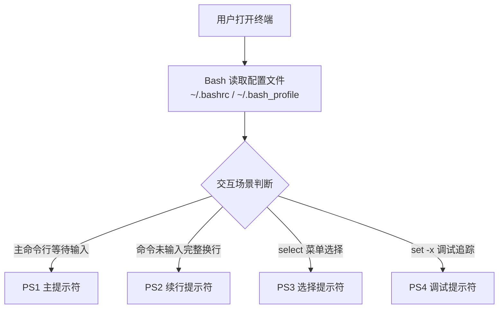
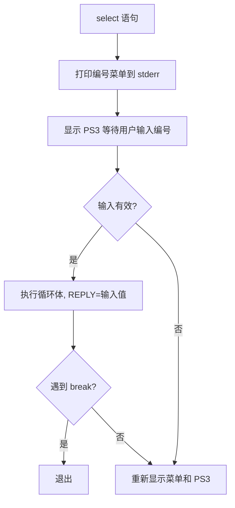
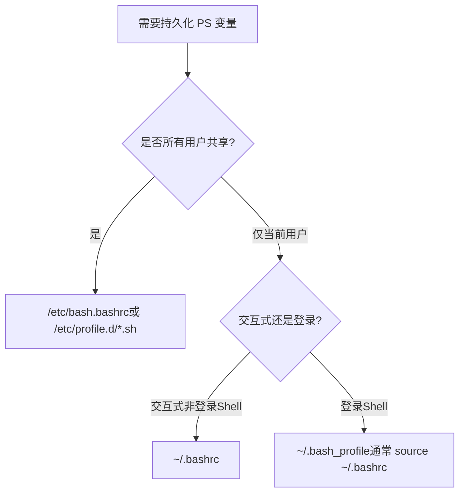

[toc]

# Shell PS1–PS4 环境变量详解

## 概念背景

Shell 在与用户交互时，需要通过"提示符"来告知用户当前状态、等待输入等信息。Bash 使用四个特殊变量 `PS1`、`PS2`、`PS3`、`PS4` 分别控制不同场景下的提示符外观与行为。理解它们是定制终端体验、调试脚本的基础技能。



---

## 四个变量

| 变量  | 触发场景                          | 默认值     | 是否常用 |
| ----- | --------------------------------- | ---------- | -------- |
| `PS1` | 每次显示主命令行提示符时          | `\s-\v\$ ` | ★★★★★    |
| `PS2` | 命令跨行未结束，等待继续输入时    | `> `       | ★★★      |
| `PS3` | `select` 语句显示菜单后等待选择时 | 无（空）   | ★★       |
| `PS4` | `set -x` 开启追踪调试时，每行前缀 | `+ `       | ★★★★     |

---

最常用的是`PS1`和`PS4`

## PS1 — 主提示符

PS1 是用户最频繁看到的提示符，每次按下回车后、新命令行出现时重新渲染。

### 转义序列速查

Bash 在 PS1 中支持以反斜杠开头的特殊占位符，会在渲染时动态替换：

| 转义符      | 含义                                                   | 示例输出       |
| ----------- | ------------------------------------------------------ | -------------- |
| `\u`        | 当前用户名                                             | `alice`        |
| `\h`        | 主机名（第一个点之前）                                 | `myhost`       |
| `\H`        | 完整主机名                                             | `myhost.local` |
| `\w`        | 当前工作目录（`~` 缩写家目录）                         | `~/projects`   |
| `\W`        | 当前目录的**最后一级**名称                             | `projects`     |
| `\$`        | 普通用户显示 `$`，root 显示 `#`                        | `$`            |
| `\n`        | 换行                                                   | （换行）       |
| `\t`        | 当前时间 HH:MM:SS（24小时）                            | `14:32:05`     |
| `\T`        | 当前时间 HH:MM:SS（12小时）                            | `02:32:05`     |
| `\A`        | 当前时间 HH:MM（24小时）                               | `14:32`        |
| `\d`        | 日期                                                   | `Mon Jan 15`   |
| `\j`        | 当前 Shell 管理的后台作业数                            | `2`            |
| `\!`        | 当前命令在历史中的编号                                 | `142`          |
| `\#`        | 本次会话中的命令编号                                   | `37`           |
| `\s`        | Shell 名称                                             | `bash`         |
| `\v`        | Bash 版本号                                            | `5.2`          |
| `\[` / `\]` | 包裹**不可打印字符**（如颜色码），防止光标位置计算错误 | —              |

> **关键原理**：`\[` 和 `\]` 是新手最容易忽略的细节。终端计算光标位置时依赖提示符的**可见字符数**，若颜色转义码未被标记为不可见，光标会乱跳、行编辑错位。

### 颜色代码结构

ANSI 颜色转义码的格式为：

`\e[<属性>;<前景色>;<背景色>m`

包裹在 PS1 中时写法为：`\[\e[...m\]`

| 属性值 | 含义         |
| ------ | ------------ |
| `0`    | 重置所有格式 |
| `1`    | 加粗         |
| `2`    | 暗淡         |
| `4`    | 下划线       |
| `5`    | 闪烁         |
| `7`    | 反色         |

| 颜色       | 前景色 | 背景色 |
| ---------- | ------ | ------ |
| 黑         | `30`   | `40`   |
| 红         | `31`   | `41`   |
| 绿         | `32`   | `42`   |
| 黄         | `33`   | `43`   |
| 蓝         | `34`   | `44`   |
| 紫         | `35`   | `45`   |
| 青         | `36`   | `46`   |
| 白         | `37`   | `47`   |
| 亮黑（灰） | `90`   | `100`  |
| 亮红       | `91`   | `101`  |
| 亮绿       | `92`   | `102`  |
| 亮黄       | `93`   | `103`  |
| 亮蓝       | `94`   | `104`  |

### 经典配置示例

最简彩色提示符 ：(ubuntu默认bash样式)

```bash
PS1='\[\e[32m\]\u@\h\[\e[0m\]:\[\e[34m\]\w\[\e[0m\]\$ '
```

渲染效果：`alice@myhost:~/projects$ `（用户@主机 绿色，路径蓝色）

---

**显示上一条命令退出状态**（成功绿色 ✔，失败红色 ✗）：

```bash
PS1='$(if [ $? -eq 0 ]; then echo "\[\e[32m\]✔"; else echo "\[\e[31m\]✗"; fi)\[\e[0m\] \[\e[32m\]\u@\h\[\e[0m\]:\[\e[34m\]\w\[\e[0m\]\$ '
```

> **注意**：`$?` 必须放在 PS1 字符串内用单引号包裹，或放在 `PROMPT_COMMAND` 里提前捕获，否则 PS1 赋值语句本身会覆盖 `$?`。

---

**多行提示符**（信息丰富，命令输入区独占一行）：

```bash
PS1='\[\e[90m\]┌─[\[\e[0m\]\[\e[93m\]\u\[\e[90m\]@\[\e[96m\]\h\[\e[90m\]] \[\e[94m\]\w\[\e[90m\]\n└─\[\e[0m\]\$ '
```

渲染效果：
```
┌─[alice@myhost] ~/projects
└─$ 
```

---

**显示 Git 分支**（现代开发者标配）：

```bash
parse_git_branch() {
    git branch 2>/dev/null | grep '^\*' | sed 's/\* //'
}

PS1='\[\e[32m\]\u@\h\[\e[0m\]:\[\e[34m\]\w\[\e[33m\]$(parse_git_branch)\[\e[0m\]\$ '
```

渲染效果：`alice@myhost:~/projects(main)$ `

### PROMPT_COMMAND — PS1 的好搭档

`PROMPT_COMMAND` 是一个特殊变量，其值是**每次显示 PS1 之前自动执行的命令**。适合做动态计算、状态捕获等 PS1 内嵌复杂逻辑时难以完成的事情。

```bash
# 将上一条命令的退出码提前存入变量，避免被覆盖
LAST_STATUS=0
capture_status() { LAST_STATUS=$?; }
PROMPT_COMMAND='capture_status'

PS1='$([ $LAST_STATUS -eq 0 ] && echo "\[\e[32m\]✔\[\e[0m\]" || echo "\[\e[31m\]✗\[\e[0m\] $LAST_STATUS") \u@\h:\w\$ '
```

---

## PS2 — 续行提示符

当用户输入的命令**语法上未结束**（如多行管道、未闭合的引号、`\` 换行），Bash 会显示 PS2 等待继续输入。

触发示例：

```bash
$ echo "hello \
> world"
hello world
```

```bash
$ for i in 1 2 3; do
>   echo $i
> done
```

此处 `>` 就是默认的 PS2。

### 自定义 PS2

```bash
PS2='\[\e[90m\]... \[\e[0m\]'
```

PS2 也支持与 PS1 相同的转义序列，但通常保持简洁，**不建议放太多信息**，避免干扰续行输入的视觉节奏。

---

## PS3 — select 菜单提示符

`select` 是 Bash 内置的菜单选择结构。PS3 控制其输入提示文字。

### select 工作原理



### 示例

```bash
PS3='请选择你的操作系统（输入编号）: '

select os in "Ubuntu" "Arch Linux" "macOS" "退出"; do
    case $os in
        "退出") break ;;
        "") echo "无效选择，请重试" ;;
        *) echo "你选择了: $os"; break ;;
    esac
done
```

输出：

```
1) Ubuntu
2) Arch Linux
3) macOS
4) 退出
请选择你的操作系统（输入编号）: 
```

> **要点**：PS3 不支持 `\u`、`\w` 等转义序列，它是一个**纯字符串**，原样显示。若未设置 PS3，默认显示 `#? `（不友好），实际使用时务必自定义。

---

## PS4 — 调试追踪前缀

执行 `set -x` 后，Bash 会在运行每一条命令前将其打印出来，PS4 控制每行追踪信息的前缀格式。

默认值 `+ ` 非常简陋，难以定位问题来源。

### 增强 PS4 的关键变量

在 PS4 中可以使用以下 Bash 内置变量（注意：这些不是 `\u` 风格的转义，而是 `$` 变量引用，需用**单引号**赋值）：

| 变量             | 含义                               |
| ---------------- | ---------------------------------- |
| `$BASH_SOURCE`   | 当前执行的脚本文件名               |
| `$LINENO`        | 当前行号                           |
| `$FUNCNAME`      | 当前函数名（数组，`[0]` 为当前层） |
| `$BASH_SUBSHELL` | 子 Shell 嵌套层级                  |

### 实用配置

**基础增强**（显示文件名和行号）：

```bash
export PS4='+ ${BASH_SOURCE[0]}:${LINENO}: '
```

追踪输出示例：
```
+ /home/alice/deploy.sh:42: echo "部署开始"
```

---

**完整调试信息**（文件、行号、函数名）：

```bash
export PS4='+ [${BASH_SOURCE[0]##*/}:${LINENO}] ${FUNCNAME[0]:+${FUNCNAME[0]}(): }'
```

- `${BASH_SOURCE[0]##*/}`：只取文件名部分，去掉路径
- `${FUNCNAME[0]:+...}`：若在函数内才显示函数名，否则留空

追踪输出示例：
```
+ [deploy.sh:15] setup_env(): export DB_HOST=localhost
+ [deploy.sh:42] echo "部署开始"
```

---

**带颜色的 PS4**（调试输出醒目区分）：

```bash
export PS4='\[\e[35m\]+ [${BASH_SOURCE[0]##*/}:${LINENO}]\[\e[0m\] '
```

> **最佳实践**：将增强的 PS4 放入 `~/.bashrc`，开发调试时直接 `set -x`，调试完 `set +x`，无需反复修改。

### 调试作用域控制

```bash
#!/usr/bin/env bash
export PS4='+ [${BASH_SOURCE[0]##*/}:${LINENO}]: '

# 只对某段代码开启追踪
set -x
    some_complex_function
set +x

# 其余代码不产生追踪输出
echo "正常运行"
```

---

## 配置的持久化与最佳实践

### 配置文件选择



通常做法是：**所有自定义都写在 `~/.bashrc`**，再在 `~/.bash_profile` 中写：

```bash
[ -f ~/.bashrc ] && source ~/.bashrc
```

### 完整的最佳实践模板

```bash
# ~/.bashrc 中的提示符配置

# ─── 工具函数 ────────────────────────────────────────────────
parse_git_branch() {
    local branch
    branch=$(git branch 2>/dev/null | grep '^\*' | sed 's/\* //')
    [ -n "$branch" ] && echo " ($branch)"
}

capture_exit_status() {
    _last_exit=$?
}

# ─── PROMPT_COMMAND ──────────────────────────────────────────
PROMPT_COMMAND='capture_exit_status'

# ─── PS1 主提示符 ─────────────────────────────────────────────
_status_icon() {
    if [ "$_last_exit" -eq 0 ]; then
        echo '\[\e[32m\]✔\[\e[0m\]'
    else
        echo '\[\e[31m\]✗'"$_last_exit"'\[\e[0m\]'
    fi
}

PS1='$(_status_icon) \[\e[32m\]\u@\h\[\e[0m\]:\[\e[34m\]\w\[\e[33m\]$(parse_git_branch)\[\e[0m\]\$ '

# ─── PS2 续行提示符 ───────────────────────────────────────────
PS2='\[\e[90m\]  ╰─ \[\e[0m\]'

# ─── PS3 select 提示 ──────────────────────────────────────────
PS3='请输入选项编号: '

# ─── PS4 调试追踪前缀 ─────────────────────────────────────────
export PS4='+ [${BASH_SOURCE[0]##*/}:${LINENO}]${FUNCNAME[0]:+ ${FUNCNAME[0]}()}: '
```

### 常见错误与规避

| 错误                      | 现象                               | 解决方法                       |
| ------------------------- | ---------------------------------- | ------------------------------ |
| 颜色码未用 `\[...\]` 包裹 | 光标位置错乱，行编辑时内容显示异常 | 所有不可打印序列必须包裹       |
| PS1 中用双引号包含 `$()`  | 函数在赋值时立即求值，不动态更新   | 用单引号，或转义 `$` 为 `\$`   |
| PS4 中 `$LINENO` 提前展开 | 所有行都显示同一行号               | 用单引号赋值 PS4，不用双引号   |
| `$?` 被 PS1 赋值覆盖      | 退出状态始终为 0                   | 用 `PROMPT_COMMAND` 提前捕获   |
| `select` 未设置 PS3       | 显示不友好的 `#? `                 | 每次用 `select` 前显式设置 PS3 |

---

## 现代替代方案参考

如果你追求开箱即用的强大提示符，以下工具值得了解，它们本质上都是在动态生成 PS1：

| 工具              | 特点                                | 适合人群                      |
| ----------------- | ----------------------------------- | ----------------------------- |
| **Starship**      | 跨 Shell、Rust 编写、极快、配置简单 | 现代开发者首选                |
| **Oh My Bash**    | Bash 专属框架，主题丰富             | 重度 Bash 用户                |
| **Powerline**     | Python 实现，状态栏风格             | 喜欢 Powerline 字体风格的用户 |
| **Liquid Prompt** | 纯 Bash，信息丰富，无需额外字体     | 不想安装额外依赖的用户        |

