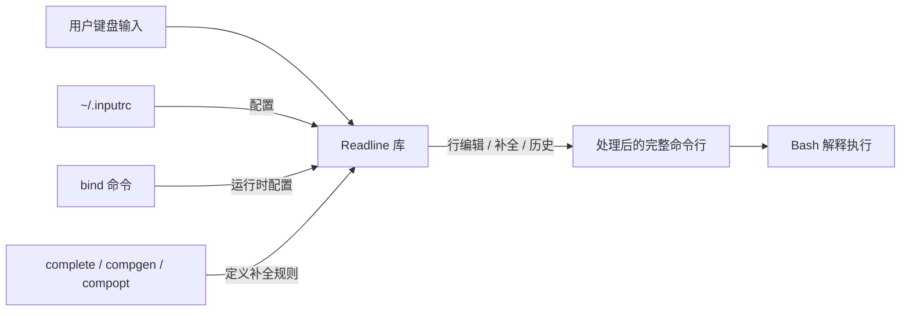
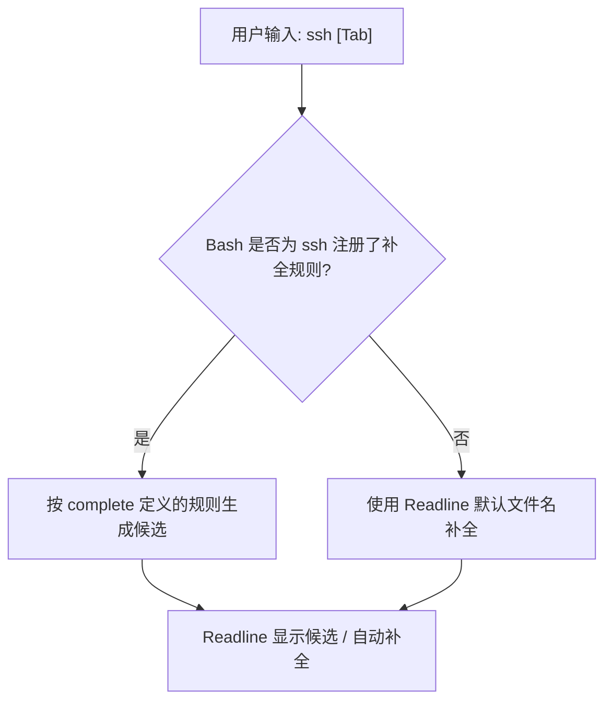
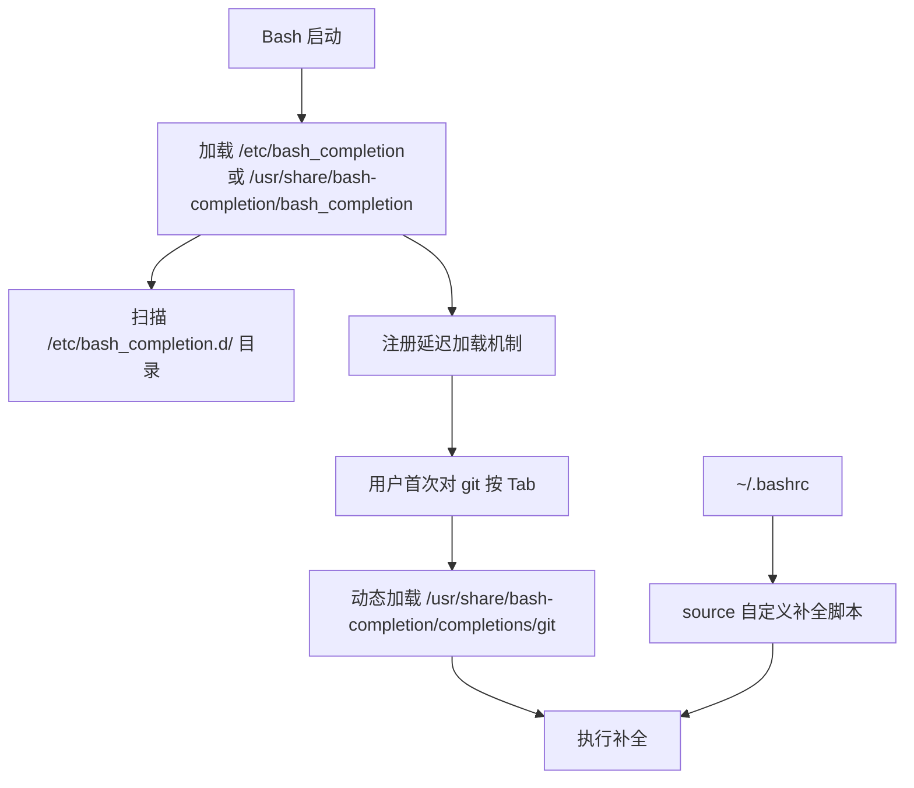

[toc]


# GNU Readline

**GNU Readline** 是一个**命令行编辑库**，提供**交互式文本输入的增强功能**。

> 你在终端里能用的很多"方便操作"，都是 Readline 提供的。
>
> GNU Readline 不是一个命令，而是一个软件库（Library）。

---

## Readline 提供的功能

Readline 负责处理你在终端输入命令时的**交互体验**。如果没有它，你的终端将变得非常难用。它主要提供以下功能：

- **行编辑**：允许你用左右方向键移动光标，用退格键删除字符。
- **命令历史**：允许你用上下键找回之前输入过的命令（其实是它在管理 `~/.bash_history`）。
- **快捷键**：支持类 Emacs（默认）或类 Vi 的快捷键。
  - 例如：`Ctrl + A` 跳到行首，`Ctrl + E` 跳到行尾，`Ctrl + R` 搜索历史。
- **自动补全**：当你按下 `Tab` 键时，背后的逻辑通常由 Readline 配合 Shell 完成。

当你运行一个支持交互的程序时，该程序会“链接”到 Readline 库。

我们可以通过 `ldd` 命令查看到底是谁在使用它：

例如查看bash

```bash
# 查看 bash 是否链接了 readline 库
ldd $(which bash) | grep readline
```

如果输出包含 `libreadline.so.x`，就说明这个程序正依赖它来处理你的输入。

### 1. 行编辑快捷键

```bash
Ctrl + A    # 跳到行首
Ctrl + E    # 跳到行尾
Ctrl + U    # 删除光标前所有内容
Ctrl + K    # 删除光标后所有内容
Ctrl + W    # 删除前一个单词
Ctrl + L    # 清屏
Alt + B     # 后退一个单词
Alt + F     # 前进一个单词
```

### 2. 历史记录

```bash
↑ / ↓       # 浏览历史命令
Ctrl + R    # 反向搜索历史
!!          # 执行上一条命令
!$          # 上一条命令的最后参数
```

### 3. Tab 自动补全

```bash
$ cd /ho[Tab]        # 补全为 /home/
$ cat my\ fi[Tab]    # 补全带空格的文件名，自动加反斜杠
```

---

## 哪些程序使用 Readline？

| 程序                 | 说明              |
| -------------------- | ----------------- |
| **Bash**             | 默认使用 Readline |
| **Python REPL**      | `python` 交互模式 |
| **MySQL/PostgreSQL** | 命令行客户端      |
| **GDB**              | 调试器            |
| **ftp/bc/gnuplot**   | 各种命令行工具    |

---

## 与 read 命令的关系

```bash
# 普通 read：没有编辑功能
read name        # 只能输入，无法用快捷键编辑

# read -e：启用 Readline
read -e name     # 支持 Tab 补全、Ctrl+A、历史记录等
```

### 演示

```bash
# 不用 -e
$ read filepath
# 输入时：不能 Tab 补全，不能 Ctrl+A 跳到行首

# 使用 -e
$ read -e filepath
# 输入时：Tab 可补全文件名，支持所有编辑快捷键
```

---

## 配置文件

既然它不是命令，你怎么控制它呢？答案是修改配置文件 **`~/.inputrc`**。

这是 Readline 的全局配置文件。你可以在这里自定义快捷键，或者开启一些隐藏的高级功能。

```bash
# 可以通过bind -f ~/.inputrc的方式激活或重载配置.


# 切换到 vi 编辑模式（如果你是键盘侠）
# set editing-mode vi

# 1. 基础全局设置
$include /etc/inputrc
set editing-mode emacs
set show-all-if-ambiguous on    # 按一下 Tab 就显示所有补全结果
set completion-ignore-case on   # 补全忽略大小写
set mark-directories on         # 补全目录时自动加上斜杠 /
set visible-stats on            # 补全列表显示文件类型标识（如 * @ /）

# 2. 搜索增强 (历史记录快速搜索)
# 输入命令开头再按上下键，只在匹配的历史中搜索
"\e[A": history-search-backward
"\e[B": history-search-forward

# 3. 颜色与美化 (如果系统支持)
set colored-stats on            # 补全列表显示颜色
set colored-completion-prefix on # 补全时高亮匹配的部分

# 4. 快捷键微调
# Ctrl+Delete 删除光标后的单词
"\e[3;5~": kill-word
# Ctrl+Backspace 删除光标前的单词
"\C-H": backward-kill-word
```

### 验证修改方法

1. **重新打开 Shell**：Readline 通常在 Shell 启动时读取配置。

2. 使用bind命令刷新配置

   ```bash
   bind -f ~/.inputrc
   ```

   

3. **查看当前所有设置**：

   ```bash
   bind -v  # 列出所有 Readline 变量的当前状态
   bind -P  # 列出所有快捷键的绑定状态
   ```

   如果你在 `.inputrc` 中设置了忽略大小写，可以运行 `bind -v | grep completion-ignore-case` 来检查。

## 总结

💡 简单说：**Readline = 让命令行输入变得好用的库**

- 命令行编辑（快捷键移动/删除）
- 历史记录（上下浏览、搜索）
- Tab 自动补全   
- 可配置 


# Bash 中与 Readline 相关的内置命令

## 什么是 Readline

Readline 是 GNU 项目提供的一个**行编辑库**。当你在终端中输入命令时，能够用方向键移动光标、用 Tab 补全、用 `Ctrl+R` 搜索历史——这些能力都来自 Readline。

Bash 并非直接处理键盘输入，而是将这项工作委托给 Readline。可以把两者的关系理解为：



Readline 负责"**怎么输入命令**"，Bash 负责"**怎么执行命令**"。

---

## 与 Readline 相关的内置命令一览

Bash 提供了以下内置命令来与 Readline 交互：

| 命令       | 职责         | 简要说明                                       |
| ---------- | ------------ | ---------------------------------------------- |
| `bind`     | 键绑定与配置 | 查看/修改快捷键绑定、设置 Readline 变量        |
| `complete` | 定义补全规则 | 为指定命令注册补全行为                         |
| `compgen`  | 生成补全候选 | 按规则生成匹配的候选词列表                     |
| `compopt`  | 修改补全选项 | 在补全函数执行过程中动态调整补全行为           |
| `set`      | 模式切换     | 通过 `set -o emacs` / `set -o vi` 切换编辑模式 |
| `read`     | 读取输入     | 使用 `-e` 选项时启用 Readline 进行交互式输入   |

下面逐一深入讲解。

---

## `bind` —— Readline 的控制中心

`bind` 是操作 Readline 最核心的命令。它可以做三件事：**查看当前配置**、**绑定快捷键**、**设置 Readline 变量**。

### 查看类操作

| 用法             | 作用                                                |
| ---------------- | --------------------------------------------------- |
| `bind -p`        | 列出所有**按键 → 函数**的绑定（以可重新输入的格式） |
| `bind -P`        | 列出所有函数及其绑定（人类可读格式）                |
| `bind -l`        | 列出所有可用的 Readline 函数名                      |
| `bind -v`        | 列出所有 Readline 变量及当前值                      |
| `bind -V`        | 同 `-v`，但以人类可读格式输出                       |
| `bind -s`        | 列出所有**按键 → 宏**的绑定                         |
| `bind -S`        | 同 `-s`，人类可读格式                               |
| `bind -q 函数名` | 查询某个函数绑定在哪个按键上                        |

几个典型的探索用法：

```bash
# 查看"向后删除一个单词"绑定在哪个键上
bind -q backward-kill-word

# 查看所有已绑定的按键（过滤掉未绑定的）
bind -p | grep -v "not bound"

# 查看所有变量的当前值
bind -v
```

> **最佳实践**：在自定义绑定之前，先用 `bind -p` 和 `bind -q` 了解当前状态，避免覆盖你依赖的快捷键。

### 绑定快捷键

`bind` 使用一种特殊的字符串语法来描述按键序列：

| 表示法 | 含义                     | 举例               |
| ------ | ------------------------ | ------------------ |
| `\C-x` | Ctrl + x                 | `\C-a` 表示 Ctrl+A |
| `\e`   | Escape（等价于 Alt）     | `\ef` 表示 Alt+F   |
| `\M-x` | Meta(Alt) + x            | `\M-f` 同 `\ef`    |
| `\e[A` | 方向键上（终端转义序列） | 各终端可能不同     |
| `\"`   | 双引号字面量             |                    |
| `\\`   | 反斜杠字面量             |                    |

**绑定到 Readline 函数**（使用 `-x` 绑定到 shell 命令）：

```bash
# 让 ↑/↓ 根据已输入的前缀搜索历史（极其实用）
bind '"\e[A": history-search-backward'
bind '"\e[B": history-search-forward'

# Ctrl+L 清屏（默认就有，这里只是演示语法）
bind '"\C-l": clear-screen'
```

**绑定到宏**（一段文本序列）：

```bash
# Ctrl+Alt+L 插入 " | less"
bind '"\e\C-l": " | less"'

# Alt+H 插入 "--help"
bind '"\eh": "--help"'
```

**绑定到 shell 命令**（`-x` 选项）：

```bash
# Ctrl+Alt+G 执行 git status
bind -x '"\e\C-g": git status'

# Ctrl+Alt+T 显示当前时间
bind -x '"\e\C-t": date'
```

> **`-x` 的特别之处**：绑定的 shell 命令会在当前 shell 环境中执行，执行完后回到命令行，当前正在编辑的内容不受影响。

### 设置 Readline 变量

```bash
# 使用 set 语法（与 ~/.inputrc 相同）
bind 'set completion-ignore-case on'
bind 'set show-all-if-ambiguous on'
bind 'set colored-stats on'
```

常用 Readline 变量：

| 变量                         | 默认值    | 作用                                     |
| ---------------------------- | --------- | ---------------------------------------- |
| `editing-mode`               | `emacs`   | 编辑模式（`emacs` 或 `vi`）              |
| `completion-ignore-case`     | `off`     | 补全时忽略大小写                         |
| `show-all-if-ambiguous`      | `off`     | 有多个候选时一次 Tab 就全部显示          |
| `show-all-if-unmodified`     | `off`     | 候选有公共前缀时一次 Tab 完成补全并显示  |
| `colored-stats`              | `off`     | 补全候选用颜色区分文件类型               |
| `colored-completion-prefix`  | `off`     | 高亮显示补全候选的公共前缀               |
| `mark-symlinked-directories` | `off`     | 符号链接目录补全时加 `/`                 |
| `visible-stats`              | `off`     | 补全候选后标注文件类型符号               |
| `completion-map-case`        | `off`     | `-` 与 `_` 在补全时视为等价              |
| `bell-style`                 | `audible` | 提示音方式（`none`/`visible`/`audible`） |
| `completion-query-items`     | `100`     | 候选超过此数量时提示确认                 |
| `history-size`               | `-1`      | Readline 历史条目上限（-1 不限制）       |

### 从文件加载配置

```bash
# 重新加载 ~/.inputrc
bind -f ~/.inputrc

# 加载自定义配置文件
bind -f ~/my-readline-config
```

### `~/.inputrc` 配置文件

`~/.inputrc` 是 Readline 的持久化配置文件，所有使用 Readline 的程序（Bash、Python REPL、MySQL CLI 等）都会读取它。

一份推荐的现代配置：

```ini
# ~/.inputrc

# 忽略大小写补全
set completion-ignore-case on

# - 与 _ 等价
set completion-map-case on

# 一次 Tab 显示所有候选
set show-all-if-ambiguous on

# 彩色补全
set colored-stats on
set colored-completion-prefix on

# 目录补全加斜杠
set mark-symlinked-directories on

# 文件类型标注
set visible-stats on

# 禁用响铃
set bell-style none

# ↑↓ 根据前缀搜索历史
"\e[A": history-search-backward
"\e[B": history-search-forward

# 仅在 Bash 中生效的条件配置
$if Bash
    # Ctrl+Alt+E 展开别名和变量
    "\e\C-e": shell-expand-line
$endif
```

> **注意**：修改 `~/.inputrc` 后，需要在已打开的终端中按 `Ctrl+X Ctrl+R`（或执行 `bind -f ~/.inputrc`）才能生效，新终端会自动加载。

---

## `complete` —— 定义补全规则

`complete` 告诉 Bash："当用户对**某个命令**按 Tab 时，应该补全**什么内容**"。

### 工作原理



### 直接指定补全类型

`complete` 提供了大量内置的补全动作（action）标志：

| 选项          | 补全内容                  | 示例                      |
| ------------- | ------------------------- | ------------------------- |
| `-f`          | 文件名                    | `complete -f cat`         |
| `-d`          | 目录名                    | `complete -d cd`          |
| `-c`          | 可执行命令                | `complete -c sudo`        |
| `-u`          | 系统用户名                | `complete -u finger`      |
| `-g`          | 用户组名                  | `complete -g chgrp`       |
| `-h`          | 主机名（从 `/etc/hosts`） | `complete -h ping`        |
| `-j`          | 作业名                    | `complete -j fg`          |
| `-v`          | Shell 变量名              | `complete -v unset`       |
| `-e`          | 已导出的环境变量          | `complete -e printenv`    |
| `-a`          | 别名                      | `complete -a unalias`     |
| `-b`          | 内建命令                  | `complete -b help`        |
| `-k`          | Shell 保留关键字          | `complete -k`             |
| `-A signal`   | 信号名                    | `complete -A signal kill` |
| `-A function` | Shell 函数名              | `complete -A function`    |

多个选项可以组合，候选取**并集**：

```bash
# ssh 后面可以补全主机名或用户名
complete -h -u ssh
```

### 用 `-W` 指定固定词列表

这是最简单实用的方式：

```bash
complete -W "start stop restart reload status" systemctl
complete -W "push pull commit checkout branch merge rebase log diff status" git
complete -W "build run test clean install deploy" make
```

词列表中的内容会经过 **word splitting** 和 **glob 展开**，所以可以利用变量：

```bash
_my_targets="build test deploy"
complete -W "$_my_targets" mytool
```

### 用 `-F` 指定补全函数

对于复杂的补全逻辑（上下文相关、多层子命令），需要编写补全函数。这是最强大也最常用的方式。

**补全函数可以使用的关键变量**：

| 变量         | 含义                            | 示例（命令行为 `git checkout ma`） |
| ------------ | ------------------------------- | ---------------------------------- |
| `COMP_WORDS` | 命令行所有单词组成的数组        | `("git" "checkout" "ma")`          |
| `COMP_CWORD` | 光标所在单词在数组中的索引      | `2`                                |
| `COMP_LINE`  | 命令行的原始文本                | `"git checkout ma"`                |
| `COMP_POINT` | 光标在 `COMP_LINE` 中的字符位置 | `18`                               |
| `COMP_TYPE`  | 补全触发类型                    | `9`（普通 Tab）                    |
| `COMPREPLY`  | **函数必须填充的结果数组**      | 函数设置为 `("main" "master")`     |

一个完整的模板：

```bash
_mycli() {
    local cur prev words cword
    cur="${COMP_WORDS[COMP_CWORD]}"      # 当前正在输入的词
    prev="${COMP_WORDS[COMP_CWORD-1]}"   # 前一个词
    
    # 第一层：子命令
    if [[ $COMP_CWORD -eq 1 ]]; then
        COMPREPLY=( $(compgen -W "init build deploy config" -- "$cur") )
        return
    fi
    
    # 第二层：根据子命令分支
    case "${COMP_WORDS[1]}" in
        build)
            if [[ "$cur" == -* ]]; then
                COMPREPLY=( $(compgen -W "--target --release --verbose" -- "$cur") )
            else
                COMPREPLY=( $(compgen -f -- "$cur") )
            fi
            ;;
        config)
            case "$prev" in
                --format)
                    COMPREPLY=( $(compgen -W "json yaml toml" -- "$cur") )
                    ;;
                *)
                    COMPREPLY=( $(compgen -W "--get --set --list --format" -- "$cur") )
                    ;;
            esac
            ;;
        deploy)
            COMPREPLY=( $(compgen -W "staging production canary" -- "$cur") )
            ;;
    esac
}

complete -F _mycli mycli
```

### 用 `-C` 指定外部命令

补全候选由一个外部程序生成。该程序通过环境变量 `COMP_LINE` 和 `COMP_POINT` 获取上下文，将候选逐行输出到 stdout：

```bash
complete -C my_completer_program mycmd
```

这种方式常用于非 Bash 实现的工具（如 Go、Rust 编写的 CLI），在程序内部处理补全逻辑。

### 过滤与修饰选项

| 选项         | 作用                       | 示例                           |
| ------------ | -------------------------- | ------------------------------ |
| `-G pattern` | 只补全匹配 glob 模式的文件 | `-G '*.py'`                    |
| `-X pattern` | 从结果中**排除**匹配的项   | `-X '*.pyc'`（排除 .pyc 文件） |
| `-P prefix`  | 给每个候选加前缀           | `-P '/usr/local/'`             |
| `-S suffix`  | 给每个候选加后缀           | `-S '/'`                       |

`-X` 的模式前加 `!` 表示**保留**匹配项（反转逻辑）：

```bash
# 只保留 .py 文件（排除非 .py 的）
complete -f -X '!*.py' python3
```

### `-o` 行为控制选项

`-o` 控制补全结果的**呈现和后续行为**：

| 值            | 作用                                             |
| ------------- | ------------------------------------------------ |
| `filenames`   | 将结果视为文件名——目录自动加 `/`，空格自动转义   |
| `dirnames`    | 无自定义匹配时回退到目录名补全                   |
| `nospace`     | 补全后不自动追加空格（适用于 `--opt=` 风格）     |
| `noquote`     | 不对包含特殊字符的补全结果加引号                 |
| `bashdefault` | 无匹配时回退到 Bash 默认补全                     |
| `default`     | 无匹配时回退到 Readline 默认补全（通常是文件名） |
| `plusdirs`    | 在自定义结果之外**额外**加入目录名               |
| `nosort`      | 不对候选排序，保留原始顺序                       |

```bash
# 补全函数返回文件名类结果时，通常需要 filenames
complete -F _my_func -o filenames mycmd

# 补全 --key=value 风格时，= 后面不加空格
complete -F _my_func -o nospace mycmd

# 补全结果加上目录（方便导航）
complete -F _my_func -o plusdirs -o filenames mycmd
```

### 管理已注册的补全

```bash
# 查看所有已注册的补全规则
complete -p

# 查看特定命令的补全规则
complete -p docker

# 删除某个命令的补全规则
complete -r docker

# 删除所有补全规则
complete -r
```

---

## `compgen` —— 补全候选的生成器

`compgen` 和 `complete` 接受**几乎相同的选项**，但用途不同：`complete` 是注册规则，`compgen` 是**立即生成并输出候选列表**。它是补全函数内部的核心工具。

### 基本用法

```bash
# 生成所有以 "sys" 开头的命令
compgen -c sys

# 生成所有以 "HO" 开头的变量名
compgen -v HO

# 从词列表中匹配以 "re" 开头的项
compgen -W "start stop restart reload" -- "re"
# 输出:
# restart
# reload
```

**`--` 后面的参数是过滤前缀**，只有匹配该前缀的候选才会输出。这在补全函数中至关重要。

### 在补全函数中的标准用法

`compgen` 几乎总是配合 `COMPREPLY` 这样使用：

```bash
COMPREPLY=( $(compgen -W "选项列表" -- "$cur") )
```

拆解这行代码：

| 部分                         | 作用                                       |
| ---------------------------- | ------------------------------------------ |
| `compgen -W "..." -- "$cur"` | 从词列表中找出以 `$cur` 开头的项，逐行输出 |
| `$(...)`                     | 命令替换，捕获输出                         |
| `( ... )`                    | 将输出转为数组                             |
| `COMPREPLY=`                 | 赋值给 Readline 读取的结果数组             |

### 实用的独立用法

`compgen` 不仅用于补全函数，也可以独立用于脚本和探索：

```bash
# 列出系统中所有可用命令（海量输出）
compgen -c

# 查看所有以 "BASH" 开头的变量
compgen -v BASH

# 列出所有 Shell 函数
compgen -A function

# 列出所有别名
compgen -a

# 列出所有信号名
compgen -A signal

# 检查某个命令是否存在
compgen -c exact_name | grep -qx exact_name && echo "存在"
```

### `-A action` 支持的完整动作列表

| action 值   | 等价短选项 | 生成内容              |
| ----------- | ---------- | --------------------- |
| `alias`     | `-a`       | 别名                  |
| `arrayvar`  |            | 数组变量名            |
| `binding`   |            | Readline 键绑定名     |
| `builtin`   | `-b`       | 内建命令              |
| `command`   | `-c`       | 所有命令              |
| `directory` | `-d`       | 目录                  |
| `disabled`  |            | 被禁用的内建命令      |
| `enabled`   |            | 已启用的内建命令      |
| `export`    | `-e`       | 已导出的变量          |
| `file`      | `-f`       | 文件                  |
| `function`  |            | Shell 函数            |
| `group`     | `-g`       | 用户组                |
| `helptopic` |            | help 命令的主题       |
| `hostname`  | `-h`       | 主机名                |
| `job`       | `-j`       | 作业                  |
| `keyword`   | `-k`       | Shell 保留关键字      |
| `running`   |            | 正在运行的作业        |
| `service`   | `-s`       | 系统服务              |
| `setopt`    |            | `set -o` 的有效选项名 |
| `shopt`     |            | `shopt` 的有效选项名  |
| `signal`    |            | 信号名                |
| `stopped`   |            | 已停止的作业          |
| `user`      | `-u`       | 用户名                |
| `variable`  | `-v`       | Shell 变量            |

---

## `compopt` —— 动态调整补全行为

`compopt` 只能在**补全函数内部**使用（或不带命令名参数时修改当前正在进行的补全）。它解决的问题是：同一个补全函数在不同分支中可能需要不同的行为。

### 语法

```bash
compopt [-o option | +o option] [命令名]
```

`-o` 启用选项，`+o` 禁用选项。选项值与 `complete -o` 相同。

### 典型场景

```bash
_smart_complete() {
    local cur="${COMP_WORDS[COMP_CWORD]}"
    
    if [[ "$cur" == -* ]]; then
        # 补全选项时：--key= 后面不加空格
        COMPREPLY=( $(compgen -W "--output= --format= --verbose --help" -- "$cur") )
        [[ ${COMPREPLY[0]} == *= ]] && compopt -o nospace
    else
        # 补全文件名时：目录加 /，空格自动转义
        COMPREPLY=( $(compgen -f -- "$cur") )
        compopt -o filenames
    fi
}
complete -F _smart_complete mytool
```

这里如果不用 `compopt`，就无法在同一个函数中对不同分支应用不同的输出行为。

---

## `set -o` —— 切换编辑模式

Readline 有两种编辑模式，通过 Bash 的 `set` 命令切换：

| 命令           | 作用                          |
| -------------- | ----------------------------- |
| `set -o emacs` | 切换到 Emacs 模式（**默认**） |
| `set -o vi`    | 切换到 Vi 模式                |

### Emacs 模式（默认）

始终处于插入状态，通过 Ctrl/Alt 组合键完成所有操作。绝大多数用户使用此模式。

核心快捷键速查：

| 操作类别 | 快捷键              | 功能                       |
| -------- | ------------------- | -------------------------- |
| **移动** | `Ctrl+A` / `Ctrl+E` | 行首 / 行尾                |
|          | `Alt+F` / `Alt+B`   | 前进 / 后退一个单词        |
| **删除** | `Ctrl+W`            | 删除前一个单词             |
|          | `Alt+D`             | 删除后一个单词             |
|          | `Ctrl+U` / `Ctrl+K` | 删除到行首 / 行尾          |
| **粘贴** | `Ctrl+Y`            | 粘贴最近删除的内容         |
| **历史** | `Ctrl+R`            | 反向搜索历史               |
|          | `Alt+.`             | 插入上条命令的最后一个参数 |
| **补全** | `Tab`               | 自动补全                   |
| **其他** | `Ctrl+L`            | 清屏                       |
|          | `Ctrl+X Ctrl+E`     | 用 `$EDITOR` 编辑当前命令  |

### Vi 模式

按 `Esc` 进入 Normal 模式，按 `i`/`a` 回到 Insert 模式。操作方式与 Vim 一致。

```bash
# 在 ~/.bashrc 中启用
set -o vi
```

> **最佳实践**：初学者建议使用默认的 Emacs 模式。如果你已经是 Vim 用户并且肌肉记忆很强，Vi 模式会让你如鱼得水。

---

## `read -e` —— 让脚本也能用 Readline

`read` 命令加上 `-e` 选项后，用户输入时就能享受 Readline 的行编辑和补全能力：

```bash
# 基本用法：带 Readline 编辑能力的输入
read -e -p "请输入文件路径: " filepath

# -i 提供默认值（用户可编辑）
read -e -p "安装目录: " -i "/usr/local" install_dir

# 配合 complete 提供上下文补全
_read_completion() {
    COMPREPLY=( $(compgen -W "development staging production" -- "${COMP_WORDS[COMP_CWORD]}") )
}
complete -F _read_completion -E   # -E 表示对空命令名（即 read 输入）生效
read -e -p "环境: " environment
complete -r -E                     # 清理
```

不加 `-e` 时，`read` 读取的是原始输入，不支持任何行编辑功能。

---

## 编写补全函数的完整实践

把前面的知识串联起来，展示一个完整的、生产级别的补全脚本：

```bash
#!/bin/bash
# 文件: _webapp_completion.bash
# 用法: source _webapp_completion.bash

_webapp() {
    local cur prev subcmd
    cur="${COMP_WORDS[COMP_CWORD]}"
    prev="${COMP_WORDS[COMP_CWORD-1]}"

    # ---- 第一层：子命令 ----
    local subcmds="serve build test lint deploy db"
    if [[ $COMP_CWORD -eq 1 ]]; then
        COMPREPLY=( $(compgen -W "$subcmds" -- "$cur") )
        return
    fi

    subcmd="${COMP_WORDS[1]}"

    # ---- 全局选项（任何位置都可用）----
    local global_opts="--help --verbose --quiet --config="
    
    # ---- 按子命令分支 ----
    case "$subcmd" in
        serve)
            case "$prev" in
                --port)
                    COMPREPLY=( $(compgen -W "3000 8000 8080 9000" -- "$cur") )
                    return ;;
                --host)
                    COMPREPLY=( $(compgen -W "localhost 0.0.0.0 127.0.0.1" -- "$cur") )
                    return ;;
            esac
            COMPREPLY=( $(compgen -W "--port --host --ssl --open $global_opts" -- "$cur") )
            # --config= 后不加空格
            [[ "${COMPREPLY[0]}" == *= ]] && compopt -o nospace
            ;;
        build)
            if [[ "$cur" == -* ]]; then
                COMPREPLY=( $(compgen -W "--release --target= --output= $global_opts" -- "$cur") )
                [[ "${COMPREPLY[0]}" == *= ]] && compopt -o nospace
            fi
            ;;
        deploy)
            case "$prev" in
                deploy)
                    COMPREPLY=( $(compgen -W "staging production canary" -- "$cur") )
                    return ;;
                --strategy)
                    COMPREPLY=( $(compgen -W "rolling blue-green canary" -- "$cur") )
                    return ;;
            esac
            COMPREPLY=( $(compgen -W "--strategy --dry-run --rollback $global_opts" -- "$cur") )
            ;;
        db)
            if [[ $COMP_CWORD -eq 2 ]]; then
                COMPREPLY=( $(compgen -W "migrate seed reset status" -- "$cur") )
            fi
            ;;
        test)
            if [[ "$cur" == -* ]]; then
                COMPREPLY=( $(compgen -W "--coverage --watch --filter=" -- "$cur") )
                [[ "${COMPREPLY[0]}" == *= ]] && compopt -o nospace
            else
                # 补全测试文件
                COMPREPLY=( $(compgen -G "tests/*.test.*" -- "$cur") )
                compopt -o filenames
            fi
            ;;
        lint)
            COMPREPLY=( $(compgen -W "--fix --format= $global_opts" -- "$cur") )
            [[ "${COMPREPLY[0]}" == *= ]] && compopt -o nospace
            ;;
    esac
}

complete -F _webapp webapp
```

将此文件放在 `~/.bash_completion.d/` 或 `/etc/bash_completion.d/` 目录中，或在 `~/.bashrc` 中 `source` 它。

---

## 补全脚本的加载机制

系统补全脚本的查找和加载遵循以下流程：



> **现代 bash-completion（2.0+）** 使用延迟加载：补全脚本不会在 Bash 启动时全部加载，而是在用户第一次对某个命令按 Tab 时才加载对应脚本，这大大加快了启动速度。

查看系统中已有的补全脚本：

```bash
# 系统级补全脚本
ls /usr/share/bash-completion/completions/

# 传统位置（兼容）
ls /etc/bash_completion.d/
```

---

## 推荐的 `~/.bashrc` Readline 配置

```bash
# ---- Readline 配置（等同于写在 ~/.inputrc）----
bind 'set completion-ignore-case on'
bind 'set completion-map-case on'
bind 'set show-all-if-ambiguous on'
bind 'set colored-stats on'
bind 'set colored-completion-prefix on'
bind 'set mark-symlinked-directories on'
bind 'set visible-stats on'
bind 'set bell-style none'

# ↑↓ 基于已输入前缀搜索历史
bind '"\e[A": history-search-backward'
bind '"\e[B": history-search-forward'
```

> **`~/.inputrc` vs `~/.bashrc` 中的 `bind`**：两种方式效果相同。区别在于 `~/.inputrc` 对所有使用 Readline 的程序生效（python3、mysql 等），而 `~/.bashrc` 中的 `bind` 只影响 Bash。如果只想配置 Bash，放在 `~/.bashrc` 中更集中；如果想全局生效，放在 `~/.inputrc` 中更合适。

---

## 常见问题排查

| 现象                    | 可能原因                         | 排查方法                             |
| ----------------------- | -------------------------------- | ------------------------------------ |
| Tab 补全完全不工作      | bash-completion 包未安装或未加载 | `type _init_completion` 查看是否存在 |
| 某命令的补全不工作      | 补全脚本未加载                   | `complete -p 命令名` 检查是否注册    |
| 补全函数报错            | `COMPREPLY` 未正确赋值           | 在函数中加 `set -x` 调试             |
| 快捷键不生效            | 被终端模拟器拦截                 | `cat -v` 然后按键查看实际发送的序列  |
| `~/.inputrc` 修改不生效 | 未重新加载                       | `bind -f ~/.inputrc` 或开新终端      |

调试补全函数的实用方法：

```bash
# 临时启用调试，观察补全函数执行过程
bind 'set show-all-if-ambiguous on'
set -x        # 开启调试
# ... 按 Tab 触发补全 ...
set +x        # 关闭调试
```