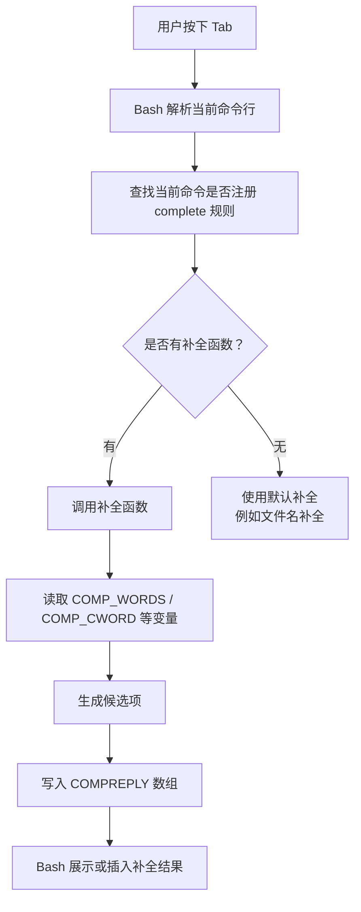

[toc]


## Bash 补全支持是什么

为 Bash 脚本提供补全支持，通常指让用户在命令行输入你的脚本或命令时，可以通过 `Tab` 自动补全：

- 子命令
- 选项参数
- 文件路径
- 枚举值
- 用户名、主机名、进程 ID 等系统资源
- 动态数据，例如项目名、配置名、远程分支名

例如：

```bash
mytool <Tab>
```

可能补全出：

```text
build  deploy  config  help
```

再比如：

```bash
mytool deploy --env <Tab>
```

可能补全出：

```text
dev  test  staging  prod
```

Bash 的补全机制叫做 **Programmable Completion**，即“可编程补全”。

------

## Bash 补全的核心组成

Bash 补全主要由以下几个部分组成：

| 组成              | 作用                                           |
| ----------------- | ---------------------------------------------- |
| `complete`        | 注册某个命令的补全规则                         |
| `compgen`         | 根据规则生成候选补全项                         |
| `COMPREPLY`       | 补全函数最终返回给 Bash 的候选数组             |
| `COMP_WORDS`      | 当前命令行被 Bash 切分后的单词数组             |
| `COMP_CWORD`      | 当前光标所在单词在 `COMP_WORDS` 中的索引       |
| `COMP_LINE`       | 当前完整命令行文本                             |
| `COMP_POINT`      | 当前光标位置                                   |
| `compopt`         | 调整补全行为，例如是否补全空格、是否按文件补全 |
| `bash-completion` | 常用补全框架，提供大量辅助函数和加载机制       |

------

## 一个最小示例

假设有一个脚本 `mytool`：

```bash
#!/usr/bin/env bash

case "$1" in
  build)
    echo "building..."
    ;;
  deploy)
    echo "deploying..."
    ;;
  config)
    echo "configuring..."
    ;;
  *)
    echo "usage: mytool {build|deploy|config}"
    ;;
esac
```

现在为它提供补全。

创建补全文件 `mytool-completion.bash`：

```bash
_mytool_completion() {
  local cur
  cur="${COMP_WORDS[COMP_CWORD]}"

  local commands="build deploy config help"

  COMPREPLY=( $(compgen -W "$commands" -- "$cur") )
}

complete -F _mytool_completion mytool
```

加载它：

```bash
source ./mytool-completion.bash
```

之后输入：

```bash
mytool <Tab>
```

就可以补全：

```text
build  deploy  config  help
```

------

## 补全函数的执行流程

Bash 在用户按下 `Tab` 时，会检查当前命令是否注册了补全函数。如果注册了，就调用对应的函数。



------

## `complete`：注册补全规则

`complete` 用来告诉 Bash：当用户补全某个命令时，应该使用什么规则。

常见用法：

```bash
complete -F _mytool_completion mytool
```

表示：

- 对 `mytool` 命令启用补全
- 补全逻辑由 `_mytool_completion` 函数提供

常见参数：

| 参数             | 含义                                     | 示例                                       |
| ---------------- | ---------------------------------------- | ------------------------------------------ |
| `-F function`    | 使用指定 Bash 函数生成补全               | `complete -F _foo foo`                     |
| `-W words`       | 使用固定词列表补全                       | `complete -W "start stop restart" service` |
| `-A action`      | 使用 Bash 内置类型补全                   | `complete -A user chown`                   |
| `-o default`     | 如果没有候选项，则使用 Bash 默认补全     | `complete -o default -F _foo foo`          |
| `-o filenames`   | 告诉 Bash 候选项是文件名                 | `complete -o filenames -F _foo foo`        |
| `-o nospace`     | 补全后不自动追加空格                     | `complete -o nospace -F _foo foo`          |
| `-o bashdefault` | 如果没有候选项，则使用 Bash 默认补全机制 | `complete -o bashdefault -F _foo foo`      |

简单固定补全也可以不写函数：

```bash
complete -W "build deploy config help" mytool
```

但实际项目中通常使用 `-F`，因为它更灵活。

------

## `compgen`：生成候选项

`compgen` 用于根据指定规则生成补全候选。

常见用法：

```bash
compgen -W "build deploy config help" -- "$cur"
```

含义是：

- 从 `"build deploy config help"` 中筛选
- 只保留以 `$cur` 开头的候选项

例如：

```bash
cur="de"
compgen -W "build deploy config help" -- "$cur"
```

输出：

```text
deploy
```

常见 `compgen` 选项：

| 选项             | 作用                   |
| ---------------- | ---------------------- |
| `-W "word list"` | 从指定单词列表中补全   |
| `-f`             | 补全文件名             |
| `-d`             | 补全目录名             |
| `-u`             | 补全用户名             |
| `-g`             | 补全用户组             |
| `-c`             | 补全命令名             |
| `-v`             | 补全变量名             |
| `-A action`      | 使用 Bash 内置补全动作 |

示例：

```bash
COMPREPLY=( $(compgen -d -- "$cur") )
```

表示只补全目录。

------

## `COMPREPLY`：返回补全结果

补全函数不会通过 `echo` 返回结果，而是应该设置 `COMPREPLY` 数组。

例如：

```bash
COMPREPLY=( "build" "deploy" "config" )
```

更常见的是结合 `compgen`：

```bash
COMPREPLY=( $(compgen -W "$commands" -- "$cur") )
```

需要注意：

```bash
echo "build"
```

不会成为 Bash 的补全结果。

正确方式是：

```bash
COMPREPLY=( "build" )
```

------

## `COMP_WORDS` 与 `COMP_CWORD`

在补全函数中，最常用的两个变量是：

| 变量         | 含义                           |
| ------------ | ------------------------------ |
| `COMP_WORDS` | 当前命令行被 Bash 切分后的数组 |
| `COMP_CWORD` | 当前正在补全的单词索引         |

例如用户输入：

```bash
mytool deploy --env pr<Tab>
```

那么大致可能是：

```bash
COMP_WORDS[0]="mytool"
COMP_WORDS[1]="deploy"
COMP_WORDS[2]="--env"
COMP_WORDS[3]="pr"
COMP_CWORD=3
```

也就是说：

```bash
cur="${COMP_WORDS[COMP_CWORD]}"
prev="${COMP_WORDS[COMP_CWORD-1]}"
```

通常：

- `cur` 表示当前正在补全的内容
- `prev` 表示当前单词前面的一个单词

示例：

```bash
_mytool_completion() {
  local cur prev
  cur="${COMP_WORDS[COMP_CWORD]}"
  prev="${COMP_WORDS[COMP_CWORD-1]}"

  if [[ "$prev" == "--env" ]]; then
    COMPREPLY=( $(compgen -W "dev test staging prod" -- "$cur") )
    return
  fi

  COMPREPLY=( $(compgen -W "build deploy config help" -- "$cur") )
}
```

这样：

```bash
mytool deploy --env <Tab>
```

会补全：

```text
dev  test  staging  prod
```

------

## 根据子命令提供不同补全

实际命令通常有子命令结构，例如：

```bash
mytool build --target app
mytool deploy --env prod
mytool config set key value
```

可以根据第一个参数决定后续补全。

```bash
_mytool_completion() {
  local cur prev cmd
  cur="${COMP_WORDS[COMP_CWORD]}"
  prev="${COMP_WORDS[COMP_CWORD-1]}"
  cmd="${COMP_WORDS[1]}"

  local commands="build deploy config help"

  case "$COMP_CWORD" in
    1)
      COMPREPLY=( $(compgen -W "$commands" -- "$cur") )
      return
      ;;
  esac

  case "$cmd" in
    build)
      COMPREPLY=( $(compgen -W "--target --release --debug" -- "$cur") )
      ;;
    deploy)
      if [[ "$prev" == "--env" ]]; then
        COMPREPLY=( $(compgen -W "dev test staging prod" -- "$cur") )
      else
        COMPREPLY=( $(compgen -W "--env --region --dry-run" -- "$cur") )
      fi
      ;;
    config)
      COMPREPLY=( $(compgen -W "get set list unset" -- "$cur") )
      ;;
    *)
      COMPREPLY=( $(compgen -W "$commands" -- "$cur") )
      ;;
  esac
}

complete -F _mytool_completion mytool
```

效果示例：

| 输入                        | 补全候选                   |
| --------------------------- | -------------------------- |
| `mytool <Tab>`              | `build deploy config help` |
| `mytool b<Tab>`             | `build`                    |
| `mytool deploy --<Tab>`     | `--env --region --dry-run` |
| `mytool deploy --env <Tab>` | `dev test staging prod`    |
| `mytool config <Tab>`       | `get set list unset`       |

------

## 使用 `compopt` 控制补全行为

`compopt` 可以在补全函数内部修改当前补全的行为。

常用场景：

| 用法                   | 说明                         |
| ---------------------- | ---------------------------- |
| `compopt -o nospace`   | 补全后不自动添加空格         |
| `compopt -o filenames` | 告诉 Bash 当前候选项是文件名 |
| `compopt -o default`   | 允许使用默认文件补全         |
| `compopt +o default`   | 关闭默认文件补全             |

### 补全目录时保留斜杠后继续补全

例如 `--path` 后补全目录：

```bash
_mytool_completion() {
  local cur prev
  cur="${COMP_WORDS[COMP_CWORD]}"
  prev="${COMP_WORDS[COMP_CWORD-1]}"

  if [[ "$prev" == "--path" ]]; then
    compopt -o filenames
    COMPREPLY=( $(compgen -d -- "$cur") )
    return
  fi

  COMPREPLY=( $(compgen -W "--path --env --help" -- "$cur") )
}

complete -F _mytool_completion mytool
```

如果候选项是文件路径，建议加：

```bash
compopt -o filenames
```

这样 Bash 能更正确地处理转义、空格和路径展示。

------

## 处理长选项与短选项

常见 CLI 会同时支持：

```bash
mytool deploy -e prod --env prod
```

补全时可以统一处理。

```bash
_mytool_completion() {
  local cur prev
  cur="${COMP_WORDS[COMP_CWORD]}"
  prev="${COMP_WORDS[COMP_CWORD-1]}"

  local global_opts="-h --help -v --version"
  local deploy_opts="-e --env -r --region --dry-run"

  case "$prev" in
    -e|--env)
      COMPREPLY=( $(compgen -W "dev test staging prod" -- "$cur") )
      return
      ;;
    -r|--region)
      COMPREPLY=( $(compgen -W "us-east-1 eu-west-1 ap-east-1" -- "$cur") )
      return
      ;;
  esac

  if [[ "${COMP_WORDS[1]}" == "deploy" ]]; then
    COMPREPLY=( $(compgen -W "$global_opts $deploy_opts" -- "$cur") )
  else
    COMPREPLY=( $(compgen -W "build deploy config help $global_opts" -- "$cur") )
  fi
}
```

------

## 避免重复补全已使用的选项

有些选项只应该出现一次，例如：

```bash
mytool deploy --env prod --env test
```

这通常没有意义。可以在补全时过滤已出现的选项。

```bash
_mytool_contains_word() {
  local word
  local seek="$1"
  shift

  for word in "$@"; do
    [[ "$word" == "$seek" ]] && return 0
  done

  return 1
}

_mytool_completion() {
  local cur
  cur="${COMP_WORDS[COMP_CWORD]}"

  local opts=(--env --region --dry-run --verbose)
  local available=()
  local opt

  for opt in "${opts[@]}"; do
    if ! _mytool_contains_word "$opt" "${COMP_WORDS[@]}"; then
      available+=("$opt")
    fi
  done

  COMPREPLY=( $(compgen -W "${available[*]}" -- "$cur") )
}

complete -F _mytool_completion mytool
```

不过要注意：并不是所有选项都应该过滤。

例如这些选项可能允许重复：

```bash
--tag foo --tag bar
--include a --include b
```

所以是否过滤要根据命令语义决定。

------

## 文件和目录补全

很多脚本会接受文件路径参数，例如：

```bash
mytool build ./src
mytool upload ./dist/app.tar.gz
```

### 只补全目录

```bash
if [[ "$prev" == "--workdir" ]]; then
  compopt -o filenames
  COMPREPLY=( $(compgen -d -- "$cur") )
  return
fi
```

### 补全普通文件

```bash
if [[ "$prev" == "--file" ]]; then
  compopt -o filenames
  COMPREPLY=( $(compgen -f -- "$cur") )
  return
fi
```

### 指定扩展名补全

例如只补全 `.json` 文件：

```bash
if [[ "$prev" == "--config" ]]; then
  compopt -o filenames
  COMPREPLY=( $(compgen -f -X '!*.json' -- "$cur") )
  return
fi
```

不过扩展名过滤在复杂场景下可能不够灵活，实际项目中也可以用 `find` 自己生成候选。

------

## 动态补全

补全候选不一定是写死的，也可以来自：

- 配置文件
- Git 分支
- Docker 容器
- Kubernetes namespace
- 数据库
- HTTP API
- 当前目录扫描结果

例如补全 Git 分支：

```bash
_mytool_completion() {
  local cur prev
  cur="${COMP_WORDS[COMP_CWORD]}"
  prev="${COMP_WORDS[COMP_CWORD-1]}"

  if [[ "$prev" == "--branch" ]]; then
    local branches
    branches="$(git for-each-ref --format='%(refname:short)' refs/heads refs/remotes 2>/dev/null)"
    COMPREPLY=( $(compgen -W "$branches" -- "$cur") )
    return
  fi

  COMPREPLY=( $(compgen -W "--branch --help" -- "$cur") )
}

complete -F _mytool_completion mytool
```

动态补全很强大，但也要注意性能。

------

## 动态补全的性能原则

补全函数会在用户频繁按 `Tab` 时执行，所以应该尽量快。

| 做法                   | 建议                     |
| ---------------------- | ------------------------ |
| 读取本地小文件         | 通常可以接受             |
| 扫描大目录             | 谨慎，可能卡顿           |
| 调用 Git 命令          | 可以，但要避免太重       |
| 调用 Docker/Kubernetes | 谨慎，可能慢             |
| 调用远程 HTTP API      | 不推荐直接做，除非有缓存 |
| 执行复杂脚本           | 尽量避免                 |

最佳实践：

- 补全函数应该尽量在几十毫秒内完成
- 避免无条件调用慢命令
- 对动态数据使用缓存
- 对网络请求设置超时
- 不要在补全函数中打印日志
- 错误信息重定向到 `/dev/null`

例如：

```bash
branches="$(git for-each-ref --format='%(refname:short)' refs/heads 2>/dev/null)"
```

不要让错误信息污染终端。

------

## 缓存动态补全结果

如果候选项生成成本较高，可以使用简单缓存。

示例：缓存项目列表 30 秒。

```bash
_mytool_projects_cache=""
_mytool_projects_cache_time=0

_mytool_get_projects() {
  local now
  now="$(date +%s)"

  if (( now - _mytool_projects_cache_time > 30 )); then
    _mytool_projects_cache="$(mytool list-projects 2>/dev/null)"
    _mytool_projects_cache_time="$now"
  fi

  printf '%s\n' "$_mytool_projects_cache"
}

_mytool_completion() {
  local cur prev projects
  cur="${COMP_WORDS[COMP_CWORD]}"
  prev="${COMP_WORDS[COMP_CWORD-1]}"

  if [[ "$prev" == "--project" ]]; then
    projects="$(_mytool_get_projects)"
    COMPREPLY=( $(compgen -W "$projects" -- "$cur") )
    return
  fi

  COMPREPLY=( $(compgen -W "--project --help" -- "$cur") )
}
```

需要注意：

- 缓存变量只在当前 Shell 会话有效
- 如果需要跨会话缓存，可以写入临时文件
- 跨会话缓存要注意失效策略

------

## 使用 `bash-completion` 框架

现代 Linux 发行版通常安装了 `bash-completion`，它提供了一套通用补全框架和辅助函数。

安装方式示例：

| 系统            | 安装命令                           |
| --------------- | ---------------------------------- |
| Debian / Ubuntu | `sudo apt install bash-completion` |
| Fedora          | `sudo dnf install bash-completion` |
| Arch Linux      | `sudo pacman -S bash-completion`   |
| macOS Homebrew  | `brew install bash-completion@2`   |

安装后，一般会在 shell 启动时加载：

```bash
source /usr/share/bash-completion/bash_completion
```

macOS Homebrew 的路径可能是：

```bash
source "$(brew --prefix)/etc/profile.d/bash_completion.sh"
```

实际路径取决于系统和安装方式。

------

## 补全脚本的安装位置

不同系统和场景下，补全文件可以放在不同位置。

| 位置                                                | 适用场景                     |
| --------------------------------------------------- | ---------------------------- |
| `/usr/share/bash-completion/completions/mytool`     | 系统级安装，推荐给软件包使用 |
| `/etc/bash_completion.d/mytool`                     | 系统级传统位置               |
| `~/.local/share/bash-completion/completions/mytool` | 用户级安装，推荐普通用户使用 |
| `~/.bash_completion`                                | 用户个人补全配置             |
| 手动 `source ./completion.bash`                     | 开发调试时使用               |

现代推荐：

```text
~/.local/share/bash-completion/completions/mytool
```

或者系统级：

```text
/usr/share/bash-completion/completions/mytool
```

文件名通常应该和命令名一致，例如：

```text
mytool
```

这样 `bash-completion` 可以按需加载。

------

## 推荐的补全文件结构

对于命令 `mytool`，推荐补全文件内容类似：

```bash
# bash completion for mytool

_mytool_completion() {
  local cur prev words cword

  # 如果 bash-completion 可用，优先使用其辅助函数
  if declare -F _init_completion >/dev/null 2>&1; then
    _init_completion || return
  else
    cur="${COMP_WORDS[COMP_CWORD]}"
    prev="${COMP_WORDS[COMP_CWORD-1]}"
    words=("${COMP_WORDS[@]}")
    cword="$COMP_CWORD"
  fi

  case "$prev" in
    --env)
      COMPREPLY=( $(compgen -W "dev test staging prod" -- "$cur") )
      return
      ;;
    --config)
      compopt -o filenames
      COMPREPLY=( $(compgen -f -X '!*.json' -- "$cur") )
      return
      ;;
  esac

  case "${words[1]}" in
    deploy)
      COMPREPLY=( $(compgen -W "--env --region --config --dry-run --help" -- "$cur") )
      ;;
    build)
      COMPREPLY=( $(compgen -W "--target --release --debug --help" -- "$cur") )
      ;;
    config)
      COMPREPLY=( $(compgen -W "get set list unset --help" -- "$cur") )
      ;;
    *)
      COMPREPLY=( $(compgen -W "build deploy config help --version" -- "$cur") )
      ;;
  esac
}

complete -F _mytool_completion mytool
```

------

## `_init_completion` 是什么

如果系统安装了 `bash-completion`，可以使用 `_init_completion` 简化初始化逻辑。

它通常会帮你设置：

| 变量    | 含义               |
| ------- | ------------------ |
| `cur`   | 当前单词           |
| `prev`  | 前一个单词         |
| `words` | 当前命令行单词数组 |
| `cword` | 当前单词索引       |

常见写法：

```bash
_mytool_completion() {
  local cur prev words cword
  _init_completion || return

  COMPREPLY=( $(compgen -W "build deploy config help" -- "$cur") )
}
```

这比手动写：

```bash
cur="${COMP_WORDS[COMP_CWORD]}"
prev="${COMP_WORDS[COMP_CWORD-1]}"
```

更稳健。

不过如果你希望补全脚本不依赖 `bash-completion`，可以保留 fallback：

```bash
if declare -F _init_completion >/dev/null 2>&1; then
  _init_completion || return
else
  cur="${COMP_WORDS[COMP_CWORD]}"
  prev="${COMP_WORDS[COMP_CWORD-1]}"
  words=("${COMP_WORDS[@]}")
  cword="$COMP_CWORD"
fi
```

------

## 常用 bash-completion 辅助函数

`bash-completion` 提供很多辅助函数，能少写不少代码。

| 函数                     | 作用                                   |
| ------------------------ | -------------------------------------- |
| `_init_completion`       | 初始化 `cur`、`prev`、`words`、`cword` |
| `_filedir`               | 文件或目录补全                         |
| `_filedir_xspec`         | 按扩展规则补全文件                     |
| `_known_hosts_real`      | 补全 SSH 主机                          |
| `_user_at_host`          | 补全 `user@host`                       |
| `_command_offset`        | 子命令偏移处理                         |
| `_get_comp_words_by_ref` | 获取更可靠的补全上下文变量             |

示例：补全 JSON 文件。

```bash
_mytool_completion() {
  local cur prev words cword
  _init_completion || return

  if [[ "$prev" == "--config" ]]; then
    _filedir json
    return
  fi

  COMPREPLY=( $(compgen -W "--config --help" -- "$cur") )
}
```

需要注意：这些函数不是 Bash 内置的，而是 `bash-completion` 提供的。脚本如果依赖它们，目标环境也要安装并加载 `bash-completion`。

------

## 处理带等号的选项

很多命令支持：

```bash
mytool --env=prod
mytool --config=app.json
```

这种形式需要特殊处理，因为当前单词是整体：

```bash
--env=pr
```

可以这样写：

```bash
_mytool_completion() {
  local cur
  cur="${COMP_WORDS[COMP_CWORD]}"

  case "$cur" in
    --env=*)
      local value="${cur#--env=}"
      COMPREPLY=( $(compgen -P "--env=" -W "dev test staging prod" -- "$value") )
      return
      ;;
    --config=*)
      local value="${cur#--config=}"
      compopt -o filenames
      COMPREPLY=( $(compgen -P "--config=" -f -- "$value") )
      return
      ;;
  esac

  COMPREPLY=( $(compgen -W "--env= --config= --help" -- "$cur") )
}
```

这里用到了：

```bash
compgen -P "--env="
```

表示给生成的候选项加前缀。

例如候选值 `prod` 会变成：

```text
--env=prod
```

------

## 处理冒号、等号等分隔符

Bash 默认会把一些字符作为单词分隔符，这由变量 `COMP_WORDBREAKS` 控制。

例如：

```bash
--env=prod
```

可能会被 Bash 拆分成多个部分，具体行为和环境有关。

如果你要精确处理复杂参数，建议使用 `bash-completion` 的辅助函数：

```bash
_get_comp_words_by_ref -n = cur prev words cword
```

这里 `-n =` 表示不要把 `=` 当成断词字符。

示例：

```bash
_mytool_completion() {
  local cur prev words cword

  if declare -F _get_comp_words_by_ref >/dev/null 2>&1; then
    _get_comp_words_by_ref -n = cur prev words cword
  else
    cur="${COMP_WORDS[COMP_CWORD]}"
    prev="${COMP_WORDS[COMP_CWORD-1]}"
    words=("${COMP_WORDS[@]}")
    cword="$COMP_CWORD"
  fi

  case "$cur" in
    --env=*)
      local value="${cur#--env=}"
      COMPREPLY=( $(compgen -P "--env=" -W "dev test prod" -- "$value") )
      return
      ;;
  esac

  COMPREPLY=( $(compgen -W "--env= --help" -- "$cur") )
}
```

------

## 子命令嵌套补全

有些工具有多层子命令：

```bash
mytool config get
mytool config set
mytool user add
mytool user remove
```

可以逐层判断。

```bash
_mytool_completion() {
  local cur prev main sub
  cur="${COMP_WORDS[COMP_CWORD]}"
  prev="${COMP_WORDS[COMP_CWORD-1]}"
  main="${COMP_WORDS[1]}"
  sub="${COMP_WORDS[2]}"

  if (( COMP_CWORD == 1 )); then
    COMPREPLY=( $(compgen -W "config user project help" -- "$cur") )
    return
  fi

  if (( COMP_CWORD == 2 )); then
    case "$main" in
      config)
        COMPREPLY=( $(compgen -W "get set list unset" -- "$cur") )
        return
        ;;
      user)
        COMPREPLY=( $(compgen -W "add remove list" -- "$cur") )
        return
        ;;
      project)
        COMPREPLY=( $(compgen -W "create delete list" -- "$cur") )
        return
        ;;
    esac
  fi

  case "$main:$sub" in
    config:set)
      COMPREPLY=( $(compgen -W "--global --local --help" -- "$cur") )
      ;;
    user:add)
      COMPREPLY=( $(compgen -W "--role --email --help" -- "$cur") )
      ;;
    project:create)
      COMPREPLY=( $(compgen -W "--template --private --help" -- "$cur") )
      ;;
  esac
}
```

------

## 让脚本自己输出补全脚本

现代 CLI 工具常见做法是提供一个子命令生成补全脚本，例如：

```bash
mytool completion bash
```

用户可以这样安装：

```bash
mytool completion bash > ~/.local/share/bash-completion/completions/mytool
```

这种方式的优点：

| 优点       | 说明                                     |
| ---------- | ---------------------------------------- |
| 易安装     | 用户不需要到处找补全文件                 |
| 版本一致   | 补全逻辑可以和命令版本同步               |
| 跨平台     | 可以同时支持 Bash、Zsh、Fish、PowerShell |
| 方便包管理 | 打包时直接生成对应 completion 文件       |

很多现代 CLI 框架都支持类似功能，例如：

- Cobra，Go 生态常见
- Click / Typer，Python 生态常见
- Clap，Rust 生态常见
- yargs / commander，Node.js 生态常见

如果你的 Bash 脚本较大，也可以实现：

```bash
mytool completion bash
```

让它输出补全脚本。

------

## 示例：脚本内置补全生成

`mytool` 本身可以提供：

```bash
mytool completion bash
```

示意实现：

```bash
#!/usr/bin/env bash

show_bash_completion() {
  cat <<'EOF'
_mytool_completion() {
  local cur prev
  cur="${COMP_WORDS[COMP_CWORD]}"
  prev="${COMP_WORDS[COMP_CWORD-1]}"

  case "$prev" in
    --env)
      COMPREPLY=( $(compgen -W "dev test staging prod" -- "$cur") )
      return
      ;;
  esac

  COMPREPLY=( $(compgen -W "build deploy config completion --env --help" -- "$cur") )
}

complete -F _mytool_completion mytool
EOF
}

case "$1" in
  completion)
    case "$2" in
      bash)
        show_bash_completion
        ;;
      *)
        echo "usage: mytool completion bash" >&2
        exit 1
        ;;
    esac
    ;;
  build)
    echo "building..."
    ;;
  deploy)
    echo "deploying..."
    ;;
  *)
    echo "usage: mytool {build|deploy|completion}"
    ;;
esac
```

用户安装：

```bash
mkdir -p ~/.local/share/bash-completion/completions
mytool completion bash > ~/.local/share/bash-completion/completions/mytool
```

------

## 调试补全脚本

补全调试不如普通脚本直观，因为补全函数是在 Bash 内部调用的。

常用技巧：

### 重新加载补全脚本

```bash
source ./mytool-completion.bash
```

如果已经注册过，重新 `source` 通常会覆盖旧函数定义。

### 查看补全注册情况

```bash
complete -p mytool
```

输出可能类似：

```bash
complete -F _mytool_completion mytool
```

### 取消补全注册

```bash
complete -r mytool
```

### 在补全函数中写调试日志

不要直接 `echo`，因为会污染补全界面。

可以写到文件：

```bash
echo "cur=$cur prev=$prev words=${COMP_WORDS[*]}" >> /tmp/mytool-completion.log
```

### 打开 Bash 调试跟踪

可以临时在补全函数中加：

```bash
set -x
```

但一般更推荐写日志文件，因为 `set -x` 输出也容易干扰终端。

------

## 安全注意事项

补全脚本本质上是会被用户 shell 执行的 Bash 代码，因此要注意安全。

| 风险                 | 建议                             |
| -------------------- | -------------------------------- |
| 执行不可信命令       | 不要在补全中执行来源不明的脚本   |
| 使用 `eval`          | 尽量避免                         |
| 拼接用户输入执行命令 | 必须严格引用和校验               |
| 访问网络             | 不建议默认发生                   |
| 输出敏感信息         | 不要把 token、密码等作为补全候选 |
| 自动读取项目文件     | 注意文件内容可能不可信           |

尤其要避免：

```bash
eval "$something_from_config"
```

补全逻辑应该只是“读取”和“筛选”，不要做有副作用的操作。

------

## 常见坑

| 问题                         | 原因                      | 解决                                        |
| ---------------------------- | ------------------------- | ------------------------------------------- |
| 补全函数里 `echo` 没效果     | Bash 读取的是 `COMPREPLY` | 设置 `COMPREPLY` 数组                       |
| 补全候选包含空格时出错       | 数组和引用处理不当        | 使用数组，必要时结合 `compopt -o filenames` |
| 文件名补全空格处理不好       | 没告诉 Bash 候选是文件    | 使用 `compopt -o filenames`                 |
| 补全后自动加了空格，但不想加 | 默认行为                  | 使用 `compopt -o nospace`                   |
| 安装后不生效                 | 补全文件没被加载          | 检查路径、文件名、bash-completion 是否启用  |
| 修改补全文件后没变化         | 当前 shell 没重新加载     | `source` 文件或开新 shell                   |
| 动态补全很卡                 | 补全函数执行了慢命令      | 缓存、减少外部命令、加超时                  |
| `--foo=bar` 补全异常         | `=` 被当成断词符          | 使用 `_get_comp_words_by_ref -n =`          |
| Zsh 不生效                   | Bash 补全不等于 Zsh 补全  | 为 Zsh 单独提供 completion                  |

------

## 编写补全脚本的最佳实践

| 建议                                  | 说明                                              |
| ------------------------------------- | ------------------------------------------------- |
| 函数名前加命令前缀                    | 例如 `_mytool_completion`，避免和其他补全函数冲突 |
| 使用 `local` 变量                     | 避免污染用户 shell 环境                           |
| 设置 `COMPREPLY`，不要 `echo`         | 这是 Bash 补全的标准方式                          |
| 选项和子命令分层处理                  | 逻辑更清晰                                        |
| 为文件补全设置 `compopt -o filenames` | 更好处理路径和空格                                |
| 慎用外部命令                          | 补全应快速响应                                    |
| 动态数据加缓存                        | 避免按一次 Tab 卡一次                             |
| 错误输出重定向                        | 使用 `2>/dev/null`                                |
| 不做有副作用操作                      | 补全不应修改文件、发起部署、改变状态              |
| 支持用户级安装路径                    | 推荐 `~/.local/share/bash-completion/completions` |
| 提供 `mytool completion bash`         | 现代 CLI 更友好                                   |
| 同步更新补全和命令行为                | 避免补全提示不存在的选项                          |

------

## 一个较完整的实践示例

假设 `mytool` 支持：

```bash
mytool build --target app --release
mytool deploy --env prod --region us-east-1 --config config.json
mytool config get
mytool config set
mytool completion bash
```

补全脚本可以写成：

```bash
# bash completion for mytool

_mytool_completion() {
  local cur prev words cword

  if declare -F _init_completion >/dev/null 2>&1; then
    _init_completion || return
  else
    cur="${COMP_WORDS[COMP_CWORD]}"
    prev="${COMP_WORDS[COMP_CWORD-1]}"
    words=("${COMP_WORDS[@]}")
    cword="$COMP_CWORD"
  fi

  local commands="build deploy config completion help"
  local global_opts="--help --version"

  case "$prev" in
    --env)
      COMPREPLY=( $(compgen -W "dev test staging prod" -- "$cur") )
      return
      ;;
    --region)
      COMPREPLY=( $(compgen -W "us-east-1 us-west-2 eu-west-1 ap-east-1" -- "$cur") )
      return
      ;;
    --target)
      COMPREPLY=( $(compgen -W "app web api worker all" -- "$cur") )
      return
      ;;
    --config)
      compopt -o filenames
      COMPREPLY=( $(compgen -f -X '!*.json' -- "$cur") )
      return
      ;;
  esac

  if (( cword == 1 )); then
    COMPREPLY=( $(compgen -W "$commands $global_opts" -- "$cur") )
    return
  fi

  case "${words[1]}" in
    build)
      COMPREPLY=( $(compgen -W "--target --release --debug --clean $global_opts" -- "$cur") )
      ;;
    deploy)
      COMPREPLY=( $(compgen -W "--env --region --config --dry-run $global_opts" -- "$cur") )
      ;;
    config)
      if (( cword == 2 )); then
        COMPREPLY=( $(compgen -W "get set list unset" -- "$cur") )
      else
        COMPREPLY=( $(compgen -W "--global --local $global_opts" -- "$cur") )
      fi
      ;;
    completion)
      COMPREPLY=( $(compgen -W "bash zsh fish powershell" -- "$cur") )
      ;;
    *)
      COMPREPLY=( $(compgen -W "$commands $global_opts" -- "$cur") )
      ;;
  esac
}

complete -F _mytool_completion mytool
```

这个示例包含了：

- 顶层子命令补全
- 子命令选项补全
- 选项参数补全
- 文件补全
- `bash-completion` 兼容
- fallback 兼容

------

## 推荐学习路线

对于新手，可以按这个顺序学习：

| 阶段 | 学习内容                                      |
| ---- | --------------------------------------------- |
| 入门 | `complete -W` 固定词补全                      |
| 基础 | `complete -F`、`COMPREPLY`、`compgen`         |
| 常用 | `COMP_WORDS`、`COMP_CWORD`、`cur`、`prev`     |
| 实战 | 子命令、选项参数、文件路径补全                |
| 进阶 | `compopt`、`bash-completion` 辅助函数         |
| 高级 | 动态补全、缓存、复杂解析、跨 Shell completion |

一个合理的实践顺序是：


------

## 总结

为 Bash 脚本提供补全支持的核心思路是：

- 用 `complete` 注册补全规则
- 用补全函数分析当前输入上下文
- 用 `compgen` 生成候选
- 把结果写入 `COMPREPLY`
- 必要时用 `compopt` 调整行为
- 推荐结合 `bash-completion` 做现代化安装和辅助处理

对于简单脚本，几十行补全代码就能显著改善使用体验。对于复杂 CLI，建议提供：

```bash
mytool completion bash
```

并安装到：

```text
~/.local/share/bash-completion/completions/mytool
```

这样既符合现代 CLI 工具习惯，也方便用户和包管理器集成。