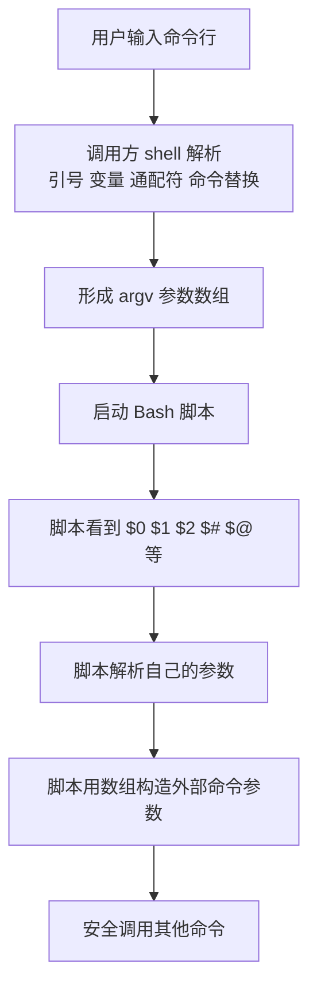

[toc]

## abstract

为bash脚本提供命令行参数解析支持 以及 bash脚本中命令的参数构造/传递方案和注意事项

## Bash 参数处理分成两类问题

Bash 脚本里的“参数”通常有两层含义：

| 目标                   | 你要解决的问题                                               | 典型场景                                         |
| ---------------------- | ------------------------------------------------------------ | ------------------------------------------------ |
| **解析脚本自己的参数** | 用户执行 `./deploy.sh --env prod -v app1 app2`，脚本要识别选项、选项值、普通参数 | `--env prod`、`-v`、`--`、必填参数校验           |
| **构造并调用其他命令** | 脚本内部要安全地拼出并执行 `kubectl`、`rsync`、`curl`、`grep` 等命令 | 可选参数、文件名含空格、透传 `"$@"`、避免 `eval` |

Bash 官方手册把当前 GNU Bash 5.3 的行为分成“参数展开、单词分割、文件名展开、引号移除”等阶段；理解这些阶段，是写对参数传递的核心。

尤其要记住：**脚本最终收到的是一组 argv 字符串，不是用户原始输入的一整行文本**。Bash 会先做展开、分割、通配符匹配、去除引号等处理，然后命令才真正执行。([GNU](https://www.gnu.org/s/bash/manual/bash.html))



------

## 基础模型：位置参数和特殊参数

脚本启动后，Bash 用**位置参数**保存传入参数：

```bash
./backup.sh --dry-run "my dir" *.txt
```

在脚本内部大致会看到：

| 写法       | 含义                                                  |
| ---------- | ----------------------------------------------------- |
| `$0`       | 脚本名或调用名                                        |
| `$1`、`$2` | 第一个、第二个参数                                    |
| `$#`       | 参数个数                                              |
| `$@`       | 所有参数                                              |
| `"$@"`     | 所有参数，并且每个原参数保持为独立参数                |
| `$*`       | 所有参数，但语义更容易误用                            |
| `"$*"`     | 把所有参数合并成一个字符串，中间用 `IFS` 的首字符连接 |

最重要的规则是：**转发参数几乎总是用 `"$@"`，不是 `$@`，也不是 `"$\*"`**。官方手册说明，`"$@"` 在双引号中会把每个位置参数展开成独立的 word，相当于 `"$1" "$2" ...`；而 `"$*"` 会把参数合并成一个 word。([GNU](https://www.gnu.org/s/bash/manual/bash.html))

```bash
# 推荐：保持每个参数原样独立传递
some_command "$@"

# 危险：会发生单词分割和通配符展开
some_command $@

# 通常不适合转发：会把所有参数合成一个参数
some_command "$*"
```

------

## 核心规则：引号不是装饰，是参数边界保护

Bash 会对未加双引号的参数展开结果做 **word splitting**，还可能做 **filename expansion**，也就是通配符展开。官方手册明确说，未出现在双引号中的参数展开、命令替换、算术展开结果会被扫描并按 `IFS` 分割。([GNU](https://www.gnu.org/s/bash/manual/bash.html))

所以这两行完全不同：

```bash
file="my report *.txt"

cat $file
cat "$file"
```

第一行可能被拆成多个参数，还可能触发 `*.txt` 通配符匹配；第二行才是把变量值作为**一个参数**传给 `cat`。

| 场景               | 推荐写法                   | 原因                                   |
| ------------------ | -------------------------- | -------------------------------------- |
| 变量作为普通参数   | `cmd "$var"`               | 保留空格、换行、通配符字符             |
| 所有脚本参数转发   | `cmd "$@"`                 | 保留每个原参数的边界                   |
| 数组作为参数列表   | `cmd "${args[@]}"`         | 每个数组元素变成一个参数               |
| 文件名来自用户输入 | `cmd -- "$file"`           | `--` 防止文件名以 `-` 开头时被当成选项 |
| 调试打印命令       | `printf ' %q' "${cmd[@]}"` | 只用于展示，不用于重新执行             |

------

## CLI 参数的常见形态

命令行接口通常会区分 **option** 和 **operand**：

| 类型       | 示例                                       | 说明                               |
| ---------- | ------------------------------------------ | ---------------------------------- |
| 短选项     | `-v`                                       | 通常单字符                         |
| 短选项带值 | `-o file.txt` 或 `-ofile.txt`              | 是否支持紧贴写法取决于解析方式     |
| 长选项     | `--verbose`                                | 多字符，可读性好                   |
| 长选项带值 | `--output file.txt` 或 `--output=file.txt` | 手写解析时建议两个都支持           |
| 选项结束符 | `--`                                       | 后面的内容都当普通参数             |
| 普通参数   | `input.txt`、`src/`                        | 也叫 operand、positional arguments |

`--` 非常重要。例如用户真的有一个文件叫 `-n`：

```bash
rm -- "-n"
grep -- "$pattern" "$file"
```

没有 `--` 时，很多命令可能把 `-n` 当成选项。

------

## 参数解析方案选型

| 方案                 | 适合场景                                  | 优点                     | 注意事项                      |
| -------------------- | ----------------------------------------- | ------------------------ | ----------------------------- |
| 直接读 `$1`、`$2`    | 极简单脚本                                | 最直观                   | 不适合可选参数多的脚本        |
| 手写 `while case`    | 需要支持长选项、`--foo=value`、自定义规则 | 最灵活、可移植、可读性好 | 要自己处理错误、`shift`、`--` |
| Bash 内建 `getopts`  | 主要支持短选项，例如 `-v -o file`         | Bash 内建，无外部依赖    | 原生不适合长选项              |
| GNU `getopt`         | Linux 环境，想支持长短选项统一解析        | 支持长选项、参数重排等   | 可移植性较差，常涉及 `eval`   |
| 换 Python/Go/Rust 等 | CLI 复杂、子命令多、校验复杂              | 更适合大型 CLI           | 不再是纯 Bash                 |

Bash 的 `getopts` 是内建命令，用于在脚本或函数中解析位置参数。它通过 `OPTIND` 记录下一个待处理参数，通过 `OPTARG` 保存选项参数；如果 `optstring` 中某个选项字符后面跟 `:`，表示该选项需要参数。([GNU](https://www.gnu.org/s/bash/manual/bash.html))

GNU `getopt` 是外部命令，支持长选项，并且 GNU util-linux 版本能生成带引号的输出以保留空白和特殊字符，但它的文档也明确提到传统实现不能正确处理空白和 shell 特殊字符，增强版需要再次交给 shell 解释，通常通过 `eval`。这也是很多 Bash 脚本宁愿手写解析长选项的原因。([man7.org](https://man7.org/linux/man-pages/man1/getopt.1.html))

------

## 推荐方案：手写 `while case` 支持长短选项

这是现代 Bash 脚本中非常常用、清晰、可控的写法。

```bash
#!/usr/bin/env bash
set -Eeuo pipefail

usage() {
  cat <<'EOF'
Usage:
  script.sh [options] [--] INPUT...

Options:
  -h, --help              Show help
  -v, --verbose           Enable verbose output
  -o, --output FILE       Write result to FILE
      --name NAME         Set name
      --dry-run           Show what would be done
EOF
}

die() {
  printf 'Error: %s\n\n' "$*" >&2
  usage >&2
  exit 2
}

verbose=0
dry_run=0
output=
name=
inputs=()

while (($#)); do
  case "$1" in
    -h|--help)
      usage
      exit 0
      ;;

    -v|--verbose)
      verbose=1
      shift
      ;;

    --dry-run)
      dry_run=1
      shift
      ;;

    -o|--output)
      [[ $# -ge 2 ]] || die "$1 requires an argument"
      output=$2
      shift 2
      ;;

    --output=*)
      output=${1#*=}
      shift
      ;;

    --name)
      [[ $# -ge 2 ]] || die "$1 requires an argument"
      name=$2
      shift 2
      ;;

    --name=*)
      name=${1#*=}
      shift
      ;;

    --)
      shift
      inputs+=("$@")
      break
      ;;

    -*)
      die "unknown option: $1"
      ;;

    *)
      inputs+=("$1")
      shift
      ;;
  esac
done

((${#inputs[@]} > 0)) || die "at least one INPUT is required"

printf 'verbose=%s\n' "$verbose"
printf 'dry_run=%s\n' "$dry_run"
printf 'output=%s\n' "${output:-}"
printf 'name=%s\n' "${name:-}"
printf 'inputs:\n'
printf '  %s\n' "${inputs[@]}"
```

这个模板的几个关键点：

| 写法                               | 作用                             |
| ---------------------------------- | -------------------------------- |
| `while (($#)); do`                 | 只要还有参数就继续解析           |
| `case "$1" in`                     | 根据当前参数决定处理方式         |
| `shift`                            | 消耗当前参数                     |
| `shift 2`                          | 消耗选项和它的值                 |
| `--output=*`                       | 支持 `--output=file`             |
| `--) shift; inputs+=("$@"); break` | 停止解析选项，后面全部当普通参数 |
| `inputs+=("$1")`                   | 用数组保存普通参数，保持参数边界 |

注意：这个简单模板没有支持 `-abc` 这种短选项组合。如果你需要 `-v -f` 可以写成 `-vf`，那就要额外解析短选项簇；新手阶段建议先不支持，帮助文档里说清楚即可。

------

## 使用 `getopts` 解析短选项

`getopts` 适合这种接口：

```bash
script.sh -v -o result.txt -n alice input1 input2
```

模板如下：

```bash
#!/usr/bin/env bash
set -Eeuo pipefail

usage() {
  cat <<'EOF'
Usage:
  script.sh [-h] [-v] [-o FILE] [-n NAME] [--] INPUT...
EOF
}

die() {
  printf 'Error: %s\n' "$*" >&2
  usage >&2
  exit 2
}

verbose=0
output=
name=

while getopts ":hvo:n:" opt; do
  case "$opt" in
    h)
      usage
      exit 0
      ;;
    v)
      verbose=1
      ;;
    o)
      output=$OPTARG
      ;;
    n)
      name=$OPTARG
      ;;
    :)
      die "option -$OPTARG requires an argument"
      ;;
    \?)
      die "unknown option -$OPTARG"
      ;;
  esac
done

shift "$((OPTIND - 1))"

inputs=("$@")

((${#inputs[@]} > 0)) || die "at least one INPUT is required"
```

这里的 `":hvo:n:"` 可以这样读：

| 片段       | 含义                                   |
| ---------- | -------------------------------------- |
| 开头的 `:` | 启用静默错误处理，方便脚本自己输出错误 |
| `h`        | 支持 `-h`                              |
| `v`        | 支持 `-v`                              |
| `o:`       | 支持 `-o VALUE`                        |
| `n:`       | 支持 `-n VALUE`                        |

`getopts` 的优点是规范、内建、适合短选项；缺点是长选项支持不自然。如果你希望脚本支持 `--output`、`--dry-run`，通常手写 `while case` 更清楚。

在函数中用 `getopts` 时，建议把 `OPTIND` 和 `OPTARG` 局部化：

```bash
parse_args() {
  local OPTIND OPTARG opt

  while getopts ":vo:" opt; do
    case "$opt" in
      v) verbose=1 ;;
      o) output=$OPTARG ;;
      :) return 2 ;;
      \?) return 2 ;;
    esac
  done

  shift "$((OPTIND - 1))"
  remaining=("$@")
}
```

------

## GNU `getopt`：能用，但要谨慎

GNU `getopt` 可以支持长选项，例如：

```bash
parsed=$(getopt \
  --options hvo: \
  --longoptions help,verbose,output:,dry-run \
  --name "$0" \
  -- "$@"
) || exit 2

eval "set -- $parsed"

while true; do
  case "$1" in
    -h|--help) usage; exit 0 ;;
    -v|--verbose) verbose=1; shift ;;
    -o|--output) output=$2; shift 2 ;;
    --dry-run) dry_run=1; shift ;;
    --) shift; break ;;
    *) die "internal parsing error: $1" ;;
  esac
done

inputs=("$@")
```

它的主要问题不是功能，而是**可移植性和复杂度**：

| 问题                                           | 说明                                       |
| ---------------------------------------------- | ------------------------------------------ |
| macOS、BSD、BusyBox 上的 `getopt` 行为可能不同 | GNU `getopt` 的增强能力不能默认假设存在    |
| 常见写法需要 `eval "set -- $parsed"`           | 必须确保 `parsed` 来自可信的 `getopt` 输出 |
| 新手容易写错引用                               | 特别是忘记 `-- "$@"`                       |

如果脚本只跑在你控制的 Linux 服务器上，GNU `getopt` 可以接受；如果脚本要跨平台分发，优先考虑手写 `while case` 或 `getopts`。

------

## 参数构造：不要把命令拼成字符串

这是 Bash 新手最容易踩的坑：

```bash
# 不推荐
cmd="grep -E $pattern $file"
$cmd
```

这看似能工作，但只要 `pattern` 或 `file` 含空格、通配符、引号、换行，就可能出错。Bash 数组才是构造命令参数的正确工具。Bash 支持一维 indexed array 和 associative array，数组可用 `name=(value1 value2 ...)` 赋值；当使用 `"${array[@]}"` 时，每个数组元素会作为独立参数展开。([GNU](https://www.gnu.org/s/bash/manual/bash.html))

推荐写法：

```bash
cmd=(grep -E -- "$pattern" "$file")
"${cmd[@]}"
```

更完整的动态构造：

```bash
cmd=(rsync -a)

[[ $verbose == 1 ]] && cmd+=(-v)
[[ $dry_run == 1 ]] && cmd+=(--dry-run)
[[ -n ${exclude_file:-} ]] && cmd+=(--exclude-from "$exclude_file")

cmd+=(-- "$src" "$dest")

printf 'Running:'
printf ' %q' "${cmd[@]}"
printf '\n'

"${cmd[@]}"
```

重点是：

| 写法                       | 含义                                 |
| -------------------------- | ------------------------------------ |
| `cmd=(rsync -a)`           | 初始命令数组                         |
| `cmd+=(-v)`                | 追加一个无值选项                     |
| `cmd+=(--output "$file")`  | 追加选项和值，两个独立参数           |
| `cmd+=(-- "$src" "$dest")` | 追加普通参数，并用 `--` 结束选项解析 |
| `"${cmd[@]}"`              | 真正执行命令，每个元素一个参数       |

------

## 参数传递：包装命令时用 `"$@"`

写 wrapper 脚本时，通常需要把用户传入的参数继续传给底层命令。

```bash
#!/usr/bin/env bash
set -Eeuo pipefail

exec docker run --rm -it my-image "$@"
```

如果要在用户参数前面加固定参数：

```bash
kubectl --namespace "$namespace" "$@"
```

如果要在用户参数后面追加：

```bash
args=("$@")
args+=(--log-level "$log_level")

some_command "${args[@]}"
```

如果要包装一个命令并额外加 `--`：

```bash
grep -R -- "$pattern" "$@"
```

这里 `"$@"` 的意义是：**用户原本传了几个参数，底层命令就继续收到几个参数**。这对文件名含空格、空字符串参数、通配符字符都很关键。

------

## 选项和普通参数的边界：善用 `--`

只要普通参数来自用户输入，尤其是文件名、目录名、pattern，最好在外部命令前加 `--`：

```bash
rm -- "$file"
cp -- "$src" "$dest"
grep -E -- "$pattern" "$file"
tar -cf "$archive" -- "${files[@]}"
```

原因是用户文件名可能以 `-` 开头：

```bash
touch -- "-important.txt"
rm -- "-important.txt"
```

如果没有 `--`，`rm "-important.txt"` 可能被当成选项解析。

------

## 空值、未设置变量和 `set -u`

很多现代 Bash 脚本会写：

```bash
set -Eeuo pipefail
```

这有助于尽早暴露错误，但 `set -u` 会让未设置变量直接报错。因此读取可选变量时应使用默认值展开：

```bash
[[ -n ${output:-} ]] && cmd+=(--output "$output")
```

常见参数展开形式：

| 写法              | 含义                                     |
| ----------------- | ---------------------------------------- |
| `${var:-default}` | var 未设置或为空时使用 default           |
| `${var-default}`  | var 未设置时使用 default；为空字符串不算 |
| `${var:?message}` | var 未设置或为空时报错                   |
| `${var:=default}` | var 未设置或为空时赋默认值               |
| `${var:+word}`    | var 设置且非空时使用 word                |

Bash 官方手册说明，带冒号的 `:-`、`:=`、`:?` 等形式会同时测试“未设置”和“为空”；不带冒号则只测试“未设置”。([GNU](https://www.gnu.org/software/bash/manual/html_node/Shell-Parameter-Expansion.html))

示例：

```bash
: "${ENVIRONMENT:?ENVIRONMENT is required}"

output=${output:-result.txt}
```

------

## 命令字符串、数组、函数的选择

| 需求               | 推荐做法                       | 不推荐做法                            |
| ------------------ | ------------------------------ | ------------------------------------- |
| 保存一个命令和参数 | 数组：`cmd=(curl -fsS "$url")` | 字符串：`cmd="curl -fsS $url"`        |
| 动态追加参数       | `cmd+=(--header "$header")`    | `cmd="$cmd --header $header"`         |
| 转发用户参数       | `cmd "$@"`                     | `cmd $@`                              |
| 表达 pipeline      | 写函数                         | 把整条 pipeline 放字符串里再 `eval`   |
| 调试显示命令       | `printf '%q' "${cmd[@]}"`      | 直接 `echo "$cmd"` 后误以为可复制执行 |

Pipeline、重定向、`&&`、`||` 这些是 shell 语法，不是普通 argv 参数。不要试图这样写：

```bash
# 错误思路：> 不会作为重定向生效，只会成为普通参数
cmd=(grep foo input.txt '>' out.txt)
"${cmd[@]}"
```

正确写法：

```bash
cmd=(grep foo input.txt)
"${cmd[@]}" >out.txt
```

或者用函数表达复杂 shell 结构：

```bash
run_report() {
  grep -E -- "$pattern" "$file" |
    sort -u |
    tee -- "$output"
}

run_report
```

------

## 常见错误对照

| 错误写法                         | 问题                            | 推荐写法                                       |
| -------------------------------- | ------------------------------- | ---------------------------------------------- |
| `for x in $@; do ...`            | 参数会被重新分割                | `for x in "$@"; do ...`                        |
| `cmd $file`                      | 空格、通配符会出问题            | `cmd "$file"`                                  |
| `cmd="cp $src $dst"; $cmd`       | 字符串无法可靠保存参数边界      | `cmd=(cp -- "$src" "$dst"); "${cmd[@]}"`       |
| `files=$(find ...)`              | 换行、空格、特殊字符容易坏      | 用 `find ... -print0` 配合 `read -d ''` 或数组 |
| `rm "$dir/"*`                    | 空目录、隐藏文件、glob 行为复杂 | 明确检查目录和 glob 策略                       |
| `eval "$cmd"`                    | 容易引入注入风险                | 优先数组、函数、显式调用                       |
| `grep "$pattern" $files`         | `$files` 不是安全的参数列表     | `grep -- "$pattern" "${files[@]}"`             |
| `[[ -n $output ]]` 配合 `set -u` | 未设置时报错                    | `[[ -n ${output:-} ]]`                         |

------

## 一个较完整的实战骨架

这个骨架同时展示：参数解析、数组构造、`--`、帮助信息、错误输出、调试打印。

```bash
#!/usr/bin/env bash
set -Eeuo pipefail

usage() {
  cat <<'EOF'
Usage:
  backup.sh [options] [--] SRC DEST

Options:
  -h, --help              Show help
  -v, --verbose           Print more details
      --dry-run           Show what would be done
      --exclude FILE      Read exclude patterns from FILE

Examples:
  backup.sh --dry-run ./src ./backup
  backup.sh --exclude patterns.txt -- "./-weird-src" ./backup
EOF
}

die() {
  printf 'Error: %s\n\n' "$*" >&2
  usage >&2
  exit 2
}

verbose=0
dry_run=0
exclude_file=
operands=()

while (($#)); do
  case "$1" in
    -h|--help)
      usage
      exit 0
      ;;

    -v|--verbose)
      verbose=1
      shift
      ;;

    --dry-run)
      dry_run=1
      shift
      ;;

    --exclude)
      [[ $# -ge 2 ]] || die "$1 requires an argument"
      exclude_file=$2
      shift 2
      ;;

    --exclude=*)
      exclude_file=${1#*=}
      shift
      ;;

    --)
      shift
      operands+=("$@")
      break
      ;;

    -*)
      die "unknown option: $1"
      ;;

    *)
      operands+=("$1")
      shift
      ;;
  esac
done

((${#operands[@]} == 2)) || die "SRC and DEST are required"

src=${operands[0]}
dest=${operands[1]}

[[ -d $src ]] || die "SRC is not a directory: $src"

cmd=(rsync -a)

[[ $verbose == 1 ]] && cmd+=(-v)
[[ $dry_run == 1 ]] && cmd+=(--dry-run)
[[ -n ${exclude_file:-} ]] && cmd+=(--exclude-from "$exclude_file")

cmd+=(-- "$src/" "$dest/")

printf 'Running:'
printf ' %q' "${cmd[@]}"
printf '\n'

"${cmd[@]}"
```

------

## 新手应形成的习惯

| 习惯                           | 原因                                      |
| ------------------------------ | ----------------------------------------- |
| 默认给变量加双引号：`"$var"`   | 防止单词分割和通配符展开                  |
| 转发参数用 `"$@"`              | 保留参数个数和边界                        |
| 构造命令用数组                 | 字符串无法安全表达 argv                   |
| 用户输入作为 operand 前加 `--` | 防止以 `-` 开头的值被当选项               |
| 参数解析后再做校验             | 逻辑更清楚，错误信息更友好                |
| 帮助信息和错误信息分开         | `--help` 输出到 stdout，错误输出到 stderr |
| 少用 `eval`                    | 降低注入和引用错误风险                    |
| 复杂 CLI 不硬塞 Bash           | 子命令很多时考虑 Python、Go 等语言        |

------

## 心智口诀

**解析参数时：**

> 看 `$1`，处理它，`shift` 掉它；遇到 `--`，后面都别再当选项。

**传递参数时：**

> 单个变量用 `"$var"`，所有参数用 `"$@"`，命令参数列表用数组和 `"${array[@]}"`。

**构造命令时：**

> 命令不是字符串，命令是“程序名 + argv 数组”。