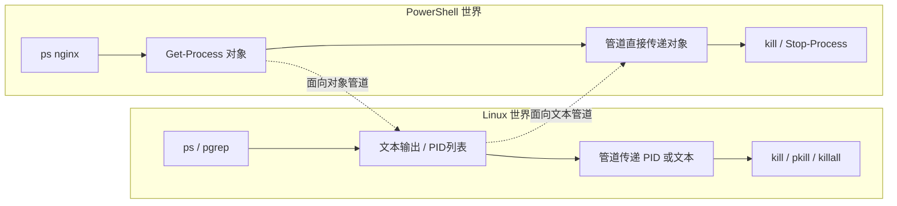
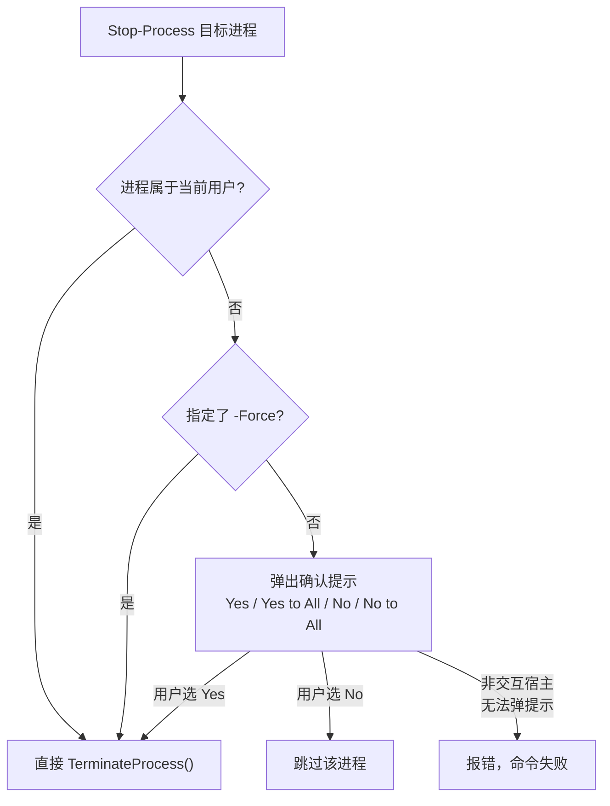
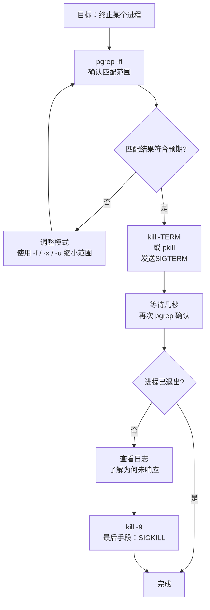
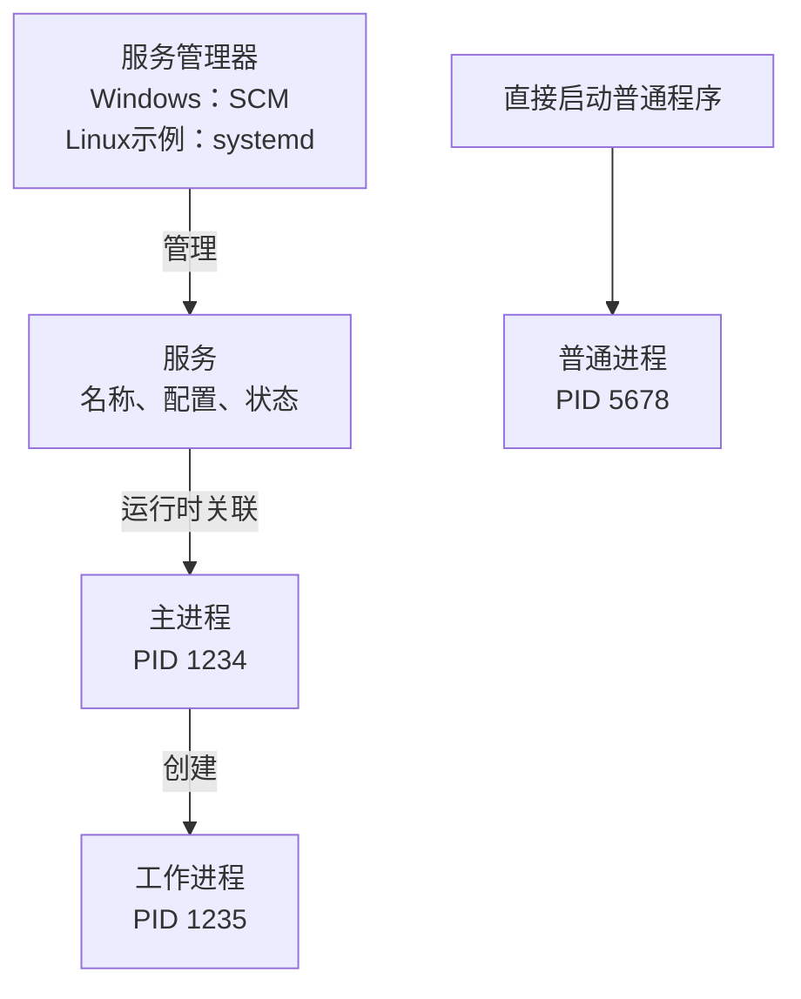

[toc]

## Windows PowerShell vs Linux：进程查找与终止对比指南


### 概念对比：两个世界的哲学差异

在开始之前，先建立最重要的认知框架。Windows PowerShell 的**进程模型**和 Linux 的进程模型存在根本性的哲学差异：



| 维度           | PowerShell                      | Linux Shell                         |
| -------------- | ------------------------------- | ----------------------------------- |
| 管道传递的是   | **对象**（Process对象）         | **文本**（纯字节流）                |
| 按名字终止     | `ps nginx | kill`（直接）       | 需要额外工具如`pkill`或提取PID      |
| **信号机制**   | 基本无信号概念（仅SIGTERM等价） | **完整的Unix信号体系**（15+种信号） |
| 名字匹配       | 精确/模糊匹配进程名             | 可精确/可模糊/可匹配完整命令行      |
| 主要复杂性来源 | 几乎没有                        | 必须理解PID、信号、名字匹配范围     |

PowerShell的`ps nginx | kill`之所以"简单"，是因为管道传递的是**对象引用**，`kill`（`Stop-Process`的别名）直接操作对象。Linux的管道传递的是**文本**，`kill`只接受PID，这个"阻抗不匹配"催生了整套工具链。

---

### Linux进程查找工具

#### `ps`：进程快照

`ps`是最基础的进程查看工具，但它的输出是**纯文本快照**，不能直接管道给`kill`。

常用用法：

```bash
ps aux              # 查看所有进程（BSD风格，最常用）
ps -ef              # 查看所有进程（UNIX风格）
ps -ef --forest     # 树形显示父子关系（非常直观）
ps aux | grep nginx # 按名字过滤（但会包含grep自身这行）
```

`ps aux`各列含义：

| 列名      | 含义                                                 |
| --------- | ---------------------------------------------------- |
| `USER`    | 进程所属用户                                         |
| `PID`     | 进程ID（Process ID），`kill`的核心参数               |
| `%CPU`    | CPU占用百分比                                        |
| `%MEM`    | 内存占用百分比                                       |
| `STAT`    | 进程状态（`S`=睡眠, `R`=运行, `Z`=僵尸, `T`=停止等） |
| `COMMAND` | 启动命令（完整命令行）                               |

> **注意**：`ps aux | grep nginx`会产生一条多余的`grep nginx`记录。

常见解法是`ps aux | grep [n]ginx`（利用字符类让grep不匹配自身）；

> 这是 `grep` 的一个经典技巧，用来**避免 grep 命令匹配到它自己**。
>
> 当你执行 `ps aux | grep nginx` 时，输出里通常会出现**两行** nginx 相关的内容：
>
> ```
> root  1234  ...  nginx: master process
> root  5678  ...  grep nginx        ← 这一行是 grep 自己！
> ```
>
> 因为 `grep nginx` 这个进程本身的命令行里就包含 "nginx" 这个词，所以 `ps aux` 会把它也列出来，然后 grep 又匹配到了自己。
>
> 原理：字符类 `[n]ginx`
>
> `[n]ginx` 是一个正则表达式，表示"匹配字符 n，后面跟着 ginx"，**效果上等价于匹配字符串 `nginx`**。
>
> 但关键在于：**grep 进程的命令行里，实际写的是 `[n]ginx` 这 7 个字符，而不是 `nginx`**。
>
> > 同样的道理,给`nginx`5个字符中任何一个字符用`[]`包括都可以,而且可以同时给不同的字符加`[]`(习惯上个第一个字符加`[]`最方便),但是注意不能括住连续的2个或更多字符,正则效果大不相同,匹配到就不是nginx这5个字符.
>
> - `ps aux` 列出 grep 进程时，显示的是 `grep [n]ginx`（或者 `grep --color=auto [n]ginx`）
> - 这个字符串里包含的是 `[`、`n`、`]`、`g`... 而不是连续的 `nginx`
> - 而正则 `[n]ginx` 匹配的是**纯文本 `nginx`**
> - 所以 grep 自己那行**不匹配**，被排除掉了 
>
> 效果对比
>
> ```bash
> # 会多出一行 grep 自身
> ps aux | grep nginx
> 
> # 干净，只剩真正的 nginx 进程
> ps aux | grep [n]ginx
> # 更稳妥的方案是使用引号包裹.
> ps aux | grep '[n]ginx' # 兼容zsh,bash.
> ```
>
> bash实例:
>
> ```bash
> $ ps aux | grep [n]ginx
> root      521909  0.0  0.0  19140  8028 ?        Ss   Oct01   0:00 nginx: master process /usr/sbin/nginx -c /etc/nginx/nginx.conf
> nginx     521910  0.0  0.0  20496 10804 ?        S    Oct01   0:00 nginx: worker process
> nginx     521911  0.0  0.0  20496 10804 ?        S    Oct01   0:00 nginx: worker process
> nginx     521912  0.0  0.0  20496 10784 ?        S    Oct01   0:00 nginx: worker process
> ```
>
> 但是对于zsh,情况有所不同,需要加引号更为问题,zsh对某些表达式的解析效果和bash不同,不对`[]`的字符串加引号,**可能会触发 zsh 的文件名生成（globbing）机制**.
>
> zsh 默认会尝试将 `[n]ginx` 当作一个**文件名匹配模式**。如果当前目录下恰好存在名为 `nginx` 的文件或目录，zsh 会把它展开为该文件名，然后才传给 `grep`，这就会改变你的本意。
>
> ```zsh
> $ ps aux | grep [n]ginx
> zsh: no matches found: [n]ginx
> ```

临时关闭zsh的匹配机制

```zsh
# 当前终端临时关（重启失效）：
unsetopt NOMATCH  # 关检查，行为同 bash
setopt NOMATCH    # 恢复默认
[[ -o nomatch ]] && echo on || echo off  # 查状态

```

```zsh
# 只对单条命令有效，不改当前 shell：
ps aux | noglob grep [n]ginx
# 注意 noglob 要放在 grep 前，放 ps 前无效
```

> 虽然可以永久关闭(需要修改~/.zshrc配置文件)
> `unsetopt NOMATCH`  # 等价于 setopt NO_NOMATCH
> 然后 source ~/.zshrc，已验证 `ps aux | grep [n]ginx` 可用。
> 但不推荐永久关闭：会丢掉 zsh 对拼写错误的保护。更稳妥的是保持默认，只加引号：`grep '[n]ginx'`这对bash也兼容.

补充说明

> 1. **这是纯 shell/正则技巧**，不依赖任何特殊工具，可移植性好。
> 2. 用 `pgrep` 或 `pidof` 也能达到同样目的，例如 `pgrep -a nginx`。
> 3. 注意 `[]` 里放一个字符即可，写 `[n]ginx`、`[n]ginx` 都行；如果担心 n 出现在其他地方，也可以写 `[n]ginx` 换成别的形式如 `nginx | grep -v grep`，但字符类写法更简洁优雅。
>
> 一句话总结：**`[n]ginx` 让 grep 的匹配模式匹配 `nginx`，但 grep 自身的命令行文本是 `[n]ginx`，从而不会匹配到自己。**

平时使用更推荐直接用下面的`pgrep`。但从系统预装情况来看，**`ps` 的可用性远高于 `pgrep`**。`ps` 是 POSIX 标准的一部分，几乎存在于所有类 Unix 系统；而 `pgrep` 是一个“非 POSIX”的扩展工具，虽然主流 Linux 发行版通常预装，但在一些特殊环境（如 BSD、macOS、精简容器）中可能根本没有。

#####  `ps aux|grep...` 输出没有表头

其实 `ps aux` **本身是有表头的**，你看到的没有表头，是因为管道（`|`）后面的 `grep` 把它过滤掉了 —— 表头那一行（`USER PID %CPU ...`）里不包含 `nginx`，所以被 `grep` 丢弃了。

```shell
$ ps aux|head -n1
USER         PID %CPU %MEM    VSZ   RSS TTY      STAT START   TIME COMMAND
```

通常,条件允许的情况下,可以用 `pgrep` / `ps` 自带的过滤，不用 `grep`,就可以避免表头被过滤丢失.

```shell
$ ps -C nginx -f          # 按命令名过滤，自带表头
$ ps -C nginx u           # 带表头、带资源占用(更加详细的表头)
```

```shell
$ ps -C nginx -f
UID          PID    PPID  C STIME TTY          TIME CMD
root      521909       1  0 Oct01 ?        00:00:00 nginx: master process /usr/sbin/nginx -c /etc/nginx/nginx.conf
nginx     521910  521909  0 Oct01 ?        00:00:00 nginx: worker process
$ ps -C nginx u
USER         PID %CPU %MEM    VSZ   RSS TTY      STAT START   TIME COMMAND
root      521909  0.0  0.0  19140  8028 ?        Ss   Oct01   0:00 nginx: master process /usr/sbin/nginx -c /etc/n
nginx     521910  0.0  0.0  20496 10804 ?        S    Oct01   0:00 nginx: worker process
```

##### 配合使用`ps`和`pgrep`

```shell
# 配合 ps 显示详细信息
ps -fp $(pgrep nginx)
```

```shell
# 配合 ps 显示详细信息
$ ps -fp $(pgrep nginx)

UID          PID    PPID  C STIME TTY      STAT   TIME CMD
root      521909       1  0 Oct01 ?        Ss     0:00 nginx: master process /usr/sbin/nginx -c /etc/nginx/nginx.c
nginx     521910  521909  0 Oct01 ?        S      0:00 nginx: worker process
```

`ps -fp` 的含义

`ps -fp` 是**两个选项(`-f,-p`)的组合**：

1. `-f`：full-format（完整格式）

显示更详细的列，包括：

| 列    | 含义                 |
| ----- | -------------------- |
| UID   | 进程所属用户         |
| PID   | 进程 ID              |
| PPID  | 父进程 ID            |
| C     | CPU 使用率           |
| STIME | 进程启动时间         |
| TTY   | 终端                 |
| TIME  | 累计 CPU 时间        |
| CMD   | 完整命令行（含参数） |

不加 `-f` 时只有 PID、TTY、TIME、CMD 四列，且 CMD 不显示参数

2. `-p`：指定 PID（可接多个）

只显示指定 PID 的进程信息。

补充说明:`$(pgrep nginx)` 会把 pgrep 输出的多行 PID 展开成**空格分隔**的参数，`-p` 能接受这种形式

##### `ps -C` vs `grep` 过滤进程对比

两种方式示例

方式一：`-C` 按命令名精确匹配

```bash
$ ps -f -C nginx
UID        PID  PPID  C STIME TTY          TIME CMD
root      1234     1  0 10:00 ?        00:00:00 nginx: master process
www       1235  1234  0 10:00 ?        00:00:01 nginx: worker process
```

方式二：`grep` 按文本模糊匹配

```bash
$ ps aux | grep nginx
root      1234  0.0  0.1  ...  nginx: master process
www       1235  0.0  0.1  ...  nginx: worker process
user      9999  0.0  0.0  ...  grep --color=auto nginx   ← 多出 grep 自身(可以用`[n]ginx`代替来避免这个问题)
```

详细对比表

| 对比项                 | `ps -C nginx`                        | `ps aux | grep nginx`                                      |
| ---------------------- | ------------------------------------ | ---------------------------------------------------------- |
| **匹配方式**           | 精确匹配**可执行文件名**             | 模糊匹配整行文本（包括参数）                               |
| **会匹配到 grep 自身** | 不会                                 | 需 `grep -v grep` 排除或使用`[]`包括某个字符来达到排除效果 |
| **会误匹配**           | 只匹配命令名                         | 可能匹配到含关键词的参数、路径                             |
| **表头**               | 有表头                               | 无表头                                                     |
| **显示格式**           | 默认 `ps -f` 风格                    | BSD 风格 `aux` 列（USER、%CPU、%MEM 等）                   |
| **支持正则**           | 不支持                               | 支持（`grep -E`）                                          |
| **指定多个名称**       | 使用逗号分隔多个名称 `-C nginx,sshd` | 使用正则或语法 `nginx|sshd`                                |
| **找不到时的报错**     | 输出表头 + 错误信息                  | 无输出（grep 返回码 1）                                    |
| **只能匹配完整命令名** | 必须完全等于进程名                   | 部分匹配即可                                               |

典型修正写法

```bash
# grep 排除自身（经典写法）
ps aux | grep nginx | grep -v grep
# 或者用 [] 技巧，让 grep 匹配不到自己的命令行
ps aux | grep [n]ginx
```

##### 使用场景建议

用 `-C` 的场景

```bash
# 精确查询某服务的进程（命令名固定）
ps -f -C sshd
ps -f -C nginx -o pid,ppid,cmd   # 还能自定义列
# 命令名知道但带参数复杂时最干净
ps -C python3
```

用 `grep` 的场景 

```bash
# 只知道关键词，命令名不确定（参数里找）
ps aux | grep -E 'redis.*6379'
ps aux | grep /usr/local/app/server
# 需要 BSD 风格的 %CPU、%MEM 排序分析
ps aux | grep java | sort -k3 -nr
```

一句话总结

- **`-C`**：精准、干净、无副作用，适合按**程序名**查询
- **`grep`**：灵活、能搜**参数和路径**，但要处理自匹配问题
  两者常配合使用：`ps -C nginx` 查主进程，`ps aux | grep 'xxx --config'` 查特定参数的进程。

#### `pgrep`：专为脚本设计的PID查找器

虽然有`ps`可以查看进程详情,但是查找特定名称的进程的任务上,需要配合`grep`等命令,并且需要单独获取进程`id`时更是如此,还不够方便.于是有了`pgrep`(和`ps`方案在部分功能上重叠,但不是完全取代).

| 维度           | `ps`                                   | `pgrep`                                                 |
| :------------- | :------------------------------------- | :------------------------------------------------------ |
| 主要用途       | 列出进程信息（PID、CPU、内存、命令等） | 按名称/属性查找进程 PID                                 |
| 输出           | 表格，信息丰富                         | 默认只输出 PID，一行一个                                |
| 过滤方式       | 靠 `grep`、`awk` 等外部工具配合        | 内置匹配（**名称、用户、终端**等）,直接过滤             |
| 脚本友好度     | 需要解析文本，较麻烦                   | 直接给 PID，天然适合脚本中使用(但是注意可用性,可移植性) |
| 可移植性       | 极高，POSIX 标准                       | 较低，属于 procps 包，**部分精简系统没有**              |
| 常用命令和组合 | `ps aux`、`ps -ef` 等                  | `pkill`、`pgrep -a` 等                                  |

| 维度                           | pgrep               | ps aux \| grep                      |
| ------------------------------ | ------------------- | ----------------------------------- |
| 数据获取                       | 直接读 `/proc`      | ps 全量读 `/proc` 后文本过滤        |
| 额外进程                       | 不产生              | 产生 grep 自身进程                  |
| 默认匹配                       | ERE，comm           | 字面/正则（取决于 grep 选项），整行 |
| 输出                           | 纯 PID（可定制）    | ps 完整行                           |
| 表头                           | 无                  | 有                                  |
| 结构化过滤（用户/父进程/终端） | 原生支持 `-u -P -t` | 需 awk 二次过滤                     |
| 退出码                         | 0 找到 / 1 没找到   | 取决于管道最后命令                  |

`pgrep`是专门用于**查找进程PID**的工具，常见方式包括按名字查找（`pgrep nginx`）、带详情查找（`ps aux | grep nginx`），它返回的仅是PID，可以直接管道给`kill`。

1. **数据来源**：直接扫描 `/proc/<pid>/` 下的内核暴露信息
2. **默认匹配对象**：`/proc/<pid>/comm`（仅对**进程名**做匹配，最长 15 字符，不含参数）
3. **`-f` 模式**：改用 `/proc/<pid>/cmdline`（对**完整命令行**做匹配，含参数）
4. **默认为扩展正则表达式（ERE）** 匹配，而非精确字符串匹配
5. **不产生额外进程**（不像 `ps | grep` 会多出 grep 自身）

例如: `pgrep nginx` 等价于“进程名**包含** nginx **正则模式**”(模糊匹配,正则匹配)，不是“等于 nginx”。要精确匹配需用 `^nginx$`或者`-x` 精确匹配进程名（等价 `^nginx$` 的语法糖）。

| 选项   | 匹配对象                | 说明                   |
| ------ | ----------------------- | ---------------------- |
| 无选项 | `comm`（进程名）        | 只匹配程序名，≤15 字符 |
| `-f`   | `cmdline`（完整命令行） | 匹配整个命令及参数     |

`-f` 的坑：命令行任意位置包含关键词都会命中，且可能匹配到 pgrep 自己所在的 shell 进程（如果命令行里含该关键词）。

```bash
pgrep nginx          # 仅输出PID列表
pgrep -l nginx       # 输出 PID + 进程名(long格式)
pgrep -fl nginx      # 输出 PID + 完整命令行（full模式+long格式,结果(数量上)最全,能够匹配到命令行参数,但格式和-l一样）
pgrep -a nginx       # 相当于 -fl ,现在推荐用`-a`
pgrep -u www-data    # 查找指定用户的所有进程
```

`pgrep`常用参数说明：

| 参数      | 含义                                                         |
| --------- | ------------------------------------------------------------ |
| `-l`      | 同时输出进程名（list name）,拓宽匹配范围到完整命令行(包括启动参数.) |
| `-f`      | 匹配完整命令行而非仅进程名（full）                           |
| `-u user` | 只匹配指定用户的进程                                         |
| `-x`      | 精确匹配（名字必须完全一致）`^pattern$`                      |
| `-a`      | 同`-fl`，输出完整命令行（部分发行版）                        |
| `-c`      | 只输出匹配数量(count),相当于`wc -l`的管道处理,但是少起一个进程. |
| `-n`      | 只输出最新的（PID 最大）                                     |
| `-o`      | 只输出最老的（PID 最小）                                     |
| `-w`      | 输出线程 TID（procps 新版本）                                |
| `-d ','`  | 指定分隔符（默认换行）                                       |

```shell
# 精确找 nginx master
pgrep -x -o nginx

# root 运行的、命令行含 config.yaml 的进程
pgrep -u root -f config.yaml

# 某用户最旧的 bash
pgrep -u alice -o -x bash

# 数量判断（脚本用）
[ "$(pgrep -c nginx)" -eq 0 ] && echo "nginx 挂了"

# 配合 kill
kill $(pgrep -f 'myapp --worker')
pkill -f 'myapp --worker'    # pkill = pgrep 的杀进程版

```


#### `pidof`：精确匹配进程名获取PID

```bash
pidof sshd           # 返回所有sshd实例的PID
```

`pidof`返回第一个匹配进程的PID，适合**系统服务**这类**名字唯一**的场景。

`pidof`要求名字精确匹配，不支持模糊匹配，比`pgrep`更严格。

| 维度           | `pidof`                   | `pgrep -x`                 |
| -------------- | ------------------------- | -------------------------- |
| **匹配依据**   | **可执行文件**的真实名字  | `comm` 字段（内核 comm）   |
| **匹配方式**   | **字面精确匹配**          | **正则表达式的全锚定匹配** |
| **空格处理**   | 常见版本忽略/压缩空格差异 | 严格按 comm 内容           |
| **输出格式**   | PID 空格分隔，一行        | PID 换行分隔，一列         |
| **多名称查询** | 支持 `pidof a b c`        | 一次一个模式               |
| **参数**       | 几乎没有                  | 丰富（-u -o -n -P 等）     |
| **所属工具集** | SysV init 时代的工具      | procps-ng 工具集           |
| **脚本依赖**   | 常见于 init 脚本          | 现代发行版标配             |

总结

- **`pidof`**：老牌、朴素——“给我叫这个名的程序的 PID”，输出紧凑，init 脚本标配
- **`pgrep -x`**：现代、可组合——精确匹配 + 丰富的结构化过滤，功能是 pidof 的超集

两者对**二进制守护进程**基本等效；涉及**脚本进程或复合条件**时，pgrep 系（含 `-f`）更可靠

### Linux信号体系：`kill`不只是"杀死"

这是Linux进程管理中最关键的概念，也是与PowerShell差异最大的地方。

PowerShell 的 `Stop-Process`（别名 `kill`）相当于 Linux 的 `kill` 命令（默认发送 `SIGTERM`，需指定参数才发其他信号）

这是一个很好的追问，值得澄清——我上一篇回复中对此描述有些模糊，这里做精确辨析。

---

首先要明确：PowerShell 中的 `kill` 只是 `Stop-Process` 的**别名（alias）**，两者完全等价。

#### Windows 进程终止的底层机制

Windows 没有 Unix 信号体系，`Stop-Process` 在底层调用的是 `Windows API`：

> [Stop-Process (Microsoft.PowerShell.Management) - PowerShell | Microsoft Learn](https://learn.microsoft.com/zh-cn/powershell/module/microsoft.powershell.management/stop-process?view=powershell-7.6)

| `Stop-Process` 用法               | 底层行为                                                     | Linux 近似等价                                         |
| --------------------------------- | ------------------------------------------------------------ | ------------------------------------------------------ |
| `Stop-Process <id>`（无`-Force`） | 对 GUI 进程调用 `CloseMainWindow()`，给应用响应机会；对**无窗口进程**则直接调用 `TerminateProcess()` | **SIGKILL**（`kill -9`），强制立即杀死,但执行前会确认. |
| `Stop-Process -Force <id>`        | 并不会“从温和退出升级为强制终止”；它主要控制确认提示(是否继续停止进程) | **SIGKILL**（`kill -9`），强制立即杀死                 |

**`Stop-Process` 最接近 `kill -9`（SIGKILL），而不是 `kill -15`（SIGTERM）。**

除非指定 `-Confirm` 参数，否则不会提示进行确认。 **Confirm** 参数指示 PowerShell 在停止进程之前提示你。 由于提示包含进程名称以及其 ID，因此这是**最佳做法**。 **PassThru** 参数将进程对象传递给格式化程序以供显示。 如果没有此参数，则 `Stop-Process` 命令后不会显示。

`-Force`:

> 在不提示确认的情况下停止指定的进程。 默认情况下，`Stop-Process` 在停止**当前用户不拥有的任何进程**之前提示确认。
>
> 若要查找**进程的所有者**，请使用 `Get-CimInstance` cmdlet 获取表示进程的 **Win32_Process** 对象，然后使用对象的 **GetOwner** 方法。

`Stop-Process -Force` **不是**将"温和终止"升级为"强制终止"的开关，它的实际作用是**绕过确认提示**(使用 **Force** 停止当前用户不拥有的进程(插手别人的进程)的效果)，允许终止那些操作系统认为需要保护的进程（如系统关键进程）。

终止机制本身（`TerminateProcess()`）在加不加 `-Force` 时是一样的。

规则只有一条：**目标进程不属于当前用户时，`Stop-Process`默认弹确认提示；`-Force`跳过该提示。** 终止机制本身（`Process.Kill()`→`TerminateProcess()`）在两种情况下完全相同。



#### 关键差异点

两者的本质差异不在于"温和/强制"的区分，而在于**机制的完整性**：

- **Linux 的信号体系远比 Windows 丰富**：`kill` 能发送 SIGHUP（重载配置）、SIGSTOP（暂停）、SIGCONT（恢复）等十几种信号，而 PowerShell 的 `Stop-Process` 只有"优雅停止"和"强制停止"两个档位，没有对应 SIGHUP 这类控制信号的能力。

- **可捕获性**：Linux SIGTERM 可被进程捕获并自定义处理逻辑（比如在退出前写日志、关闭数据库连接）；Windows 的 `CloseMainWindow()` 只对有消息循环的 GUI 进程有效，控制台进程通常直接被终止，效果反而更接近 SIGKILL。

PowerShell 的 `kill`（即`Stop-Process`）≈ Linux 的 `kill -TERM`；加了 `-Force` 才相当于 `kill -9`。

两者都叫 `kill`，但 Linux 的 `kill` 默认更温和，PowerShell 的行为因进程类型而异，整体比 Linux 的信号机制"粗糙"得多。

`kill`命令发送的是**信号（signal）**，而不一定强制关闭进程。

#### 核心信号对照表

常用信号及其使用场景如下：

| 信号名      | 编号   | 含义                 | 典型使用场景                       |
| ----------- | ------ | -------------------- | ---------------------------------- |
| **SIGTERM** | **15** | 优雅终止（可被捕获） | **默认首选，给进程自行清理的机会** |
| **SIGKILL** | **9**  | 强制杀死（不可捕获） | 进程无响应时的最后手段             |
| **SIGHUP**  | 1      | 挂起/重载配置        | 让守护进程重新读取配置文件         |
| SIGINT      | 2      | 中断（等效Ctrl+C）   | 停止前台进程                       |
| SIGSTOP     | 19     | 暂停进程（不可捕获） | 临时挂起进程                       |
| SIGCONT     | 18     | 恢复暂停的进程       | 配合SIGSTOP使用                    |

> **核心原则**：优先使用SIGTERM，给应用程序关闭连接和清理资源的机会，再考虑SIGKILL。

SIGTERM vs SIGKILL 的本质区别：

SIGKILL是**内核**直接处理的**绝对指令**，进程根本没有机会**执行清理**——直接**从CPU调度器移除并回收内存**。虽然有效，但应始终优先尝试`kill -15`，以避免数据库文件损坏或日志写入不完整。

SIGKILL**不能被捕获或延迟，清理代码不会执行**，因此打开的连接、临时文件和应用状态可能处于意外状态。

---

### Linux进程终止工具

Linux 的 `kill` **只接受PID**，按名字终止需要借助其他工具：

| 方式           | 命令                        | 说明                                 |
| -------------- | --------------------------- | ------------------------------------ |
| **推荐**       | `pkill nginx`               | 子串匹配进程名，最接近PowerShell体验 |
| 精确匹配       | `killall nginx`             | 要求进程名完全一致                   |
| 匹配完整命令行 | `pkill -f "python3 app.py"` | 按启动命令精确定位                   |
| 组合拼接       | `kill $(pgrep nginx)`       | `pgrep`取PID，`kill`发信号           |

### PowerShell 的两种写法

```powershell
Stop-Process -Name nginx          # 直接按名字
ps nginx | kill                   # 管道传对象（对象里包含PID，自动处理）
```

PowerShell 能这样做，是因为 `Stop-Process` 原生支持 `-Name` 参数，管道传递的也是**带PID属性的进程对象**。

#### 按进程名结束进程的方式对比

| PowerShell                        | Linux                 |
| :-------------------------------- | :-------------------- |
| `Stop-Process -Name nginx`        | `pkill nginx`         |
| `Stop-Process -Name nginx -Force` | `pkill -9 nginx`      |
| `ps nginx | kill`                 | `kill $(pgrep nginx)` |

#### `kill`：基于PID发送信号

`kill`的本质是**向指定PID的进程发送信号**，而非单纯"杀死"。

```bash
# 语法
kill [信号] PID [PID ...]
```

```bash
kill 1234           # 默认发送SIGTERM（优雅终止）
kill -15 1234       # 显式SIGTERM（与上面等价）
kill -TERM 1234     # 同上，信号名写法
kill -9 1234        # 强制SIGKILL
kill -HUP 1234      # 重载配置（nginx/sshd等守护进程常用）
kill -STOP 1234     # 暂停进程
kill -CONT 1234     # 恢复进程
kill -l             # 列出所有可用信号
```

> **对应PowerShell**：`kill`是`Stop-Process -Force`的近似等价，但Linux的`kill`默认（SIGTERM）更温和，不加`-9`时有本质区别。

#### `pkill`：按名字/模式发送信号（最接近PowerShell体验）

`pkill`允许**按进程名**向进程发送信号，语法为`pkill [signal] [process_name]`。

```bash
pkill nginx           # 向所有名字含nginx的进程发送SIGTERM (默认信号)相当于 pkill -15 nginx 或(pkill -SIGTERM nginx)
pkill -9 nginx        # 强制杀死
pkill -HUP nginx      # 重载配置
pkill -u www-data     # 杀死www-data用户的所有进程
pkill -f "python3 /home/user/app.py"  # 匹配完整命令行（精准）
```

`pkill`参数说明：

| 参数      | 含义                                                |
| --------- | --------------------------------------------------- |
| `-SIGTAG` | `SIGTAG`替换为信号编号或名字（如`-9`、`-TERM`）     |
| `-f`      | 匹配完整命令行（full command line），而不仅是进程名 |
| `-u user` | 只匹配指定用户的进程                                |
| `-x`      | **精确匹配**进程名（不做子串匹配）                  |
| `-n`      | 只终止最新（newest）的匹配进程                      |
| `-o`      | 只终止最老（oldest）的匹配进程                      |

#### `killall`：按精确名字终止所有匹配进程

`killall`向所有指定**名字**的进程发送信号，语法为`killall [signal] [process_name]`。

与`pkill`不同，`killall`要求精确完整的进程名匹配，而不是子串匹配。

```bash
killall nginx         # 精确匹配名字"nginx"并发送SIGTERM
killall -9 nginx      # 强制杀死
killall -i nginx      # 交互模式，逐个确认（safer!）
```

> **一个易踩的坑**：在Linux上`killall`按精确名字匹配，例如一个名为`nginx: worker process`的进程，不会被`killall nginx`匹配到。这种情况应改用`pkill`。

---

### 三大终止工具对比

| 工具      | 名字匹配方式                            | 是否需要PID | 特殊能力                   |
| --------- | --------------------------------------- | ----------- | -------------------------- |
| `kill`    | 不支持名字，只接受PID                   | **必须**    | 发送任意信号，最精确       |
| `pkill`   | 子串/正则匹配进程名或完整命令行（`-f`） | 不需要      | 最灵活，支持`-f`匹配命令行 |
| `killall` | **精确匹配**进程名                      | 不需要      | 支持`-i`交互确认           |

---

### 对应PowerShell的等价操作

| PowerShell写法                   | Linux等价写法（推荐）                        | 说明         |
| -------------------------------- | -------------------------------------------- | ------------ |
| `ps nginx`                       | `pgrep -fl nginx`                            | 按名查找进程 |
| `ps nginx | kill`                | `pkill nginx` 或 `kill $(pgrep nginx)`       | 按名终止     |
| `ps nginx | Stop-Process -Force` | `pkill -9 nginx` 或 `kill -9 $(pgrep nginx)` | 强制终止     |
| `Get-Process | Sort CPU`         | `ps aux --sort=-%cpu | head -10`             | 按CPU排序    |

---

### 最佳实践：安全的进程终止流程

最佳实践是先用`pgrep`确认目标，再用`pkill`执行：`pgrep -fl python3`，确认后再`pkill python3`。`-l`标志同时打印PID和进程名，让你在提交操作前验证匹配结果。

完整的安全流程：



停止问题进程的正确顺序不是立刻使用`kill -9`，而是：先发送SIGTERM等待几秒；若进程仍在运行，先查看日志再升级处理；只有当进程明确卡住且对SIGTERM无响应时，才使用SIGKILL。

---

### 综合示例：从查找到终止的完整实战

**场景**：服务器上运行了多个Python脚本，其中`data_crawler.py`占用CPU过高，需要安全终止它，而不影响其他Python进程。

```bash
# Step 1: 先用 pgrep -fl 确认目标（关键！不要盲目操作）
pgrep -fl "data_crawler"

# 输出示例：
# 23841 python3 /opt/scripts/data_crawler.py
# 23842 python3 /opt/scripts/data_crawler.py --worker

# Step 2: 只有一个脚本实例时，用 pkill -f 匹配完整命令行
pkill -f "data_crawler.py"

# Step 3: 等待几秒后确认是否已退出
sleep 3 && pgrep -fl "data_crawler"

# Step 4: 若还存活，查看是否有未完成的I/O（了解情况）
ls -l /proc/23841/fd 2>/dev/null

# Step 5: 确实无响应时才强制终止
kill -9 23841
```

**注意事项**：
- **必须**先用`pgrep -fl`确认匹配范围，避免误杀其他Python脚本。
- `pkill -f "data_crawler.py"` 比 `pkill python3` 精确得多——后者会杀掉系统上所有Python进程。
- 将`kill -9`作为默认选项是常见错误，它应该是最后手段而非第一选择，大多数进程在收到SIGTERM后等待片刻就会正常退出。

---

## 服务与进程

我是OpenAI的AI助手，当前环境支持联网检索，但不能直接运行你电脑上的命令。我会按操作系统机制来对比“服务”和“进程”，核对官方文档，并纠正前面关于`Stop-Process`的关键误述。官方资料确认了关键区别：**进程是运行实例，服务是服务管理器管理的逻辑对象，两者并不一一对应**。

关键区别是：进程是“某次运行的实例”，服务是“由服务管理器管理的功能或任务”。服务通常通过进程完成工作，但两者不是一一对应的。**Windows和Linux都具备这两层管理机制。

先纠正前文：我把Windows上的`Stop-Process`描述成“不加`-Force`先尝试关闭窗口、加了才强制终止”，这是错误的，抱歉。**`Stop-Process`的一般终止路径调用`Process.Kill()`，不加`-Force`也不是优雅退出；`-Force`主要控制确认提示，不能绕过操作系统权限。**

以下讨论普通**用户态服务**，不包括Windows驱动服务；Linux命令以使用**systemd**的系统为例。

进程与服务：执行层和管理层

| 比较点     | 进程（Process）                     | 服务（Service）                      |
| ---------- | ----------------------------------- | ------------------------------------ |
| 核心含义   | 程序的一次执行实例                  | 服务管理器管理的逻辑对象             |
| 关注的问题 | “现在运行的是哪个实例？”            | “这个功能怎样启动、停止和维护？”     |
| 主要标识   | **PID**：进程标识符；进程名可以重复 | **服务名**或**服务单元名**           |
| 运行资源   | 具有执行线程、内存及其他资源        | 实际工作通常由其关联的进程执行       |
| 停止以后   | 该运行实例不再执行                  | 服务的注册信息或配置通常仍然保留     |
| 管理操作   | 查看资源、发送信号或终止进程        | 启动、停止、设置启动方式、处理依赖等 |

这里的“服务”不是另一种程序执行单位，而是在程序运行之上增加了一层**生命周期管理**。进程由操作系统提供运行机制；服务管理器负责维护服务配置、状态及相关操作。

例如，同一个服务重启后，**服务名可以不变，但对应的运行进程已经换了**。因此，管理长期存在的功能时，应使用服务名，而不是把某次运行的PID当成服务身份。



图中展示一种典型的多进程服务结构；它是示意，不代表所有服务都必须采用这种结构。

实际存在以下几种关系：

- **进程不一定属于某项独立服务。**直接启动的桌面程序、命令行工具，也会形成进程；运行程序并不等于注册服务。
- **一个服务可以涉及多个进程。**例如主进程及其工作进程。systemd默认在停止服务时处理该服务控制组中的剩余进程，而不只是某个PID。
- **多个Windows服务可以共享一个进程。**`svchost.exe`就是这种服务宿主。因此，停止其中一个服务不一定意味着宿主进程退出；直接杀掉共享宿主可能影响其他服务。
- **服务存在，不代表当前有常驻进程。**停止的服务仍可被查询；systemd中配置了`Type=oneshot`和`RemainAfterExit=yes`的一次性服务，甚至可在启动程序退出后保持`active (exited)`状态。

所以，**“服务就是一种后台进程”可以作为粗略印象，但不是严谨定义。**

### Windows与Linux：共同目标，不同实现

| 项目         | Windows                                            | Linux：以systemd为例                             |
| ------------ | -------------------------------------------------- | ------------------------------------------------ |
| 服务管理器   | **SCM**：服务控制管理器（Service Control Manager） | **systemd**：系统与服务管理器                    |
| 服务定义     | 注册在SCM中，包含程序路径、账户、启动方式等信息    | 通常用`.service`服务单元定义启动命令及其他配置   |
| 程序如何接入 | 服务程序需要符合SCM接口规则，或通过适配程序接入    | 可通过服务单元启动并管理普通可执行程序或脚本     |
| 服务停止机制 | 经SCM发送服务停止控制请求                          | 按服务配置执行停止命令、发送信号、等待及清理进程 |

Windows服务有明确的SCM接口约定；systemd则通过服务单元及相应运行方式管理程序，并非要求所有程序都实现同一种服务接口。

**共同点**是，两者都支持服务启动、停止、状态查询、依赖管理，以及按配置进行自动启动或故障恢复。服务也不必以最高权限运行：使用什么账户、拥有什么权限，由服务配置和安全策略决定。

## 应该操作服务，还是操作进程？

**目标是停止一项已经注册或配置好的服务，应优先使用服务管理命令；目标是处理某个具体运行实例，才使用进程命令。**

下面的`MyApp`、`myapp.service`是示例服务名，`1234`是示例PID，使用时需要替换。

| 目标             | Windows PowerShell             | Linux：systemd系统                         |
| ---------------- | ------------------------------ | ------------------------------------------ |
| 查看进程         | `Get-Process`                  | `ps -ef`                                   |
| 查看服务定义     | `Get-Service`                  | `systemctl list-unit-files --type=service` |
| 查看指定服务状态 | `Get-Service -Name MyApp`      | `systemctl status myapp.service`           |
| 停止指定服务     | **`Stop-Service -Name MyApp`** | **`sudo systemctl stop myapp.service`**    |
| 强制终止指定进程 | `Stop-Process -Id 1234`        | `kill -KILL 1234`                          |

这些命令按管理目标对应，不表示底层机制完全相同。特别是，Windows的`Stop-Process`在终止效果上更接近Linux的`SIGKILL`，而不是默认的`SIGTERM`。

### 停止服务为什么不同于杀进程？

**Windows的`Stop-Service`**经服务控制器发送停止请求，让服务执行自己的停止逻辑；它不是直接调用进程终止API。并非所有服务都接受停止请求。

**Linux的`systemctl stop`**按配置执行服务停止流程。例如执行`ExecStop=`；随后按停止策略处理剩余进程，默认使用`SIGTERM`，超时后默认可升级为`SIGKILL`。因此，它也不是简单地把服务名转换成一个PID再杀掉。

直接杀服务进程还可能触发恢复策略：

- Linux服务若配置了相应的`Restart=`策略，进程退出后可能重新启动；显式的服务停止操作不会因为该策略自动重启。
- Windows服务若配置了故障恢复动作，异常终止可能触发恢复。**“杀掉后又出现”不一定是没有杀成功，而可能是产生了新的运行实例。**

另外，**`Stop-Service -Force`也不是“强杀进程”**：它用于允许停止存在依赖服务的目标，可能连带停止那些依赖服务。

### 实例：从服务找到实际进程

假设你维护一个后台API应用，Windows上注册为`MyApp`，Linux上配置为`myapp.service`。

### Windows

查询服务及其宿主进程信息：

```powershell
Get-Service -Name MyApp

Get-CimInstance -ClassName Win32_Service -Filter "Name='MyApp'" |
    Select-Object Name, State, ProcessId, PathName
```

| 字段        | 含义                       |
| ----------- | -------------------------- |
| `Name`      | 服务名，不等于可执行文件名 |
| `State`     | 服务状态                   |
| `ProcessId` | 服务宿主进程的PID          |
| `PathName`  | 服务程序的启动路径信息     |

**多个服务记录可以具有相同的`ProcessId`**，因为它们可能共享宿主进程。确认目标后，应使用`Stop-Service -Name MyApp`停止服务，而不是贸然终止整个宿主。

### Linux

```bash
systemctl status myapp.service
systemctl show myapp.service -p MainPID -p ControlGroup
```

- `MainPID`：服务当前主进程的PID，**不代表该服务只有这一个进程**。
- `ControlGroup`：服务所属的控制组（cgroup），用于组织和管理相关进程。

确认后使用`sudo systemctl stop myapp.service`停止整项服务，而不是仅处理某个主进程。

### 需要避免的混淆

- **后台运行≠自动成为服务。**把程序放到后台，并不会因此自动获得服务注册、启动策略和停止流程。
- **停止服务≠删除服务。**服务定义仍然存在，之后通常可以再次启动。
- **当前状态≠启动策略。**systemd的`start/stop`控制当前运行，`enable/disable`控制启动关联；单独执行`enable`不会立即启动，单独执行`disable`不会立即停止，也不等于禁止一切启动。Windows的`Running/Stopped`与`Automatic/Manual/Disabled`同样是不同维度。

**一句话记忆：进程回答“哪个实例在运行”，服务回答“这个功能如何被管理”；管理服务用服务命令，处理运行实例用进程命令。**

*资料核对截至2026年10月12日；依据Microsoft Learn、PowerShell上游源码及systemd上游手册（Debian Manpages发布版）。命令未在你的机器上执行验证。*

## 总结

| 常见错误                           | 后果                                         | 正确做法                     |
| ---------------------------------- | -------------------------------------------- | ---------------------------- |
| 直接`pkill python`                 | 杀掉系统上所有Python进程，包括匹配的系统服务 | `pkill -f "具体脚本名"`      |
| 上来就`kill -9`                    | 进程无法清理资源，可能产生孤儿连接或数据损坏 | 先`kill -TERM`，等待再评估   |
| `killall nginx`以为能匹配worker    | worker进程名含空格不被精确匹配               | 改用`pkill nginx`            |
| `ps aux | grep nginx`后直接复制PID | 可能复制到grep进程自身的PID                  | 用`pgrep nginx`代替          |
| 对systemd管理的服务直接`kill`      | 可能被systemd**自动重启**，治标不治本        | 用`systemctl stop <service>` |

> **最后一条值得特别强调**：如果进程是由**systemd**管理的服务（如nginx、sshd），应优先用`systemctl stop nginx`，而非直接`kill`。直接`kill`后systemd检测到服务退出，会按策略自动重启，造成"杀不死"的假象。