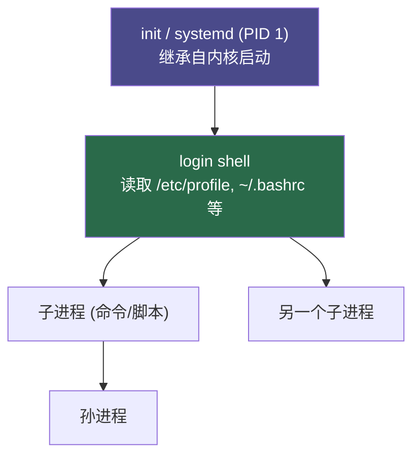
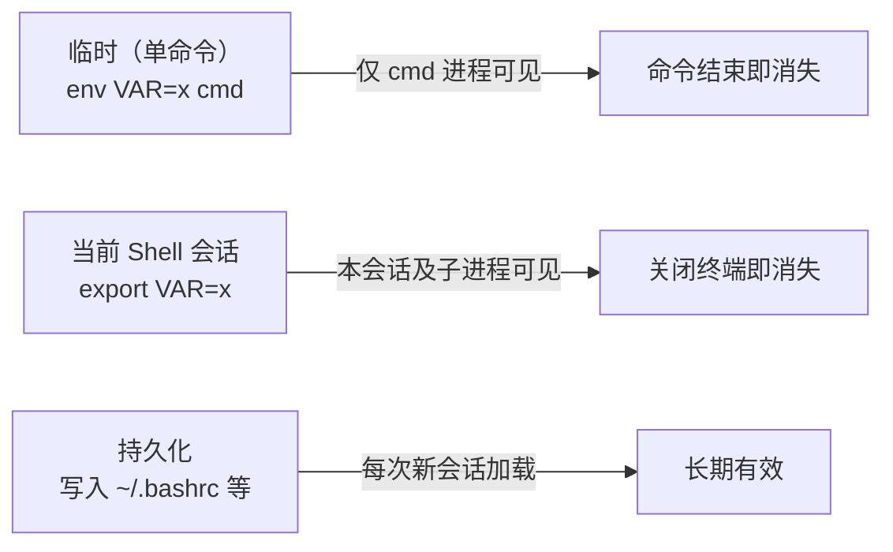

[toc]


# Shell 中 `env` 命令与环境变量继承

## 什么是环境变量

环境变量是**操作系统**提供给进程的一组**键值对配置**，进程可以通过它们感知运行环境，例如当前用户、搜索路径、语言设置等。

```
KEY=VALUE
```

它们不是 shell 专属的概念——任何进程（C 程序、Python 脚本等）都可以读取环境变量。

---

## 进程与环境变量的继承机制

理解继承是理解 `env` 命令的前提。



**核心规则：**

- 子进程**继承**父进程的环境变量副本（写时复制）
- 子进程对环境的修改**不会**反向影响父进程
- 父进程新增的变量，只有 `export` 之后子进程才能看到

### Shell 变量 vs 环境变量

| 特性       | Shell 变量     | 环境变量            |
| ---------- | -------------- | ------------------- |
| 定义方式   | `VAR=value`    | `export VAR=value`  |
| 子进程可见 | ❌ 否           | ✅ 是                |
| 查看命令   | `set`          | `env` 或 `printenv` |
| 典型用途   | 脚本内部临时值 | 跨进程配置          |

```bash
# shell 变量，子进程不可见
MYVAR=hello
bash -c 'echo $MYVAR'   # 输出空

# 导出为环境变量，子进程可见
export MYVAR=hello
bash -c 'echo $MYVAR'   # 输出 hello
```

---

## `env` 命令详解

`env` 是一个独立的系统程序（`/usr/bin/env`），不是 shell 内建命令，核心能力有三：

- **查看**当前环境变量
- **临时设置**变量后运行命令
- **清空**环境后以最小化环境运行命令

### 基本语法

```
env [选项] [NAME=VALUE ...] [命令 [参数...]]
```

### 常用选项

| 选项                           | 含义                                         |
| ------------------------------ | -------------------------------------------- |
| `env`（无参数）                | 打印当前所有环境变量                         |
| `-i` 或 `--ignore-environment` | 以**空环境**启动，不继承任何变量             |
| `-u NAME` 或 `--unset=NAME`    | 启动时移除指定变量                           |
| `NAME=VALUE cmd`               | 仅为此次命令临时添加/覆盖变量                |
| `--`                           | 明确区分选项与命令（变量名含特殊字符时使用） |

### 典型用法示例

**① 查看当前环境**

```bash
env
# 等价于
printenv
```

**② 临时覆盖变量运行命令**（不污染当前 shell）

```bash
env DEBUG=true LOG_LEVEL=verbose ./myapp
```

对比直接 `export`：`export` 会持续影响后续所有命令，而 `env` 只作用于这一次。

**③ 净化环境运行命令**

```bash
env -i PATH=/usr/bin:/bin bash --norc
```

用于测试脚本是否依赖了"隐式"的环境变量，是排查环境污染问题的利器。

**④ 移除单个变量**

```bash
env -u HTTP_PROXY curl https://example.com
```

临时绕过代理，不需要修改 shell 配置。

**⑤ Shebang 中的经典用法**

```python
#!/usr/bin/env python3
```

不写死 `python3` 的绝对路径，而是让 `env` 在 `PATH` 中查找，**提升脚本的跨环境可移植性**，是最佳实践。

---

## 环境变量的作用域与生命周期



| 范围         | 方式                          | 是否影响其他终端 |
| ------------ | ----------------------------- | ---------------- |
| 单次命令     | `env VAR=x cmd`               | ❌                |
| 当前会话     | `export VAR=x`                | ❌                |
| 当前用户持久 | 写入 `~/.bashrc` / `~/.zshrc` | ✅（新会话生效）  |
| 全局持久     | 写入 `/etc/environment`       | ✅（所有用户）    |

---

## 常用环境变量速查

| 变量               | 含义                     |
| ------------------ | ------------------------ |
| `PATH`             | 命令搜索路径，冒号分隔   |
| `HOME`             | 当前用户主目录           |
| `USER` / `LOGNAME` | 当前用户名               |
| `SHELL`            | 当前使用的 shell 路径    |
| `PWD`              | 当前工作目录             |
| `LANG` / `LC_ALL`  | 语言与字符编码           |
| `EDITOR`           | 默认编辑器               |
| `TERM`             | 终端类型                 |
| `PS1`              | shell 提示符格式（bash） |

---

## 最佳实践

**脚本开头用 `env -i` 测试隔离性**
在正式运行前，用净化环境测试脚本，能提前发现对外部环境的隐式依赖。

**优先用 `env VAR=x cmd` 而非临时 `export`**
`export` 后忘记 `unset` 会污染后续命令，`env` 形式天然隔离。

**敏感变量不要写进脚本**
密码、Token 等通过环境变量传入（`env TOKEN=xxx ./deploy.sh`），不要硬编码，也不要写进版本控制的文件。

**`~/.bashrc` vs `~/.bash_profile`**
`~/.bash_profile` 用于**登录 shell**（SSH 登录等），`~/.bashrc` 用于**交互式非登录 shell**（新开终端标签等），持久化变量建议统一写入 `~/.bashrc` 并在 `~/.bash_profile` 中 `source` 它。

**修改 `PATH` 要追加而非覆盖**
```bash
export PATH="$HOME/.local/bin:$PATH"   # ✅ 正确
export PATH="$HOME/.local/bin"          # ❌ 丢失系统路径
```