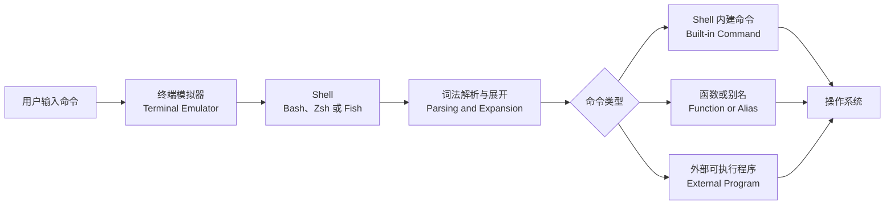
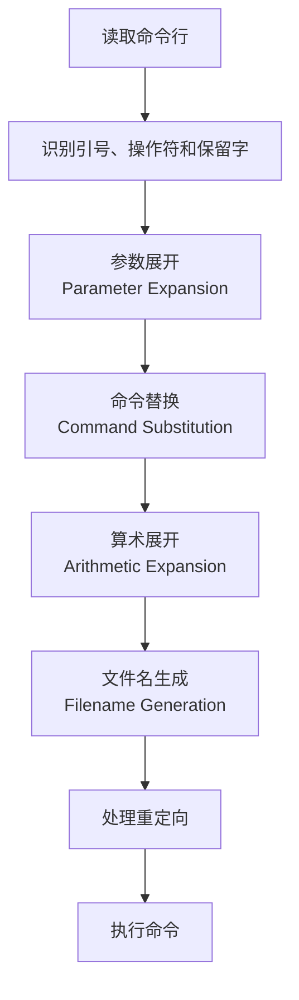
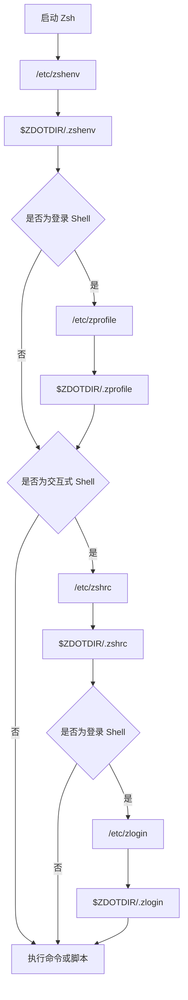
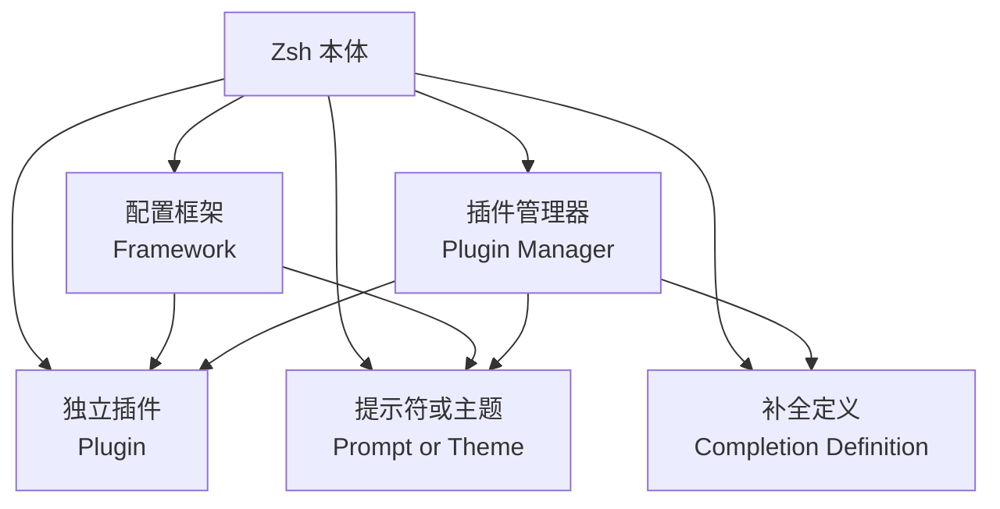
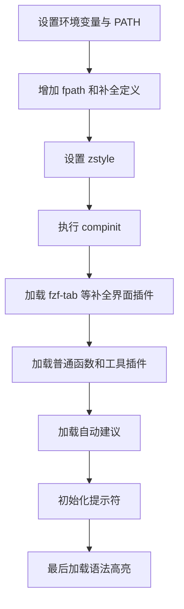

[toc]

## abstract

将zsh,fish,bash三者放在同一套“交互使用、脚本兼容、配置体系、插件生态”框架下比较。

内容基线：截至 2026 年 7 月，Zsh 官方文档对应 5.9.2，GNU Bash 当前参考手册对应 Bash 5.3，Fish 当前文档对应 4.8.1。([Zsh](https://zsh.sourceforge.io/Doc/Release/Introduction.html))

## 编排思路

学习 Shell 时，一个常见误区是先复制一份复杂的 `.zshrc`，安装十几个插件，再根据报错逐项修补。这样虽然可能很快得到一个“好看”的终端，却很难理解配置为什么生效，也很难处理启动缓慢、补全失效、环境变量不一致等问题。

本文采用下面的学习路径：

- 先区分终端、Shell、命令和脚本。
- 再理解交互式 Shell、登录 Shell 和非交互式 Shell。
- 通过 Bash、Zsh、Fish 对比，明确三者的定位。
- 掌握 Zsh 的启动文件、选项系统、补全系统和行编辑器。
- 最后引入插件、主题、提示符和插件管理器。
- 以稳定性、可维护性和安全性为目标构建配置，而不是单纯追求插件数量。

## 内容大纲

- Shell、终端和命令之间的关系
- Bash、Zsh、Fish 的定位与选择
- Zsh 的语法模型和核心概念
- 登录 Shell、交互式 Shell与脚本 Shell
- Zsh 启动文件及加载顺序
- `.zshrc` 的配置分层
- 历史记录、补全、快捷键和提示符
- Zsh 插件生态的组成
- Oh My Zsh、Antidote、Zinit 等方案对比
- 常用插件及加载顺序
- Fish 的开箱即用体验与语法差异
- Bash 的兼容优势和现代增强方案
- 性能分析、安全控制和故障排查
- 新手学习路线与推荐配置方案

## Shell 在系统中的位置

终端模拟器（Terminal Emulator）主要负责显示文本、接收键盘输入和维护终端会话。真正解释命令的是 Shell。



例如执行：

```sh
cd ~/projects
```

`cd` 通常是 Shell 内建命令，因为它需要修改当前 Shell 进程的工作目录。

而执行：

```sh
git status
```

Shell 会根据 `$PATH` 搜索 `git` 可执行程序，创建新进程并等待它运行。

因此，安装 Zsh 并不会替换 `git`、`ls`、`grep` 等程序；它改变的是解释命令、补全、历史记录、提示符和交互操作的环境。

## 先区分三种 Shell 运行状态

理解启动文件之前，必须先理解几个经常混淆的概念。

| 状态             | 英文术语                | 典型场景                               | 主要关注点                     |
| ---------------- | ----------------------- | -------------------------------------- | ------------------------------ |
| 登录 Shell       | Login Shell             | SSH 登录、文本控制台登录、部分终端配置 | 初始化用户登录环境、`PATH`     |
| 交互式 Shell     | Interactive Shell       | 用户在终端中输入命令                   | 补全、提示符、历史记录、快捷键 |
| 非交互式 Shell   | Non-interactive Shell   | 执行脚本、CI 任务、`zsh -c`            | 稳定、无输出、低开销           |
| 交互式登录 Shell | Interactive Login Shell | 同时具有登录和交互属性                 | 同时读取登录及交互配置         |

这几个状态可以重叠。例如，一个 Shell 可以既是登录 Shell，又是交互式 Shell。

可使用下面的 Zsh 表达式判断当前状态：

```zsh
[[ -o interactive ]] && print "interactive shell"
[[ -o login ]] && print "login shell"
```

常见判断原则是：

- 环境变量不一定属于交互配置。
- 提示符、别名、补全和快捷键只应在交互式 Shell 中加载。
- 脚本启动时不应输出欢迎文字。
- 非交互式 Shell 不应加载大量主题和插件。

## Bash、Zsh 与 Fish 的总体对比

| 维度           | Bash                                            | Zsh                                  | Fish                           |
| -------------- | ----------------------------------------------- | ------------------------------------ | ------------------------------ |
| 全称           | Bourne Again Shell                              | Z Shell                              | Friendly Interactive Shell     |
| 核心定位       | 通用 Shell、脚本和系统兼容                      | 高度可配置的交互式 Shell             | 开箱即用的交互式 Shell         |
| POSIX 兼容方向 | 可通过 POSIX 模式接近标准 `sh`                  | 默认模式不是 POSIX Shell             | 语法有意区别于 POSIX Shell     |
| 交互默认体验   | 相对基础                                        | 功能强，但许多能力需要初始化         | 默认提供高亮、建议和丰富补全   |
| 补全体系       | `complete`、`compgen`，通常配合 bash-completion | `compsys`、`compinit`、`zstyle`      | 内置上下文补全和可筛选列表     |
| 行编辑         | GNU Readline                                    | Zsh Line Editor，简称 ZLE            | Fish 自带交互编辑系统          |
| 插件生态       | 较分散，以补全和提示符增强为主                  | 框架、插件管理器、主题和插件较丰富   | 规模较小，但基本交互功能已内置 |
| 配置难度       | 中等                                            | 上限高，复杂度也较高                 | 初始配置最少                   |
| 脚本可移植性   | 较好，服务器和 CI 中常见                        | 适合 Zsh 专用脚本，不宜假定兼容 Bash | Fish 脚本只能由 Fish 解释      |
| 适合用户       | 运维、脚本开发、服务器环境                      | 开发者、重度终端用户、可定制工作流   | 希望少配置、重视交互体验的新手 |
| 主要风险       | 交互能力需要额外增强                            | 容易堆积插件并产生启动和顺序问题     | 无法直接复用大量 Bash 脚本语法 |

Bash 在以 `sh` 名称启动或启用 `--posix` 时，会采用相应的 POSIX 行为。Zsh 官方明确说明，其默认运行模式不保证 POSIX 或其他 Shell 兼容。Fish 则以交互可用性为设计中心，内置语法高亮、自动建议和补全，同时采用自己的变量、循环、条件和函数语法。([GNU](https://www.gnu.org/software/bash/manual/html_node/Bash-Startup-Files))

### 如何选择

| 使用需求                                  | 推荐方案                                           |
| ----------------------------------------- | -------------------------------------------------- |
| 编写系统部署脚本                          | POSIX `sh` 或 Bash                                 |
| 编写 GitHub Actions、容器入口脚本         | 根据运行环境使用 `sh` 或 Bash                      |
| 日常开发终端，希望高度定制                | Zsh                                                |
| 不想折腾配置，希望立即获得自动建议和高亮  | Fish                                               |
| 经常登录配置未知的远程服务器              | 熟练掌握 Bash                                      |
| 同时使用 macOS、Linux 和 Windows 开发环境 | Zsh 或 Fish 作为交互 Shell，脚本仍使用 Bash或 `sh` |
| 团队共享脚本                              | 不要依赖个人默认 Shell，明确写 Shebang             |

一个实用的组合是：

- 使用 Zsh 或 Fish 作为日常交互式 Shell。
- 使用 Bash 编写需要明确 Bash 能力的脚本。
- 使用 POSIX `sh` 编写强调可移植性的简单脚本。
- 不要因为登录 Shell 是 Zsh，就给所有脚本写 `#!/bin/zsh`。

## Zsh 的核心设计

Zsh 不只是“带插件的 Bash”。它拥有自己的选项系统、参数展开规则、补全系统和行编辑器。

Zsh 官方将其定位为既可作为交互式登录 Shell，也可作为脚本处理器的 Unix 命令解释器。其功能体系包括语法、重定向、函数、参数展开、文件名生成、补全、ZLE 和可加载模块。([Zsh](https://zsh.sourceforge.io/Doc/Release/Introduction.html))

### 命令解析的基本过程

一条命令通常会经历以下过程：



不同展开过程可能相互影响，因此 Shell 中的引号尤其重要。

### 引号规则

#### 不加引号

```zsh
print $name
```

变量会被展开，并可能继续参与 Shell 的其他处理。具体行为取决于 Shell 及其选项。

#### 双引号

```zsh
print "$name"
```

允许变量展开和命令替换，但保护结果不被不必要地拆分或解释。

#### 单引号

```zsh
print '$name'
```

内容按字面值处理，不进行变量展开。

对于路径和用户输入，默认优先使用双引号：

```zsh
cd -- "$target_dir"
rm -- "$file"
```

`--` 表示后面的内容不再作为命令选项解析，可以避免文件名以 `-` 开头时被误认为参数。

### 通配符与文件名生成

常见通配符（Glob）包括：

```zsh
*.log
src/**/*.ts
file?.txt
```

Zsh 的文件名生成能力比普通 POSIX Shell 更丰富，但复杂模式也更容易形成只在 Zsh 中可用的脚本。

例如：

```zsh
print -l **/*.md
```

在启用相应行为时，可以递归匹配 Markdown 文件。

需要注意，Zsh 默认会对未匹配的通配符报错。下面的命令在当前目录没有 `.log` 文件时，可能出现 `no matches found`：

```zsh
rm *.log
```

不要为了消除报错就全局关闭保护。更稳妥的方式是明确使用 Zsh 的空匹配限定符：

```zsh
rm -- *.log(N)
```

`(N)` 表示没有匹配时生成空结果。

### 变量与环境变量

普通 Shell 变量：

```zsh
project_name="demo"
```

导出为环境变量：

```zsh
export PROJECT_ENV="development"
```

普通变量只存在于当前 Shell。导出的环境变量会传递给后续启动的子进程。

Zsh 提供关联数组和普通数组：

```zsh
languages=(Python Rust Go)
print "$languages[1]"
```

Zsh 数组默认从 1 开始索引。这与 Bash 默认从 0 开始索引不同，是迁移脚本时常见的错误来源。

### `$PATH` 与 `path` 数组

在 Zsh 中，`PATH` 与 `path` 是相互关联的特殊参数：

```zsh
print -l $path
```

可以使用数组方式管理路径，并通过唯一属性去重：

```zsh
typeset -U path PATH
path=(
  "$HOME/.local/bin"
  "$HOME/bin"
  $path
)
export PATH
```

相比反复拼接：

```zsh
export PATH="$HOME/.local/bin:$PATH"
```

数组方式更容易阅读，也更容易去除重复目录。

### 别名与函数

别名（Alias）适合简单文本替换：

```zsh
alias ll='ls -lah'
alias gst='git status'
```

当逻辑涉及参数、判断或多条命令时，应使用函数：

```zsh
mkcd() {
  if (( $# != 1 )); then
    print -u2 "usage: mkcd <directory>"
    return 2
  fi

  mkdir -p -- "$1" && cd -- "$1"
}
```

经验规则：

- 固定短命令使用别名。
- 需要参数时使用函数。
- 需要错误处理时使用函数。
- 不要给 `rm`、`cp` 等基础命令设置行为差异过大的别名。
- 团队脚本中不要依赖个人别名。

## Zsh 的选项系统

Zsh 将大量行为设计为可开启或关闭的选项。

查看当前选项：

```zsh
setopt
```

开启选项：

```zsh
setopt AUTO_CD
```

关闭选项：

```zsh
unsetopt AUTO_CD
```

判断选项：

```zsh
[[ -o auto_cd ]] && print "AUTO_CD is enabled"
```

常见选项如下。

| 选项                   | 作用                                | 建议                 |
| ---------------------- | ----------------------------------- | -------------------- |
| `APPEND_HISTORY`       | 退出时追加历史，而不是覆盖          | 推荐                 |
| `SHARE_HISTORY`        | 在多个交互式 Shell 间导入和共享历史 | 多终端用户可开启     |
| `HIST_IGNORE_DUPS`     | 不连续记录相同命令                  | 推荐                 |
| `HIST_IGNORE_ALL_DUPS` | 删除历史中较早的重复命令            | 可选                 |
| `HIST_SAVE_NO_DUPS`    | 保存历史文件时移除重复项            | 可选                 |
| `HIST_REDUCE_BLANKS`   | 减少多余空白                        | 推荐                 |
| `HIST_IGNORE_SPACE`    | 以空格开头的命令不记入历史          | 需理解安全边界后使用 |
| `AUTO_CD`              | 直接输入目录名即可进入目录          | 可选                 |
| `INTERACTIVE_COMMENTS` | 交互命令行允许使用 `#` 注释         | 推荐                 |
| `NO_BEEP`              | 禁止终端蜂鸣                        | 按个人习惯           |
| `CORRECT`              | 尝试纠正命令拼写                    | 容易干扰，默认不推荐 |
| `EXTENDED_GLOB`        | 启用更丰富的 Glob 语法              | 熟悉后再开启         |

历史共享存在取舍。启用 `SHARE_HISTORY` 后，多个终端的命令会相互合并，但命令顺序可能与单个终端中看到的执行顺序不同。对于希望每个终端历史完全独立的用户，不应开启。

## Zsh Line Editor

Zsh Line Editor，简称 ZLE，是 Zsh 的命令行编辑系统。它负责：

- 光标移动
- 删除和修改文本
- 历史搜索
- 按键绑定
- 补全触发
- 自定义交互部件（Widget）
- 插件对当前命令行缓冲区的修改

选择 Emacs 风格按键：

```zsh
bindkey -e
```

选择 Vi 风格按键：

```zsh
bindkey -v
```

常见快捷键：

| 快捷键   | 常见作用         |
| -------- | ---------------- |
| `Ctrl+A` | 移动到行首       |
| `Ctrl+E` | 移动到行尾       |
| `Ctrl+U` | 删除光标前内容   |
| `Ctrl+K` | 删除光标后内容   |
| `Ctrl+W` | 删除前一个单词   |
| `Ctrl+R` | 反向搜索历史     |
| `Alt+F`  | 向前移动一个单词 |
| `Alt+B`  | 向后移动一个单词 |
| `Ctrl+L` | 清理屏幕         |

可以查看当前按键映射：

```zsh
bindkey
```

大量交互插件本质上都是在注册或包装 ZLE Widget。因此插件加载顺序不是形式问题，而会直接决定快捷键、高亮和补全是否正常。

## Zsh 补全系统

Zsh 的现代补全系统通常称为 `compsys`。它能够根据当前命令、参数位置、选项和语法上下文决定补全内容。补全系统通过 `compinit` 初始化，并使用 `zstyle` 调整行为。([Zsh](https://zsh.sourceforge.io/Doc/Release/Completion-System.html))

### 最小初始化

```zsh
autoload -Uz compinit
compinit
```

`autoload` 表示先登记函数，在需要时再从 `$fpath` 中加载。

### `$fpath`

`fpath` 是 Zsh 搜索自动加载函数和补全定义的目录数组。

```zsh
print -l $fpath
```

如果安装第三方补全定义，应在执行 `compinit` 之前扩展 `fpath`：

```zsh
fpath=(
  "$HOME/.local/share/zsh/site-functions"
  $fpath
)

autoload -Uz compinit
compinit
```

否则 `compinit` 扫描时可能无法发现新补全。

### 常用 `zstyle`

```zsh
zstyle ':completion:*' menu select
zstyle ':completion:*' group-name ''
zstyle ':completion:*:descriptions' format '[%d]'
zstyle ':completion:*' matcher-list 'm:{a-zA-Z}={A-Za-z}'
```

对应作用：

- 使用可选择菜单。
- 将不同类型的候选项分组。
- 显示候选项描述。
- 补全时忽略大小写差异。

`zstyle` 的模式由“上下文”组成。初学阶段不必立即掌握完整语法，可以先理解：

```text
zstyle <上下文模式> <样式名称> <样式值>
```

### 补全缓存

可以将补全缓存放入缓存目录：

```zsh
zsh_cache_dir="${XDG_CACHE_HOME:-$HOME/.cache}/zsh"
mkdir -p -- "$zsh_cache_dir"

autoload -Uz compinit
compinit -d "$zsh_cache_dir/zcompdump-$ZSH_VERSION"
```

升级 Zsh、修改补全路径或遇到异常时，可以删除缓存后重新生成：

```zsh
rm -f -- "${XDG_CACHE_HOME:-$HOME/.cache}/zsh"/zcompdump-*
exec zsh
```

### `compinit` 安全检查

`compinit` 会检查补全目录的所有权和权限。如果目录可被其他用户写入，会显示安全警告。

排查命令：

```zsh
autoload -Uz compaudit
compaudit
```

正确做法是修复目录的所有者和写权限，而不是长期使用跳过安全检查的参数。

不建议为了安静而直接使用：

```zsh
compinit -u
```

这样可能隐藏真正的目录权限风险。

## Zsh 启动文件

Zsh 根据是否为登录 Shell 和交互式 Shell，读取不同配置文件。

官方读取顺序为：



退出登录 Shell 时，还会读取 `.zlogout`。Zsh 官方特别指出，`.zshenv` 会被所有 Zsh 实例读取，因此必须保持精简。([Zsh](https://zsh.sourceforge.io/Doc/Release/Files.html))

### 启动文件职责

| 文件        | 何时读取                       | 推荐内容                             | 不应放置                   |
| ----------- | ------------------------------ | ------------------------------------ | -------------------------- |
| `.zshenv`   | 所有 Zsh                       | 极少量全局环境变量、`ZDOTDIR`        | 输出、插件、提示符、慢命令 |
| `.zprofile` | 登录 Shell                     | 登录环境、`PATH`、会话初始化         | 补全、快捷键、主题         |
| `.zshrc`    | 交互式 Shell                   | 历史、别名、函数、补全、插件、提示符 | 非交互脚本必须依赖的变量   |
| `.zlogin`   | 登录 Shell，位于 `.zshrc` 之后 | 少量必须在交互配置后执行的登录任务   | 与 `.zprofile` 重复的内容  |
| `.zlogout`  | 登录 Shell 退出                | 清理任务                             | 耗时或高风险命令           |

### `.zshenv` 为什么必须精简

下面的操作不应放在 `.zshenv`：

```zsh
echo "Welcome"
neofetch
nvm use
pyenv init -
eval "$(starship init zsh)"
```

因为执行脚本、运行编辑器子进程、调用 `zsh -c` 时，也可能加载 `.zshenv`。

适合放入 `.zshenv` 的内容：

```zsh
export XDG_CONFIG_HOME="${XDG_CONFIG_HOME:-$HOME/.config}"
export XDG_CACHE_HOME="${XDG_CACHE_HOME:-$HOME/.cache}"
export XDG_DATA_HOME="${XDG_DATA_HOME:-$HOME/.local/share}"
export XDG_STATE_HOME="${XDG_STATE_HOME:-$HOME/.local/state}"

export EDITOR="${EDITOR:-vim}"
export VISUAL="${VISUAL:-$EDITOR}"
```

### Bash 启动文件对比

Bash 的主要规则是：

- 交互式登录 Shell 读取 `/etc/profile`，然后从 `.bash_profile`、`.bash_login`、`.profile` 中读取第一个存在的文件。
- 交互式非登录 Shell 读取 `.bashrc`。
- 常见做法是在 `.bash_profile` 中主动加载 `.bashrc`。
- 非交互式 Bash 可通过 `BASH_ENV` 指定配置文件。([GNU](https://www.gnu.org/software/bash/manual/html_node/Bash-Startup-Files))

```bash
# ~/.bash_profile
if [ -f "$HOME/.bashrc" ]; then
  . "$HOME/.bashrc"
fi
```

### Fish 启动文件对比

Fish 使用：

```text
~/.config/fish/config.fish
~/.config/fish/conf.d/*.fish
```

`conf.d` 中的文件会在 `config.fish` 前自动执行。Fish 的配置文件会在不同启动模式下读取，因此应使用 `status --is-interactive` 和 `status --is-login` 限制特定配置。([Fish Shell](https://fishshell.com/docs/current/))

```fish
if status --is-interactive
    # 交互配置
end

if status --is-login
    # 登录配置
end
```

## 推荐的 Zsh 配置分层

不要把所有内容堆进一个几千行的 `.zshrc`。可以采用下面的结构：

```text
~/.zshenv
~/.zprofile
~/.zshrc

~/.config/zsh/
├── aliases.zsh
├── completion.zsh
├── functions.zsh
├── keybindings.zsh
├── options.zsh
├── plugins.zsh
└── prompt.zsh
```

在 `.zshrc` 中按固定顺序加载：

```zsh
zsh_config_dir="${XDG_CONFIG_HOME:-$HOME/.config}/zsh"

source "$zsh_config_dir/options.zsh"
source "$zsh_config_dir/aliases.zsh"
source "$zsh_config_dir/functions.zsh"
source "$zsh_config_dir/completion.zsh"
source "$zsh_config_dir/keybindings.zsh"
source "$zsh_config_dir/plugins.zsh"
source "$zsh_config_dir/prompt.zsh"
```

对于新手，最开始不必立即拆分。配置稳定到一百行以上，并且开始出现明确功能区域时再拆分，通常更容易维护。

## 一份可用的最小配置

### `.zshenv`

```zsh
export XDG_CONFIG_HOME="${XDG_CONFIG_HOME:-$HOME/.config}"
export XDG_CACHE_HOME="${XDG_CACHE_HOME:-$HOME/.cache}"
export XDG_DATA_HOME="${XDG_DATA_HOME:-$HOME/.local/share}"
export XDG_STATE_HOME="${XDG_STATE_HOME:-$HOME/.local/state}"

export EDITOR="${EDITOR:-vim}"
export VISUAL="${VISUAL:-$EDITOR}"
```

### `.zprofile`

```zsh
typeset -U path PATH

path=(
  "$HOME/.local/bin"
  "$HOME/bin"
  $path
)

export PATH
```

### `.zshrc`

```zsh
# 仅允许交互式 Shell 继续加载
[[ -o interactive ]] || return

# 按键模式
bindkey -e

# 历史记录
history_dir="${XDG_STATE_HOME:-$HOME/.local/state}/zsh"
mkdir -p -- "$history_dir"

HISTFILE="$history_dir/history"
HISTSIZE=50000
SAVEHIST=50000

setopt APPEND_HISTORY
setopt SHARE_HISTORY
setopt HIST_IGNORE_DUPS
setopt HIST_SAVE_NO_DUPS
setopt HIST_REDUCE_BLANKS

# 交互行为
setopt INTERACTIVE_COMMENTS
setopt NO_BEEP

# 可选：直接输入目录名进入目录
setopt AUTO_CD

# 补全样式必须在 compinit 前设置
zstyle ':completion:*' menu select
zstyle ':completion:*' group-name ''
zstyle ':completion:*:descriptions' format '[%d]'
zstyle ':completion:*' matcher-list 'm:{a-zA-Z}={A-Za-z}'

# 初始化补全
completion_cache="${XDG_CACHE_HOME:-$HOME/.cache}/zsh"
mkdir -p -- "$completion_cache"

autoload -Uz compinit
compinit -d "$completion_cache/zcompdump-$ZSH_VERSION"

# 简单别名
alias ll='ls -lah'
alias la='ls -A'
alias gst='git status'
alias gl='git log --oneline --decorate --graph'

# 示例函数
mkcd() {
  if (( $# != 1 )); then
    print -u2 "usage: mkcd <directory>"
    return 2
  fi

  mkdir -p -- "$1" && cd -- "$1"
}

# 跨 Shell 提示符，可选
if (( $+commands[starship] )); then
  eval "$(starship init zsh)"
fi
```

这份配置已经包含：

- 环境目录
- `PATH` 去重
- 历史记录
- 基础选项
- 上下文补全
- 按键模式
- 别名和函数
- 可选提示符

在此基础上再添加插件，问题更容易定位。

## Zsh 插件生态的组成

“插件生态”经常被混为一个概念，实际上至少包含五个层次。



### 配置框架

框架不仅负责下载插件，还会提供：

- 目录结构
- 默认选项
- 主题系统
- 内置插件
- 辅助函数
- 更新机制

典型代表是 Oh My Zsh。它提供数百个可选插件和大量主题，适合希望快速获得完整配置的新手。([GitHub](https://github.com/ohmyzsh/ohmyzsh?utm_source=chatgpt.com))

### 插件管理器

插件管理器主要负责：

- 克隆插件仓库
- 更新插件
- 决定插件加载顺序
- 生成静态加载文件
- 延迟加载或编译插件
- 管理第三方主题和补全

它通常不会像完整框架一样替你决定大量默认行为。

### 提示符与主题

提示符（Prompt）负责显示：

- 用户和主机
- 当前目录
- Git 分支及工作区状态
- 上一条命令退出状态
- 语言运行时版本
- Kubernetes、云环境或虚拟环境

主题可能是纯 Zsh 脚本，也可能是跨 Shell 可执行程序。

Starship 支持 Bash、Zsh、Fish 等多个 Shell，并分别提供对应初始化方式。([Starship](https://starship.rs/))

### 补全插件

补全插件一般向 `$fpath` 添加 `_command` 形式的补全函数，必须在 `compinit` 扫描之前准备好。

`zsh-completions` 提供额外的 Zsh 补全定义。其文档特别提示，应避免重复调用 `compinit`，否则可能重复生成缓存并增加启动时间。([GitHub](https://github.com/zsh-users/zsh-completions))

### ZLE 插件

自动建议、语法高亮、历史搜索等插件通常会操作 ZLE。

由于多个插件可能包装同一个 Widget，因此加载顺序非常重要。

## Zsh 配置方案对比

| 方案             | 定位                           | 优点                         | 缺点                             | 适合对象             |
| ---------------- | ------------------------------ | ---------------------------- | -------------------------------- | -------------------- |
| 纯手动配置       | 直接 `source` 插件             | 可控、透明、依赖少           | 更新需自行管理                   | 想理解原理、插件较少 |
| 系统包管理器     | 通过发行版或 Homebrew 安装插件 | 审计和升级相对统一           | 版本可能落后                     | 重视稳定性           |
| Oh My Zsh        | 完整配置框架                   | 入门快、资料多、插件丰富     | 默认内容较多，容易无意识启用功能 | 新手和快速搭建       |
| Antidote         | 声明式插件管理器               | 配置简洁、插件清单清晰       | 仍需理解 Zsh 加载顺序            | 追求轻量和可维护性   |
| Zinit            | 高度可编程插件管理器           | 延迟加载、转换和管理能力丰富 | 配置语法和调试成本较高           | 高级用户             |
| 自建静态插件加载 | 自己克隆并锁定版本             | 最透明、最容易审计           | 缺少自动更新体验                 | 团队和稳定环境       |

Antidote 通常使用 `.zsh_plugins.txt` 声明插件集合，并生成对应的加载脚本。Zinit 提供更复杂的插件加载与延迟机制，但配置面也更大。([GitHub](https://github.com/mattmc3/antidote))

### 新手选择建议

希望快速体验：

```text
Oh My Zsh
少量内置插件
zsh-autosuggestions
zsh-syntax-highlighting
Starship 或一个简单主题
```

希望配置清晰：

```text
原生 Zsh 配置
Antidote
三到五个核心插件
Starship
```

希望真正掌握 Zsh：

```text
先使用纯手动配置
理解 fpath、compinit、ZLE 和加载顺序
之后再选择插件管理器
```

不要同时叠加多个完整体系，例如：

```text
Oh My Zsh + Prezto + Zinit + 多套提示符
```

技术上可能可以组合，但配置来源、更新职责、快捷键和补全初始化很容易冲突。

## 常用 Zsh 插件

| 插件                           | 功能                         | 是否适合新手 | 注意事项                                |
| ------------------------------ | ---------------------------- | ------------ | --------------------------------------- |
| `zsh-autosuggestions`          | 根据历史和补全显示灰色建议   | 是           | 与快捷键插件可能冲突                    |
| `zsh-syntax-highlighting`      | 输入命令时进行语法高亮       | 是           | 通常应最后加载                          |
| `zsh-completions`              | 增加额外命令补全             | 是           | 必须在 `compinit` 前扩展 `fpath`        |
| `fzf-tab`                      | 使用 fzf 展示 Zsh 补全候选项 | 可选         | 在 `compinit` 后、Widget 包装插件前加载 |
| `zsh-history-substring-search` | 根据当前输入搜索历史         | 可选         | 需要配置上下方向键                      |
| `zoxide`                       | 根据使用频率快速跳转目录     | 是           | 属于跨 Shell 工具，不只是 Zsh 插件      |
| `fzf`                          | 模糊搜索文件、历史和文本     | 是           | 注意不同集成脚本间的快捷键冲突          |
| Powerlevel10k                  | 功能丰富的 Zsh 提示符主题    | 可选         | 配置项较多，并可能依赖特殊字体          |
| Starship                       | 跨 Shell 提示符              | 是           | 同一时间只初始化一套提示符              |

`zsh-autosuggestions` 根据历史和补全内容提供输入建议；`zsh-syntax-highlighting` 在执行前对命令行进行高亮，帮助发现错误。([GitHub](https://github.com/zsh-users/zsh-autosuggestions?utm_source=chatgpt.com))

`fzf-tab` 替换的是 Zsh 默认的候选项选择界面，而不是重新实现整个补全系统。它要求在 `compinit` 之后、会包装 ZLE Widget 的插件之前加载。([GitHub](https://github.com/aloxaf/fzf-tab))

### 推荐加载顺序



一个简化示例：

```zsh
# 补全定义必须先加入 fpath
fpath=("$HOME/.local/share/zsh-completions/src" $fpath)

autoload -Uz compinit
compinit

# compinit 之后
source "$HOME/.local/share/zsh-plugins/fzf-tab/fzf-tab.plugin.zsh"

# 普通交互插件
source "$HOME/.local/share/zsh-plugins/zsh-autosuggestions/zsh-autosuggestions.zsh"

# 提示符
eval "$(starship init zsh)"

# 通常最后加载
source "$HOME/.local/share/zsh-plugins/zsh-syntax-highlighting/zsh-syntax-highlighting.zsh"
```

`zsh-syntax-highlighting` 通过 ZLE Hook 对当前命令行缓冲区进行高亮，官方说明要求它在其他会修改命令行 Widget 的配置之后加载。([GitHub](https://github.com/zsh-users/zsh-syntax-highlighting))

## Oh My Zsh 的使用要领

Oh My Zsh 的价值不只是“主题好看”，而是提供了一套相对统一的 Zsh 配置框架。

典型配置：

```zsh
export ZSH="$HOME/.oh-my-zsh"

ZSH_THEME="robbyrussell"

plugins=(
  git
  docker
  kubectl
)

source "$ZSH/oh-my-zsh.sh"
```

### 插件不是安装得越多越好

Oh My Zsh 内置插件常见内容包括：

- 别名
- Shell 函数
- 补全定义
- 环境初始化
- 快捷命令

每启用一个插件前，应查看其 README，确认：

- 它增加了哪些别名。
- 是否执行外部命令。
- 是否调用版本管理工具。
- 是否修改 `PATH`。
- 是否初始化补全。
- 是否与已有插件重复。

例如同时启用多个 Git、Docker、Node.js 环境插件，可能产生重复别名、重复补全或启动时外部进程调用。

### 使用外部提示符

使用 Starship 时，可以禁用 Oh My Zsh 自带主题：

```zsh
ZSH_THEME=""
```

然后在 Oh My Zsh 加载完成后初始化：

```zsh
source "$ZSH/oh-my-zsh.sh"

if (( $+commands[starship] )); then
  eval "$(starship init zsh)"
fi
```

不要同时启用多个提示符：

```text
Oh My Zsh 主题
Powerlevel10k
Starship
自定义 PROMPT
```

同一时间应只有一个组件负责最终提示符。

## Fish 的核心特点

Fish 的设计目标是让交互功能容易发现，并尽可能在默认状态下可用。它默认提供：

- 命令语法高亮
- 基于历史的自动建议
- 上下文补全
- 可过滤的候选列表
- 友好的错误提示
- Web 配置界面
- 自动加载函数和补全

这些能力无需像 Zsh 那样先安装自动建议和语法高亮插件。([Fish Shell](https://fishshell.com/docs/current/tutorial.html?utm_source=chatgpt.com))

### Fish 与 Bash、Zsh 的语法差异

#### 设置变量

Bash 或 Zsh：

```sh
name="alice"
export EDITOR="nvim"
```

Fish：

```fish
set name alice
set -gx EDITOR nvim
```

#### 条件判断

Bash 或 Zsh：

```sh
if command -v git >/dev/null 2>&1; then
  echo "Git exists"
fi
```

Fish：

```fish
if command -q git
    echo "Git exists"
end
```

#### 循环

Bash 或 Zsh：

```sh
for file in *.txt; do
  echo "$file"
done
```

Fish：

```fish
for file in *.txt
    echo $file
end
```

#### 命令替换

Bash 或 Zsh：

```sh
current_date=$(date +%F)
```

Fish：

```fish
set current_date (date +%F)
```

Fish 的设计文档明确说明，它只直接支持自己的命令替换模型，不照搬传统 Shell 的子 Shell 和进程替换语法。([Fish Shell](https://fishshell.com/docs/current/design.html))

### Fish 配置示例

```fish
# ~/.config/fish/config.fish

fish_add_path ~/.local/bin

set -gx EDITOR nvim
set -gx VISUAL nvim

if status --is-interactive
    abbr -a gst 'git status'
    abbr -a gco 'git checkout'
    abbr -a dc 'docker compose'

    if type -q starship
        starship init fish | source
    end
end
```

`fish_add_path` 会在路径尚未存在时添加目录，通常比直接修改 `$PATH` 更安全。Fish 的缩写（Abbreviation）只在交互输入时展开，不会影响脚本，因此比大量别名更容易观察和学习。([Fish Shell](https://fishshell.com/docs/current/))

### Fish 插件生态

Fish 已内置高亮、自动建议和较强补全，因此其插件更多用于：

- 提示符
- Git 工作流
- 语言版本管理
- 目录跳转
- fzf 集成
- 外部工具兼容

Fisher 是常见的 Fish 插件管理器，支持安装、更新、删除插件，并可以锁定到标签、分支或提交。([GitHub](https://github.com/jorgebucaran/fisher))

例如：

```fish
fisher install jorgebucaran/fisher
fisher install IlanCosman/tide@v6
```

### 何时更适合 Fish

Fish 更适合下面的情况：

- 主要需求是交互操作，而不是 Shell 脚本兼容。
- 不想维护复杂插件加载顺序。
- 希望安装后立即获得高亮、建议和补全。
- 愿意学习一套更统一但不同于 Bash 的语法。
- 日常脚本可以明确交给 Bash 或其他语言执行。

Fish 不适合直接解释大量现有 Bash 脚本。正确方式不是“让 Fish 兼容 Bash”，而是使用正确解释器：

```fish
bash script.sh
```

或者确保脚本本身有正确 Shebang：

```bash
#!/usr/bin/env bash
```

## Bash 的现代定位

Bash 的优势通常不在于默认交互体验，而在于：

- 大量系统和服务器已有 Bash。
- 大量脚本、文档和 CI 示例使用 Bash。
- 能够在交互使用和脚本使用之间保持较统一的语言。
- 可以通过 bash-completion、ble.sh、fzf 和 Starship 获得现代体验。

### Bash 补全

`bash-completion` 为大量命令提供可编程补全，并支持按需加载补全定义。([GitHub](https://github.com/scop/bash-completion))

### Bash 高亮和建议

`ble.sh` 是以 Bash 实现的行编辑器增强层，可以替换默认 GNU Readline 交互层，并提供语法高亮、自动建议、Vi 模式等功能。([GitHub](https://github.com/akinomyoga/ble.sh))

这说明 Bash 也能获得接近现代 Shell 的交互体验，但通常需要额外组件，而 Fish 默认已包含许多相似能力，Zsh 则通过 ZLE 和插件体系实现。

### Bash 最小交互配置

```bash
# ~/.bashrc

case $- in
  *i*) ;;
  *) return ;;
esac

HISTCONTROL=ignoreboth:erasedups
HISTSIZE=50000
HISTFILESIZE=50000

shopt -s histappend
shopt -s checkwinsize

alias ll='ls -lah'
alias gst='git status'

if command -v starship >/dev/null 2>&1; then
  eval "$(starship init bash)"
fi
```

## 提示符的选择

| 方案           | 支持范围   | 特点                      | 推荐场景                 |
| -------------- | ---------- | ------------------------- | ------------------------ |
| 原生 `PROMPT`  | Zsh        | 无外部依赖、最透明        | 学习原理、追求极简       |
| Oh My Zsh 主题 | Zsh        | 选择多、配置简单          | 使用 Oh My Zsh           |
| Powerlevel10k  | Zsh        | 信息丰富、可视化配置      | 重度 Zsh 用户            |
| Starship       | 多种 Shell | 配置统一、可跨 Shell 使用 | 同时使用 Bash、Zsh、Fish |
| Tide           | Fish       | 与 Fish 集成紧密          | Fish 用户                |

简单的原生 Zsh 提示符：

```zsh
autoload -Uz colors
colors

PROMPT='%F{cyan}%n@%m%f %F{blue}%~%f %# '
```

常用提示符转义：

| 形式        | 含义                               |
| ----------- | ---------------------------------- |
| `%n`        | 用户名                             |
| `%m`        | 主机名                             |
| `%~`        | 当前目录，主目录显示为 `~`         |
| `%#`        | 普通用户显示 `%`，特权用户显示 `#` |
| `%?`        | 上一条命令退出状态                 |
| `%F{color}` | 设置前景色                         |
| `%f`        | 恢复前景色                         |

提示符中包含 Git 状态、语言版本和云环境时，应避免每次绘制都同步执行大量外部命令。

## 环境变量和版本管理工具

Node.js、Python、Ruby 等版本管理器经常是 Shell 启动缓慢的主要来源之一。

常见工具会在 `.zshrc` 中要求执行：

```zsh
eval "$(tool init -)"
```

这类代码可能：

- 启动外部进程。
- 扫描文件系统。
- 修改 `PATH`。
- 注册补全或 Hook。
- 在每次新建 Shell 时重复运行。

最佳实践：

- 只初始化真正使用的工具。
- 优先使用惰性加载或按目录激活机制。
- 不要同时安装多套管理同一种语言的版本管理器。
- 将工具生成的缓存放入 XDG 缓存目录。
- 定期检查 `.zshrc` 中有多少条 `eval "$(…)"`。
- 不要把交互初始化放进 `.zshenv`。

## 配置安全实践

### 不盲目执行远程脚本

许多项目会提供：

```sh
curl ... | sh
```

或者：

```fish
curl ... | source
```

这类命令方便，但会直接执行网络返回内容。Oh My Zsh 和 Fisher 等项目都提供类似快速安装方式。([Oh My Zsh!](https://ohmyz.sh/?utm_source=chatgpt.com))

个人测试环境可以根据风险接受程度使用；团队或生产环境更建议：

- 优先使用系统包管理器。
- 先下载，再检查脚本。
- 固定版本、标签或提交。
- 记录插件来源。
- 将插件清单纳入 Dotfiles 仓库。
- 不自动执行未经审查的更新。

### 不把密钥写进 Dotfiles

避免：

```zsh
export OPENAI_API_KEY="..."
export AWS_SECRET_ACCESS_KEY="..."
```

更适合使用：

- 操作系统钥匙串
- 密钥管理工具
- 云平台凭据工具
- 只在本地存在且不提交的环境文件
- `direnv` 配合受控项目目录
- CI Secret 管理功能

### 对项目自动加载保持警惕

进入目录后自动执行项目脚本虽然方便，但项目目录可能来自不可信仓库。

自动加载工具应至少具备：

- 首次执行确认
- 文件变更后重新授权
- 明确的信任记录
- 可查看即将执行的内容

### 不关闭补全权限检查

出现 `compinit` 权限警告时，应修复：

- 目录所有者
- 组写权限
- 其他用户写权限
- 不可信路径

不要把跳过安全检查作为永久解决方案。

## 性能优化

### 首先测量启动时间

```zsh
time zsh -i -c exit
```

多执行几次，避免把首次磁盘缓存影响当作稳定结果。

### 使用 `zprof`

在 `.zshrc` 最前面临时加入：

```zsh
zmodload zsh/zprof
```

在末尾加入：

```zsh
zprof
```

重新启动 Shell 后，可以看到函数调用次数和耗时。

定位完成后应删除性能分析代码。

### 常见慢点

| 慢点                    | 表现                        | 改进方式                    |
| ----------------------- | --------------------------- | --------------------------- |
| 插件数量过多            | 新建终端延迟                | 删除低频插件                |
| 多次调用 `compinit`     | 补全初始化明显变慢          | 全局只初始化一次            |
| 版本管理器初始化        | 每次启动执行多个子进程      | 惰性加载                    |
| 提示符同步检查 Git      | 大仓库中卡顿                | 使用异步提示符或减少模块    |
| 启动时检查更新          | 偶发网络阻塞                | 将更新移出启动流程          |
| 多次运行包管理器查询    | 每次调用 `brew --prefix` 等 | 缓存路径或使用固定安装路径  |
| 重复修改 `$PATH`        | 路径越来越长                | 使用 `typeset -U path PATH` |
| 在 `.zshenv` 中运行命令 | 所有 Zsh 脚本都变慢         | 只保留常量环境变量          |

### 不要过早延迟加载所有东西

延迟加载（Lazy Loading）并非没有代价：

- 首次使用相关命令时会产生延迟。
- 补全可能在工具加载前不可用。
- 环境变量可能晚于其他插件初始化。
- 调试顺序更复杂。

先删除无用配置和重复初始化，再考虑延迟加载。

## Dotfiles 管理

推荐将配置纳入版本控制，但不要直接提交整个主目录。

可以管理：

```text
.zshenv
.zprofile
.zshrc
.config/zsh/
.config/starship.toml
.config/fish/
```

不要提交：

```text
历史文件
补全缓存
插件克隆目录
机器密钥
访问令牌
本机生成日志
包含私密主机名的配置
```

推荐区分：

```text
公共配置
机器专用配置
公司环境配置
私密配置
```

例如：

```zsh
[[ -r "$HOME/.zshrc.local" ]] && source "$HOME/.zshrc.local"
[[ -r "$HOME/.zshrc.private" ]] && source "$HOME/.zshrc.private"
```

并在 Git 中忽略本地文件：

```gitignore
.zshrc.local
.zshrc.private
```

## 常见故障排查

| 问题                        | 常见原因                             | 排查方式                                  |
| --------------------------- | ------------------------------------ | ----------------------------------------- |
| 修改 `.zshrc` 后不生效      | 当前不是 Zsh，或读取了其他 `ZDOTDIR` | 检查 `echo $ZSH_VERSION`、`echo $ZDOTDIR` |
| 登录后有变量，新终端没有    | 变量只放在登录配置中                 | 区分 `.zprofile` 与 `.zshrc`              |
| 脚本输出欢迎信息            | `.zshenv` 中存在输出命令             | 清理 `.zshenv`                            |
| 补全插件不生效              | `fpath` 在 `compinit` 后才修改       | 调整加载顺序                              |
| `compinit` 权限警告         | 补全目录可被其他用户写入             | 运行 `compaudit` 并修复权限               |
| 补全候选重复                | 多次执行 `compinit` 或重复加载补全   | 保证只初始化一次                          |
| 自动建议不能接受            | 快捷键插件覆盖 Widget                | 检查 `bindkey` 和加载顺序                 |
| 语法高亮偶尔失效            | 高亮插件加载过早                     | 将其放在交互插件末尾                      |
| 终端启动缓慢                | 插件、版本管理器或提示符执行慢       | 使用 `zprof`                              |
| Bash 脚本在 Zsh 报错        | 使用了 Bash 专属语法                 | 使用 `bash script.sh` 或正确 Shebang      |
| Zsh 显示 `no matches found` | 通配符没有匹配文件                   | 引用参数或使用 `(N)`                      |
| 图标显示方框                | 字体不包含对应字形                   | 改用普通字符或安装匹配字体                |
| `command not found`         | `$PATH` 未在当前启动模式初始化       | 检查 `path`、`.zprofile`、`.zshrc`        |

### 使用无配置模式排查

```zsh
zsh -f
```

`-f` 会跳过用户启动文件。若问题在 `zsh -f` 中消失，基本可以确认来自个人配置或插件。

### 检查配置语法

```zsh
zsh -n ~/.zshrc
```

它可以检查明显语法错误，但不会模拟所有运行时逻辑。

### 查看命令来源

```zsh
type git
type cd
whence -v gst
```

在 Zsh 中，`whence` 可以帮助判断一个名称究竟是：

- 别名
- 函数
- 内建命令
- 外部程序
- 保留字

## Bash、Zsh、Fish 常用写法速查

| 任务             | Bash                     | Zsh               | Fish                    |
| ---------------- | ------------------------ | ----------------- | ----------------------- |
| 设置变量         | `name=value`             | `name=value`      | `set name value`        |
| 导出变量         | `export X=value`         | `export X=value`  | `set -gx X value`       |
| 读取参数         | `$1`                     | `$1`              | `$argv[1]`              |
| 命令替换         | `$(command)`             | `$(command)`      | `(command)`             |
| 条件结束         | `fi`                     | `fi`              | `end`                   |
| 循环结束         | `done`                   | `done`            | `end`                   |
| 函数定义         | `name() { ...; }`        | `name() { ...; }` | `function name ... end` |
| 数组定义         | `arr=(a b)`              | `arr=(a b)`       | `set arr a b`           |
| 普通数组起始索引 | 0                        | 1                 | 1                       |
| 配置文件         | `.bashrc`                | `.zshrc`          | `config.fish`           |
| 补全初始化       | 通常加载 bash-completion | `compinit`        | 默认启用                |
| 语法高亮         | 需额外工具               | 需插件            | 内置                    |
| 自动建议         | 需额外工具               | 需插件            | 内置                    |

## 推荐学习路线

| 阶段          | 学习内容                             | 实践目标                  |
| ------------- | ------------------------------------ | ------------------------- |
| Shell 基础    | 命令、参数、引号、变量、管道、重定向 | 能解释一条命令如何被处理  |
| 启动模型      | 登录、交互、非交互及启动文件         | 能判断配置应该放在哪里    |
| Zsh 基础      | 选项、函数、数组、Glob               | 编写不依赖框架的 `.zshrc` |
| 交互能力      | ZLE、`bindkey`、历史记录             | 定制快捷键和历史搜索      |
| 补全系统      | `fpath`、`compinit`、`zstyle`        | 独立配置上下文补全        |
| 插件体系      | 框架、管理器、主题、插件             | 理解加载顺序并控制依赖    |
| 性能与安全    | `zprof`、权限、版本锁定              | 构建快速且可审计的配置    |
| 跨 Shell 使用 | Bash、Zsh、Fish 差异                 | 为不同任务选择正确解释器  |

## 实践练习

### 基础配置练习

建立只包含以下内容的 `.zshrc`：

- 历史记录
- `bindkey -e`
- 三个 `setopt`
- 原生补全
- 两个别名
- 一个带参数检查的函数

在没有任何框架的情况下运行一段时间。

### 补全练习

完成以下配置：

- 启用补全菜单。
- 忽略大小写。
- 将补全缓存写入缓存目录。
- 安装一组额外补全定义。
- 验证 `fpath` 修改发生在 `compinit` 之前。

### 插件练习

只添加：

```text
zsh-autosuggestions
zsh-syntax-highlighting
```

观察：

- 启动时间变化。
- Widget 是否冲突。
- 两个插件交换加载顺序后是否有差异。

### 跨 Shell 练习

分别用 Bash、Zsh、Fish 实现：

- 设置一个环境变量。
- 遍历三个文件名。
- 判断 `git` 是否存在。
- 定义一个接收目录参数的函数。
- 获取当前日期。

通过对照理解 Fish 为什么不能直接执行 Bash 语法。

## 最终建议

对于大多数希望学习现代命令行环境的新手，推荐采用下面的组合：

```text
交互式 Shell：Zsh
脚本语言：Bash 或 POSIX sh
提示符：Starship 或简单原生 PROMPT
插件管理：开始时手动管理，稳定后使用 Antidote 或 Oh My Zsh
核心插件：autosuggestions、syntax-highlighting
可选工具：fzf、zoxide、fzf-tab
```

如果更看重开箱即用，而不在意 Bash 语法兼容，可以直接选择 Fish：

```text
交互式 Shell：Fish
脚本语言：Bash 或 POSIX sh
插件管理：无插件起步，需要时再使用 Fisher
提示符：Fish 原生、Tide 或 Starship
```

如果工作环境主要是服务器、容器、CI 和自动化脚本，则应优先熟练掌握 Bash。即使日常使用 Zsh 或 Fish，也必须能够阅读和调试 Bash 脚本。

最重要的原则不是“选择功能最多的 Shell”，而是明确区分：

- 哪个 Shell 用来交互。
- 哪个解释器负责运行脚本。
- 哪些功能属于 Shell 本体。
- 哪些功能来自插件。
- 哪些配置需要在每个进程中存在。
- 哪些配置只应在交互终端中加载。

理解这些边界后，Zsh 才会从一份难以维护的插件清单，变成可预测、可调试和可扩展的命令行工作环境。

这份内容可进一步整理为“博客长文版”或“分章节课程讲义版”，并补充逐步安装实验。