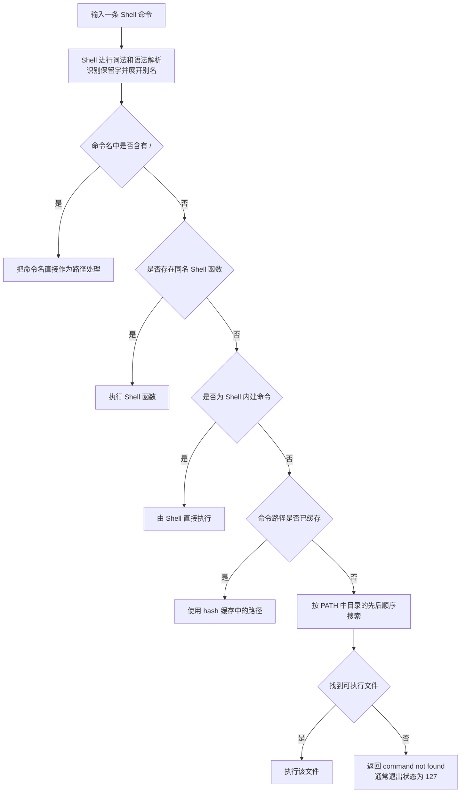

[toc]


## 学习大纲

linux系统上的查询类命令

| 学习主题       | 核心问题                          | 代表命令                                     |
| -------------- | --------------------------------- | -------------------------------------------- |
| 命令身份       | Shell 会怎样解释这个命令名？      | `type`、`command -v`、`command -V`           |
| 命令路径       | 外部可执行文件位于哪里？          | `type -P`、`which`、`whereis`                |
| 命令解析缓存   | Shell 是否缓存了旧路径？          | `hash`                                       |
| 文件内容类型   | 文件里实际是什么格式的数据？      | `file`                                       |
| 文件系统类型   | 它是普通文件、目录还是符号链接？  | `stat`、`test`、`find -type`、`ls -l`        |
| 路径与符号链接 | 最终路径是什么？链接指向哪里？    | `readlink`、`realpath`、`namei`              |
| 文件定位       | 系统中哪些文件符合条件？          | `find`、`locate`                             |
| 可执行文件结构 | ELF、动态库、符号表等是什么情况？ | `readelf`、`objdump`、`ldd`、`nm`、`strings` |
| 文档查询       | 命令怎么使用？相关命令有哪些？    | `help`、`man`、`whatis`、`apropos`、`info`   |
| 软件包归属     | 这个文件由哪个软件包安装？        | `dpkg-query`、`rpm`、`pacman`、`dnf`         |
| 跨 Shell 差异  | Bash、Zsh、Fish 中是否相同？      | `type`、`whence`、`where`、`command -v`      |

以下内容以现代 Linux 上常见的 **Bash** 为主要环境，同时强调 POSIX Shell 脚本中的可移植写法。

当前 Bash 官方手册版本为 Bash 5.3；可移植性规则主要参考 POSIX.1-2024。([GNU](https://www.gnu.org/software/bash/manual/bash.html?utm_source=chatgpt.com))

------

## 先分清 `type`、`which` 和 `file`

这是最重要的第一步。

| 命令         | 查询对象                  | 典型问题                                   | 是否理解别名和函数 |
| ------------ | ------------------------- | ------------------------------------------ | ------------------ |
| `type`       | 当前 Shell 的命令解析结果 | “输入 `python` 时，Shell 会把它当成什么？” | 是                 |
| `command -v` | 当前 Shell 对命令名的解释 | “这个命令在当前 Shell 中是否可用？”        | 是                 |
| `which`      | `$PATH` 中的可执行文件    | “PATH 中首先匹配的是哪个文件？”            | 通常否             |
| `file`       | 文件内容或文件系统对象    | “这个文件实际是什么格式？”                 | 不适用             |

例如：

```bash
type printf
which printf
file /usr/bin/printf
```

可能得到类似结果：

```text
printf is a shell builtin
/usr/bin/printf
/usr/bin/printf: ELF 64-bit LSB pie executable, ...
```

这三行并不矛盾：

- `type printf` 表示当前 Bash 会优先执行内建命令（Shell Builtin）。
- `which printf` 找到了 `$PATH` 中同名的外部程序。
- `file /usr/bin/printf` 检查这个外部程序文件的数据格式。

`type` 和 `command -v`回答的是“命令名如何被 Shell 解释”；`file`回答的是“一个路径所指向的文件是什么”。Bash 的命令解析会考虑函数、内建命令以及 `$PATH` 中的可执行文件，而 `file`使用文件系统测试、魔数数据库（Magic Database）和内容规则识别文件类型。([GNU](https://www.gnu.org/software/bash/manual/html_node/Command-Search-and-Execution.html?utm_source=chatgpt.com))

------

## Shell 是怎样找到命令的

理解命令解析顺序（Command Resolution）后，`type`、`which`、`hash`等命令就容易理解了。



需要注意，别名（`Alias`）展开发生在命令搜索之前，严格来说属于 Shell 的语法处理阶段；

函数、内建命令和 `$PATH` 搜索则属于后续的命令查找过程。

Bash 会缓存通过 `$PATH` 找到的外部命令路径，以避免每次重新遍历 `$PATH`。([GNU](https://www.gnu.org/software/bash/manual/html_node/Command-Search-and-Execution.html?utm_source=chatgpt.com))

### `$PATH` 的本质

`PATH`是一个以冒号分隔的目录列表：

```bash
printf '%s\n' "$PATH"
```

例如：

```text
/usr/local/bin:/usr/bin:/bin
```

执行：

```bash
demo
```

Shell 会依次尝试：

```text
/usr/local/bin/demo
/usr/bin/demo
/bin/demo
```

找到第一个符合执行条件的文件后停止搜索。

查看得更清楚：

```bash
printf '%s\n' "$PATH" | tr ':' '\n'
```

在安全敏感的脚本中，不应假设用户的 `$PATH` 一定安全。可以设置明确的 `$PATH`，或者直接使用经过确认的绝对路径。POSIX 的 `command -p`还可让 Shell 使用能够找到标准工具的默认路径。([GNU](https://www.gnu.org/s/bash/manual/html_node/Bash-Builtins.html?utm_source=chatgpt.com))

------

## 查询命令身份

## `type`：首选的交互式诊断命令

`type`是 Shell 内建命令，用于说明一个名称在当前 Shell 中会如何被解释。

> bash的type和zsh的type命令功能不完全相同,后者的`type`支持更多的选项,例如`-S`.

基本用法：

```bash
type NAME
```

例如：

```bash
type cd
type ls
type if
type printf
```

可能输出：

```text
cd is a shell builtin
ls is aliased to 'ls --color=auto'
if is a shell keyword
printf is a shell builtin
```

Bash 的 `type`能够识别：

- 别名（Alias）
- 保留字或关键字（Keyword）
- Shell 函数（Shell Function）
- Shell 内建命令（Shell Builtin）
- 外部可执行文件（Executable File）

这些类别也是 `type -t`可能输出的类型。([GNU](https://www.gnu.org/s/bash/manual/html_node/Bash-Builtins.html?utm_source=chatgpt.com))

### `type -a`：显示所有可能匹配

```bash
type -a printf
```

可能输出：

```text
printf is a shell builtin
printf is /usr/bin/printf
printf is /bin/printf
```

它特别适合排查：

- 同名别名覆盖外部命令
- Shell 函数覆盖系统命令
- 多个 `$PATH` 目录存在同名程序
- `/usr/local/bin`中的版本覆盖发行版版本

常用示例：

```bash
type -a python
type -a pip
type -a node
type -a gcc
```

### `type -t`：只输出命令类别

```bash
type -t cd
type -t ls
type -t my_function
```

典型输出：

```text
builtin
alias
function
```

这适合诊断，但脚本通常不应过度依赖这些 Bash 专有输出。

### `type -P`：只按 `$PATH` 搜索外部程序

```bash
type -P printf
```

可能输出：

```text
/usr/bin/printf
```

即使 `printf`同时是 Bash 内建命令，`type -P`也会查找外部可执行文件。

这比 `which`更适合 Bash 环境，因为命令仍由当前 Shell 自己完成查询。

### `type -p` 

在 Bash 中,`type`命令的`-p`与 `-P`，两者含义略有区别：

- `type -p NAME`：只有当正常**解析结果是磁盘文件**时才输出路径。
- `type -P NAME`：强制在 `$PATH` 中**搜索磁盘文件**，即使同名内建命令或函数优先级更高。

例如：

```bash
type -p printf
type -P printf
```

因为正常执行的 `printf`是内建命令，所以第一条可能没有输出；

第二条则可能输出 `/usr/bin/printf`。这些选项属于 Bash 的扩展，不应假定所有 Shell 行为完全一致。([GNU](https://www.gnu.org/s/bash/manual/html_node/Bash-Builtins.html?utm_source=chatgpt.com))

```shell
$ type ls
ls is aliased to `\ls --color=auto'
$ type -p ls
# 没有输出,因为当前的环境中,ls是别名

$ type -p ps
/usr/bin/ps #当前环境的ps没有别名或函数同名

```


------

## `command`系列

```shell
$ help command
command: command [-pVv] command [arg ...]
    Execute a simple command or display information about commands.

    Runs COMMAND with ARGS suppressing  shell function lookup, or display
    information about the specified COMMANDs.  Can be used to invoke commands
    on disk when a function with the same name exists.

    Options:
      -p    use a default value for PATH that is guaranteed to find all of
            the standard utilities
      -v    print a description of COMMAND similar to the `type' builtin
      -V    print a more verbose description of each COMMAND

    Exit Status:
    Returns exit status of COMMAND, or failure if COMMAND is not found.
    
 

```

### 典型用例

```shell
$ command -V ls
ls is aliased to `\ls --color=auto'
 
$ command -v ls
alias ls='\ls --color=auto'
```


### `command -v`：脚本中检查依赖的首选方式

> 和`type`类似

基本用法：

```bash
command -v NAME
```

例如：

```bash
command -v git
command -v python3
command -v cd
```

`command -v`由 Shell 执行，能够根据 Shell 自己的命令解析规则报告：

- 别名
- 函数
- 内建命令
- 外部可执行文件

POSIX.1-2024明确规定，`command -v`和`command -V`用于说明命令名将怎样被 Shell 解释，因此在可移植 Shell 脚本中应优先使用它们，而不是依赖 `which`。([The Open Group](https://pubs.opengroup.org/onlinepubs/9799919799.2024edition/utilities/command.html?utm_source=chatgpt.com))

#### 正确检查命令是否存在

推荐：

```bash
if command -v jq >/dev/null 2>&1; then
    printf '%s\n' 'jq 已安装'
else
    printf '%s\n' '缺少 jq' >&2
fi
```

判断时应使用退出状态，而不是解析输出文本：

```bash
command -v jq >/dev/null 2>&1
```

原因是：

- 不同 Shell 的输出格式可能不同。
- 输出可能是路径、别名定义、函数名称或内建命令名称。
- 本地化设置可能影响详细描述。
- 脚本真正关心的通常只是“能否解析到该命令”。

一个实用的依赖检查函数：

```bash
need_command() {
    command -v "$1" >/dev/null 2>&1 || {
        printf '错误：缺少必要命令：%s\n' "$1" >&2
        exit 127
    }
}

need_command git
need_command curl
need_command tar
```

### `command -V`：输出详细说明

```bash
command -V python3
command -V printf
```

`-V`比`-v`输出更详细，适合人阅读，不适合脚本解析。POSIX明确指出，`-V`的详细输出不应被应用程序依赖或任意解析。([The Open Group](https://pubs.opengroup.org/onlinepubs/9799919799.2024edition/utilities/command.html?utm_source=chatgpt.com))

### `command NAME`：绕过同名函数

`command`不仅能查询，还能执行命令：

```bash
command ls
```

如果当前定义了同名函数：

```bash
ls() {
    printf '%s\n' '这是自定义函数'
}
```

那么：

```bash
ls
```

执行函数，而：

```bash
command ls
```

忽略名为 `ls`的 Shell 函数，继续查找内建命令或 `$PATH` 中的外部命令。([GNU](https://www.gnu.org/s/bash/manual/html_node/Bash-Builtins.html?utm_source=chatgpt.com))

如果必须执行某个确定文件，最可靠的是使用确认过的绝对路径：

```bash
/usr/bin/ls
```

------

## `which`：只适合快速查看，不适合做最终判断

> `which` 并没有 `command` 或 `type` 无法替代的“独占功能”。
>
> 实际上，它是一个非标准的、行为可能不一致的外部命令，因此，**在几乎所有场景下，都建议用更可靠的 `command -v` 或 `type -P` 来替代它**

基本用法：

```bash
which python3
```

典型输出：

```text
/usr/bin/python3
```

`which`通常是一个**外部程序**，它主要在 `$PATH` 中寻找可执行文件。

不同 Linux 发行版可能提供不同实现，因此其功能和选项并不完全统一。Debian 系统中的 `which`来自 `debianutils`，其他系统也可能使用 GNU `which`或其他实现。([Debian Manpages](https://manpages.debian.org/unstable/debianutils/which.1.en.html?utm_source=chatgpt.com))

它的主要问题是：**它通常无法完整表达当前 Shell 的真实命令解析结果。**

例如：

```bash
alias python=python3
```

此时：

```bash
type python
which python
```

可能分别得到：

```text
python is aliased to 'python3'
/usr/bin/python
```

真正输入 `python`时执行的是别名展开后的 `python3`，而 `which python`找到的只是 `$PATH` 中名为 `python`的文件。

## 推荐原则

交互式排查：

```bash
type -a python
```

可移植脚本：

```bash
command -v python
```

只想知道 Bash 在 `$PATH` 中能找到哪个外部程序：

```bash
type -P python
```

只有在明确知道 `which`实现及其限制时，才将它用于辅助查看：

```bash
which python
```

------

## `hash`：查看和清理命令路径缓存

Bash 会缓存已经找到的外部命令路径。

假设第一次执行：

```bash
mytool
```

Bash 找到：

```text
/usr/bin/mytool
```

后来你又安装了：

```text
/usr/local/bin/mytool
```

并且 `/usr/local/bin`在 `$PATH` 中更靠前，当前 Shell 仍可能继续使用缓存的旧路径。

查看缓存：

```bash
hash
```

查看特定命令的缓存路径：

```bash
hash -t mytool
```

清空全部命令缓存：

```bash
hash -r
```

删除单个缓存项：

```bash
hash -d mytool
```

Bash 使用命令哈希表（Command Hash Table）避免每次执行外部命令时完整搜索 `$PATH`。([GNU](https://www.gnu.org/software/bash/manual/html_node/Command-Search-and-Execution.html?utm_source=chatgpt.com))

### 常见排查流程

```bash
type -a mytool
hash -t mytool 2>/dev/null
printf '%s\n' "$PATH" | tr ':' '\n'
hash -r
type -a mytool
```

安装、升级或替换某个命令后，如果路径表现异常，`hash -r`是一个很实用的排查步骤。

------

## 查询命令文件的位置

## `whereis`：寻找二进制、源码和手册页

基本用法：

```bash
whereis bash
```

可能输出：

```text
bash: /usr/bin/bash /usr/share/man/man1/bash.1.gz
```

`whereis`可以搜索：

- 二进制文件（Binary）
- 源代码文件（Source）
- 手册页（Manual Page）

常用选项：

```bash
whereis -b bash
whereis -m bash
whereis -s bash
```

其中：

- `-b`：只查二进制。
- `-m`：只查手册页。
- `-s`：只查源码。

`whereis`使用预定义搜索位置，并可参考 `$PATH`和`$MANPATH`构造搜索路径；它不是当前 Shell 命令解析器，所以不能代替 `type`。([man7.org](https://man7.org/linux/man-pages/man1/whereis.1.html?utm_source=chatgpt.com))

适合：

```bash
whereis ssh
whereis systemctl
whereis gcc
```

不适合回答：

> 我现在输入 `python`，Shell 究竟会执行什么？

这个问题仍然应使用：

```bash
type -a python
```

------

## `find`：实时遍历文件系统

`find`直接遍历目录树，根据名称、类型、权限、时间、大小等条件匹配文件。

按名称查找：

```bash
find /usr -name 'python3'
```

忽略名称大小写：

```bash
find /usr -iname 'readme*'
```

只找普通文件：

```bash
find /usr/local/bin -type f
```

只找符号链接：

```bash
find /usr/local/bin -type l
```

查找具有任意执行位的普通文件：

```bash
find /usr/local/bin -type f -perm /111
```

限制目录深度：

```bash
find /usr/local/bin -maxdepth 1 -type f -name 'python*'
```

`find`读取当前文件系统状态，结果实时但可能较慢，尤其是从根目录开始搜索时。GNU `find`支持丰富的测试条件和动作组合。([man7.org](https://man7.org/linux/man-pages/man1/find.1.html?utm_source=chatgpt.com))

避免无必要地运行：

```bash
sudo find / ...
```

优先缩小范围：

```bash
find /usr/local/bin ...
find "$HOME/.local/bin" ...
find /opt ...
```

------

## `locate`：查询文件名索引

基本用法：

```bash
locate python3
```

`locate`查询预先生成的文件名数据库，因此通常比遍历文件系统的 `find`快很多。它的缺点是数据库可能尚未反映刚创建或刚删除的文件。数据库通常由 `updatedb`维护。([man7.org](https://man7.org/linux/man-pages/man1/locate.1.html?utm_source=chatgpt.com))

更新索引通常需要相应权限：

```bash
sudo updatedb
```

简单区别：

| 特征     | `find`                         | `locate`           |
| -------- | ------------------------------ | ------------------ |
| 数据来源 | 当前文件系统                   | 文件名数据库       |
| 实时性   | 高                             | 取决于索引更新时间 |
| 搜索速度 | 可能较慢                       | 通常很快           |
| 查询能力 | 名称、类型、权限、时间、大小等 | 主要是路径名称     |
| 适合场景 | 精确条件查询                   | 快速寻找可能位置   |

现代发行版可能使用 `plocate`作为 `locate`的实现，但基本使用方式相近。

------

## 查询文件类型与内容格式

## `file`：识别文件内容类型

基本用法：

```bash
file PATH
```

例如：

```bash
file /usr/bin/bash
file archive.tar.gz
file image.png
file script.sh
```

可能输出：

```text
/usr/bin/bash: ELF 64-bit LSB pie executable, ...
archive.tar.gz: gzip compressed data, ...
image.png: PNG image data, ...
script.sh: Bourne-Again shell script, Unicode text, ...
```

`file`不是单纯查看文件扩展名。它通常综合使用：

- 文件系统属性测试
- 魔数（Magic Number）和魔数数据库
- 文件内容特征
- 文本或编程语言启发式规则

因此，一个没有 `.png`扩展名的文件仍可能被识别为 PNG；一个扩展名为 `.jpg`的文件也不一定真的是 JPEG。([man7.org](https://man7.org/linux/man-pages/man1/file.1.html?utm_source=chatgpt.com))

### 常用选项

只输出类型描述，不输出文件名：

```bash
file -b image.png
```

输出 MIME 类型：

```bash
file -b --mime-type image.png
```

可能输出：

```text
image/png
```

查看字符编码：

```bash
file -b --mime-encoding document.txt
```

可能输出：

```text
utf-8
```

同时输出 MIME 类型和编码：

```bash
file --mime document.txt
```

跟随符号链接，检查最终目标：

```bash
file -L /usr/bin/python3
```

不跟随符号链接时，通常会得到：

```text
symbolic link to python3.12
```

跟随后则可能得到：

```text
ELF 64-bit LSB pie executable, ...
```

### `file`不是安全验证器

`file`的判断依赖规则和启发式测试。它非常适合诊断，但不应被视为严格的安全边界：

```bash
file upload.bin
```

即使输出 `JPEG image data`，也不代表该文件一定安全、完整或可被可信地处理。对于用户上传文件，应继续进行：

- 格式解析器校验
- 文件大小限制
- 解压资源限制
- 恶意内容扫描
- 隔离处理
- 扩展名、MIME 和实际解析结果交叉验证

魔数匹配只能说明某些字节模式或结构与已知格式相符。([man7.org](https://man7.org/linux/man-pages/man4/magic.4.html?utm_source=chatgpt.com))

------

## `stat`：查看文件系统元数据

`stat`查询文件系统记录的元数据（Metadata），而不是识别文件内容格式。

```bash
stat /usr/bin/bash
```

通常包括：

- 文件大小
- 文件类型
- inode 编号
- 权限模式
- 硬链接数量
- 所有者 UID
- 所属组 GID
- 最后访问时间
- 内容修改时间
- 元数据更改时间
- 文件系统块等信息

GNU `stat`还支持自定义输出格式。([man7.org](https://man7.org/linux/man-pages/man1/stat.1.html?utm_source=chatgpt.com))

### 自定义输出

```bash
stat -c '类型=%F 权限=%A 模式=%a UID=%u GID=%g 大小=%s inode=%i' -- file.txt
```

可能输出：

```text
类型=regular file 权限=-rw-r--r-- 模式=644 UID=1000 GID=1000 大小=120 inode=123456
```

这里使用 `--`是一个好习惯，表示后面的参数都是文件名，避免文件名以 `-`开头时被误当成选项。

### 查看符号链接本身与目标

默认查看链接本身：

```bash
stat symlink
```

跟随链接查看目标：

```bash
stat -L symlink
```

注意时间字段的区别：

- `atime`：访问时间（Access Time）。
- `mtime`：文件内容修改时间（Modification Time）。
- `ctime`：inode 元数据更改时间（Change Time）。
- `btime`或 Birth Time：创建时间，但并非所有文件系统都提供。

Linux 中的 `ctime`不是“创建时间”。

------

## `ls -l`：适合快速浏览，不等同于完整元数据查询

```bash
ls -l file
```

可以快速看到：

- 文件类型字符
- 权限
- 硬链接数
- 所有者
- 所属组
- 大小
- 时间
- 文件名
- 符号链接目标

例如：

```text
lrwxrwxrwx 1 root root 10 Jul 20 12:00 python3 -> python3.12
```

开头字符常见含义：

| 字符 | 类型            |
| ---- | --------------- |
| `-`  | 普通文件        |
| `d`  | 目录            |
| `l`  | 符号链接        |
| `c`  | 字符设备        |
| `b`  | 块设备          |
| `p`  | FIFO 或命名管道 |
| `s`  | Unix 域套接字   |

但需要精确或适合脚本处理的数据时，应优先使用 `stat`或 Shell 条件测试。

------

## `test`：在 Shell 脚本中判断文件属性

常见判断：

```bash
test -e "$path"    # 路径存在
test -f "$path"    # 普通文件
test -d "$path"    # 目录
test -L "$path"    # 符号链接
test -r "$path"    # 当前用户可读
test -w "$path"    # 当前用户可写
test -x "$path"    # 当前用户可执行或可搜索
test -s "$path"    # 文件存在且大小大于零
```

通常写成：

```bash
if [ -f "$path" ]; then
    printf '%s\n' '这是普通文件'
fi
```

或者在 Bash 中使用更强的条件语法：

```bash
if [[ -x $path ]]; then
    printf '%s\n' '当前用户可以执行该路径'
fi
```

需要注意：

```bash
[[ -x $path ]]
```

只是检查当前用户是否具有执行权限；它不能证明文件是 ELF 程序或有效脚本。内容格式应交给：

```bash
file "$path"
```

------

## 查询路径和符号链接

## `readlink`：查看符号链接保存的目标字符串

```bash
readlink /usr/bin/python3
```

可能输出：

```text
python3.12
```

这里输出的可能是相对路径，并不一定是规范化的绝对路径。

例如：

```text
/usr/bin/python3 -> python3.12
```

`readlink`只输出链接中保存的文本：

```text
python3.12
```

它不会自动加上 `/usr/bin/`。

------

## `realpath`：得到规范化的最终路径

```bash
realpath /usr/bin/python3
```

可能输出：

```text
/usr/bin/python3.12
```

`realpath`通常会处理：

- 相对路径
- 当前目录
- `.`路径分量
- `..`路径分量
- 符号链接
- 多重符号链接

例如：

```bash
realpath ./dir/../dir/file
```

`readlink -f`在 GNU/Linux 上也常用于规范化路径，但 `realpath`的语义更加直观；GNU `readlink`手册也建议规范化路径时优先考虑 `realpath`。([man7.org](https://man7.org/linux/man-pages/man1/readlink.1.html?utm_source=chatgpt.com))

### 组合使用

```bash
cmd=$(command -v python3)

printf 'Shell 解析路径：%s\n' "$cmd"
printf '规范化路径：%s\n' "$(realpath "$cmd")"

file -L "$cmd"
stat -L "$cmd"
```

------

## `namei`：逐层分析路径组成

```bash
namei -l /home/user/project/script.sh
```

它会逐层显示路径中的每个组成部分：

```text
f: /home/user/project/script.sh
drwxr-xr-x root root /
drwxr-xr-x root root home
drwx------ user user user
drwxr-xr-x user user project
-rwxr-xr-x user user script.sh
```

这非常适合排查：

- 明明文件可读，却提示 Permission denied
- 某一级目录缺少执行或搜索权限
- 路径中间存在符号链接
- 所有者或权限设置异常

对于访问一个文件，用户不仅需要文件本身的权限，还需要对路径中每一级目录具备适当的搜索权限。`namei`属于 `util-linux`工具集。([man7.org](https://man7.org/linux/man-pages/man1/namei.1.html?utm_source=chatgpt.com))

------

## 处理路径字符串的辅助命令

## `basename`

提取路径最后一个组成部分：

```bash
basename /home/user/archive.tar.gz
```

输出：

```text
archive.tar.gz
```

删除指定后缀：

```bash
basename /home/user/archive.tar.gz .gz
```

输出：

```text
archive.tar
```

注意它不是通用的“删除扩展名”工具，只删除你明确指定且匹配的后缀。

## `dirname`

提取目录部分：

```bash
dirname /home/user/archive.tar.gz
```

输出：

```text
/home/user
```

这两个命令处理的是**路径字符串**，并不要求对应文件一定存在。

在 Bash 脚本中，简单场景也可使用参数展开：

```bash
path=/home/user/archive.tar.gz

printf '%s\n' "${path##*/}"
printf '%s\n' "${path%/*}"
```

但参数展开与 `basename`、`dirname`在尾随斜杠、无斜杠路径等边界情况下可能不同。复杂脚本应先明确所需语义。

------

## 检查可执行文件的内部结构

`file`只能给出概括。如果需要进一步分析 ELF（Executable and Linkable Format）可执行文件或共享库，可以使用下面这些工具。ELF 是 Linux 用户空间程序和共享库最常见的二进制格式之一。([man7.org](https://www.man7.org/linux/man-pages/man5/elf.5.html?utm_source=chatgpt.com))

| 命令      | 主要用途                            | 常用示例               |
| --------- | ----------------------------------- | ---------------------- |
| `readelf` | 读取 ELF 头、段、节、动态表、符号表 | `readelf -h program`   |
| `objdump` | 显示目标文件信息、反汇编代码        | `objdump -p program`   |
| `ldd`     | 显示运行时共享库依赖                | `ldd program`          |
| `nm`      | 查看目标文件中的符号                | `nm -D library.so`     |
| `strings` | 提取可打印字符串                    | `strings -n 8 program` |
| `getcap`  | 查看文件能力（File Capabilities）   | `getcap /usr/bin/ping` |

### `readelf`

查看 ELF 头：

```bash
readelf -h /usr/bin/bash
```

查看程序头：

```bash
readelf -l /usr/bin/bash
```

查看动态链接信息：

```bash
readelf -d /usr/bin/bash
```

查看符号表：

```bash
readelf -s /usr/bin/bash
```

`readelf`专门读取 ELF 数据结构，不依赖 BFD 库完成解析，因此很适合做结构诊断。([man7.org](https://man7.org/linux/man-pages/man1/readelf.1.html?utm_source=chatgpt.com))

### `objdump`

查看目标文件的私有头信息：

```bash
objdump -p /usr/bin/bash
```

反汇编：

```bash
objdump -d /usr/bin/bash
```

显示文件头、节、符号等综合信息：

```bash
objdump -x /usr/bin/bash
```

`objdump`属于 GNU Binutils，可处理目标文件、可执行文件和库文件。([man7.org](https://man7.org/linux/man-pages/man1/objdump.1.html?utm_source=chatgpt.com))

### `ldd`

```bash
ldd /usr/bin/bash
```

可能输出：

```text
linux-vdso.so.1
libtinfo.so.6 => /lib/x86_64-linux-gnu/libtinfo.so.6
libc.so.6 => /lib/x86_64-linux-gnu/libc.so.6
```

重要安全规则：**不要对不可信的可执行文件随意运行 `ldd`。**

`ldd`手册明确提醒，某些情况下分析文件可能涉及执行目标或其解释器。对于不可信文件，可以先使用：

```bash
objdump -p suspicious-program | grep NEEDED
```

或者：

```bash
readelf -d suspicious-program
```

这些方法主要读取二进制结构，不直接运行目标程序。([man7.org](https://man7.org/linux/man-pages/man1/ldd.1.html?utm_source=chatgpt.com))

### `strings`

```bash
strings -n 8 program
```

提取长度至少为 8 的可打印字符串。它可能帮助发现：

- 错误消息
- 文件路径
- URL
- 编译器信息
- 动态库名称
- 协议关键字

但 `strings`输出不是可靠的程序行为证明，只是原始字节中看起来像文本的数据。([man7.org](https://man7.org/linux/man-pages/man1/strings.1.html?utm_source=chatgpt.com))

### `nm`

查看符号：

```bash
nm program
```

查看动态符号：

```bash
nm -D library.so
```

常用于分析：

- 函数名
- 全局变量
- 未定义符号
- 动态导出接口

被完全剥离（Stripped）的二进制可能几乎没有普通符号表。([man7.org](https://man7.org/linux/man-pages/man1/nm.1.html?utm_source=chatgpt.com))

### `getcap`

```bash
getcap /usr/bin/ping
```

可能输出：

```text
/usr/bin/ping cap_net_raw=ep
```

文件能力（File Capabilities）可以向可执行文件授予特定内核能力，而不必给予完整的 setuid root 权限。`getcap`用于查询这些能力。([man7.org](https://www.man7.org/linux/man-pages/man8/getcap.8.html?utm_source=chatgpt.com))

------

## 查询文档与相关命令

## `help`：查看 Shell 内建命令

对于 Bash 内建命令，优先使用：

```bash
help type
help command
help hash
help builtin
help enable
```

也可显示简短语法：

```bash
help -s type
```

原因是 `type`、`command`、`hash`等是由当前 Bash 实现的，`help`展示的内容与当前 Shell 更直接匹配。

```bash
man type
```

有时展示的是 POSIX 手册页或其他实现说明，不一定完全对应当前 Bash 的扩展选项。

------

## `man`：查看手册页

```bash
man file
man stat
man readlink
man find
```

指定手册章节：

```bash
man 1 stat
man 2 stat
```

这里可能分别表示：

- `stat(1)`：命令行程序。
- `stat(2)`：系统调用。

同名条目可能存在于多个章节，所以遇到开发相关问题时应明确章节。

查找手册页文件位置：

```bash
man -w stat
```

查看所有同名手册页：

```bash
man -a printf
```

`man -k`等价于关键词搜索，`man -f`等价于精确摘要查询。([man7.org](https://man7.org/linux/man-pages/man1/man.1.html?utm_source=chatgpt.com))

------

## `whatis`：查询命令的一行摘要

```bash
whatis file
whatis stat
```

可能输出：

```text
file (1) - determine file type
stat (1) - display file or file system status
stat (2) - get file status
```

适合已经知道命令名，想快速知道其用途。

`whatis`查询手册页摘要数据库。([man7.org](https://man7.org/linux/man-pages/man1/whatis.1.html?utm_source=chatgpt.com))

------

## `apropos`：按主题查找相关命令

```bash
apropos 'symbolic link'
apropos 'file type'
apropos 'executable'
```

等价写法：

```bash
man -k 'symbolic link'
```

`apropos`特别适合“我知道要做什么，但不知道命令叫什么”的情况。

例如：

```bash
apropos 'canonical path'
apropos 'shared library'
apropos 'file permissions'
```

它依赖手册页索引数据库。如果结果为空或明显不完整，管理员可更新数据库：

```bash
sudo mandb
```

`apropos`和`whatis`都基于手册页索引；`mandb`负责创建或更新该索引缓存。([man7.org](https://man7.org/linux/man-pages/man1/apropos.1.html?utm_source=chatgpt.com))

------

## `info`：阅读 GNU 工具的完整文档

GNU 工具的 `man`页面有时只是摘要，完整文档位于 Info 系统中。

例如：

```bash
info coreutils
info bash
info find
```

直接进入某个节点：

```bash
info coreutils 'stat invocation'
info coreutils 'realpath invocation'
```

常见学习顺序：

```bash
command --help
man command
info package-or-command
```

其中 `--help`适合快速看选项，`man`适合日常参考，`info`适合系统学习 GNU 工具的完整行为。

------

## 查询文件属于哪个软件包

这类问题与 `type`和`file`不同，它查询的是软件包数据库（Package Database）。

### Debian、Ubuntu

查询已安装文件的归属：

```bash
dpkg-query -S /usr/bin/ls
```

或者：

```bash
dpkg -S /usr/bin/ls
```

`dpkg-query -S`会在已安装软件包数据库中搜索拥有匹配文件的包。([man7.org](https://man7.org/linux/man-pages/man1/dpkg-query.1.html?utm_source=chatgpt.com))

查询尚未安装的文件由哪个软件包提供：

```bash
apt-file search bin/example-command
```

`apt-file`搜索仓库的软件包内容索引，因此文件不必已经安装。([Debian Manpages](https://manpages.debian.org/bookworm/apt-file/apt-file.1.en.html?utm_source=chatgpt.com))

### Fedora、RHEL、Rocky Linux、AlmaLinux

查询已安装文件：

```bash
rpm -qf /usr/bin/ls
```

查询仓库中哪个包提供文件：

```bash
dnf provides /usr/bin/example-command
```

也可使用通配形式：

```bash
dnf provides '*/example-command'
```

RPM 的文件查询可定位拥有已安装文件的软件包；DNF 的 `provides`查询可搜索软件包提供的文件路径或能力。([Arch手册页](https://man.archlinux.org/man/rpm.8.en?utm_source=chatgpt.com))

### Arch Linux

查询已安装文件：

```bash
pacman -Qo /usr/bin/ls
```

查询仓库中提供某文件的软件包：

```bash
pkgfile example-command
```

`pacman -Qo`查询本地软件包数据库中的文件归属；`pkgfile`查询仓库的文件数据库。([Arch手册页](https://man.archlinux.org/man/pacman.8.en?utm_source=chatgpt.com))

### 文件归属查询的边界

软件包管理器只能可靠回答由软件包数据库管理的文件。

以下文件可能没有归属软件包：

- 用户手工编译安装的程序
- 复制到 `/usr/local/bin`的脚本
- 使用 `curl`或`wget`直接下载的程序
- 解压后直接运行的应用
- 容器、虚拟环境或语言包管理器安装的程序
- 管理员手工创建的配置文件

例如：

```bash
dpkg-query -S /usr/local/bin/custom-tool
```

可能返回找不到匹配项，这是正常现象。

------

## Shell 专用的类似命令

Linux 系统可以运行不同 Shell，所以命令行为不能全部归因于“Linux”。

| Shell      | 推荐命令                  | 说明                      |
| ---------- | ------------------------- | ------------------------- |
| POSIX `sh` | `command -v`              | 可移植脚本首选            |
| Bash       | `type`、`command -v`      | `type -a`特别适合诊断     |
| Zsh        | `whence`、`where`、`type` | `where`相当于显示多个匹配 |
| Fish       | `type`                    | 按 Fish 自身规则解释命令  |

Zsh 提供 `whence`，还能区分别名、内建命令、外部命令、函数、哈希命令和保留字；Zsh 的 `where`等价于 `whence -ca`，用于显示所有匹配。Fish 也提供自己的 `type`命令。([Zsh](https://zsh.sourceforge.io/Doc/Release/Shell-Builtin-Commands.html?utm_source=chatgpt.com))

查看当前交互式 Shell：

```bash
printf '%s\n' "$SHELL"
```

但 `$SHELL`通常表示登录 Shell，不一定就是当前正在运行的 Shell。

查看当前进程：

```bash
ps -p "$$" -o comm=
```

Bash 中还可检查：

```bash
printf '%s\n' "$BASH_VERSION"
```

Zsh 中：

```zsh
printf '%s\n' "$ZSH_VERSION"
```

Fish 中：

```fish
fish --version
```

------

## 经典排查场景

## 命令行为和 `which`结果不一致

现象：

```bash
which ls
```

输出：

```text
/usr/bin/ls
```

但执行 `ls`却带有颜色或额外选项。

排查：

```bash
type -a ls
alias ls 2>/dev/null
declare -F ls 2>/dev/null
```

可能发现：

```text
ls is aliased to 'ls --color=auto'
ls is /usr/bin/ls
```

结论：实际执行前发生了别名展开。

临时绕过别名和同名函数：

```bash
command ls
```

明确执行外部文件：

```bash
/usr/bin/ls
```

------

## 安装了新版本，却仍执行旧版本

排查：

```bash
type -a mytool
command -V mytool
hash -t mytool 2>/dev/null
printf '%s\n' "$PATH" | tr ':' '\n'
```

清除缓存：

```bash
hash -r
```

再次检查：

```bash
type -a mytool
```

如果仍然不正确，需要检查：

- `$PATH`顺序
- Shell 启动文件是否修改 `$PATH`
- 是否存在同名别名
- 是否存在同名函数
- 是否使用虚拟环境
- 是否存在符号链接
- 是否启动了新的 Shell 会话

------

## 判断一个命令究竟是不是脚本

```bash
cmd=$(command -v mytool) || {
    printf '%s\n' '找不到 mytool' >&2
    exit 127
}

printf '解析结果：%s\n' "$cmd"
type -a mytool
file -L "$cmd"
```

如果是脚本，还可查看首行解释器声明（Shebang）：

```bash
head -n 1 -- "$cmd"
```

可能输出：

```text
#!/usr/bin/env python3
```

继续检查解释器：

```bash
command -v python3
type -a python3
```

需要注意，`#!/usr/bin/env python3`会通过运行时环境的 `$PATH`寻找 `python3`，因此不同环境可能使用不同解释器。

------

## 分析一个符号链接命令

```bash
cmd=$(command -v python3)

printf 'Shell 找到：%s\n' "$cmd"
printf '链接内容：'
readlink "$cmd" 2>/dev/null || printf '%s\n' '不是符号链接'

printf '最终路径：%s\n' "$(realpath "$cmd")"

namei -l "$cmd"
file -L "$cmd"
stat -L "$cmd"
```

这套组合分别回答：

- `command -v`：Shell 找到了什么。
- `readlink`：链接中记录了什么。
- `realpath`：最终规范路径是什么。
- `namei`：路径各层是什么。
- `file -L`：最终文件内容类型是什么。
- `stat -L`：最终文件的元数据是什么。

------

## 分析一个未知文件

安全的第一轮静态检查：

```bash
path=unknown-file

file -- "$path"
stat -- "$path"
file -b --mime-type -- "$path"
```

查看前 64 字节：

```bash
od -An -tx1 -N64 -- "$path"
```

提取较长字符串：

```bash
strings -n 8 -- "$path" | head
```

如果是 ELF：

```bash
readelf -h -- "$path"
readelf -l -- "$path"
readelf -d -- "$path"
```

不要一开始就执行：

```bash
./unknown-file
```

也不要对不可信程序直接使用可能触发执行路径的分析方式。

------

## 最佳实践总结

### 查询“Shell 实际会执行什么”

交互式诊断：

```bash
type -a command_name
```

脚本检查：

```bash
command -v command_name >/dev/null 2>&1
```

### 查询“外部可执行文件在哪里”

Bash 中：

```bash
type -P command_name
```

然后规范化路径：

```bash
realpath "$(type -P command_name)"
```

### 查询“文件实际是什么”

```bash
file -L -- path
```

### 查询“文件系统元数据”

```bash
stat -- path
```

### 查询“符号链接最终指向哪里”

```bash
realpath -- path
```

### 查询“系统中有哪些同名文件”

实时、精确搜索：

```bash
find /search/root -name 'name'
```

快速索引搜索：

```bash
locate name
```

### 查询“命令文档和类似命令”

```bash
help command_name
man command_name
whatis command_name
apropos 'keyword'
```

### 查询“文件由哪个软件包提供”

根据发行版选择：

```bash
dpkg-query -S /path/to/file
rpm -qf /path/to/file
pacman -Qo /path/to/file
```

### 编写脚本时始终引用路径变量

推荐：

```bash
file -- "$path"
stat -- "$path"
realpath -- "$path"
```

不推荐：

```bash
file $path
```

未引用的变量可能发生：

- 空格拆分
- 通配符展开
- 空值消失
- 多个参数意外产生

### 文件名可能以 `-`开头时使用 `--`

```bash
file -- "$path"
stat -- "$path"
rm -- "$path"
```

### 不要用 `which`判断依赖是否存在

不推荐：

```bash
if which git >/dev/null 2>&1; then
    ...
fi
```

推荐：

```bash
if command -v git >/dev/null 2>&1; then
    ...
fi
```

### 不要把“可执行”误解成“有效程序”

```bash
test -x file
```

只说明当前用户具有执行权限；不能说明：

- 文件格式有效
- Shebang 正确
- 动态库齐全
- CPU 架构匹配
- 程序值得信任

应结合：

```bash
file file
readelf -h file
```

必要时再检查依赖和运行环境。

------

## 一张速查表

| 想回答的问题                   | 首选命令                                 |
| ------------------------------ | ---------------------------------------- |
| 当前 Shell 会怎样解释 `foo`？  | `type foo`                               |
| 有哪些同名的 `foo`？           | `type -a foo`                            |
| 脚本中判断 `foo`是否可用？     | `command -v foo`                         |
| `$PATH`中的外部 `foo`在哪里？  | `type -P foo`                            |
| 快速查看 PATH 中程序位置？     | `which foo`                              |
| 二进制、源码、手册分别在哪里？ | `whereis foo`                            |
| Shell 是否缓存了旧路径？       | `hash -t foo`                            |
| 清理 Shell 命令缓存？          | `hash -r`                                |
| 文件实际是什么格式？           | `file path`                              |
| 文件的 MIME 类型？             | `file -b --mime-type path`               |
| 文件权限、inode、时间？        | `stat path`                              |
| 链接中保存的目标是什么？       | `readlink path`                          |
| 链接最终指向哪里？             | `realpath path`                          |
| 路径中哪一级权限有问题？       | `namei -l path`                          |
| 实时搜索文件？                 | `find`                                   |
| 从索引快速搜索文件名？         | `locate`                                 |
| 查看 ELF 结构？                | `readelf`                                |
| 查看共享库依赖？               | `ldd`                                    |
| 安全地查看 ELF 所需动态库？    | `readelf -d`或`objdump -p`               |
| 查看内建命令帮助？             | `help`                                   |
| 查看完整手册？                 | `man`                                    |
| 查询命令一句话说明？           | `whatis`                                 |
| 不知道命令名，只知道功能？     | `apropos`                                |
| 查询已安装文件属于哪个包？     | `dpkg-query -S`、`rpm -qf`、`pacman -Qo` |

最值得新手首先掌握的组合是：

```bash
type -a NAME
command -v NAME
file -L PATH
stat PATH
readlink PATH
realpath PATH
man NAME
apropos KEYWORD
```

只要始终先判断自己查询的是“命令名”“路径”“文件内容”“文件元数据”还是“软件包数据库”，这些看起来相似的命令就不容易混淆。