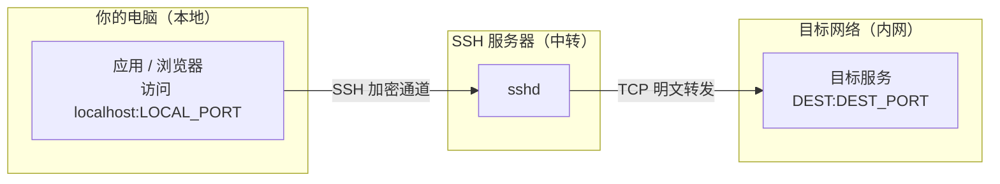
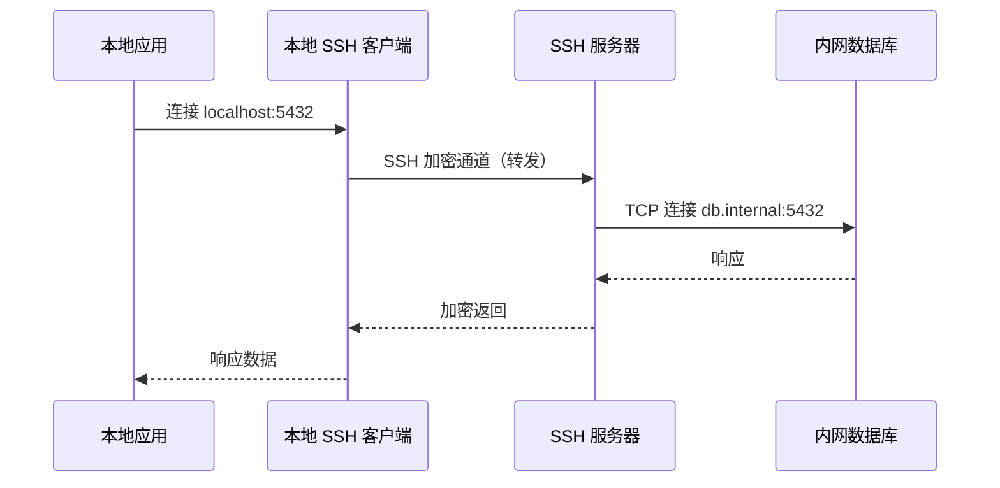
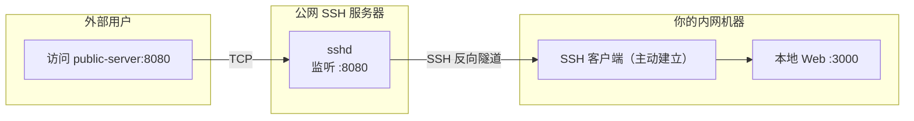
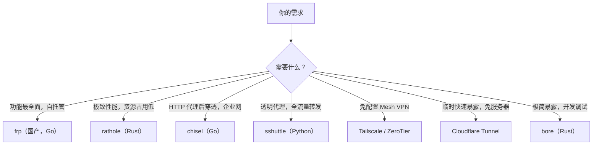
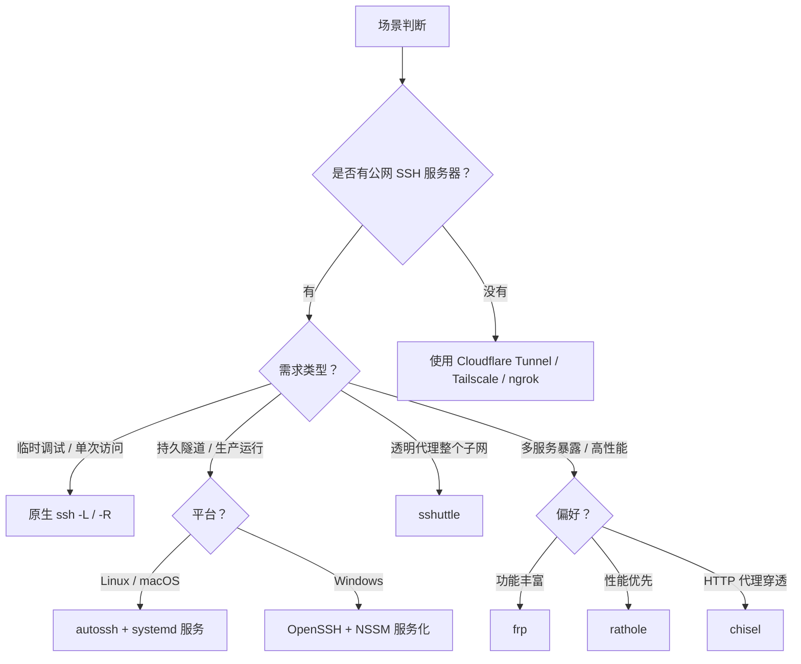

[toc]


## SSH 隧道与端口转发：完整生命周期指南

### 核心概念与工作原理

**SSH 隧道（SSH Tunneling）**本质是利用 SSH 已有的加密通道，将任意 **TCP 流量**封装其中转发。

它创建一条安全通道（tunnel）来封装原本未加密的网络流量。

理解端口转发需要先理清几个角色：

| 术语                                  | 说明                                          |
| ------------------------------------- | --------------------------------------------- |
| **本地端（Local）**                   | 发起 SSH 连接的机器，即你的操作机             |
| **SSH 服务器（Jump Host / Bastion）** | 承载 SSH 连接的中间机，作为流量"中继"         |
| **目标服务（Destination）**           | 最终被访问的服务，可与 SSH 服务器同机或不同机 |
| **绑定地址（Bind Address）**          | 监听端口所绑定的网卡地址，默认 `127.0.0.1`    |
| **转发端口（Forwarded Port）**        | 在本地或远端打开的监听端口                    |



---

### 三种端口转发模式

#### 本地转发（Local Port Forwarding，`-L`）

**场景**：你在外网，想访问只有内网 SSH 服务器才能访问的数据库。

```
ssh -L [本地绑定地址:]LOCAL_PORT:DEST_HOST:DEST_PORT user@SSH_SERVER
```

**示例**：把远端数据库（`db.internal:5432`）映射到本地 `5432`：

```bash
ssh -L 5432:db.internal:5432 user@jump.example.com
```

之后本地直接 `psql -h 127.0.0.1 -p 5432` 即可连接内网 PostgreSQL。



#### 远程转发（Remote Port Forwarding，`-R`）

**场景**：你的机器在内网或 NAT 后，想让外网服务器（或他人）访问你本地的服务。俗称**反向隧道（Reverse Tunnel）**。

```
ssh -R [远端绑定地址:]REMOTE_PORT:DEST_HOST:DEST_PORT user@SSH_SERVER
```

**示例**：让外网服务器的 `8080` 端口访问你本地的 Web 服务（`localhost:3000`）：

```bash
ssh -R 8080:localhost:3000 user@public-server.com
```

这是另一种典型用法——远程 TCP 转发，可允许远端服务器通过 SSH 隧道访问你本地机器上的端口。

> **注意**：远端服务器的 `/etc/ssh/sshd_config` 需要设置 `GatewayPorts yes` 才能让远端端口对外（非仅 localhost）监听。



#### 动态转发（Dynamic Port Forwarding，`-D`）

**场景**：需要一个 **SOCKS5 代理**，将本地应用的所有流量通过 SSH 服务器转出。

```
ssh -D [本地绑定地址:]SOCKS_PORT user@SSH_SERVER
```

**示例**：

```bash
ssh -D 1080 user@jump.example.com
```

之后在浏览器或应用中配置 SOCKS5 代理指向 `127.0.0.1:1080`，流量即经由服务器转发。本质上是在本地起了一个 **SOCKS5 代理服务器**，SSH 服务器作为出口节点。

---

### 常用参数速查

建隧道时常见的核心参数：

| 参数                          | 含义                                              |
| ----------------------------- | ------------------------------------------------- |
| `-N`                          | 不执行远端命令，只做端口转发（推荐始终加上）      |
| `-f`                          | 后台运行（fork 到后台）；与 `-N` 配合常用         |
| `-T`                          | 禁用伪终端分配                                    |
| `-C`                          | 启用数据压缩（弱网/慢速链路可考虑；局域网不建议） |
| `-g`                          | 允许其他主机连接本地监听端口（放开到 `0.0.0.0`）  |
| `-o ExitOnForwardFailure=yes` | 端口绑定失败时立即退出，而非静默挂起              |
| `-o ServerAliveInterval=30`   | 每 30 秒发送一次 keepalive 探测包                 |
| `-o ServerAliveCountMax=3`    | 连续 3 次无响应后断开                             |

---

### 连接保活与自动重连

#### 问题根源：隧道的静默死亡

当你建立了 SSH 隧道用于端口转发，让其闲置一段时间后，隧道就会因不活跃而悄然断开。这是因为中间防火墙或 NAT 网关会清理长时间无数据流动的 TCP 连接，而 SSH 默认不发送探测包。

#### 方案一：SSH 内置 Keepalive

最简单的保活方式，直接通过 SSH 参数实现，**无需额外工具**：

```bash
ssh -N -f \
  -o ServerAliveInterval=30 \
  -o ServerAliveCountMax=3 \
  -o ExitOnForwardFailure=yes \
  -L 5432:db.internal:5432 \
  user@jump.example.com
```

`ServerAliveInterval 30` 和 `ServerAliveCountMax 3` 告诉 SSH 每 30 秒发送一次 keepalive 包，若连续 3 次无响应则尝试重连。

写入 `~/.ssh/config` 以持久化配置（推荐）：

```
Host jump
    HostName jump.example.com
    User user
    ServerAliveInterval 30
    ServerAliveCountMax 3
    ExitOnForwardFailure yes
    LocalForward 5432 db.internal:5432
```

#### 方案二：autossh — 进程级守护

autossh 是一个可在 SSH 隧道断开或中断时自动重启它的工具。普通 SSH 隧道在网络断开时会静默死亡；autossh 监控隧道健康状态并自动重启，使其适合数据库访问隧道、监控隧道等生产场景。

**安装**：

```bash
# Debian / Ubuntu
sudo apt install autossh

# RHEL / CentOS（需启用 EPEL）
sudo yum install autossh

# macOS
brew install autossh
```

**标准用法**（推荐配合 `-M 0` 禁用 autossh 自带监控端口，改用 SSH 内置 keepalive）：

```bash
autossh -M 0 -fN \
  -o "ServerAliveInterval 30" \
  -o "ServerAliveCountMax 3" \
  -o "ExitOnForwardFailure yes" \
  -L 5432:db.internal:5432 \
  user@jump.example.com
```

参数解析：

| 参数                       | 含义                                                       |
| -------------------------- | ---------------------------------------------------------- |
| `-M 0`                     | 禁用 autossh 自身的监控端口（推荐；改用 ServerAlive 机制） |
| `-fN`                      | 后台运行，不执行远端命令                                   |
| `ExitOnForwardFailure yes` | 端口绑定失败则退出，触发 autossh 重启                      |

autossh 还支持通过环境变量 `AUTOSSH_MAXSTART` 控制最大重启次数，若设为负数则无限重启（默认行为）。

#### 方案三：systemd 服务单元（生产推荐）

将 autossh 托管为 systemd 服务，实现**开机自启、崩溃自恢复、日志集中管理**：

创建 `/etc/systemd/system/ssh-tunnel-db.service`：

```ini
[Unit]
Description=SSH Tunnel to DB (db.internal:5432)
After=network-online.target
Wants=network-online.target

[Service]
User=tunnel-user
# 不要用 -f，让 systemd 管理前台进程
ExecStart=/usr/bin/autossh -M 0 -N \
    -o "ServerAliveInterval=30" \
    -o "ServerAliveCountMax=3" \
    -o "ExitOnForwardFailure=yes" \
    -o "StrictHostKeyChecking=yes" \
    -i /home/tunnel-user/.ssh/tunnel_key \
    -L 5432:db.internal:5432 \
    user@jump.example.com
Restart=on-failure
RestartSec=10
# 避免重启风暴
StartLimitIntervalSec=60
StartLimitBurst=5

[Install]
WantedBy=multi-user.target
```

启用：

```bash
sudo systemctl daemon-reload
sudo systemctl enable --now ssh-tunnel-db
sudo systemctl status ssh-tunnel-db
```

> **重要**：服务 `User` 对应的账户必须已完成 SSH 密钥认证配置（免密登录），避免需要交互式输入密码。`StrictHostKeyChecking=yes` 防止自动化场景下接受伪造的主机密钥。

---

### 优雅停止与资源善后

这是**最容易被忽视却最重要**的部分。

#### 后台进程（`-f` 启动）的停止

`-f` 后台运行的 SSH 进程，不能简单 Ctrl+C，需要找到进程 ID 后发送信号：

```bash
# 查找 SSH 隧道进程
pgrep -a ssh | grep "L 5432"

# 优雅终止（SIGTERM，SSH 会等当前连接结束后退出）
kill <PID>

# 强制终止（谨慎使用）
kill -9 <PID>
```

更好的方式是写入 PID 文件，便于脚本化管理。

#### ControlMaster — 最优雅的隧道管理方式

**SSH 多路复用（Multiplexing）**通过 `ControlMaster` / `ControlPath` 机制，让多个 SSH 会话复用同一个 TCP 连接，同时提供了**干净的生命周期控制接口**。

在自动化脚本中，ControlMaster 模式非常适合建立、检查健康状态和拆除隧道——远比在后台跑进程再通过 PID 杀掉要优雅。

配置说明：

| 配置项                       | 说明                                                    |
| ---------------------------- | ------------------------------------------------------- |
| `ControlMaster auto`         | 自动创建或复用已有的控制 socket                         |
| `ControlPath ~/.ssh/ctrl-%C` | socket 文件路径，`%C` 是连接参数的哈希值，避免名称冲突  |
| `ControlPersist 10m`         | 所有 client 断开后，master 连接在后台保持 10 分钟再关闭 |

**建立隧道**（使用 ControlMaster）：

```bash
ssh -M -S /tmp/ssh-ctrl-jump -fNT \
  -L 5432:db.internal:5432 \
  user@jump.example.com
```

**检查状态**：

```bash
ssh -S /tmp/ssh-ctrl-jump -O check user@jump.example.com
```

**优雅停止**（等现有连接结束后关闭）：

```bash
ssh -S /tmp/ssh-ctrl-jump -O stop user@jump.example.com
```

**立即强制退出**（所有会话立即断开）：

```bash
ssh -S /tmp/ssh-ctrl-jump -O exit user@jump.example.com
```

`-O stop` 命令会优雅地关闭多路复用；发出命令后，控制 socket 被移除，不再接受新的复用会话。已有连接被允许继续直到自然结束，而 `-O exit` 则会立即移除 socket 并终止所有现有连接。

#### Shell 脚本中的优雅善后（trap 机制）

在脚本中，利用 `trap` 捕获退出信号，确保隧道在脚本结束时总被清理：

```bash
#!/usr/bin/env bash
set -euo pipefail

REMOTE_HOST="jump.example.com"
REMOTE_USER="user"
CTRL_SOCKET=$(mktemp -u /tmp/ssh-ctrl-XXXXXX)  # 生成路径但不实际创建文件

cleanup() {
    if [ -S "${CTRL_SOCKET}" ]; then
        echo "正在关闭 SSH 隧道..."
        ssh -S "${CTRL_SOCKET}" -O exit "${REMOTE_USER}@${REMOTE_HOST}" 2>/dev/null || true
    fi
}

# 注册退出钩子：正常退出、错误退出、Ctrl+C、kill 信号均触发
trap cleanup EXIT ERR INT TERM

# 建立隧道
ssh -M -S "${CTRL_SOCKET}" -fNT \
    -o ExitOnForwardFailure=yes \
    -o ServerAliveInterval=30 \
    -L 5432:db.internal:5432 \
    "${REMOTE_USER}@${REMOTE_HOST}"

# 确认隧道就绪
ssh -S "${CTRL_SOCKET}" -O check "${REMOTE_USER}@${REMOTE_HOST}"
echo "隧道已就绪，按 Ctrl+C 终止..."

# 保持脚本运行（可替换为实际业务命令）
wait
```

配合 `ExitOnForwardFailure=yes`，SSH 会在端口转发成功建立之后才进入后台，避免后续命令访问一个尚未开放的端口。

#### 孤儿 Socket 清理

如果进程被意外 kill（如 OOM Kill、Ctrl+C 中断），socket 文件可能成为孤儿，残留在文件系统中。

清理方式：

```bash
# 删除所有孤儿 SSH control socket（根据实际路径调整）
find /tmp -name "ssh-ctrl-*" -type s -mmin +60 -delete

# 或针对特定目录
rm -f ~/.ssh/control-sockets/*
```

---

### Windows 用户指南

#### 原生 OpenSSH（推荐首选）

从 Windows 10 build 1809 和 Windows Server 2019 开始，OpenSSH 作为可选功能提供。

安装（PowerShell 管理员模式）：

```powershell
# 检查是否可用
Get-WindowsCapability -Online | Where-Object Name -like 'OpenSSH.Client*'

# 安装
Add-WindowsCapability -Online -Name OpenSSH.Client~~~~0.0.1.0
```

安装后即可在 PowerShell / CMD / Windows Terminal 中直接使用 `ssh` 命令，语法与 Linux **完全一致**：

```powershell
ssh -N -L 5432:db.internal:5432 user@jump.example.com
```

> Windows 下没有原生 autossh，但可以利用**任务计划程序（Task Scheduler）**或 **NSSM**（Non-Sucking Service Manager）将 SSH 命令包装为 Windows 服务实现自动重启。

用 NSSM 注册为服务（需先[下载 NSSM](https://nssm.cc/)）：

```powershell
# 以管理员身份运行
nssm install SSHTunnelDB "C:\Windows\System32\OpenSSH\ssh.exe" `
    "-N -o ServerAliveInterval=30 -o ServerAliveCountMax=3 -L 5432:db.internal:5432 user@jump.example.com"
nssm set SSHTunnelDB AppRestartDelay 10000
nssm start SSHTunnelDB
```

#### PuTTY（图形界面，适合不习惯命令行的用户）

PuTTY 是 Windows 上友好的 SSH 客户端，它也提供创建 SSH 隧道的选项，用于访问内部可信网络中的资源。

配置步骤：
1. 打开 PuTTY，在 Session 填写主机名
2. 导航到 **Connection > SSH > Tunnels**
3. 在 "Source port" 填写本地端口，"Destination" 填写 `目标主机:目标端口`
4. 选择 **Local**（本地转发）或 **Remote**（反向隧道）
5. 点击 **Add**，回到 Session 保存配置
6. 点击 **Open** 建立隧道

> PuTTY 的隧道生命周期与 PuTTY 窗口绑定，关窗口即断隧道。生产环境建议使用 OpenSSH + 服务化方式。

#### 其他 Windows SSH 客户端

| 工具                           | 特点                                               |
| ------------------------------ | -------------------------------------------------- |
| **Windows Terminal + OpenSSH** | 现代化体验，原生支持，推荐日常使用                 |
| **MobaXterm**                  | 集成 SSH/SFTP/X11/端口转发 GUI，免费个人版功能完整 |
| **Tabby**                      | 开源、跨平台、现代化终端，支持 SSH 隧道管理        |
| **PuTTY**                      | 老牌轻量，纯 GUI，适合简单场景                     |
| **WinSCP**                     | 主要用于 SFTP，附带基础 SSH 隧道功能               |

---

### 替代方案生态

当 SSH 隧道满足不了需求时（如需要持续暴露服务、性能要求高、需要 Web Dashboard、需要穿透严格防火墙等），以下现代工具值得考虑：



#### 自托管方案详解

frp 拥有约 85K GitHub Stars，用 Go 编写，MIT 协议，是功能最完整的自托管隧道方案；rathole 约 12K Stars，用 Rust 编写，性能最佳、资源占用最小；Chisel 同约 12K Stars，用 Go 编写，可在 HTTP 代理后穿透。

| 工具         | 语言   | 特点                                                         | 适用场景                 |
| ------------ | ------ | ------------------------------------------------------------ | ------------------------ |
| **frp**      | Go     | 支持 TCP/UDP/HTTP/HTTPS，Web 控制台，负载均衡                | 功能需求丰富、多服务暴露 |
| **rathole**  | Rust   | 类似 frp（含配置格式），但性能更好，资源占用更低，支持热重载 | 性能敏感、低配设备       |
| **chisel**   | Go     | 底层走 SSH，但使用自定义客户端二进制，支持 Let's Encrypt 自动证书 | 企业代理后穿透           |
| **sshuttle** | Python | Tailscale 联合创始人之一的开源项目，服务端无需 root，专为避免 TCP-over-TCP 问题设计 | 透明代理整个子网         |
| **bore**     | Rust   | 极简隧道方案，MIT 协议，Rust 编写                            | 快速开发调试暴露         |
| **wstunnel** | Rust   | 通过 WebSocket 代理，专注于穿透封锁了特定协议的网络          | 严格防火墙环境           |
| **gost**     | Go     | 功能全面，支持 TCP 和 UDP 隧道，TAP/TUN 设备，负载均衡，Web API | 国内用户，功能综合       |

**选型建议**：用 frp 若需要功能最全和最好的文档；用 rathole 若性能是第一优先级；用 chisel 若在企业 HTTP 代理后；用 WireGuard 若需要访问整个内网而非单一服务。

> **国内网络环境提示**：frp 和 gost 有中文社区和文档，在国内开发者群体中使用广泛，GitHub 资源可通过 `https://ghproxy.com/https://github.com/...` 加速下载。

#### 免自建服务器方案（开发/临时用）

| 工具                  | 免费额度           | 特点                                |
| --------------------- | ------------------ | ----------------------------------- |
| **Cloudflare Tunnel** | 免费（无流量限制） | 无需公网 IP，与 Cloudflare DNS 集成 |
| **Tailscale**         | 免费（100 设备）   | WireGuard Mesh VPN，零配置，跨平台  |
| **ZeroTier**          | 免费（25 设备）    | SDN 网络，P2P 优先                  |
| **ngrok**             | 免费额度有限       | 最知名，HTTPS 随机域名              |

rathole 是完全自托管方案，意味着你在自己的基础设施（如便宜的 VPS）上运行服务端，对流量和数据拥有完全控制权。与 Cloudflare Tunnel 相比，Cloudflare Tunnel 虽然方便，但会将所有流量路由经过 Cloudflare 的基础设施。

---

### 安全加固建议

在生产中使用 SSH 隧道，还需关注以下安全事项：

- **专用隧道账户**：创建无 shell 权限的 Linux 用户（`/sbin/nologin`），仅用于建立隧道，避免使用 root 账户
- **限制 `authorized_keys`**：在服务端 `~/.ssh/authorized_keys` 中为隧道公钥添加 `command=""` 和 `no-pty,no-agent-forwarding,permitopen="db.internal:5432"` 等限制，约束该 key 仅能做特定转发
- **`StrictHostKeyChecking yes`**：禁止自动信任未知主机指纹，防止中间人攻击
- **服务端关闭不需要的 `AllowTcpForwarding`**：在 `sshd_config` 中按需精细控制
- **密钥而非密码**：隧道服务务必使用 SSH 密钥认证，禁用密码登录

---

### 整体方案选型思路总结

