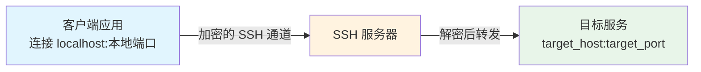
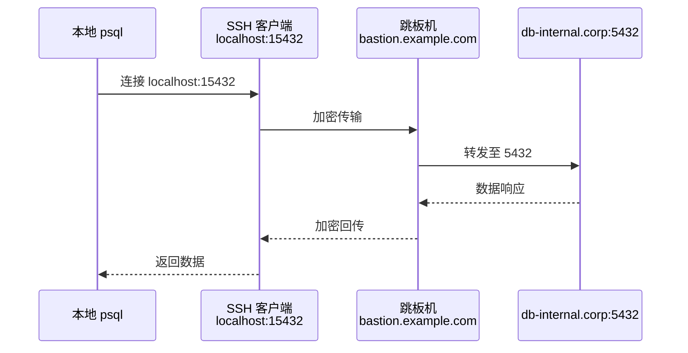
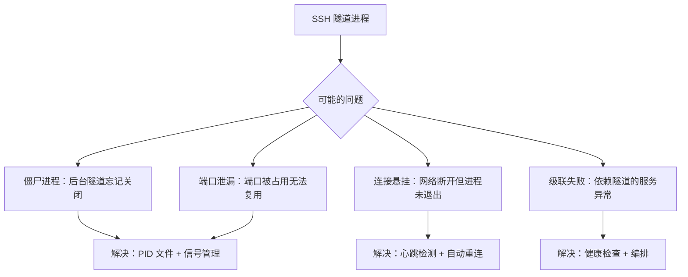
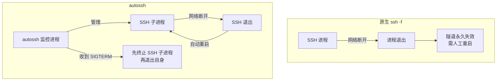

[toc]


## SSH 隧道与端口转发完整指南

### 核心概念

**SSH 隧道（SSH Tunnel）** 是利用 **SSH 协议**在已有的加密连接内部，封装并转发其他网络流量的技术。它本质上是在 SSH 客户端与服务端之间建立一条**加密的逻辑通道**，让原本不加密或无法直接访问的服务，通过这条通道安全地传输数据。

**端口转发（Port Forwarding）** 是 SSH 隧道的具体实现方式——将某个端口上的流量，经由 SSH 连接，转发到另一端的指定地址和端口。



### 三种端口转发模式

| 模式                    | 参数 | 数据流向                                  | 典型场景                   |
| ----------------------- | ---- | ----------------------------------------- | -------------------------- |
| **本地转发（Local）**   | `-L` | 客户端 → SSH 服务器 → 目标                | 从本地访问远程内网的数据库 |
| **远程转发（Remote）**  | `-R` | 外部 → SSH 服务器 → 客户端本地            | 将本地开发服务暴露给外网   |
| **动态转发（Dynamic）** | `-D` | 客户端 SOCKS 代理 → SSH 服务器 → 任意目标 | 通过远程服务器做全局代理   |

---

### 本地端口转发（Local Forwarding, `-L`）

#### 语法

```bash
ssh -L [bind_address:]local_port:target_host:target_port user@ssh_server
```

| 参数              | 含义                                                         |
| ----------------- | ------------------------------------------------------------ |
| `bind_address`    | 本地监听地址，**省略或写 `localhost`** 时仅本机可访问；写 `0.0.0.0` 或 `*` 时允许其他机器连入（需服务端配置 `GatewayPorts`） |
| `local_port`      | 本地监听的端口号                                             |
| `target_host`     | 从 **SSH 服务器视角**可达的目标主机地址                      |
| `target_port`     | 目标服务的端口                                               |
| `user@ssh_server` | SSH 服务器的登录凭据和地址                                   |

> **关键理解**：`target_host` 是相对于 SSH 服务器解析的，不是相对于客户端。写 `localhost` 意味着 SSH 服务器自身。

#### 现实场景：访问远程内网的 PostgreSQL

公司的 PostgreSQL 数据库 `db-internal.corp:5432` 仅限内网访问，你通过跳板机 `bastion.example.com` 建立隧道：

```bash
ssh -L 15432:db-internal.corp:5432 admin@bastion.example.com
```

此后，本地工具连接 `localhost:15432` 即等同于连接内网的 `db-internal.corp:5432`：

```bash
psql -h localhost -p 15432 -U dbuser -d mydb
```



---

### 远程端口转发（Remote Forwarding, `-R`）

#### 语法

```bash
ssh -R [bind_address:]remote_port:target_host:target_port user@ssh_server
```

| 参数           | 含义                                                         |
| -------------- | ------------------------------------------------------------ |
| `bind_address` | SSH **服务器端**监听的地址，默认仅 `localhost`，要对外暴露需在 `sshd_config` 中设置 `GatewayPorts yes`（或 `clientspecified`） |
| `remote_port`  | SSH 服务器上监听的端口                                       |
| `target_host`  | 从**客户端视角**可达的目标地址                               |
| `target_port`  | 目标服务端口                                                 |

> **方向相反**：这次 `target_host` 是相对于**客户端**解析的。

#### 现实场景：让同事访问你本地的开发服务器

你在本地 `localhost:3000` 运行了一个 Web 应用，希望让拥有公网 IP 的服务器 `vps.example.com` 的 `8080` 端口代理它：

```bash
ssh -R 8080:localhost:3000 user@vps.example.com
```

此后访问 `http://vps.example.com:8080` 就等同于访问你本地的 `localhost:3000`。

> **注意**：默认情况下远程端口只绑定在服务器的 `127.0.0.1`，外部无法访问。要让外部访问，需要：
> 1. 在服务器 `/etc/ssh/sshd_config` 中添加 `GatewayPorts clientspecified`（或 `yes`）
> 2. 重启 sshd：`sudo systemctl restart sshd`
> 3. 命令改为：`ssh -R 0.0.0.0:8080:localhost:3000 user@vps.example.com`

---

### 动态端口转发（Dynamic Forwarding, `-D`）

#### 语法

```bash
ssh -D [bind_address:]local_port user@ssh_server
```

这会在本地创建一个 **SOCKS5 代理**，所有通过该代理的流量都经由 SSH 服务器转发。不需要预先指定目标地址，由应用层（浏览器等）动态决定。

```bash
# 在本地 1080 端口创建 SOCKS5 代理
ssh -D 1080 user@remote-server.com

# 浏览器或 curl 使用代理
curl --proxy socks5h://localhost:1080 https://example.com
```

> `socks5h` 表示 DNS 解析也由代理端完成（推荐），`socks5` 则由本地解析 DNS。

---

### 常用辅助参数

这些参数决定了隧道运行时的行为模式，对于**资源管理**至关重要：

| 参数                          | 含义                             | 说明                                                         |
| ----------------------------- | -------------------------------- | ------------------------------------------------------------ |
| `-f`                          | **后台运行**                     | SSH 进程 fork 到后台（认证完成后），常与 `-N` 配合           |
| `-N`                          | **不执行远程命令**               | 仅建立隧道，不打开远程 Shell，减少攻击面，是做纯隧道时的**必选项** |
| `-T`                          | **不分配 TTY**                   | 隧道不需要终端，减少开销                                     |
| `-g`                          | **允许远程主机连接本地转发端口** | 等效于 `bind_address` 写 `0.0.0.0`                           |
| `-o ExitOnForwardFailure=yes` | 端口绑定失败时**立即退出**       | 防止端口冲突时静默失败，**强烈推荐**                         |
| `-o ServerAliveInterval=30`   | 每 30 秒发送心跳                 | 防止空闲连接被防火墙/NAT 切断                                |
| `-o ServerAliveCountMax=3`    | 心跳无响应 3 次后断开            | 与上一项配合，实现**死连接检测**                             |

#### 生产级隧道建立命令模板

```bash
ssh -f -N -T \
    -o ExitOnForwardFailure=yes \
    -o ServerAliveInterval=30 \
    -o ServerAliveCountMax=3 \
    -L 15432:db-internal.corp:5432 \
    admin@bastion.example.com
```

这条命令的行为：

1. 认证成功后进入后台（`-f`）
2. 不打开远程 Shell（`-N`）、不分配终端（`-T`）
3. 若本地 `15432` 端口被占用，立即报错退出而非静默失败
4. 每 30 秒发送心跳，90 秒无响应则自动断开

---

### 资源管理与优雅停止（重点）

这是许多教程忽略的关键部分。SSH 隧道建立后若不妥善管理，会导致**僵尸进程、端口泄漏、资源浪费**等问题。

#### 问题全景



#### 方案一：使用 PID 文件管理（推荐的基础方案）

**核心思路**：启动隧道时记录进程 PID，停止时通过 PID 发送信号。

##### Linux / macOS 脚本

```bash
#!/usr/bin/env bash
# tunnel-manager.sh — SSH 隧道生命周期管理
# 用法：
#   ./tunnel-manager.sh start   启动隧道
#   ./tunnel-manager.sh stop    优雅停止
#   ./tunnel-manager.sh status  查看状态
#   ./tunnel-manager.sh restart 重启

set -euo pipefail

# ===== 配置区域（按需修改） =====
TUNNEL_NAME="db-tunnel"
LOCAL_PORT=15432
TARGET_HOST="db-internal.corp"
TARGET_PORT=5432
SSH_USER="admin"
SSH_HOST="bastion.example.com"
SSH_KEY="${HOME}/.ssh/id_ed25519"      # SSH 私钥路径
PID_DIR="${XDG_RUNTIME_DIR:-/tmp}"
PID_FILE="${PID_DIR}/${TUNNEL_NAME}.pid"
LOG_FILE="/tmp/${TUNNEL_NAME}.log"
# ================================

start_tunnel() {
    if is_running; then
        echo "[INFO] 隧道 '${TUNNEL_NAME}' 已在运行 (PID: $(cat "$PID_FILE"))"
        return 0
    fi

    echo "[INFO] 启动隧道 '${TUNNEL_NAME}' ..."
    ssh -f -N -T \
        -o ExitOnForwardFailure=yes \
        -o ServerAliveInterval=30 \
        -o ServerAliveCountMax=3 \
        -o ConnectTimeout=10 \
        -i "$SSH_KEY" \
        -L "${LOCAL_PORT}:${TARGET_HOST}:${TARGET_PORT}" \
        "${SSH_USER}@${SSH_HOST}" \
        2>>"$LOG_FILE"

    # -f 让 ssh 在认证后 fork，获取后台进程 PID
    # 通过 pgrep 精确匹配获取 PID
    local pid
    pid=$(pgrep -f "ssh.*-L ${LOCAL_PORT}:${TARGET_HOST}:${TARGET_PORT}.*${SSH_HOST}" | head -1)

    if [[ -n "$pid" ]]; then
        echo "$pid" > "$PID_FILE"
        echo "[OK] 隧道已启动 (PID: ${pid}, 本地端口: ${LOCAL_PORT})"
    else
        echo "[ERROR] 隧道启动失败，请检查日志: ${LOG_FILE}"
        return 1
    fi
}

stop_tunnel() {
    if ! is_running; then
        echo "[INFO] 隧道 '${TUNNEL_NAME}' 未在运行"
        cleanup
        return 0
    fi

    local pid
    pid=$(cat "$PID_FILE")
    echo "[INFO] 停止隧道 '${TUNNEL_NAME}' (PID: ${pid}) ..."

    # 第一步：发送 SIGTERM，请求优雅退出
    kill -TERM "$pid" 2>/dev/null || true

    # 第二步：等待进程退出（最多 5 秒）
    local waited=0
    while kill -0 "$pid" 2>/dev/null && (( waited < 5 )); do
        sleep 1
        (( waited++ ))
    done

    # 第三步：若仍未退出，强制终止
    if kill -0 "$pid" 2>/dev/null; then
        echo "[WARN] 进程未响应 SIGTERM，发送 SIGKILL ..."
        kill -KILL "$pid" 2>/dev/null || true
    fi

    cleanup
    echo "[OK] 隧道已停止"
}

is_running() {
    [[ -f "$PID_FILE" ]] && kill -0 "$(cat "$PID_FILE")" 2>/dev/null
}

cleanup() {
    rm -f "$PID_FILE"
}

status_tunnel() {
    if is_running; then
        local pid
        pid=$(cat "$PID_FILE")
        echo "[RUNNING] 隧道 '${TUNNEL_NAME}' (PID: ${pid})"
        echo "  本地端口: ${LOCAL_PORT}"
        echo "  目标: ${TARGET_HOST}:${TARGET_PORT}"
        echo "  SSH 服务器: ${SSH_HOST}"
        # 验证端口是否真的在监听
        if command -v ss &>/dev/null; then
            ss -tlnp 2>/dev/null | grep ":${LOCAL_PORT}" || echo "  [WARN] 端口未在监听"
        elif command -v netstat &>/dev/null; then
            netstat -tlnp 2>/dev/null | grep ":${LOCAL_PORT}" || echo "  [WARN] 端口未在监听"
        fi
    else
        echo "[STOPPED] 隧道 '${TUNNEL_NAME}' 未运行"
        cleanup  # 清理可能残留的 PID 文件
    fi
}

case "${1:-}" in
    start)   start_tunnel ;;
    stop)    stop_tunnel ;;
    restart) stop_tunnel; sleep 1; start_tunnel ;;
    status)  status_tunnel ;;
    *)
        echo "用法: $0 {start|stop|restart|status}"
        exit 1
        ;;
esac
```

**停止的分级策略说明**：

1. **`SIGTERM`（信号 15）**：SSH 进程收到后会关闭所有转发的 socket、清理加密上下文、与远端发送断开消息，然后退出。这是**优雅停止**的标准方式。
2. **等待窗口**：给进程最多 5 秒完成清理。
3. **`SIGKILL`（信号 9）**：作为最后手段，强制终止。此时远端可能产生残留连接，但本地资源会被内核回收。

##### 方案一的备选：使用 SSH ControlMaster 管理

SSH 的 **ControlMaster** 机制允许多个 SSH 会话复用同一个连接，并提供了**通过 socket 文件优雅管理连接**的能力：

```bash
# 启动：使用 control socket
ssh -f -N -T \
    -o ControlMaster=yes \
    -o ControlPath=/tmp/ssh-tunnel-%C \
    -o ExitOnForwardFailure=yes \
    -o ServerAliveInterval=30 \
    -o ServerAliveCountMax=3 \
    -L 15432:db-internal.corp:5432 \
    admin@bastion.example.com

# 检查状态
ssh -o ControlPath=/tmp/ssh-tunnel-%C -O check admin@bastion.example.com

# 优雅停止（推荐）
ssh -o ControlPath=/tmp/ssh-tunnel-%C -O exit admin@bastion.example.com

# 若 exit 不响应，可用 stop（立即关闭 socket）
ssh -o ControlPath=/tmp/ssh-tunnel-%C -O stop admin@bastion.example.com
```

| ControlPath 中的 `%C` 含义 | 说明                                                         |
| -------------------------- | ------------------------------------------------------------ |
| `%C`                       | 连接的唯一哈希值（基于 host、port、user 计算），**推荐使用** |
| `%h`                       | 远程主机名                                                   |
| `%p`                       | 远程端口                                                     |
| `%r`                       | 远程用户名                                                   |

> **优势**：`-O exit` 是 SSH 协议层面的优雅关闭命令，比直接 `kill` 更可靠，它会通知远端正常断开。

#### 方案二：使用 `autossh` 实现自动重连

**`autossh`** 是专门用于**监控 SSH 连接并在断开后自动重建**的工具，是生产环境中管理长期隧道的事实标准。

```bash
# 安装
# Debian/Ubuntu
sudo apt install autossh
# macOS
brew install autossh
# Arch
sudo pacman -S autossh
```

```bash
# 启动带自动重连的隧道
autossh -M 0 -f -N -T \
    -o ExitOnForwardFailure=yes \
    -o ServerAliveInterval=30 \
    -o ServerAliveCountMax=3 \
    -L 15432:db-internal.corp:5432 \
    admin@bastion.example.com
```

| 参数   | 含义                                                         |
| ------ | ------------------------------------------------------------ |
| `-M 0` | 禁用 autossh 自身的监控端口，改用 SSH 内置的 `ServerAliveInterval` 检测连接状态。**这是现代推荐配置**，避免额外端口占用 |
| `-f`   | 后台运行（注意：这是 autossh 的 `-f`，它会在 SSH 断开后自动重启 SSH 进程） |

**autossh 与原生 ssh 的区别**：



**优雅停止 autossh**：

```bash
# autossh 正确响应 SIGTERM：它会先终止管理的 SSH 子进程，再退出自身
kill -TERM $(pgrep -f "autossh.*15432")

# 或者配合 PID 文件（autossh 支持环境变量 AUTOSSH_PIDFILE）
export AUTOSSH_PIDFILE="/tmp/db-tunnel-autossh.pid"
autossh -M 0 -f -N -T \
    -L 15432:db-internal.corp:5432 \
    admin@bastion.example.com

# 停止时
kill -TERM $(cat /tmp/db-tunnel-autossh.pid)
```

#### 方案三：systemd 服务化管理（Linux 生产环境推荐）

对于需要**开机自启、日志集成、依赖管理**的场景，将隧道做成 systemd 服务是最规范的做法。

创建 `~/.config/systemd/user/ssh-tunnel-db.service`（用户级服务，无需 root）：

```ini
[Unit]
Description=SSH Tunnel to internal database
After=network-online.target
Wants=network-online.target

[Service]
Type=simple
# 注意：systemd 管理时不要使用 -f（不要后台化），让 systemd 直接管理前台进程
ExecStart=/usr/bin/ssh -N -T \
    -o ExitOnForwardFailure=yes \
    -o ServerAliveInterval=30 \
    -o ServerAliveCountMax=3 \
    -o ConnectTimeout=10 \
    -i %h/.ssh/id_ed25519 \
    -L 15432:db-internal.corp:5432 \
    admin@bastion.example.com

# 自动重启策略
Restart=on-failure
RestartSec=10

# 安全加固
NoNewPrivileges=yes
ProtectSystem=strict
ProtectHome=read-only

[Install]
WantedBy=default.target
```

> **`%h`** 在 systemd unit 文件中会被替换为用户的 home 目录路径。

```bash
# 加载服务
systemctl --user daemon-reload

# 启动
systemctl --user start ssh-tunnel-db

# 开机自启
systemctl --user enable ssh-tunnel-db

# 查看状态和日志
systemctl --user status ssh-tunnel-db
journalctl --user -u ssh-tunnel-db -f

# 优雅停止（systemd 发送 SIGTERM，超时后 SIGKILL）
systemctl --user stop ssh-tunnel-db
```

**为什么不在 systemd 中使用 `-f`**：systemd 设计为**自己管理进程生命周期**，如果 SSH 进程 fork 到后台，systemd 会认为主进程退出了，导致管理混乱。`Type=simple` + 前台运行是正确做法。

如果要配合 `autossh`，只需把 `ExecStart` 改为：

```ini
ExecStart=/usr/bin/autossh -M 0 -N -T \
    -o ExitOnForwardFailure=yes \
    -o ServerAliveInterval=30 \
    -o ServerAliveCountMax=3 \
    -L 15432:db-internal.corp:5432 \
    admin@bastion.example.com
```

同样**不加 `-f`**。

---

### Windows 系统用户专题

Windows 用户面临的情况和 `*nix` 系统有显著差异，需要专门说明。

#### Windows 原生 OpenSSH

从 **Windows 10 1809** 起，系统自带 **OpenSSH 客户端**（位于 `C:\Windows\System32\OpenSSH\`）。其命令语法与 Linux 版 OpenSSH **完全一致**：

```powershell
# PowerShell 中使用
ssh -L 15432:db-internal.corp:5432 admin@bastion.example.com -N -T
```

**差异和注意事项**：

| 方面             | Linux/macOS        | Windows                                      |
| ---------------- | ------------------ | -------------------------------------------- |
| SSH 密钥默认位置 | `~/.ssh/`          | `C:\Users\<用户名>\.ssh\`                    |
| SSH 配置文件     | `~/.ssh/config`    | `C:\Users\<用户名>\.ssh\config`              |
| `-f` 后台运行    | 支持               | **不支持**（Windows 的 OpenSSH 不支持 fork） |
| 信号管理         | `kill -TERM <pid>` | 需使用 `taskkill` 或 `Stop-Process`          |
| `autossh`        | 通过包管理器安装   | **无官方 Windows 版本**，需替代方案          |
| systemd 服务化   | 原生支持           | 不适用，需用 **NSSM** 或 **Windows 服务**    |

#### Windows 上的后台运行方案

由于 Windows 的 OpenSSH 不支持 `-f`，需要用其他方式后台化：

**方案 A：PowerShell `Start-Process`**

```powershell
# 启动隧道（后台运行）
$proc = Start-Process -FilePath "ssh" -ArgumentList @(
    "-N", "-T",
    "-o", "ExitOnForwardFailure=yes",
    "-o", "ServerAliveInterval=30",
    "-o", "ServerAliveCountMax=3",
    "-L", "15432:db-internal.corp:5432",
    "admin@bastion.example.com"
) -WindowStyle Hidden -PassThru

# 记录 PID
$proc.Id | Out-File "$env:TEMP\db-tunnel.pid"
Write-Host "隧道已启动, PID: $($proc.Id)"
```

```powershell
# 优雅停止
$pid = Get-Content "$env:TEMP\db-tunnel.pid"
Stop-Process -Id $pid -ErrorAction SilentlyContinue
Remove-Item "$env:TEMP\db-tunnel.pid" -ErrorAction SilentlyContinue
Write-Host "隧道已停止"
```

**方案 B：完整的 PowerShell 管理脚本**

```powershell
# Manage-SSHTunnel.ps1
# 用法：
#   .\Manage-SSHTunnel.ps1 -Action Start
#   .\Manage-SSHTunnel.ps1 -Action Stop
#   .\Manage-SSHTunnel.ps1 -Action Status

param(
    [Parameter(Mandatory)]
    [ValidateSet("Start", "Stop", "Status", "Restart")]
    [string]$Action
)

# ===== 配置 =====
$TunnelName   = "db-tunnel"
$LocalPort    = 15432
$TargetHost   = "db-internal.corp"
$TargetPort   = 5432
$SshUser      = "admin"
$SshHost      = "bastion.example.com"
$SshKey       = "$env:USERPROFILE\.ssh\id_ed25519"
$PidFile      = "$env:TEMP\$TunnelName.pid"
# =================

function Test-TunnelRunning {
    if (Test-Path $PidFile) {
        $pid = Get-Content $PidFile
        $proc = Get-Process -Id $pid -ErrorAction SilentlyContinue
        return ($null -ne $proc)
    }
    return $false
}

function Start-Tunnel {
    if (Test-TunnelRunning) {
        $pid = Get-Content $PidFile
        Write-Host "[INFO] 隧道已在运行 (PID: $pid)"
        return
    }

    $sshArgs = @(
        "-N", "-T",
        "-o", "ExitOnForwardFailure=yes",
        "-o", "ServerAliveInterval=30",
        "-o", "ServerAliveCountMax=3",
        "-i", $SshKey,
        "-L", "${LocalPort}:${TargetHost}:${TargetPort}",
        "${SshUser}@${SshHost}"
    )

    $proc = Start-Process -FilePath "ssh" `
        -ArgumentList $sshArgs `
        -WindowStyle Hidden `
        -PassThru

    Start-Sleep -Seconds 2

    if ($proc.HasExited) {
        Write-Host "[ERROR] 隧道启动失败 (退出码: $($proc.ExitCode))"
        return
    }

    $proc.Id | Out-File $PidFile
    Write-Host "[OK] 隧道已启动 (PID: $($proc.Id), 本地端口: $LocalPort)"
}

function Stop-Tunnel {
    if (-not (Test-TunnelRunning)) {
        Write-Host "[INFO] 隧道未在运行"
        Remove-Item $PidFile -ErrorAction SilentlyContinue
        return
    }

    $pid = Get-Content $PidFile

    # Windows 没有 SIGTERM 的精确等价物
    # Stop-Process 默认发送终止请求，ssh 进程通常会正常退出
    Stop-Process -Id $pid -ErrorAction SilentlyContinue

    # 等待退出
    $waited = 0
    while ($waited -lt 5) {
        $proc = Get-Process -Id $pid -ErrorAction SilentlyContinue
        if ($null -eq $proc) { break }
        Start-Sleep -Seconds 1
        $waited++
    }

    # 强制终止
    $proc = Get-Process -Id $pid -ErrorAction SilentlyContinue
    if ($null -ne $proc) {
        Write-Host "[WARN] 进程未退出，强制终止..."
        Stop-Process -Id $pid -Force -ErrorAction SilentlyContinue
    }

    Remove-Item $PidFile -ErrorAction SilentlyContinue
    Write-Host "[OK] 隧道已停止"
}

function Get-TunnelStatus {
    if (Test-TunnelRunning) {
        $pid = Get-Content $PidFile
        Write-Host "[RUNNING] 隧道 '$TunnelName' (PID: $pid)"
        Write-Host "  本地端口: $LocalPort"
        Write-Host "  目标: ${TargetHost}:${TargetPort}"
        # 检查端口监听状态
        $listener = Get-NetTCPConnection -LocalPort $LocalPort `
            -State Listen -ErrorAction SilentlyContinue
        if ($listener) {
            Write-Host "  端口监听: 正常"
        } else {
            Write-Host "  [WARN] 端口未在监听"
        }
    } else {
        Write-Host "[STOPPED] 隧道 '$TunnelName' 未运行"
        Remove-Item $PidFile -ErrorAction SilentlyContinue
    }
}

switch ($Action) {
    "Start"   { Start-Tunnel }
    "Stop"    { Stop-Tunnel }
    "Status"  { Get-TunnelStatus }
    "Restart" { Stop-Tunnel; Start-Sleep -Seconds 1; Start-Tunnel }
}
```

**方案 C：使用 NSSM 注册为 Windows 服务（长期运行场景）**

**NSSM（Non-Sucking Service Manager）** 可以将任何可执行程序注册为 Windows 服务，支持自动重启、日志、开机自启：

```powershell
# 下载 NSSM：https://nssm.cc/download
# 或通过 scoop 安装
scoop install nssm

# 注册服务
nssm install SSHTunnel-DB "C:\Windows\System32\OpenSSH\ssh.exe"
nssm set SSHTunnel-DB AppParameters "-N -T -o ExitOnForwardFailure=yes -o ServerAliveInterval=30 -o ServerAliveCountMax=3 -i C:\Users\admin\.ssh\id_ed25519 -L 15432:db-internal.corp:5432 admin@bastion.example.com"
nssm set SSHTunnel-DB DisplayName "SSH Tunnel - Database"
nssm set SSHTunnel-DB Description "SSH tunnel to internal database"
nssm set SSHTunnel-DB AppStopMethodSkip 6
nssm set SSHTunnel-DB AppRestartDelay 10000

# 启动 / 停止 / 状态
nssm start SSHTunnel-DB
nssm stop SSHTunnel-DB
nssm status SSHTunnel-DB

# 删除服务
nssm remove SSHTunnel-DB confirm
```

> **注意**：以 Windows 服务运行 SSH 隧道时，SSH 密钥认证需要确保服务账户有权限读取私钥文件，且私钥**不能有密码短语**（passphrase），因为服务运行时没有交互式终端来输入密码。

#### Windows 上 autossh 的替代

| 方案                        | 说明                                                         |
| --------------------------- | ------------------------------------------------------------ |
| **NSSM + 自动重启**         | 上述方案 C，NSSM 自带进程守护和重启功能                      |
| **WSL 中运行 autossh**      | 在 WSL (Windows Subsystem for Linux) 中直接使用 Linux 版 `autossh`，隧道端口可被 Windows 侧访问 |
| **Eternal Terminal (`et`)** | 支持自动重连的 SSH 替代客户端，但端口转发功能有限            |
| **PuTTY + `plink`**         | 经典方案，`plink -L 15432:db:5432 user@host` 语法类似        |

---

### SSH 配置文件持久化（`~/.ssh/config`）

对于经常使用的隧道，可以在 SSH 配置文件中预定义，避免每次输入长命令。此配置在 **Linux/macOS/Windows** 上通用：

```
# ~/.ssh/config（Windows: C:\Users\<用户名>\.ssh\config）

# 跳板机基础配置
Host bastion
    HostName bastion.example.com
    User admin
    IdentityFile ~/.ssh/id_ed25519
    ServerAliveInterval 30
    ServerAliveCountMax 3
    ExitOnForwardFailure yes

# 数据库隧道
Host tunnel-db
    HostName bastion.example.com
    User admin
    IdentityFile ~/.ssh/id_ed25519
    LocalForward 15432 db-internal.corp:5432
    ServerAliveInterval 30
    ServerAliveCountMax 3
    ExitOnForwardFailure yes
    RequestTTY no         # 等同于 -T

# 多端口隧道
Host tunnel-multi
    HostName bastion.example.com
    User admin
    IdentityFile ~/.ssh/id_ed25519
    LocalForward 15432 db-internal.corp:5432
    LocalForward 16379 redis-internal.corp:6379
    LocalForward 18080 web-internal.corp:8080
    ServerAliveInterval 30
    ServerAliveCountMax 3
    ExitOnForwardFailure yes
    RequestTTY no
```

使用时简化为：

```bash
ssh -N tunnel-db          # 前台运行
ssh -f -N tunnel-db       # 后台运行（Linux/macOS）
ssh -N tunnel-multi       # 同时转发多个端口
```

---

### 安全加固最佳实践

| 实践                               | 说明                                                         |
| ---------------------------------- | ------------------------------------------------------------ |
| **使用密钥认证，禁用密码**         | 隧道通常无人值守运行，密码认证不适用且不安全                 |
| **使用专用密钥**                   | 为隧道服务生成独立密钥对，便于权限管控和撤销                 |
| **服务端限制命令**                 | 在 `authorized_keys` 中使用 `command="",no-pty,no-agent-forwarding,permitopen="db:5432"` 限制密钥只能做端口转发 |
| **最小化端口暴露**                 | 不要用 `0.0.0.0` 绑定除非确实需要，默认 `localhost` 最安全   |
| **使用 `AllowTcpForwarding` 控制** | 在 `sshd_config` 中按用户/组控制是否允许端口转发             |

服务端 `authorized_keys` 限制示例：

```
# 只允许该密钥做特定端口转发，不能做其他任何事
command="echo 'Tunnel only'",no-pty,no-agent-forwarding,no-X11-forwarding,permitopen="db-internal.corp:5432" ssh-ed25519 AAAAC3... tunnel-user@workstation
```

---

### 故障排查

#### 常用诊断命令

```bash
# 详细调试输出（-v/-vv/-vvv 增加详细级别）
ssh -v -N -L 15432:db:5432 admin@bastion

# 检查本地端口是否在监听
# Linux
ss -tlnp | grep 15432
# macOS
lsof -i :15432
# Windows PowerShell
Get-NetTCPConnection -LocalPort 15432

# 查找 SSH 隧道进程
# Linux/macOS
pgrep -af "ssh.*-L"
ps aux | grep "ssh.*-[L]"
# Windows
Get-Process ssh | Format-List Id, StartTime, CommandLine
tasklist /FI "IMAGENAME eq ssh.exe"

# 测试隧道是否真正可用
nc -zv localhost 15432          # Linux/macOS
Test-NetConnection -ComputerName localhost -Port 15432  # Windows
```

#### 常见问题速查

| 问题                                      | 原因                       | 解决方案                                           |
| ----------------------------------------- | -------------------------- | -------------------------------------------------- |
| `bind: Address already in use`            | 本地端口被占用             | 换端口，或找到并终止占用进程                       |
| `channel 0: open failed: connect refused` | 目标服务未运行或地址错误   | 从 SSH 服务器手动测试目标可达性                    |
| `Connection timed out`                    | 网络不通或防火墙拦截       | 检查防火墙规则，尝试不同端口                       |
| 隧道建立后一段时间失效                    | NAT/防火墙超时断开空闲连接 | 配置 `ServerAliveInterval`                         |
| 远程转发端口无法外部访问                  | `GatewayPorts` 未开启      | 服务端设置 `GatewayPorts yes` 或 `clientspecified` |

---

### 替代方案

当 SSH 隧道不能满足需求时，有多种成熟的替代工具可选：

#### 替代方案对比总览

| 工具                     | 类型        | 开源             | 跨平台      | 适用场景              | 复杂度 |
| ------------------------ | ----------- | ---------------- | ----------- | --------------------- | ------ |
| **SSH 隧道**             | 端口转发    | 是               | 是          | 临时访问内网服务      | 低     |
| **frp**                  | 内网穿透    | 是               | 是          | 长期暴露内网服务      | 中     |
| **Cloudflare Tunnel**    | 零信任隧道  | 部分             | 是          | 暴露 Web 服务到公网   | 中     |
| **ngrok**                | 即时隧道    | 否（有免费计划） | 是          | 快速演示/Webhook 调试 | 低     |
| **WireGuard**            | VPN         | 是               | 是          | 需要完整网络互通      | 中     |
| **Tailscale / ZeroTier** | Overlay VPN | 部分             | 是          | 组建虚拟局域网        | 低     |
| **sshuttle**             | 透明代理    | 是               | Linux/macOS | 穷人的 VPN，基于 SSH  | 低     |

#### frp（Fast Reverse Proxy）

**frp** 是国内开发者 fatedier 创建的高性能内网穿透工具，在 GitHub 上有 **90k+ Star**，是国内使用最广泛的内网穿透方案之一。

**相比 SSH 隧道的优势**：

- **支持 TCP/UDP/HTTP/HTTPS** 等多种协议
- 内置 **Web 管理面板**（Dashboard）
- 支持 **P2P 打洞**（xtcp），可减少服务器流量
- 支持**负载均衡、访问控制、TLS 加密**
- 配置文件驱动，更适合持久化运行
- 有完善的 **TOML 配置格式**（v0.52+ 推荐 TOML，旧版 INI 已废弃）

```toml
# frpc.toml（客户端配置，放在内网机器上）
serverAddr = "vps.example.com"
serverPort = 7000

[[proxies]]
name = "db-tunnel"
type = "tcp"
localIP = "db-internal.corp"
localPort = 5432
remotePort = 15432
```

- **官方仓库**：https://github.com/fatedier/frp
- **文档**：https://gofrp.org/

#### Cloudflare Tunnel（原 Argo Tunnel）

**免费**将内网 Web 服务暴露到公网，无需公网 IP，无需开放入站端口。通过 **`cloudflared`** 客户端建立出站连接到 Cloudflare 边缘网络。

```bash
# 安装 cloudflared
# Linux
curl -fsSL https://github.com/cloudflare/cloudflared/releases/latest/download/cloudflared-linux-amd64 -o cloudflared
chmod +x cloudflared

# 快速隧道（无需登录，临时使用）
cloudflared tunnel --url http://localhost:3000
# 会输出一个 *.trycloudflare.com 的临时域名
```

**适合**：暴露 HTTP/HTTPS 服务、Webhook 接收、Web 应用演示。
**不适合**：非 HTTP 的 TCP/UDP 流量（付费版支持任意 TCP）。

#### ngrok

一行命令将本地服务暴露到公网，极其简单：

```bash
ngrok http 3000
```

**免费版限制**：随机域名、连接数限制、带宽限制。适合快速演示和 Webhook 调试。

**国内替代**：由于 ngrok 在国内访问不稳定，可考虑 **cpolar**、**natfrp (SakuraFrp)** 等国内服务。

#### sshuttle

**sshuttle** 被称为"穷人的 VPN"——它只需要远程服务器有 Python 和 SSH 访问权限，就能创建一个**透明代理**，将指定子网的流量通过 SSH 转发：

```bash
# 将 10.0.0.0/8 和 172.16.0.0/12 子网的流量通过 SSH 服务器转发
sshuttle -r admin@bastion.example.com 10.0.0.0/8 172.16.0.0/12

# DNS 也走代理
sshuttle --dns -r admin@bastion.example.com 0/0
```

**优势**：不需要在远端安装任何额外软件，不需要 root（远端只要有 Python），比 SSH 动态转发更透明（应用不需要配置 SOCKS 代理）。

**限制**：仅支持 **Linux 和 macOS**（依赖 iptables/pf），**不支持 Windows**（但可在 WSL 中使用）。

#### Tailscale

基于 **WireGuard** 的零配置 VPN 网络，所有加入同一 Tailscale 账户的设备自动组成一个虚拟局域网，支持 **NAT 穿透**：

```bash
# 安装后一行命令加入网络
tailscale up

# 之后直接用 Tailscale IP 访问其他设备
ssh user@100.x.y.z
psql -h 100.x.y.z -p 5432 -U dbuser
```

**适合**：长期需要多台设备间互相访问的场景，比手动管理 SSH 隧道简单得多。个人使用**免费**（最多 100 台设备）。

---

### 资源管理清单总结

以一张表总结不同环境下的完整生命周期管理方案：

| 阶段                   | Linux/macOS                        | Windows                                       |
| ---------------------- | ---------------------------------- | --------------------------------------------- |
| **建立隧道**           | `ssh -f -N -T -L ...`              | `Start-Process ssh -WindowStyle Hidden`       |
| **后台化**             | `-f` 参数                          | `Start-Process -WindowStyle Hidden`           |
| **记录 PID**           | `echo $! > pidfile` 或 `pgrep`     | `$proc.Id \| Out-File pidfile`                |
| **心跳保活**           | `ServerAliveInterval=30`           | 同左                                          |
| **端口绑定失败**       | `ExitOnForwardFailure=yes`         | 同左                                          |
| **查看状态**           | `ss -tlnp` / `lsof -i`             | `Get-NetTCPConnection`                        |
| **优雅停止**           | `kill -TERM` → 等待 → `kill -KILL` | `Stop-Process` → 等待 → `Stop-Process -Force` |
| **ControlMaster 停止** | `ssh -O exit`                      | 不适用（Windows OpenSSH 不支持）              |
| **清理残留**           | 删除 PID 文件、socket 文件         | 删除 PID 文件                                 |
| **自动重连**           | `autossh`                          | NSSM / WSL+autossh                            |
| **服务化**             | systemd unit                       | NSSM / Windows Service                        |
| **开机自启**           | `systemctl enable`                 | NSSM / Task Scheduler                         |

---

### 实战配方总结

#### 临时使用（开发调试）

```bash
# 前台运行，Ctrl+C 即停止，最简单
ssh -N -L 15432:db-internal:5432 admin@bastion -o ServerAliveInterval=30
```

#### 日常使用（写入 SSH config）

```
# ~/.ssh/config
Host tunnel-db
    HostName bastion.example.com
    User admin
    IdentityFile ~/.ssh/id_ed25519
    LocalForward 15432 db-internal.corp:5432
    ServerAliveInterval 30
    ServerAliveCountMax 3
    ExitOnForwardFailure yes
    RequestTTY no
```

```bash
ssh -N tunnel-db          # 前台
ssh -f -N tunnel-db       # 后台（Linux/macOS）
```

#### 生产级长期运行（Linux）

```bash
# systemd + autossh（见前文 systemd unit 章节）
systemctl --user enable --now ssh-tunnel-db
```

#### 生产级长期运行（Windows）

```powershell
# NSSM（见前文 NSSM 章节）
nssm install SSHTunnel-DB "C:\Windows\System32\OpenSSH\ssh.exe" "-N -T -o ExitOnForwardFailure=yes -L 15432:db:5432 admin@bastion"
nssm start SSHTunnel-DB
```

---

**内容依据**：OpenSSH 官方手册（`man ssh`、`man ssh_config`、`man sshd_config`）、autossh 文档、frp 官方文档（gofrp.org）、Cloudflare Tunnel 文档、各工具 GitHub 仓库 README 及 Issues。知识截止日期约为 **2025 年 7 月**，具体版本号和功能请以各项目最新发布为准。