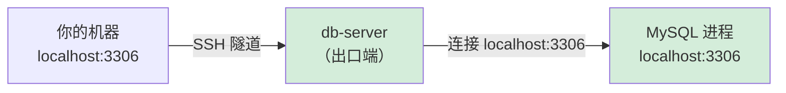
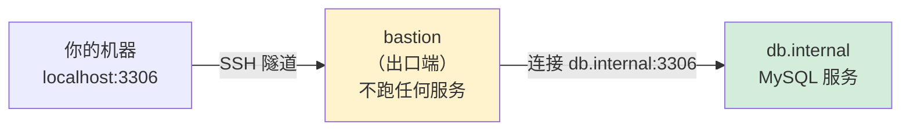
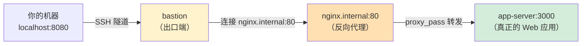
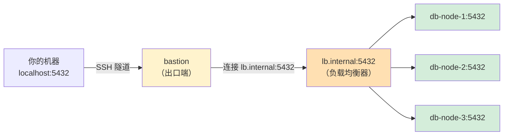

[toc]


## `DEST_HOST` 作为"下一步地址"的完整示例

用同一个场景——你要从本地访问一个内网中的应用服务——展示三种递进的情况。

```shell
ssh -L [BIND_ADDRESS:]LOCAL_PORT:DEST_HOST:DEST_PORT user@ssh_server
```


---

### 情况一：`DEST_HOST` 就是最终服务（最简单）

出口端自身就在跑 MySQL：

```bash
ssh -L 3306:localhost:3306 user@db-server
```



出口端和服务是**同一台机器**，`DEST_HOST=localhost` 直接就是最终服务。这是最常见、最好理解的情况。

---

### 情况二：`DEST_HOST` 是出口端网络中的另一台机器

出口端（bastion）本身不跑任何应用服务，只是一台跳板机：

```bash
ssh -L 3306:db.internal:3306 user@bastion
```



bastion 拿到隧道中出来的流量后，向 `db.internal:3306` 建立一个**新的普通 TCP 连接**，把流量转过去。bastion 在这里只是一个中转者。

---

### 情况三：`DEST_HOST` 是一个反向代理，后面还有真正的服务

这是"不一定是最终服务"最典型的例子。出口端网络中有一台 Nginx 做反向代理，真正的应用跑在 Nginx 后面的另一台机器上：

```bash
ssh -L 8080:nginx.internal:80 user@bastion
```



这里经历了**三次连接**，SSH 隧道只负责前两段：

| 段落   | 从             | 到                | 连接性质                 |
| ------ | -------------- | ----------------- | ------------------------ |
| 第一段 | 你的机器       | bastion           | SSH 加密隧道             |
| 第二段 | bastion        | nginx.internal:80 | 普通 TCP（bastion 发起） |
| 第三段 | nginx.internal | app-server:3000   | 普通 TCP（Nginx 发起）   |

`DEST_HOST`（`nginx.internal`）只是 bastion "下一步去连"的地址，它本身并不提供最终的应用服务，而是再转了一手。**SSH 隧道对第三段的存在毫不知情，也无法控制。**

---

### 情况四：`DEST_HOST` 是负载均衡器，后面有一组服务

```bash
ssh -L 5432:lb.internal:5432 user@bastion
```



你以为自己连的是一台数据库，实际上 `DEST_HOST` 是一个负载均衡器，每次请求可能落到不同的节点上。SSH 隧道对此完全透明——它的职责到"把流量送到 `lb.internal:5432`"就结束了。

---

### 总结

四种情况的共同点：**SSH 隧道的视野终止于 `DEST_HOST:DEST_PORT`**。

| 情况 | `DEST_HOST` 是什么 | 后面还有跳转吗     | SSH 是否知道 |
| ---- | ------------------ | ------------------ | ------------ |
| 一   | 最终服务本身       | 没有               | —            |
| 二   | 内网中另一台服务器 | 没有               | —            |
| 三   | 反向代理（Nginx）  | 有，转到真正的后端 | **不知道**   |
| 四   | 负载均衡器         | 有，分发到集群节点 | **不知道**   |

> `DEST_HOST` 的准确含义始终是"**出口端被要求去连接的那个地址**"。至于那个地址背后是直接提供服务，还是再做一次转发、负载均衡甚至又套了一层隧道——这些都在 SSH 隧道的视野之外了。