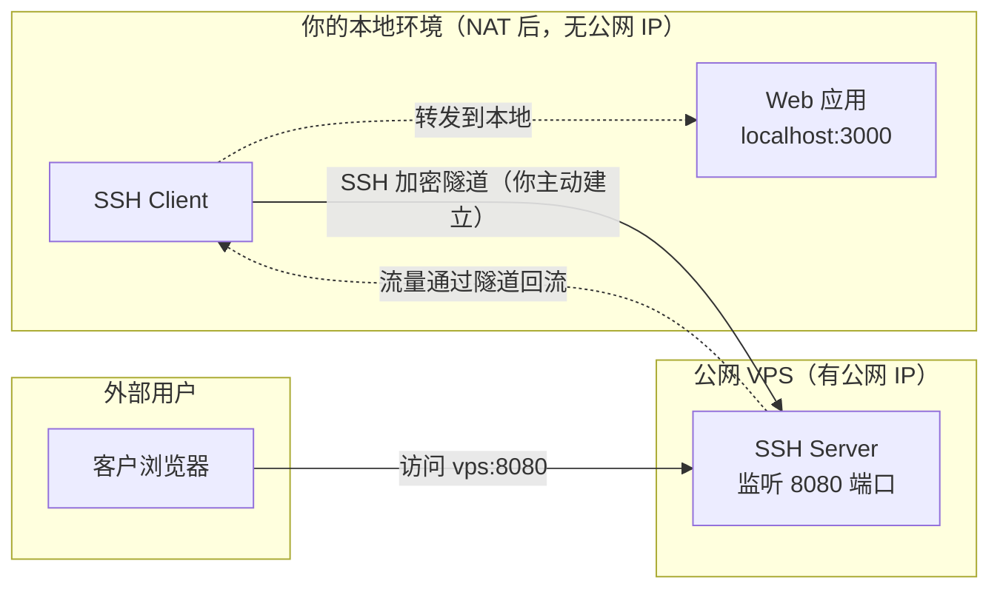
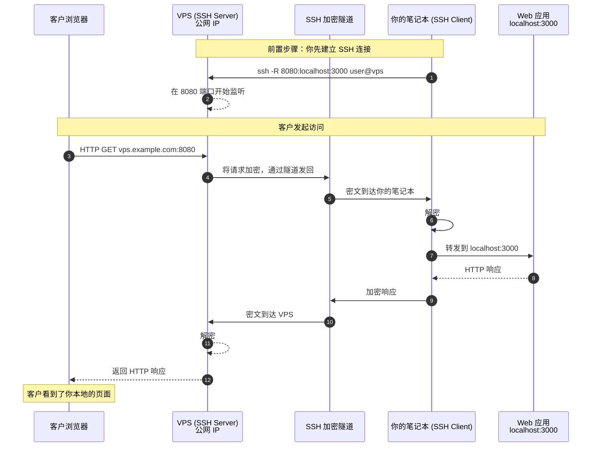
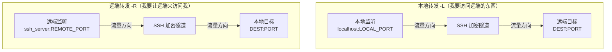
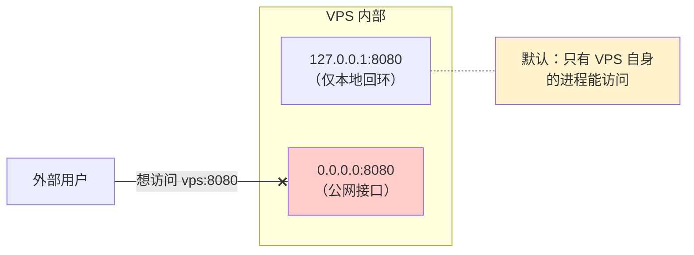

[toc]


## SSH 远端端口转发

---

### 它解决什么问题

先理解一个现实困境：

你在自己的笔记本上运行了一个 Web 应用（`localhost:3000`），你想让远在另一个城市的客户看到它。但问题是——

- 你的笔记本在家庭路由器 NAT 后面，**没有公网 IP**
- 客户无法主动连接到你
- 你不想把代码部署到服务器上，只是想临时展示,并且你手上有一台**带公网 IP** 的 VPS（`vps.example.com`）。

**远端端口转发就是让 VPS 替你"开一扇门"，外部访问这扇门时，流量会通过 SSH 隧道回流到你的笔记本。**

这里一般涉及3个实体角色:



关键认知：**SSH 连接是你主动从本地发起的（从内到外），所以不受 NAT 限制**。

一旦隧道建立，远端 VPS 上打开的端口就成了**通往你本地服务的入口**。

```shell
ssh -R REMOTE_PORT:DEST_HOST:DEST_PORT user@ssh_server
```

```bash
ssh -R 8080:localhost:3000 user@vps.example.com
```

把这条命令拆成四个部分：

| 组成部分               | 含义                                                         |
| ---------------------- | ------------------------------------------------------------ |
| `-R`                   | 指定**远端转发**模式（Remote）                               |
| `8080`                 | 在 **VPS（远端）** 上开放的监听端口                          |
| `localhost:3000`       | 流量最终要送达的**目标地址和端口**，这里的 `localhost` 是相对于 **SSH 客户端（你的本地机器）** 而言的 |
| `user@vps.example.com` | SSH 服务器的登录凭据和地址                                   |

完整的通用格式：

```bash
ssh -R [BIND_ADDR:]REMOTE_PORT:DEST_HOST:DEST_PORT user@ssh_server
```

其中 `BIND_ADDR` 是可选的，控制远端监听绑定的网络接口（后面详述）。

---

### 容易混淆的关键概念：`localhost` 到底指谁

这是新手最常掉进去的坑。

在 `-R 8080:localhost:3000` 中，`localhost` **不是指 VPS**，而是**指你的本地机器**（SSH 客户端所在的机器）。

理解这一点的口诀：**`DEST_HOST:DEST_PORT` 永远从 SSH 隧道的"出口端"来解析。**

> SSH 隧道就像一根管道，有两个口：
>
> - **入口端**：请求流量被"塞入"隧道、开始加密传输的那一端
> - **出口端**：请求流量从隧道中"吐出来"、被解密、然后继续转发到最终目标的那一端
>
> **出口端**指的是：请求流量离开 SSH 加密隧道后，重新变为**普通网络流量**的那一端机器。"出口端"描述的是**请求流量（正向连接）的走向**——即"谁去敲最终目标的门"。
>
> `DEST_HOST` 不一定是服务所在的机器本身，它只是出口端"下一步要连的地址"。简单情况下,这个目标绑大多数时候确实就是跑着 MySQL、Web 应用、PostgreSQL 等服务的那台机器。
>
> ```mermaid
> graph LR
>     A["发起方"] -->|"① 请求"| Entry["入口端"]
>     Entry -->|"② 加密传输 →"| Exit["出口端"]
>     Exit -->|"③ 转发请求到"| Dest["最终目标<br/>DEST_HOST:DEST_PORT"]
> 
>     Dest -.->|"④ 响应"| Exit
>     Exit -.->|"⑤ ← 加密回传"| Entry
>     Entry -.->|"⑥ 返回给"| A
> ```
>
> 

| 转发模式             | 隧道出口在哪一端   | `DEST_HOST` 相对于谁解析 |
| -------------------- | ------------------ | ------------------------ |
| **`-L`（本地转发）** | 远端（SSH Server） | 相对于 **SSH Server**    |
| **`-R`（远端转发）** | 本地（SSH Client） | 相对于 **SSH Client**    |

所以 `-R 8080:localhost:3000` 的意思是："在远端开 8080 端口，收到的流量送回我本地的 `localhost:3000`"。

而如果写 `-R 8080:192.168.1.50:80`，则表示："送回我本地网络中 `192.168.1.50` 这台机器的 80 端口"——**你的本地机器充当了中继**。

---

### 数据流全过程（时序图）

从外部用户发起请求到收到响应，完整的数据流如下：



注意两个关键事实：

1. **加密区间**：只有"你的笔记本 ↔ VPS"之间的流量是 SSH 加密的。"客户浏览器 ↔ VPS"之间、"你的笔记本 ↔ localhost:3000"之间都是明文（除非应用本身用了 HTTPS）
2. **连接方向 vs 数据方向**：SSH 连接是你从本地主动发起的（内→外），但业务数据是从外部流向你本地的（外→内）。这就是远端转发的精髓——**反向打洞**

---

### `-L` 与 `-R` 的对称关系

本地转发和远端转发本质上是**同一机制的两个方向**。理解它们的对称性是掌握 SSH 端口转发的关键：



一句话总结：

- **`-L`**：**监听端口开在本地**，数据从本地流向远端——"我去找远端"
- **`-R`**：**监听端口开在远端**，数据从远端流回本地——"让远端来找我"

---

### `GatewayPorts`：控制远端监听绑定的接口

这是远端转发中最容易踩坑的配置项。

默认行为下，SSH 服务端的远端转发端口**只绑定在 `127.0.0.1`**（loopback），这意味着：



只有 VPS 上运行的进程（如 `curl localhost:8080`）才能访问这个转发端口，**外部用户根本连不上**。

要解决这个问题，有三种方式：

**方式一：服务端配置 `GatewayPorts`（推荐，但需要服务端权限）**

在 VPS 的 `/etc/ssh/sshd_config` 中：

```
# 允许远端转发绑定到所有接口
GatewayPorts yes

# 或者更灵活：允许客户端自己指定绑定地址
GatewayPorts clientspecified
```

修改后重启 `sshd`：

```bash
sudo systemctl restart sshd
```

当设为 `clientspecified` 时，客户端可以这样指定绑定地址：

```bash
# 绑定到 VPS 的所有接口
ssh -R 0.0.0.0:8080:localhost:3000 user@vps.example.com

# 只绑定到 VPS 的某个特定 IP
ssh -R 203.0.113.5:8080:localhost:3000 user@vps.example.com
```

**方式二：在 VPS 上用 Nginx/Caddy 反向代理（无需改 `sshd_config`）**

即使 `GatewayPorts` 保持默认的 `no`，VPS 本地进程是可以访问 `127.0.0.1:8080` 的。所以可以在 VPS 上运行一个反代，把公网流量转到本地回环：

```
# /etc/nginx/conf.d/tunnel.conf（VPS 上的 Nginx 配置）
server {
    listen 80;
    server_name demo.example.com;

    location / {
        proxy_pass http://127.0.0.1:8080;
        proxy_set_header Host $host;
        proxy_set_header X-Forwarded-For $remote_addr;
    }
}
```

这种方式的额外好处：可以加 HTTPS（配合 Let's Encrypt）、做域名路由、加访问控制。

**方式三：VPS 上用 `socat` 临时转发（快速但不正式）**

```bash
# 在 VPS 上执行，将公网 9090 转到本地 8080
socat TCP-LISTEN:9090,fork,reuseaddr TCP:127.0.0.1:8080
```

三种方式对比：

| 方式               | 需要 root 权限 | 需要改 `sshd_config` | 支持 HTTPS | 持久性   |
| ------------------ | -------------- | -------------------- | ---------- | -------- |
| `GatewayPorts yes` | 是             | 是                   | 否         | 永久配置 |
| Nginx/Caddy 反代   | 是（安装服务） | 否                   | 是         | 永久配置 |
| `socat` 转发       | 否             | 否                   | 否         | 临时     |

---

### 实用技巧与完整命令模板

**后台运行 + 自动保活**：

```bash
ssh -f -N -T \
    -R 8080:localhost:3000 \
    -o ServerAliveInterval=30 \
    -o ServerAliveCountMax=3 \
    -o ExitOnForwardFailure=yes \
    user@vps.example.com
```

各参数的作用：

| 参数                          | 作用                                                 |
| ----------------------------- | ---------------------------------------------------- |
| `-f`                          | SSH 认证完成后转入后台                               |
| `-N`                          | 不执行远程命令（纯转发用途）                         |
| `-T`                          | 不分配终端（节省资源）                               |
| `-o ServerAliveInterval=30`   | 每 30 秒发一次心跳，防止空闲断开                     |
| `-o ServerAliveCountMax=3`    | 连续 3 次心跳无响应则断开                            |
| `-o ExitOnForwardFailure=yes` | 端口绑定失败时立即退出，**避免静默失败**（强烈推荐） |

**写入 `~/.ssh/config` 管理**：

```
Host dev-expose
    HostName        vps.example.com
    User            deploy
    IdentityFile    ~/.ssh/id_ed25519
    RemoteForward   8080 localhost:3000
    ServerAliveInterval 30
    ServerAliveCountMax 3
    ExitOnForwardFailure yes
```

使用时只需：

```bash
ssh -f -N dev-expose
```

**断开隧道**：

```bash
# 查找后台 SSH 进程
ps aux | grep "ssh -f"

# 或更精确地
pgrep -f "ssh.*dev-expose"

# 终止
kill <PID>
```

---

### 一些常见疑问

**Q：远端转发能转发 UDP 流量吗？**

不能。SSH 端口转发只支持 **TCP**。如果需要转发 UDP（如 DNS、游戏流量），需要借助其他工具（如 WireGuard、`socat` 的 UDP 模式、或 `sshuttle`）。

**Q：SSH 断开后隧道还在吗？**

不在。SSH 连接断开后，远端监听的端口会立即关闭。如果需要自动重连，可以使用 `autossh`：

```bash
# autossh 会在连接断开时自动重建隧道
autossh -M 0 -f -N -T \
    -R 8080:localhost:3000 \
    -o ServerAliveInterval=30 \
    -o ServerAliveCountMax=3 \
    user@vps.example.com
```

`-M 0` 表示使用 SSH 自身的 `ServerAliveInterval` 机制做存活检测，而非 `autossh` 自己的监控端口（现代推荐做法）。

若要做成系统服务（开机自启），可以写一个 systemd unit：

```ini
# /etc/systemd/system/ssh-tunnel.service
[Unit]
Description=SSH Remote Port Forwarding Tunnel
After=network-online.target
Wants=network-online.target

[Service]
ExecStart=/usr/bin/ssh -N -T \
    -R 8080:localhost:3000 \
    -o ServerAliveInterval=30 \
    -o ServerAliveCountMax=3 \
    -o ExitOnForwardFailure=yes \
    -i /home/user/.ssh/id_ed25519 \
    deploy@vps.example.com
Restart=always
RestartSec=10
User=user

[Install]
WantedBy=multi-user.target
```

```bash
sudo systemctl enable --now ssh-tunnel
```

**Q：远端转发可以同时转发多个端口吗？**

可以，多次使用 `-R` 参数：

```bash
ssh -R 8080:localhost:3000 \
    -R 8443:localhost:3443 \
    -R 5555:localhost:5432 \
    user@vps.example.com
```

**Q：和 ngrok / frp 之类工具相比呢？**

SSH `-R` 是**零依赖**的内网穿透方案——只要有 SSH 账号就能用，不需要额外安装任何软件。但它缺少自动 HTTPS、自定义域名、Web 管理面板等功能。**ngrok**、**frp**、**Cloudflare Tunnel** 等专用工具在这些方面更完善，适合长期或正式场景。SSH `-R` 更适合临时、轻量的场景。

## 远端端口转发实践案例

SSH 远程转发：Flask 本地服务暴露到公网服务器

### 问题现象

在 Windows 本机运行 Flask 服务（监听 `0.0.0.0:5000`），通过 SSH 远程转发到公网服务器 `s1`（`233.239.111.123`）的 8080 端口，从 `s1` 上 `curl http://localhost:8080` 返回 `Empty reply from server`。

### 根本原因

**`-R` 的目标地址解析歧义**。原命令：

```bash
ssh -R 8080:localhost:5000 root@s1
```

- `8080` 未指定绑定地址，默认只监听 `s1` 的 `127.0.0.1`，公网 IP `233.239.111.123:8080` 无法访问。
- 目标 `localhost:5000` 在部分环境下被解析为 IPv6 的 `::1`，而 Flask 只监听 IPv4，导致连接目标失败，sshd 直接关闭连接，表现为 `Empty reply`。

### 最终生效方案

**服务端 `s1` 配置**（`/etc/ssh/sshd_config`）：

```
GatewayPorts clientspecified
```

修改后重启 sshd：

```bash
sudo sshd -t && sudo systemctl restart sshd
```

**客户端命令**（Windows 本机执行）：

```bash
ssh -f -N -T \
  -R 0.0.0.0:8080:127.0.0.1:5000 \
  -o ServerAliveInterval=30 \
  -o ServerAliveCountMax=3 \
  -o ExitOnForwardFailure=yes \
  root@s1
```

| 参数                             | 作用                                                         |
| -------------------------------- | ------------------------------------------------------------ |
| `-f`                             | 隧道转入后台运行                                             |
| `-N`                             | 不执行远程命令                                               |
| `-T`                             | 不分配伪终端                                                 |
| `-R 0.0.0.0:8080:127.0.0.1:5000` | 在 `s1` 所有接口监听 8080，目标显式指定为 IPv4 的 `127.0.0.1:5000` |
| `ServerAliveInterval=30`         | 每 30 秒发探测包，防止半开连接形成孤儿隧道                   |
| `ServerAliveCountMax=3`          | 连续 3 次无响应则断开                                        |
| `ExitOnForwardFailure=yes`       | 转发失败时立即退出，避免静默失败                             |

**防火墙**（如 `s1` 有 ufw 或 iptables）：放行 8080 端口。

**验证**：

```bash
# 在 s1 上确认监听地址
ss -tlnp | grep 8080

# 从外部访问
curl http://233.239.111.123:8080/
```

### 关键点速查

- `-R` 的绑定地址写法决定监听范围：省略或 `127.0.0.1` 仅本机可访问，`0.0.0.0` 所有接口可访问（需服务端 `GatewayPorts` 允许）。
- 目标地址**显式写 `127.0.0.1`** 而非 `localhost`，**避免 IPv4/IPv6 解析歧义**。
- **安全提醒**：`0.0.0.0:8080` 暴露到公网，建议配合防火墙限制来源 IP，或在前置反向代理加认证。

### 停止隧道

```bash
# 查找并终止
ps aux | grep 'ssh -f -N -T'
kill <PID>
```

确认端口释放：

```bash
ss -tlnp | grep 8080
```