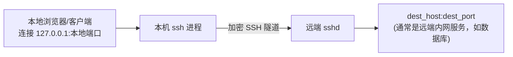
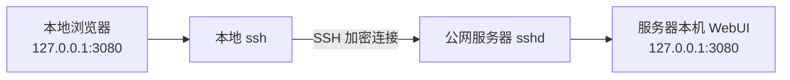
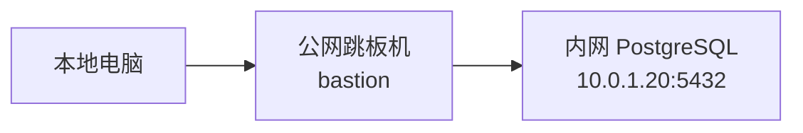
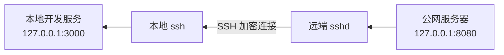
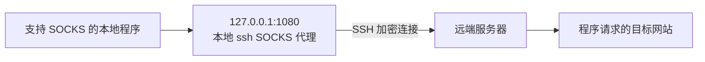

[toc]

## 区分ssh的端口转发功能

- **`-L`（本地转发）**：把**远端**能访问到的服务，映射到**本地**端口上，让**本地**其他程序去连。
- **`-R`（远程转发）**：把**本地**能访问到的服务，映射到**远端**端口上，让**远端**其他程序去连。

**记忆口诀：`-L` 的目标端口在“本地开口子”，`-R` 的目标端口在“远端开口子”。**

---

## 语法对比

| 项目                     | `-L`（本地转发）                                             | `-R`（远程转发）                                             |
| ------------------------ | ------------------------------------------------------------ | ------------------------------------------------------------ |
| 命令语法                 | `ssh -L [bind_addr:]local_port:dest_host:dest_port user@ssh_host` | `ssh -R [bind_addr:]remote_port:dest_host:dest_port user@ssh_host` |
| 监听位置                 | **本机**（发起 ssh 的这台机器）                              | **远端**（`ssh_host`，即你连接的服务器）                     |
| 最终访问目标             | 从**远端**视角能访问到的 `dest_host:dest_port`               | 从**本地**视角能访问到的 `dest_host:dest_port`               |
| 谁去连监听端口           | **本机**其他程序（浏览器、psql、redis-cli 等）               | **远端**其他程序或远端的其他用户                             |
| 配置文件对应指令         | `LocalForward`                                               | `RemoteForward`                                              |
| 典型默认绑定范围         | 默认只绑定 `127.0.0.1`（本机回环）                           | 默认只绑定远端的 `127.0.0.1`，是否能对外监听受服务端 `GatewayPorts` 控制 |
| 安全影响面               | 主要影响**本机**，风险相对小                                 | 会在**远端服务器**开一个监听端口，风险相对大，很多机构默认禁用 |
| 需要服务端额外开启的选项 | 一般不需要，除非要绑定非回环地址                             | 常需要 `sshd_config` 里 `AllowTcpForwarding yes`，如需对外监听还要 `GatewayPorts` |

---

## 数据流向图示

### `-L` 本地转发：把远端的服务“搬”到本地来用



**典型场景**：服务器只允许内网访问 `db:5432`，你在本地想直接用 `psql` 连它。

```bash
ssh -N -L 127.0.0.1:5432:db:5432 user@bastion
```

- **本地**监听 `127.0.0.1:5432`；
- 本地程序连 `127.0.0.1:5432`，流量经 SSH 隧道到达 `bastion`，再由 `bastion` 转发到 `db:5432`（`db` 是 **相对 bastion 而言**能访问到的地址，可以是 `localhost`、内网 IP 或另一台机器）。

### `-R` 远程转发：把本地的服务“搬”到远端去用


**典型场景**：本地跑了个开发中的 Web 服务 `localhost:3000`，想让公网 VPS 上的人临时访问，或者自己家里机器没公网 IP，想让 VPS 反向连回来。

```bash
ssh -N -R 127.0.0.1:8080:localhost:3000 user@vps
```

- **远端**（`vps`）监听 `127.0.0.1:8080`；
- 远端的程序（或者你登录 `vps` 后自己）访问 `127.0.0.1:8080`，流量经 SSH 隧道**反向**回到本地，再由本地转发到 `localhost:3000`。

---

## 关键细节和易错点

### 1. `dest_host` 是“相对谁而言”，是最容易搞混的地方

- **`-L` 里的 `dest_host`**：是**相对远端**（ssh_host）能访问到的地址，不是相对本机。
- **`-R` 里的 `dest_host`**：是**相对本机**能访问到的地址，不是相对远端。

例如 `ssh -L 5432:db:5432 bastion`，这里的 `db` 必须是 `bastion` 能解析、能连通的主机名（可能是 `bastion` 内网 DNS 里的 `db`），而不是你本机的 `db`。

### 2. 默认只监听回环地址，外部机器连不上

无论 `-L` 还是 `-R`，**默认绑定地址都是 `127.0.0.1`**，也就是说：

- `-L` 转发出来的端口，默认只有**本机自己**能连，局域网里别的电脑连不上。
- `-R` 转发到远端的端口，默认只有**远端服务器自己**能连（比如你登录进去后 `curl 127.0.0.1:8080`），远端服务器所在网络里的别的机器连不上。

如果想让局域网/公网其他机器也能连：

```bash
# 本地转发，允许局域网内其他机器连本机的转发端口
ssh -L 0.0.0.0:5432:db:5432 user@bastion
```

```bash
# 远程转发，允许远端网络中其他机器连服务器的转发端口
ssh -R 0.0.0.0:8080:localhost:3000 user@vps
```

**但 `-R` 要绑定非回环地址，服务端 `sshd_config` 里通常还需要开启 `GatewayPorts yes`（或 `clientspecified`），否则即使客户端指定 `0.0.0.0`，服务端也可能强制只绑定 `127.0.0.1`。** 这是很多人配置 `-R 0.0.0.0:...` 却发现外部依然连不上的常见原因。

### 3. `-R` 的安全风险通常更高，很多环境默认禁用

- `-L` 主要暴露的是**本机**的一个端口，风险面局限在你自己电脑上。
- `-R` 是在**别人的服务器**上开一个监听端口，一旦配置不当（比如绑定了 `0.0.0.0` 又开了 `GatewayPorts`），相当于把你本机的服务变相暴露到了那台服务器所在的网络甚至公网上。

所以正规的公司/云服务器环境常见做法是：`sshd_config` 里 `AllowTcpForwarding local`（只允许本地转发，不允许远程转发），或者干脆按用户/按 `Match` 块单独放开，而不是全局允许 `-R`。

### 4. 只做转发、不要开 shell，记得加 `-N`

```bash
ssh -N -L 127.0.0.1:5432:db:5432 user@bastion
```

`-N` 表示这条 SSH 连接**只用来转发，不执行远程命令、不进入 shell**，适合专门跑在后台的隧道连接。**注意 `-N` 会让终端“卡住”不返回提示符，这是正常现象，不是卡死；`Ctrl+C` 即可关闭隧道。**

### 5. 后台常驻：配合 `-f` 或 `~/.ssh/config`

命令行长期跑一条隧道，可以后台化：

```bash
ssh -f -N -L 127.0.0.1:5432:db:5432 user@bastion
```

或者写进 `~/.ssh/config`，用配置替代记命令：

```ssh_config
Host bastion-db-tunnel
    HostName bastion.example.com
    User ops
    LocalForward 127.0.0.1:5432 db:5432

Host vps-dev-tunnel
    HostName vps.example.com
    User ops
    RemoteForward 127.0.0.1:8080 localhost:3000
```

之后只需要：

```bash
ssh -N bastion-db-tunnel
ssh -N vps-dev-tunnel
```

---

## 一张图总结怎么选

| 你的需求场景                                                 | 应该用                                     |
| ------------------------------------------------------------ | ------------------------------------------ |
| 我在本地，想访问**服务器那边**才能连到的数据库/内网系统      | **`-L`**                                   |
| 我在本地跑了个服务，想让**服务器那边**（或经服务器出去的其他人）访问 | **`-R`**                                   |
| 我想让整个流量走远端出口做代理（不针对单个端口）             | 用 `-D`（动态转发/SOCKS），不是 `-L`/`-R`  |
| 我要访问的是**服务器的内网另一台机器**，不是服务器本身       | **`-L`**，`dest_host` 填那台内网机器的地址 |
| 我本机没公网 IP，想让公网 VPS 能连到我                       | **`-R`**，反向把本机服务暴露到 VPS         |


## 核心概念

**SSH 端口转发（SSH Port Forwarding）是在 SSH 加密连接中承载其他 TCP 连接。**

它通常用于：

- **安全访问没有公网监听的 WebUI、数据库和管理后台**
- **通过跳板机访问内网服务**
- **把本地服务反向提供给远端服务器**
- **建立临时 SOCKS 代理**
- **避免直接在公网开放敏感端口**

SSH 端口转发主要分为：

| 类型                               |                             参数 | 监听端口在哪里     | 典型方向                   |
| ---------------------------------- | -------------------------------: | ------------------ | -------------------------- |
| **本地转发**（Local Forwarding）   |                             `-L` | SSH 客户端所在机器 | 本地访问远端服务           |
| **远程转发**（Remote Forwarding）  |                             `-R` | SSH 服务器所在机器 | 远端访问本地服务           |
| **动态转发**（Dynamic Forwarding） |                             `-D` | SSH 客户端所在机器 | 本地 SOCKS 代理            |
| **Unix Socket 转发**               | `LocalForward` / `RemoteForward` | 本地或远端         | 转发 Docker 等 Unix Socket |
| **TUN 隧道**                       |                             `-w` | 两端虚拟网络接口   | 更接近 VPN 的三层隧道      |

OpenSSH 支持本地、远程、动态端口转发，也支持 Unix-domain socket 和 TUN 设备转发；其中 `-D` 会让 SSH 客户端充当 SOCKS4/SOCKS5 代理。

---

## 工作原理

一条 SSH 端口转发通常包含四个角色：


最重要的两个问题是：

- **监听端口开在哪一端？**
- **最终目标连接由哪一端发起？**

| 转发方式 | 监听端口        | 谁连接最终目标  |
| -------- | --------------- | --------------- |
| **`-L`** | 本地客户端      | 远端 SSH 服务器 |
| **`-R`** | 远端 SSH 服务器 | 本地 SSH 客户端 |
| **`-D`** | 本地客户端      | 远端 SSH 服务器 |

因此：

> **`-L` 把远端资源带到本地，`-R` 把本地资源带到远端，`-D` 把远端变成本地的 SOCKS 出口。**

SSH 转发的是 **TCP 字节流**；普通 `-L`、`-R`、`-D` 不能直接转发任意 UDP。如果需要完整网络层隧道，可以考虑 WireGuard、Tailscale，或者 OpenSSH 的 `-w` TUN 转发；后者还需要服务器允许 `PermitTunnel`。

---

## 本地端口转发：`-L`

### 语法

```bash
ssh -L [本地绑定地址:]本地端口:目标主机:目标端口 用户@SSH服务器
```

例如：

```bash
ssh -N -L 127.0.0.1:3080:127.0.0.1:3080 root@server.example.com
```

数据流：



此时在本地浏览器访问：

```text
http://127.0.0.1:3080
```

这里两个 `127.0.0.1` 指代不同机器：

- 第一个是**本地计算机**
- 第二个是**远端服务器**

### 典型用例：访问服务器上的 WebUI

假设 DeepSeek Harness WebUI 只监听服务器的：

```text
127.0.0.1:3080
```

在本地执行：

```bash
ssh -NT \
  -o ExitOnForwardFailure=yes \
  -L 127.0.0.1:3080:127.0.0.1:3080 \
  root@服务器公网IP
```

然后打开：

```text
http://127.0.0.1:3080
```

这是访问公网服务器敏感 WebUI 的**推荐方式**：

- 不需要让 WebUI 监听 `0.0.0.0`
- 不需要开放云防火墙的 `3080`
- WebUI 流量经过 SSH 加密
- 只有能够通过 SSH 认证的人才能建立隧道

### 典型用例：访问远端内网数据库

网络拓扑：



命令：

```bash
ssh -NT \
  -L 127.0.0.1:15432:10.0.1.20:5432 \
  ops@bastion.example.com
```

本地数据库客户端连接：

```text
127.0.0.1:15432
```

实际访问的是：

```text
10.0.1.20:5432
```

注意，`10.0.1.20` 必须是**跳板机能够访问**的地址，不要求本地计算机能直接访问。

---

## 远程端口转发：`-R`

### 语法

```bash
ssh -R [远端绑定地址:]远端端口:目标主机:目标端口 用户@SSH服务器
```

例如，本地运行着开发服务：

```text
127.0.0.1:3000
```

希望公网服务器自身可以访问它：

```bash
ssh -NT \
  -R 127.0.0.1:8080:127.0.0.1:3000 \
  user@vps.example.com
```

数据流：



登录服务器后执行：

```bash
curl http://127.0.0.1:8080
```

实际上访问的是本地计算机的 `127.0.0.1:3000`。

### 典型用例

- 本地开发服务提供给远端测试
- 没有公网 IP 的家庭计算机反向连接 VPS
- 让远端 Nginx 代理本地服务
- 临时回连位于 NAT 后面的设备
- CI 环境回连开发机上的测试服务

### 让其他机器访问远程转发端口

下面的命令试图让 VPS 在所有网卡上监听：

```bash
ssh -NT \
  -R 0.0.0.0:8080:127.0.0.1:3000 \
  user@vps.example.com
```

但它还受到服务器 `/etc/ssh/sshd_config` 的控制：

```ssh_config
AllowTcpForwarding remote
GatewayPorts clientspecified
```

修改后应先检查配置，再重新加载 SSH 服务：

```bash
sudo sshd -t
sudo systemctl reload sshd
```

部分发行版服务名可能是 `ssh`：

```bash
sudo systemctl reload ssh
```

OpenSSH 服务端默认会将远程转发监听限制在回环地址。`GatewayPorts clientspecified` 允许客户端指定监听地址；`GatewayPorts yes` 则会强制使用通配地址。`PermitListen` 还能限制允许创建的远程监听地址和端口。

**不要轻易将无认证 WebUI 通过 `-R 0.0.0.0` 暴露到公网。** 如确有需要，应在前面增加 HTTPS、身份认证、来源 IP 限制和云防火墙规则。

---

## 动态端口转发：`-D`

### 建立本地 SOCKS 代理

```bash
ssh -NT -D 127.0.0.1:1080 user@server.example.com
```

数据流：



这和 `-L` 的主要区别是：

- `-L` 的目标主机和端口在命令中固定
- `-D` 的目标由浏览器、curl 等 SOCKS 客户端逐次指定

使用 curl 测试：

```bash
curl --socks5-hostname 127.0.0.1:1080 https://example.com/
```

使用 `--socks5-hostname` 可以让域名通过 SOCKS 代理一侧解析，避免本地 DNS 无法解析远端内网域名。

OpenSSH 的动态转发支持 SOCKS4 和 SOCKS5，SSH 客户端在本地充当 SOCKS 服务器。

### 典型用例

- 临时通过服务器访问其内网网站
- 使用远端服务器的网络出口
- 排查“本地不能访问、服务器可以访问”的网络问题
- 访问仅能由公司跳板机解析和连接的内部域名

**`-D` 不是全局 VPN。** 只有支持并配置了 SOCKS 的应用才会使用它；操作系统中的其他程序不会自动经过隧道。

---

## 三种转发的直接对比

| 问题               | `-L` 本地转发                | `-R` 远程转发              | `-D` 动态转发         |
| ------------------ | ---------------------------- | -------------------------- | --------------------- |
| 在哪里监听         | 本地                         | 远端                       | 本地                  |
| 谁使用它           | 本地程序                     | 远端程序                   | 本地 SOCKS 客户端     |
| 最终连接从哪里发出 | 远端服务器                   | 本地客户端                 | 远端服务器            |
| 目标是否固定       | 固定                         | 固定                       | 每个连接动态决定      |
| 主要用途           | 访问远端或远端内网服务       | 向远端提供本地服务         | 临时代理              |
| 常见风险           | 把远端敏感服务暴露到本地网络 | 把本地服务暴露到远端或公网 | 开放 SOCKS 代理被滥用 |
| 记忆方式           | **远端资源带回来**           | **本地资源送过去**         | **远端充当代理出口**  |

---

## 与跳板机配合

假设最终服务器只能通过跳板机访问：

```bash
ssh -NT \
  -J ops@bastion.example.com \
  -L 127.0.0.1:3080:127.0.0.1:3080 \
  app@internal-server
```

数据路径是：


这里最终 SSH 登录目标是 `internal-server`，所以 `-L` 的目标 `127.0.0.1:3080` 指的是 **internal-server 自己**，而不是跳板机。

也可以写入 `~/.ssh/config`：

```ssh_config
Host bastion
    HostName bastion.example.com
    User ops
    IdentityFile ~/.ssh/id_ed25519

Host internal-server
    HostName 10.0.1.30
    User app
    ProxyJump bastion
    IdentityFile ~/.ssh/id_ed25519
    LocalForward 127.0.0.1:3080 127.0.0.1:3080
    ExitOnForwardFailure yes
```

使用时：

```bash
ssh -NT internal-server
```

---

## 常用辅助参数

| 参数                          | 作用                         | 建议                   |
| ----------------------------- | ---------------------------- | ---------------------- |
| `-N`                          | 不执行远程命令，只建立转发   | **端口转发一般都加**   |
| `-T`                          | 不分配伪终端                 | 纯隧道建议加           |
| `-f`                          | 认证后转入后台               | 临时后台运行可用       |
| `-g`                          | 允许其他主机连接本地转发端口 | 谨慎使用               |
| `-4`                          | 强制 IPv4                    | 双栈解析异常时排错     |
| `-6`                          | 强制 IPv6                    | 明确使用 IPv6 时使用   |
| `-v` / `-vvv`                 | 输出调试日志                 | 转发失败时首选         |
| `-o ExitOnForwardFailure=yes` | 监听端口创建失败时退出       | **自动化场景建议开启** |
| `-o ServerAliveInterval=30`   | 定期发送保活消息             | 长时间隧道建议使用     |
| `-o ServerAliveCountMax=3`    | 连续失败多少次后退出         | 配合服务管理器重连     |

一个相对稳妥的临时隧道命令：

```bash
ssh -NT \
  -o ExitOnForwardFailure=yes \
  -o ServerAliveInterval=30 \
  -o ServerAliveCountMax=3 \
  -L 127.0.0.1:3080:127.0.0.1:3080 \
  user@server.example.com
```

需要注意：**`ExitOnForwardFailure` 只保证监听端口能够创建，不保证最终目标服务始终可连接。** 例如远端 `127.0.0.1:3080` 没有服务监听，SSH 隧道仍可能建立成功，但浏览器访问时才会失败。

---

## 使用 `~/.ssh/config` 简化命令

### 本地转发配置

```ssh_config
Host deepseek-webui
    HostName server.example.com
    User root
    IdentityFile ~/.ssh/id_ed25519

    LocalForward 127.0.0.1:3080 127.0.0.1:3080
    ExitOnForwardFailure yes
    ServerAliveInterval 30
    ServerAliveCountMax 3
```

启动：

```bash
ssh -NT deepseek-webui
```

### 远程转发配置

```ssh_config
Host reverse-tunnel
    HostName vps.example.com
    User tunnel
    IdentityFile ~/.ssh/id_ed25519

    RemoteForward 127.0.0.1:8080 127.0.0.1:3000
    ExitOnForwardFailure yes
    ServerAliveInterval 30
    ServerAliveCountMax 3
```

启动：

```bash
ssh -NT reverse-tunnel
```

### 动态转发配置

```ssh_config
Host socks-proxy
    HostName server.example.com
    User ops
    IdentityFile ~/.ssh/id_ed25519

    DynamicForward 127.0.0.1:1080
    ExitOnForwardFailure yes
```

启动：

```bash
ssh -NT socks-proxy
```

---

## 绑定地址与暴露范围

绑定地址直接决定谁能连接转发端口。

| 绑定地址    | 含义                               |
| ----------- | ---------------------------------- |
| `127.0.0.1` | 只有当前机器可以连接，**默认推荐** |
| `::1`       | 只有当前机器可以通过 IPv6 连接     |
| `0.0.0.0`   | 所有 IPv4 网卡均监听               |
| `::`        | 通常表示所有 IPv6 网卡             |
| 指定内网 IP | 只在对应网卡监听                   |

安全示例：

```bash
ssh -L 127.0.0.1:3080:127.0.0.1:3080 user@server
```

风险更高的示例：

```bash
ssh -L 0.0.0.0:3080:127.0.0.1:3080 user@server
```

第二条可能让本地局域网内其他设备访问远端 WebUI。除非明确需要，**始终显式绑定 `127.0.0.1`**。

---

## 服务端如何限制转发

在 `/etc/ssh/sshd_config` 中可以控制：

```ssh_config
AllowTcpForwarding local
```

可选值通常包括：

| 配置                           | 含义                         |
| ------------------------------ | ---------------------------- |
| `AllowTcpForwarding yes`       | 允许本地和远程 TCP 转发      |
| `AllowTcpForwarding local`     | 只允许客户端使用 `-L`、`-D`  |
| `AllowTcpForwarding remote`    | 只允许客户端使用 `-R`        |
| `AllowTcpForwarding no`        | 禁止 TCP 转发                |
| `DisableForwarding yes`        | 禁止多类 SSH 转发能力        |
| `PermitOpen host:port`         | 限制可以连接的目标           |
| `PermitListen host:port`       | 限制远程转发允许监听的位置   |
| `GatewayPorts no`              | 远程转发限制在服务器回环地址 |
| `GatewayPorts clientspecified` | 允许客户端指定远端绑定地址   |

OpenSSH 服务端支持通过 `AllowTcpForwarding` 分别允许本地或远程转发，通过 `PermitOpen` 限制转发目标，并通过 `PermitListen` 和 `GatewayPorts` 限制远程监听地址。

推荐按用户限制，而不是全局开放：

```ssh_config
Match User tunnel
    AllowTcpForwarding remote
    GatewayPorts no
    PermitListen 127.0.0.1:8080
    X11Forwarding no
    AllowAgentForwarding no
```

修改后检查：

```bash
sudo sshd -t
```

---

## 常见故障排查

| 现象                                | 常见原因                              | 排查方法                                |
| ----------------------------------- | ------------------------------------- | --------------------------------------- |
| `Address already in use`            | 监听端口被占用                        | 换本地端口或查占用进程                  |
| `administratively prohibited`       | 服务端禁止转发                        | 检查 `AllowTcpForwarding`、`PermitOpen` |
| 隧道建立但浏览器打不开              | 最终服务没启动或目标写错              | 在负责连接目标的那一端直接测试          |
| `-R 0.0.0.0` 仍只有服务器自己能访问 | `GatewayPorts` 不允许                 | 配置 `clientspecified` 并检查防火墙     |
| 外部无法访问远程端口                | 系统防火墙或云安全组未放行            | 同时检查两层防火墙                      |
| SSH 一断，转发立即消失              | 转发依赖该 SSH 会话                   | 使用保活和系统服务管理                  |
| 内网域名无法解析                    | 误解了目标连接发起端                  | 确认域名应该由本地还是远端解析          |
| Windows 本地端口访问失败            | 防火墙、端口占用或用了错误 SSH 客户端 | 使用 `ssh -vvv` 并检查端口              |

通用调试：

```bash
ssh -vvv -NT \
  -L 127.0.0.1:3080:127.0.0.1:3080 \
  user@server
```

Linux 查看监听：

```bash
ss -ltnp | grep 3080
```

Windows PowerShell：

```powershell
Get-NetTCPConnection -LocalPort 3080
```

检查 SSH 配置展开结果：

```bash
ssh -G deepseek-webui
```

---

## 选择指南

| 需求                              | 选择                                             |
| --------------------------------- | ------------------------------------------------ |
| 本地访问公网服务器上的 WebUI      | **`-L`**                                         |
| 本地访问服务器内网数据库          | **`-L`**                                         |
| 本地访问只能由跳板机访问的网站    | **`-L`** 或 `-D`                                 |
| 把本地开发服务提供给 VPS 自己     | **`-R 127.0.0.1:...`**                           |
| 把 NAT 后面的服务临时映射到 VPS   | **`-R`**                                         |
| 通过远端服务器访问多个不同目标    | **`-D`**                                         |
| 需要全设备、全协议长期组网        | WireGuard、Tailscale 等 VPN                      |
| 只想打开服务器上的 DeepSeek WebUI | **`ssh -NT -L 3080:127.0.0.1:3080 user@server`** |

## 最实用的记忆方式

- **`-L`：我在本地开门，把远端服务拉回来。**
- **`-R`：我在远端开门，把本地服务送过去。**
- **`-D`：我在本地开一个 SOCKS 代理，让远端替我连接目标。**
- **不确定安全范围时，一律绑定 `127.0.0.1`，不要绑定 `0.0.0.0`。**

本轮官方检索还发现了几个可进一步展开的关键词：**`PermitListen`、`PermitOpen`、`AllowStreamLocalForwarding`、`ExitOnForwardFailure`、`GatewayPorts clientspecified` 和 `PermitTunnel`**。