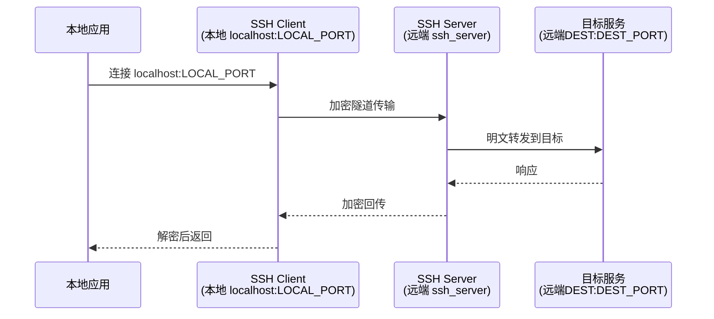
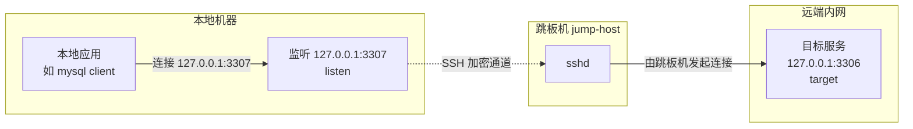
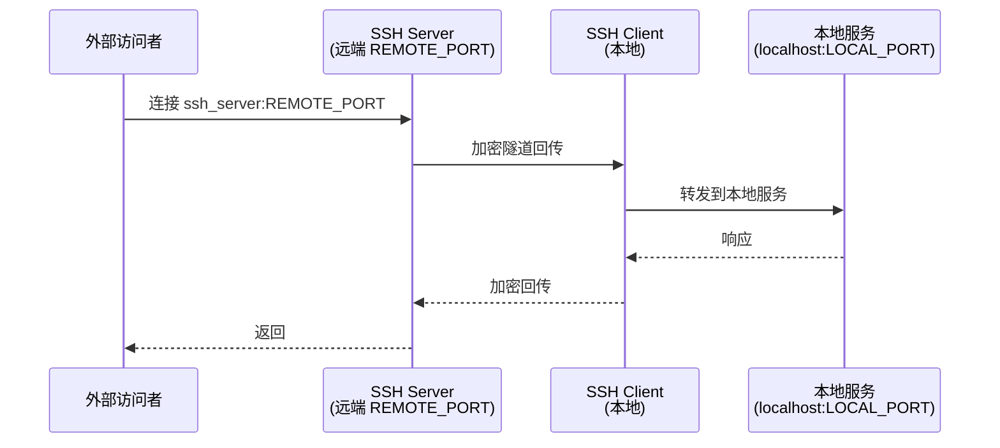
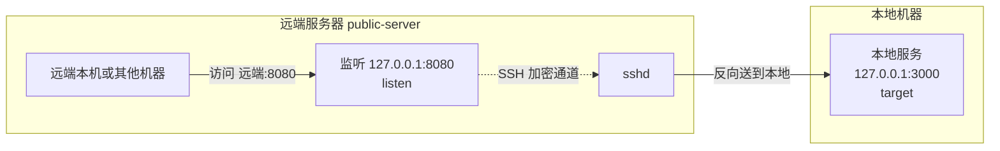
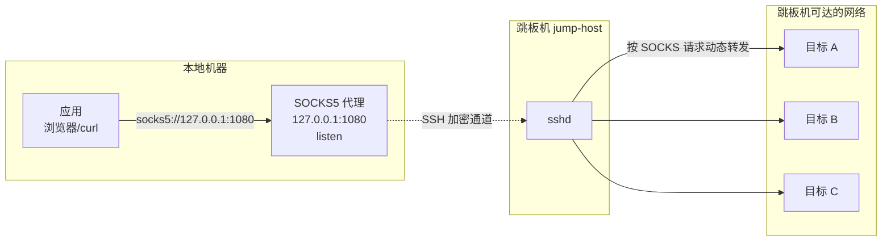

[toc]


## 流量转发

用户最好奇的一点：**SSH 端口转发是否拦截流量？**

SSH 端口转发会"拦截"**发往本地机器某个特定端口的流量**，并通过加密的 SSH 连接将其**转发到远端服务器**，再由远端送达最终目的地。

> "拦截"在这里**不是恶意含义**。更准确的说法是：**重定向（redirect）** 或 **转发（forward）**。
>
> SSH 端口转发是**由你主动发起、授权配置**的，是受控的流量重路由行为。

SSH 隧道本质上是在 SSH 客户端（本地机器）和 SSH 服务器（远程主机）之间建立的**一条加密 TCP 连接**。通过端口转发机制，SSH 客户端"捕获"发往本地某个特定端口的流量，并将其通过加密通道运输到远端对应端口。

形象地说，SSH 隧道就像一根安全的、隐形的管道穿越不可信的公网环境。管道内的流量由 SSH 协议的加密算法（如 `ChaCha20-Poly1305` 或 `AES-256-GCM`）进行加密，任何截获数据包的人只会看到随机的密文。


## 基础概念与术语

**SSH 端口转发（SSH Port Forwarding）**，又称 **SSH 隧道（SSH Tunneling）**：

SSH 端口转发是将**其他服务的流量**通过已加密的 SSH 连接进行转发的机制(流量转发)。

其核心原理是将**应用层协议**（如 HTTP、RDP、MySQL 等）包裹在加密的 SSH 连接内进行传输。这些协议通常在网络上以明文方式传输，极易被截获、嗅探或篡改。

**SSH 隧道**创建了本地机器和远端机器之间的加密连接，**端口转发**则是"将特定网络流量引导通过该隧道"的**具体机制**。

几个常用术语对照：

| 术语                           | 说明                                                  |
| ------------------------------ | ----------------------------------------------------- |
| **SSH Client**（客户端）       | 发起 SSH 连接的一侧，通常是你的本地机器               |
| **SSH Server**（服务端）       | 接受 SSH 连接的一侧，通常是远程主机（如 VPS、跳板机） |
| **Local Port**（本地端口）     | 在客户端机器上监听的端口号                            |
| **Remote Port**（远端端口）    | 在服务端机器上监听或目标服务使用的端口号              |
| **Tunnel**（隧道）             | 封装在 **SSH 连接**内部的**数据通道**                 |
| **SOCKS Proxy**                | 动态转发中 SSH 创建的代理协议，支持任意目标地址       |
| **Bastion Host / Jump Server** | 作为中继/跳板的 SSH 服务器，常见于企业内网访问场景    |
| **`AllowTcpForwarding`**       | `sshd_config` 中控制是否允许端口转发的服务端配置项    |
| **`GatewayPorts`**             | `sshd_config` 中控制远端转发是否绑定公网接口的配置项  |

---

## 三种转发模式详解

SSH 端口转发有三种不同的模式，适用于不同场景：本地端口转发（`-L`）、远端端口转发（`-R`）、动态端口转发（`-D`）。

一个常见的混淆点是："local/remote"描述的是**监听 socket 开在哪一端**，而不是哪台机器发起了 SSH 连接。

---

### 本地端口转发（Local Port Forwarding，`-L`）

**场景**：你想从本地访问远端（或远端能到达的）某个服务，但该服务不直接对外暴露。

**本地端口**转发在你的**本地机器上开放一个端口**，将该端口的连接**通过 SSH 服务器转发到目标主机和端口**。目标可以是 SSH 服务器自身，也可以是 SSH 服务器在其网络内能够访问到的任何主机。

在内部实现上，SSH 在客户端为**指定端口分配一个 socket 监听器**；一旦有连接接入，连接就会通过已有的 SSH 信道转发到远端服务器的目标端口。

**工作流程**：

1. 本地 **SSH 客户端**在**本地端口监听**(以便转发其他应用程序(浏览器等)的流量)
2. **应用程序**(例如浏览器)连接到被监听的本地端口
3. SSH 客户端将流量加密，通过 SSH 隧道发送给 SSH 服务端
4. SSH 服务端解密，转发给最终目标服务





**命令格式**：

```shell
ssh -L [BIND_ADDRESS:]LOCAL_PORT:DEST_HOST:DEST_PORT user@ssh_server
```

> 这里要注意`DEST_HOST`和`ssh_server`的概念区分;
>
> `ssh_server` 是运行ssh服务的服务器,表示"谁帮你转发"，`DEST_HOST` 是"从 `ssh_server` 的视角看，最终要连到哪里"。
>
> 简单情况下(无跳板机或堡垒机)时,`ssh_server`和`DEST_HOST`可以是同一个远程服务器(即便如此,`DEST_HOST`和`ssh_server`也不一定完全相同,`DEST_HOST`相对于`ssh_server`可以是内网地址,例如`ssh_server`用公网地址,而`DEST_HOST`使用`127.0.0.1`这样的地址(但注意这个内网地址是相对于`ssh_server`而言的,而不是`LOCAL_HOST`)

**典型示例**：

```bash
# 通过 bastion 访问内网数据库（本地 5433 -> 远端私网 db.internal:5432）
ssh -L 5433:db.internal:5432 user@bastion.example.com

# 访问远端 localhost 上的 MySQL（仅监听 127.0.0.1）
ssh -L 3306:localhost:3306 user@remote-host


```

综合用法:后台静默运行，不执行命令，保持心跳;

```shell
# 1. 建立隧道（-f 会立刻返回，不占用终端）
ssh -f -N -L 3306:localhost:3306 \
    -o ExitOnForwardFailure=yes \
    -o ServerAliveInterval=30 \
    -o ServerAliveCountMax=3 \
    user@remote-host
# 2. 像连本地库一样连接
mysql -h 127.0.0.1 -P 3306 -u dbuser -p
```

| 部分                  | 含义                                                         |
| :-------------------- | :----------------------------------------------------------- |
| `-f`                  | 认证成功后，ssh 转入**后台运行**（fork 到后台），终端立刻返回 |
| `-N`                  | **不执行远程命令**，只做端口转发，不打开交互式 shell         |
| `-L`                  | **本地端口转发**                                             |
| `3306:localhost:3306` | `[本地端口]:[目标主机]:[目标端口]`                           |

- 本地监听 `127.0.0.1:3306`（只本机可连）(`-L 3306:localhost:3306`相当于`-L 127.0.0.1:3306:localhost:3306`,其中`127.0.0.1`经常被省略)
- `localhost:3306` 是**从 remote-host 视角**看的目标,也就是 **remote-host 自己的 3306**

> 这里的 `localhost` 指 **remote-host 的 localhost**，不是你的 localhost。

上面省略了 `bind_address`，默认只监听 `127.0.0.1`，**只有本机能连**。如果想让局域网其他机器也能连：

```shell
ssh -f -N -L 0.0.0.0:3306:localhost:3306 user@remote-host
# 或
ssh -f -N -L *:3306:localhost:3306 user@remote-host
```

> ⚠️ 这会把你本机变成代理入口，注意安全，别在不可信网络里这么干。

`-o` 用来传 SSH 配置项，等价于写在 `~/.ssh/config` 里。

| 选项                    | 值    | 含义                                                         |
| :---------------------- | :---- | :----------------------------------------------------------- |
| `ServerAliveInterval`   | `30`  | 每 **30 秒**没收到服务器数据，就发一个心跳包探测             |
| `ServerAliveCountMax`   | `3`   | 连续 **3 次**心跳无响应，就判定连接断开并退出                |
| `ExitOnForwardFailure ` | `yes` | 这样如果转发失败，ssh 会直接报错退出，而不是“假装成功”但隧道实际没建起来 |


### 基本效果

如果转发隧道建立成功,那么没有内容会输出;命令提示符也不会返回.

```shell
#Admin[pwsh][Administrator@CXXUDESK][~\Desktop][11:38:34]
 ssh -f -N -L 13306:localhost:3306 root@s1

```

> 接下来可以将本地的13306上的服务当做服务器上的3306上的服务来使用;

在另一个终端窗口中可以执行`mysql`链接(借助已经建立的隧道来转发流量).

```shell
# 通过-P(大写P)指定本地监听的端口(而不是服务器上原本的端口3306);使用-p (小写p)来输入密码
mysql -h 127.0.0.1 -P 13306 -u root -p

Enter password: ****************

Welcome to the MySQL monitor.  Commands end with ; or \g.
Your MySQL connection id is 65372414
...
Type 'help;' or '\h' for help. Type '\c' to clear the current input statement.

mysql>
```


### 确保本地端口未被占用

以本地 3306 端口已被占用为例:

```shell
bind [127.0.0.1]:3306: Permission denied
channel_setup_fwd_listener_tcpip: cannot listen to port: 3306
Could not request local forwarding.
```

**核心问题**：你的**本地机器**上，`3306` 端口已经被某个进程占用了（通常是本机自己运行的 MySQL/MariaDB）。SSH 无法在同一个端口上再监听，所以转发失败。

> ⚠️ 注意：这个错误和 `root@s1` 无关，也和远程 `s1` 无关。问题出在**你执行 ssh 命令的这台机器**上。
>
> 要么排查本地是否有类似服务运行占用,要么就换一个未被占用的端口.

---

### 远端端口转发（Remote Port Forwarding，`-R`）

**场景**：你想让外部/远端的人访问你本地运行的服务（如开发服务器），但你本地没有公网 IP。

远端端口转发将**远端服务器上的某个端口的流量**路由回你的本地机器或其他指定目标，使外部用户可以通过 SSH 隧道访问你本地运行的服务。

例如，你在本地开发了一个应用，想让客户安全访问而**无需部署到公网服务器**。

**工作流程**：

1. SSH 服务端在**指定端口监听**
2. 外部客户端**主动连接**该远端端口
3. SSH 服务端将流量通过隧道加密发回 SSH 客户端
4. SSH 客户端转发给本地目标服务





**命令格式**：

```bash
ssh -R REMOTE_PORT:DEST_HOST:DEST_PORT user@ssh_server
```

**典型示例**：

```bash
# 把本地 3000 端口的开发服务暴露在远端的 8080 端口
ssh -R 8080:localhost:3000 user@vps.example.com

# 外部用户访问 vps.example.com:8080 即可访问你的本地 localhost:3000
```


**关键细节 - `GatewayPorts`**：

默认情况下，远端转发的监听地址绑定在 SSH 服务器的 loopback 接口（`127.0.0.1`）上，只有服务器本地进程能访问。若要允许外部机器访问，需要在服务端的 `sshd_config` 中设置 `GatewayPorts yes`。

如果没有设置 `GatewayPorts yes`，只有在远端服务器上运行的进程才能连接到转发端口。

```bash
# /etc/ssh/sshd_config 中（服务端）
GatewayPorts yes
# 修改后需重启 sshd：
sudo systemctl restart sshd
```

---

### 动态端口转发（Dynamic Port Forwarding，`-D`）

**场景**：你不想固定一个目标地址，而是想把本地变成一个"出口代理"，让任意应用的流量经由 SSH 服务器出去。

动态端口转发（`-D`）将你的 SSH 客户端变成一个 SOCKS5 代理，不是将流量转发到某个固定目标，而是将任意流量通过 SSH 服务器转发到各种目的地。

应用程序自行决定要连接的目标，SSH 服务器代其建立出站连接。



**命令格式**：

```bash
ssh -D LOCAL_SOCKS_PORT user@ssh_server
```

**典型示例**：

```bash
# 在本地 1080 端口启动 SOCKS5 代理
ssh -D 1080 -f -N user@vps.example.com

# 浏览器配置 SOCKS5 代理: 127.0.0.1:1080 即可全局走隧道
# curl 使用：
curl --socks5 127.0.0.1:1080 https://example.com
```

使用动态端口转发时，你的流量被加密并通过 SSH 服务器路由，使得第三方难以追踪或拦截你的网络活动。

---

### 三种模式对比总览

| 维度         | 本地转发 `-L`            | 远端转发 `-R`               | 动态转发 `-D`                    |
| ------------ | ------------------------ | --------------------------- | -------------------------------- |
| 监听端口位置 | **本地**（客户端）       | **远端**（服务端）          | **本地**（客户端）               |
| 目标地址     | 固定（建立时指定）       | 固定（建立时指定）          | 动态（由 SOCKS 协议决定）        |
| 协议支持     | TCP                      | TCP                         | SOCKS4 / SOCKS5（支持 UDP 扩展） |
| 典型用途     | 访问内网数据库、私有服务 | 暴露本地开发服务到公网      | 代理/翻墙/科学上网               |
| 配置复杂度   | 低                       | 中（需注意 `GatewayPorts`） | 低（需客户端支持 SOCKS）         |

---

## 工作原理深入：SSH 信道复用（Channel Multiplexing）

SSH 连接本身是一条加密的 TCP 长连接。在这条连接之上，SSH 协议支持**多路复用（Multiplexing）**，可以在同一个连接内开辟多个逻辑信道（Channel）：

- **Session Channel**：用于终端 shell、命令执行
- **Direct-tcpip Channel**：本地转发使用，由客户端主动建立
- **Forwarded-tcpip Channel**：远端转发使用，由服务端请求建立
- **Direct-streamlocal Channel**：Unix domain socket 转发（高级用法）

SSH 能在同一条加密连接上承载终端流量之外的更多内容。端口转发就利用这条连接来传输其他服务的流量，从应用程序的视角来看，它只是在连接一个普通的本地端口而已。

---

## 加密边界的细节：加密并不覆盖全路径

这是很多人会误解的地方，值得单独说清楚。

SSH 隧道只加密了从你的笔记本到跳板机（bastion）之间的流量——这一段在不可信网络（如咖啡馆 Wi-Fi）上是安全的。但是从 bastion 到目标服务之间的流量？那取决于内网本身的安全性。如果内网中服务之间走的是明文 HTTP，这部分就不加密。这是一个至关重要的区别。

SSH 端口转发保护的是到网关（SSH 服务器）的路径，不一定是到最终目标的完整路径。

简单示意：

```
本地机器 ←——[SSH 加密]——→ SSH Server ←——[取决于内网]——→ 目标服务
          ↑ 这段安全                          ↑ 这段不一定
```

实践建议：
- 目标服务本身若支持 TLS（如 HTTPS、MySQL over TLS），可以做到端到端加密
- 如果目标服务是明文协议（如旧版 FTP、VNC），至少中间的公网段通过 SSH 隧道被保护

---

## 常用命令标志速查

常用参数说明：

| 参数                          | 说明                                                         |
| ----------------------------- | ------------------------------------------------------------ |
| `-f`                          | 后台运行（go to background）                                 |
| `-N`                          | 不执行远程命令，仅做端口转发                                 |
| `-T`                          | 不分配伪终端（pseudo-TTY）                                   |
| `-C`                          | 压缩传输（低带宽场景有用，高速网络反而慢）                   |
| `-i <key>`                    | 指定私钥文件                                                 |
| `-p <port>`                   | 指定 SSH 服务端口（默认 22）                                 |
| `-o ServerAliveInterval=60`   | 心跳保活，防止隧道因空闲被断开                               |
| `-o ExitOnForwardFailure=yes` | 端口绑定失败时立即退出（防止静默失败）                       |
| `-g`                          | 允许其他机器连接本地转发端口（等效于 `GatewayPorts` 的客户端侧） |

**最常用的组合**（后台静默转发，仅转发不开 shell）：

```bash
ssh -f -N -T \
    -L 5433:db.internal:5432 \
    -o ServerAliveInterval=60 \
    -o ServerAliveCountMax=3 \
    user@bastion.example.com
```

---

## 通过 `~/.ssh/config` 管理隧道（推荐）

直接写命令行参数容易出错且难以维护。推荐使用 SSH 配置文件统一管理：

```
# ~/.ssh/config

# 访问内网数据库（本地转发示例）
Host db-tunnel
    HostName      bastion.example.com
    User          deploy
    IdentityFile  ~/.ssh/id_ed25519
    LocalForward  5433 db.internal:5432
    ServerAliveInterval 60
    ServerAliveCountMax 3

# 动态代理
Host socks-proxy
    HostName      vps.example.com
    User          user
    DynamicForward 1080
```

然后直接用：

```bash
ssh -f -N db-tunnel
ssh -f -N socks-proxy
```

---

## 典型应用场景

SSH 隧道适用于为不支持加密的协议（如 VNC、FTP）加密传输、访问地理受限内容、绕过中间防火墙等场景。任何 TCP 端口都可以被转发并通过安全的 SSH 连接进行隧道化。

### 内网数据库访问（最常见）

SSH 隧道可让本地数据库 GUI 工具（如 DBeaver、DataGrip）通过 SSH 端口这一被允许的通道，安全连接到同一 VPC 内的数据库。

```bash
# 访问只在内网开放的 PostgreSQL
ssh -L 5433:10.0.0.50:5432 user@bastion

# DBeaver 中配置连接 localhost:5433 即可
```

### 暴露本地开发环境到公网（远端转发）

当你需要让客户查看本地 Web 应用、测试移动端连接本地 API，或测试第三方 webhook（如 Stripe、GitHub），可以通过远端转发将本地开发服务器安全地通过远端 VPS 暴露到公网。

```bash
ssh -R 8080:localhost:3000 user@vps.example.com
# 外部访问 vps.example.com:8080 即等价访问你的 localhost:3000
```

### 不可信网络下的加密代理（动态转发）

动态端口转发可以将任意一台可 SSH 的远端服务器即时变为安全的 SOCKS5 代理。

```bash
ssh -D 1080 -f -N user@vps.example.com
# 浏览器或系统配置 SOCKS5: 127.0.0.1:1080
```

### 多跳场景（Jump Host / ProxyJump）

当目标服务器无法直接访问，需要通过跳板机中转时：

```bash
# 直接写法（-J 参数，OpenSSH 7.3+）
ssh -J user@bastion.example.com user@internal-host

# 配置文件写法（更推荐）
# ~/.ssh/config
Host internal-host
    HostName      10.0.0.100
    User          user
    ProxyJump     bastion.example.com
```

`-J`（`ProxyJump`）是 OpenSSH 7.3 引入的标准跳板机语法，比老式的 `ProxyCommand` 更简洁。

---

## SSH vs VPN 的横向对比

SSH 隧道只加密特定客户端到特定远程服务之间的流量，适合保护单个应用或服务，不加密全部网络流量。VPN 则加密客户端到 VPN 服务器之间的所有网络流量，让用户看起来像是在与 VPN 服务器同一网络中。总结：SSH 隧道更面向特定应用，VPN 提供网络级别的广泛安全和访问控制。

| 维度       | SSH 隧道               | VPN                                |
| ---------- | ---------------------- | ---------------------------------- |
| 加密范围   | 针对特定端口/应用      | 全部网络流量                       |
| 配置难度   | 低（一条命令）         | 中高（需安装客户端/服务端）        |
| 依赖条件   | SSH 账号 + 服务器      | VPN 服务端（WireGuard/OpenVPN 等） |
| 适用场景   | 临时访问、单个服务     | 全局代理、团队长期使用             |
| 穿透防火墙 | 利用 22 端口，穿透性强 | 取决于协议和防火墙策略             |

---

## 服务端关键配置（`sshd_config`）

控制端口转发行为的核心服务端配置项：

```
# /etc/ssh/sshd_config

# 是否允许 TCP 端口转发（默认 yes）
AllowTcpForwarding yes

# 是否允许远端转发绑定非 loopback 地址（默认 no）
GatewayPorts no

# 是否允许本地/远端转发（更细粒度控制，OpenSSH 6.2+）
PermitOpen any
# 或限制到特定目标：
# PermitOpen db.internal:5432 web.internal:80

# 最大会话数
MaxSessions 10
```

禁用端口转发可能会阻断合法的 SSH 隧道使用场景，在禁用前要评估实际需求。

---

## 安全最佳实践

使用 SSH 隧道时，应遵循以下安全准则：始终使用强密码和基于密钥的身份验证；保持 SSH 客户端和服务端软件及时更新；使用 SSH 配置文件统一管理多个隧道；转发端口时注意避免无意中暴露访问权限；纯转发时使用 `-N` 标志防止远程命令执行；正确配置服务端的 `GatewayPorts`；定期审计 SSH 连接和隧道，确认是否仍然必要。

此外：

- **最小权限原则**：专用隧道账号只需 shell 限制（`/sbin/nologin` 搭配 `AllowTcpForwarding yes`），或使用 `command=` 选项在 `authorized_keys` 中限制命令执行
- **`PermitOpen`**：限制服务端允许转发的目标，防止服务器被当成代理滥用
- **密钥认证优先**：禁用密码认证，配合 `ssh-keygen -t ed25519` 生成现代密钥
- **端口绑定范围**：本地转发默认只绑 `127.0.0.1`，若要让局域网其他机器访问，才需要显式指定 `0.0.0.0` 或使用 `-g`，**切勿随意开放**

---

## 常见问题与排错

| 问题现象                                 | 可能原因                         | 解决方式                                                |
| ---------------------------------------- | -------------------------------- | ------------------------------------------------------- |
| `bind: Address already in use`           | 本地端口被占用                   | `lsof -ti :PORT \| xargs kill` 或换端口                 |
| 隧道建立后很快断开                       | SSH 空闲超时                     | 加 `-o ServerAliveInterval=60 -o ServerAliveCountMax=3` |
| 远端转发只有 `127.0.0.1` 可访问          | 服务端未开 `GatewayPorts`        | `sshd_config` 中加 `GatewayPorts yes`                   |
| `channel 3: open failed: connect failed` | 目标服务不可达或端口错误         | 在 SSH 服务端手动 `telnet DEST PORT` 验证               |
| `AllowTcpForwarding no` 错误             | 服务端禁止了转发                 | 修改 `sshd_config` 或联系管理员                         |
| 多跳场景网络慢                           | 每跳加密/解密开销 + 链路延迟叠加 | 减少跳数；启用 `-C` 压缩（低带宽时）                    |

---

## 小结

SSH 端口转发不是"拦截"流量，而是**主动的、受控的、加密的流量重定向**机制。理解三种模式的核心在于：

- **`-L`（本地）**：我要访问远端的东西 → 在本地开门
- **`-R`（远端）**：我要让远端访问我这里 → 在远端开门
- **`-D`（动态）**：我要让所有流量走 SSH 代理出去 → SOCKS5 全局代理

端口转发使 SSH 能够安全地创建两台网络主机之间的加密通信信道（隧道），利用它可以在远端执行命令、将本地端口暴露到远端、将远端端口映射到本地，或通过 SOCKS 代理路由流量。