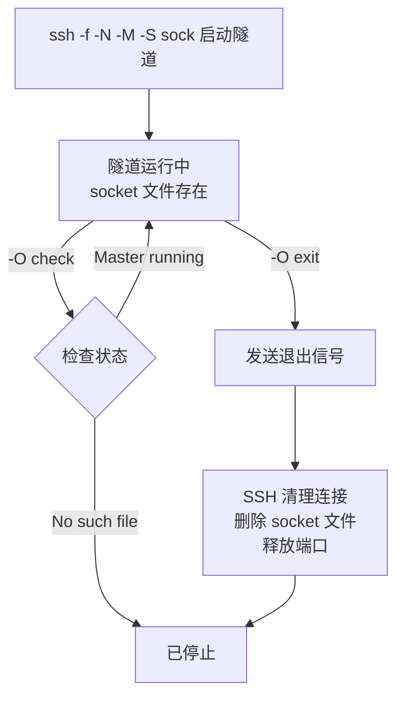
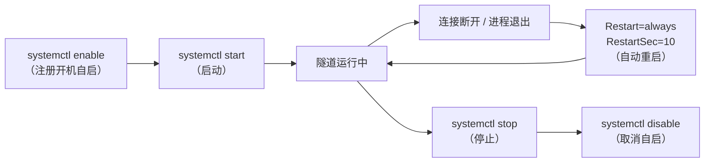
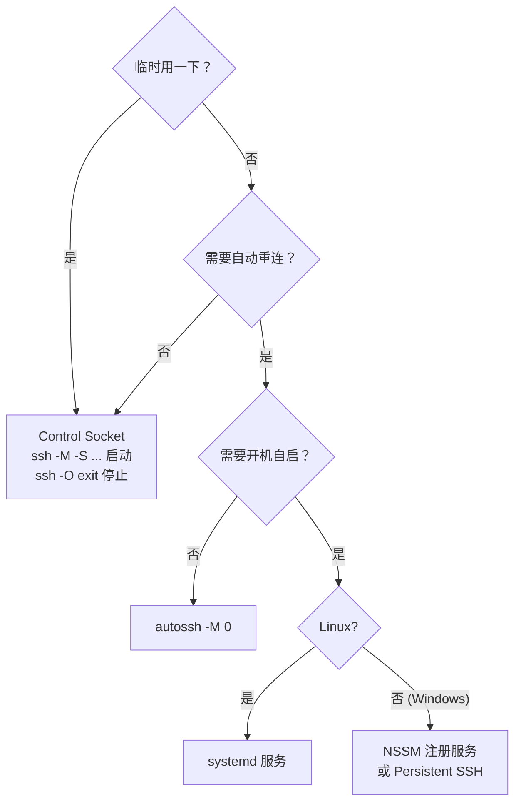

[toc]


## SSH 隧道的生命周期管理

SSH 隧道是一种持有系统资源（进程、端口、网络连接）的运行时实体。如果只管"开"不管"关"，日积月累会留下僵尸进程、端口占用、连接泄漏。下面从最基础到最完善，逐级介绍管理方式。

---

### 问题的根源：后台隧道的"失控"

当你用 `-f` 把隧道送入后台后，SSH 进程脱离了你的终端，变成了一个"你知道它在，但不好精确控制"的东西：

```bash
# 建立隧道，进入后台
ssh -f -N -L 5433:db.internal:5432 user@bastion
```

此时你面临的问题：

- 怎么**确认**它还活着？
- 怎么**干净地停止**它？
- 如果网络断了，它会**自动恢复**吗？
- 多条隧道同时运行时，怎么**分别管理**？

---

### 方案总览

从简单到完善，有五种管理手段：

| 方案                          | 适用场景             | 启动控制 | 停止控制         | 自动重连     | 开机自启 |
| ----------------------------- | -------------------- | -------- | ---------------- | ------------ | -------- |
| 粗暴 `kill` PID               | 临时调试             | 手动     | 手动找 PID       | 无           | 无       |
| **Control Socket**（`-M -S`） | 日常使用（推荐入门） | 优雅     | 优雅             | 无           | 无       |
| **`autossh`**                 | 需要自动重连         | 自动     | 手动             | **有**       | 需配合   |
| **systemd 服务**              | 长期运行 / 服务器    | 自动     | `systemctl stop` | **有**       | **有**   |
| **systemd + autossh**         | 生产级可靠性         | 自动     | `systemctl stop` | **双重保障** | **有**   |

---

### 方案一：粗暴方式——`ps` + `kill`（不推荐，仅作为兜底）

```bash
# 找到隧道进程
ps aux | grep "ssh.*-L 5433"

# 或者更精确
pgrep -af "ssh.*5433:db.internal"

# 杀掉
kill <PID>
```

**问题**：

- 多条隧道时容易杀错
- 参数相似的隧道难以区分
- 无法优雅通知 SSH 清理资源
- 不推荐直接用 PID kill SSH 进程

---

### 方案二：Control Socket——优雅的启停控制（推荐日常使用）

OpenSSH 从 3.9 版本引入了多路复用（multiplexing）支持，你可以在后台启动一个 SSH 会话，然后像管理系统服务一样向它发送停止命令，只需要告诉 SSH 使用一个 Control Socket。

**核心思路**：`-M` 将 SSH 客户端置于"主模式"（master mode）用于连接共享；`-S` 指定一个 Control Socket 文件的路径。之后你可以通过这个 socket 文件对隧道执行检查、停止等操作。

#### 完整生命周期

**启动**：

```bash
ssh -f -N -T \
    -M -S ~/.ssh/tunnels/db-tunnel.sock \
    -L 5433:db.internal:5432 \
    -o ServerAliveInterval=30 \
    -o ServerAliveCountMax=3 \
    -o ExitOnForwardFailure=yes \
    user@bastion
```

各参数分工：

| 参数                               | 职责                             |
| ---------------------------------- | -------------------------------- |
| `-M`                               | 以 master 模式运行，创建控制通道 |
| `-S ~/.ssh/tunnels/db-tunnel.sock` | 指定 socket 文件路径（唯一标识） |
| `-f -N -T`                         | 后台、无命令、无终端             |
| `-o ExitOnForwardFailure=yes`      | 端口绑定失败立即退出，不静默失败 |

**检查状态**：

```bash
ssh -S ~/.ssh/tunnels/db-tunnel.sock -O check user@bastion
# 输出示例：Master running (pid=12345)
```

**优雅停止**：

```bash
ssh -S ~/.ssh/tunnels/db-tunnel.sock -O exit user@bastion
# 输出：Exit request sent.
```

执行 `ssh -S my-ctrl-socket -O exit user@host` 后，如果再次 `check` 会显示 "No such file or directory"，说明会话已成功终止。

**验证已释放端口**：

```bash
# 确认端口不再被占用
ss -tlnp | grep 5433
# 无输出说明已干净释放
```

#### 流程图



#### 写入 `~/.ssh/config` 简化管理

```
Host db-tunnel
    HostName        bastion.example.com
    User            deploy
    IdentityFile    ~/.ssh/id_ed25519
    LocalForward    5433 db.internal:5432
    # Control Socket 配置
    ControlMaster   auto
    ControlPath     ~/.ssh/tunnels/%r@%h-%p
    ControlPersist  10m
    # 保活
    ServerAliveInterval 30
    ServerAliveCountMax 3
    ExitOnForwardFailure yes
```

| 配置项               | 含义                                                     |
| -------------------- | -------------------------------------------------------- |
| `ControlMaster auto` | 自动判断是否需要建立 master 连接                         |
| `ControlPath`        | socket 文件路径模板（`%r`=用户名，`%h`=主机，`%p`=端口） |
| `ControlPersist 10m` | master 连接空闲 10 分钟后自动关闭（自动清理资源）        |

使用时：

```bash
# 启动
ssh -f -N db-tunnel

# 检查
ssh -O check db-tunnel

# 停止
ssh -O exit db-tunnel
```

> `ControlPersist` 是一个很实用的"安全网"——即使你忘了手动关隧道，它也会在空闲超时后自动断开，避免资源泄漏。

---

### 方案三：`autossh`——自动重连

普通 SSH 隧道在网络波动时会断开且**不会自动恢复**。`autossh` 是一个专门解决这个问题的包装工具。

`autossh` 自动化管理基于 SSH 的端口转发，它启动、监控并在隧道关闭时自动重启。

**安装**：

```bash
# Debian / Ubuntu
sudo apt install autossh

# RHEL / Fedora
sudo dnf install autossh

# macOS
brew install autossh
```

**基本用法**：

```bash
autossh -M 0 -f -N -T \
    -L 5433:db.internal:5432 \
    -o ServerAliveInterval=30 \
    -o ServerAliveCountMax=3 \
    -o ExitOnForwardFailure=yes \
    user@bastion
```

`-M 0` 的含义：将 `0` 传给 `-M` 会关闭 autossh 自身的监控循环，转而依赖 SSH 内置的 `ServerAliveInterval` 机制检测连接存活。`ServerAliveInterval` 使客户端按指定间隔（秒）向服务端发送保活空包并期望响应，`ServerAliveCountMax` 设定连续无响应的上限次数，超过后客户端自动断开并以非零状态退出，随后 autossh 会重启隧道。

**停止**：

```bash
# autossh 会把 ssh 作为子进程管理
# 杀 autossh 即可，它会自动清理子 ssh 进程
pkill -f "autossh.*5433:db.internal"
```

**注意**：在 systemd 服务中使用 autossh 时不要用 `-f` 参数，它会将 autossh fork 到后台，导致 systemd 误以为进程已结束。

---

### 方案四：systemd 服务——生产级管理（Linux）

使用 systemd 管理 SSH 隧道相比独立的 SSH 或 autossh 有几个优势：连接失败时自动重启，以及通过 SSH 的 `ServerAliveInterval` 和 `ServerAliveCountMax` 防止连接停滞。

这种方式甚至不依赖 autossh，纯用 systemd + ssh 就能实现持久化隧道并在断连时自动重启。

#### 纯 systemd + ssh（无需 autossh）

```ini
# /etc/systemd/system/ssh-tunnel-db.service

[Unit]
Description=SSH Tunnel to Internal Database
After=network-online.target
Wants=network-online.target

[Service]
Type=simple
ExecStart=/usr/bin/ssh \
    -N -T \
    -o ServerAliveInterval=30 \
    -o ServerAliveCountMax=3 \
    -o ExitOnForwardFailure=yes \
    -o StrictHostKeyChecking=accept-new \
    -i /home/deploy/.ssh/id_ed25519 \
    -L 5433:db.internal:5432 \
    deploy@bastion.example.com
Restart=always
RestartSec=10

# 安全加固
User=deploy
Group=deploy
NoNewPrivileges=yes

[Install]
WantedBy=multi-user.target
```

**管理命令**：

```bash
# 启用（开机自启）+ 立即启动
sudo systemctl enable --now ssh-tunnel-db

# 查看状态
sudo systemctl status ssh-tunnel-db

# 查看日志
journalctl -u ssh-tunnel-db -f

# 停止
sudo systemctl stop ssh-tunnel-db

# 禁用开机自启
sudo systemctl disable ssh-tunnel-db
```

systemd 在这里提供了完整的生命周期：



#### systemd + autossh（双重保障）

如果你希望更稳健（autossh 做应用层存活检测 + systemd 做进程级守护）：

```ini
# /etc/systemd/system/ssh-tunnel-db.service

[Unit]
Description=AutoSSH Tunnel to Internal Database
After=network-online.target
Wants=network-online.target

[Service]
Type=simple
Environment="AUTOSSH_GATETIME=0"
ExecStart=/usr/bin/autossh -M 0 \
    -N -T \
    -o ServerAliveInterval=30 \
    -o ServerAliveCountMax=3 \
    -o ExitOnForwardFailure=yes \
    -i /home/deploy/.ssh/id_ed25519 \
    -L 5433:db.internal:5432 \
    deploy@bastion.example.com
Restart=always
RestartSec=10
User=deploy

[Install]
WantedBy=multi-user.target
```

`AUTOSSH_GATETIME` 控制 SSH 会话需要建立多久才算真正成功（默认 30 秒）；使用 `-f` 参数时会自动设为 0。在 systemd 中设为 `0` 以确保首次连接失败时 autossh 不会直接退出，由 systemd 的 `Restart=always` 接管重试。

---

### 方案五：Windows 环境下的管理

Windows 上没有 systemd，对应方案有所不同：

| 需求     | Windows 方案                                                 |
| -------- | ------------------------------------------------------------ |
| 基本隧道 | OpenSSH（Windows 10+ 内置）或 PuTTY 的 `plink`               |
| 后台运行 | `Start-Process` (PowerShell) 或 NSSM 注册为服务              |
| 自动重连 | Persistent SSH 是一个 Windows 系统上的 SSH 隧道管理器，作为系统服务运行并在隧道断开时自动重启 |
| GUI 管理 | PuTTY + AutoPuTTY，或 Termius                                |

PowerShell 基本管理示例：

```powershell
# 启动隧道（后台）
$tunnel = Start-Process -NoNewWindow -PassThru ssh `
    "-N -T -L 5433:db.internal:5432 user@bastion"

# 记住 PID
$tunnel.Id

# 停止
Stop-Process -Id $tunnel.Id
```

用 NSSM 注册为 Windows 服务（类似 systemd 的效果）：

```powershell
# 安装 NSSM（可通过 scoop 或 choco）
scoop install nssm

# 注册服务
nssm install SSHTunnelDB "C:\Windows\System32\OpenSSH\ssh.exe" `
    "-N -T -L 5433:db.internal:5432 -i C:\Users\deploy\.ssh\id_ed25519 deploy@bastion"

# 管理
nssm start SSHTunnelDB
nssm stop SSHTunnelDB
nssm remove SSHTunnelDB
```

---

### 管理多条隧道的实践建议

当你同时维护多条隧道时，命名和组织变得很重要：

**Control Socket 方式——用有意义的 socket 路径**：

```bash
# 先确保目录存在
mkdir -p ~/.ssh/tunnels

# 每条隧道用描述性名称
ssh -f -N -M -S ~/.ssh/tunnels/db-prod.sock    -L 5433:db.internal:5432 user@bastion
ssh -f -N -M -S ~/.ssh/tunnels/redis-dev.sock   -L 6380:redis.dev:6379 user@bastion
ssh -f -N -M -S ~/.ssh/tunnels/web-staging.sock -L 8080:web.stg:80 user@bastion

# 一次查看所有隧道状态
for sock in ~/.ssh/tunnels/*.sock; do
    echo -n "$(basename "$sock"): "
    ssh -S "$sock" -O check user@bastion 2>&1
done

# 全部停止
for sock in ~/.ssh/tunnels/*.sock; do
    ssh -S "$sock" -O exit user@bastion 2>&1
done
```

**systemd 方式——每条隧道一个 unit 文件**：

```bash
# 命名规范
ssh-tunnel-db-prod.service
ssh-tunnel-redis-dev.service
ssh-tunnel-web-staging.service

# 批量管理
systemctl status 'ssh-tunnel-*'
systemctl stop 'ssh-tunnel-*'
```

---

### 总结：按场景选方案



**不论哪种方案，核心原则是一致的**：

1. **可标识**：每条隧道有唯一的名称或 socket 路径，你能明确知道"这条隧道是干什么的"
2. **可检查**：随时能查看隧道是否存活（`-O check` / `systemctl status`）
3. **可停止**：有明确的关闭手段，不依赖盲目 `kill`
4. **可恢复**：网络断开后能自动或半自动重建
5. **可清理**：不用的隧道及时关闭，释放端口和进程资源