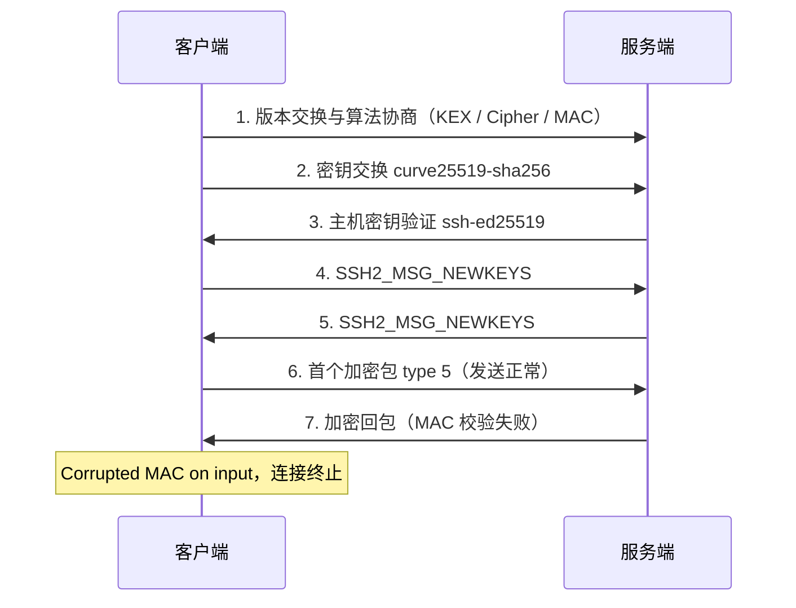

## SSH `Corrupted MAC on input` 排查记录

### 背景与结论

本次故障现象为 SSH 在加密传输阶段中断，报错如下：

```
Corrupted MAC on input.
ssh_dispatch_run_fatal: Connection to 192.xxx... port 20203: message authentication code incorrect
```

排查结论：密钥交换（KEX）正常，故障集中于特定加密与认证组合 `aes128-ctr + umac-128-etm`。通过更换该组合即可恢复连接，无须改动网络链路。

> **术语说明：本文的 MAC 指消息认证码（Message Authentication Code），用于校验数据完整性，与网卡 MAC 地址无关。**
>
> `Corrupted MAC on input` 表示：接收方对收到的数据包计算认证码，与发送方附带的认证码不一致，因此判定数据损坏或被篡改，主动终止连接。该机制属于 SSH 的完整性保护，而非网络连通性检测。

---

## 1. 环境

- 客户端：`OpenSSH_for_Windows_9.5p2, LibreSSL 3.8.2`
- 服务端：`OpenSSH_8.9p1 Ubuntu-3`
- 本地 `ssh -Q mac` 查询结果包含 `umac-*-etm, hmac-sha2-*-etm, hmac-sha2-*` 等

> **说明：**
>
> - `OpenSSH_for_Windows_9.5p2` 为 Windows 内置 SSH 客户端版本；`LibreSSL 3.8.2` 为其依赖的加密库版本。两者共同决定客户端支持的算法与具体实现。
> - `OpenSSH_8.9p1 Ubuntu-3` 为 Ubuntu 22.04 默认搭载的服务端版本，属于较旧版本。
> - `ssh -Q mac` 的作用是列出本地支持的消息认证码算法，用于确认协商候选项范围，不代表连接实际使用的算法。

### 1.1 术语速查

| 术语 | 全称 | 作用 |
| --- | --- | --- |
| KEX | Key Exchange，密钥交换 | 通信双方在不直接传输密钥的前提下，协商出一致的会话密钥。本次使用 `curve25519-sha256@libssh.org`。 |
| Host Key | 主机密钥 | 服务端身份标识，客户端首次连接时确认并缓存，用于防范中间人攻击。本次为 `ssh-ed25519` 类型。 |
| Cipher | 对称加密算法 | 对认证完成后的应用数据进行加密。本次涉及 `aes128-ctr`、`aes256-ctr`、`aes128-gcm@openssh.com`。 |
| MAC | Message Authentication Code，消息认证码 | 对数据包进行完整性校验。本次涉及 `umac-128-etm@openssh.com`、`hmac-sha2-256` 等。 |
| ETM | Encrypt-then-MAC，先加密后认证 | MAC 计算对象为加密后的数据包，为 OpenSSH 当前默认模式。非 ETM 模式则先认证后加密。 |
| AEAD | Authenticated Encryption with Associated Data，带关联数据的认证加密 | 加密与完整性校验一体化的算法，使用此类 Cipher 时无须单独协商 MAC，例如 `aes128-gcm@openssh.com`、`chacha20-poly1305@openssh.com`。 |

---

## 2. 复现与定位

使用以下命令复现，并输出详细协商日志：

```powershell
ssh -vvv -o BatchMode=yes -o ConnectTimeout=15 root@192.xxx.xxx.xxx -p 20203
```

> **参数说明：**
>
> - `-vvv`：输出三级详细日志，用于观察算法协商、密钥交换与认证各阶段。
> - `-o BatchMode=yes`：禁止交互式输入密码，适用于脚本与故障复现。若认证未配置密钥，将直接返回 `Permission denied`，而非等待输入。
> - `-o ConnectTimeout=15`：连接超时时间为 15 秒，避免在网络不可达时长时间等待。

复现结果：

- `KEX` 成功：`curve25519-sha256@libssh.org`，host key `ssh-ed25519`
- 协商结果：`server->client cipher: aes128-ctr MAC: umac-128-etm@openssh.com`
- `SSH2_MSG_NEWKEYS` 双向成功
- 客户端发出首个加密包 `type 5` 后，服务端回包 MAC 校验失败

> **分步说明：**
>
> - `KEX 成功`表示双方已协商出一致的会话密钥，密钥交换算法本身无异常。
> - `server->client cipher ... MAC ...` 表示服务端至客户端方向选定的加密与认证组合，即后续服务端回包的保护方式。
> - `SSH2_MSG_NEWKEYS` 为密钥交换结束标志，双向成功表示双方均确认启用新密钥，进入加密传输阶段。
> - `type 5` 为加密通道建立后的首个服务请求包。该包发送成功，表明客户端至服务端方向正常；随后服务端回包校验失败，表明故障位于服务端至客户端方向。

SSH 建连流程与故障点如下：



结论：密钥交换正常，加密传输阶段服务端至客户端方向损坏，问题集中在 `Cipher/MAC` 组合。

> **方向说明：**
>
> - **Inbound（入站）**：从外部进入观察主体的流量。在本案例的客户端日志视角下，指服务端返回至客户端的数据包。
> - **Outbound（出站）**：从观察主体发往外部的流量。在本案例中，指客户端发送至服务端的数据包。
> - 因此，“inbound 方向损坏”在此特指 `server->client` 方向的回包未能通过完整性校验，而非泛指服务端防火墙入站规则。

---

## 3. 对比测试

| 测试 | 参数 | 结果 | 含义 |
| --- | --- | --- | --- |
| 默认 | `aes128-ctr + umac-128-etm` | 失败，`Corrupted MAC` | 命中故障组合，传输层中断 |
| test1 | `-o Ciphers=aes256-ctr -o MACs=hmac-sha2-256` | 成功，进入认证阶段，返回 `Permission denied (publickey,password)` | 更换加密与认证组合后传输正常；`Permission denied` 仅表示 BatchMode 下无可用密钥，属预期现象 |
| test2 | `-o Ciphers=aes128-gcm@openssh.com` | 成功，进入认证阶段，同上 | AEAD 算法一体完成加密与校验，不依赖独立 MAC，传输正常 |
| test3 | `-o Ciphers=chacha20-poly1305@openssh.com` | 协商失败 | 服务端不支持该算法，双方无交集，连接无法建立，属预期现象 |

上述结果表明：故障并非全链路网络损坏，而是由特定 `umac-*-etm` 组合触发。

> **SSH 建连阶段说明：**
>
> 1. **版本交换**：双方确认协议版本。
> 2. **算法协商**：协商 KEX、Cipher、MAC、压缩等算法。
> 3. **密钥交换**：基于 KEX 生成会话密钥。
> 4. **认证**：校验用户身份，例如公钥或密码。
> 5. **加密数据传输**：后续命令、输出与文件内容均受 Cipher 与 MAC/AEAD 保护。
>
> 其中，Cipher 决定应用数据的加密方式，MAC（或 AEAD 内置校验）决定完整性校验方式。对比测试中 test1 与 test2 能够到达第 4 步，即证明第 2 步选出的新组合在第 5 步可正常传输。

---

## 4. 客户端 workaround（立即恢复登录）

```powershell
ssh -o Ciphers=aes256-ctr -o MACs=hmac-sha2-256 root@192.xxx.xxx.xxx -p 20203
# 或选用 AEAD，无须单独指定 MAC：
ssh -o Ciphers=aes128-gcm@openssh.com root@192.xxx.xxx.xxx -p 20203
```

> **说明：**
>
> - `-o Ciphers=... -o MACs=...` 仅对本次连接生效，用于限定算法候选范围，从而避开默认优先命中的 `umac-*-etm`。
> - 第二条命令选用 AEAD 算法时，加密与校验一体化，`MACs` 参数不再起作用，因此无须指定。

如需长期生效，写入 `C:\Users\Administrator\.ssh\config` 的 `Host barevps` 段：

```
Host barevps
  HostName 192.xxx.xxx.xxx
  Port 20203
  User root
  Ciphers aes128-gcm@openssh.com,aes256-gcm@openssh.com,aes256-ctr,aes128-ctr
  MACs hmac-sha2-256,hmac-sha2-512,hmac-sha2-256-etm@openssh.com,hmac-sha2-512-etm@openssh.com
```

> **说明：**
>
> - `Host barevps` 为配置别名，后续可使用 `ssh barevps` 直接连接，别名内各字段分别对应主机名、端口、用户名与算法偏好。
> - 上述列表已排除 `umac` 系列，客户端在协商时将仅从剩余算法中选择。

---

## 5. 服务端根治（让所有客户端更容易连）

OpenSSH 算法协商规则为：按客户端列表顺序，选取双方支持列表的第一个交集。因此，仅调整服务端顺序无法避开客户端首选的 `umac`，必须从服务端可用列表中移除 `umac`。

`/etc/ssh/sshd_config`：

```
MACs hmac-sha2-512-etm@openssh.com,hmac-sha2-256-etm@openssh.com,hmac-sha2-512,hmac-sha2-256
Ciphers aes256-gcm@openssh.com,aes128-gcm@openssh.com,aes256-ctr,aes128-ctr
```

生效：

```bash
sshd -t && systemctl reload sshd
sshd -T | grep -Ei '^(macs|ciphers)'
```

> **命令说明：**
>
> - `sshd -t`：检查配置文件语法，语法正确时无输出。
> - `systemctl reload sshd`：重载配置，已建立的连接不受影响；区别于 `restart`，后者将中断现有连接。
> - `sshd -T`：输出当前生效配置，结合 `grep` 确认 `MACs` 与 `Ciphers` 已按预期加载。

注意：保留一个可用会话再 reload，防止配错锁死；先用第 4 节 workaround 连上去再改。

---

## 6. 升级建议

1. 优先升级 Windows 客户端 `9.5p2`，`umac-etm` 异常更可能源于客户端实现。本项为基于对比测试的推断，尚未进行代码级定位。
2. 服务端 `8.9p1` 为 Ubuntu 22.04 默认版本，有条件可升级到 Ubuntu 24.04 / OpenSSH 9.6 及以上版本，以获得更新的算法支持与缺陷修复。
3. 改配置无安全损失，`hmac-sha2 / gcm` 均为当前主流安全算法，与 `umac` 同属受认可的消息认证与认证加密机制，调整仅改变协商优先级，不降低保护强度。
