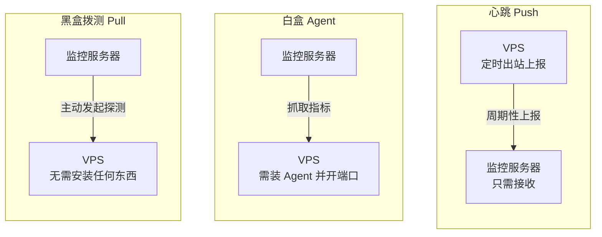
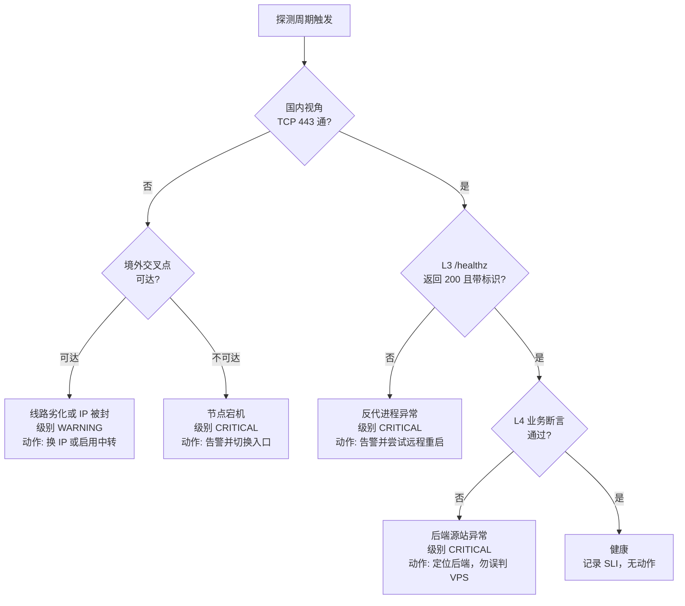

[toc]

## 本篇的定位

面向"一台稳定监控服务器 + 一批境外反向代理 VPS + 后端源站，由国内运维"的场景，给出**监控什么、分几层、选什么工具、怎么告警、怎么验收**的整体设计。

工具的具体部署与配置拆到子文档，本篇只给设计与裁决结论：

| 子文档 | 解决的问题 |
| --- | --- |
| `VPS存活监控@Uptime Kuma部署与检查项.md` | 用网页点选方式建起可用的监控中心 |
| `VPS存活监控@Gatus部署与配置.md` | 用声明式配置管住批量节点与健康判据 |
| `VPS存活监控@探测脚本与systemd调度.md` | 与主监控解耦的兜底实现 |
| `nezha监控使用指南.md` | 需要主机资源指标与中文面板时的专项手册 |

**时效说明**：本篇事实性内容核验时点为 2026-09 至 2026-11，版本号、星标数、免费额度一类会过期且来源互相矛盾的数字已删除或降级为定性表述，未解决项集中列在 **待确认事项**。

## 术语与范围

**拨测(active probing)** 指通过模拟用户的真实访问行为，判断网络、服务或应用是否可用。它起源于电信行业的"拨号测试"，现在泛指从用户视角发起的主动探测，与"等用户报障或等服务器自己报警"的被动监控相对。

**本篇覆盖**：机器活着没、反代还能不能代理、用户此刻能不能真正访问到网站、资源是否即将耗尽、线路是否劣化。

**本篇不覆盖**：应用内部性能剖析、日志与链路追踪、业务指标的容量规划。

| 术语 | 含义 |
| --- | --- |
| **Pull(拉取探测)** | 监控端主动向目标发起探测，目标无需安装任何东西 |
| **Push(心跳上报)** | 被监控端定期向监控端"报平安"，超时未报即告警，也就是**死人开关(dead man's switch)** |
| **Liveness(存活)** | 机器或进程还在运行 |
| **Readiness(就绪)** | 进程能正常处理真实请求 |
| **SLI(服务等级指标)** | 用于衡量服务质量的量化指标，如可用率、响应耗时 |
| **探测锚定** | 强制把某个域名解析到指定 IP，使本次探测只命中目标那一台机器 |

## 一个失败信号背后是几类不同的事件

把"检测 VPS 是否存活甚至健康"当成一件事做，是自建监控失败的主要原因。它实际包含彼此独立的问题：**机器还在吗**(主机层)、**代理进程还在正常代理吗**(服务层)、**用户此刻真的能访问到吗**(体验层)。

同一组探测结果对应多种完全不同的故障，必须先能分辨，才谈得上处置：

| 实际故障 | Ping | TCP 443 | HTTP 健康检查 | 主机指标 |
| --- | --- | --- | --- | --- |
| VPS 关机、内核崩溃 | 通常失败 | 失败 | 失败 | 无法获取 |
| ICMP 被禁用 | 失败 | 可能正常 | 可能正常 | 正常 |
| Nginx 进程停止 | 可能正常 | 可能失败 | 失败 | 可显示异常 |
| Nginx 正常、源站不可达 | 正常 | 正常 | 可能返回 502/504 | 可能正常 |
| 返回 200 但实际是错误页 | 正常 | 正常 | 只看状态码会误判 | 可能正常 |
| CPU 或内存压力过高 | 可能正常 | 可能正常 | 可能变慢 | 可能提前预警 |
| 监控端到 VPS 的网络异常 | 可能失败 | 可能失败 | 可能失败 | 可能失联 |
| 用户所在运营商线路异常 | 可能正常 | 可能正常 | 可能正常 | 正常 |

两条据此推出的硬规则：**不要仅凭 Ping 失败就判定宕机**；**不要仅凭 200 就断定业务正常**。有价值的目标不是"报出故障"，而是**报出故障发生在哪一层**。

## 监控分层：从网络可达到业务真实可用

| 层级 | 名称 | 探测内容 | 典型手段 | 业务价值 | 误报敏感度 |
| --- | --- | --- | --- | --- | --- |
| **L0** | 网络可达 | ICMP 回显 | `ping`、`fping` | 可选 | 极高(ICMP 常被限速或丢弃) |
| **L1** | 端口存活 | TCP 三次握手(443/80) | `nc`、`curl telnet://`、Gatus `tcp://` | 必备 | 中 |
| **L2** | 传输层健康 | TLS 握手成功、证书剩余有效期、SNI 匹配 | `openssl s_client`、`[CERTIFICATE_EXPIRATION]` | 推荐 | 低 |
| **L3** | 反代自身健康 | 反代专用 `/healthz` 返回 200 且带标识字段 | HTTP 探测 + 断言 | 最高 | 低 |
| **L4** | 端到端业务 | 经反代打到真实后端，断言业务 JSON 或关键字 | HTTP 关键字/JSON 查询 | 最高 | 中 |
| **L5** | 主机资源 | CPU、内存、磁盘、负载、连接数、周期流量 | 心跳上报、node_exporter、Agent | 推荐 | 低 |
| **L6** | 链路质量 | 丢包率、RTT 抖动、路由变化、分省可达性 | SmokePing、多地探测点 | 按需 | 趋势型，不报警 |

**业务价值**一列按"能回答用户最关心的问题"排序，**误报敏感度**一列按"多容易被环境因素干扰"排序，两者结论不同：L0 便宜但几乎不可用，L3/L4 成本略高却直接对应真实故障。因此默认策略是**关掉 L0、以 L1 起步、把 L3 与 L4 当作主判据**。

**配置语义**：`level=N` 表示"启用 L1 到 LN 的全部检查"，L0 仅作可选补充。改一个整数即可在"最省事"与"最全面"之间滑动：

- **轻度使用**：`level=3`(TCP + TLS + 反代健康端点)。覆盖多数真实宕机场景，误报极低。
- **生产使用**：`level=4` 加 L5 心跳。补上业务真实性验证与"即将出问题"的预警。
- **多节点长期运营**：`level=5` 加 L6 趋势分析，进入容量规划与线路优化。

早期材料的层级编号不一致，对照关系如下，避免引用旧稿时对不上：

| 本篇 | 旧稿的"四层"编号 | 旧稿的"三层"编号 |
| --- | --- | --- |
| L1 端口存活 | L1 网络存活 | L1 存活探测 |
| L2 传输层健康、L3 反代自身 | L2 服务存活 | L2 服务健康 |
| L4 端到端业务 | L3 链路健康 | — |
| L5 主机资源 | L4 资源健康 | L3 资源健康 |
| L0、L6 | — | — |

## 采集范式：Pull、Agent 与 Push

数据往哪个方向流动，决定了防火墙策略、攻击面与可靠性上限。



三类范式各自解决不同问题，不是替代关系。

| 维度 | 黑盒拨测(Pull) | 白盒 Agent | 心跳推送(Push) |
| --- | --- | --- | --- |
| 被监控端需安装 | **无需** | 需要 Agent 或 exporter | 仅需 `curl` 与定时器 |
| 网络方向 | 监控端到 VPS(入站) | 监控端到 VPS(入站) | VPS 到监控端(**出站**) |
| 防火墙要求 | 开放业务端口(本来就开) | **需额外开放端口** | **零额外入站** |
| 能获取的信息 | L0 至 L4(外部可见的) | L0 至 L5 全量 | L5 为主，L1 至 L4 需自测后上报 |
| 视角真实性 | **最接近真实用户** | 机器内部视角，可能"自我感觉良好" | 内部视角 |
| 失效模式 | 网络断则立刻发现 | 同左 | 机器死透则心跳停止，**延迟一个周期**才发现 |
| 对线路封锁的敏感度 | 高，容易误报 | 高 | 低，出站通常更畅通 |
| 安全风险 | **最低** | 中到高 | 低 |

**推荐组合**：以**黑盒拨测为主干**(真实、零侵入、零攻击面增量)，以**心跳推送补 L5**(避免为了看磁盘占用而开放 exporter 端口)，仅在确有深度排障需求时才引入白盒 Agent 且必须走内网隧道(WireGuard、Tailscale、Cloudflare Tunnel)，**绝不裸奔公网**。

还有一条不能省的认识：**外部探测与内部指标不能互相替代**。VPS 完全失联时 Agent 也送不出数据；反过来，主机指标正常也不能证明用户访问得到。两套信号必须并存。

### 探针 Agent 的安全边界

这是本方案中风险最高的一处，需要在选型阶段就明确。

探针类工具(哪吒、Komari、Beszel、Checkmate 的 Agent)不只是遥测，它们的**功能集天然就构成一条双向控制通道**：远程命令执行、WebSSH、交互式终端、文件管理。这些能力在正常运维中是便利，在凭据泄露之后就是现成的后门载体。

安全厂商 Huntress 公开记录过真实案例：2026 年 4 月，攻击者利用窃取的 VPN 凭据横向移动后，借 Komari agent 投放了 SYSTEM 级后门，且未使用任何恶意基础设施即完成投放。哪吒亦曾被该机构列为特定威胁行为者使用的工具。

这不等于说这些项目是恶意软件，它们是正当的开源项目，问题在于能力与需求的错配。据此有三条硬性建议：

- **只要"看 VPS 活没活"，就不要装带 WebSSH 或远程执行能力的 Agent**。收益与风险严重不匹配，用黑盒拨测加心跳即可。
- 若确实要用面板，**关闭远程终端与在线任务执行**(哪吒用 `disable_command_execute`、`disable_nat`)，面板置于 IP 白名单或 Cloudflare Access 之后，启用强密码与 2FA。
- **锁定版本、订阅安全公告**，不用 `latest` 一键脚本无脑跨大版本升级。

## 国内视角的特殊性：区分"被墙"与"宕机"

对境外 VPS 而言，"从国内探测不通"和"VPS 坏了"是两个完全不同的事件，却在最简单的 `ping` 监控里长得一模一样。方案的核心难点不是"怎么探测"，而是**怎么区分这两者，避免每天几十条误报把人训练成对告警免疫**。

判定依赖**双视角**：一个探测点代表国内真实用户体验，另一个在境外代表 VPS 的客观状态。二者结果的**差异本身就是诊断信号**。



与"随便装个面板"的本质区别在于：这张树把**一个失败信号分解成语义不同的故障**，每种对应不同的严重级别与处置动作。L5 资源水位不参与这张树——它属于"即将出问题"的预警，走独立的阈值告警，不与可用性判定混在一起。

## 工具选型

下表按"能覆盖哪些层"和"运维代价"排列，同一格里的多个项目可互换。

| 方案 | 类型与覆盖 | 配置方式 | 优势 | 局限 | 结论 |
| --- | --- | --- | --- | --- | --- |
| **Gatus** | 黑盒 + 心跳，L1 至 L5 | **YAML(可进 Git)** | 健康判据是表达式，能断言状态码、耗时、证书有效期、JSON 字段；单 Go 二进制，资源占用极低；原生 `failure-threshold` 抖动抑制 | 无 Web 编辑界面，非工程师难以维护；无主机资源指标 | **首选之一(声明式)** |
| **Uptime Kuma** | 黑盒 + 心跳，L1 至 L4 | **Web UI 点选** | 上手最快，通知渠道覆盖广且含国内渠道，自带状态页，最短间隔 20 秒 | 单实例无高可用；无主机资源指标；SQLite 规模有上限；配置不在 Git 里 | **首选之一(易用)** |
| **Prometheus + Blackbox Exporter + Alertmanager + Grafana** | 黑盒 + 白盒，L0 至 L6 全覆盖 | YAML + PromQL | 分位数统计、长期趋势、多维标签、告警抑制与静默，能力天花板最高 | 组件多、心智负担重，对一批 VPS 属过度设计 | 进阶 |
| **Zabbix** | 白盒为主，L0 至 L6 | Web UI + 模板 | 企业级、中文完善、Web 场景监控成熟 | 重，需要数据库与专职维护 | 大规模时再考虑 |
| **Netdata** | 白盒，L5 为主 | 自动发现 | 实时性能剖析能力强，是排障利器 | 单机开销明显，不是拨测工具 | 专用(诊断) |
| **Beszel** | 白盒，L5 为主 | Hub + Agent，Web UI | 极轻量，含容器状态与主机指标，官方便有中文界面；Agent 还能发起 ICMP/TCP/HTTP/DNS 探测，辅助观察各 VPS 到源站的质量 | 需在每台 VPS 装 Agent；不做端到端业务断言 | **资源层首选** |
| **哪吒监控 / Komari** | 白盒面板，L1、L5、L6 | Web UI | 中文原生，含月流量统计、到期提醒、分省延迟图，一套面板管全部机器 | Agent 是双向控制通道，安全面最大；端到端断言能力弱 | 需要中文面板与资源指标时 |
| **Checkmate** | 白盒 + 端点，L1 至 L5 | Web UI + Capture Agent | 端点监控与主机指标统一在一个现代化面板 | 依赖 Node.js 与 MongoDB，栈比前两者重；成熟度较新 | 想要一体化面板时 |
| **Monit** | 本机自检，L5 | 本机配置文件 | 进程、文件、服务检查并**自动恢复**，适合本机故障自愈 | 只能看自己，机器宕机时发不出告警 | 补充(本机自愈) |
| **SmokePing** | 链路质量，L6 | 配置文件 + RRDtool | 长期延迟、抖动、丢包分析专业 | 不能代替业务健康检查 | 专用(线路诊断) |
| **Apache HertzBeat** | 多协议，L1 至 L6 | Web UI + YAML 模板 | 中文友好、协议覆盖广、支持分布式采集 | 平台化程度高，初期成本不低 | 平台化备选 |
| **纯 Shell 脚本 + systemd timer** | 黑盒，按需 L1 至 L5 | CLI 参数或环境变量 | 零第三方依赖，完全透明可控，资源占用趋近于零 | 无历史曲线与界面，扩展全靠自己维护 | **兜底与第二实现** |
| **外部 SaaS**(UptimeRobot、BetterStack、Healthchecks.io) | 黑盒或心跳，L1 至 L4 | 托管 Web UI | 零部署，多地探测点，**监控自身挂了它是唯一还能通知你的东西** | 探测点在境外，免费档间隔长，数据出境 | **必有(第二只眼睛)** |
| **Upptime** | 黑盒，L1 至 L3 | 仓库内 YAML | 零服务器成本 | 受 GitHub Actions 调度限制，间隔与稳定性都不够 | 不推荐 |
| **宝塔面板告警 / 堡塔云监控** | 本机自检 / 面板 + 被控端 | Web UI | 面板告警原生中文、通道齐全；堡塔云监控思路接近哪吒，可作为国内替代 | 面板告警只能看自己，宕机时一起失联 | 已有宝塔时顺手开启 |

### 声明式与界面式：两类首选的分工

Gatus 与 Uptime Kuma 都常被推荐，早期材料甚至给出相反的首选结论，原因不在"谁更好"，而在**前提不同**：Gatus 假设使用者愿意把监控清单当代码管理、节点规模会持续增长；Uptime Kuma 假设使用者只想尽快看到"通不通"，维护检查项的人不写 YAML。

- **Uptime Kuma 的定位**是"自托管拨测的默认选项"：一个容器加内置 SQLite，就有多协议检查、通知、状态页与历史曲线。它不适合承担主机资源监控，Ping 延迟图也不等于专业的丢包与抖动分析。
- **Gatus 的定位**是"工程师友好的声明式方案"：加一台 VPS 就是复制一段 YAML，断言可以写成 `[STATUS] == 200`、`[RESPONSE_TIME] < 1500`、`[CERTIFICATE_EXPIRATION] > 336h`、`[BODY].role == edge`。它的短板是没有 Web 编辑界面——配合 Git 与 CI 时这反而是优点。

两者不冲突，分工方式见下一节。

### 已有宝塔面板时的取舍

宝塔的面板自带「告警设置」，通道齐全(微信公众号、邮箱、钉钉、企业微信、飞书、Webhook)，但它**只能监控自己**：机器宕机或断网时，告警模块跟着停止，什么也发不出去。用分层模型来说，它只覆盖 L5，而且是最需要它的时候恰好失效。

「堡塔云监控」是另一款产品，采用主控端加被控端结构，思路接近哪吒，可以当作国内替代品。

| 维度 | 宝塔面板告警 | 堡塔云监控 | 哪吒监控 | Uptime Kuma |
| --- | --- | --- | --- | --- |
| 判断 VPS 是否存活 | 不能 | 能(靠心跳) | 能(靠心跳) | 能(主动探测) |
| 检查完整反代链路 | 部分 | 未核实 | 能 | 能，而且最擅长 |
| CPU、内存、磁盘 | 能 | 能 | 能 | 不能 |
| VPS 上要装什么 | **整个面板**(最重) | 被控端 | 被控端 | **什么都不用装** |
| 中文支持 | 原生中文 | 原生中文 | 原生中文 | 有中文界面 |

结论很直接：**VPS 上已经装了宝塔**，可以顺手打开面板告警，覆盖磁盘、负载、服务停止、证书到期这类问题，作为免费补充；但宕机判定仍必须由外部探测负责。**VPS 上没有装宝塔**，就不要为了监控专门装它——反代节点应保持精简，整个面板占资源、增加攻击面，也多了维护负担。

另外两条与安全有关：搜索这类方案时容易碰到「宝塔开心版」「纯净版」一类站点，那是破解版或第三方修改版，**生产环境不要用**；堡塔云监控是否靠心跳超时判离线，来源未核实，选它之前需实测。

## 结论：按实际需求直接选

| 你的实际偏好 | 最值得考虑的方案 |
| --- | --- |
| 完全不希望在 VPS 上安装任何东西 | Uptime Kuma 或 Gatus |
| 希望通过浏览器管理所有检查项 | Uptime Kuma |
| 希望监控配置纳入 Git 并自动部署 | Gatus |
| 节点多、需要批量生成监控项 | Gatus |
| 需要知道 CPU、内存、磁盘是否异常 | Gatus 或 Uptime Kuma 加 Beszel |
| 主要担心跨国线路抖动、间歇性丢包 | SmokePing 或 Beszel 的 Agent 端网络探测 |
| 需要百分位延迟与长期趋势分析 | Prometheus 加 Blackbox Exporter 加 Grafana |
| 需要中文面板统一管全部机器 | 哪吒监控或 Komari |
| 只想尽快跑起来、能报警就算达标 | Uptime Kuma |

**共同的底盘**不论选哪个工具都必须有，否则再好的面板也只能告诉你"坏了"，不能告诉你"哪里坏了"：

- 探测目标**锚定到具体节点**，不能测 DNS 指向的"某一台"。
- 每台 VPS 提供**不回源的 `/healthz`**，把代理进程故障与源站故障分开。
- **连续失败阈值防抖**，国内到境外的链路建议三次以上。
- **境外交叉探测点**，用来区分被墙与宕机。
- 面板与管理端口**不裸露公网**。

## 渐进式落地

不建议一开始就上 Zabbix 或完整 Prometheus 栈。核心需求是可用性监控、问题早发现与基础定位，轻量工具能以更低维护成本先覆盖主要风险。

| 阶段 | 动作 | 目标 | 建议组件 |
| --- | --- | --- | --- |
| **先建可用性监控** | 每台 VPS 建 Ping 与 TCP 检查，各核心站点建 HTTP 健康检查，配好通知 | 准确知道哪台代理、哪个业务异常 | Uptime Kuma，或 Gatus 加脚本 |
| **再补资源与链路** | 关键 VPS 装 Agent，采集 CPU、内存、磁盘、容器；必要时加 VPS 到源站的探测 | 从"知道坏了"升级到"知道可能因为什么坏了" | Beszel，或哪吒 |
| **最后加独立观测** | 接入托管监控或第二地区探测点，定期做模拟故障演练 | 消除单一监控位置的盲区与误判 | 外部 SaaS 加境外廉价 VPS |

规模与形态的对应关系可以更直接一些：

| 场景 | 形态 |
| --- | --- |
| 1 至 3 台，要求快速上手 | Uptime Kuma 单体，加外部 SaaS 兜底 |
| 3 至 10 台，追求配置即代码 | Gatus 加心跳加境外交叉点加 SaaS 兜底 |
| 10 台以上，或需要 SLO 报表与容量规划 | Prometheus 栈，存储层可用 VictoriaMetrics 替代 |

## VPS 侧改造：健康端点与探测锚定

监控信息质量的上限不在监控工具，而在**被监控侧怎么答**。若 `/healthz` 只返回一个空的 200，L3 检查就退化成了 L1。

### 两条必须分开的健康检查路径

- **代理自身健康检查**：由 Nginx 或 Caddy 本地直接响应，判断代理服务是否工作。
- **端到端健康检查**：请求穿过代理到达后端业务，判断整条路径是否工作。

两条都保留，才能区分"代理进程故障"与"源站或业务故障"。端到端检查应覆盖至少一个关键依赖，但不要让健康接口执行重型数据库查询或产生业务副作用；启用 CDN 缓存的服务还要保证健康检查不会被缓存的旧结果误导。

返回体应带可识别字段，而不是空 200：

```json
{
  "status": "ok",
  "service": "main-api",
  "role": "edge"
}
```

这些是示例字段，不是任何监控工具强制要求的协议；关键是自己能据此断言，例如 `[BODY].role == edge` 可以证明"是反代自己答的，不是后端或错误页"。

### Caddy 配置示例

Caddy 开源版即带主动健康检查，对个人用户最友好：

```caddyfile
hk01.example.com {
    # 健康端点：仅对携带正确令牌的请求返回详情
    handle /healthz {
        @authed header X-Probe-Token "{env.PROBE_TOKEN}"
        handle @authed {
            respond `{"role":"edge","node":"hk01","status":"ok"}` 200 {
                close
            }
        }
        respond 404
    }

    # 业务反代：带主动健康检查的负载均衡
    reverse_proxy backend-a.internal:8080 backend-b.internal:8080 {
        lb_policy       least_conn
        health_uri      /api/health
        health_interval 10s
        health_timeout  3s
        health_status   2xx
        fail_duration   30s
    }
}
```

### Nginx 配置示例

```nginx
server {
    listen 443 ssl http2;
    server_name hk01.example.com;

    # L3 健康端点：本地直接返回，不打到后端
    location = /healthz {
        access_log off;
        default_type application/json;
        return 200 '{"role":"edge","node":"hk01","status":"ok"}';
    }

    # 反代指标（仅本机可读）
    location = /nginx_status {
        stub_status;
        allow 127.0.0.1;
        deny all;
    }

    location / {
        proxy_pass http://backend_pool;
        proxy_set_header Host              $host;
        proxy_set_header X-Real-IP         $remote_addr;
        proxy_set_header X-Forwarded-For   $proxy_add_x_forwarded_for;
        proxy_set_header X-Forwarded-Proto $scheme;
        proxy_next_upstream error timeout http_502 http_503 http_504;
    }
}

upstream backend_pool {
    server backend-a.internal:8080 max_fails=3 fail_timeout=30s;
    server backend-b.internal:8080 max_fails=3 fail_timeout=30s backup;
    keepalive 32;
}
```

### 主动检查与被动检查的差别

这直接决定"后端挂了反代能不能自动摘除"。

| 反向代理 | 被动健康检查 | 主动健康检查 | 说明 |
| --- | --- | --- | --- |
| **Nginx 开源版** | 支持(`max_fails` 加 `fail_timeout`) | **不支持** | 主动检查属 Nginx Plus 商业特性，开源版需第三方模块或改用 OpenResty |
| **Caddy 2** | 支持(`fail_duration`) | **支持**(`health_uri` 等) | 开源即完整能力 |
| **Traefik** | 支持 | **支持**(`healthCheck`) | 容器化场景自动发现能力强 |
| **HAProxy** | 支持 | **支持** | 四层与七层负载均衡的事实标准 |

**被动检查**的含义是：只有当真实用户请求打过去失败了，反代才知道这个后端有问题——也就是说**第一批用户必然报错**。**主动检查**则由反代自己定期探测，故障后端在用户感知前就被摘除。后端有多个实例且追求高可用时，优先选 Caddy 或 Traefik；必须用 Nginx 开源版时，把主动检查的职责交给外部监控加自动化脚本补上，这也是 L4 存在的意义之一。

### 带资源信息的增强端点

用一个极小的脚本定时生成静态 JSON，由反代直接 `alias` 出去，零常驻进程、零额外端口：

```bash
#!/usr/bin/env bash
# /usr/local/bin/gen-health.sh —— 每分钟由 systemd timer 触发
set -euo pipefail

OUT=/var/www/health/healthz.json
TMP=$(mktemp)

disk=$(df -P / | awk 'NR==2{gsub("%","",$5); print $5}')
mem=$(free | awk '/^Mem:/{printf "%.0f", $3/$2*100}')
load1=$(awk '{print $1}' /proc/loadavg)
proxy_up=$(systemctl is-active --quiet nginx && echo true || echo false)
uptime_s=$(awk '{printf "%d", $1}' /proc/uptime)

cat > "$TMP" <<EOF
{
  "role": "edge",
  "node": "$(hostname)",
  "status": "ok",
  "proxy_up": ${proxy_up},
  "disk_used_pct": ${disk},
  "mem_used_pct": ${mem},
  "load1": ${load1},
  "uptime_seconds": ${uptime_s},
  "generated_at": "$(date -Iseconds)"
}
EOF

install -m 0644 "$TMP" "$OUT"
rm -f "$TMP"
```

配合条件断言即可把资源水位纳入同一次探测：

```yaml
conditions:
  - "[STATUS] == 200"
  - "[BODY].proxy_up == true"
  - "[BODY].disk_used_pct < 90"
  - "[BODY].mem_used_pct < 95"
```

生成脚本必须用 `mktemp` 加 `install` 的**原子替换**写法。否则探测请求可能读到写了一半的文件，导致 JSON 解析失败——这类细节正是自建监控"莫名其妙偶发告警"的常见来源。

### 探测锚定：怎么保证测的是"这一台"

直接检查业务域名会被 DNS、CDN 和流量调度影响：即使某台 VPS 已故障，请求也可能一直命中另一台正常的。直接访问 IP 又会出现证书域名不匹配、SNI 不正确、落到默认虚拟主机等问题。

有三种可行做法，按拓扑选一种：

| 做法 | 适用条件 | 代价 |
| --- | --- | --- |
| **每节点独立子域名**(`hk01.example.com`) | 节点数量可控，愿意为每台签发证书 | 证书与 DNS 维护量随节点数增长 |
| **`curl --resolve` 强制解析** | 节点共用同一业务域名 | 需要自己写脚本或工具支持该参数 |
| **自定义 `Host` 请求头加直连 IP** | 临时验证或工具只支持填 URL | 易踩证书与 SNI 的坑，需配合忽略校验，不适合长期 |

`--resolve` 的写法把"保留域名语义"和"只打指定 IP"同时做到了：

```bash
curl --noproxy '*' \
  --fail --silent --show-error \
  --connect-timeout 3 \
  --max-time 8 \
  --resolve app.example.com:443:203.0.113.10 \
  --output /dev/null \
  --write-out 'HTTP=%{http_code} total=%{time_total}s\n' \
  https://app.example.com/healthz
```

| 参数 | 作用 |
| --- | --- |
| `--resolve` | 把指定域名和端口的连接目标改为指定 IP，不改系统 DNS 与 `hosts` |
| `--noproxy '*'` | 忽略环境里的代理，确保直连目标；本来就要经代理探测时不应加 |
| `--fail` | 状态码达到 400 及以上时返回失败(有少数认证相关例外) |
| `--connect-timeout` | 连接建立阶段的超时阈值 |
| `--max-time` | 整个请求的最长执行时间 |
| `--write-out` | 输出状态码与耗时，`%{time_total}` 单位是秒 |

两个必须注意的语义陷阱：**`--fail` 不等于"只有 200 才算成功"**，重定向响应也可能被算作成功，严格检查应显式断言期望状态码与响应内容；**不要用 `-k` 关闭证书校验来掩盖 TLS 问题**。

使用前提是每台 VPS 都能以该域名正确提供 HTTPS 服务；若证书、虚拟主机或路由有特殊设计，需要相应调整探测路径。

### 双栈与端点安全

- 网站同时发布 A 与 AAAA 记录时，应分别验证 IPv4 与 IPv6 可用性。常见故障是探测器能用 IPv6 而容器环境访问不了 IPv6。
- 健康检查接口不应泄露数据库凭据、内部地址、组件版本或详细堆栈。需要认证时用权限最小化的令牌或受控网络。
- 需要暴露在公网的健康端点，建议用请求头令牌做一层过滤，无令牌直接返回 404，避免被当作免费的存活性探测入口。

## 告警设计：从噪音到信号

自建监控最常见的死法不是漏报，而是**误报把人训练成不看告警**。把下面几道闸门串起来即可，每一道都对应一个具体的配置项。

| 闸门 | 机制 | 配置位置 | 效果 |
| --- | --- | --- | --- |
| **失败阈值** | 连续 N 次失败才告警 | `failure-threshold`、脚本 `--retries` | 过滤瞬时抖动 |
| **多点确认** | 本地与境外交叉点同时失败才判宕机 | 双探测实例、`--peer-probe` | 区分被墙与宕机 |
| **分级路由** | 严重走强提醒，警告走群消息 | 按 severity 分流通知 | 避免"狼来了" |
| **维护窗口** | 已知变更期间静默 | Gatus `maintenance`、Kuma 维护模式 | 避免自己操作触发告警 |
| **恢复通知** | 恢复后补一条 | `send-on-resolved` | 形成闭环，减少人工确认 |

**阈值起点**可先按此配置，运行一两周后按实际误报率调整：

| 事件 | 初始规则 | 级别 |
| --- | --- | --- |
| Ping 连续失败 | 三次 | 警告 |
| TCP 443 连续失败 | 三次 | 严重 |
| 核心 HTTP 健康检查失败 | 二到三次 | 严重 |
| HTTPS 响应明显变慢 | 超基线持续若干分钟 | 警告 |
| TLS 证书即将过期 | 剩余 14 天、7 天分级提醒 | 警告 |
| 磁盘空间不足 | 80% 与 90% 两档 | 警告/严重 |
| 监控系统自身失联 | 外部监控连续收不到有效响应 | 严重 |

一个容易被误读的点：**"三次失败"不等于"固定 180 秒后必然报警"**。以 60 秒间隔为例，实际延迟取决于故障发生时刻、检查排程、超时设置与重试机制。

### 通知通道

| 通道 | 国内直达 | 需代理 | 强提醒能力 | 适用 |
| --- | --- | --- | --- | --- |
| **Bark**(iOS) | 是 | 否 | 强，支持关键警告铃声 | iPhone 用户的首选严重通道 |
| **企业微信、飞书、钉钉群机器人** | 是 | 否 | 中，可 @所有人 | 团队协作场景 |
| **Telegram Bot** | 否 | **是** | 中 | 境外服务器直连；国内监控机需配代理 |
| **邮件 SMTP** | 是 | 否 | 弱 | 归档与日报，不适合紧急告警 |
| **Server 酱、PushDeer、WxPusher** | 是 | 否 | 中 | 微信生态推送 |

**至少配置两条相互独立的通知路径**，例如邮件加即时消息。国内网络环境下必须**实际测试通道可达性**，而不是只在后台把配置填完；Telegram 一类境外服务的接收条件会随用户网络变化。

代理配置有跨平台差异，容易踩坑：

- **Linux 含 Docker**：`export HTTPS_PROXY=http://127.0.0.1:7890`。容器内要用 `http://host.docker.internal:7890`，Linux 上需在 compose 里加 `extra_hosts: ["host.docker.internal:host-gateway"]`，或干脆用 `network_mode: host`。
- **Windows**：PowerShell 用 `$env:HTTPS_PROXY="http://127.0.0.1:7890"`，注意这是 PowerShell 语法而非 Bash 的 `$`；mihomo、Clash 类客户端还要开启"允许局域网连接"。
- **Uptime Kuma v2** 已支持用环境变量让多数通知提供商走代理，优先用官方机制而非系统级全局代理。

企业微信或飞书 webhook 的 JSON body 必须是 UTF-8 且不转义中文，用 `jq -n --arg` 构造比手写字符串拼接安全得多；服务器 locale 建议设为 `LANG=C.UTF-8`，避免 `date` 与日志输出出现问号或方块。现成的分级通知脚本见 `VPS存活监控@探测脚本与systemd调度.md`。

## 故障定位：把组合结果翻译成排查方向

告警只说明"有东西不对"，下面这张表把四路信号翻译成第一排查对象。

| 网络存活 | TCP 443 | 代理本地健康 | 端到端业务 | 优先排查方向 |
| --- | --- | --- | --- | --- |
| 失败 | 失败 | 失败 | 失败 | VPS 宕机、节点网络中断、防火墙或监控线路 |
| 正常 | 失败 | 失败 | 失败 | 代理进程、端口监听、防火墙 |
| 正常 | 正常 | 正常 | 失败 | 源站、反代上游链路、应用故障 |
| 正常 | 正常 | 正常 | 正常 | 该路径未发现异常，仍需考虑其他地区或用户问题 |

这张表是**优先排查顺序**，不是确定性诊断：ICMP 被过滤时第一列可能失败，TCP 通也不能证明 TLS 握手能完成。

两条推论很好用：多台 VPS 的端到端同时失败、但各自的网络与代理本地健康都正常时，优先查**共享后端或共享依赖**；只有单台异常而另一台正常时，优先查**这台节点与源站之间的路径**。

## 监控监控者

自建监控的先天短板是：它必须运行在被监控基础设施之外，而"之外"那一台也可能会挂。它挂了却没人知道，是最讽刺的失效方式。

| 做法 | 成本 | 作用 | 局限 |
| --- | --- | --- | --- |
| **外部托管 SaaS**(UptimeRobot、BetterStack、Healthchecks.io) | 免费档够用 | 监控服务器断电、断网、被机房拔线时，它是唯一还能通知你的东西；多地探测点顺带补上单一视角 | 探测点在境外，数据出境，免费档间隔较长 |
| **境外廉价 VPS 跑第二实例** | 每月几美元 | 两个实例互拨对方端口即可互监控，同时充当境外交叉探测点 | 自己维护，仍是自建 |
| **Dead Man's Switch 心跳** | 零成本 | 让监控系统每分钟向外打一次心跳，收不到就报警 | 只能证明"有心跳"，不能证明"检查在跑" |

最后一条的隐患必须点明：**心跳发送者要与真实的监控执行状态关联**。单独让一台仍然存活的机器发心跳，并不能证明监控系统里的检查任务都在正常运行。更稳的做法是让监控系统在完成一轮检查后发心跳，或用心跳内容携带本轮检查数量。

## 从监控到自愈

监控只提供故障信号，它并不自动把用户从 A 节点切到 B 节点。要做到"降低宕机风险"，需要单独设计切换逻辑，并且必须带**前置条件**，否则会变成新的故障源。

可行的自愈路径按侵入性从小到大：

- **DNS 故障转移**：健康判定连续失败后，调 Cloudflare 或 DNSPod 的 API 把 A 记录切到备用节点；恢复后再切回。
- **负载层摘除**：由 Caddy、Traefik、HAProxy 的主动健康检查完成，不依赖外部脚本。
- **面板触发任务**：哪吒一类的工具可在离线或资源超限时下发预置命令，例如重启服务、拉起容器。

三条边界必须写进设计里：

- **不要把一次 Ping 失败当作切换生产流量的依据**。切换的触发条件应是多路信号同时失败，且经过与告警同级的阈值确认。
- **设备已离线时，本机任务下发不进去**。离线场景只能靠对外通知，再由其他存活节点执行预案。
- **恢复条件要显式定义**，否则会在抖动期间来回切换，比不切换影响更大。

若你的目标是完整的高可用，还需要单独设计负载均衡健康检查、故障摘除与恢复判定，监控只是其中一环。

## 上线验收

部署完成后，至少分别模拟以下事件，逐条确认**告警是否触发、是否误判、能否定位到故障层、恢复后是否正常通知**：

- 停止一台 VPS 上的反向代理服务(应触发 L3，且不应误判为宕机)。
- 让代理暂时无法连接源站(应触发 L4，且定位指向后端而非 VPS)。
- 短暂阻断某台 VPS 到监控服务器的路径(应触发多点确认逻辑，而不是直接判宕机)。
- 停止监控容器本身(应收到外部 SaaS 或对端实例的告警)。
- 恢复所有服务，确认恢复通知发出且状态归位。

这一轮验收是判断"监控系统是否可信"的唯一依据，跳过它等于把判断权交给运气。

## 安全与备份基线

- 管理面板端口只绑回环(`127.0.0.1:PORT:PORT`)，经带 TLS 与鉴权的反代对外提供。写成 `PORT:PORT` 会**绕过 UFW 与 firewalld** 直接把端口暴露到公网，因为 Docker 直接改写 iptables 的 `DOCKER` 链——这是自建监控最常见的"裸奔"事故。
- 远程管理优先走 SSH 端口转发、WireGuard 或 Tailscale，不要把管理界面直接挂在公网域名下。
- 容器镜像固定到经过验证的具体版本或摘要(Digest)，不用长期漂移的主版本标签；升级前备份数据并写好回滚方法。
- 监控数据是长期运维资产，尤其是用于追溯偶发断网、比较供应商与线路时。备份要考虑一致性：停机备份、应用自带的备份方式，或有快照保证的卷。
- 监控服务器本身要启用强认证、限制管理接口来源、定期更新；它掌握着全部节点信息，是整套体系里权限最高的单点。

## 待确认事项

以下条目在来源材料里互相矛盾或未能核实，正文已按较保守的表述落笔，需要时自行复核：

| 事项 | 现状 | 影响 |
| --- | --- | --- |
| Uptime Kuma 当前稳定版本号与各版本发布日期 | 三份来源给出 2025 年发布 2.0、2026-08 发布 2.5.0 等不同说法 | 只影响升级节奏，不影响选型 |
| Uptime Kuma 的通知渠道数量与 GitHub 星标 | 有 70+、90+、95+ 与 6 万、8 万+ 两套数字 | 已改为定性表述 |
| Gatus 的最短检测间隔 | 一处称约 10 秒，未在官方文档确认 | 高频探测场景需实测 |
| UptimeRobot、BetterStack、Healthchecks.io 的免费额度 | 只有 UptimeRobot 的 50 项与 5 分钟间隔经官方页面核对；其余未见第二独立来源 | 影响兜底方案的容量假设 |
| Checkmate 的星标数与贡献者数 | 来自单一来源且时点不明 | 只影响成熟度判断 |
| Beszel 网络监测所需 Agent 版本 | 引用官方文档称不低于 `0.20.0`，未自行复核 | 升级前需确认 |
| 宝塔「堡塔云监控」是否靠心跳超时判离线 | 来源标注为待核实 | 只影响它作为哪吒替代品的说服力 |
| 哪吒相关的安全事件细节与 CVE 编号 | 部分来自社区长文，可信度低于厂商报告 | 结论"关闭远程执行能力"不因此改变 |
| Cloudflare 负载均衡的计费方式 | 未核实 | 只在考虑自愈切换时相关 |
| 自愈章节的完整设计 | 原始材料到"故障转移层"处中断，本篇只保留其已明确的要点 | 需要完整方案时要另做一轮设计 |

## 子文档索引

- 要在半小时内跑起来并看到状态页：读 `VPS存活监控@Uptime Kuma部署与检查项.md`。
- 要把监控清单纳入 Git、按节点批量生成：读 `VPS存活监控@Gatus部署与配置.md`。
- 要不依赖任何常驻服务、与主监控互为对照：读 `VPS存活监控@探测脚本与systemd调度.md`。
- 要主机资源指标加中文面板：读 `nezha监控使用指南.md`。
