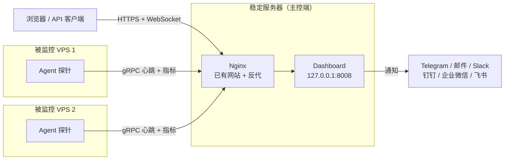
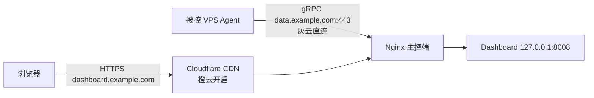

[toc]

## 范围与版本基线

本文适用于在已有 **Nginx** 的稳定服务器上自托管**哪吒监控（Nezha Monitoring）**，并接入多台被监控主机的场景。内容以官方 **V2** 文档为基准核验合并。

- 当前产品代际为 **V2**，**Dashboard** 与 **Agent** 独立发布版本，版本号不要求完全一致。
- 接口路径中的 `/api/v1` 为接口版本命名，不代表产品仍为 V1，不应自行改为 `/api/v2`。
- **V0** 使用 Web 端口与 **5555** RPC 端口双端口；自 **V1** 起 Web 访问与 Agent 通信统一为单一端口，默认 **8008**，该行为在 V2 中延续。
- 本文档示例域名为 `dashboard.example.com`（公开访问）与 `data.example.com`（Agent 通信），证书路径与 IP 请按实际替换。

## 概念与架构

### 组件与数据流

**Dashboard（面板/主控端）** 为控制面与展示入口，负责身份鉴权、接收状态、调度服务检查与任务、发送告警；

**Agent（探针/被控端）** 运行于每台被监控设备，负责采集上报与执行已分配的检查或授权任务。



逻辑要点：

- 浏览器必须可达 Dashboard 公开入口；每个 Agent 必须可达 **Agent 对接地址**。
- V2 的 Web 访问与 Agent 通信可共用同一监听端口，实际多经反向代理以 HTTPS 对外提供。
- 未启用 **TSDB** 时实时状态可用，但服务器历史指标与部分服务历史不可用；启用后历史写入本地 TSDB。

### 版本沿革

三代差异决定反代写法，不可混用：

| 代际 | 端口模型 | 反代要点 | 说明 |
| --- | --- | --- | --- |
| **V0** | Web 端口 + **5555** RPC 端口 | 需分别反代两个端口，`data` 域常需直连 | 旧教程中的 `5555`、`proxygrpcport`、`OAuth 提供商`、`未接入 CDN 的面板服务器域名/IP` 多属此代，不可直接用于新部署 |
| **V1** | 单一端口，默认 **8008** | 按路径分流 `proto.NezhaService` 与 WebSocket | 首次引入统一端口与用户绑定的连接密钥 |
| **V2** | 延续 V1 单端口 | 三段式分流：gRPC、WebSocket、普通 Web，并透传 `nz-realip` | 当前文档默认目标，Dashboard 与 Agent 独立发版 |

### 技术栈与选型理由

按下表理解各分层技术与其合理性，判定依据均为官方仓库与配置文档中的可验证项，未核实的实现细节（如前端框架）本文不作断言：

| 分层 | 技术 | 选型理由 |
| --- | --- | --- |
| **后端与探针语言** | **Go 语言**（Dashboard 与 Agent 仓库均含 `go.mod`，以 GoReleaser 分发） | 单二进制交付、交叉编译方便，内存占用低，单核 512MB 即可运行；Go 的 gRPC 与 HTTP/2 生态成熟，契合下述通信选型 |
| **Agent 通信** | **gRPC**（远程过程调用，含 `proto` 契约，路径前缀 `/proto.NezhaService/`） | 心跳、指标、任务下发多路复用同一长连接；自 V1 起与 Web 共用 `8008` 单端口，反代按路径分流即可，少开端口且 CDN 友好；代价是必须启用 **HTTP/2** 与 TLS |
| **实时与运维通道** | **WebSocket**（路径 `/api/v1/ws/server|terminal|file`） | 面板实时刷新、在线终端、文件管理需要全双工通道，与 gRPC 分开处理；Nginx 须透传 `Upgrade` 并放宽超时 |
| **对外接口** | **REST**（路径 `/api/v1`）与可选 **MCP**（模型上下文协议，`POST /mcp`，默认关闭） | 接口版本独立于产品代际，`/api/v1` 不代表产品仍为 V1；自动化使用最小范围的 API Token，不默认授信 |
| **存储** | **SQLite**（关系型嵌入式数据库，默认业务与配置存储）＋内存（实时状态）＋可选内置 **TSDB**（时序数据库，VictoriaMetrics 存储引擎，`tsdb.data_path` 启用） | 自托管简单，备份即复制数据目录；实时状态放内存，重启后由 Agent 重连恢复；历史指标按需开启 TSDB，保留天数、内存与磁盘水位可配；代价是启用后旧 `service_histories` 表会被删除且不迁移，启用前须备份 |
| **前端** | 用户前端与管理前端随 Dashboard 发布，主题经 `frontend-templates.yaml` 配置，支持 `custom_code` 注入 | 公开状态页与管理后台分离，支持强制登录与游客隐藏；自定义代码只注入对应端，互不串扰 |
| **身份与安全** | 用户绑定的连接密钥（`client_secret`）、**JWT**（JSON Web Token，生产经 `NZ_JWTSECRETKEY` 注入）、**OAuth 2.0**（开放授权）绑定登录、内置 **WAF**（Web 应用防火墙，经 `web_real_ip_header` 识别） | Dashboard 是高权限控制面，密钥、会话、回调 Host 与 WAF 分层设防；旧全局 `agent_secret_key` 已废弃，以用户绑定密钥为准 |
| **分发与部署** | **Docker** 镜像（`ghcr.io/nezhahq/nezha`）＋ `nezha.sh`、`agent.sh` 安装脚本 | 脚本与 Compose 两种姿势并存；生产经 Nginx 或 Caddy 终结 TLS，源站仅听回环；CDN 为可选项而非必选项 |
| **Agent 形态** | 单二进制常驻＋YAML 配置＋系统服务＋自更新（可切 Gitee 或 AtomGit 更新源） | 安装命令一次携带 `NZ_SERVER`、`NZ_TLS`、`NZ_CLIENT_SECRET`、`NZ_UUID`，覆盖 Linux、Windows、macOS 及群晖、OpenWrt 等场景；上报间隔 `report_delay` 取 1-4 秒，实时性与误报率折中 |

设计取舍：单端口降低运维面，但要求反代同时正确处理三类流量，任一配错即表现为部分功能正常、部分离线；通信域与公开域分离、通知规则的 `duration×3` 秒窗口与 70% 样本门限、分组 `cover/ignore`，均是在误报与打扰之间折中。远程运维能力默认可用，但最小化部署应关闭命令执行、NAT 与强制更新，仅保留监控。

### 概念和术语

**Dashboard（控制面板）**：哪吒监控的主控端。你通过浏览器访问的就是它的 Web 界面，所有被监控服务器的汇总信息都在这里展示，告警规则、通知渠道也在后台配置。

**Agent（客户端 / 探针）**：安装在被监控服务器上的小程序。它负责采集这台机器的 CPU、内存、磁盘、网络等数据，然后定时上报给 Dashboard。因为是 Go 编写的，所以对系统资源的消耗非常小。

**WebSocket**：一种网络通信协议，它允许服务器和浏览器之间建立一条“长连接”，双方可以随时主动发送数据。哪吒监控用它来实现前端页面监控数据的**实时刷新**，无需手动刷新页面。

**gRPC**(**Google Remote Procedure Call**)：一种高性能的远程过程调用（RPC）框架。哪吒监控的 Agent 用它来高效地向 Dashboard 传输监控数据，比普通的 HTTP 请求更节省资源。

**TSDB（时间序列数据库）**：专门用来存储带有时间戳的数据的数据库。哪吒监控用它来保存 CPU、内存等指标的**历史曲线**，方便你查看服务器在过去一段时间内的资源使用趋势。

**反向连接**：哪吒监控支持的一种网络模式。即便被监控的服务器**位于内网或防火墙之后**，没有公网 IP，它上面的 Agent 也可以主动向外连接 Dashboard，从而被成功监控。

**自托管（Self-hosted）**：软件运行在你自己的服务器上，而不是使用厂商提供的云服务。这意味着**所有监控数据都由你自己掌控**，没有隐私泄露风险。

### 前置需求清单

按清单备齐，缺失项会阻塞后续步骤：

| 项目 | 是否必需 | 说明 |
| --- | --- | --- |
| **稳定服务器** | 是 | 安装 Dashboard，建议已有 Nginx；单核 512MB 即可覆盖多数场景 |
| **Docker** | 建议 | 本文以官方 `nezha.sh` 脚本为主 |
| **公开访问域名** | 建议 | 已设 A 记录指向主控端；纯 `IP:8008` 可跑通但 TLS 与 CDN 受限 |
| **Agent 通信域名** | 可选但推荐 | 与公开访问分离时最稳定，详见 CDN 章节 |
| **放行端口与备份位置** | 是 | 按需放行 `80/443` 或直连 `8008`；明确备份目录与恢复流程 |

## Dashboard 安装

安装之前对于是否走cdn(例如cloudflare)的决策参考后面CDN接入章节说明.

### 方式一：脚本安装

主控端可直连 GitHub 时执行：

```bash
curl -L https://raw.githubusercontent.com/nezhahq/scripts/refs/heads/main/install.sh \
  -o nezha.sh && chmod +x nezha.sh && sudo ./nezha.sh
```

主控端位于中国大陆时走镜像：

```bash
curl -L https://gitee.com/naibahq/scripts/raw/main/install.sh \
  -o nezha.sh && chmod +x nezha.sh && sudo CN=true ./nezha.sh
```

按提示输入**站点标题**、**对外暴露端口**（默认 `8008`）与**后台语言**，等待拉取镜像。重复管理执行 `./nezha.sh` 即可进入管理菜单，含更新与重启入口。

### 方式二：Docker Compose

以 Docker 方式部署时创建目录与 Compose 文件：

```bash
mkdir -p /opt/nezha && cd /opt/nezha
```

`/opt/nezha/docker-compose.yml` 示例：

```yaml
services:
  dashboard:
    image: ghcr.io/nezhahq/nezha
    container_name: nezha-dashboard
    restart: always
    volumes:
      - ./data:/dashboard/data
    ports:
      - "127.0.0.1:8008:8008"
```

**127.0.0.1:8008:8008** 表示仅监听本机回环，强制经 Nginx 对外提供，避免管理端口直接暴露公网。启动后检查日志：

```bash
docker compose up -d
docker compose logs -f
```

直连验证地址形如 `http://dashboard.example.com:8008`，管理后台路径为 `/dashboard`。

### 首次登录

首次默认用户名与密码均为 `admin`。该口令为弱口令，安装后应立即修改：头像 → **个人信息** → **更新个人资料**。生产环境建议 **18 位以上**，混合大小写字母、数字与符号，每位操作者使用独立账号，不共享管理员口令。

## 证书与 TLS 决策

### 是否必须配置证书

证书并非程序强制项，但经公网提供服务时应视为必备：

- 裸 HTTP 会使登录口令与 `NZ_CLIENT_SECRET` 等密钥明文传输。
- 经反代终止 TLS 后，Agent 需同步启用 TLS；直连明文 `host:8008` 则不应启用。两侧不一致是 Agent 离线的常见原因。
- 经 **Cloudflare（内容分发网络，Content Delivery Network）** 等 CDN 提供 gRPC 时，源站必须支持 TLS 与 **HTTP/2**，并使用 `443` 对外提供。

| 方案 | 适用场景 | 有效期 | 说明 |
| --- | --- | --- | --- |
| **acme.sh / Certbot（Let's Encrypt）** | 域名可做 HTTP 验证 | 90 天，自动续签 | 通用首选 |
| **Cloudflare 源服务器证书** | 域名托管于 Cloudflare 且套 CDN | 最长 15 年 | 加密模式须选**完全**或**完全（严格）**，不可用灵活 |
| **自签证书** | 内网或临时测试 | 自定义 | Agent 需设 `insecure_tls: true`，公网部署不应以此绕过校验 |

### 方案 A：acme.sh

```bash
curl https://get.acme.sh | sh -s email=your@email.com
~/.acme.sh/acme.sh --issue -d dashboard.example.com --webroot /var/www/html
~/.acme.sh/acme.sh --install-cert -d dashboard.example.com \
  --cert-file /etc/ssl/nezha/cert.pem \
  --key-file /etc/ssl/nezha/privkey.pem \
  --fullchain-file /etc/ssl/nezha/fullchain.pem \
  --reloadcmd "nginx -s reload"
```

国内访问 Let's Encrypt 不稳定时，可在 `acme.sh` 中切换 `--server zerossl` 等兼容颁发机构。

### 方案 B：Cloudflare 源服务器证书

在 Cloudflare 面板 SSL/TLS → 源服务器创建证书，将证书与私钥保存至服务器对应路径，有效期选长期。回源加密模式须为**完全**或**完全（严格）**。

## Nginx 反向代理

已有 Nginx 与其他网站共存时，新增虚拟主机反代 Dashboard 即可，不影响现有站点。V2 单端口下须在同一 `server` 内按路径分流三类流量。

关键要求：

- 开启 **HTTP/2**，否则 gRPC 无法建连。新版 Nginx 使用 `http2 on`，旧版使用 `listen 443 ssl http2`。
- 在 `server` 块开启 `underscores_in_headers on`，否则含下划线的 Agent 认证头会被丢弃。
- 按路径分流：`proto.NezhaService` 走 `grpc_pass`，`/api/v1/ws/server|terminal|file` 走 WebSocket `proxy_pass`，其余走普通 `proxy_pass`。
- 向 Dashboard 透传真实 IP，推荐使用 `nz-realip`，并在面板**系统设置**中将**前端真实 IP 请求头**与 **Agent 真实 IP 请求头**填为同名。仅当反代确实覆盖 Dashboard 且不可被绕过时才可信该头。
- 上游使用 `keepalive` 复用长连接，gRPC 与 WebSocket 适当放宽读写超时。

`/etc/nginx/sites-available/nezha.conf` 示例（单通信域名直连回源，面板可套 CDN）：

```nginx
upstream dashboard {
    server 127.0.0.1:8008;
    keepalive 512;
}

server {
    listen 443 ssl;
    listen [::]:443 ssl;
    http2 on;

    server_name dashboard.example.com;

    ssl_certificate     /etc/ssl/nezha/fullchain.pem;
    ssl_certificate_key /etc/ssl/nezha/privkey.pem;
    ssl_protocols       TLSv1.2 TLSv1.3;
    ssl_session_cache   shared:SSL:10m;
    ssl_session_timeout 1d;

    underscores_in_headers on;

    # gRPC：Agent 上报通道
    location ^~ /proto.NezhaService/ {
        grpc_set_header Host $host;
        grpc_set_header nz-realip $remote_addr;
        # 经 Cloudflare 回源时改用：
        # grpc_set_header nz-realip $http_cf_connecting_ip;
        grpc_read_timeout 600s;
        grpc_send_timeout 600s;
        grpc_socket_keepalive on;
        client_max_body_size 10m;
        grpc_buffer_size 4m;
        grpc_pass grpc://dashboard;
    }

    # WebSocket：实时状态、终端、文件
    location ~* ^/api/v1/ws/(server|terminal|file)(.*)$ {
        proxy_set_header Host $host;
        proxy_set_header nz-realip $remote_addr;
        # 经 Cloudflare 回源时改用：
        # proxy_set_header nz-realip $http_cf_connecting_ip;
        proxy_set_header Origin https://$host;
        proxy_set_header Upgrade $http_upgrade;
        proxy_set_header Connection "upgrade";
        proxy_read_timeout 3600s;
        proxy_send_timeout 3600s;
        proxy_pass http://127.0.0.1:8008;
    }

    # 普通 Web：页面与 API
    location / {
        proxy_set_header Host $host;
        proxy_set_header nz-realip $remote_addr;
        # 经 Cloudflare 回源时改用：
        # proxy_set_header nz-realip $http_cf_connecting_ip;
        proxy_read_timeout 3600s;
        proxy_send_timeout 3600s;
        proxy_buffer_size 128k;
        proxy_buffers 4 256k;
        proxy_busy_buffers_size 256k;
        proxy_max_temp_file_size 0;
        proxy_pass http://127.0.0.1:8008;
    }
}

server {
    listen 80;
    listen [::]:80;
    server_name dashboard.example.com data.example.com;
    return 301 https://$host$request_uri;
}
```

需为 `data.example.com` 提供相同证书并新增同构 `server` 块，或将两个域名合并至同一证书后复用上述分流结构。配置后执行：

```bash
nginx -t && nginx -s reload
```

字段说明：

| 字段 | 含义 |
| --- | --- |
| `http2 on` | 启用 HTTP/2，gRPC 建连前提 |
| `underscores_in_headers on` | 放行含下划线的 Agent 认证头，缺失则 Agent 无法鉴权 |
| `location ^~ /proto.NezhaService/` + `grpc_pass` | Agent gRPC 前缀，必须用 `grpc_pass` 而非 `proxy_pass` |
| `location ~* ^/api/v1/ws/(server\|terminal\|file)` | 实时状态与远程运维的 WebSocket 通道，需透传 `Upgrade` |
| `nz-realip` | 透传给 Dashboard 的真实 IP，需与面板请求头配置同名 |
| `upstream dashboard` + `keepalive 512` | 复用至 Dashboard 的长连接，避免频繁建连 |
| `Origin https://$host` | WebSocket 校验所需来源头 |

自检 gRPC 是否直达 Dashboard：

```bash
curl https://dashboard.example.com/proto.NezhaService/ \
  -H "Content-Type: application/grpc" -X POST -v
```

正常应返回 `content-type: application/grpc` 与 `grpc-status: 12`，提示未知方法而非连接失败。

## CDN 接入

V2 访问与通信可共用同一端口，但不同 CDN 对 gRPC 与长连接的支持存在差异，因此双域名仍是更稳妥的选择。

| 方案 | 域名 | CDN | 适用性 |
| --- | --- | --- | --- |
| **双域名** | `dashboard.example.com` (公开域)公开访问，给浏览器等客户端访问;<br />`data.example.com` 通信域,不是给浏览器用的. | 公开域橙云代理，通信域灰云直连 | 最稳定，兼容性最好，推荐生产环境使用 |
| **单域名** | 同一域名同时承载页面与 Agent | 全走 CDN | 配置最少，需确认 CDN 支持 gRPC 与 WebSocket |

> 子域名组合也可以取成`nz-dashboard`和`nz-data`这个组合



### Cloudflare 必开选项：

- DNS 中**公开域**橙云代理，**通信域**灰云仅 DNS。
- 网络中开启 **gRPC** 与 **WebSockets**。
- SSL/TLS 加密模式选**完全**，源站证书有效时优先**完全（严格）**。
- 面板**系统设置**中公开入口填 `dashboard_host`，Agent 对接地址填 `install_host`，例如 `data.example.com:443`，并按实际是否经 TLS 终止勾选 TLS。

若 Agent 分布全球且对延迟敏感，通信域直连通常优于经 CDN 回源，可减少误报离线。

### 安装期决策：橙云、加密模式与 Nginx 共存

安装阶段建议先灰后橙：解析时两个域名均设灰云仅 DNS，打通后再将公开域切橙云。灰云阶段可直连验证源站，故障定位不经过边缘节点；证书签发与 gRPC 自检也更可靠。切橙云后再按本节必开选项复验一次。

加密模式不可任意选择，下表为三种模式的结论：

| 模式 | 回源行为 | 结论 |
| --- | --- | --- |
| **灵活** | 浏览器到边缘为 HTTPS，边缘到源站为 HTTP | 禁用；gRPC 握手失败，且易出现重定向环与协议混淆 |
| **完全** | 边缘到源站为 HTTPS，但不验证源站证书 | 可用；源站可用 Cloudflare 源证书或有效证书，起步推荐 |
| **完全（严格）** | 边缘到源站为 HTTPS，且验证源站证书有效 | 最优；源站持有有效证书（如 Let's Encrypt）时选用 |

服务器上已有 Nginx 与其他网站时，另须注意以下事项：

- 为哪吒新建独立 `server` 块，依靠 **SNI**（服务器名称指示）按域名分流；不得把 `proto.NezhaService` 与 WebSocket 分流塞进现有站点的 `server` 块。
- 每个域名使用各自证书；`underscores_in_headers`、`http2`、`grpc_pass` 等指令只加在哪吒的 `server` 块内，避免影响现有站点。
- `80` 端口保留供证书 HTTP 验证与跳转；检查 `default_server` 归属，避免新块抢占默认入口；访问日志与错误日志分文件存放，便于互相甩锅时举证。
- 真实 IP 链路随橙灰切换：橙云回源时透传 `CF-Connecting-IP`，灰云直连时透传 `$remote_addr`，面板的真实 IP 请求头须与 Nginx 透传同名，否则在线用户与 **WAF** 封禁都会错位。
- 套橙云后建议在源站防火墙将 `443` 收敛至 Cloudflare 回源段，仅留 SSH 与必要的直接管理入口；收敛前先确认证书续签通道仍然可用。
- 面板的 `dashboard_host` 填公开域，`install_host` 填通信域加端口并同步 TLS 开关；多入口域名一并写入 `reserved_hosts`，防止 NAT 域名抢占面板路由。

## Agent 安装与配置

### 安装前设置对接地址

在管理后台头像 → **系统设置**中填写 **Agent 对接地址**，例如 `data.example.com:443` 或直连 `IP:8008`。该地址不建议接入 CDN。经 Nginx TLS 终止时同步启用 TLS，直连明文则不启用。

### 一键安装

在**服务器**页面点击**安装命令**，选择被控端操作系统后复制命令，被控端执行后新节点会自动出现在列表中，批量节点可用 SSH 工具执行同一命令。

```bash
curl -L https://raw.githubusercontent.com/nezhahq/scripts/main/agent/install.sh \
  -o agent.sh && chmod +x agent.sh && \
  env NZ_SERVER=data.example.com:443 NZ_TLS=true NZ_CLIENT_SECRET=EXAMPLE ./agent.sh
```

字段说明：`NZ_SERVER` 为对接地址，`NZ_TLS` 是否启用 TLS，`NZ_CLIENT_SECRET` 为用户绑定的连接密钥，不得发布至公开渠道。替换已有记录时追加 `NZ_UUID=已有服务器UUID`，并先卸载旧 Agent 避免身份冲突。

国内被控端下载不稳定时，可用 Gitee 镜像或复用安装脚本的 `CN` 变量，多重试几次后再排查网络与防火墙。自动更新源亦可在 Agent 配置中切换 `use_gitee_to_upgrade` 或 `use_atomgit_to_upgrade`。

### 安全与采集配置

配置文件路径为 `/opt/nezha/agent/config.yml`，修改后重启生效：

```bash
sudo systemctl restart nezha-agent.service
```

同一主机多 Agent 时先列出实例名再分别重启：

```bash
sudo systemctl list-units --type=service | grep nezha-agent
sudo systemctl restart <service-name>
```

| 字段 | 含义 |
| --- | --- |
| `server` | 对接域名或 IP，必须含端口 |
| `tls` | 是否启用 TLS，需与面板与反代实际一致 |
| `insecure_tls` | 跳过证书校验，仅限受控临时环境 |
| `client_secret` | 用户绑定的连接密钥，错误则鉴权失败 |
| `uuid` | Agent 唯一标识，复制配置时必须重新生成 |
| `report_delay` | 上报间隔，默认 3 秒，有效范围 1-4 秒 |
| `disable_auto_update` / `disable_force_update` | 禁用自动或强制更新，生产环境常用手动可控策略 |
| `disable_command_execute` | 禁用命令执行、在线终端与文件列表，不需远程运维时建议开启 |
| `disable_nat` | 禁用内网穿透任务 |
| `disable_send_query` | 禁止接受 Ping 与 HTTP 检查下发 |
| `skip_connection_count` / `skip_procs_count` | 高连接或资源受限时关闭连接数或进程数采集 |
| `hard_drive_partition_allowlist` | 限定监控的硬盘分区，为空则按默认采集 |
| `nic_allowlist` | 限定监控的网卡，为空则监控全部可用网卡 |
| `gpu` / `temperature` | 可选的显卡与温度监控，需硬件与依赖支持 |
| `ip_report_period` / `dns` / `custom_ip_api` | 本地 IP 上报周期、自定义 DNS 与公网 IP 查询接口 |
| `use_ipv6_country_code` | 强制用 IPv6 查询国家代码 |
| `debug` | 排障期启用日志，收集后关闭 |

生产最小化建议：不需远程操作时同时开启 `disable_command_execute`、`disable_nat`，并按需关闭强制更新。

## 可监控指标与服务拨测

### 主机指标

Agent 上报能力取决于操作系统、权限、硬件与上述采集开关：

| 类别 | 内容 | 说明 |
| --- | --- | --- |
| **在线状态** | 在线、离线、运行时间 | 离线告警最常用 |
| **CPU** | 使用率、负载 | 支持阈值告警 |
| **内存** | 内存与交换空间已用、总量、使用率 | 适用于反代内存泄漏预警 |
| **磁盘** | 各分区已用、总量、使用率 | 可用分区 allowlist 限定 |
| **网络流量** | 实时上下行速率、累计与周期流量 | 适合按套餐设流量上限告警 |
| **连接与进程** | TCP 连接数、进程数 | 高负载或疑似攻击时定位连接堆积 |
| **系统信息** | 虚拟化类型、内核、公网 IP | 便于确认 VPS 类型 |
| **可选指标** | GPU、温度 | 需硬件与依赖支持 |
| **可用性** | HTTP、Ping、TCP 检查结果 | 由服务监控另行配置 |

### 服务监控

服务监控由 Dashboard 将检查任务分配给选定 Agent，再由 Agent 从自身网络位置探测目标，可对比多地域与多运营商链路。

新增路径：管理后台 → **服务** → 新增：

| 字段 | 说明 |
| --- | --- |
| **名称** | 自定义描述 |
| **类型** | `HTTP GET`、`ICMP Ping`、`TCPing` |
| **目标** | HTTP 填完整 URL，HTTPS 会同时检查证书状态；Ping 填域名或 IP，不含端口；TCPing 填域名或 IP 加端口 |
| **覆盖范围 / 特定服务器** | 选择执行检查的 Agent，可实现多地拨测 |
| **间隔** | 探测间隔秒数 |
| **通知组 ID** | 关联已配置的通知方式 |
| **启用失败通知 / 延迟通知 / 触发任务** | 故障、延迟越界、恢复后执行预置任务 |
| **对游客隐藏 / 排序** | 控制公开状态页可见性与展示顺序 |

三网延迟示例：为同一业务分别创建移动、联通、电信入口的 Ping 或 TCPing 监控，再在服务器详情**网络**标签中对比延迟与丢包趋势。未登录用户一般仅可见较短周期，完整周期需登录查看。

## 告警与通知

设备出问题后有两条链路：**对外通知**让人收到，**触发任务**让机器自救。配置顺序为先维护**通知方式**，再维护**通知组与规则**，最后在服务器或服务中关联通知组。通知正文可能含服务器名、IP 与资源状态，接入第三方前应审查模板与接收范围。

### 通知方式

官方给出多通道示例，按需选用：Telegram、邮件、Slack、Bark、Server 酱、wxpusher、钉钉群机器人、企业微信群机器人、飞书群机器人、Matrix，以及通用 Webhook。Webhook 请求体支持 FORM（`key:value`）与 JSON（字符串替换后直投），`URL` 中也可使用占位符。

常用占位符便于组装通知内容，开启格式化后输出带单位的易读值，关闭则保留原始数值以便对接需要纯数字的 Webhook：

| 占位符 | 含义 |
| --- | --- |
| `#NEZHA#` | 通知内容 |
| `#DATETIME#` | 事件发生时间 |
| `#SERVER.NAME#` / `#SERVER.IP#` | 服务器名称与 IP |
| `#SERVER.CPU#` / `#SERVER.MEM#` / `#SERVER.DISK#` | CPU、内存、磁盘使用率 |
| `#SERVER.LOAD1#` / `#SERVER.LOAD5#` / `#SERVER.LOAD15#` | 1、5、15 分钟负载 |
| `#SERVER.TCPCONNCOUNT#` / `#SERVER.UDPCONNCOUNT#` | TCP、UDP 连接数 |
| `#SERVER.TRANSFERIN#` / `#SERVER.TRANSFEROUT#` | 累计入站、出站流量 |

Webhook 有两条硬限制：目标仅支持公网 `http` 与 `https`，指向本机、私有网段、链路本地、保留与多播地址的请求会被拒绝，且不跟随重定向；推送内网服务须先经公网可达的中转接收。新增或修改通知方式时默认先发一条测试消息，服务暂时不可达但参数确认无误时可勾选跳过检查；HTTPS 通知地址使用自签或内网证书时，按需关闭证书校验。

### 告警规则

规则以通知组为单位发送，字段含义如下：

| 字段 | 含义 |
| --- | --- |
| `type` | 触发类型，多选时须同时满足；资源类含 `cpu`、`gpu`、`memory`、`swap`、`disk`，网络类含 `net_in_speed`、`net_out_speed`、`net_all_speed`、`transfer_in`、`transfer_out`、`transfer_all`，系统类含 `offline`、`load1`、`load5`、`load15`、`process_count`，连接类含 `tcp_conn_count`、`udp_conn_count`，温度类为 `temperature_max` |
| `duration` | 采样数，不小于 3 的整数；约每 3 秒检查一次，窗口约为 `duration×3` 秒；普通规则需窗口内超 70% 样本超限，离线规则要求窗口内全离线 |
| `min` / `max` | 阈值上下界；流量网速类单位为字节，内存硬盘 CPU 为百分比，离线规则无需设置 |
| `cover` / `ignore` | 覆盖策略；`0` 为监控全部再忽略指定，`1` 为忽略全部再选中指定，`ignore` 形如 `{"1": true}` |

离线通知示例，连续约 30 秒离线后通知：

```json
[{"type": "offline", "duration": 10}]
```

CPU 与内存组合示例：

```json
[
  {"type": "cpu", "min": 0, "max": 50, "duration": 10},
  {"type": "memory", "min": 20, "max": 0, "duration": 20}
]
```

分服务器分组示例，服务器 1、2 离线 10 分钟后发往通知组 A：

```json
[{"type": "offline", "duration": 200, "cover": 1, "ignore": {"1": true, "2": true}}]
```

周期流量属特殊规则，类型为 `transfer_in_cycle`、`transfer_out_cycle`、`transfer_all_cycle`，另需 `cycle_start`（RFC3339 起始）、`cycle_interval` 与 `cycle_unit`（`hour`、`day`、`week`、`month`、`year`）。服务器 3、4 出站月流量超 1TB 示例：

```json
[
  {
    "type": "transfer_out_cycle",
    "max": 1099511627776,
    "cycle_start": "2022-01-01T00:00:00+08:00",
    "cycle_interval": 1,
    "cycle_unit": "month",
    "cover": 1,
    "ignore": {"3": true, "4": true}
  }
]
```

通知触发模式分**总是**（每次上报符合即通知）与**仅一次**（仅正常变异常或异常恢复时通知），为减少打扰，恢复类提醒一般选用仅一次。

### 触发任务

在通知规则中可绑定**异常时执行**与**恢复后执行**两个任务，服务监控同样支持告警任务与恢复任务。任务需提前在**任务**页建好，类型与字段如下：

| 字段 | 含义 |
| --- | --- |
| **任务类型** | **计划任务**按 cron 周期执行，**触发任务**仅被通知或 API 触发、每次执行一次 |
| **计划** | 仅计划任务生效，格式为秒分时天月星期，如 `0 0 3 * * *` 表示每天凌晨 3 点 |
| **命令** | 与 Shell、Bat 写法相同，多命令 Linux 用 `&&` 连接、Windows 用 `&` 连接；找不到命令时多为 `PATH` 未加载，改用绝对路径或先 `source ~/.bashrc` |
| **覆盖范围 / 特定服务器** | 指定哪些 Agent 执行；触发任务可选在触发通知的服务器上执行 |
| **通知方式组** | 任务执行结果的通知去向 |

常见触发式自救示例：CPU 长时间高占用后重启指定服务，服务探活失败后执行 `reboot`，每天凌晨用 `restic` 或 `rclone` 备份数据。两条边界须牢记：需执行任务的 Agent 不得开启 `disable_command_execute`，且 Dashboard 操作者须有相应权限；设备已离线时本机任务下发不进去，离线场景主要靠对外通知，再由其他存活节点执行预案。

### 常用规则

针对 VPS 反代场景的常用规则：

| 规则 | 建议阈值 | 说明 |
| --- | --- | --- |
| **服务器离线** | 心跳超时即告警 | 最关键规则 |
| **磁盘使用率** | 大于 85% | 避免日志无法写入 |
| **内存使用率** | 大于 90% | 内存泄漏预警 |
| **CPU 持续高负载** | 大于 95% 持续 5 分钟 | 异常流量或攻击预警 |
| **周期流量超额** | 按套餐自定义 | 防止超额停机或计费 |
| **证书到期** | 剩余少于 14 天 | 反代证书提前预警 |
| **服务失败 / 延迟越界** | 按服务配置 | 与服务监控联动 |

## 部署流程总览

1. 准备域名与 DNS 记录，安装期先灰云仅 DNS，打通后再切橙云。
2. 以脚本方式安装 Dashboard。
3. 申请证书，选用 Let's Encrypt 或 Cloudflare 源证书。
4. 配置 Nginx 三段式反代，分别承载 gRPC、WebSocket 与普通 Web。
5. 在面板设置公开入口与对接地址，并配置真实 IP 请求头。
6. 在被控端执行安装命令，确认 Agent 上线。
7. 核对 CPU、内存、磁盘与流量指标。
8. 配置服务监控，覆盖 HTTP、Ping 与 TCPing。
9. 配置通知组与告警规则。
10. 完成安全加固与备份验证。

## 常见问题速查

**Agent 显示离线**

1. 被控端能否连通对接地址与端口，可用 `nc`、`telnet` 或端口检查工具验证出站与入站防火墙。
2. 面板对接地址与 TLS 开关是否与反代实际一致，反代 TLS 终止则必须启用 TLS。
3. Nginx 是否遗漏 `underscores_in_headers on`、HTTP/2 或 `proto.NezhaService` 的 `grpc_pass`。
4. 主控端若走反代，公网一般只需放行 `80/443`，无需直放 `8008`。
5. 查看 `systemctl status nezha-agent*` 与 `journalctl -u nezha-agent*` 日志，必要时开 `debug`。
6. 检查 SELinux 是否拦截，必要时临时 `setenforce 0` 验证后再定永久策略。

**面板可访问但实时数据不刷新**

检查 WebSocket 分流与 `Upgrade` 头、Cloudflare WebSocket 开关、面板请求头 `nz-realip` 是否与 Nginx 透传同名。

**国内被控端下载失败**

多重试几次，或改用镜像与加速源，避免将含密钥的完整命令粘贴至公开群组与 Issue。

**磁盘只显示部分分区**

确认 Agent 权限与 `hard_drive_partition_allowlist` 是否限定了采集范围。

**IP 显示为反代地址或 WAF 误封**

说明真实 IP 头配置错误。先核对 Nginx 透传头与面板 `web_real_ip_header`、`agent_real_ip_header` 是否同名，再到**在线用户**核对 IP，必要时将配置改回直连模式并清理 WAF 封禁记录。

**旧版本升级**

Dashboard 与 Agent 独立发版，升级前分别阅读 Release Notes，备份 `/opt/nezha` 或实际映射的数据、配置与 TSDB 目录，先小范围验证再批量升级。旧 V0 配置与数据库可能不兼容当前版本，不应直接覆盖。

## 安全基线

- 公开入口全程 HTTPS，源站 `8008` 仅允许可信反代或内网访问。
- 为 `dashboard_host`、`install_host` 与 OAuth 回调使用固定可信域名，多入口加入保留域名，避免 NAT 域名冲突。
- API Token 按最小 scope 创建并设有效期，自动化账号与管理员账号分离，MCP 默认关闭。
- 不需远程运维的 Agent 关闭命令执行、NAT 与强制更新，关闭闲置终端与文件会话。
- 备份包含账号、密钥与监控数据，应加密并限制读取，迁移或一致性备份前停止 Dashboard，恢复后验证用户、Agent、服务、通知与历史。
- 仅从官方仓库、Release 与安装脚本引用来源获取程序与更新。

## 参考来源

- 官方 V2 文档：产品概览、架构与数据流、版本与兼容性、安全与隐私。
- 官方安装与配置文档：安装 Dashboard、安装 Agent、Agent 配置、Dashboard 配置、TSDB 启用。
- 官方排障文档：Agent 上线自检、Dashboard 反向代理配置、WebSocket 排障、真实 IP 请求头、备份与恢复。
- 官方功能文档：服务监控、通知配置、任务管理。
- 源码与发布页：`nezhahq/nezha`、`nezhahq/agent`、`nezhahq/scripts`。
