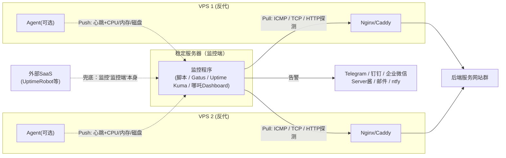
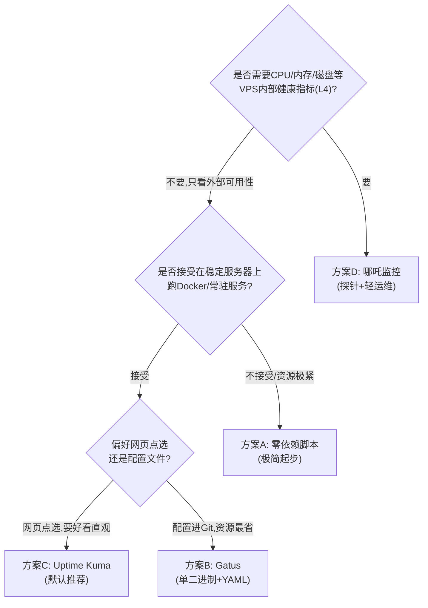
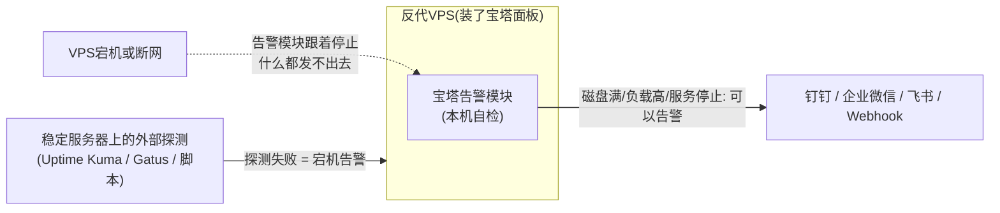

[toc]

## vps存活拨测方案

“拨测”是通信和互联网行业里的一个常用术语，全称通常是**“拨号测试”**或**“网络拨测”**。简单来说，就是**通过模拟用户真实的使用行为，来检测网络、服务或应用是否正常可用**。

它最初起源于传统电信行业：工作人员用测试电话或设备去“拨号”，看能否接通、通话质量如何。现在，这个词已经扩展到互联网和App领域，含义变得更广。

拨测主要测什么？

核心是**“从用户视角出发”**，主要检测以下几类问题：

1. **网络连通性**：目标服务器或IP能不能通？延迟、丢包率是多少？比如用 `ping` 或 `traceroute` 就是最基础的拨测。
2. **服务可用性**：网站能不能打开？App的登录、支付、搜索等关键接口是否正常返回？比如定时访问一个网页，看状态码是不是200。
3. **业务功能正确性**：不只是“通不通”，还要看“对不对”。比如模拟一个完整的下单流程：登录→选商品→下单→支付，看每一步是否都成功。
4. **性能体验**：网页打开用了多久？视频卡不卡？首屏加载时间、接口响应时间等，都是拨测关注的指标。

### 常见的拨测类型

- **ICMP拨测**：就是 `ping`，测网络层通不通。
- **HTTP/HTTPS拨测**：模拟浏览器访问网页，检查状态码、内容关键词、响应时间。
- **DNS拨测**：检查域名解析是否正常、快不快。
- **TCP/UDP拨测**：检测特定端口的连通性。
- **API拨测**：模拟App或系统调用接口，验证返回数据是否正确。
- **事务拨测**：模拟一串连续操作（如登录+查询+退出），验证完整业务流程。
- **音视频拨测**：在通信领域，模拟通话或视频流，检测接通率、卡顿率、MOS分等。

谁在用拨测？

- **运营商**：监测基站、专线、语音通话质量。
- **互联网公司**：7x24小时监控自家网站、App、API的可用性。
- **CDN和云服务商**：从全国各地不同节点拨测，评估加速效果和故障范围。
- **企业IT**：监控内部办公系统、VPN等是否正常。

### 拨测和“监控”

拨测是**主动监控**的一种。传统监控很多是“被动”的，等**用户**报障或服务器自己报警。而拨测是**主动出击**，在用户发现问题之前，就定期去“模拟用户”用一遍，提前发现故障。

比如，一个电商网站可以每分钟从北京、上海、广州的节点去拨测一次“商品详情页”，如果上海节点连续3次打不开，运维就能立刻收到告警，而不是等上海用户打电话来投诉。

总结一下：**拨测就是用技术手段模拟真人去“用”你的服务，从而判断它到底能不能用、好不好用。** 它是保障网络和服务质量非常基础又重要的一环。

## 监控层次

在选型之前，先把"存活/健康"拆成三个层次，这决定了工具的选择边界：

| 层次                    | 检测对象                        | 典型手段                                 | 回答的问题                 |
| ----------------------- | ------------------------------- | ---------------------------------------- | -------------------------- |
| **L1 网络存活**         | VPS的IP可达性                   | ICMP Ping                                | 机器/网络是否还在          |
| **L2 服务存活**         | 服务进程（Nginx/Caddy等）的端口 | TCP连接443/80、HTTP状态码、TLS证书有效期 | 被检测目标的服务是否在工作 |
| **L3 链路健康**         | 完整反代链路（VPS→后端）        | 带`Host`头的HTTP请求 + 关键字/状态码断言 | 用户实际访问是否正常       |
| **L4 资源健康**（可选） | VPS内部的CPU/内存/磁盘/流量     | Agent上报（探针）                        | 为什么会挂、快挂了没       |

一个关键辨析：**L3检测失败不一定是VPS的锅**——可能是后端源站挂了。最佳实践是在每台VPS的服务配置里加一个**不经过后端的健康端点**（如`location /nz-health { return 200; }`），这样"L2正常+L3异常"就能明确定位到后端故障，而不是误判VPS宕机。

另一个核心概念辨析——**Pull（拉取探测）与Push（心跳上报）**：

- **Pull**：监控端主动去"敲门"（ping/curl），无需在VPS上装任何东西，**零侵入**，适合L1~L3；
- **Push**：VPS上的Agent或cron定期向监控端"报平安"，超时未报即告警（即**死人开关**，dead man's switch），能带上资源指标，适合L4，且能穿透"监控端连不上VPS但VPS实际活着"的单向网络问题。自托管社区的常见分工是：Uptime Kuma做点选式的存活探测，Gatus做配置即代码的检查，Healthchecks类工具做"静默失败"任务的死人开关监控。

整体架构示意：



---

## 候选方案总览与对比

按"依赖从少到多"排列：

| 方案                                       | 依赖                        | 界面              | 检测能力(L1-L3) | 健康指标(L4)               | 配置方式        | 上手难度 | 适用规模        |
| ------------------------------------------ | --------------------------- | ----------------- | --------------- | -------------------------- | --------------- | -------- | --------------- |
| **A. Shell脚本 + cron**                    | 仅`curl`/`ping`（系统自带） | 无                | L1~L3           | 无                         | 改脚本变量      | 极低     | 1~10台          |
| **B. Gatus**                               | 单个Go二进制或容器          | 简洁状态页        | L1~L3+断言      | 无                         | YAML（可进Git） | 低~中    | 数十~数百检查   |
| **C. Uptime Kuma**                         | Docker或Node.js             | 精美Web UI+状态页 | L1~L3+证书      | 无（可搭Push心跳）         | 网页点选        | 低       | 数个~百余监控项 |
| **D. 哪吒监控(Nezha)**                     | Dashboard+各VPS装Agent      | 中文面板          | L1~L3           | **有**(CPU/内存/磁盘/流量) | 网页点选        | 低~中    | 多机运维        |
| **E. Prometheus+Grafana栈**                | 多组件                      | Grafana           | 全部            | 有                         | 配置文件+PromQL | 高       | 专业/大规模     |
| **F. 免费SaaS**(UptimeRobot/HetrixTools等) | 无需自建                    | 网页              | L1~L3(多地探测) | 部分                       | 网页点选        | 极低     | 兜底/补充       |

下面逐一展开，含落地要点。

---

## 方案A：零依赖Shell脚本（cron / systemd timer）

**定位**：不装任何第三方软件，稳定服务器上只用系统自带的`curl`、`ping`、`cron`即可跑起来。社区里大量VPS监控实践正是基于这一模式——例如通过Telegram Bot实现对服务器资源的监控预警，当超过预设阈值时向指定Telegram用户发送警告消息。

一个生产可用的示例脚本（含**重试防抖**、**状态去重**（只在状态变化时告警，避免宕机期间每分钟轰炸）、**多通知渠道**）：

```bash
#!/usr/bin/env bash
# vps-watch.sh —— VPS反代存活巡检脚本
# 用法: 由cron每分钟调用一次: * * * * * /opt/vps-watch/vps-watch.sh
# 依赖: bash, curl, ping (系统自带)
set -u

# ============ 用户配置区 ============
# 待检目标, 每行格式: 名称|VPS_IP|业务域名(用于Host头,留空则只测TCP)
TARGETS=(
  "hk-proxy-1|203.0.113.10|www.example.com"
  "jp-proxy-2|198.51.100.20|blog.example.com"
)
RETRY=3               # 判定宕机前的重试次数(防网络抖动误报)
RETRY_INTERVAL=10     # 每次重试间隔(秒)
TIMEOUT=8             # 单次探测超时(秒)
STATE_DIR="/var/lib/vps-watch"   # 状态文件目录(记录上次结果,用于去重)

# 通知渠道(按需启用其一或多个)
TG_TOKEN=""           # Telegram Bot Token(监控端在国内需走代理)
TG_CHAT_ID=""
SC_KEY=""             # Server酱 SendKey(国内直连友好)
# ====================================

mkdir -p "$STATE_DIR"

notify() {  # $1=标题 $2=正文
  [ -n "$TG_TOKEN" ] && curl -sm 10 \
    "https://api.telegram.org/bot${TG_TOKEN}/sendMessage" \
    -d chat_id="${TG_CHAT_ID}" -d text="$1
$2" >/dev/null
  [ -n "$SC_KEY" ] && curl -sm 10 \
    "https://sctapi.ftqq.com/${SC_KEY}.send" \
    -d title="$1" -d desp="$2" >/dev/null
}

probe() {  # $1=IP $2=域名; 返回0=健康
  if [ -n "$2" ]; then
    # L3: 直连VPS IP并伪装Host头, 走完整反代链路
    local code
    code=$(curl -skm "$TIMEOUT" -o /dev/null -w '%{http_code}' \
      --resolve "$2:443:$1" "https://$2/")
    [[ "$code" =~ ^(2|3) ]] && return 0 || return 1
  else
    # L2: 仅测TCP 443端口
    curl -skm "$TIMEOUT" -o /dev/null "https://$1:443" && return 0 || return 1
  fi
}

for entry in "${TARGETS[@]}"; do
  IFS='|' read -r name ip host <<<"$entry"
  ok=1
  for ((i = 1; i <= RETRY; i++)); do
    if probe "$ip" "$host"; then ok=0; break; fi
    sleep "$RETRY_INTERVAL"
  done
  state_file="$STATE_DIR/$name"
  last=$(cat "$state_file" 2>/dev/null || echo "UP")
  if [ "$ok" -ne 0 ] && [ "$last" = "UP" ]; then
    echo "DOWN" >"$state_file"
    notify "[宕机] $name" "IP: $ip  连续${RETRY}次探测失败  $(date '+%F %T')"
  elif [ "$ok" -eq 0 ] && [ "$last" = "DOWN" ]; then
    echo "UP" >"$state_file"
    notify "[恢复] $name" "IP: $ip  已恢复  $(date '+%F %T')"
  fi
done
```

**关键字段/占位符解释**：

| 字段                       | 含义与注意点                                                 |
| -------------------------- | ------------------------------------------------------------ |
| `TARGETS`                  | 目标清单。`名称`用于告警文案与状态文件名；`VPS_IP`是探测的物理落点；`业务域名`用于构造`Host`头 |
| `--resolve "$2:443:$1"`    | curl的核心技巧：**强制把域名解析到指定VPS的IP**，绕过DNS，从而精确测试"这一台VPS"的反代链路，而非DNS轮询到的任意一台 |
| `RETRY` / `RETRY_INTERVAL` | 防抖参数。VPS网络波动常见，**连续N次失败才算宕机**，避免误报 |
| `STATE_DIR`                | 状态去重目录。记录上次UP/DOWN，实现"只在状态翻转时通知一次"  |
| `TG_TOKEN` / `TG_CHAT_ID`  | Telegram机器人令牌与会话ID，通过@BotFather创建获取           |
| `SC_KEY`                   | Server酱推送密钥，走微信通知，**国内网络直连可用**，是Telegram在国内监控端的替代 |
| `-sk` / `-m`               | curl参数：`-s`静默、`-k`忽略证书校验（若你反代用自签或按IP访问）、`-m`超时秒数 |

部署：`chmod +x`后加入crontab，或用**systemd timer**（比cron更现代，支持日志进journal、防止任务重叠）。编写后建议用`shellcheck`静态检查、`shfmt`格式化，保证脚本规范性。

**优点**：零第三方依赖、完全透明可控、资源占用趋近于零。
**缺点**：无历史曲线与UI、通知渠道要自己写、功能扩展全靠自己维护。**超过10台或需要看趋势时不建议硬撑**。

---

## 方案B：Gatus —— 单二进制、配置即代码

**定位**：介于脚本和全功能面板之间的"工程师友好"方案。Gatus读取一份可放进Git的YAML文件，而Uptime Kuma用Web UI和自己的数据库。Gatus支持HTTP、TCP、UDP、SCTP、ICMP、DNS、SSH、WebSocket、gRPC、TLS和STARTTLS检查，可以对状态码、响应时间、证书到期、响应体内容等参数设置断言条件。

资源占用极低：Go二进制空闲约20–50MB内存，而Uptime Kuma的Node.js运行时接近100–150MB，在受限设备上这一差距是有意义的。

示例配置（`config.yaml`），针对你的反代场景：

```yaml
endpoints:
  - name: hk-proxy-1-链路
    group: 反代VPS
    url: "https://www.example.com/"        # 走完整链路
    client:
      dns-resolver: "tcp://8.8.8.8:53"
    interval: 60s
    conditions:
      - "[STATUS] == 200"
      - "[RESPONSE_TIME] < 2000"           # 毫秒
      - "[CERTIFICATE_EXPIRATION] > 168h"  # 证书剩余>7天
    alerts:
      - type: telegram
        failure-threshold: 3               # 连续3次失败才告警(防抖)
        success-threshold: 2               # 连续2次成功才报恢复

  - name: hk-proxy-1-存活
    group: 反代VPS
    url: "icmp://203.0.113.10"             # ICMP前缀即ping探测
    interval: 60s
    conditions:
      - "[CONNECTED] == true"
```

| 占位符/字段                | 解释                                                  |
| -------------------------- | ----------------------------------------------------- |
| `[STATUS]`                 | HTTP响应状态码                                        |
| `[RESPONSE_TIME]`          | 响应耗时（毫秒），可做劣化预警而不只是宕机告警        |
| `[CERTIFICATE_EXPIRATION]` | TLS证书剩余有效期，`168h`即7天                        |
| `[CONNECTED]`              | 连接是否建立（ICMP/TCP场景用）                        |
| `failure-threshold`        | 判定故障所需的连续失败次数，等价于脚本方案里的`RETRY` |
| `icmp://`                  | 只需给端点URL加前缀即可用ICMP协议监控目标             |

**优点**：单文件二进制部署、YAML可版本控制（GitOps）、断言表达力强于Kuma——Uptime Kuma只能检查响应体是否包含特定字符串，无法对JSONPath表达式求值或做数值阈值比较，而Gatus的条件语法原生支持。
**缺点**：界面不如Uptime Kuma精致丰富，社区也相对较小；无L4资源指标。

---

## 方案C：Uptime Kuma —— 免费成熟方案的"默认选项"（重点推荐）

**定位**：如果你要"简单易用直观"，这就是当前自托管拨测领域的事实标准。它是2026年默认的自托管拨测工具：HTTP/TCP/ping/DNS/关键字检查、90+通知渠道、状态页，单容器约256MB。MIT协议完全免费开源，没有付费层级、监控数量限制或高级功能收费。GitHub已有8万+星标，当前处于2.x版本线，2.5.0于2026年8月1日发布，是撰文时的当前稳定版——项目活跃且成熟。

**核心能力对照你的需求**：

- 监控类型覆盖HTTP(s)、TCP、HTTP(s)关键字、Ping、DNS记录、Push、Docker容器等——L1~L3全覆盖，**Push类型**还可让VPS上一行cron `curl`回调实现心跳（部分弥补L4）；
- 通知支持Telegram、Discord、Gotify、Slack、Pushover、SMTP邮件等90多种服务，其中**包含钉钉、飞书、企业微信、Server酱、Bark等国内直连友好的渠道**，对国内/国外监控端都好用；
- 支持最短20秒的检测间隔；还支持SSL证书到期监控和实时刷新的状态页——可以顺手给你的站点群做一个对外状态页。

**部署**（Docker一行命令，生产环境在国外服务器无镜像拉取问题；国内服务器可配置Docker镜像加速器或走本地代理）：

```bash
docker run -d --restart=unless-stopped -p 3001:3001 \
  -v uptime-kuma:/app/data --name uptime-kuma louislam/uptime-kuma:2
```

之后浏览器打开`http://监控服务器IP:3001`，网页里点选添加监控项即可。针对反代场景的配置技巧：对每台VPS建两个监控项——一个Ping类型（填VPS IP，测L1），一个HTTPS类型（**URL填业务域名但在高级选项里不勾选跟随DNS，或直接填`https://VPS_IP`并自定义`Host`请求头**，测L2/L3）。

**运维注意事项**（来自社区最佳实践）：

- 通知不是全局默认生效的：创建或编辑监控项时必须在Notifications区手动开启对应的通知渠道——新手最常踩的坑；
- 把`/app/data`持久化到本地存储并直接备份该数据、独立于被监控服务测试通知链路；
- SQLite是它的规模上限：在短间隔下超过约100–150个监控项后UI会变卡，需拆分实例或把检查迁到Gatus——对你"一批"VPS的规模通常绰绰有余；
- 默认3001端口是裸HTTP，不应把管理面板端口直接暴露公网，应放在带TLS的反向代理之后（或至少用防火墙限源IP）。

**局限**：它从单一位置探测，如果监控服务器自己挂了，告警也就停了——这正是后文"监控监控者"要解决的问题。

---

## 方案D：哪吒监控（Nezha）—— 需要L4健康指标与批量运维时的国产优选

**定位**：前三个方案都是**无Agent的Pull模式**，只能回答"外面看它活没活"；哪吒监控是**Agent模式**的代表，中文原生、VPS圈使用极广。它是开源的服务器监控探针，支持同时监控多个服务器的状态，提供历史网络状态和延迟图表，监控网页、端口可用性和SSL证书状态，支持故障和流量等状态告警，可通过邮件、微信等多种方式提醒；还提供API获取服务器状态，支持WebSSH、DDNS和流量监控，可设置定时和触发任务并批量执行服务器任务。

架构上，需要同时安装Dashboard（装在你的稳定服务器上）和Agent（装在每台被监控的VPS上）。

Agent持续上报CPU/内存/磁盘/网速/流量——**这是唯一能原生回答"VPS快挂了没"（L4）的轻量方案**，而且掉线告警天然就是Push心跳模型。**告警通知**采用通用Webhook设计，例如在后台"新增通知方式"中填入Telegram Bot API的URL、POST方式和JSON Body即可实现服务器离线的卡片通知（同理可接钉钉/企业微信/飞书的机器人Webhook）。

实操提示（社区沉淀的最佳实践）：

- 强烈建议用两个子域名：一个作为面板访问域名（方便套CDN），另一个仅解析到面板服务器IP供Agent连接——若直接用IP，日后迁移面板需要逐台修改Agent，非常麻烦；
- 面板走Nginx反代时需对`/ws`路径的WebSocket做特别配置以支持服务器状态实时更新；
- 国内VPS安装Agent时，官方安装脚本从GitHub raw拉取，位于中国大陆的被控服务器可以使用镜像安装（脚本支持`CN=true`环境变量走国内镜像源）。

**优点**：中文生态、健康指标全、附带WebSSH/批量命令等轻运维能力，面板美观直观。
**缺点**：**有侵入性**（每台VPS装Agent，多一个常驻进程与攻击面）；对"链路级HTTP健康"的断言能力弱于Gatus；组件比Kuma多一层（Dashboard+Agent+域名规划）。

> 顺带一提，本轮搜索还发现了新兴同类项目**Moss**：Go+React实现的轻量自托管VPS监控，单二进制+Docker，Agent一键脚本可注册为systemd/launchd/计划任务开机自启，ICMP探测在Windows下需管理员权限、Linux下需root或CAP_NET_RAW，甚至能充当看门狗在节点离线后自动调用云API把实例拉起。项目较新、成熟度不及哪吒，但思路值得关注。

---

## 方案E：Prometheus + node_exporter + blackbox_exporter + Grafana + Alertmanager

**定位**：专业级全家桶，仅作边界说明。`blackbox_exporter`做拨测（L1~L3）、`node_exporter`装在VPS上出资源指标（L4）、Alertmanager做告警路由与静默、Grafana出图。能力天花板最高、生态最完善，但**组件多、学习曲线陡（PromQL、告警规则语法）**，对"一批反代VPS"的体量属于明显过度设计。监控领域长期被大型企业方案主导，不想学Prometheus和Grafana的人过去只能付费用UptimeRobot——而Uptime Kuma正是为此提供的自托管答案。仅当你未来要监控指标维度很多（QPS、后端延迟分布、按站点聚合）时再考虑升级到这一档。

一个折中技巧：给拨测工具搭配节点指标（Netdata或Prometheus node_exporter）——拨测告诉你"坏了"，指标告诉你"为什么坏"。即"Kuma+每台VPS装个Netdata"也是常见组合，不必一步到位上全家桶。

---

## 补充：免费SaaS兜底与"谁来监控监控者"

自托管方案有个先天短板：监控必须运行在它所监控的基础设施之外——和被监控对象同机部署的监控会跟着一起死。你已经把监控放在独立的稳定服务器上，这一点做对了；但还剩最后一环——**稳定服务器自己挂了怎么办**。两个免费解法：

1. **免费SaaS反向兜底**：用UptimeRobot（免费档约50个监控项）、HetrixTools等外部服务，只监控你的稳定服务器/监控面板这一个目标。SaaS相对自托管的独有优势正是多地理位置探测（自托管需要自建多实例来弥补）；顺带它的多地探测视角也能帮你区分"VPS真挂了"与"仅监控端到VPS的单条线路抖动"。注意：这类SaaS的探测点在国外，若你有国内用户可达性需求，可补充国内免费拨测（如阿里云云监控站点拨测的免费额度）。
2. **双实例互监控**：在另一个数据中心花几美元再放一台小鸡，两个实例互相监控，成本低于一个SaaS席位。Uptime Kuma互相拨测对方的3001端口即可。

---

## 推荐决策与组合



**我的推荐（按你的场景排序）**：

1. **首选：Uptime Kuma（方案C）+ 免费SaaS兜底（方案F）**。理由：完全命中你"免费、成熟、简单易用、直观"的要求，想要"粘贴一个URL就完事"、或维护检查项的人不写YAML，就选Uptime Kuma；对每台VPS建Ping+HTTPS两个监控项即可覆盖L1~L3，20秒级间隔+90+通知渠道足够反代场景使用；再花两分钟注册UptimeRobot盯住监控端本身，闭环完成。
2. **若你还想看VPS资源水位、顺便批量运维：叠加或改用哪吒监控（方案D）**。它与Kuma不冲突——很多VPS玩家两者并用：哪吒看资源与在线状态，Kuma看业务链路与状态页。
3. **若稳定服务器资源极其有限、或你偏好一切进Git：Gatus（方案B）**。想在面板里点选监控就用Kuma，想让每个检查以YAML声明、走PR评审、像代码一样部署就用Gatus。
4. **零依赖脚本（方案A）** 适合作为**过渡或补充**（例如给最关键的1~2台VPS加一道独立于面板的"第二保险"），不建议作为长期唯一方案。
5. Prometheus栈（方案E）在当前规模下不推荐，留作未来升级路径。

**无论选哪个，落地时务必做到**：探测目标用`--resolve`/自定义Host头**钉死到每台VPS的IP**（否则测的是DNS指到的"某一台"）；设置**连续失败阈值防抖**（VPS网络波动多，建议3次×失败间隔≈2~3分钟再告警）；反代上开一个**不回源的`/health`端点**用于区分VPS故障与后端故障；通知渠道按监控端位置选择（国外监控端Telegram最顺手；国内监控端优先Server酱/钉钉/企业微信/飞书Webhook，Telegram需经代理）；面板管理端口**不裸露公网**。

---


## 宝塔方案

**结论：宝塔有两款相关产品，但都不是严格意义上的"拨测"工具。**

- 面板自带的「告警设置」只能让服务器监控自己。VPS 宕机时，它会和机器一起失联，所以不适合检测"VPS 是否存活"。

- 另一款「[堡塔云监控|宝塔云控平台](https://www.bt.cn/new/product_cloud.html)」是**主控端加被控端**的探针系统，思路和上一轮说的**哪吒监控**相近，可以当作哪吒的国内替代品。

### 对比

| 产品                                    | 有什么依据                                                   | 工作方式                                                     | 能否在 VPS 宕机时发出告警                                    |
| --------------------------------------- | ------------------------------------------------------------ | ------------------------------------------------------------ | ------------------------------------------------------------ |
| **面板内置告警**（「设置 → 告警设置」） | **已核实**：[官方文档](https://docs.bt.cn/category/%E5%91%8A%E8%AD%A6%E9%80%9A%E7%9F%A5)写明支持微信公众号、邮箱、钉钉、企业微信、飞书、Webhook 等通道，还有告警任务列表和告警日志 | 机器检查自己，例如[磁盘告警每 10 分钟检查一次](https://www.vpsss.net/29082.html) | **不能**。机器宕机或断网后，告警也发不出去                   |
| **堡塔云监控**                          | **已核实**：官方论坛 2022-04 发布了[使用教程](https://www.bt.cn/bbs/thread-90685-1-1.html)；第三方教程提到它的「告警设置」可以接 Telegram | **待核实**：在稳定服务器上装主控端，每台 VPS 装被控端，定期上报 CPU、内存、磁盘、网络等数据 | **大概率能**。被控端停止上报就算离线（相当于心跳超时），具体行为需要实际测试确认 |
| 「云安全监控」                          | 已核实：有教程介绍它能对站点问题自动告警（[搬主题教程](https://www.banzhuti.com/29138.html)） | 待核实：它和「堡塔云监控」是否是同一个产品，或者是不同版本的叫法，我没能确认 | 待核实                                                       |
| 网站监控报表插件                        | 待核实（没有搜到结果）                                       | 印象中是分析网站访问日志的统计插件                           | 不适用，它不做可用性探测                                     |

为什么**宝塔面板**自带告警不能判断宕机

用上一轮的分层来说，面板告警只能覆盖 **L4 资源健康**，而且是**机器自己监控自己**。它最关键的缺陷在于：最需要它的时候，恰恰是它失效的时候。



这张图的意思是：**资源类问题**（快出事了）可以由 VPS 自己上报；**宕机或断网**（已经出事了）必须靠外部机器来发现。这也是上一轮强调"外部探测（Pull）和心跳上报（Push）配合使用"的原因。

### 和上一轮方案的对比

| 维度                                  | 宝塔面板告警                      | 堡塔云监控                   | 哪吒监控     | Uptime Kuma        |
| ------------------------------------- | --------------------------------- | ---------------------------- | ------------ | ------------------ |
| 判断 VPS 是否存活                     | 不能                              | 能（靠心跳，待核实）         | 能（靠心跳） | 能（主动探测）     |
| 检查完整反代链路（HTTP 状态码、证书） | 部分（例如 SSL 到期提醒，待核实） | 待核实                       | 能           | **能，而且最擅长** |
| CPU、内存、磁盘等资源指标             | 能                                | 能                           | 能           | 不能               |
| VPS 上要装什么                        | **整个宝塔面板**（最重）          | 被控端                       | 被控端       | **什么都不用装**   |
| 开源和费用                            | 面板免费，部分功能收费            | 待核实：可能分免费版和专业版 | 开源免费     | MIT 协议开源，免费 |
| 中文支持                              | 原生中文                          | 原生中文                     | 原生中文     | 有中文界面         |

## 建议

- **VPS 上已经装了宝塔：** 可以**顺手打开面板告警**，覆盖磁盘、负载、服务停止、SSL 到期这类问题，算是免费的补充。但仍然要**在稳定服务器上跑 Uptime Kuma**（或 Gatus、脚本），专门负责发现宕机。
- **VPS 上没有装宝塔：** **不建议为了监控专门装宝塔。** 反代 VPS 最好保持精简，整个面板占资源、增加攻击面，也多了维护负担。宝塔历史上出现过影响较大的安全事件（具体细节这次没有核实）。
- **想用国内生态的探针方案：** 可以试试堡塔云监控，和哪吒监控放在一起比较。哪吒开源、社区活跃、VPS 圈子里用的人多，我目前仍然更倾向哪吒。堡塔云监控的优势是和宝塔配套，服务商在国内。
- **注意安全：** 搜索结果里有些教程来自"宝塔开心版"和"纯净版"网站，它们是破解版或第三方修改版。**生产环境不要用**，可能有后门，存在供应链风险。
