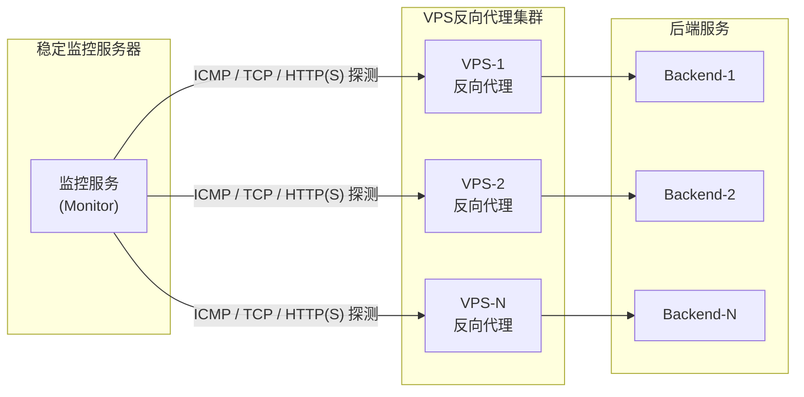
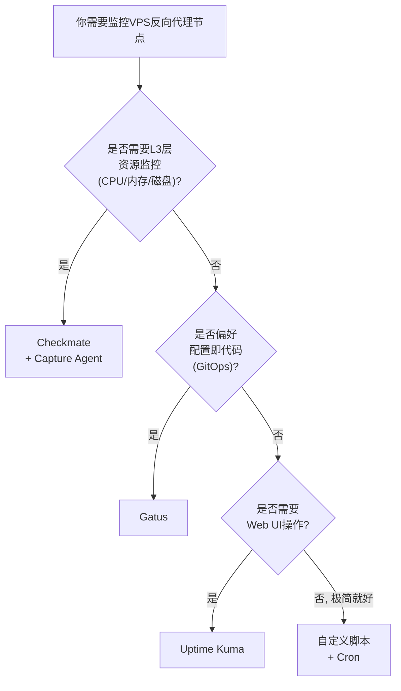
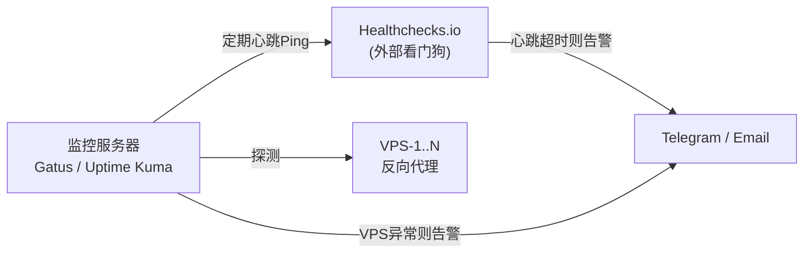

[toc]

## 自省

我是Claude（由Anthropic开发），具备联网搜索能力，本轮对话可执行搜索。我将以**运维架构师**的角色，面向国内IT从业者，围绕"**在稳定服务器上持续监测VPS反向代理节点存活与健康状况**"这一话题，构思并对比方案。

搜索深度为**a（1轮）**，详略等级为**1（full）**，下面先进行搜索收集信息。

---信息收集完毕，以下开始正式输出。

---

## VPS反向代理节点存活与健康监测方案

**信息依据**：基于2026年6-9月的搜索结果，涵盖GitHub项目、BetterStack、DevHelm、PageLantern、SelfhostedGuides等多源对比文章。知识截止日期：2026年9月。

### 问题背景与架构概览

你的场景可以抽象为：一台**稳定的监控服务器（Monitor Server）**需要从外部持续探测一批**VPS反向代理节点**的可达性与健康状况。核心需求是：

- **存活检测**（Alive/Dead）：VPS是否可达（Ping/TCP/HTTP）
- **服务健康检测**（Health Check）：反向代理服务（如Nginx/Caddy）是否正常响应
- **可选的深度检测**：VPS自身资源（CPU/内存/磁盘/带宽）是否健康
- **灵活配置**：用户可按需选择检测粒度
- **告警通知**：异常时及时通知（Telegram/Email/Webhook等）



**关键原则**：监控工具自身运行在它所监测的基础设施内部时，会随该基础设施一起失效。因此，将监控服务部署在**独立于被监测VPS的稳定服务器**上是完全正确的做法。建议将监控工具运行在被监测基础设施之外（至少是一台独立的VPS），并保持更新和备份，同时为它配备一个看门狗（watchdog）。部署在同一台主机上的监控工具恰好会错过最重要的那些故障。

### 监测层次模型

在深入方案之前，先明确**检测信息深度**的三个层级，用户可灵活选择组合：

| 层级 |     名称     | 检测方式                                                     | 能发现的问题                                         | 是否需要在VPS上安装Agent |
| :--: | :----------: | :----------------------------------------------------------- | :--------------------------------------------------- | :----------------------: |
|  L1  | **存活探测** | ICMP Ping、TCP端口连通                                       | VPS宕机、网络不通、端口未监听                        |            否            |
|  L2  | **服务健康** | HTTP(S)请求反向代理，检查状态码、响应时间、关键字、SSL证书有效期 | 反向代理服务崩溃、后端不可达、证书过期、响应异常缓慢 |            否            |
|  L3  | **资源健康** | 在VPS上运行Agent上报CPU/内存/磁盘/带宽等指标                 | 资源耗尽、磁盘写满、带宽超限等潜在故障               |          **是**          |

**L1+L2完全无侵入**（不需在VPS上安装任何东西），**L3需要Agent**但能提供更深层的预警。大多数场景下**L1+L2已足以满足反向代理存活监测需求**。

---

### 方案对比

经过调研，我将方案分为**四大类**，并精选最具代表性的选项进行对比。

#### 方案一：Uptime Kuma（推荐 — 易用优先）

Uptime Kuma是自托管版的Uptime Robot替代品。只需一个Docker容器加一个SQLite数据库，就拥有了95+通知集成和内置状态页的可用性监控。它是最平易近人的开源监控工具——面向想要监测端点但不想学习Prometheus数据模型或管理集群的开发者。

**核心特性**：

- 支持HTTP(S)、HTTP(S)关键字、TCP、Ping、DNS记录、Push、Steam游戏服务器等多种监测类型。
- 集成了70+种通知服务，包括Telegram、Discord、Slack、Email等。（截至2026年已超过**95种**。）
- 最短检测间隔低至20秒。
- 在GitHub上拥有60,000+星标，社区活跃，每周持续更新。
- 内置**状态页**（Status Page），可公开展示服务状态。

**部署方式**：

```bash
docker run -d \
  --name uptime-kuma \
  --restart unless-stopped \
  -p 3001:3001 \
  -v uptime-kuma:/app/data \
  louislam/uptime-kuma:1
```

访问`http://your-server:3001`，创建账户，即可开始添加监控。整个过程不超过5分钟。

**优势**：

- **零门槛部署**，Web UI操作，不需要编写任何配置文件
- 检测协议丰富，特别适合监测反向代理的HTTP端点
- 通知集成极其丰富，尤其适合国内用户使用Telegram/Webhook/Email
- 单Docker容器，SQLite存储在Docker卷中，无外部依赖。

**局限**：

- 单节点架构——没有内置集群或高可用。如果Uptime Kuma实例自身宕机，监控就停止了。没有基础设施指标（CPU、内存、磁盘），它只做端点监控。SQLite在超过约1,000个监控且频繁检查时扩展性不佳。没有配置即代码——所有配置都通过Web UI完成。没有分布式探测——所有探针来自单一实例位置。
- 不支持L3层（VPS资源）监控

**适用场景**：VPS数量**不多**（几台到几十台），主要关注L1+L2层检测，希望快速上手、不折腾。

---

#### 方案二：Gatus（推荐 — 配置即代码优先）

Gatus是一个配置即代码（Configuration-as-Code）监控工具：你在YAML中定义检查项，提交到仓库，Gatus会提供一个干净的状态仪表板。喜欢将监控与基础设施一起版本化管理的开发者会青睐它。功能比Uptime Kuma轻量但在其擅长领域表现出色。

**核心特性**：

- Gatus遵循配置即代码的方式。所有监控端点、条件和告警规则都在YAML文件中定义。启动时Gatus解析配置，为每个端点初始化调度器，按定义的间隔执行健康检查。
- 支持**HTTP(S)、TCP、DNS、ICMP**等协议
- 支持**JSON响应体**字段校验（可以验证API返回内容）
- 结果持久化到SQLite数据库（或PostgreSQL用于多实例部署），并通过内置状态仪表板暴露。
- 当条件失败且达到失败阈值时，告警引擎通过配置的提供商（如SMTP）发送通知。因为整个配置是静态YAML文件，它天然地融入GitOps流水线——对监控的每次变更都是一个版本化的提交。

**配置示例**（针对VPS反向代理监测场景）：

```yaml
# /opt/gatus/config.yaml
storage:
  type: sqlite
  path: /data/gatus.db

alerting:
  telegram:
    token: "YOUR_BOT_TOKEN"
    id: "YOUR_CHAT_ID"
    default-alert:
      description: "VPS反向代理异常"
      send-on-resolved: true
      failure-threshold: 3    # 连续3次失败后告警
      success-threshold: 2    # 连续2次成功后恢复

endpoints:
  # L1: ICMP Ping 存活探测
  - name: VPS-1-Ping
    group: vps-alive
    url: "icmp://203.0.113.10"
    interval: 30s
    conditions:
      - "[CONNECTED] == true"
      - "[RESPONSE_TIME] < 200"
    alerts:
      - type: telegram

  # L1: TCP端口探测(Nginx 443端口)
  - name: VPS-1-TCP-443
    group: vps-port
    url: "tcp://203.0.113.10:443"
    interval: 30s
    conditions:
      - "[CONNECTED] == true"
    alerts:
      - type: telegram

  # L2: HTTP(S)服务健康检测
  - name: VPS-1-HTTPS
    group: vps-service
    url: "https://proxy1.example.com"
    interval: 60s
    conditions:
      - "[STATUS] == 200"
      - "[RESPONSE_TIME] < 1000"
      - "[CERTIFICATE_EXPIRATION] > 720h"  # SSL证书30天前预警
    alerts:
      - type: telegram

  # L2: 反向代理健康端点(可选, 需后端配合)
  - name: VPS-1-Health-API
    group: vps-health
    url: "https://proxy1.example.com/health"
    interval: 30s
    conditions:
      - "[STATUS] == 200"
      - "[BODY].status == ok"
      - "[RESPONSE_TIME] < 500"
    alerts:
      - type: telegram
```

上述配置中各关键字段说明：

| 字段                       | 含义                                                         |
| :------------------------- | :----------------------------------------------------------- |
| `url`                      | 探测目标地址，前缀决定协议类型（`icmp://`、`tcp://`、`https://`等） |
| `interval`                 | 两次检测之间的间隔时间（如`30s`、`1m`、`5m`）                |
| `conditions`               | 断言条件列表，全部满足才判定为健康                           |
| `[STATUS]`                 | HTTP响应状态码                                               |
| `[RESPONSE_TIME]`          | 响应耗时（毫秒）                                             |
| `[CONNECTED]`              | TCP/ICMP连接是否成功（布尔值）                               |
| `[CERTIFICATE_EXPIRATION]` | SSL证书剩余有效期（Go的`time.Duration`格式，如`720h`=30天）  |
| `[BODY]`                   | HTTP响应体，支持JSONPath语法提取字段                         |
| `failure-threshold`        | 连续失败多少次后触发告警                                     |
| `success-threshold`        | 故障恢复后连续成功多少次才发送恢复通知                       |

**部署方式**：

```bash
mkdir -p /opt/gatus
# 编辑 /opt/gatus/config.yaml (如上)

docker run -d \
  --name gatus \
  --restart unless-stopped \
  -p 8080:8080 \
  -v /opt/gatus/config.yaml:/config/config.yaml \
  -v /opt/gatus/data:/data \
  twinproduction/gatus:latest
```

**优势**：

- Gatus（一个小型静态二进制，可选零数据库）和Uptime Kuma（一个容器）是最轻量的。
- YAML配置天然适合**版本控制**和**批量管理**多台VPS，修改即提交
- 条件表达式灵活，可以验证响应体JSON字段（适合自定义健康端点）
- 适合通过脚本/CI自动化管理

**局限**：

- 没有Web UI来编辑检查项，非工程师无法操作，且状态页面功能性而非面向客户展示的风格。
- 不支持L3层资源监控
- Gatus相比Uptime Kuma较新，社区规模更小。

**适用场景**：偏好**Infrastructure-as-Code**，习惯编辑配置文件而非Web UI，希望将监控配置纳入Git管理，或需要在CI/CD中自动化更新监控配置。

---

#### 方案三：Checkmate（新兴 — 兼顾端点+资源监控）

Checkmate是一个开源的自托管工具，用于实时追踪和监控服务器硬件、可用性、响应时间和事件，并提供精美的可视化。

这是一个**2024-2026年**兴起的新项目，拥有10,400个GitHub星标、153个贡献者，无按监控数量计费的限制，从单一自托管仪表板提供全面的基础设施监控——涵盖可用性、页面速度、服务器硬件、Docker容器甚至游戏服务器。

**核心特性**（它与前两者的关键差异）：

- Checkmate有一个名为**Capture**的Agent，用于从远程服务器采集数据。虽然Capture不是运行Checkmate的必须组件，但它提供了关于服务器CPU、内存、磁盘和温度状态的额外洞察。Capture可以运行在Linux、Windows、Mac、Raspberry Pi或任何能运行Go的设备上。

这意味着Checkmate**天然支持L1+L2+L3全三层监控**：无Agent时做端点监控，安装Capture Agent后获得资源级别的指标。这非常贴合你"信息深度用户可灵活配置选择"的需求。

- 经过压力测试，支持1000+个活跃监控而无明显性能瓶颈。
- 现代化Web UI，美观的可视化图表
- 内置事件追踪和通知

**局限**：

- 它是最新的Kuma风格选项，UI现代化且有主题化状态页，但需要Node.js和MongoDB栈。依赖比前两者重。
- 社区虽在快速增长，但成熟度不及Uptime Kuma
- 需要在每台被监控VPS上部署Capture Agent才能获得L3层数据

**适用场景**：需要**同时覆盖端点监控和VPS资源监控**，且愿意在VPS上部署轻量Agent，希望有统一的现代化仪表板。

---

#### 方案四：自定义脚本（轻量 — DIY优先）

如果你只需要最基本的存活探测和告警，不需要Web UI和状态页，一个**Shell/Python脚本 + Cron**即可完成：

这是"DIY"方法。编写一个小型Bash或Python脚本来检查指标（如磁盘使用率），并在超过阈值时发送邮件或Slack消息。

**示例脚本思路**（部署在监控服务器上，Cron定期执行）：

```bash
#!/usr/bin/env bash
# vps_check.sh — 从监控服务器探测VPS反向代理节点
# 用法: ./vps_check.sh
# 依赖: curl, ping, jq(可选)

set -euo pipefail

# ===== 配置区 =====
# 格式: "名称|地址|HTTPS端点|期望状态码"
VPS_LIST=(
  "VPS-1|203.0.113.10|https://proxy1.example.com|200"
  "VPS-2|198.51.100.20|https://proxy2.example.com|200"
)

TELEGRAM_BOT_TOKEN="YOUR_BOT_TOKEN"
TELEGRAM_CHAT_ID="YOUR_CHAT_ID"
PING_TIMEOUT=5        # Ping超时(秒)
HTTP_TIMEOUT=10       # HTTP请求超时(秒)
MAX_RESPONSE_TIME=2   # 最大可接受响应时间(秒)

# ===== 函数 =====
send_alert() {
  local message="$1"
  curl -s -X POST \
    "https://api.telegram.org/bot${TELEGRAM_BOT_TOKEN}/sendMessage" \
    -d chat_id="${TELEGRAM_CHAT_ID}" \
    -d text="${message}" \
    -d parse_mode="Markdown" > /dev/null 2>&1
}

check_vps() {
  local name="$1" ip="$2" url="$3" expected_code="$4"
  local issues=()

  # L1: Ping存活
  if ! ping -c 2 -W "${PING_TIMEOUT}" "${ip}" > /dev/null 2>&1; then
    issues+=("Ping不通")
  fi

  # L2: HTTP(S)服务健康
  local http_code response_time
  http_code=$(curl -s -o /dev/null -w '%{http_code}' \
    --max-time "${HTTP_TIMEOUT}" "${url}" 2>/dev/null || echo "000")
  response_time=$(curl -s -o /dev/null -w '%{time_total}' \
    --max-time "${HTTP_TIMEOUT}" "${url}" 2>/dev/null || echo "999")

  if [[ "${http_code}" != "${expected_code}" ]]; then
    issues+=("HTTP状态码=${http_code}(期望${expected_code})")
  fi

  if (( $(echo "${response_time} > ${MAX_RESPONSE_TIME}" | bc -l) )); then
    issues+=("响应时间=${response_time}s(阈值${MAX_RESPONSE_TIME}s)")
  fi

  # 汇总
  if [[ ${#issues[@]} -gt 0 ]]; then
    local detail
    detail=$(printf '%s; ' "${issues[@]}")
    send_alert "$(printf '*%s 异常*\nIP: \`%s\`\n问题: %s\n时间: %s' \
      "${name}" "${ip}" "${detail}" "$(date '+%Y-%m-%d %H:%M:%S')")"
    echo "[FAIL] ${name}: ${detail}"
  else
    echo "[ OK ] ${name}: Ping通, HTTP ${http_code}, 耗时${response_time}s"
  fi
}

# ===== 主流程 =====
for entry in "${VPS_LIST[@]}"; do
  IFS='|' read -r name ip url code <<< "${entry}"
  check_vps "${name}" "${ip}" "${url}" "${code}"
done
```

配合Cron每分钟执行：

```bash
# crontab -e
* * * * * /opt/scripts/vps_check.sh >> /var/log/vps_check.log 2>&1
```

**优势**：零依赖、完全可控、极轻量、便于在任何Linux服务器上运行。

**局限**：无Web UI、无历史记录图表、无状态页、告警逻辑（如连续失败N次才报警）需自行实现、维护成本随需求增长而上升。

**适用场景**：仅需最基本的存活+服务探测，或作为正式监控工具的**补充看门狗**。

---

### 综合对比表

| 维度             | **Uptime Kuma**     | **Gatus**                        | **Checkmate**           | **自定义脚本**    |
| :--------------- | :------------------ | :------------------------------- | :---------------------- | :---------------- |
| **开源许可**     | MIT                 | Apache-2.0                       | AGPL-3.0                | 自有              |
| **GitHub星标**   | 60,000+             | 12,200+                          | 10,400+                 | N/A               |
| **部署复杂度**   | 极低（单容器）      | 低（单容器/二进制）              | 中（Node.js+MongoDB）   | 极低（脚本+Cron） |
| **配置方式**     | Web UI点击          | YAML文件                         | Web UI                  | 脚本/变量         |
| **L1存活探测**   | Ping/TCP            | ICMP/TCP                         | Ping/TCP                | Ping/TCP          |
| **L2服务健康**   | HTTP(S)/关键字/JSON | HTTP(S)/JSON Body/DNS            | HTTP(S)/页面速度        | curl状态码        |
| **L3资源监控**   | 不支持              | 不支持                           | 支持（需Capture Agent） | 需SSH+自行实现    |
| **SSL证书监控**  | 支持                | 支持（条件表达式）               | 支持                    | 需自行实现        |
| **告警通知**     | 95+集成             | Slack/Discord/Email/PagerDuty等  | Email/Webhook等         | 自行对接          |
| **状态页**       | 内置                | 内置（功能性风格）               | 内置（美观主题化）      | 无                |
| **配置即代码**   | 不支持              | 天然支持                         | 不支持                  | 天然支持          |
| **高可用/集群**  | 不支持              | 不支持（可用PostgreSQL做多实例） | 不支持                  | 不适用            |
| **最低检测间隔** | 20秒                | 约10秒                           | 约60秒                  | Cron最低1分钟     |
| **适合VPS规模**  | 1~200台             | 1~几百台                         | 1~1000+台               | 1~几十台          |
| **学习曲线**     | 极低                | 低（需了解YAML语法）             | 低                      | 中（需编程能力）  |

---

### 推荐决策树



### 最终推荐

针对你的场景（**一批VPS反向代理节点、监测信息深度可配置**），推荐方案的优先级如下：

**首选：Gatus**

理由：
1. **YAML配置天然适合批量管理多台VPS**——每增加一台VPS，在配置文件中加一段即可，可以用模板或脚本批量生成
2. 条件表达式足够灵活，能精确地覆盖L1（ICMP/TCP）和L2（HTTP状态码/响应时间/SSL证书/响应体JSON字段）
3. 配置文件可纳入**Git版本控制**，变更有据可查
4. Go语言编写的静态二进制，**极度轻量**，在监控服务器上几乎不消耗资源
5. `failure-threshold`和`success-threshold`机制避免网络抖动导致的误报

**备选：Uptime Kuma**

如果你更看重**直观的Web UI**、不想编辑YAML、且VPS数量不多，Uptime Kuma是最省心的选择。

**补充层：Healthchecks.io（Dead Man's Switch看门狗）**

可以设置一个外部免费服务（如UptimeRobot或Healthchecks.io）来验证你的自托管监控本身是否还活着。具体做法是让你的Gatus或Uptime Kuma定期向Healthchecks.io发送心跳Ping，如果心跳没有在预期窗口内到达，Healthchecks就会向你告警。这形成了一个**监控的监控**（watchdog），弥补了自托管监控"自身宕机无人知"的盲区。



这种**双层监控架构**（Gatus/Uptime Kuma监控VPS + Healthchecks.io监控Gatus/Uptime Kuma本身）是社区公认的最佳实践，在不增加显著复杂度的前提下大幅提升了监控体系自身的可靠性。