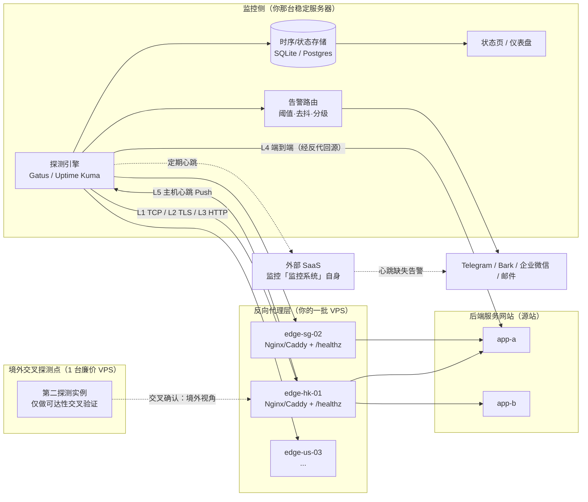
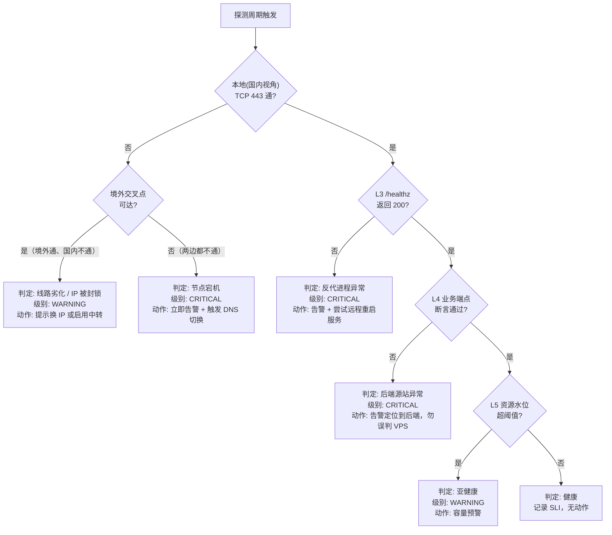
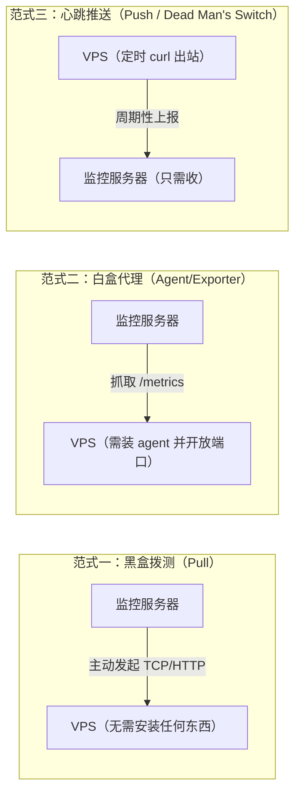
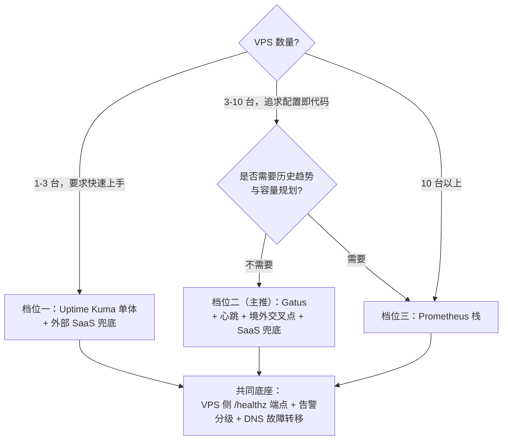

## 反向代理 VPS 的存活与健康监控方案设计

## 本轮工作说明(透明度声明)

| 项目         | 说明                                                         |
| ------------ | ------------------------------------------------------------ |
| 角色         | 运维 / SRE 方向技术顾问                                      |
| 场景         | 境外 VPS 反向代理集群 + 国内视角运维，个人或小团队规模       |
| 搜索深度     | **a(1 轮)**，本轮实际成功执行 **5 条查询**，第 6 条起触发平台配额上限 |
| 详略等级     | **1(full)**                                                |
| 沙箱时间锚点 | **2026-09-28**(由容器 `date -u` 实测，本文时效性以此为准)  |
| 工程验证     | Gatus 配置、Compose、Prometheus 规则均通过 PyYAML 解析；探测脚本通过 `bash -n` 与实跑分支测试 |
| 局限         | 沙箱**无 `shellcheck` / `shfmt` / `yq`**，静态检查需你本地补做；Blackbox Exporter、Cloudflare 负载均衡计费、国内告警通道这三类未能完成联网核实，文中已单独标注 |

本文属于**方案场景**而非深度调研场景，因此在单轮搜索后直接给出完整方案；对未经本轮联网核实的点，我会显式标注「**待核实**」而不含糊带过。

------

## 需求拆解：三个容易被混为一谈的问题

你的原始表述是"检测 VPS 是否存活甚至健康"。这句话里实际藏了**三个独立问题**，混在一起做是绝大多数自建监控失败的根因：

1. **VPS 这台机器还活着吗？**(主机层 / Liveness)
2. **VPS 上的反向代理进程还在正常代理吗？**(服务层 / Readiness)
3. **我的用户此刻真的能访问到网站吗？**(端到端体验层 / SLI)

三者可以任意组合出错：机器活着但 Nginx 崩了；Nginx 活着但后端源站挂了；全都活着但 **IP 被 GFW 封锁**，国内用户全不可达。

> **国内场景的特殊性必须前置**：对境外 VPS 而言，"从国内探测不通"与"VPS 宕机"是**两个完全不同的事件**，但它们在最朴素的 `ping` 监控里长得一模一样。方案设计的核心难点不是"怎么检测"，而是**怎么区分这两者并避免每天几十条误报把你训练成对告警免疫**。

------

## 健康分级模型：把"信息程度"变成可配置的层级

你要求"信息程度用户可以灵活配置选择"。落地方式是定义一套**自底向上、逐层递进的健康层级(Health Level)**，让用户用一个整数(或一组开关)决定探测深度。这是全文的骨架。

| 层级   | 名称         | 探测内容                                           | 典型手段                                             | 资源开销 | 误报敏感度                          | 能回答的问题             |
| ------ | ------------ | -------------------------------------------------- | ---------------------------------------------------- | -------- | ----------------------------------- | ------------------------ |
| **L0** | 网络可达     | ICMP 回显                                          | `ping`、`fping`                                      | 极低     | **极高**(ICMP 常被限速/丢弃/封锁) | 路由是否通               |
| **L1** | 端口存活     | TCP 三次握手(443/80)                             | `nc`、`curl telnet://`、Gatus `tcp://`               | 极低     | 中                                  | 监听进程是否在           |
| **L2** | 传输层健康   | TLS 握手成功、证书剩余有效期、SNI 匹配             | `openssl s_client`、Gatus `[CERTIFICATE_EXPIRATION]` | 低       | 低                                  | 证书会不会明天过期       |
| **L3** | 反代自身健康 | 反代专用 `/healthz` 返回 200 + 响应时间 + 标识字段 | HTTP 探测 + 断言                                     | 低       | 低                                  | Nginx/Caddy 本身是否正常 |
| **L4** | 端到端业务   | 经反代打到真实后端，断言业务 JSON / 关键字         | HTTP 关键字 / JSON 查询                              | 中       | 中                                  | **用户能不能真正用**     |
| **L5** | 主机资源     | CPU、内存、磁盘、负载、连接数、月流量配额          | 心跳上报 / node_exporter / agent                     | 中       | 低                                  | 会不会因磁盘满而"即将"宕 |
| **L6** | 链路质量     | 丢包率、RTT 抖动、路由变化、分省可达性             | SmokePing、多地探测点                                | 中高     | —(趋势型)                         | 线路是否劣化、是否被墙   |

**配置语义建议**：`level=N` 表示"启用 L1 到 LN 的全部检查"(L0 因误报率过高，默认关闭、仅作可选补充)。这样用户只需要改一个数字即可在"最省事"与"最全面"之间滑动。

**推荐默认值**：

- **轻度用户**：`level=3`(TCP + TLS + 反代健康端点)— 覆盖 90% 的真实宕机场景，误报极低。
- **生产用户**：`level=4` + L5 心跳 — 增加业务真实性验证与"即将出问题"的预警能力。
- **多节点/长期运营**：`level=5` + L6 趋势 — 进入容量规划与线路优化阶段。

------

## 总体架构



**图解要点**：

- **实线** = 主动拨测(Pull，黑盒视角)；**虚线** = 被动上报或旁路验证。
- **G** 与 **P2** 构成**双视角**：**G** 在你的稳定服务器上(可能在国内，代表真实用户体验)，**P2** 在境外(代表 VPS 客观状态)。二者的**结果差异本身就是诊断信号**。
- 最右下角的 **SAAS** 解决"**谁来监控监控系统**"这个必须回答的问题——自建监控最大的讽刺是它自己挂了却没人知道。

### 故障判定决策树



这张决策树是**整个方案与"随便装个 Uptime Kuma"的本质区别**：它把"一个失败信号"分解成了五种**语义完全不同的故障**，每种对应不同的严重级别与处置动作。

------

## 三种监控范式的选型权衡

在挑具体工具之前，必须先想清楚数据是**怎么流动**的。这决定了防火墙策略、攻击面和可靠性上限。



| 维度                | 黑盒拨测(Pull)                   | 白盒 Agent(Pull metrics)       | 心跳推送(Push)                                     |
| ------------------- | ---------------------------------- | -------------------------------- | ---------------------------------------------------- |
| 被监控端需安装      | **无需**                           | 需要(agent / exporter)         | 仅需 `curl` + cron                                   |
| 网络方向            | 监控端 → VPS(入站)               | 监控端 → VPS(入站)             | VPS → 监控端(**出站**)                             |
| 防火墙要求          | VPS 需对外开放业务端口(本来就开) | **需额外开放端口**(攻击面 +1)  | **零额外入站**，最安全                               |
| 能获取的信息        | L0–L4(外部可见的)                | L0–L5 全量(CPU/磁盘/进程)      | L5 为主，L1-L4 需自测后上报                          |
| 视角真实性          | **最接近真实用户**                 | 机器内部视角，可能"自我感觉良好" | 内部视角                                             |
| 失效模式            | VPS 网络断 → 立刻发现              | 同左                             | **VPS 死透了 → 心跳停止 → 超时告警**(延迟一个周期) |
| 对 GFW/线路的敏感性 | 高(可能误报)                     | 高                               | 低(出站通常更畅通)                                 |
| 安全风险            | **最低**                           | 中到高(见下文安全警示)         | 低                                                   |

**结论与推荐组合**：

- **以黑盒拨测为主干**(真实、零侵入、零攻击面增量)；
- **以心跳推送为补充**，承载 L5 主机资源(避免为了看磁盘占用而开放 exporter 端口)；
- **仅在确有深度排障需求时**才引入白盒 Agent，且必须走**内网隧道**(WireGuard / Tailscale / Cloudflare Tunnel)，**绝不裸奔公网**。

------

## 候选方案横向对比

### 总览表

| 方案                                                         | 类型              | 部署形态              | 配置方式           | 覆盖层级         | 资源占用             | 告警能力                            | 国内友好度                                   | 成熟度        | 推荐指数                         |
| ------------------------------------------------------------ | ----------------- | --------------------- | ------------------ | ---------------- | -------------------- | ----------------------------------- | -------------------------------------------- | ------------- | -------------------------------- |
| **Gatus**                                                    | 黑盒 + 心跳       | 单 Go 二进制 / Docker | **YAML(GitOps)** | L1–L5            | 极低(几十 MB)      | 条件表达式 + 多通道 + 阈值          | 中(需配代理发 TG)                          | 高            | 五星                            |
| **Uptime Kuma**                                              | 黑盒 + 心跳       | Docker / Node         | **Web UI**         | L1–L4            | 低(约 100–200 MB)  | 90+ 通知渠道                        | 高(渠道覆盖广)                             | 很高          | 五星                            |
| **Prometheus + Blackbox + Alertmanager + Grafana**           | 黑盒 + 白盒       | 多组件                | YAML + PromQL      | **L0–L6 全覆盖** | 中高                 | **最强**(PromQL + 抑制/分组/静默) | 中                                           | 极高          | 四星半(进阶)                    |
| **Zabbix**                                                   | 白盒为主          | Server + Agent + DB   | Web UI + 模板      | L0–L6            | 高                   | 强(企业级)                        | 高(中文完善)                               | 极高          | 三星(偏重)                      |
| **Netdata**                                                  | 白盒              | Agent per host        | 自动发现           | L5 为主          | 中高(单机开销明显) | 内置告警                            | 中                                           | 高            | 三星(诊断利器，非拨测)          |
| **哪吒监控 / Komari / Beszel**                               | 白盒 Agent + 面板 | 面板 + Agent          | Web UI             | L1、L5、L6       | 低                   | 中                                  | **极高**(中文原生、含流量/到期/国内延迟图) | 中            | 二星半 **(有重大安全考量，见下)** |
| **纯 Shell/Python 脚本 + systemd timer**                     | 黑盒              | 单文件                | CLI 参数 / env     | 按需 L1–L5       | 可忽略               | 自己接 webhook                      | 高                                           | —(取决于你) | 四星(极简/兜底场景)            |
| **外部 SaaS**(UptimeRobot、BetterStack、Healthchecks.io 等) | 黑盒 / 心跳       | 零部署                | Web UI             | L1–L4            | 零                   | 好                                  | 中                                           | 高            | 四星(**作为第二保险不可替代**) |
| **Upptime**(GitHub Actions 驱动)                           | 黑盒              | 零服务器              | YAML in repo       | L1–L3            | 零                   | Issue + 通知                        | 低(GH Pages 访问不稳)                      | 中            | 二星(玩具级，间隔受限)           |

### 逐一点评

#### Gatus —— 本方案的主推

Gatus 是用 Go 写的配置驱动型健康监控器。<cite>它周期性检查一组端点(HTTP、TCP、ICMP、DNS、TLS)，并按你自己用 YAML 写的条件来评估响应</cite>(来源：dreamserver.ro 对 Gatus 的评测)。它的杀手锏正好命中你"信息程度可灵活配置"的需求——**健康判据本身就是一行行可读的表达式**：

<cite>条件写起来像 `[STATUS]==200`、`[RESPONSE_TIME]<300`、`[CERTIFICATE_EXPIRATION]>168h`，足够灵活地覆盖"200 且 300ms 内响应""TLS 证书至少还有一周有效期""端口开放""DNS 记录解析正确"这类现实场景</cite>(来源同上)。

其余关键特性：

- <cite>所有配置集中在单个 YAML 文件中，定义监控哪些端点、什么条件算健康、数据存哪、如何告警；二进制安装时放在 `/etc/gatus/config.yaml`</cite>(来源：computingforgeeks.com)。
- <cite>告警在连续失败次数达到 `failure-threshold` 后触发，在连续成功次数达到 `success-threshold` 后恢复</cite>(来源同上)——这正是**抖动抑制**的原生支持。
- <cite>结果存在 SQLite 里，不需要外部数据库；同时暴露 Prometheus 兼容的 `/metrics` 端点，可以接入既有监控栈做关联分析</cite>(来源：dreamserver.ro)。
- <cite>支持条件式健康检查、多提供商告警、维护窗口和内置状态页；生产加固建议包括在反向代理上启用 TLS、用 PostgreSQL 做持久化存储</cite>(来源：computingforgeeks.com)。

**为什么它最适合你**：配置即代码，一个 `config.yaml` 放进 Git，**加一台 VPS 就是复制粘贴一段 YAML**，天然满足你"可自动化、多台设备方便使用"的偏好。

**它的短板**：没有 Web 编辑界面，改配置要动文件重启(可接受，配合 Git + CI 反而是优点)；生态与通知渠道数量不如 Uptime Kuma。

#### Uptime Kuma —— 最快见效、渠道最全

<cite>支持 HTTP(s)、TCP、HTTP(s) 关键字、HTTP(s) JSON 查询、WebSocket、Ping、DNS 记录、Push、Steam 游戏服务器、Docker 容器等多种监控类型；通知支持 Telegram、Discord、Gotify、Slack、Pushover、邮件(SMTP)等 90 多种服务</cite>(来源：GitHub `louislam/uptime-kuma`)。

版本现状(**2026-09 时点**)：

- <cite>Uptime Kuma 2.0 在经历近一年公开 Beta 后于 2025 年发布，数据库层、UI 框架都做了更换，Docker 默认以 rootless 运行，并新增了若干监控类型</cite>(来源：uptimekuma.io 的 v2 指南)。
- <cite>v2.0.0 新增了通知提供商(Nextcloud Talk、Brevo、Evolution API)、2FA 自动聚焦以及代理支持</cite>(来源：winterflow.io 发布说明)。
- **对国内用户极其关键的一条**：<cite>新增了一个环境变量，使大多数通知提供商能够在代理后工作</cite>(来源同上)。这意味着监控服务器若在国内，**Telegram 告警终于可以官方支持走本地代理**，不必再打补丁。
- 版本仍在快速迭代：<cite>2.5.0 加入了 NTP 监控、Plivo 短信与语音、Ooredoo 短信、WxPusher、无限探测间隔等</cite>(来源：releasebot.io，最近更新于 2026-09-12)。其中 **WxPusher 属于国内推送渠道**，是社区在补齐中文生态的信号。

**一个实用限制**：<cite>官方明确说明数据目录不支持 NFS 之类的网络文件系统</cite>(来源：GitHub README)——如果你打算把数据放 NAS 挂载卷，请避开。

#### Prometheus + Blackbox Exporter 栈 —— 天花板方案

这是唯一能同时做到**分位数统计、长期趋势、多维标签、告警抑制与分组**的方案，也是"从监控走向可观测性"的正路。代价是组件多、心智负担重。

> **待核实**：本轮搜索配额耗尽，未能对 Blackbox Exporter 的 2026 年最新版本特性与最佳实践做联网确认。下文给出的指标名(`probe_success`、`probe_ssl_earliest_cert_expiry`、`probe_duration_seconds`)属于长期稳定的公开约定，但**具体模块语法请以官方仓库 README 为准**。

**判断标准**：如果你的 VPS 数量 **< 10 台**且不需要历史趋势分析，用 Gatus/Kuma；**≥ 10 台**或需要做容量规划、SLO 报表，直接上 Prometheus 栈。

#### 哪吒监控 / Komari / Beszel —— 国内生态最贴合，但请务必读完安全警示

这三者是中文 VPS 圈(NodeSeek、LowEndTalk 中文区等)的主流选择，因为它们提供了**国际方案普遍缺失的本地化能力**：月流量统计、VPS 到期提醒、分省 ICMP 延迟折线、中文 UI。

社区实测口径(来源：知乎《轻量级服务器探针 Komari》一文，2025-12 发布、2026-02 转载)：<cite>Komari 后台可直接导出/导入备份文件，无需像哪吒探针那样备份整个目录；GeoIP 方面可在面板中选择 IP 库提供商并在线更新，用过哪吒的用户常遇到的 VPS 实际地区与面板识别地区对不上的问题在 Komari 中基本不会出现</cite>。总体定位是<cite>Komari 更适合小白上手，哪吒探针适合喜欢手动配置的极客</cite>(来源同上)。反代难度上，<cite>Komari 可以直接反代 25774 端口，不需要像哪吒那样区分面板、gRPC 和 WebSocket 分别配置</cite>(来源同上)。

NodeSeek 论坛的选型讨论(2026-01 前后)呈现出社区正在从哪吒向 Komari 迁移的趋势，同时有用户指出 <cite>Beszel 是这几家探针里唯一带 Docker 容器监控的</cite>(来源：nodeseek.com 帖子 585727)。

另需注意哪吒的一次破坏性升级：<cite>哪吒探针将面板和 Agent 升级到 v1 版本，与原 v0.x 完全不兼容，同时一键安装脚本默认安装 v1 版 Agent，导致其无法与 v0.x 的 Dashboard 正常通信</cite>(来源：CSDN 博客，2026-04)。**如果你手上还有老脚本，批量装机会直接踩坑。**

> **安全警示(这是本方案中优先级最高的一条)**
>
> 探针类工具的 Agent **本质上是一条常驻的双向控制通道**，不是纯遥测。安全厂商 Huntress 已公开记录了真实入侵案例：
>
> <cite>2026 年 4 月 16 日，一名攻击者利用窃取的 VPN 凭据横向移动到 Huntress 合作伙伴的 Windows 工作站，并使用 Komari agent 投放了一个 SYSTEM 级别的后门；Huntress 认为这是 Komari 在真实入侵中被滥用的首个公开记录案例，并明确指出 Komari 不是"恰好可被滥用"的遥测工具，而是设计上就是一条双向控制通道</cite>(来源：huntress.com，2026-04-30)。<cite>该事件中攻击者未使用任何恶意基础设施即完成了 SYSTEM 级后门投放</cite>(来源：cyberdaily.au，2026-05-04)。
>
> 哪吒亦有相关记录：Huntress 曾于 2025-10 发文将 Nezha 列为与中国相关威胁行为者使用的工具(来源：huntress.com《The Crown Prince, Nezha》)。此外中文社区在 2026 年 6 月讨论过哪吒的严重漏洞引发 VPS 沦为"肉鸡"的事件(来源：X 平台长文，2026-06-16 —— **此条为社区来源，可信度低于厂商报告，建议你自行复核 CVE 编号**)。
>
> **这不等于说这些项目是恶意软件**——它们是正当的开源项目，问题在于其**功能集(远程命令执行、WebSSH、交互式终端)天然就是理想的后门载体**。对你的场景，这意味着三条硬性建议：
>
> 1. **如果只是要"看 VPS 活没活"，不要装带 WebSSH/远程执行能力的 Agent**——收益与风险严重不匹配，用黑盒拨测 + 心跳即可。
> 2. 若确实要用面板，**关闭远程终端与在线任务执行功能**，面板本体置于 IP 白名单或 Cloudflare Access 之后，**绝不暴露裸公网**，并启用强密码 + 2FA。
> 3. **锁定版本、订阅安全公告、及时升级**，不要用 `latest` 一键脚本无脑更新到 major 版本。

#### 外部 SaaS —— 不可替代的"第二只眼睛"

免费额度(UptimeRobot、BetterStack 等)足够监控 5–10 个端点。它唯一但致命的价值是：**当你的监控服务器本身断电、断网、被机房拔线时，它是唯一还能通知你的东西**。

> **待核实**：本轮未核实各 SaaS 2026 年的免费额度与最小检测间隔，请以官网为准。

------

## 推荐方案：三档渐进式路线



### 档位一：最小可用(约 15 分钟)

**适用**：1–3 台 VPS，先要有东西能跑起来。

| 组件        | 选型                                       | 作用               |
| ----------- | ------------------------------------------ | ------------------ |
| 探测引擎    | Uptime Kuma(Docker)                      | 主体监控 + 状态页  |
| 监控项/节点 | Ping + TCP:443 + HTTP 关键字               | 覆盖 L0/L1/L3      |
| 通知        | Telegram(配代理)或 Bark / 企业微信机器人 | 告警触达           |
| 兜底        | UptimeRobot 免费版监控 Kuma 的状态页       | 防止"监控自己挂了" |

### 档位二：推荐主力(配置即代码 + 智能判定)

**适用**：3–10 台 VPS，长期运营，希望配置进 Git、批量复制。

| 组件     | 选型                                                         | 作用                                 |
| -------- | ------------------------------------------------------------ | ------------------------------------ |
| 探测引擎 | **Gatus**(Docker Compose + Git 管理的 `config.yaml`)       | L1–L4 分级探测，条件表达式做健康判据 |
| 分级机制 | Gatus `group` 字段(`L1-存活` / `L3-反代` / `L4-业务`)      | 落地"信息程度可配置"                 |
| 主机资源 | VPS 侧 cron 定时 **心跳 Push** 到 Gatus `external-endpoints` | 获取 L5 而不开放任何入站端口         |
| 交叉验证 | 境外 1 台廉价 VPS 跑第二个 Gatus 实例                        | 区分"真宕机"与"被墙"                 |
| 通知     | Telegram + Bark 双通道，按 severity 分流                     | 降噪 + 保证触达                      |
| 兜底     | Healthchecks.io 类 Dead Man's Switch                         | 监控监控者                           |
| 自愈     | Cloudflare / DNSPod API 脚本自动切换 A 记录                  | 从"知道"到"恢复"                     |

### 档位三：可观测性平台

**适用**：≥10 台 VPS，或需要 SLO 报表、成本与容量规划。

Prometheus + Blackbox Exporter(黑盒)+ Node Exporter(白盒，走 WireGuard)+ Alertmanager(路由/抑制/静默)+ Grafana(可视化)。若嫌 Prometheus 吃内存，可用 **VictoriaMetrics** 作为存储替代。

------

## 落地实施(以档位二 Gatus 为例)

### 目录结构

```
/opt/edge-monitor/
├── docker-compose.yml
├── .env                      # 密钥，不进 Git，权限 600
├── config/
│   └── config.yaml           # Gatus 主配置，进 Git
└── scripts/
    ├── edge-probe.sh         # 兜底探测脚本
    └── render-config.py      # 可选：由节点清单批量生成 YAML
```

### `docker-compose.yml`(已通过 YAML 校验)

```yaml
services:
  gatus:
    image: twinproduction/gatus:latest
    container_name: gatus
    restart: unless-stopped
    ports: ["127.0.0.1:8080:8080"]   # 仅绑本地，前面套 Caddy/Nginx 加 TLS 与鉴权
    volumes:
      - ./config:/config:ro
      - gatus-data:/data
    env_file: [./.env]
volumes:
  gatus-data: {}
```

> **安全要点**：`ports` 务必写成 `127.0.0.1:8080:8080` 而非 `8080:8080`。后者会**绕过 UFW/firewalld 规则**直接把端口暴露到公网(Docker 直接改写 iptables 的 `DOCKER` 链)，这是自建监控最常见的"裸奔"事故。

### `config/config.yaml`(已通过 PyYAML 校验)

```yaml
storage:
  type: sqlite
  path: /data/gatus.db

web:
  port: 8080

alerting:
  telegram:
    token: "${TG_BOT_TOKEN}"
    id: "${TG_CHAT_ID}"
  custom:                                   # Bark（iOS 推送，国内直连快）
    url: "https://api.day.app/${BARK_KEY}/[ALERT_TRIGGERED_OR_RESOLVED]/[ENDPOINT_NAME]"
    method: GET
    default-alert:
      failure-threshold: 3
      success-threshold: 2
      send-on-resolved: true

endpoints:
  # ---------- L1: 端口存活 ----------
  - name: "edge-hk-01 L1 TCP443"
    group: "L1-存活"
    url: "tcp://hk01.example.com:443"
    interval: 30s
    conditions:
      - "[CONNECTED] == true"
    alerts:
      - type: telegram
        failure-threshold: 4                # 连续 4 次（约 2 分钟）才报，抗抖动
        success-threshold: 2
        send-on-resolved: true

  # ---------- L2: 证书有效期 ----------
  - name: "edge-hk-01 L2 TLS"
    group: "L2-证书"
    url: "https://hk01.example.com/healthz"
    interval: 6h                            # 证书类检查无需高频
    client:
      timeout: 10s
    conditions:
      - "[STATUS] == 200"
      - "[CERTIFICATE_EXPIRATION] > 336h"   # 剩余 < 14 天即告警
    alerts:
      - type: telegram

  # ---------- L3: 反代自身健康 ----------
  - name: "edge-hk-01 L3 反代自身"
    group: "L3-反代"
    url: "https://hk01.example.com/healthz"
    interval: 30s
    headers:
      X-Probe-Token: "${PROBE_TOKEN}"       # 防止健康端点被公网滥用
      User-Agent: "Gatus-Probe/1.0"
    conditions:
      - "[STATUS] == 200"
      - "[BODY].role == edge"               # 确认是反代自己答的，不是后端或错误页
      - "[RESPONSE_TIME] < 1500"
    alerts:
      - type: telegram

  # ---------- L4: 端到端业务 ----------
  - name: "app-www 端到端（经 hk01 回源）"
    group: "L4-业务"
    url: "https://www.example.com/api/health"
    interval: 60s
    conditions:
      - "[STATUS] == 200"
      - "[BODY].db == ok"
      - "[BODY].upstream_latency_ms < 800"
      - "[RESPONSE_TIME] < 3000"
    alerts:
      - type: telegram
        description: "端到端业务链路异常"

# ---------- L5: 主机心跳（Push，零入站端口）----------
external-endpoints:
  - name: "edge-hk-01 主机心跳"
    group: "L5-主机"
    token: "${HEARTBEAT_TOKEN}"
    heartbeat:
      interval: 120s                        # 超过 120s 未收到上报即判定异常
    alerts:
      - type: telegram
```

### 配置字段与条件占位符逐项解释

**顶层字段**：

| 字段                   | 含义               | 取值要点                                                     |
| ---------------------- | ------------------ | ------------------------------------------------------------ |
| `storage.type`         | 存储后端           | `memory`(重启丢数据)、`sqlite`(推荐单机)、`postgres`(多实例/大规模) |
| `storage.path`         | 数据文件路径       | 必须落在持久化卷上，否则容器重建即丢历史                     |
| `web.port`             | 监听端口           | 容器内端口，与宿主机映射解耦                                 |
| `alerting.<provider>`  | 告警提供商全局配置 | 每种提供商配一次，端点侧用 `alerts[].type` 引用              |
| `default-alert`        | 该提供商的默认阈值 | 端点内的同名字段会覆盖它                                     |
| `endpoints[]`          | 主动拨测目标列表   | Pull 模式                                                    |
| `external-endpoints[]` | 被动接收上报的目标 | Push 模式，用于心跳                                          |

**端点级字段**：

| 字段                         | 含义                             | 说明与易混辨析                                               |
| ---------------------------- | -------------------------------- | ------------------------------------------------------------ |
| `name`                       | 端点显示名                       | 会出现在告警文本与状态页，**建议统一命名为 `<节点>-<层级>-<用途>`** 便于检索 |
| `group`                      | 分组                             | 状态页按组折叠展示；**这是实现"健康分级"可视化的关键字段**   |
| `url`                        | 探测地址                         | 协议前缀决定探测类型：`https://` HTTP、`tcp://` 端口、`icmp://` Ping、`dns://` DNS、`tls://` 纯 TLS |
| `interval`                   | 探测间隔                         | **不是越短越好**：30s 是 L1/L3 的合理值；证书类用 `6h`；间隔过短会放大网络抖动带来的误报 |
| `client.timeout`             | 单次请求超时                     | 需明显小于 `interval`，否则探测会堆积                        |
| `headers`                    | 自定义请求头                     | 用于携带鉴权令牌、绕过 WAF 的 UA 白名单                      |
| `conditions[]`               | **健康判据**(全部满足才算健康) | 见下表占位符                                                 |
| `alerts[].type`              | 引用哪个告警提供商               | 必须与 `alerting` 下的键名一致                               |
| `alerts[].failure-threshold` | 连续失败几次才告警               | **抖动抑制的第一道闸**；国内→境外链路建议 ≥3                 |
| `alerts[].success-threshold` | 连续成功几次才判恢复             | 防止"抖动式恢复"反复刷屏                                     |
| `alerts[].send-on-resolved`  | 是否发送恢复通知                 | 建议 `true`，否则你永远不知道问题何时结束                    |
| `alerts[].description`       | 告警附加描述                     | 写清**处置动作**而非重复现象，例如"检查源站 Docker 是否 OOM" |

**条件表达式占位符**(写在 `conditions[]` 中)：

| 占位符                     | 含义                              | 示例                                                 | 适用层级 |
| -------------------------- | --------------------------------- | ---------------------------------------------------- | -------- |
| `[STATUS]`                 | HTTP 响应状态码                   | `[STATUS] == 200`                                    | L3/L4    |
| `[RESPONSE_TIME]`          | 响应耗时，单位毫秒                | `[RESPONSE_TIME] < 1500`                             | L3/L4    |
| `[BODY]`                   | 响应体；`.x.y` 为 JSON 路径取值   | `[BODY].db == ok`                                    | L4       |
| `[CONNECTED]`              | TCP 连接是否建立成功              | `[CONNECTED] == true`                                | L1       |
| `[CERTIFICATE_EXPIRATION]` | 证书剩余有效期，支持 `h` 时长单位 | `[CERTIFICATE_EXPIRATION] > 336h`                    | L2       |
| `[IP]`                     | 解析到的目标 IP                   | `[IP] == 1.2.3.4`(可用于**检测 DNS 被劫持或误改**) | L0       |
| `[DNS_RCODE]`              | DNS 响应码                        | `[DNS_RCODE] == NOERROR`                             | L0       |

> **辨析提醒**：`[RESPONSE_TIME]` 单位是**毫秒**，而 `[CERTIFICATE_EXPIRATION]` 用的是 **Go 时长字符串**(`336h` = 14 天)。这两个单位体系不同，是配置时最常写错的地方。另外 `336h` 不能写成 `14d`，Go 的 `time.ParseDuration` **不支持 `d` 单位**。

### `.env` 示例

```bash
TG_BOT_TOKEN=123456:AA...
TG_CHAT_ID=-1001234567890
BARK_KEY=xxxxxxxx
PROBE_TOKEN=$(openssl rand -hex 24)
HEARTBEAT_TOKEN=$(openssl rand -hex 24)
```

配套权限加固：`chmod 600 .env`，并在 `.gitignore` 中排除它。

------

## VPS 侧：设计一个"说人话"的健康端点

这是**整套方案信息质量的上限所在**。如果 `/healthz` 只返回一个空的 200，你的 L3 检查就退化成了 L1。

### Caddy 配置示例(推荐，自动 HTTPS)

```caddyfile
hk01.example.com {
    # 健康端点：仅对携带正确令牌的请求返回详情
    handle /healthz {
        @authed header X-Probe-Token "{env.PROBE_TOKEN}"
        handle @authed {
            respond `{"role":"edge","node":"hk01","status":"ok"}` 200 {
                close
            }
        }
        respond 404
    }

    # 业务反代：带主动健康检查的负载均衡
    reverse_proxy backend-a.internal:8080 backend-b.internal:8080 {
        lb_policy       least_conn
        health_uri      /api/health
        health_interval 10s
        health_timeout  3s
        health_status   2xx
        fail_duration   30s
    }
}
```

### Nginx 配置示例

```nginx
server {
    listen 443 ssl http2;
    server_name hk01.example.com;

    # L3 健康端点：本地直接返回，不打到后端
    location = /healthz {
        access_log off;
        default_type application/json;
        return 200 '{"role":"edge","node":"hk01","status":"ok"}';
    }

    # 反代指标（仅本机可读）
    location = /nginx_status {
        stub_status;
        allow 127.0.0.1;
        deny all;
    }

    location / {
        proxy_pass http://backend_pool;
        proxy_set_header Host              $host;
        proxy_set_header X-Real-IP         $remote_addr;
        proxy_set_header X-Forwarded-For   $proxy_add_x_forwarded_for;
        proxy_set_header X-Forwarded-Proto $scheme;
        proxy_next_upstream error timeout http_502 http_503 http_504;
    }
}

upstream backend_pool {
    server backend-a.internal:8080 max_fails=3 fail_timeout=30s;
    server backend-b.internal:8080 max_fails=3 fail_timeout=30s backup;
    keepalive 32;
}
```

### 关键技术辨析：反向代理的主动 vs 被动健康检查

这是极易被误解的一点，直接影响"后端挂了反代能不能自动摘除"：

| 反向代理         | 被动健康检查(Passive)              | 主动健康检查(Active)      | 备注                                                         |
| ---------------- | ------------------------------------ | --------------------------- | ------------------------------------------------------------ |
| **Nginx 开源版** | 支持(`max_fails` + `fail_timeout`) | **不支持**                  | 主动检查是 Nginx Plus 商业特性；开源可用第三方模块 `ngx_http_upstream_check_module` 或改用 OpenResty |
| **Caddy 2**      | 支持(`fail_duration`)              | **支持**(`health_uri` 等) | **开源即完整能力，对个人用户最友好**                         |
| **Traefik**      | 支持                                 | **支持**(`healthCheck`)   | 容器化场景自动发现能力强                                     |
| **HAProxy**      | 支持                                 | **支持**(功能最丰富)      | 四/七层负载均衡的事实标准                                    |

> **被动检查**的含义是：只有当**真实用户请求**打过去失败了，反代才知道这个后端有问题——也就是说**第一批用户必然报错**。**主动检查**则是反代自己定期去探，故障后端在用户感知前就被摘除。
>
> **实践建议**：如果你的后端有多个实例且追求高可用，**优先选 Caddy 或 Traefik**，开源版就能拿到主动健康检查；若必须用 Nginx 开源版，就把"主动检查"的职责交给**外部监控 + 自动化脚本**来补(这也是本方案 L4 存在的意义之一)。

### 增强版健康端点(含 L5 资源信息)

用一个极小的脚本定时生成静态 JSON，由反代直接 `alias` 出去，**零常驻进程、零额外端口**：

```bash
#!/usr/bin/env bash
# /usr/local/bin/gen-health.sh —— 每分钟由 systemd timer 触发
set -euo pipefail

OUT=/var/www/health/healthz.json
TMP=$(mktemp)

disk=$(df -P / | awk 'NR==2{gsub("%","",$5); print $5}')
mem=$(free | awk '/^Mem:/{printf "%.0f", $3/$2*100}')
load1=$(awk '{print $1}' /proc/loadavg)
proxy_up=$(systemctl is-active --quiet nginx && echo true || echo false)
uptime_s=$(awk '{printf "%d", $1}' /proc/uptime)

cat > "$TMP" <<EOF
{
  "role": "edge",
  "node": "$(hostname)",
  "status": "ok",
  "proxy_up": ${proxy_up},
  "disk_used_pct": ${disk},
  "mem_used_pct": ${mem},
  "load1": ${load1},
  "uptime_seconds": ${uptime_s},
  "generated_at": "$(date -Iseconds)"
}
EOF

install -m 0644 "$TMP" "$OUT"
rm -f "$TMP"
```

配合 Gatus 条件即可实现资源告警：

```yaml
conditions:
  - "[STATUS] == 200"
  - "[BODY].proxy_up == true"
  - "[BODY].disk_used_pct < 90"
  - "[BODY].mem_used_pct < 95"
```

> **注意**：生成 JSON 的脚本必须用 `mktemp` + `install` 的**原子替换**写法，否则探测请求可能读到写了一半的文件，导致 JSON 解析失败引发误报。这类细节正是自建监控"莫名其妙偶发告警"的常见来源。

------

## 心跳推送：Dead Man's Switch

对**只有出站、没有入站**的场景(VPS 端口被封、在 NAT 后、你不想开任何额外端口)，心跳是唯一可行手段。逻辑是**反向的**：不是"探测失败才告警"，而是"**该来的心跳没来就告警**"。

VPS 侧(`/etc/cron.d/heartbeat` 或 systemd timer)：

```bash
*/1 * * * * root /usr/bin/curl -fsS -m 10 --retry 2 \
  -H "Authorization: Bearer ${HEARTBEAT_TOKEN}" \
  -X POST "https://status.example.com/api/v1/endpoints/L5-主机_edge-hk-01/external?success=true" \
  >/dev/null 2>&1
```

**它的独特价值**：

- 覆盖"机器还在但已彻底失联"的场景；
- 可携带资源数据(把 `success` 换成带 body 的上报)；
- **反向也能用**：让你的 **Gatus 自己** 每分钟向外部 SaaS 打一次心跳，SaaS 收不到就通知你 —— 这就是前文架构图里"监控监控者"的实现。

------

## 兜底方案：零依赖 Shell 探测脚本

当你不想上任何服务，或者需要一个**与主监控系统完全解耦的第二实现**(避免"同一个 bug 让两套都瞎")，用这个。脚本已在沙箱通过 `bash -n` 与实跑测试。

完整脚本见下(保存为 `/opt/edge-monitor/scripts/edge-probe.sh`)：

```bash
#!/usr/bin/env bash
# edge-probe.sh —— 反向代理 VPS 分级健康探测器（无 agent，纯出站探测）
# 依赖: bash>=4, curl, openssl；可选: jq
# 退出码: 0=健康 1=降级 2=故障 3=用法错误
set -Eeuo pipefail
VERSION="1.2.0"

NAME=""; HOST=""; PORT=443; HEALTH_URL=""; BIZ_URL=""; PROBE_TOKEN=""
LEVEL=3; CERT_MIN_DAYS=14; RT_MAX_MS=1500; TIMEOUT=8; RETRIES=3; RETRY_WAIT=5
PEER_PROBE=""; OUTPUT="text"; NOTIFY_CMD=""

die() { printf 'error: %s\n' "$*" >&2; exit 3; }

while [[ $# -gt 0 ]]; do
  case "$1" in
    --host)          HOST="${2:?}"; shift 2 ;;
    --name)          NAME="${2:?}"; shift 2 ;;
    --port)          PORT="${2:?}"; shift 2 ;;
    --health-url)    HEALTH_URL="${2:?}"; shift 2 ;;
    --biz-url)       BIZ_URL="${2:?}"; shift 2 ;;
    --token)         PROBE_TOKEN="${2:?}"; shift 2 ;;
    --level)         LEVEL="${2:?}"; shift 2 ;;
    --cert-min-days) CERT_MIN_DAYS="${2:?}"; shift 2 ;;
    --rt-max-ms)     RT_MAX_MS="${2:?}"; shift 2 ;;
    --timeout)       TIMEOUT="${2:?}"; shift 2 ;;
    --retries)       RETRIES="${2:?}"; shift 2 ;;
    --retry-wait)    RETRY_WAIT="${2:?}"; shift 2 ;;
    --peer-probe)    PEER_PROBE="${2:?}"; shift 2 ;;
    --output)        OUTPUT="${2:?}"; shift 2 ;;
    --notify)        NOTIFY_CMD="${2:?}"; shift 2 ;;
    -h|--help)       usage; exit 0 ;;
    *)               die "未知参数: $1" ;;
  esac
done
[[ -n "$HOST" ]] || die "缺少 --host"
NAME="${NAME:-$HOST}"

declare -A RESULT=(); declare -a NOTES=(); WORST=0
mark()  { RESULT["$1"]="$2"; }
note()  { NOTES+=("$1"); }
worse() { (( $1 > WORST )) && WORST=$1; return 0; }

with_retry() {
  local i
  for ((i = 1; i <= RETRIES; i++)); do
    if "$@"; then return 0; fi
    (( i < RETRIES )) && sleep "$RETRY_WAIT"
  done
  return 1
}

check_tcp() { curl -sS --connect-timeout "$TIMEOUT" -o /dev/null "telnet://${HOST}:${PORT}" 2>/dev/null; }

check_cert() {
  local end_date end_epoch days
  end_date=$(echo | openssl s_client -servername "$HOST" -connect "${HOST}:${PORT}" 2>/dev/null \
             | openssl x509 -noout -enddate 2>/dev/null | cut -d= -f2) || return 1
  [[ -n "$end_date" ]] || return 1
  end_epoch=$(date -d "$end_date" +%s) || return 1
  days=$(( (end_epoch - $(date +%s)) / 86400 ))
  note "证书剩余 ${days} 天"
  (( days >= CERT_MIN_DAYS ))
}

HTTP_BODY=""
http_probe() {
  local url="$1" out code rt_ms
  out=$(curl -sS -m "$TIMEOUT" -o /tmp/edge-probe.body \
        -H "X-Probe-Token: ${PROBE_TOKEN}" -H "User-Agent: edge-probe/${VERSION}" \
        -w '%{http_code} %{time_total}' "$url" 2>/dev/null) || return 1
  code="${out%% *}"; rt_ms=$(awk -v t="${out##* }" 'BEGIN{printf "%d", t*1000}')
  HTTP_BODY=$(cat /tmp/edge-probe.body 2>/dev/null || true)
  note "${url} -> HTTP ${code} / ${rt_ms}ms"
  [[ "$code" == "200" ]] || return 1
  (( rt_ms <= RT_MAX_MS )) || return 2      # 慢但可用 => 降级
}

cross_check() {
  [[ -n "$PEER_PROBE" ]] || return 1
  [[ "$(curl -sS -m "$TIMEOUT" -o /dev/null -w '%{http_code}' "${PEER_PROBE}${HOST}" 2>/dev/null)" == "200" ]]
}

# ===== 执行流程 =====
if with_retry check_tcp; then mark tcp ok; else
  mark tcp fail
  if cross_check; then
    note "交叉确认：境外探测点可达 → 本地线路/封锁问题"; worse 1
  else
    note "交叉确认：境外亦不可达 → 节点故障"; worse 2
  fi
fi

if (( LEVEL >= 2 )) && [[ "${RESULT[tcp]}" == "ok" ]]; then
  if check_cert; then mark cert ok; else mark cert fail; worse 1; fi
else mark cert skip; fi

if (( LEVEL >= 3 )) && [[ -n "$HEALTH_URL" && "${RESULT[tcp]}" == "ok" ]]; then
  set +e; with_retry http_probe "$HEALTH_URL"; rc=$?; set -e
  case "$rc" in 0) mark edge_http ok ;; 2) mark edge_http slow; worse 1 ;; *) mark edge_http fail; worse 2 ;; esac
else mark edge_http skip; fi

if (( LEVEL >= 4 )) && [[ -n "$BIZ_URL" ]]; then
  set +e; with_retry http_probe "$BIZ_URL"; rc=$?; set -e
  case "$rc" in 0) mark biz ok ;; 2) mark biz slow; worse 1 ;; *) mark biz fail; worse 2 ;; esac
else mark biz skip; fi

STATUS=$([[ $WORST -eq 0 ]] && echo healthy || { [[ $WORST -eq 1 ]] && echo degraded || echo down; })
JSON=$(printf '{"node":"%s","host":"%s","status":"%s","level":%s,"time":"%s"}' \
       "$NAME" "$HOST" "$STATUS" "$LEVEL" "$(date -Iseconds)")

[[ "$OUTPUT" == "json" ]] && printf '%s\n' "$JSON" || {
  printf '%s (%s) => %s\n' "$NAME" "$HOST" "${STATUS^^}"
  for k in "${!RESULT[@]}"; do printf '  %-10s %s\n' "$k" "${RESULT[$k]}"; done
  for n in "${NOTES[@]}"; do printf '  · %s\n' "$n"; done
}

[[ -n "$NOTIFY_CMD" && $WORST -gt 0 ]] && printf '%s' "$JSON" | eval "$NOTIFY_CMD" || true
exit "$WORST"
```

### 脚本参数说明

| 参数              | 类型          | 默认        | 含义                                           |
| ----------------- | ------------- | ----------- | ---------------------------------------------- |
| `--host`          | 字符串        | **必填**    | 被探测 VPS 的主机名或 IP                       |
| `--name`          | 字符串        | 同 `--host` | 告警中显示的节点别名                           |
| `--port`          | 整数          | `443`       | L1 TCP 探测端口                                |
| `--health-url`    | URL           | 空          | L3 反代健康端点                                |
| `--biz-url`       | URL           | 空          | L4 端到端业务端点                              |
| `--token`         | 字符串        | 空          | 随 `X-Probe-Token` 头发送的鉴权令牌            |
| `--level`         | 1–5           | `3`         | **探测深度，累积生效**(对应前文健康分级模型) |
| `--cert-min-days` | 整数          | `14`        | 证书剩余天数低于此值判为降级                   |
| `--rt-max-ms`     | 整数          | `1500`      | 响应时间上限(毫秒)，超出判为"慢但可用"       |
| `--timeout`       | 秒            | `8`         | 单次请求超时                                   |
| `--retries`       | 整数          | `3`         | **连续失败重试次数，抖动抑制的核心参数**       |
| `--retry-wait`    | 秒            | `5`         | 重试间隔                                       |
| `--peer-probe`    | URL 前缀      | 空          | 境外交叉确认端点，最终请求为 `<该值><host>`    |
| `--output`        | `text`/`json` | `text`      | 输出格式，`json` 便于管道处理                  |
| `--notify`        | 命令串        | 空          | 告警命令，结果 JSON 经 **stdin** 传入          |

**退出码约定**：`0` 健康 / `1` 降级 / `2` 故障 / `3` 用法错误。可直接被 systemd、Ansible、CI 消费。

### 实测输出(沙箱无外网，故走故障分支)

```json
{"node":"example.com","host":"example.com","status":"down","level":2,
 "time":"2026-09-28T13:29:57+00:00",
 "checks":{"edge_http":"skip","tcp":"fail","cert":"skip","biz":"skip"},
 "notes":["交叉确认：境外探测点亦不可达（或未配置）→ 判定为节点故障"]}
exit=2
```

### systemd 定时调度(优于 cron：有日志、有超时、有依赖管理)

`/etc/systemd/system/edge-probe@.service`：

```ini
[Unit]
Description=Edge VPS health probe for %i
After=network-online.target
Wants=network-online.target

[Service]
Type=oneshot
EnvironmentFile=/opt/edge-monitor/.env
ExecStart=/opt/edge-monitor/scripts/edge-probe.sh \
    --host %i --level 4 \
    --health-url https://%i/healthz \
    --token ${PROBE_TOKEN} \
    --peer-probe https://peer.example.com/probe?host= \
    --notify '/opt/edge-monitor/scripts/notify.sh'
TimeoutStartSec=120
# 最小权限加固
DynamicUser=yes
NoNewPrivileges=yes
PrivateTmp=yes
ProtectSystem=strict
ProtectHome=yes
```

`/etc/systemd/system/edge-probe@.timer`：

```ini
[Unit]
Description=Run edge probe for %i every minute

[Timer]
OnBootSec=2min
OnUnitActiveSec=1min
RandomizedDelaySec=15s   # 打散并发，避免多节点同时探测造成瞬时突发
AccuracySec=5s

[Install]
WantedBy=timers.target
```

批量启用(**模板单元 `@` 的价值：一条命令搞定 N 台**)：

```bash
for h in hk01.example.com sg02.example.com us03.example.com; do
  systemctl enable --now "edge-probe@${h}.timer"
done
systemctl list-timers 'edge-probe@*'
```

> **规范性建议**：沙箱内无 `shellcheck` / `shfmt`，请在你本地执行静态检查后再投产：
>
> ```bash
> shellcheck -S style edge-probe.sh notify.sh gen-health.sh
> shfmt -i 2 -ci -bn -w edge-probe.sh
> ```
>
> 国内安装：`apt install shellcheck` 可直接装；`shfmt` 若 GitHub Release 下载困难，可用 `https://gh-proxy.com/` 前缀包裹原始下载链接加速(**使用前请先访问确认该镜像站当前可用**，此类镜像站存在时效性)。

------

## 告警设计：决定方案是"有用"还是"被静音"

### 降噪的五道闸门

| 闸门        | 机制                                          | 配置位置                                     | 效果                 |
| ----------- | --------------------------------------------- | -------------------------------------------- | -------------------- |
| 1. 失败阈值 | 连续 N 次失败才告警                           | Gatus `failure-threshold` / 脚本 `--retries` | 过滤瞬时抖动         |
| 2. 多点确认 | 本地 + 境外双失败才判宕机                     | `--peer-probe` / 双 Gatus 实例               | **区分被墙与宕机**   |
| 3. 分级路由 | Critical 走电话/Bark 强提醒，Warning 走群消息 | `alerts[].type` 分流                         | 避免"狼来了"         |
| 4. 维护窗口 | 已知变更期间静默                              | Gatus `maintenance` 配置块                   | 避免自己操作触发告警 |
| 5. 恢复通知 | `send-on-resolved: true`                      | 全局 `default-alert`                         | 闭环，减少人工确认   |

### 告警通道选型(面向国内运维者)

| 通道                                | 国内直达 | 需要代理 | 强提醒能力             | 适用                               |
| ----------------------------------- | -------- | -------- | ---------------------- | ---------------------------------- |
| **Bark**(iOS)                     | 是       | 否       | 强(支持关键警告铃声) | iPhone 用户首选 Critical 通道      |
| **企业微信 / 飞书 / 钉钉 群机器人** | 是       | 否       | 中(可 @所有人)       | 团队协作场景                       |
| **Telegram Bot**                    | 否       | **是**   | 中                     | 境外服务器直连；国内监控机需配代理 |
| **邮件 SMTP**                       | 是       | 否       | 弱                     | 归档与日报，不适合紧急告警         |
| **Server 酱 / PushDeer / WxPusher** | 是       | 否       | 中                     | 微信生态推送                       |

> **代理配置的跨平台差异**(务必区分，这是常见踩坑点)：
>
> - **Linux(含 Docker)**：`export HTTPS_PROXY=http://127.0.0.1:7890`；Docker 容器内需用 `http://host.docker.internal:7890`(Linux 上要在 compose 加 `extra_hosts: ["host.docker.internal:host-gateway"]`)，或者干脆 `network_mode: host`。
> - **Windows**：PowerShell 用 `$env:HTTPS_PROXY="http://127.0.0.1:7890"`(**注意此处 `$env:` 是 PowerShell 语法，不是 Bash 的 `$`**)；mihomo/Clash 类客户端还需开启"允许局域网连接"。
> - **Uptime Kuma v2** 已原生支持通过环境变量让多数通知提供商走代理(见前文引用)，优先使用官方机制而非系统级全局代理。

### 一个可直接用的通知脚本

```bash
#!/usr/bin/env bash
# notify.sh —— 从 stdin 读取探测结果 JSON，按严重级别分流
set -euo pipefail
payload=$(cat)
status=$(jq -r '.status' <<<"$payload")
node=$(jq -r '.node'   <<<"$payload")

case "$status" in
  down)
    # Critical: Bark 关键警告（iOS 可穿透静音）
    curl -fsS -m 10 -X POST "https://api.day.app/${BARK_KEY}" \
      -H 'Content-Type: application/json' \
      -d "$(jq -n --arg t "节点故障: ${node}" --arg b "$payload" \
             '{title:$t, body:$b, level:"critical", sound:"alarm", group:"edge"}')" >/dev/null
    ;;
  degraded)
    # Warning: 群机器人即可
    curl -fsS -m 10 -X POST "${WECOM_WEBHOOK}" \
      -H 'Content-Type: application/json' \
      -d "$(jq -n --arg c "⚠ 节点降级: ${node}\n${payload}" \
             '{msgtype:"text", text:{content:$c}}')" >/dev/null
    ;;
esac
```

> **中文显示注意**：企业微信/飞书 webhook 的 JSON body **必须是 UTF-8 且不转义中文**。上例用 `jq -n --arg` 构造，能自动处理转义，比手写字符串拼接安全得多——手工拼接中文 JSON 是乱码问题的头号来源。另外服务器 locale 建议设为 `LANG=C.UTF-8`，避免 `date`、日志输出出现 `?` 或方块字符。

------

## 从"监控"到"自愈"：故障转移层

监控只能告诉你坏了。要真正降低你担心的"宕机风险"，必须有自动切换。