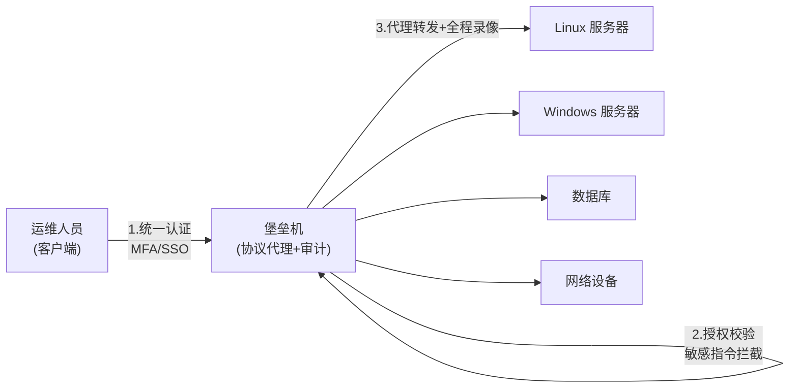

[toc]


# 堡垒机与服务器:从概念到落地实践

## 一句话先建立直觉

服务器(Server)是被访问、被保护的**资产**;

堡垒机(Bastion Host)是所有运维人员访问这些资产时**必须经过的唯一安全大门**。

从技术实现上讲,堡垒机通过**切断终端计算机对网络和服务器资源的直接访问**,而采用协议代理的方式,接管终端计算机对网络和服务器的访问。打个比方,堡垒机扮演"看门人",所有对服务器的请求都要从这扇门经过。

---

## 堡垒机、跳板机、服务器

初学者最容易混淆的是**跳板机(Jump Server)**、**堡垒机(Bastion Host)**、**服务器**三个词,它们不是一回事:

| 概念                     | 定位                                                         | 核心能力                             | 是否含审计             |
| ------------------------ | ------------------------------------------------------------ | ------------------------------------ | ---------------------- |
| **服务器(Server)**       | 被访问、被保护的资产(Linux/Windows 主机、数据库、网络设备等) | 承载业务                             | —                      |
| **跳板机(Jump Server)**  | 网络中转的"垫脚石"                                           | 只解决"能连上内网服务器"的连通性问题 | **不强调审计**         |
| **堡垒机(Bastion Host)** | 运维安全管控入口                                             | **认证、授权、账号、审计**四位一体   | **核心就是审计与管控** |

关键区别在于:**跳板机**仅提供服务器**登录安全**,而堡垒机在此基础上**增加了权限控制、行为审计等完整的安全管控能力**。也就是说,**跳板机是堡垒机的雏形,堡垒机 = 跳板机 + 全套安全管控**。

在中文语境里,堡垒机还有一个更正式的名字——**运维安全审计系统**。

---

## 为什么需要堡垒机:4A 模型

如果没有堡垒机,运维人员会用各自的账号密码直接 SSH 登录每一台服务器。当团队规模扩大,就会出现**账号混乱、身份冒用、权限交叉、操作无法追溯**等问题。堡垒机主要用来解决企业 IT 运维部门账号管理混乱、身份冒用滥用、授权控制不明确、操作行为不规范、事件责任无法定位等问题。

堡垒机的理论核心是 **4A 模型**,这是理解一切堡垒机产品的基础:

4A 是指认证 Authentication、授权 Authorization、账号 Account、审计 Audit,即将身份认证、授权、记账和审计定义为网络安全的四大组成部分。

| 维度     | 英文           | 解决的问题 | 通俗理解                       |
| -------- | -------------- | ---------- | ------------------------------ |
| **认证** | Authentication | 你是谁     | 确认操作者的真实身份           |
| **账号** | Account        | 用什么账号 | 集中管理资产账号与密码         |
| **授权** | Authorization  | 你能做什么 | 谁能登录哪些资产、执行哪些操作 |
| **审计** | Audit          | 你做了什么 | 全程录像、可回溯追责           |

用一句话概括堡垒机的价值:堡垒机是用来控制哪些人可以登录哪些资产(事先防范和事中控制),以及录像记录登录资产后做了什么事情(事后溯源)。对应到时间线上,就是**事前授权、事中管控、事后审计**的完整闭环。

---

## 工作原理:协议代理

堡垒机的技术本质是**协议代理(Proxy)**。运维人员不再直连服务器,而是先登录堡垒机,由堡垒机代理转发所有会话,并在中间完成鉴权、管控与录像。



三个阶段的管控逻辑:堡垒机在安全层面通过事前权限授权、事中敏感指令拦截,还为用户提供事后运维审计特性,用户在堡垒机中所进行的运维操作均会以日志的形式记录下来。因为所有流量都经过这道"翻译"环节,堡垒机才能实现**完整的操作留痕与责任定位**。

---

## 核心功能模块

现代堡垒机通常纳管多种资产类型:RDP/VNC 运维、SSH/Telnet 运维、SFTP/FTP 运维、数据库运维、Web 系统运维、远程应用运维。主要功能可归纳为:

- **访问控制**:通过对访问资源的严格控制,确保运维人员在其账号有效权限、期限内合法访问操作资源,降低操作风险。
- **账号管理**:无论是云主机还是局域网主机,都可以同步导入堡垒机进行账号集中管理与密码的批量修改,并可一键批量设置 SSH 密钥对。
- **资源授权**:采用基于角色的访问控制模型(RBAC),能够对用户、资源、功能进行细致化的授权管理。
- **指令审核**:针对敏感指令,堡垒机可以对非法操作进行阻断响应或触发审核,审核未通过的敏感指令将进行拦截。
- **审计录像**:支持事件查询、历史操作图形回放的安全审计功能,可完整重现运维、外包人员对远程主机的整个操作过程。

**认证方式**要足够灵活(这是统一入口的前提):本地认证(本地账号密码,一般支持强密码策略)、远程认证(第三方 AD/LDAP/Radius)、双因子认证(UsbKey、动态令牌、短信网关、手机 APP 令牌)。

---

## 一个重要的合规概念:三权分立

在等保(等级保护)与政务、金融等高安全场景中,堡垒机必须支持**三权分立(三员管理)**,这是初学者进入合规领域必须掌握的概念:

三员之三权:废除超级管理员;三员是三角色并非三人;安全保密管理员与审计员必须非同一个人。

- **系统管理员**:负责配置(资产、账号)
- **安全保密管理员**:负责授权
- **安全审计员**:负责审计

其设计目的是**避免"一个超级管理员通吃"**,让权力互相制约、互相监督。

---

## 部署方式

堡垒机通常采用**旁路部署**(不串接在业务流量主链路上,不影响业务),常见拓扑有:

| 部署模式        | 特点                                                         | 适用场景           |
| --------------- | ------------------------------------------------------------ | ------------------ |
| **单机部署**    | 结构简单,成本低                                              | 小规模、测试环境   |
| **HA 高可用**   | 双机热备,主备切换                                            | 中小企业生产环境   |
| **集群/分布式** | 横向扩展,支撑高并发                                          | 大规模资产、多机房 |
| **异地同步**    | 多地部署,堡垒机之间进行配置信息自动同步,运维人员访问当地堡垒机进行管理,不受网络/带宽影响,同时兼顾灾备目的 | 多数据中心、跨区域 |

堡垒机通常采用旁路部署,可选择单机或 HA 高可用部署方式。需要特别注意的一个**风险点**是单点故障:堡垒机代表一个单点故障,如果它不可用,其背后的所有资源都将无法访问;而设置多个堡垒机来缓解这一问题又意味着要管理另一套凭据——这正是要上 HA 或集群的根本原因。

---

## 主流方案对比

堡垒机领域可分为**国产开源、商业闭源、国外新兴(零信任方向)**三大阵营。国内读者对开源、免费、易用方案更感兴趣,这里重点突出。

### 国产开源标杆:JumpServer

**JumpServer 是目前中文世界事实上的开源堡垒机首选**,几乎是绕不开的答案。JumpServer 是国产开源堡垒机标杆项目,专业术语称为特权访问管理(PAM)工具,采用 Python+Django+Vue 技术栈实现分布式架构,通过 Web 浏览器即可实现对 SSH、RDP、Kubernetes、数据库等多种类型资源的统一访问管理。

其官方定位与特点:JumpServer 采用分布式架构设计、容器化部署方式,支持多种资产类型和大规模资产纳管,支持高并发访问;提供无插件纯 Web 使用体验,支持纳管主机、网络设备、数据库、云服务、Kubernetes、Web 等多种资产类型,支持审计录像存储在云端,内置多租户体系。英文站点数据显示其应用规模:JumpServer 是面向 DevOps 与 IT 团队的免费开源特权访问管理平台,可保护 SSH、RDP、Kubernetes 与数据库访问,部署量超过 50 万。

**版本演进提醒**(选型时务必注意):JumpServer 开源堡垒机 V2 版本(社区版)已于 2023 年 12 月 31 日停止维护支持,新项目应直接采用 **V3/V4** 版本。

### 国外阵营:向"零信任访问"演进

国外主流方案更强调**身份感知(identity-aware)与零信任(Zero Trust)**,某种程度上是在"重新定义堡垒机"这一模式:

| 方案                   | 定位                   | 授权模式       | 备注                                                         |
| ---------------------- | ---------------------- | -------------- | ------------------------------------------------------------ |
| **OpenSSH**            | 最基础的原生跳板方案   | 系统层         | 最古老也最知名的 SSH 服务器,绝大多数 Linux 发行版默认预装,是最容易上手的选择 |
| **Teleport**           | 身份感知多协议访问代理 | 基于证书/身份  | 理解 SSH、HTTPS、RDP、Kubernetes API、MySQL、MongoDB 和 PostgreSQL 等协议 |
| **HashiCorp Boundary** | 开源身份访问管理(IAM)  | 基于身份/角色  | 开源免费,基于身份的安全,基于角色和逻辑服务的授权,支持动态凭据 |
| **Warpgate**           | 轻量多协议堡垒         | —              | 面向 Linux 的智能 SSH、HTTPS、Kubernetes、MySQL 和 PostgreSQL 堡垒主机,无需专用客户端 |
| **Octelium**           | 自托管零信任平台       | 逐请求授权     | 免费开源的自托管零信任访问平台,提供对 SSH、K8s、数据库和内部 API 的无密钥访问,基于身份和 L7 感知、逐请求的访问控制 |
| **Cardea**             | 面向中小团队的轻量堡垒 | 文本文件即代码 | 带访问控制、会话录制和可选 TPM 密钥保护的 SSH 堡垒服务器,访问规则以文本文件形式存在,可在 PR 中审查 |
| **Bastillion**         | Web 版 SSH 控制台      | —              | 开源的基于 Web 的 SSH 控制台,集中管理系统的管理访问,充当管理员的堡垒主机 |

一个值得关注的**行业趋势**是"去堡垒机盒子化"——用身份层取代独立的堡垒机/VPN:Teleport 可作为 VPN 与堡垒机的替代方案,把跳板机、VPN 和代理基础设施整合进单一的、基于身份的访问层,而不是再加固一个盒子。

### 国产商业方案

国内商业堡垒机市场成熟,常见于等保合规采购场景。常见的商用产品有奇安信、亚信安全和绿盟等;此外启明星辰(天玥)、齐治、行云管家,以及阿里云、腾讯云的**云堡垒机**也是主流选择。

---

## 轻量替代:OpenSSH ProxyJump(适合小团队/个人)

如果你只是想安全地"经跳板机访问内网服务器",**不一定需要重型堡垒机**,OpenSSH 原生的 `ProxyJump`(`-J`)就能满足基础需求。如果堡垒主机可通过 `bastion.example.com` 访问,就能用 `-J` 命令行标志访问其背后(同一 VPC/LAN)的其他主机,`-J` 用于跳转到另一台主机。

命令行一次性用法:

```bash
# 经堡垒机 bastion.example.com 跳转到内网主机 10.5.5.10
ssh -J user@bastion.example.com user@10.5.5.10
```

为避免多次使用 `-J` 标志,可以配置客户端根据目标地址自动应用该标志。在 `~/.ssh/config` 中固化配置(跨平台通用,Windows 上的 OpenSSH 同样适用):

```sshconfig
Host bastion
    HostName bastion.example.com
    User ops

Host inner-*
    ProxyJump bastion
    User deploy

# 之后直接 ssh inner-web01 即可自动经堡垒机跳转
Host inner-web01
    HostName 10.5.5.10
```

> **跨平台提示**:Windows 10/11 已内置 OpenSSH 客户端,`ProxyJump` 语法与 `*nix` 完全一致;`~/.ssh/config` 在 Windows 上位于 `C:\Users\<用户名>\.ssh\config`。注意该文件应使用 **LF 换行**并妥善设置权限,避免因权限过宽导致 SSH 拒绝读取密钥。

**但要清醒认识 `ProxyJump` 的局限**:会话日志、数据库及其他协议的活动不会被捕获——也就是说它只解决"连通"和"收敛入口",**不具备审计录像与集中授权**,一旦有合规要求就必须上真正的堡垒机。

---

## 面向自动化运维时代的新要求

传统堡垒机是为"人工敲命令"设计的,但在 DevOps/AIOps 时代面临新挑战:随着 DevOps 与 AIOps 日益盛行,运维的 C 端从人工操作向自动化运维软件、运维机器人转变,从人机交互走向机机交互,传统意义上的堡垒机已无法满足自动化运维时代的运维审计需求。这也是为什么现代方案(如 Teleport、Boundary、Octelium)都在强调**可编程 API、动态凭据、机机访问审计**等能力。

---

## 安全与合规

### 等保合规是国内主要驱动力

在中国,堡垒机往往是**等保 2.0 合规**的刚需设备。按照等级保护 2.0 标准要求,在运维管理区域部署漏扫、堡垒机、数据库审计等安全设备,通过云平台安全和云租户安全的安全部署可以满足等保要求和行业最佳实践。

### 堡垒机自身的加固要点

堡垒机是"钥匙总管",一旦被攻破后果严重,因此其自身必须强化:实施多因素身份验证(MFA)增强用户认证;使用细粒度权限管理,遵循"最小特权原则";记录所有操作以便事后审查;监控异常行为(如频繁失败登录);使用 SSL/TLS 加密协议保障数据传输安全。

### 一个真实的近期漏洞警示

**开源不等于免维护**。JumpServer 官方 2026 年 9 月发布过高危安全公告:安全公告 JS-2026.09.09 披露了一个 API 过滤不当漏洞(CVSS 8.8,高危),使任何已认证用户可通过附加查询参数获取管理员 Access Key;影响 V3 >= v3.7.0 且 < v3.10.23 LTS,以及 V4 >= v4.0.0 且 < v4.10.19 LTS,应立即升级或应用 Nginx 缓解措施。

> **实践启示**:无论用哪款堡垒机,都要**订阅官方安全公告、及时打补丁、锁定到 LTS 版本**,并把堡垒机本身纳入定期漏洞扫描范围。

---

## 选型建议(给不同规模团队)

| 团队/场景                         | 推荐方案                                     | 理由                                   |
| --------------------------------- | -------------------------------------------- | -------------------------------------- |
| **个人/极小团队,只要收敛入口**    | OpenSSH `ProxyJump`                          | 零成本、原生、跨平台;但无审计          |
| **中小企业,要审计+合规,预算有限** | **JumpServer(开源版)**                       | 国产、中文友好、社区活跃、纳管资产丰富 |
| **DevOps/云原生/多协议+机机访问** | Teleport / Boundary / Octelium               | 身份感知、零信任、API 友好             |
| **政务/金融等强合规、要商务支持** | 国产商业堡垒机(奇安信、齐治、云厂商云堡垒机) | 满足等保、有厂商 SLA 与三权分立认证    |

**核心决策逻辑**:先问三个问题——① 是否有**审计/合规**硬性要求?(有则必须用真堡垒机而非跳板机)② 是**人工运维为主还是自动化运维为主**?(后者优先选 API 强的现代方案)③ 是否需要**厂商担责与商务支持**?(需要则考虑商业版)。

---

## 知识依据与截止说明

- **总体知识截止**:本文结合的联网检索结果时间跨度约为 2020 年至 **2026 年 9 月**,其中 JumpServer 安全公告为 2026 年 9 月最新信息。
- **来源可靠性说明**:概念与原理主要参考阿里云开发者社区、知乎、技术博客及安全内参(secrss)、FreeBuf 等;产品信息参考 **JumpServer 官网/官方安全公告**、Teleport(goteleport)官方博客、StrongDM、AlternativeTo 等聚合评测平台。请注意 CSDN、软件下载站等来源属于二手资料,关键结论(尤其版本号、CVE)已尽量以**官方来源**交叉印证,落地前仍建议以各产品**官方最新文档**为准。

