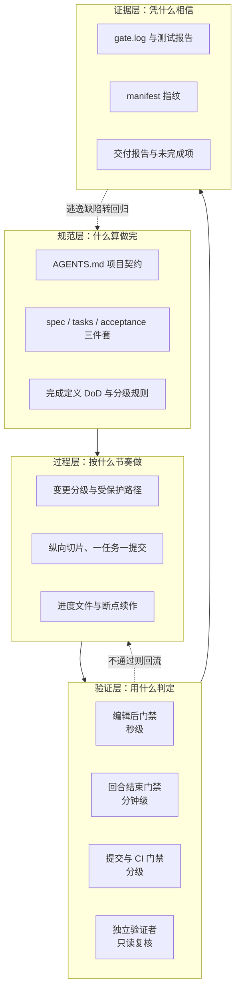

[toc]

## 摘要：AI 的"完成"必须是证据

**不能靠更长的提示词解决 AI 交付不完整的问题，只能靠外部的、可重复验证的系统。** 这套系统的目标是让每一句"做完了"都对应一条可复现的证据：一次真实执行的命令、一份绑定当前提交的报告、一条通过了的验收条款。

它要回答四个问题：

- **做完的标准是什么**：开工前就把验收条件写成编号化条款，而不是等 AI 自己解释。
- **由谁判定**：执行者与验收者分离，判定权交给门禁与独立复核，不交给生成代码的那一方。
- **证据在哪里**：命令、退出码、报告、截图、追踪、部署记录，且都必须绑定当前提交与拟交付制品。
- **代价是否匹配**：按风险分级投入验证强度，小改不做过测，大改不做漏测。

三个最容易混淆的判断：

- **写完不等于可交付**：页面有、接口通、单测绿，都可能只是半成品。可交付要求用户能真正完成一次任务，且失败路径有交代。
- **测试通过不等于质量达标**：测试只能证明它断言过的东西；覆盖率只说明代码被执行过。
- **工具齐全不等于验收有效**：工具只是手段，门禁必须能拒绝"不完整"，否则只是仪式。

**适用范围**：以 Web/前端项目与 AI 编码代理（CLI 或 IDE 内）为主要场景，其余技术栈可裁剪使用。**不覆盖**：原生移动、桌面、嵌入式与实时系统，医疗、金融、航空等受监管软件的专项合规，超大规模多租户迁移，以及具体云厂商的发布策略。

## 问题的本质：为什么 AI 会"做一半"

### 四条根因

1. **验证幻觉**。代理"认为"自己完成了。据该主题的一份 2026 年研究（原文引用 NL2Repo-Bench），失败分两类：**提前终止**（过度自信，显式调用完成动作但过早）与**非完成**（从不调用完成工具，因等待输入或超时结束）。推理模型的内部独白容易形成回音室。
2. **动作成功不等于任务完成**。加了按钮但点击报错，接口返回 200 但数据没落库，"测试应该能过"但从没执行。这类问题在动作层面全部"成功"。
3. **自我认证的激励错位**。代理同时是执行者和验收者，于是"控制退出条件"成了最省力的路径。**再增加一个 AI 评审也有同样的盲点**：它读的是同一份叙述。
4. **循环不等于可靠**。2026 年的另一项研究区分**提案搜索**（历史上曾有一次修订正确）与**完成可靠性**（保留正确状态、基于证据修订、仅在证据风险足够低时停止）。"曾经正确"的比例上升，可以与最终正确率下降同时发生。

还有第三种机制（据 WebCanvas 相关工作）：**路径难走时降低完成标准**——把做不到的部分判定为"不必要"，然后宣布完成。据报道，超长任务上当前前沿编码代理的解决率不到 30%。

### 一线症状

出现下列任一表述，即属于本主题要解决的问题：

- "应该可以了""基本完成""大致没问题""请手动验证一下"。
- 变更里留有 `TODO`、`FIXME`、空函数、假数据、被注释掉的测试、`test.skip`。
- 没有执行测试就宣称通过；只贴代码不贴命令与退出码。
- 验收条款只覆盖了顺利路径，错误、空态、权限、并发一概未提。
- 报告中"未完成项"一栏永远为空。

### 五条设计原则

| 原则 | 含义 | 落到什么机制 |
| --- | --- | --- |
| **验收权与执行权分离** | 谁写代码谁不签字 | Stop 门禁 + 只读独立验证者 |
| **证据驱动** | 只承认实际执行的命令与可复现的报告 | 统一验收入口 + 报告模板 + 追溯矩阵 |
| **风险分级** | 验证强度随风险变化，不按代码行数 | L0～L4 分级 + 只升不降 |
| **小步闭环** | 每个切片都能独立验收 | 纵向切片 + 一任务一提交 |
| **工具优先于提示** | 提示词指导行为，钩子与 CI 阻止不合格交付 | Hooks + git 钩子 + CI + 受保护路径 |

## 总体架构：四层防线



四层各解决一类失效：**规范层**解决"不知道什么算完成"，**过程层**解决"做到一半遗忘或越权"，**验证层**解决"自己说自己通过"，**证据层**解决"无法复核、报告过期"。

**缺任何一层都会被绕过**：只有规范没有门禁，规则会腐烂；只有门禁没有证据，无法解释为什么放行；只有证据没有独立复核，作者可以挑对自己有利的证据。

### 强制强度的四档阶梯

不是所有团队都能立刻上钩子。四档强度可按能力递进，也可叠加：

| 强度 | 机制 | 适用 | 局限 |
| --- | --- | --- | --- |
| 一档 | 外层 shell 循环调用验证脚本 | 任何 CLI 代理，零改造 | 粗糙，代理可能重复犯同一个错 |
| 二档 | Stop 钩子拦截"结束回合" | 支持 hooks 的代理（Claude Code、Codex 等） | 需防死循环，需处理退出码语义 |
| 三档 | 证据指纹 + manifest 校验 | 任何代理，几十行脚本 | 只能发现"改完又改"，不能判断对错 |
| 四档 | 独立检查者（换会话/换模型） | L2 及以上 | 成本高，且评估模型本身也可能过宽 |

### 与测试体系、平台门禁的关系

本文的"门禁"由两类机制组成，不能互相替代：

- **验收门禁**（本文重点）：回答"这次变更的验收条款是否真的被验证过"。它关心范围、执行、证据、版本一致性。
- **平台质量门**：回答"这批代码的聚合指标是否达标"。典型如 SonarQube 的新代码覆盖率、重复率、安全热点（见后文"基础设施"一章）。

平台门只做聚合，看不到"AI 是否偷偷删了测试""报告是不是旧版本""验收项是否全覆盖"，这些正是验收门禁要补的。反过来，验收门禁也替代不了平台门对全仓库技术债与安全热点的持续监控。

## 验收等级与风险分级

### 五级验收强度

**本文统一使用 L0～L4**。部分方案用 A0～A4 命名，思路相同；不同编号体系不要混用。

| 等级 | 典型改动 | 必须执行 | 人工验收 | 发布要求 |
| --- | --- | --- | --- | --- |
| **L0** 静态门禁 | 文案、注释、纯样式、翻译键、文档 | 格式化、Lint、类型检查、半成品扫描、结构完整性 | 无需，抽查即可 | 正常合并 |
| **L1** 局部验收 | 单组件内缺陷、函数边界、表单校验、局部文案与样式 | L0 + 受影响文件单测/组件测试 + 生产构建 | 实现者自检或轻量复核 | 正常合并 |
| **L2** 标准验收 | 局部行为改动、小范围新能力、状态或请求层调整、共享组件修改 | L1 + 全量单测、API 集成、E2E 冒烟、视觉回归、依赖扫描（改依赖时） | 独立只读复核（推荐）+ 人工抽查清单 | 常规发布，可快速回滚 |
| **L3** 严格验收 | 新页面、新用户故事、跨层联动、接口契约变化、依赖主版本升级 | L2 + 完整 E2E 场景、无障碍扫描、体积预算、覆盖率不下降 | 独立验证者逐条核对验收条款 | 预览环境 + 发布审批 + 监控 |
| **L4** 高风险验收 | 鉴权与权限、支付、批量写入、用户数据删除、破坏性迁移、架构或部署链路大改 | L3 + 威胁建模、迁移与回滚演练、隔离环境主动扫描、性能与恢复测试、类生产验收 | 双人或跨角色审批 + 产品验收 | 功能开关、灰度、明确 SLO、可观测、可验证回滚 |

**等级是下限，不是配额。**同一等级内部仍可按需加做检查；跨等级只许上调。

### 判级规则

1. **按风险判，不按行数判**。一行权限判断可以比几百行界面代码更重要。
2. **任一触发条件命中即取该级**，多项命中取最高，不取平均。
3. **新增可见功能最低 L3**：新页面、新路由、新用户故事、新的对外行为。
4. **触到地基即升级**：鉴权、支付、数据模型与迁移、全局状态结构、路由表、公共接口签名、依赖主版本，至少 L2；其中鉴权、支付、迁移、批量写入、删除数据按 L4。
5. **范围扩大必须重新判级**。实施中发现影响面超出预估，先停下重判，不得沿用原等级继续。
6. **工具缺失不构成降级理由**。缺工具是阻塞，不是低风险；未获批准前只能标"未验证"。
7. **判级权**：脚本或规则给出建议下限，代理只能等于或高于建议值；填写低于建议值的等级，门禁直接拒绝。人工可上调。
8. **等级写进可见位置**：PR 标题或标签（如 `[L2]`）、规格文件的 `Level:` 字段、交付报告首行。看不见的等级等于没有等级。

### 可量化的风险评分（可选用）

分级表适合日常沟通；当变更难以归类时，可用加权评分辅助：

`R = 3·Sec + 3·Data + 2·Blast + 2·Crit + 2·Contract + 2·Novel + UX + Recover`

每个因子取 0～3 分，理论上限 48 分。

| 因子 | 含义 | 0 分 | 3 分 |
| --- | --- | --- | --- |
| **Sec** 安全隐私 | 鉴权、越权、敏感数据、合规 | 静态文案 | 登录、授权、支付、隐私数据 |
| **Data** 数据风险 | 读写、迁移、不可逆操作 | 不读写数据 | 不可逆迁移、批量更新 |
| **Blast** 影响面 | 波及用户与模块 | 单一内部页面 | 全部用户、公共组件、核心入口 |
| **Crit** 业务关键度 | 失败的业务后果 | 辅助信息 | 无法登录、无法下单、数据丢失 |
| **Contract** 契约 | 接口、消息、依赖兼容性 | 无接口变化 | 公共 API 或消息格式变化 |
| **Novel** 新颖性 | 成熟度与不确定性 | 成熟既有模式 | 新框架、新依赖、需求含糊 |
| **UX** 交互复杂度 | 多端、响应式、可访问性、国际化 | 无 UI 变化 | 复杂交互、输入法、拖放 |
| **Recover** 恢复难度 | 出事后多难回退 | 开关可立即关闭 | 无回滚、缺监控、状态不可逆 |

分段映射：`0–6 → L0`、`7–14 → L1`、`15–24 → L2`、`25–34 → L3`、`35–48 → L4`。评分结果与"变更类型下限"取高。

### 不允许被等级降低的底线

以下七条适用于**所有**运行时代码变更，任何等级都不能豁免：

- 不引入明文密钥、令牌或生产敏感数据。
- 不留未经批准的 `TODO`、占位实现、假按钮、假数据。
- 不通过删除测试、放宽断言、加任意等待来掩盖失败。
- 不把失败改成警告，不用 `|| true` 或 `continue-on-error` 吞掉退出码。
- 不跳过构建、类型检查或必要测试，除非在报告中显式披露并获得批准。
- 不以"现有测试本来就失败"为由不记录基线。
- 不声称执行了没有执行的命令。

### 六种"不能算完成"

- 页面有了，但提交按钮没有真实逻辑。
- 接口返回成功，但数据没有落库。
- 只测了模拟接口，没有真实集成。
- 测试没跑，却写"应该可以正常运行"。
- 为通过而删用例、放宽断言、取消原有门槛。
- 把重大未完事项藏在"后续优化"里。

## 规范层：把"完成"写成文件

规范层的产物必须少而稳定：一个项目契约、一组变更文件、一份完成定义。文件越多越容易腐烂。

### 项目契约：`AGENTS.md`

`AGENTS.md` 是写给编码代理的项目契约，也是跨工具的单一事实来源。`CLAUDE.md` 用一行 `@AGENTS.md` 引用，`.cursor/rules/` 与 `.github/copilot-instructions.md` 只写差异。**不要维护多份互相抄写的规则**，漂移是必然的。

**篇幅**：控制在 200～300 行以内。它是一个索引，不是百科全书：架构、质量门、测试、安全、发布的长文档放在 `docs/`，这里只留链接。规则越短，遵循度越高。

**必须包含五类内容**：

| 内容 | 为什么必须 | 写法要求 |
| --- | --- | --- |
| **命令** | 代理要能自己验证 | 复制即用，带参数，指向唯一入口；构建命令只在 `Makefile` 或 `package.json` 定义一次 |
| **完成定义（DoD）** | 把"做完"变成可判定条件 | 用退出码、文件存在性、证据路径描述，不写"保证质量" |
| **分级规则** | 防止小改过测、大改漏测 | 触发条件 + 每级命令 + 只升不降 |
| **边界** | 明确禁区 | 分"总是做 / 先询问 / 绝不做"三层 |
| **工具缺失协议** | 防止私装依赖或静默降级 | 先自检、再申请、未批准则标阻塞 |

**边界要写成三层**，而不是一长串禁令：

- **总是做**：读取相关 ADR 与规格、先写失败测试再修缺陷、提交前跑统一入口、更新任务状态。
- **先询问**：新增依赖、修改 CI 与门禁配置、改数据库迁移、触碰受保护路径、需要系统级安装。
- **绝不做**：提交密钥、`--no-verify`、删测试或放宽断言、改黄金数据、擅自重置用户已有改动、伪造执行结果。

一个可直接改用的骨架：

```markdown
# AGENTS.md

## 项目概览
React 18 + TypeScript + Vite + Zustand。目录：src/features（按功能）、src/shared（共享组件与工具）、tests。
架构决策见 docs/adr/，改动架构前先读相关 ADR。

## 命令（唯一定义在 package.json，禁止自创变体）
- 安装: pnpm install --frozen-lockfile
- 开发: pnpm dev（端口 5173）
- 全量检查: pnpm verify --level L2
- 单测: pnpm test；单文件: pnpm test -- src/features/xxx/xxx.test.ts
- E2E: pnpm e2e；冒烟: pnpm e2e -- --grep @smoke
- 环境自检: pnpm doctor

## 变更分级（编码前必须在 PR 标题声明，只升不降）
- L0 文案/样式/注释；L1 单组件内缺陷；L2 局部行为、状态/请求层、共享组件
- L3 新页面/新用户故事/跨层联动；L4 鉴权、支付、批量写入、数据删除、破坏性迁移
- 不确定取高；范围扩大必须重判；工具缺失不得降级

## 完成定义（DoD）
1. `pnpm verify --level <声明等级>` 退出码 0，日志存入 evidence/
2. tasks.md 全部勾选，每条验收条款都有证据（测试名或报告路径）
3. 变更新增行无 TODO / FIXME / not implemented / test.skip
4. 新增用户可见行为至少有一条测试，测试名包含验收编号（如 AC-3）
5. 交付报告写明未做项、已知风险、回滚方式

## 边界
- 总是：先读规格与 ADR；修缺陷先写失败测试；每完成一个任务提交一次
- 先问：新增依赖、改 CI/门禁/测试配置、改迁移文件、系统级安装
- 绝不：提交密钥；`--no-verify`；删测试/放宽断言/降覆盖率；改黄金数据；伪造结果

## 工具缺失
先跑 `pnpm doctor`；缺失时按模板申请（能力、证据、命令、影响、替代方案），
获批准后再安装；未批准只能标记"未验证"，不得宣称通过。

## 修缺陷的固定顺序
1) 用测试复现 2) 确认测试失败 3) 最小修复 4) 测试转绿 5) 跑该等级全量 6) 回归相邻功能

## 进度与续作
每个变更目录维护 tasks.md 与 progress.md；新会话先读这两个文件再动手。
```

**两个实操细节**：

- **确认工具真的读这个文件**。`AGENTS.md` 是文件约定，不是所有代理都默认加载；不同工具的读取范围与优先级不同，需要实测。
- **指令冲突时停下来报告**，不要自行选择。规则之间的冲突应当被移除，而不是留给代理解释。

### 规格与任务：四件套

每个非平凡变更建一个目录，放四份文件。L0/L1 可合并为一份 PR 检查表，不必强行凑齐。

| 文件 | 作用 | 必备字段 |
| --- | --- | --- |
| `proposal.md` 或 `spec.md` | 做什么、为什么、边界 | 背景、目标、**非目标**、影响范围、`Level:` 与理由 |
| `plan.md` | 怎么做 | 受影响模块、数据变更、执行顺序、风险 |
| `tasks.md` | 怎么拆 | 原子任务、验收条款编号、验证命令、证据栏 |
| `acceptance.md` | 凭什么算通过（考卷） | 编号、场景、预期结果、测试方式、是否必需、执行状态、证据位置 |

**验收条款必须编号且可测**：

- 用 Given-When-Then，或 EARS 句式："当 <触发条件> 时，系统应 <响应>"。
- 一条条款只描述一个可观察结果；禁止"优化体验""提升性能"这类不可判定的描述。
- 编号在测试名中回引（`it('AC-3 空文件时拒绝并提示', ...)`），这是自动追溯的基础。
- **区分"必需"与"可选"**：可选条款未做时写进报告，而不是悄悄删掉。
- **Test Oracle 必须来自需求、协议或已确认样例**，不能从刚写出来的实现反向生成——否则测试只是在复述实现。

**任务清单要带状态与证据栏**：

```markdown
# tasks.md — 看板 CSV 导出（等级 L3）

## T1 [x] 数据层: toCsv 序列化
验收: AC-2, AC-6
验证: pnpm test -- src/features/export/toCsv.test.ts
证据: toCsv.test.ts 全部通过（8 用例，含 BOM 断言）

## T2 [~] UI: 导出按钮与空态禁用
验收: AC-3, AC-5
验证: pnpm test -- src/features/export/ExportButton.test.tsx
证据: （待填）

## T3 [ ] 集成: 触发下载与文件名
验收: AC-1
验证: pnpm e2e -- --grep "AC-1"
证据:
```

状态词汇统一为四态：`[ ]` 未开始、`[~]` 进行中（**同一时刻最多一个**）、`[x]` 完成（必须有证据）、`[!]` 阻塞（必须写原因与待决问题）。代理不能把 `[!]` 改回 `[x]` 除非对应问题已解决并有新证据。

### 规格驱动开发的取舍

| 方案 | 形态 | 适合 | 代价 |
| --- | --- | --- | --- |
| **手写四件套** | 两个 Markdown + 两个可选文件 | 小团队、存量项目 | 无工具成本，靠纪律 |
| **OpenSpec** | Node 工具，Propose / Apply / Archive 三步，每次变更约 4 个文件 | 存量项目的增量变更 | 流程轻，无阶段门禁 |
| **Spec Kit** | Python CLI，constitution / specify / plan / tasks / implement 完整流水线 | 新项目、需要强护栏 | `plan.md` 可达数百行，上下文开销大 |

**判据**：把框架生成的文档全部载入后，占用超过上下文窗口的 15%～20%，就应精简 Spec Kit 或改用 OpenSpec。**任何规格工具都不验证代码是否符合规范**，这一步只能由门禁与测试完成。

## 执行层：分级权限与推进纪律

### 受保护路径

代理最容易"顺手改绿"的地方必须设防。受保护路径清单：

- `tests/`（尤其 `tests/e2e/fixtures/` 等黄金数据）、`**/*.test.ts`、`**/*.spec.ts`
- `.github/workflows/`、`.gitlab-ci.yml`、`lefthook.yml`、`.husky/`
- `scripts/verify.*`、`scripts/gate.*`、`scripts/doctor.*`、钩子脚本
- `eslint.config.*`、`tsconfig*.json`、`vitest.config.*`、`playwright.config.*`
- `.claude/`、`AGENTS.md`、`package.json` 的 `scripts` 段
- 迁移目录、`.env.example`、部署与基础设施配置

**两种实现方式**：

- **代理钩子拦截**：PreToolUse 阶段拒绝写入受保护路径，或要求变更理由。
- **Git 钩子 + CI 复检**：提交信息必须包含约定标记（如 `[gate-change]`）才允许改动受保护路径；CI 用同一份清单复检，防止本地被绕过。

**改门禁本身必须独立审查**：修改验收规则、测试过滤、覆盖率阈值、CI 配置的变更，不能由实施该功能的同一代理自行批准。

### 推进纪律

1. **计划先行**：先输出影响文件清单与任务拆分，等人工确认后再动手。
2. **纵向切片**：每个切片尽量形成一条可运行、可验收的用户闭环（入口 → 交互 → 接口 → 持久化 → 结果展示），而不是先堆完所有页面再串联。
3. **一任务一提交**：提交信息带任务编号与验收编号，便于追溯与回滚。
4. **粒度上限**：单任务不超过约 5 个文件；同一会话不超过约 5 个任务。超过就拆。
5. **红-绿-重构**：修缺陷先让测试失败，再改实现；重构时锁定既有 E2E 用例，不允许修改断言。
6. **断点续作**：任务开始标 `[~]`，完成填证据再标 `[x]`；新会话先读 `tasks.md` 与最近提交，不从记忆续写。

### 弱模型的额外约束

同一套规则对能力较弱的模型要收得更紧：

- 任务粒度再降一档：L3 功能拆成 5～15 条任务，一条任务一次提交。
- 指令模板化：把常用动作写成可直接复制的提示模板，减少自由发挥。
- 失败处理固定化：只修当前失败的那一步，同一方法连续两次失败即停止并报告，不重复试错。
- 设三个停止条件：最大步数、最大工具调用数、token 预算；触顶先存检查点，再报告。
- 禁止并行子代理改动同一仓库；禁止自评"已完成"；考官用更强的模型。
- 外层循环兜底：Stop 钩子最多打回一次，外层最多再跑 5 轮，仍失败转人工。

**强弱分工**：弱模型负责实现与局部修复，强模型或人负责判级复核、独立验证与门禁裁决。

### 长任务的持久化状态

跨上下文、跨会话的任务必须把状态写进文件，而不是留在对话里。两种做法可选其一：

- **机器可读**：`task-state.json`，字段包括 `taskId`、`acceptanceLevel`、`status`（`planned / in_progress / blocked / failed / verified`）、`requirements[]`（每项含 `id`、`state`、`evidence[]`）、`blockers[]`、`nextAction`。
- **人可读**：`progress.md`，写清当前等级、已完成与证据、未完成、阻塞、下一步的具体操作。

**状态只能依据证据更新**：写了代码但没验证，状态仍是 `in_progress`；无法建立基线时为 `blocked` 或 `partial`，绝不是 `done`。中断时必须交代"哪些已验证、哪些未验证、当前是否可运行、下一条具体操作"。

## 验证层：门禁的六层与统一入口

### 门禁分层

| 层次 | 时机 | 检查内容 | 目标时长 | 失败后果 |
| --- | --- | --- | --- | --- |
| **编辑后** | 每次写文件 | 单文件格式化、Lint、必要时类型检查 | 秒级 | 错误立即回传给代理 |
| **回合结束** | 代理想结束回合 | 该等级的统一验收 + 完整性扫描 | 分钟级 | 打回，不允许结束 |
| **提交** | `git commit` / `push` | 暂存文件 Lint 与类型、受保护路径、推送前 L1 | 秒级到分钟级 | 拒绝提交 |
| **CI** | PR 打开/更新 | 按标签取最高等级跑全套，上传报告与追踪 | 十分钟级 | 阻止合并 |
| **独立验证** | 门禁通过后 | 只读会话逐条核对验收条款 | 一次性 | 报告不通过项，回流修复 |
| **人工** | L2 起 | 按清单操作，L3/L4 逐条验收 | 一次性 | 签字或退回 |

**分工原则**：编辑后只做快检查，**绝不在这里跑全量测试**；昂贵的检查留给回合结束与 CI。指令说"总是"只是"通常"，**钩子才是"每一次"**。

### 统一入口

代理、人、CI 必须调用同一个入口，避免"本地绿、CI 红"的双轨。

**接口约定**：

- `verify --level L0..L4`：按等级选择检查集。
- `--scope <dir|glob>`：限定范围，仅对 L0/L1 生效，L2 起强制全量。
- `--no-e2e`：无浏览器环境下跳过浏览器步骤，并在报告中标注。
- `--ci`：不启动开发服务器，输出 CI 报告格式。
- 退出码：`0` 全部通过，`1` 有失败步骤（fail-fast），`2` 参数错误。
- 输出约定：每步开始打印 `==> RUN <step>`，失败打印 `==> FAIL <step>`，末行打印等级与 `ALL PASS`，便于代理解析。

**各等级的步骤映射**：

| 等级 | 步骤 |
| --- | --- |
| L0 | 格式化 → Lint → 类型检查 → 半成品扫描 → 结构完整性 |
| L1 | L0 + 受影响文件单测/组件测试 + 生产构建 |
| L2 | L1 + 全量单测（含覆盖率）+ API/集成 + E2E 冒烟 + 视觉回归 |
| L3 | L2 + 完整 E2E 场景 + 无障碍扫描 + 体积预算 + 依赖审计 |
| L4 | L3 + 迁移与回滚演练 + 隔离环境主动扫描 + 性能与恢复测试 |

一个可直接改造的 bash 骨架：

```bash
#!/usr/bin/env bash
# verify.sh - 统一验收入口（本地与 CI 共用）
# 用法: ./verify.sh [-l L0..L4] [-s <scope>] [--no-e2e] [--ci]
set -euo pipefail

level="L1"; scope=""; e2e=1; ci=0
while [ $# -gt 0 ]; do
  case "$1" in
    -l|--level)   level="${2:-}"; shift 2 ;;
    -s|--scope)   scope="${2:-}"; shift 2 ;;
    --no-e2e)     e2e=0; shift ;;
    --ci)         ci=1; shift ;;
    -h|--help)    sed -n '2,3p' "$0"; exit 0 ;;
    *)            echo "未知参数: $1" >&2; exit 2 ;;
  esac
done

case "$level" in
  L0|L1|L2|L3|L4) ;;
  *) echo "未知等级: $level" >&2; exit 2 ;;
esac

step() { echo "==> RUN $1"; }

fail() { echo "==> FAIL $1"; exit 1; }

step "format";  pnpm exec prettier --check . || fail "format"
step "lint";    pnpm exec eslint . --max-warnings=0 || fail "lint"
step "types";   pnpm exec tsc --noEmit || fail "types"
step "stubs";   ./scripts/scan-stubs.sh || fail "stubs"
step "structure"; node scripts/check-structure.mjs || fail "structure"

run_level() { # 输出 1 表示该等级需要执行对应步骤
  case "$1" in
    L0) echo 0 ;;
    L1) [ "${2}" = "L1" ] && echo 1 || echo 0 ;;
    L2) case "$2" in L1|L2) echo 1 ;; *) echo 0 ;; esac ;;
    L3) case "$2" in L1|L2|L3) echo 1 ;; *) echo 0 ;; esac ;;
    L4) echo 1 ;;
  esac
}

if [ "$(run_level "$level" L1)" = 1 ]; then
  if [ -n "$scope" ] && [ "${level#L}" -le 1 ]; then
    step "unit:scoped"; pnpm exec vitest run "$scope" || fail "unit:scoped"
  else
    step "unit"; pnpm exec vitest run || fail "unit"
  fi
  step "build"; pnpm run build || fail "build"
fi

if [ "$(run_level "$level" L2)" = 1 ]; then
  step "coverage"; pnpm exec vitest run --coverage || fail "coverage"
  if [ "$e2e" = 1 ]; then
    step "e2e:smoke"; pnpm exec playwright test --grep @smoke || fail "e2e:smoke"
  fi
fi

if [ "$(run_level "$level" L3)" = 1 ] && [ "$e2e" = 1 ]; then
  step "e2e:full"; pnpm exec playwright test || fail "e2e:full"
  step "a11y"; pnpm exec playwright test --grep @a11y || fail "a11y"
fi

echo "==> ALL PASS (level=${level} scope=${scope:-all} ci=${ci})"
```

Windows 环境有三种等价做法：用 Git Bash 或 WSL 执行、改为 PowerShell 脚本、或把核心门禁统一写成 Node（`.mjs`），彻底消除 shell 差异。**核心门禁优先选 Node**，因为它跨平台行为一致。

这份骨架只实现到 L3 的通用步骤；**L4 的迁移演练、隔离环境主动扫描与性能恢复测试通常由独立流水线或专项脚本承担**，不要硬塞进每次运行。

`package.json` 里只保留入口别名，不复制检查逻辑：

```json
{
  "scripts": {
    "verify": "node scripts/verify.mjs",
    "verify:fast": "node scripts/verify.mjs --level L1",
    "verify:release": "node scripts/verify.mjs --level L4"
  }
}
```

### 钩子：把门禁变成"无法绕过"

两类钩子足够覆盖绝大多数场景：

- **编辑后钩子**（PostToolUse）：只格式化并检查**本次修改的那一个文件**，把错误回传给代理。超时控制在 30～60 秒，超时就跳过，别拖死会话。
- **回合结束钩子**（Stop）：代理想结束回合时运行统一验收；不通过就阻止结束。

三条容易踩空的语义：

1. **`stop_hook_active` 必须检查**。钩子打回后代理会再次尝试结束，若不判断该字段会无限循环。约定是"第二次放行但标记未完成"。
2. **退出码语义因工具而异**。Claude Code 支持两种：输出 `{"decision":"block","reason":"..."}` 并退出 `0`，或直接退出 `2` 并把 stderr 回传给代理；**退出 `1` 不会阻断**，只记录错误——这是最常见的失效原因。
3. **打回理由必须可执行**。只贴结论没有用，要贴最近 40 行失败输出与"禁止改门禁或跳过测试"的明确要求。

```bash
#!/usr/bin/env bash
# stop-gate.sh - 回合结束门禁
# 输入: stdin 的 JSON（含 stop_hook_active）
# 退出码: 0 允许结束; 2 打回（stderr 回传给代理）
set -u
payload="$(cat)"
active="$(printf '%s' "$payload" | jq -r '.stop_hook_active // false')"

# 没有进行中的任务时视为日常问答，直接放行
fs="$(cat "${CLAUDE_PROJECT_DIR:-.}/tasks.md" 2>/dev/null || true)"
if ! printf '%s' "$fs" | grep -Eq '^## T[0-9]+ \[~\]'; then
  exit 0
fi

level="$(printf '%s' "$fs" | grep -Eo '等级[:：] *L[0-4]' | head -n1 | grep -Eo 'L[0-4]')"
level="${level:-L1}"

if out="$("${CLAUDE_PROJECT_DIR:-.}"/scripts/verify.sh -l "$level" 2>&1)"; then
  exit 0
fi

reason="verify ${level} 未通过。不得修改门禁、删除测试或放宽断言。最近输出：
$(printf '%s' "$out" | tail -n 40)"

if [ "$active" = "true" ]; then
  # 已由钩子触发的第二次结束：放行但标记未完成，交人工处理
  echo "UNFINISHED: 门禁未通过，需人工介入" >&2
  exit 0
fi

printf '%s' "$reason" >&2
exit 2
```

**没有钩子的工具**退化为三层兜底：`lefthook` 提交钩子 + CI 门禁 + 规则文件要求代理粘贴输出。强度下降，但仍能拦住大部分"假完成"。

```yaml
# lefthook.yml
pre-commit:
  parallel: true
  commands:
    protected:
      run: node scripts/check-protected.mjs
    lint:
      glob: "*.{ts,tsx,js,jsx}"
      run: pnpm exec eslint {staged_files}
    format:
      glob: "*.{ts,tsx,js,jsx,css,md,json}"
      run: pnpm exec prettier --check {staged_files}
    types:
      run: pnpm exec tsc --noEmit
pre-push:
  commands:
    verify:
      run: pnpm verify --level L1
```

选择 `lefthook` 而不是 `husky` 的主要理由是 Windows 兼容性与并行执行；代价是多一个二进制。保持单一选择即可，不要在仓库里同时用两套。

### CI 门禁

CI 与本地必须调用同一入口，只是等级可能更高。要点：

- **等级从标签解析，取最高**，缺省 L2。`grep -oE 'L[0-4]' | sort -r | head -n1` 即可。
- **`permissions` 最小化**，`timeout-minutes` 必设，`fetch-depth: 0` 才能做差异与追溯。
- **报告始终上传**（`if: always()`），并绑定本次运行标识，否则失败时无从诊断。
- **汇总任务必须始终执行**。GitHub 的必需检查可以接受 `successful`、`skipped`、`neutral` 三种状态，"平台显示允许合并"不等于"该跑的验收真跑过"。只加 `always()` 也不够，还要用 `needs` 主动校验每个必需任务确实成功且报告存在。

```yaml
name: verify
on:
  pull_request:
    types: [opened, synchronize, labeled, unlabeled]

permissions:
  contents: read

jobs:
  gate:
    runs-on: ubuntu-latest
    timeout-minutes: 30
    steps:
      - uses: actions/checkout@v4
        with: { fetch-depth: 0 }
      - uses: pnpm/action-setup@v4
      - uses: actions/setup-node@v4
        with: { node-version: 22, cache: pnpm }
      - run: pnpm install --frozen-lockfile

      - name: Resolve level
        id: level
        run: |
          level="$(printf '%s' '${{ join(github.event.pull_request.labels.*.name, ' ') }}' \
            | grep -oE 'L[0-4]' | sort -r | head -n1)"
          echo "value=${level:-L2}" >> "$GITHUB_OUTPUT"

      - name: Install browsers (skip for L0)
        if: steps.level.outputs.value != 'L0'
        run: pnpm exec playwright install --with-deps chromium

      - name: Verify
        run: pnpm verify --level ${{ steps.level.outputs.value }} --ci

      - uses: actions/upload-artifact@v4
        if: always()
        with:
          name: reports-${{ github.run_id }}
          path: |
            playwright-report/
            test-results/
            coverage/
            evidence/
```

**必须拒绝的八种情形**（汇总器要逐条检查）：

1. 必需检查失败、取消或超时。
2. 检查根本没有运行，或报告缺失。
3. 测试组没有收集到任何测试（零用例仍为绿）。
4. 关键验收项被全部跳过。
5. 只有重试才通过（按不稳定测试政策处理，不得静默转为通过）。
6. 报告对应的源码或构建与当前提交不一致。
7. 关键旅程不可用、存在越权或数据丢失风险。
8. 人工验收或发布演练未完成。

**必需脚本不存在时直接失败**，不要用 `--if-present` 之类的开关掩盖。

### 独立验证者

**为什么需要**：门禁只能证明"声明的检查都通过了"，不能证明"该检查的都被声明了"。独立验证者补的是覆盖面与判断力。

**输入顺序很重要**：先给原始需求、验收条款、风险等级、代码差异、测试入口与运行环境；**不要先给实现代理的长篇解释**，否则会被它的叙述锚定。

**权限**：只读。拒绝写文件、拒绝改测试、拒绝执行部署；只能运行测试与浏览器操作。

**输出格式固定**：逐条给出"充分 / 不充分 / 缺失"、证据路径，以及"实现做了但未声明的变更"清单。

**起点**：L2 起推荐，L3 起强制，L4 由双人或跨角色承担。**成本**是真实的，所以只在需要判断力的时候用；确定性检查交给门禁。**单纯再加一个 AI 评审并不可靠**，它的价值建立在"确定性门禁已经跑过"之上。

## 测试与验收设计

### 测试层次

经典**测试金字塔**给出投资比例：单元 70%～80%、集成 15%～20%、端到端 5%～10%。倒置金字塔会让流水线又慢又脆：大量 E2E 里一个选择器改动就能让几十条用例同时红。

在 Web 前端场景，可以用更细的五层：

| 层次 | 验证什么 | 工具候选 | 特点 |
| --- | --- | --- | --- |
| **静态检查** | 类型、规范、死代码 | `tsc --noEmit`、ESLint/Biome、`knip` | 最快，零运行成本 |
| **单元测试** | 纯函数、状态转换、边界 | Vitest、Jest | 毫秒级，定位精确 |
| **组件测试** | 用户可见交互、可访问名称 | Vitest + Testing Library、Playwright Component | 不启动真实浏览器时最快；jsdom 布局能力有限 |
| **集成测试** | 请求层、数据一致性、第三方契约 | Vitest + MSW、Testcontainers、Pact | 用真实依赖替代 mock 失真 |
| **端到端 / 冒烟** | 关键用户旅程、真实后端 | Playwright | 最贵最慢，只覆盖核心路径 |

**分层的判断标准**：能在低层断言的，不要上高层；但**凡是"用户能否真正完成这件事"，必须有至少一条高层用例**。

### 测试维度：八个容易漏的面

层次回答"在哪测"，维度回答"测什么"。两者正交，可叠加使用。

| 维度 | 典型检查 | 主要落在 |
| --- | --- | --- |
| **用户主路径** | 真实入口进入、填写、提交、看到结果，必要时编辑与删除 | 组件 + E2E |
| **状态完整性** | 加载中、空数据、校验错误、提交中、成功、失败、重试 | 组件 + 故障注入 |
| **输入与边界** | 空值、超长、中文、特殊字符、日期、格式错误、大小限制 | 单元 + 接口 |
| **数据与一致性** | 刷新后仍在；重复提交不重复；失败不半写入 | 真实接口 + 数据库 |
| **权限与安全** | 不只隐藏按钮，直调 API 必须被拒；用户数据隔离 | 服务端 + 真实接口 |
| **故障与恢复** | 超时、服务错误、登录过期、响应乱序、重复点击 | 模拟 + 关键真实恢复 |
| **视觉与可访问性** | 小屏、长中文、键盘、焦点、标签、错误提示 | 浏览器 + 视觉对比 + a11y |
| **发布与运行** | 生产构建、深链刷新、静态资源、配置、迁移、健康检查、回滚 | 部署验收 + 上线冒烟 |

### 设计方法

| 方法 | 擅长发现 | WebUI 示例 | 适用等级 |
| --- | --- | --- | --- |
| 等价类划分 | 输入类别遗漏 | 有效/无效/空邮箱 | L1 起 |
| 边界值分析 | 长度、范围、分页 | 0、1、最大长度、最大+1 | L1 起 |
| 决策表 | 多条件组合 | 角色 × 资源所有者 × 操作类型 | L2 起 |
| 状态转换 | 非法状态跳转 | 活跃→停用→恢复；处理中不可重复提交 | L2 起 |
| 负面测试 | 错误处理缺陷 | 401/403/404/409/500、超时 | L2 起 |
| 属性测试 | 大量输入组合 | 查询参数序列化再解析等价 | L3 起 |
| 差分测试 | 重构前后行为漂移 | 同输入在新旧实现下结果一致 | L3 起 |
| 故障注入 | 恢复与幂等 | 延迟、断网、重复响应、部分失败 | L3 起 |
| 变异测试 | 有覆盖但断言无效 | 改权限判断后测试必须失败 | L3 起（核心逻辑） |
| 探索性测试 | 未预见的交互组合 | 连点、后退、刷新、切换账号 | L2 起 |
| 威胁建模 | 设计层安全缺陷 | 越权、IDOR、CSRF、敏感信息泄漏 | L4 |

### 真实性与 Mock 边界

- **至少一条关键旅程必须走真实后端与独立测试数据**，不 mock 自家核心 API。核心链路全 mock 的 E2E 只是在测试 mock。
- **组件测试不得 mock 被测组件自己的子模块**；E2E 只 mock 不受控的第三方。
- **等待基于状态而非固定时长**：用元素可见、网络空闲等条件，禁止 `sleep(3000)` 这类"看起来稳"的写法。
- **数据要隔离**：每条用例自建数据、自清理；验证新增数量时先核对操作前后的差异，避免残留数据造成假通过。
- **修缺陷先复现**：先让回归用例在旧代码上失败，再确认修复后通过。

### 可访问性与性能

**可访问性**以 **WCAG 2.2 A 与 AA** 为目标，且针对完整页面及其响应式变化判定，不能只扫某个组件就宣称整页合规。

- 自动扫描（`axe-core`）只覆盖结构性问题，`incomplete` 项需要人工判断。
- 人工必做八项：仅键盘能否完成主流程、焦点顺序与可见性、屏幕阅读器抽查、**200% 及以上缩放**、高对比度/强制颜色模式、减少动画设置、中文输入法与组合输入、错误信息是否可理解。
- 元素必须暴露到无障碍树，否则代理与读屏器都"看不见"，只能靠脆弱的 CSS 选择器。

**性能**的良好阈值：**LCP ≤ 2.5s、INP ≤ 200ms、CLS ≤ 0.1**。三个边界必须说清：

- 这些是**真实用户字段数据**的**第 75 百分位**，不是一次实验室跑分。
- CI 里的 Lighthouse 是**实验室环境**，用途是"防相对基线回退"，不能冒充真实用户性能。
- 性能验收要**事先约定**环境、数据规模、并发量与阈值；压测工具必须配置失败阈值，否则只产出好看的图。

### 安全验收

安全不是上线前扫一次。按六个位置分层：

| 位置 | 检查什么 | 典型工具 |
| --- | --- | --- |
| 提交前 | 密钥、危险配置、明显不安全的 API 调用 | `gitleaks`、Lint 规则 |
| PR | SAST、依赖变化、许可证、锁文件 | Semgrep、CodeQL、Dependency Review、OSV-Scanner |
| 构建 | 镜像漏洞、SBOM、来源证明 | Trivy、Syft、SLSA attestation |
| 测试环境 | 被动扫描、响应头、Cookie、TLS | ZAP Baseline |
| 严格验收 | 主动扫描、越权、业务逻辑 | ZAP Full/Automation、人工 |
| 运行时 | 告警、审计日志、异常模式 | 可观测平台、SIEM |

**标准定位**：应用安全需求对照**固定版本**的 OWASP ASVS；安全测试设计参考 OWASP WSTG——**WSTG 是测试指南，不是跑一次就安全的扫描器**。

**主动扫描只能用于自有或明确授权的环境**；它也发现不了大部分业务逻辑与访问控制缺陷，仍需要人工设计越权用例。

### 防"假通过"专题

这是整套体系的高价值区。汇总常见形态与对策：

| 假通过形态 | 检测手段 |
| --- | --- |
| 只写"应该可以运行" | 只承认实际执行的命令、退出码与报告 |
| `test.only` 导致大部分用例漏跑 | `forbidOnly: true`（但不禁止所有跳过） |
| 重试才通过算绿 | `failOnFlakyTests: true`（Playwright 1.52+）；重试通过标记为 flaky，不计入稳定通过 |
| 零用例或全跳过仍绿 | 汇总器检查"该测试组是否收集到用例""必需项是否全跳" |
| CI 显示绿但任务被跳过 | 始终执行的汇总任务 + `always()` + `needs` 校验报告存在 |
| 报告来自旧版本 | 报告绑定 commit 与构建标识，旧报告判不通过 |
| 删测试、降断言、放宽阈值 | 受保护路径 + 独立审查 + 用例数不得下降 |
| 只测 Mock | 至少一条真实 API + 独立测试库的关键旅程 |
| 截图冒充正确 | 截图只证明"看起来对"，业务正确性要靠断言 |
| 覆盖率掩盖遗漏 | 覆盖率只作辅助，门禁检查验收条款是否真被覆盖 |
| 数据残留造成虚增 | 核对操作前后差异，数据可清理 |
| 实现者自批 | 实现与验证角色分离 |

Playwright 的一份防假通过配置（按项目裁剪）：

```typescript
const baseURL = process.env.ACCEPTANCE_BASE_URL;
if (!baseURL) throw new Error('缺少 ACCEPTANCE_BASE_URL，拒绝运行验收');

export default defineConfig({
  testDir: './tests/e2e',
  forbidOnly: true,
  failOnFlakyTests: true,
  retries: 1,
  globalTimeout: 10 * 60_000,
  reporter: [
    ['list'],
    ['json', { outputFile: 'test-results/results.json' }],
    ['html', { outputFolder: 'playwright-report', open: 'never' }],
  ],
  use: { baseURL, trace: 'on-first-retry', screenshot: 'only-on-failure' },
  projects: [{ name: 'chromium', use: { ...devices['Desktop Chrome'] } }],
});
```

几个字段的边界：`baseURL` 只保证指向受控站点，不保证连的是测试数据源；`forbidOnly` 挡不住 `test.skip`；`retries` 保留一次诊断机会，但配置了 `failOnFlakyTests` 后，重试成功仍判失败；`trace` 要在 CI 上传，否则失败无法复盘。

## 完整性专项：反"做一半"

**三道独立防线**，任何一道单独都会被绕过：

1. **扫描**：变更新增行里的占位符与逃逸标记。
2. **结构**：新代码有没有真正接入系统。
3. **可达性**：用户真的能走到、点得到。

### 占位符与逃逸标记扫描

**只扫本次新增行**，避免历史债务淹没信号。匹配意图分四类：

| 类别 | 典型形态 | 处理 |
| --- | --- | --- |
| 未完成标记 | `TODO`、`FIXME`、`XXX`、`HACK`、`待实现`、`占位`、`not implemented` | 阻断；若确需保留，必须带 issue 编号并在 PR 说明 |
| 空实现 | `=> {}`、函数体只有 `return null/undefined`（启发式） | 阻断，需人工确认是否为合法桩 |
| 测试逃逸 | `.skip(`、`.only(`、`xit(`、`xdescribe(` | 阻断；删除的测试文件同样阻断 |
| 检查逃逸 | `@ts-ignore`、`@ts-expect-error`、`eslint-disable`、`biome-ignore` | 阻断或要求说明 |

```bash
#!/usr/bin/env bash
# scan-stubs.sh - 扫描本次改动新增行中的半成品与逃逸标记
# 用法: ./scripts/scan-stubs.sh [base_ref]   默认与 origin/main 比较
set -euo pipefail
base="${1:-origin/main}"
pattern='TODO|FIXME|XXX|HACK|待实现|占位|placeholder|not implemented|NotImplemented|@ts-ignore|@ts-expect-error|eslint-disable|biome-ignore|\.skip\(|\.only\(|xit\(|xdescribe\('

if ! git rev-parse --verify --quiet "$base" >/dev/null; then
  echo "基线引用不存在: $base（先 git fetch）" >&2
  exit 2
fi

hits="$(git diff "$base"... --unified=0 -- . ':!*.md' \
  | grep -E '^\+' | grep -v '^+++' | grep -nE "$pattern" || true)"

if [ -n "$hits" ]; then
  echo "$hits" | sed 's/^/新增行命中: /'
  echo "如确需保留，请在 PR 中逐条说明理由并获得人工批准" >&2
  exit 1
fi
echo "stub scan: clean"
```

### 结构完整性

Web 前端最容易出现的"接入遗漏"有四项，建议写成脚本逐项断言：

- **路由注册**：新增页面在路由表中存在，且不是 `hidden`。
- **国际化键**：新增文案在所有语言的资源文件中都存在，没有漏翻成 key。
- **Mock 处理器**：新增接口在 MSW handler 中有对应实现，且契约与真实接口一致。
- **环境变量样例**：新增配置项出现在 `.env.example` 中。

### 可达性验证

一个低成本高收益的做法：遍历路由表，逐页断言"标题可见且无页面错误"。

```typescript
// tests/e2e/routes.spec.ts
for (const route of routes.filter((r) => !r.hidden)) {
  test(`路由可达：${route.path} @smoke`, async ({ page }) => {
    const errors: string[] = [];
    page.on('pageerror', (e) => errors.push(e.message));
    await page.goto(route.path);
    await expect(page.getByRole('heading', { level: 1 })).toBeVisible();
    expect(errors).toEqual([]);
  });
}
```

### 证据指纹

"跑完测试又改了一行"是最隐蔽的假通过。解决办法是在门禁通过后，为受管文件生成内容指纹：

- `manifest.json` 记录每个受管文件路径与哈希。
- 回合结束或提交时比对当前工作区哈希；不一致即判定"证据过期"，必须重跑。
- 指纹范围只覆盖源码与测试，不覆盖构建产物与依赖目录。

### 报告里的"未做与风险"

必须给代理一个**合法说"没做"的位置**，否则它只能编造。交付报告固定包含：

- 已完成项及其证据路径。
- **未完成项**（允许非空，但必须具体）。
- 已知风险与影响范围。
- 前置条件与阻塞原因。
- 回滚方式。

## 交付报告与证据

报告不是总结陈词，是**证据索引**。建议固定字段：

| 字段 | 要求 |
| --- | --- |
| 任务与等级 | 任务 ID、声明等级、判级理由 |
| 范围 | 已实现 / 明确不做（对应非目标） |
| 验收追溯 | 每条验收条款 → 测试 ID 或人工验证 → 证据路径 |
| 执行命令 | 命令、环境、退出码、结果产物；**只记录真的执行过的** |
| 人工验证 | 做了什么操作、看到了什么 |
| 既有失败 | 变更前就存在的失败，附基线记录 |
| 本次新增失败 | 不得为空则必须说明为何仍交付（通常不允许） |
| 跳过项 | 跳过了什么、原因、谁批准、后果 |
| 工具与依赖变更 | 新增依赖、版本变化、许可证 |
| 残余风险 | 已知但未解决的问题 |
| 发布与回滚 | 开关、监控项、回滚命令、数据回滚方式、部署后冒烟 |

**三个状态必须分开写**：**已实现**（代码在）、**已验收**（证据齐）、**已部署**（在生产）。混用这三个词是交付争议的主要来源。

**证据的判定标准**：只有进仓库、且能被 CI 复跑的测试才算证据；MCP"看一眼"、截图、口述都不算。报告必须绑定**当前提交与拟交付制品**，否则只是历史记录。

**没有终端权限时**，如实写 `Not executed: no shell access` 与"需要仓库维护者执行验证"，不得依据代码阅读推断通过。

## 工具治理：发现、评估与安装请求

### 工具矩阵

| 能力 | 推荐起点 | 说明 |
| --- | --- | --- |
| 格式化 + Lint | Biome，或 ESLint + Prettier | Biome 单二进制、配置少、对 AI 友好；Vue 等生态规则 ESLint 更全 |
| 类型检查 | `tsc --noEmit` | 必须独立于打包命令，否则打包器可能跳过类型错误 |
| 单元/组件 | Vitest + Testing Library | 与 Vite 同构、ESM 友好；按角色与可见文本定位 |
| API 模拟 | MSW | 开发、测试、Storybook 复用同一套网络行为 |
| 真实依赖 | Testcontainers 或 Docker Compose | 数据库、消息队列用真容器 |
| 契约 | Pact、OpenAPI + schema 校验 | 前后端独立发布时价值最高 |
| E2E | Playwright | 多浏览器、自动等待、trace/截图/视频；新项目先做 3～5 场景 PoC |
| 视觉回归 | Playwright `toHaveScreenshot` | 基线必须在同一镜像生成，否则字体渲染差异会制造噪声 |
| 可访问性 | `axe-core`、`@axe-core/playwright` | 只覆盖结构性问题，必须配人工检查 |
| 性能 | Lighthouse CI、`size-limit` | 用基线与预算，不看单次总分 |
| 安全 | Semgrep/CodeQL、OSV-Scanner、Trivy、ZAP | 分层使用，主动扫描限授权环境 |
| 变异测试 | Stryker | 只对核心领域逻辑定期跑，不进常规门禁 |
| 提交规范 | commitlint、lefthook | 机器可解析的提交历史才能自动发版 |
| 死代码 | knip | 发现"新增了组件但没人引用" |
| 环境自检 | 自写 `doctor` 脚本 | 把"缺什么"变成可执行的清单 |

### 选择原则

- **优先复用**：仓库已有 ESLint 就不要为"现代化"再装 Biome；已有 Cypress 且运行良好，迁移的收益通常小于成本。
- **先补能力，不堆产品**：缺的是"真实浏览器验证"这项能力，不是"再来一个平台"。
- **四个维度评估**：非交互调用能力（能否 `--reporter=json`）、跨平台一致性、生态与维护状态、国内网络可获取性。
- **新工具先做 PoC**：用 3～5 个代表性场景验证，其中至少一个失败诊断场景。
- **不因工具缺失降低验收等级**：缺工具是阻塞，不是低风险。

### 六步发现顺序

1. **盘点**：读项目说明、包管理器与锁文件、`scripts`、现有测试目录、CI 配置、操作系统。
2. **识别缺口**：明确"哪一条验收条款目前没有执行手段"。
3. **有界检索**：通常比较一两个候选即可，不做无限调研。
4. **说明选择**：技术栈匹配、维护成本、版本兼容、平台支持、网络可达、许可证、所需权限。
5. **请求批准后安装**，装完核对版本并跑一个最小用例。
6. **固化**：命令与版本写进项目配置和锁文件，记入 `AGENTS.md` 的环境章节。

**探测时的两个陷阱**：

- **不要用可能自动下载软件的命令做"无副作用探测"**。官方文档明确指出，`npx` 在找不到命令时可能先安装再执行。
- **"包已安装"不等于"工具可用"**。Playwright 的包版本与浏览器二进制是两回事，缺浏览器时用例会直接报错。

### 安装申请模板

> **缺失能力**：真实浏览器 E2E（当前只有 jsdom 组件测试）
> **探测证据**：`pnpm exec playwright --version` 返回 command not found；`~/.cache/ms-playwright` 不存在
> **拟补齐方案**：`@playwright/test` + Chromium（对比 Cypress：并行需付费服务，trace 能力较弱）
> **变更范围**：`devDependencies` 新增 1 个包，`package.json` 与锁文件变更，不涉及生产依赖
> **权限与网络**：仅项目内开发依赖；需从 npm 镜像下载，设置 `PLAYWRIGHT_DOWNLOAD_HOST` 或走代理
> **验证方式**：安装后运行一条冒烟用例确认可启动浏览器
> **不安装的后果**：L2 及以上无法完成，报告只能标注"E2E 未执行"
> **请求授权**：是否批准安装

**安装规则**：

- **必须**：先探测再申请；记录版本；锁文件入库；CI 用冻结安装；优先项目内依赖。
- **避免**：`curl | sh` 一类管道安装；系统级安装不申请；用 `npx` 隐式下载；为绕过门禁临时换轻量替代品。
- **预授权边界**：项目内开发依赖可预授权；系统包、浏览器二进制、容器运行时、需要提权的操作必须单独确认。

### 国内网络与跨平台

- **镜像**：npm 用 `https://registry.npmmirror.com`；Playwright 浏览器可用 `PLAYWRIGHT_DOWNLOAD_HOST` 指向镜像；CI 与生产环境保持一致，不要让锁文件里写死镜像地址。
- **代理**：`HTTPS_PROXY`/`HTTP_PROXY` 按平台设置；脚本里取值要判空（`${HTTPS_PROXY:-}`），否则 `set -u` 直接崩。
- **换行**：仓库根 `.gitattributes` 写 `* text=auto eol=lf`，`*.sh` 显式 `eol=lf`；Prettier 配 `endOfLine: "lf"`。
- **钩子语言**：核心门禁优先 Node（`.mjs`），避免 bash 与 PowerShell 的语义差异；非用 bash 时确认 Git Bash 可用。
- **中文环境**：CI 容器缺中文字体时截图与视觉基线会失真，需安装 `fonts-noto-cjk`；视觉基线在 CI 同一镜像内生成。
- **编码**：CSV 导出等场景明确是否带 BOM；Windows 终端先 `chcp 65001` 再排查乱码。

## 基础设施：Quality Gate 与度量

### 测试与门禁的分工

| 维度 | 测试 | 门禁 |
| --- | --- | --- |
| 产出 | 质量数据（通过/失败、覆盖率、告警） | 布尔裁决（放行/阻断） |
| 粒度 | 函数、组件、系统 | 指标聚合与交付条件 |
| 责任 | 开发者、QA | 平台、DevOps、发布负责人 |
| 位置 | 开发与流水线各处 | 关键节点（合入、部署） |
| 失败后果 | 反馈问题 | 直接阻断，并把原因回传 |

一句话：**测试生产数据，门禁消费数据做裁决**。没有测试的门禁是空壳，没有门禁的测试只是报告。

### SonarQube 门禁的两种配置

**Sonar way（默认四项）**：无新增问题、新安全热点全部审查、新代码覆盖率 ≥ 80%、新代码重复率 ≤ 3%。

**企业级六项**（主干更严、特性分支放宽）：Security / Reliability / Maintainability 评级均为 A、新代码覆盖率 ≥ 80%、新代码重复率 ≤ 3%、热点审查率 100%。

**接入方式**（以 GitLab CI 为例，四个 job 串起来）：

1. 单元测试产出覆盖率报告（`coverage.xml`，cobertura 格式）。
2. `sonar-scanner` 上报，配置 `sonar.projectKey`、源码路径、覆盖率报告路径、服务器地址与令牌。
3. 门禁 job 轮询 `api/qualitygates/project_status`，状态非 `OK` 即 `exit 1`，并设 `allow_failure: false`。
4. 部署 job 以 `needs` 依赖门禁 job，未通过则不会启动。

**认知**：覆盖率只是一个条件。**90% 覆盖率仍然可能失败**，因为安全或可靠性评级不达标。

### 参考阈值

| 维度 | 指标 | 参考阈值 |
| --- | --- | --- |
| 覆盖率 | 新代码行覆盖率 | ≥ 80% |
| 重复率 | 重复代码行比例 | ≤ 3% |
| 安全漏洞 | 高危/严重数量 | = 0 |
| 安全热点 | 审查率 | = 100% |
| 可维护性 | 单函数圈复杂度 | ≤ 10 |
| 可靠性 | 新引入缺陷 | = 0 |
| 技术债 | 债务比率 | ≤ 5% |

**这些是平台门禁的护栏值，不是验收标准。**验收标准永远是"验收条款是否被真正验证"，覆盖率不能替代条款覆盖。

### 构建门禁与部署门禁

| 类型 | 位置 | 检查 | 阻断什么 |
| --- | --- | --- | --- |
| **构建门禁** | 每次提交 / PR | 静态分析、单测、SAST、构建 | 阻断合并 |
| **部署门禁** | 合入主干后 / 发布前 | E2E、性能、DAST、人工审批、迁移检查 | 阻断上生产 |

两者不可互相替代：构建门禁保证"代码可以合"，部署门禁保证"这次发布可以上"。

### 渐进引入

一次性上全套门禁，通常会以"全组绕过"收场。建议四阶段：

1. 只加格式化与 Lint，先让流水线稳定。
2. 加单元测试，不强制覆盖率。
3. 覆盖率阈值由低到高，逐步逼近目标。
4. 加安全扫描、依赖扫描与部署门禁，同时建立例外审批。

**每个阶段的阈值都要写进版本控制**，放在 Wiki 里的策略一个月就会过时。

### 度量

**团队工程指标**（关注趋势，不做个人排名）：

- 缺陷逃逸率：趋近 0。
- 不稳定测试率：低于 1%。
- 流水线耗时：15 分钟以内。
- 新代码覆盖率：≥ 80%。
- 技术债比率：≤ 5%。
- 平均恢复时间（MTTR）：越短越好。

**AI 工作流指标**（评估这套体系本身是否有效）：

- 一次通过率、虚假完成率、验收条款覆盖率。
- 工具调用错误率、遗漏文件率、回归引入率。
- 平均修复轮次、被验证者拒绝的比例。
- 用户发现而测试未发现的缺陷率。
- 成本、耗时、上下文用量。

重要基准要多次运行取分布，评分看**环境最终状态**而非对话里的自我描述，并保存任务、试次、评分器、轨迹与结果。

### 左移的成本依据

缺陷修复的相对成本常被引为 **1 / 5 / 15 / 40 / 100**（编码期 / 单元测试 / 集成测试 / QA / 生产）。数量级比精确值更重要：**把检查前移到能自动执行的位置，几乎总是更便宜**。

## 综合案例

### 案例一：看板 CSV 导出（L3 全流程）

需求：把当前筛选结果导出为 CSV。

1. **判级**：新增用户可见功能 → L3，人工确认。
2. **写规格**：六条验收条款——文件名 `board-<YYYYMMDD>.csv`；仅导出当前筛选可见卡片且列序固定；0 条时按钮禁用并提示；导出失败可关闭且不产生下载；键盘可达且读屏名称为"导出 CSV"；UTF-8 带 BOM。非目标：不做 xlsx、不含附件。回滚：`VITE_FEATURE_EXPORT=false`。
3. **拆任务**：T1 序列化（AC-2、AC-6）→ T2 按钮与禁用（AC-3、AC-5）→ T3 接入下载（AC-1）→ T4 失败处理（AC-4）→ T5 开关与文档。
4. **实现**：逐任务实现，一任务一提交，提交信息带任务与条款编号；编辑后钩子自动格式化并检查单文件。
5. **回合结束**：`verify --level L3` **因 AC-6 没有任何测试引用而失败**——代理补了"输出以 BOM 开头"的断言后才通过。这是自动追溯的价值：条款写了但没测，人眼很容易漏。
6. **CI**：PR 标签 L3，CI 取最高等级重跑，上传报告与 trace。
7. **独立验证**：只读会话逐条核对，判定 **AC-4 只覆盖了网络错误、未覆盖 500**，要求补测。
8. **人工验收**：预览环境逐条操作，用 Excel 打开确认中文不乱码。
9. **交付**：开关默认关闭，灰度开启；报告写明"异步大文件导出未做，见非目标"。

### 案例二：管理员用户管理（L4 风险评分）

需求：新增管理页，含用户列表、搜索分页、停用与恢复、操作状态查看；普通用户不可访问；停用与恢复写入审计日志。

**评分**：Sec 3、Data 2、Blast 2、Crit 3、Contract 2、Novel 1、UX 2、Recover 1，`R = 9+6+4+6+4+2+2+1 = 34`，落在 L3 上边界；因涉及授权与高影响账户操作，按类型下限升为 **L4**。

**验收条款**（节选）：列表分页可见；搜索与分页状态进 URL 且刷新保持；停用需确认且状态正确；失败必须显示明确错误、不得假成功；普通用户前端不可见**且直调 API 被拒**；不能停用自己；重复提交不产生重复审计事件；并发修改返回 409 并提示；审计含操作者、目标、时间；键盘可完成全流程；有功能开关与失败率监控。

**最容易漏的十种半成品**：有页面无真实 API；按钮调 API 但不处理失败；只在前端隐藏入口、后端无校验；改状态无审计；成功路径可用、空态与错态崩溃；弹窗鼠标可用键盘不可用；只 mock 组件内部函数不验真实网络；刷新后搜索条件丢失；管理员能停用自己；E2E 通过但测试数据无法重复建立。

### 案例三：CSV 批量导入（L4 数据完整性）

需求：从 CSV 批量导入任务，涉及批量写入、权限与失败恢复。

**产品约定**（仅本案例的口径）：必需字段 `external_id`、`title`；接受 UTF-8 与带 BOM 的 UTF-8；单次最多 1000 条、文件不超过 1 MiB；同一工作区内 `external_id` 唯一；**整批原子提交**，任一行非法则整批不写；网络结果不确定时用同一请求标识重试不重复创建；非目标：不支持 Excel、不自动猜编码、不支持部分成功。

**切片**：

1. 合法文件上传 → 真实提交 → 重新读取，先形成一条纵向闭环。
2. 格式、边界与整批失败处理（含回滚到零条）。
3. 幂等重试、权限、异常恢复。
4. 全量回归 + 发布验收（迁移、性能预算、日志、回滚）。

**特别要防**：先做漂亮的导入弹窗、预览表格与成功提示就宣布完成；测试数据残留造成"数量看起来对"；性能凭"感觉很快"，而没有事先约定环境、数据规模、并发与阈值。

### 案例四：L0 文案改动与它暴露的规则漏洞

改动：按钮文案从"导出"改为"导出 CSV"。

- 判级脚本只看到 `src/locales/zh-CN.json` 变化，建议 L0；门禁跑格式化、类型、Lint、半成品扫描、结构完整性，**约 20 秒通过**。
- **陷阱**：如果 E2E 里写的是 `getByRole('button', { name: '导出 CSV' })`，文案一变定位器就失效；而 **L0 不跑 E2E**，问题会漏到 CI 或线上。
- **两层对策**：关键交互元素用 `data-testid`，或从 i18n 资源读取文案；同时在判级脚本里加规则——"改 i18n 文件且其值被 `tests/e2e/` 字面量引用 → 升 L1 并跑冒烟"。
- **结论**：`AGENTS.md` 与判级脚本都是**活文档**，每次踩坑都要回写规则，否则同类问题会重复发生。

## 反模式与改进循环

| 反模式 | 后果 | 对策 |
| --- | --- | --- |
| 以"记得测试"代替门禁 | 依赖个人状态，AI 下必然失效 | 统一入口 + 钩子 |
| 同一会话既实现又验收 | 自我认证 | 独立只读验证者 |
| 整功能不拆、不设进度 | 中断后无法续作 | 纵向切片 + tasks 证据栏 |
| 把 MCP"看一眼"当证据 | 无法复跑、无法审计 | 产出落地为 spec 并由门禁运行 |
| 任意修改测试、门禁、CI、阈值 | 指标失真 | 受保护路径 + 独立审查 |
| 接受"应该/基本/大致" | 模糊交付 | 只认命令、退出码与报告 |
| L0 跑全量 E2E | 反馈太慢，最终被绕过 | 检查强度与等级匹配 |
| 用一行提示词让 AI"全面优化" | 范围失控 | 小批量 + 明确非目标 |

**改进循环**：每个逃逸到生产或评审的缺陷，都回答一个问题——**哪一层门禁本应拦住它**。然后把答案沉淀为四种资产之一：规则（`AGENTS.md`）、检查（`verify` 步骤）、用例（回归测试）、判级规则（脚本）。没有回写的复盘等于没发生。

## 落地路线图

### 最小可用集（一周内）

如果只能做八件事：

1. 在 `AGENTS.md` 写明禁止虚假完成、禁止静默跳过。
2. 定义 L0～L4 与判级规则，写进 PR 模板。
3. 建一个统一验收入口，支持 `--level`。
4. 每条验收条款必须对应证据。
5. 实现与验证分离（至少换会话）。
6. 状态词表统一，区分已实现、已验收、已部署。
7. PR 必须过 CI 才能合并。
8. 大功能必须有预览环境、开关与回滚。

### 四周排期

| 周 | 目标 | 产物 |
| --- | --- | --- |
| 第 1 周 | 建立契约与入口 | `AGENTS.md`、`verify`、`doctor`、`lefthook.yml`、报告模板、Stop 钩子 |
| 第 2 周 | 冒烟闭环 | 5～10 条 `@smoke` 用例，L1 生效，提交与推送钩子启用 |
| 第 3～4 周 | 分级与独立验收 | CI 分级、覆盖率阈值、无障碍扫描、L2/L3 独立验证与人工清单 |
| 持续 | 回写规则 | 逃逸缺陷 → 规则/检查/用例；每月回顾一次 |

### 必须、应该、可以、避免

**必须**：

- `AGENTS.md` 含命令、DoD、分级规则、边界、工具缺失协议。
- 一个统一验收入口，本地与 CI 共用；等级只升不降。
- 每条验收条款有证据；报告必须写未做与风险。
- 受保护路径不可被实施者自行修改。
- L2 起独立复核，L3 起逐条验收，L4 双人或跨角色。
- 平台门禁：高危漏洞零容忍，`allow_failure: false` 不得省略。

**应该**：

- Stop 钩子或 `lefthook` 兜底，使门禁不可绕过。
- 修缺陷先红后绿；重构锁定既有 E2E。
- 至少一条真实后端的关键旅程；数据隔离与自清理。
- 无障碍自动扫描 + 人工键盘检查；性能基线与预算。
- 证据指纹防止"跑完又改"。
- 弱模型一任务一会话、模板化输出、强模型复核。

**可以**：

- 规格驱动工具（OpenSpec / Spec Kit），按上下文开销取舍。
- 视觉回归、变异测试（核心逻辑）、属性测试。
- 预览环境部署冒烟、自动 DAST、SBOM 与来源证明。
- 按 AI 参与度分组统计 DORA 类指标。

**避免**：

- 口头"已通过"、以代码阅读代替执行。
- 按代码行数判级；混合多个目的的大变更。
- `--no-verify`、跳过测试、放宽断言、改黄金数据。
- 用可能自动下载命令的工具做探测；未申请就装依赖。
- 只看覆盖率、只看单次 Lighthouse 分数、只看工具分。
- 把"请手动验证"写进报告却不标未完成。

## 待确认事项与核实状态

各稿在若干口径上不一致，本文的选择与依据如下，使用前建议团队内固定一次：

- **等级命名与数量**：本文用 L0～L4 五级；有方案用 A0～A4，也有用 L0～L3 四级。差异主要在于是否把"高风险改动"独立成最高级。
- **普通新功能的起点**：有方案放在 L2（"加字段、加独立小功能"），有方案要求 L3（"新页面、新用户故事"）。本文的裁决是——**新增用户可见的页面或故事按 L3；仅加字段、改规则等局部新能力按 L2**。这一条对交付门槛影响最大，务必团队确认。
- **覆盖率的地位**：平台门禁把新代码覆盖率 ≥ 80% 当硬条件；验收体系则强调"覆盖率不等于条款覆盖"。本文的处理是两层并存、互不替代。
- **重试政策**：允许一次诊断性重试，但"重试才通过"必须标记为 flaky 并由发布门禁拒绝，不得静默算通过。
- **独立复核起点**：有方案从 L2 起强制，有方案只在 L3/L4 要求。本文取"L2 推荐、L3 强制、L4 双人"。
- **入口与状态命名**：各稿有 `verify`、`verify:quick/change/release`、`verify:fast/standard/strict` 三套；状态词有四套。本文统一为 `verify --level` 与五态。团队落地时应一次性固化，避免混用。

**外部数据与版本**（均需按原文复核）：

- 关于 AI 代理完成率的研究（NL2Repo-Bench 的两类失败、WebCanvas 的降标准机制、"超长任务不足 30%"）、ECLoop 的 Pass@1 提升 4.8～11.8 个百分点、"复现优先"提示词把某模型从 24% 提升到 77%：均转引自各稿，样本与条件不明，只宜作方向性证据。
- Playwright `failOnFlakyTests` 自 1.52 起提供；GitHub 必需检查可接受 `skipped`/`neutral`；`npx` 可能隐式安装；`npm ci` 在锁文件不一致时报错且不改写——这些结论请以对应官方文档为准。
- 各脚本与配置示例**未在本轮实际运行**，仅经过语法与逻辑检查；落地前请在目标项目跑一遍并补 `shellcheck`/类型检查。
- 本文不覆盖原生移动、桌面、嵌入式、受监管行业专项合规与超大规模迁移场景。

## 主要参考来源

- 编码代理与规格：`AGENTS.md` 项目（agents.md）、GitHub Spec Kit（Microsoft for Developers 博客）、OpenSpec 文档、Claude Code 钩子文档、Codex 与 Cursor 的规则文件文档。
- 测试工具：Playwright 官方文档（含 `forbidOnly`、`failOnFlakyTests`、trace、视觉比对）、Testing Library 指导原则、Vitest 文档、MSW 文档、axe-core 文档。
- 质量门与度量：SonarQube 官方文档（Quality Gates、Sonar way）、GitLab CI 文档、Trivy 与 OSV-Scanner 文档、OWASP ASVS 与 WSTG、NIST SSDF、SLSA 与 SPDX/CycloneDX。
- 研究线索：NL2Repo-Bench、WebCanvas、ECLoop 及"复现优先"提示词相关论文（转引自各稿，未逐篇核验）。
- 工程实践：*Accelerate*（DORA 指标）、*Site Reliability Engineering*、Google 工程实践文档（代码评审）。

**说明**：这些文档的检索与核查时间集中在 2026 年 10 月前后；工具版本、平台行为与合规要求变化较快，落地前请再查官方文档。

