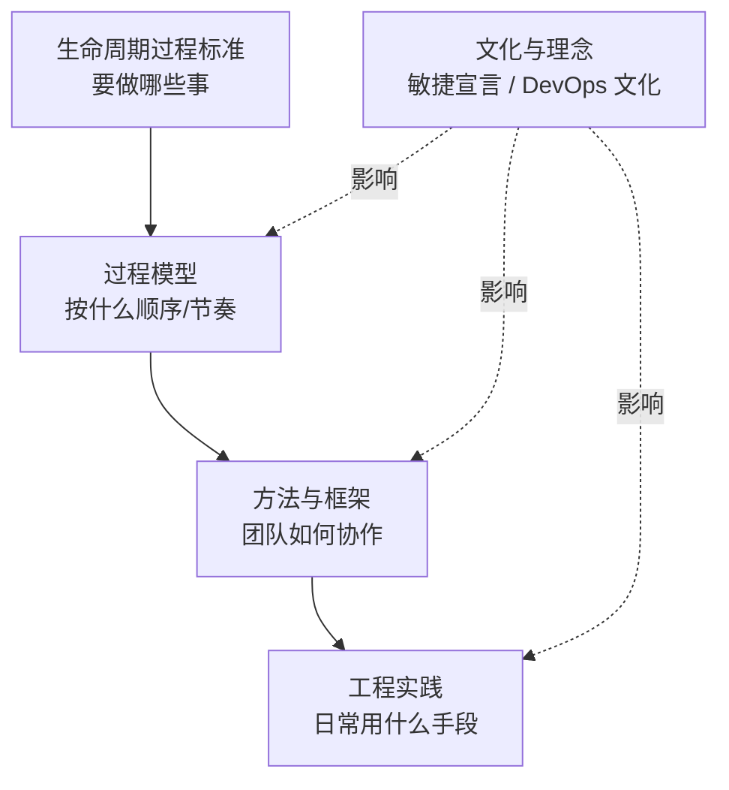
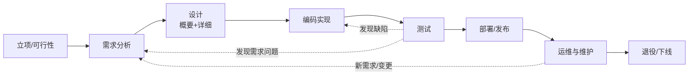
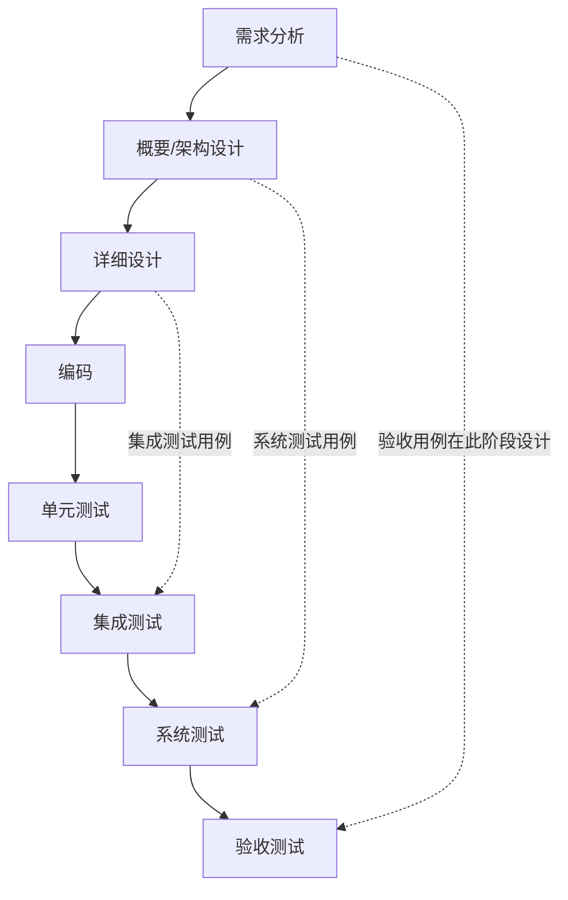
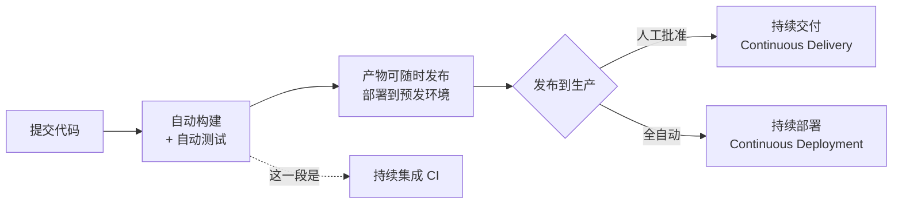
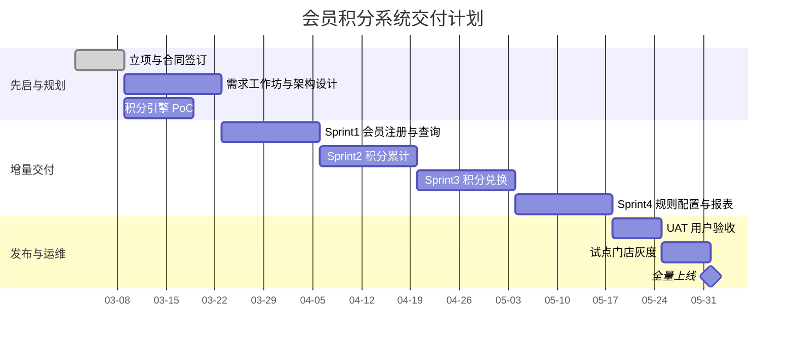

[toc]

## 先建立坐标系：四个层次不要混为一谈

大多数概念混淆，都是因为把**不同层次的东西放在一起比较**，比如"瀑布和 Scrum 哪个好"、"DevOps 和敏捷选哪个"。先分清下面四层：

| 层次                  | 中文/英文                                         | 回答的问题                     | 典型代表                       |
| --------------------- | ------------------------------------------------- | ------------------------------ | ------------------------------ |
| **生命周期/过程标准** | 软件生存周期过程（Software Life Cycle Processes） | 软件从生到死**要做哪些事**     | ISO/IEC/IEEE 12207、GB/T 8566  |
| **过程模型**          | 开发过程模型（Process Model）                     | 这些事**按什么顺序和节奏组织** | 瀑布、V 模型、增量、迭代、螺旋 |
| **方法/框架**         | 方法论/框架（Methodology/Framework）              | 团队**具体怎么协作和管理**     | Scrum、Kanban、RUP、SAFe       |
| **实践/工程能力**     | 工程实践（Engineering Practice）                  | 每天**用什么手段把事做好**     | TDD、代码评审、CI/CD、特性开关 |

**怎么看这张图**：从上到下越来越具体。"敏捷"和"DevOps"更接近**理念和文化**，会同时影响下面三层，**本身不是一个具体的流程**。所以"瀑布 vs 敏捷"其实是在比较组织节奏，"Scrum vs CI/CD"则根本不在同一层，不能拿来二选一。

## 标准视角：生存周期过程是"过程集合"，不是"阶段序列"

**ISO/IEC/IEEE 12207** 是软件生存周期过程的国际标准。根据 [Wikipedia 条目](https://en.wikipedia.org/wiki/ISO/IEC_12207)，它 1995 年首次发布，**最新版是 2026 年 4 月发布的 12207:2026**（此前广泛使用的是 2017 版）。标准把过程分成**四大过程组**：

| 过程组                 | 英文                                      | 包含什么（举例）                                             |
| ---------------------- | ----------------------------------------- | ------------------------------------------------------------ |
| **协议过程**           | Agreement Processes                       | 获取（甲方）、供应（乙方），也就是合同和采购关系             |
| **组织级项目使能过程** | Organizational Project-Enabling Processes | 生命周期模型管理、基础设施、人力资源、质量管理、知识管理     |
| **技术管理过程**       | Technical Management Processes            | 项目计划、评估与控制、决策、风险、**配置管理**、信息管理、度量、质量保证 |
| **技术过程**           | Technical Processes                       | 业务/需求分析、架构定义、设计、实现、集成、**验证**、移交、**确认**、运行、**维护**、**处置（退役）** |

**关键原则**：该条目指出，标准里的过程**在任何阶段需要时都可以发生**。也就是说，**12207 不规定顺序**，它不是瀑布，也同样适用于敏捷和迭代开发（[arc42 质量站的解读](https://quality.arc42.org/standards/iso12207)也是这么说的）。

- 国内对应的国家标准是 **GB/T 8566《系统与软件工程 软件生存周期过程》**。现行版本据我所知是 **GB/T 8566-2022，基本等同采用 ISO/IEC/IEEE 12207:2017**（未经本轮核实，**引用前请到国家标准全文公开系统确认**）。
- **推荐做法**：做政府或国企项目、写投标书、准备 CMMI 或软件过程评估时，阶段命名和交付物清单要**对齐 GB/T 8566 及对应的文档规范**（例如 GB/T 8567 计算机软件文档编制规范，未经本轮核实）。

## 经典阶段划分：每个阶段做什么、产出什么

国内教材和企业里最常见的是"**七到八阶段**"划分。注意，这是**对技术过程的一种线性组织方式**，不是唯一正确答案。

**怎么看这张图**：实线是计划中的主路径，**虚线是现实中一定会出现的回流**。一个流程如果没为回流留路径（变更控制、缺陷修复、需求澄清），就会在项目后期失控。

| 阶段                                      | 核心活动                                 | 主要交付物                                   | **退出准则**（Exit Criteria，进入下一阶段的条件） | 主要角色                       |
| ----------------------------------------- | ---------------------------------------- | -------------------------------------------- | ------------------------------------------------- | ------------------------------ |
| **立项/可行性**（Initiation/Feasibility） | 商业论证、技术可行性、粗估成本和工期     | 项目章程、可行性报告、立项审批               | 已批准预算和负责人，范围边界明确                  | 发起人、产品负责人、架构师     |
| **需求分析**（Requirements）              | 获取、分析、规格化、确认需求             | 需求规格说明（SRS）或产品待办列表、原型      | 关键需求已**评审并签字/确认**，形成需求基线       | 产品经理、业务分析师、用户代表 |
| **设计**（Design）                        | 架构设计（概要）、模块和接口设计（详细） | 架构文档、接口契约（如 OpenAPI）、数据库设计 | 设计评审通过，关键技术风险已验证                  | 架构师、技术负责人             |
| **实现**（Implementation）                | 编码、单元测试、代码评审                 | 源码、单元测试、构建产物                     | 达到团队的**完成定义**（DoD）                     | 开发工程师                     |
| **测试**（Testing）                       | 集成测试、系统测试、验收测试             | 测试报告、缺陷清单                           | 严重缺陷清零，验收通过                            | 测试工程师、用户代表           |
| **部署/发布**（Deployment/Release）       | 环境准备、上线、灰度、回滚预案           | 发布说明、上线检查单                         | 线上监控指标正常                                  | 运维/SRE、开发                 |
| **运维与维护**（Operation/Maintenance）   | 监控、故障处理、缺陷修复、小改进         | 运维手册、事件复盘                           | 持续进行，直到决定退役                            | SRE、开发                      |
| **退役**（Retirement/Disposal）           | 数据迁移和归档、通知用户、下线           | 退役计划、数据处置记录                       | 资源回收，合规留档                                | 运维、法务/合规                |

各项要求的强度：

- **必须**：每个阶段都要有**明确的退出准则**，否则"阶段"只是日历上的时间段。
- **应该**：需求、设计、代码这类关键产出要**纳入配置管理并建立基线**（Baseline）。
- **避免**：把"维护"当成项目收尾的附属品。软件大部分成本发生在上线之后（业界的普遍共识，具体比例因来源而异）。

## 常见过程模型：怎么组织这些阶段

| 模型                      | 核心思想                                       | 适用场景                         | 主要风险                             |
| ------------------------- | ---------------------------------------------- | -------------------------------- | ------------------------------------ |
| **瀑布**（Waterfall）     | 阶段顺序推进，前一阶段完成才进入下一阶段       | 需求稳定、强合同约束、强监管     | 问题暴露晚，变更代价高               |
| **V 模型**（V-Model）     | 每个开发阶段对应一个测试级别                   | 嵌入式、汽车、医疗等安全关键领域 | 本质仍是线性，同样怕需求变化         |
| **增量**（Incremental）   | 把系统切成若干块，**分批交付**                 | 能拆分出独立价值的系统           | 前期架构没设计好会导致集成困难       |
| **迭代**（Iterative）     | 反复对同一部分**改进和细化**                   | 需求不清楚、需要探索             | 没有收敛机制就会无限打磨             |
| **螺旋**（Spiral，Boehm） | 每一圈都做**风险分析**再决定下一步             | 大型、高风险、新技术项目         | 管理成本高，依赖风险评估能力         |
| **RUP**（统一过程）       | 四个阶段（先启、精化、构建、移交）配合多次迭代 | 大型企业项目（现在较少用）       | 过程偏重                             |
| **敏捷/Scrum**            | 短周期、迭代加增量、持续反馈                   | 需求变化快的产品型开发           | 只学了仪式没学工程实践，变成"伪敏捷" |
| **Kanban**                | 可视化流动，限制在制品（WIP），不设固定迭代    | 运维支持、需求随时到来的团队     | 缺少节奏，容易失去目标感             |

V 模型强调"**每个开发阶段在左侧定义，对应的测试在右侧验证**"：

**怎么看这张图**：虚线表示**测试设计应该在左侧对应阶段就开始**，而不是等代码写完再想怎么测。这一点同样适用于敏捷团队，验收标准要在写代码之前写好。

**怎么选（推荐做法）**：现代项目大多采用**混合模式**（Hybrid）。前期用一个较短的"先启/规划"阶段确定范围、架构和关键风险，中期用**短迭代做增量交付**，配合 CI/CD；对外的合同里程碑则按增量批次设置。**避免**为了"政治正确"在合同固定、范围固定的外包项目里硬套纯 Scrum。

## 常见误区与概念混淆

下面按出现频率和危害程度排序，每条都给出**辨析**和**正确做法**。

### 误区一：阶段（Phase）等于活动（Activity）

- **错误认识**："测试阶段才测试"、"设计阶段结束就不能再设计"。
- **辨析**：**活动**是要做的事（需求、设计、编码、测试），**阶段**是时间上的管理分段，一个阶段里可以同时包含多种活动。12207 本身就强调**过程按需发生**。在迭代开发里，**每个迭代都包含全部活动**，只是比重不同。
- **正确做法**：用"**以哪种活动为主**"来描述阶段，同时允许其他活动穿插进行。比如设计阶段也要写原型代码来验证技术风险。

### 误区二：瀑布模型是 Royce 推荐的方法

- **错误认识**：Royce 1970 年的论文"发明并提倡"瀑布模型。
- **辨析**：Royce 的论文 *Managing the Development of Large Software Systems* 里，那张单向的阶段图是他**批评**的"简单方法"。他认为这种做法**有风险、容易失败**，并在论文后半部分提出了反馈回路、先做一遍原型（"do it twice"）、让客户参与等改进。D. A. Wheeler 的文章指出，他**本人从未称之为"waterfall"**，很多人只看了前面的图、跳过了后面更复杂的图，所以**完全误解了这篇论文**（[dwheeler.com](https://dwheeler.com/essays/waterfall.html)）。Codemanship 的总结也认为，这篇论文**更像是对线性流程的批评和对迭代方法的呼吁**（[codemanship](https://codemanship.wordpress.com/2023/11/24/the-bluffers-guide-to-managing-the-development-of-large-software-systems/)）。
- **启示**：瀑布本身并不是"错的"，**错的是去掉反馈回路的瀑布**。

### 误区三：迭代（Iterative）和增量（Incremental）是一回事

这是**最常见的术语混淆**之一。

| 对比项     | **增量**                   | **迭代**               |
| ---------- | -------------------------- | ---------------------- |
| 本质       | **分批构建与交付**的策略   | **返工与改进**的策略   |
| 每次做的事 | 增加一块**新功能**         | 把**已有部分**做得更好 |
| 风险       | 后来的块和前面的块集成不上 | 一直改进，不交付       |

- **经典比喻**（Jeff Patton 的"蒙娜丽莎"，未经本轮核实出处细节）：增量是一块一块画完整的局部，先画好左上角，再画右上角；迭代是先画整幅草图，再逐步上色、细化。
- **现实示例**：做电商 App。**增量**：第 1 批做商品浏览，第 2 批做购物车，第 3 批做支付。**迭代**：搜索功能第 1 版只支持关键词，第 2 版加拼音容错，第 3 版加个性化排序。
- **结论**：Scrum 这类敏捷方法是**"迭代 + 增量"**，每个 Sprint 既交付新增量，也改进已有功能。

### 误区四：敏捷就是 Scrum，敏捷就是不写文档、不做计划

- **辨析一**：**敏捷**（Agile）是 2001 年《敏捷宣言》提出的**价值观和原则**；**Scrum** 只是实现敏捷的**一个框架**，Kanban、XP、Lean 等也属于敏捷大家族。
- **辨析二**：宣言的原话结构是"个体和互动**高于**流程和工具，可工作的软件**高于**详尽的文档……**尽管右项有其价值，我们更重视左项**"（我按原文结构转述，未经本轮核实措辞）。是"**更重视**"，不是"**不要**"。
- **正确做法**：保留**有人读、能维护**的文档，比如架构决策记录（ADR）、接口契约、运维手册，去掉没人看的"为写而写"的文档。计划也要做，只是**滚动式规划**（Rolling Wave Planning）：近期细、远期粗。

### 误区五：照搬过时的 Scrum 概念

很多中文资料还停留在 2017 版 Scrum 指南。**2020 版的关键变化**：

- **取消"开发团队"这个子团队概念**，只保留一个 **Scrum 团队**，包含三种**职责**（Accountabilities）：产品负责人（PO）、Scrum Master（SM）、**开发者**（Developers）（[scrumguides.org 修订说明](https://scrumguides.org/revisions.html)、[Mountain Goat Software](https://www.mountaingoatsoftware.com/agile/top-5-changes-in-the-2020-version-of-the-scrum-guide)）。
- 引入**产品目标**（Product Goal），每个 Sprint 都要让产品更接近这个目标。
- 给三个工件各配一个**承诺**（Commitment）：产品待办列表对应**产品目标**，Sprint 待办列表对应 **Sprint 目标**，**增量对应完成定义**（DoD）（[Scrum.org](https://www.scrum.org/scrum-guide-2020)）。

另外一个常见混淆是"**Sprint = 小瀑布**"。如果一个两周的 Sprint 被切成"前 3 天需求、中间 5 天开发、最后 2 天测试"，测试就成了瓶颈，质量问题仍然留到最后才暴露。**推荐做法**：一个故事一个故事地端到端完成（需求澄清、开发、测试、合并），而不是按活动分段。

### 误区六：验证（Verification）和确认（Validation）混用

| 对比项            | **验证 Verification**                                  | **确认 Validation**                                        |
| ----------------- | ------------------------------------------------------ | ---------------------------------------------------------- |
| 经典表述（Boehm） | **Are we building the product right?**（产品做得对吗） | **Are we building the right product?**（做的是对的产品吗） |
| 依据              | 规格、设计、标准                                       | 用户的真实需要和使用场景                                   |
| 手段              | 评审、静态分析、单元/集成/系统测试                     | 验收测试、用户试用、A/B 测试                               |
| 示例              | 接口返回值符合 OpenAPI 定义                            | 财务人员确实能用它在 5 分钟内完成报销审批                  |

12207 把两者列为**两个独立的技术过程**，原因就在这里：**完全符合规格的系统，也可能是用户不要的系统**。

### 误区七：QA、QC 和测试是同义词

- **质量保证 QA**（Quality Assurance）：**面向过程**，预防缺陷，例如制定编码规范、评审流程、过程审计。
- **质量控制 QC**（Quality Control）：**面向产品**，发现缺陷，例如检查交付物。
- **测试**（Testing）：QC 的**主要手段之一**。
- **常见错位**：国内很多公司把测试岗叫作"QA"。称呼可以随俗，但要清楚**过程改进的职责不能只压在测试人员身上**。

### 误区八：持续集成、持续交付、持续部署分不清

**怎么看这张图**：**CI** 关注"频繁合并到主干并自动验证"；**持续交付**要求**每个版本都处于随时可发布状态**，但上生产需要一次人工决策；**持续部署**连这一步也自动化了。两者都缩写成 CD，**说 "CD" 时最好说清楚是哪一个**。

另一个相关混淆是**部署**（Deploy）和**发布**（Release）：**部署是技术动作**（代码到了生产环境），**发布是业务动作**（用户能用到了）。借助**特性开关**（Feature Flag），可以"**先部署、后发布**"，比如药店系统可以先上线代码，等到营销日再打开开关。

### 误区九：DevOps 是一个岗位或一套工具链

- **辨析**：DevOps 是一种**打通开发与运维的文化、实践和度量体系**，CI/CD 和 IaC 只是它的实践手段。招一个"DevOps 工程师"、装一套 Jenkins，并不等于实现了 DevOps。
- **推荐做法**：用 **DORA 指标**衡量交付效能：部署频率、变更前置时间、变更失败率、故障恢复时间（未经本轮核实最新版本是否增加了指标，**建议查阅 dora.dev 的最新报告**）。

### 误区十：里程碑、交付物、基线混为一谈

| 术语                      | 含义                                 | 示例                                |
| ------------------------- | ------------------------------------ | ----------------------------------- |
| **里程碑**（Milestone）   | 时间轴上的**关键节点**，持续时间为零 | "6 月 30 日需求评审通过"            |
| **交付物**（Deliverable） | **可验收的产出**                     | 需求规格说明、可运行的安装包        |
| **基线**（Baseline）      | 经过评审、**冻结并受变更控制**的版本 | 需求基线 v1.0，此后改动要走变更流程 |

### 误区十一：项目生命周期、产品生命周期、SDLC 是同一个东西

- **项目生命周期**：项目从启动到收尾，**有明确的结束点**（PMBOK 的视角）。
- **产品生命周期**：产品从构思到退市，**可能跨越很多个项目**。
- **SDLC/软件生存周期**：软件本身从构想到退役的全过程，**包括运维和退役**。
- **常见后果**：只按"项目"思路做事，项目结束团队就解散，产品没人维护，技术债务失控。

### 误区十二：PoC、原型、MVP 混用

| 术语                                           | 目的                       | 受众       | 结束后         |
| ---------------------------------------------- | -------------------------- | ---------- | -------------- |
| **PoC 概念验证**（Proof of Concept）           | 验证**技术上能不能做**     | 技术团队   | 通常丢弃       |
| **原型**（Prototype）                          | 验证**交互和需求理解**     | 用户、产品 | 通常丢弃或演进 |
| **MVP 最小可行产品**（Minimum Viable Product） | 用**最小成本验证市场价值** | 真实用户   | 持续演进       |

### 其他高频混淆（速查）

- **完成定义 DoD 与验收标准 AC**：**DoD 适用于所有条目**（代码评审过、测试通过、文档更新），**AC 只针对某个具体需求**（"积分不足时提示具体差额"）。
- **用户故事与需求规格**：用户故事是**促进沟通的占位符**，要配合验收标准和对话补全细节，本身不是完整的规格说明。
- **敏捷等于快**：敏捷追求的是**更早得到反馈、更低的变更代价**，并不承诺同样的范围更快完成。
- **Alpha / Beta / RC / GA**：内部测试版、外部公测版、候选发布版、正式可用版，要在发布策略里明确定义。

## 综合示例：连锁药店会员积分系统

**场景**：一家区域连锁药店（约 80 家门店）外包开发会员积分系统。合同要求**4 个月上线**，涉及会员个人信息，需要满足《个人信息保护法》的合规要求。需求方对"积分规则"自己也还没想清楚。

**流程设计（混合模式）**：

**讲解（每一步对应前文的哪个概念）**：

- **先启阶段（3 周）**：合同签订属于 12207 的**协议过程**。需求工作坊产出产品待办列表和**粗粒度需求基线**；与此同时针对"高并发积分计算"做 **PoC**（误区十二）。这里**不追求一次写完全部需求**，避免陷入"去掉反馈回路的瀑布"（误区二）。
- **四个 Sprint**：每个 Sprint 都包含需求澄清、开发、测试（误区一、误区五），交付一个**增量**（误区三）。Sprint 3 时门店店员反馈兑换界面难用，于是在 Sprint 4 **迭代改进**了 Sprint 3 的界面（迭代与增量同时发生）。
- **CI/CD**：每次提交自动构建和测试（CI），自动部署到预发环境。生产发布需要药店 IT 负责人批准，所以这里是**持续交付而不是持续部署**（误区八）。积分兑换功能**先部署、用特性开关关闭**，等营销活动当天再发布。
- **V&V**：自动化测试检查"积分计算符合规则文档"，这是**验证**；UAT 阶段请 3 家门店店长实际操作，确认"店员能在收银时 10 秒内完成积分抵扣"，这是**确认**（误区六）。
- **里程碑与合同**：合同里的付款节点按"**Sprint 2 增量验收**"、"**UAT 通过**"、"**全量上线**"设置。这样既满足甲方对固定里程碑的要求，又不强迫团队按瀑布执行（误区十）。
- **上线之后**：团队不解散，转入**运维与维护**，用 DORA 指标观察交付效能。会员数据的保留和销毁策略提前写进**退役计划**，满足合规要求（误区十一）。

**反面对照**：如果这个项目用纯瀑布，积分规则在第 1 个月就"冻结"，但甲方在第 3 个月才看到可运行的系统并发现规则不合理，返工就会集中到最后一个月，延期几乎不可避免。

## 最佳实践清单

**必须**：

- 明确**每个阶段/迭代的退出准则**（DoD、评审通过、验收签字）。
- 关键产出纳入**版本控制和配置管理**，需求变更走**变更控制**。
- **验证和确认都要做**，不能只测"符不符合规格"。
- 在流程里为**反馈回路和回流**留出路径。

**应该/推荐**：

- 用**混合模式**：先启阶段管风险和架构，短迭代做增量交付。
- **测试左移**：验收标准在开发之前写好（V 模型的思想在敏捷里同样适用）。
- 采用 **CI + 持续交付**，用**特性开关**把部署和发布分开。
- 术语按最新的权威来源统一（Scrum 指南 2020、ISO/IEC/IEEE 12207 新版、GB/T 8566）。

**可以**：

- 运维型或需求随时到来的团队用 **Kanban**。
- 高风险的新技术项目借鉴**螺旋模型**的风险驱动思路。

**避免**：

- 把阶段当成活动的"牢笼"（"测试阶段才测"）。
- 只做 Scrum 仪式、不做工程实践（"伪敏捷"）。
- 把"DevOps"简化成一个岗位或一套工具。
- 在合同固定、范围固定的项目里硬套纯 Scrum，或者在需求高度不确定的产品里硬套纯瀑布。

## 信息来源与知识截止

- **本轮联网检索（3 次成功）**：
  - ISO/IEC/IEEE 12207：[Wikipedia](https://en.wikipedia.org/wiki/ISO/IEC_12207)、[arc42 Quality](https://quality.arc42.org/standards/iso12207)
  - Royce 与瀑布误读：[D. A. Wheeler](https://dwheeler.com/essays/waterfall.html)、[Codemanship](https://codemanship.wordpress.com/2023/11/24/the-bluffers-guide-to-managing-the-development-of-large-software-systems/)、[ProjectManagement.com](https://www.projectmanagement.com/blog-post/80348/the-waterfall-misconception--what-dr--royce-really-said-in-1970)
  - Scrum 指南 2020：[scrumguides.org](https://scrumguides.org/revisions.html)、[Scrum.org](https://www.scrum.org/scrum-guide-2020)、[Mountain Goat Software](https://www.mountaingoatsoftware.com/agile/top-5-changes-in-the-2020-version-of-the-scrum-guide)
- **来自我已有知识、未经本轮核实的内容**：GB/T 8566-2022 的等同采用关系、GB/T 8567、《敏捷宣言》的具体措辞、Boehm 的 V&V 表述、Cockburn/Patton 关于迭代与增量的比喻、DORA 最新指标、CI/CD 的定义。
- **知识截止**：检索结果显示 12207:2026 已于 2026 年 4 月发布，所以本文信息**大致截至 2026 年年中**。我没能拿到 12207:2026 相对 2017 版的具体改动细节。
- **下一轮建议搜索词**（用来补齐没查到的部分）：`GB/T 8566-2022 等同采用`、`ISO/IEC/IEEE 12207:2026 changes`、`DORA 2025 report metrics`、`continuous delivery vs continuous deployment Martin Fowler`、`Cockburn incremental vs iterative`、`Scrum Guide 2025 expansion pack`。